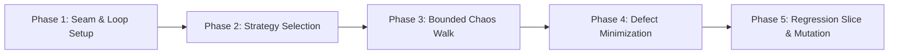

# sl-chaos-walk

Five-phase autonomous exploratory QA fuzzer and chaos walk engine for the **Signal Loom** (`#partner-signal-loom`) platform.

Constructed following the **Matt Pocock Skill Discipline** (tight feedback loops, seam design, bounded execution, and defect minimization). It drives intelligent agent traversals over web interfaces and REST APIs to surface latent crashes before production release.

---

## Execution Profiles

The skill provides three tuned operational profiles:

| Profile | Target Turns | Focus Area | When to Use |
| :--- | :--- | :--- | :--- |
| **`quick-walk`** | 5–10 turns | Fast route sanity check (<= 30s) | Pre-commit sanity check, verifying newly added UI pages, rapid agent feedback. |
| **`deep-chaos`** | 20–50 turns | Multi-page exploratory fuzz with network jitter & click storms | Release verification, nocturnal fuzzing, boundary stress tests. |
| **`api-storm`** | 200–500 reqs | High-concurrency stochastic payload fuzzing | Validating backend FastAPI routes against injection, unicode, and malformed JSON. |

---

## 5-Phase Pocock Discipline

The diagram shows the five phases of the Pocock discipline:



### Phase 1: Target Seam & Feedback Loop Construction
**Build the tightest possible red/green signal.**
1. **Target Identification**: Resolve target route (`--area <route>`) or full application (`/`).
2. **Session & Auth Resolution**: Obtain session state via OIDC Dex login or run against authenticated Tailscale ingress (`https://ftna-signalloom.taild4da3.ts.net`).
3. **Oracle Registration**: Register comprehensive error listeners before launching the crawler:
   - **HTTP 5xx / 404 Sentinel**: Traps all server-side errors on dynamic `/api/v1/*` endpoints.
   - **Page Error Trap**: Intercepts uncaught runtime exceptions (`pageerror`) and unhandled promise rejections.
   - **React Error Boundary Guard**: Scans DOM for `"Something went wrong"`, fallback error cards, or unmounted tree indicators.
   - **Console Sentinel**: Catches non-whitelisted `console.error` logs.
   - **Dead-Control Detector**: Flags interactive controls (buttons, tabs) that produce zero state change or network traffic after interaction.
   - **Layout Spill Detector**: Identifies overflowing text nodes or broken flex containers.

### Phase 2: Strategy & Decision Engine Selection
1. **Model Discovery**: Probe for `TYPESAFE_API_KEY` or `JEV_API_KEY` in environment or secret store.
2. **Offline Simulation Fallback (`--mock`)**: If uncredentialed, sandboxed, or running in an offline CI lane, activate the **Calibrated System One Simulator**. The simulator uses weighted Markov choice models and DOM heuristics to make realistic exploratory choices without network LLM calls.
3. **Mutation Configuration**: Enable `--click-storm`, `--network-jitter`, or `--input-fuzz` when running `deep-chaos`.

### Phase 3: Bounded Chaos Walk Execution
1. **Atomic DOM Snapshotting**: Each turn snapshots visible interactive controls into an indexed action space (`[1] button`, `[2] link`, `[3] textbox`).
2. **Safety Guardrails (Non-Negotiable)**:
   - **Destructive Target Exclusion**: Strictly skips clicking `"Sign out"`, `"Log out"`, `"Delete"`, or account teardown triggers.
   - **Turn & Timeout Bounds**: Hard stop upon reaching `--max-turns` or `--timeout` to prevent infinite loops.
   - **Reconciliation Invariant**: Avoid mutating shared GitOps-governed resources without explicit scope flags.

### Phase 4: Defect Minimization & Triage
1. When an oracle fires, immediately freeze the execution state.
2. Extract the minimal reproduction sequence:
   - Seed URL
   - Ordered list of user actions (clicks, inputs, navigations)
   - Failing network request payload or JavaScript exception stack trace
   - Captured screenshot and atomic DOM snapshot at the point of failure.
3. Classify defect severity:
   - **Critical (P0)**: React crash card, unhandled page crash, HTTP 500 on critical path.
   - **High (P1)**: Unhandled promise rejection, dead primary action button.
   - **Medium (P2)**: Layout overflow, console error warnings.

### Phase 5: Auto-Generated Regression Slice & Mutation Proof
1. **Synthesize Regression Test**:
   - For UI defects: Generate a minimal Playwright spec `test/acceptance/repro-<slug>.spec.ts` following repository standards.
   - For backend/API defects: Generate a targeted pytest case in `d2-signalloom/apps/fe-signalloom/src/tests/`.
2. **Empirical Mutation Proof (`tdd` discipline)**:
   - Verify the newly synthesized test fails against the unpatched code.
   - Mutate the assertion or check to ensure it is not a fake green light.
   - Register the test in [`test/acceptance/SPEC-REGISTRY.tsv`](../../../test/acceptance/SPEC-REGISTRY.tsv).
3. **Artifact Summary**:
   - Write full JSON trace and markdown diagnostic report to `reports/chaos-walk/<timestamp>_<slug>.md`.
   - Provide a concise 4-bullet executive summary to the user.

---

## Tooling & Command Line Interface

The skill is driven via `.agents/skills/sl-chaos-walk/Tools/chaos-walk.sh` or through `make`:

```bash
# 1. Quick route sanity walk (5 turns against Kusari agent overview)
make chaos-walk AREA=/agents/agent-kusari-847cc7d984-mwg8c TURNS=5

# 2. Deep exploratory chaos walk (25 turns with click storms and network jitter)
make chaos-walk-deep TURNS=25

# 3. High-concurrency API fuzzing storm (300 requests across all REST routers)
make chaos-walk-api REQUESTS=300 CONCURRENCY=8

# 4. Direct CLI execution with specific options
.agents/skills/sl-chaos-walk/Tools/chaos-walk.sh --profile quick-walk --area /policies --mock --stop-on-error
```

---

## Non-Negotiable Invariants

1. **Fail-Closed on Hard Crashes**: Any unhandled exception or React error boundary is an immediate failure. It must never be swallowed or ignored.
2. **Graceful Offline Degradation**: The skill must run seamlessly under `--mock` when no API keys are present. CI and offline sandboxes must never fail due to missing external credentials.
3. **Zero Destructive Escalation**: Never trigger administrative teardowns, token revocations, or account deletions during an exploratory walk.
4. **Context Window Protection**: Never dump thousands of raw DOM lines into chat. Persist full traces to `reports/chaos-walk/` and return only derived insights and targeted diffs.
