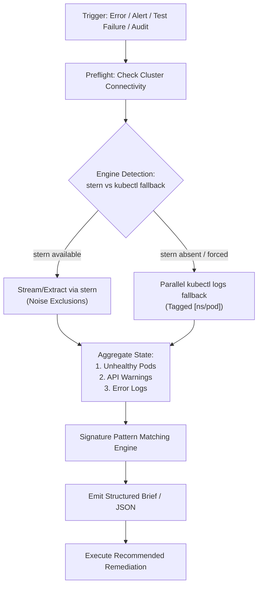

# Cluster Diagnostics & Log Triage Workflow

This workflow guides operators and AI agents through rapid, non-interactive cluster diagnosis and log triage without requiring tmux.

## Workflow Overview

The diagram shows the diagnostic flow from its trigger to the recommended remediation.



---

## 1. Quick Triage (Snapshot Mode)

To get an immediate summary of cluster health, run:

```bash
.agents/skills/sl-cluster-diagnostics/Tools/cluster-diagnostics.sh --snapshot
```

### Reviewing Results:
1. **Unhealthy Pods**: If any pods show `ImagePullBackOff` or `CrashLoopBackOff`, note their namespace and name.
2. **Warning Events**: Inspect recent API events for scheduling failures, failed probes, or resource exhaustion.
3. **Log Chunks**: Review extracted error lines.
4. **Alarms / Signatures**: Look for known alarms at the bottom.

---

## 2. Namespace Deep-Dive

When investigating a specific component (e.g. `fe-signalloom` or `cert-manager`):

```bash
# Scan fe-signalloom for errors in the last 15 minutes
.agents/skills/sl-cluster-diagnostics/Tools/cluster-diagnostics.sh -e -n fe-signalloom --since 15m

# Check cert-manager logs and events
.agents/skills/sl-cluster-diagnostics/Tools/cluster-diagnostics.sh -e -n cert-manager --since 30m
```

---

## 3. Continuous Monitoring (No Tmux)

To tail cluster logs interactively in a single terminal or background subagent task without launching tmux:

```bash
# Stream core application logs with noise filtering
.agents/skills/sl-cluster-diagnostics/Tools/cluster-diagnostics.sh --stream

# Stream a specific namespace
.agents/skills/sl-cluster-diagnostics/Tools/cluster-diagnostics.sh --stream -n fe-signalloom
```

---

## 4. Headless & Automated CI/Agent Mode

To consume diagnostics programmatically:

```bash
.agents/skills/sl-cluster-diagnostics/Tools/cluster-diagnostics.sh --json --since 5m
```

Exit code convention:
- `0`: Cluster healthy, zero unhandled signatures or fatal crashes detected.
- `1`: Unhealthy pods or actionable failure signatures matched.
- `2`: Invalid CLI options.
