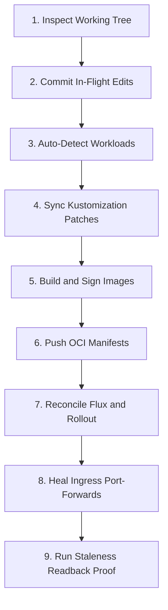

# In-Flight Code Deployment Workflow

This workflow guides deploying in-flight code changes to the local Kind cluster.
Follow these steps to deploy frontend, backend, or manifest updates.

The diagram shows the sequence from local source changes to live verification.



## Step 1: Inspect Working Tree and Current Pods

Check whether the running pods already match your current code.
Execute the preflight staleness auditor:

```bash
KUBECONFIG=/tmp/osramp-kubeconfig.yaml ./scripts/check-deployed-staleness.sh
```

A status of `DRIFT` confirms that running pods do not match the working tree.

## Step 2: Commit In-Flight Code

Flux OCI repository publishing records the Git commit hash.
Uncommitted files produce `-dirty` image tags that can confuse release tracking.

Commit your in-flight code using a scope-less conventional commit message:

```bash
git add -A
git commit --no-gpg-sign -m "feat: your change summary"
```

Never use GPG signing during automated agent sessions.
The sandbox environment denies access to private keyring daemons.

## Step 3: Run the Local Deploy Tool

Run the deployment tool to build, sign, and roll out changes:

```bash
.agents/skills/sl-local-deploy/Tools/local-deploy.sh
```

The script performs the following actions:
1. Detects which workloads changed based on Git diffs.
2. Synchronizes image tag patches in `d2-signalloom/apps/fe-signalloom/local/kustomization.yaml`.
3. Builds container images using `docker buildx` with provenance attestations and SBOM metadata.
4. Signs images and OCI artifacts using Cosign.
5. Loads images into the Kind node via `kind load docker-image`.
6. Publishes manifests to the in-cluster Zot registry via `scripts/push-local.sh signalloom`.
7. Reconciles Flux Kustomizations and restarts deployments.
8. Re-establishes severed port-forwards on port 19080.

## Step 4: Verify Deployment Freshness

Verify that the running pods serve your new code:

```bash
KUBECONFIG=/tmp/osramp-kubeconfig.yaml ./scripts/check-deployed-staleness.sh
```

The output must show `VERIFIED FRESH` for your updated workload.
Test the application in your browser or with automated curl probes:

```bash
curl -fsS http://127.0.0.1:19080/
```
