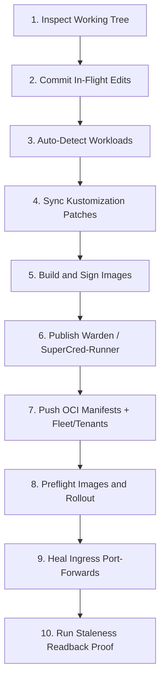

# In-Flight Code Deployment Workflow

This workflow guides deploying in-flight code changes to the local Kind cluster.
Follow these steps to deploy frontend, backend, or manifest updates.

The diagram shows the sequence from local source changes to live verification.



## Step 1: Inspect Working Tree and Current Pods

Check whether the running pods already match your current code.
Run the preflight staleness auditor:

```bash
KUBECONFIG=/tmp/osramp-kubeconfig.yaml ./scripts/check-deployed-staleness.sh
```

A status of `DRIFT` confirms that running pods do not match the working tree.

## Step 2: Commit In-Flight Code

Flux OCI repository publishing records the Git commit hash.
Uncommitted files produce `-dirty` image tags that can confuse release tracking.

Commit your in-flight code using a scope-less conventional commit message:

```bash
git add -A
git commit --no-gpg-sign -m "feat: your change summary"
```

Never use GPG signing during automated agent sessions.
The sandbox environment denies access to private keyring daemons.

## Step 3: Run the Local Deploy Tool

Run the deployment tool to build, sign, and roll out changes:

```bash
.agents/skills/sl-local-deploy/Tools/local-deploy.sh
```

The script performs the following actions:
1. Detects which workloads changed based on Git diffs (`dashboard`, `backend`, `docs`, `signal-ingest`, `fleet`, `warden`, `supercred-runner`, or discovered apps).
2. Synchronizes image tag patches in `d2-signalloom/apps/fe-signalloom/local/kustomization.yaml` and deployment pins in `d2-signalloom/apps/signal-ingest/base/deployment.yaml`.
3. Builds container images with provenance attestations and SBOM metadata.
4. Signs images and OCI artifacts using Cosign.
5. Loads images into the Kind node via `kind load docker-image` and `kind-load-verified.sh`.
6. When `warden` is targeted, publishes the signalloom-warden (sentinel) DaemonSet image via `make -C d2-signalloom sentinel-image-publish`. When `supercred-runner` is targeted, builds and loads it via `make demo-signalloom-supercred-runner-image`.
7. Publishes manifests to the in-cluster Zot registry via `scripts/push-local.sh signalloom`. When `fleet` is targeted, also pushes the fleet artifact via `scripts/push-local.sh fleet` and reconciles the `tenants` Flux Kustomization. Without this, the agent-swarm ResourceSet in `d2-osramp-fleet/tenants/base/agent-swarm.yaml` keeps running stale.
8. Verifies required container images are present in the Kind CRI image store before rollout.
9. Reconciles Flux Kustomizations and restarts deployments.
10. Re-establishes severed port-forwards on port 19080.
11. Proves deployment freshness via `check-deployed-staleness.sh` and halts if stale.

### Fleet, Warden and SuperCred-Runner

A change under `d2-osramp-fleet/**`, or to the sentinel's or supercred-demo-runner's
build inputs, is auto-detected the same way as the core workloads. See
`scripts/sentinel-image-tag.sh` and `scripts/supercred-images.sh` for each
workload's exact input set. No extra flag is needed. To target one explicitly:

```bash
.agents/skills/sl-local-deploy/Tools/local-deploy.sh -w fleet
.agents/skills/sl-local-deploy/Tools/local-deploy.sh -w warden
.agents/skills/sl-local-deploy/Tools/local-deploy.sh -w supercred-runner
```

`-w all` includes all three alongside dashboard/backend/docs/ingest.

## Step 4: Verify Deployment Freshness

Verify that the running pods serve your new code:

```bash
KUBECONFIG=/tmp/osramp-kubeconfig.yaml ./scripts/check-deployed-staleness.sh
```

The output must show `VERIFIED FRESH` for your updated workload.
Test the application in your browser or with automated curl probes:

```bash
curl -fsS http://127.0.0.1:19080/
```
