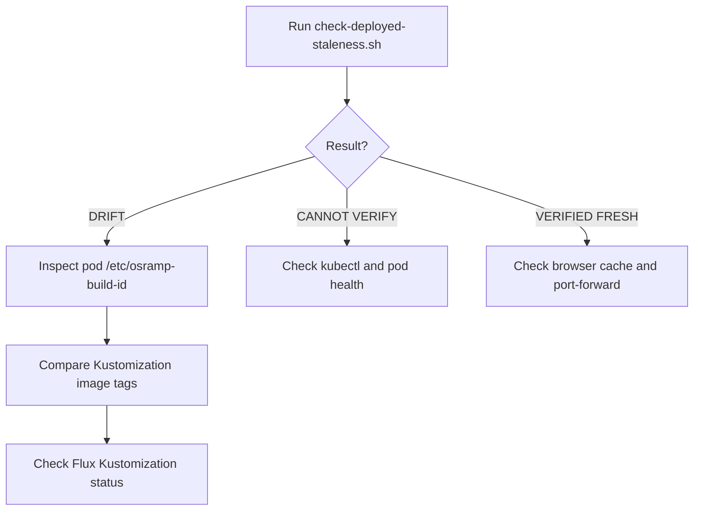

# Diagnosing Deployment Staleness

This guide explains how to debug pods running outdated code.
It provides steps to diagnose image tag mismatches and GitOps drift.

The flowchart shows the diagnostic path to isolate deployment staleness.



## 1. Run the Staleness Probe

Run the staleness checker to identify mismatched workloads:

```bash
KUBECONFIG=/tmp/osramp-kubeconfig.yaml ./scripts/check-deployed-staleness.sh
```

The script reads `/etc/osramp-build-id` from running containers.
It compares that content against the working tree source fingerprint.

## 2. Check the In-Cluster Marker

Query the build marker directly from the pod filesystem:

```bash
kubectl --kubeconfig=/tmp/osramp-kubeconfig.yaml -n fe-signalloom \
  exec deployment/dashboard-signalloom -- cat /etc/osramp-build-id
```

If the file is missing, the container runs an image built without source identification.
If the fingerprint differs, the pod runs an older image build.

## 3. Check for Kustomization Image Pinning

Inspect local overlay patches in `d2-signalloom/apps/fe-signalloom/local/kustomization.yaml`:

```bash
grep -n -C 3 "image:" d2-signalloom/apps/fe-signalloom/local/kustomization.yaml
```

If the file contains a hardcoded image tag, Flux will enforce that older tag.
Update the patch or align it with your newly built image tag.

## 4. Inspect Flux Reconciliation Status

Check whether Flux successfully reconciled the latest GitOps manifests:

```bash
flux get kustomizations -n fe-signalloom
```

Verify that the `Ready` condition is `True`.
If the status is `False`, check reconciliation error messages:

```bash
kubectl --kubeconfig=/tmp/osramp-kubeconfig.yaml -n fe-signalloom \
  describe kustomization apps
```

## 5. Verify Ingress Port-Forwards

If the pod is fresh but the browser displays outdated content, check port-forwards.
A restarted pod terminates existing port-forward SPDY connections.

Test the local endpoint directly:

```bash
curl -i http://127.0.0.1:19080/
```

Restart the port-forward listener if the connection fails:

```bash
setsid kubectl --kubeconfig=/tmp/osramp-kubeconfig.yaml -n fe-signalloom \
  port-forward svc/dashboard-signalloom 19080:8080 --address 0.0.0.0 </dev/null >/dev/null 2>&1 & disown
```
