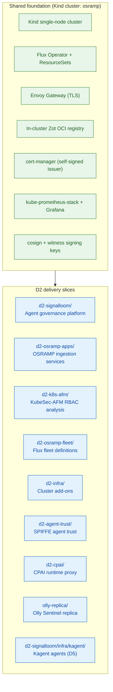

# AGENTS.md — osramp-demo

This is the onboarding guide for agents and engineers. Read it first. Then read
the `AGENTS.md` file of the slice that you will change.

The complete documentation map is [`docs/README.md`](docs/README.md). The
writing rules are in [`docs/documentation-style.md`](docs/documentation-style.md).
Run `make docs-lint` after you change a document.

## Repository purpose

This monorepo holds the OSRAMP and Signal Loom demonstration platform. It holds
independent D2 delivery slices. The slices share one Kind cluster, one Flux
GitOps control plane, and one Envoy ingress gateway.

## Platform architecture

The diagram shows the shared foundation and the slices that it runs. The
[slice table](#d2-slices) links to the guide of each slice.



## Shared foundation

| Layer | Technology | Location |
|-------|-----------|----------|
| Cluster | Kind (single node, `osramp`) | `make up` / `make cluster` |
| GitOps | Flux Operator + ResourceSets | [`d2-osramp-fleet/`](d2-osramp-fleet/) |
| Ingress | Envoy Gateway (Gateway API, TLS) | [`d2-infra/components/ingress/`](d2-infra/components/ingress/) |
| Registry | Zot (in-cluster, cache in `.cache/zot`) | [`d2-osramp-fleet/local/zot.yaml`](d2-osramp-fleet/local/zot.yaml) (`make registry`) |
| Signing | cosign + witness | `.keys/` (made by `make signing-keys`, gitignored) |
| Monitoring | kube-prometheus-stack + Grafana | [`d2-infra/components/monitoring/`](d2-infra/components/monitoring/) |
| Certificates | cert-manager (self-signed cluster issuer) | [`d2-infra/components/cert-manager/`](d2-infra/components/cert-manager/) |

## D2 slices

Each slice is an independent deployment boundary. The slices share the cluster.
Each slice owns its namespaces, images, tests, and lifecycle.

| Slice | Purpose | Deploy | Guide |
|-------|---------|--------|-------|
| `d2-signalloom/` | Signal Loom agent governance: dashboard, API, Fleet Manager, docs, identity | `make demo-signalloom-up` | [`d2-signalloom/AGENTS.md`](d2-signalloom/AGENTS.md) |
| `d2-osramp-apps/` | OSRAMP ingestion services: listener, processor, archiver | `make demo-osramp-up` | [`d2-osramp-apps/AGENTS.md`](d2-osramp-apps/AGENTS.md) |
| `d2-k8s-afm/` | KubeSec-AFM formal-methods RBAC analysis | `make demo-k8s-afm-up` | [`d2-k8s-afm/AGENTS.md`](d2-k8s-afm/AGENTS.md) |
| `d2-osramp-fleet/` | Flux fleet definitions: clusters, tenants, ResourceSets | `make up` (foundation) | [`d2-osramp-fleet/AGENTS.md`](d2-osramp-fleet/AGENTS.md) |
| `d2-infra/` | Cluster add-ons: cert-manager, ingress, monitoring, Trivy | `make up` (foundation) | [`d2-infra/AGENTS.md`](d2-infra/AGENTS.md) |
| `d2-agent-trust/` | SPIFFE agent trust: A2A identity, OpenBao JWT roles, NetworkPolicies | `make demo-agent-trust-up` | [`d2-agent-trust/AGENTS.md`](d2-agent-trust/AGENTS.md) |
| `d2-cpai/` | CPAI runtime proxy: OpenAI-compatible proxy to Vertex AI | `make demo-cpai-up` | [`d2-cpai/AGENTS.md`](d2-cpai/AGENTS.md) |
| `olly-replica/` | Olly Sentinel AI SRE replica | `make demo-olly-up` | [`olly-replica/README.md`](olly-replica/README.md) |
| `d2-signalloom/infra/kagent/` (D5) | Kagent AI agent framework: CRDs, declarative agents, SPIFFE and OpenBao | `make swarm-kagent-up`, then `make demo-kagent-up` | [`docs/kagent-d5.md`](docs/kagent-d5.md) |

The Signal Loom documentation service ([`d2-signalloom/apps/docs-signalloom/`](d2-signalloom/apps/docs-signalloom/))
and the AgentMaxxing console (the dashboard route `/demos/agentmaxxing`) deploy
with `make demo-signalloom-up`.

One optional service deploys outside the Signal Loom target:

| Service | Deploy | Used by |
|---------|--------|---------|
| `afm-platform` | `make demo-k8s-afm-up` | The dashboard pages `/rbac-analysis` and `/rbac-explorer`, through nginx and the API |

`make demo-signalloom-up` deploys Fleet Manager through Flux.
`make demo-signalloom-fleet-up` applies Fleet Manager directly. It is a test
escape hatch. Do not use it as the normal deployment path.

`make demo-k8s-afm-up` builds its image from `$KUBESEC_AFM_ROOT`. The default is
the directory next to the repository root, `<repo>/../kubesec-afm`
([`scripts/k8s-afm.sh`](scripts/k8s-afm.sh), line 45). If that checkout does not
exist, `docker build` fails.

CAUTION: In a git worktree, the default path does not exist. The worktree is
outside the source checkout, so the build fails. Set the variable before you
build:

```bash
export KUBESEC_AFM_ROOT=/path/to/kubesec-afm
```

Run `make gcp-tf-worktree-check` to check this condition. The worktree section of
[`docs/gcp-demo/OPERATIONS.md`](docs/gcp-demo/OPERATIONS.md#working-from-git-worktrees)
has more detail.

Before you add a backend service, read
[`docs/deploying-a-backend-service.md`](docs/deploying-a-backend-service.md).
Four independent layers can each break the page. None of them reports "not
deployed".

## Quick start

```bash
# 1. Start the foundation: Kind cluster, Zot registry, signing keys, Flux
make up

# 2. Start one or more slices
make demo-signalloom-up     # Signal Loom (includes the AgentMaxxing console)
make demo-osramp-up         # OSRAMP apps
make demo-k8s-afm-up        # KubeSec-AFM
make demo-olly-up           # Olly Sentinel
make demo-bao-up            # OpenBao and SPIRE only
make demo-agent-trust-up    # SPIFFE agent trust (needs inf-bao first)
make demo-cpai-up           # CPAI runtime proxy
make swarm-kagent-up        # Kagent CRDs and control plane (D5)
make demo-kagent-up         # Kagent declarative agents (D5)

# 3. Check health
make healthcheck            # foundation readiness
make doctor                 # full read-only cluster diagnostic
```

## Shared lifecycle commands

| Command | Action |
|---------|--------|
| `make up` | Start the foundation: Kind, Zot, signing keys, Flux |
| `make down` | Delete the Kind cluster. The Zot cache stays. |
| `make teardown` | Full reset, including keys and build state |
| `make teardown-all` | Full reset, including the tools that `setup.sh` installed |
| `make healthcheck` | Check that the foundation is ready for demos |
| `make doctor` | Make a full read-only cluster diagnostic report |
| `make cluster-debug` | Same as `make doctor` |
| `make help` | List all make targets |

Most slices use the same three targets:

```bash
make demo-<slice>-up        # Deploy
make demo-<slice>-test      # Static and readiness checks
make demo-<slice>-down      # Remove the slice. The foundation stays.
```

The foundation slices and Kagent use the commands in the slice table.

## Shared cluster diagnostics

Run `make doctor` before you examine a cluster problem. `make doctor` and
`make cluster-debug` are the same read-only diagnostic. It checks connectivity,
unhealthy pods, restart counts, warning events, Flux state, node metrics, and
image-pull failures. The runbook is in
[`TESTING.md`](TESTING.md#shared-cluster-diagnostics).

Do not guess why a page fails. Query the path from inside the pod. The
triage table for the Signal Loom dashboard is in
[`d2-signalloom/AGENTS.md`](d2-signalloom/AGENTS.md). Section 8 of
[`docs/cluster-debugging.md`](docs/cluster-debugging.md) lists probes that can
give false answers.

| Command | What it checks |
|---------|----------------|
| `make doctor` | The full cluster, read-only |
| `make demo-signalloom-supercred-evidence` | The credential chain, with six probes |
| `make demo-agent-trust-network-test` | The SPIFFE trust boundaries |
| `make demo-k8s-afm-status` | The `afm-platform` status and its `/health` endpoint |

## Shared testing commands

| Command | Scope |
|---------|-------|
| `make test` | End-to-end BATS tests of `d2-osramp-apps` on a running cluster |
| `make acceptance-test` | Playwright browser tests (Signal Loom and KubeSec-AFM) |
| `make demo-signalloom-api-test` | FastAPI contract and integration tests |
| `make demo-agentmaxxing-acceptance-test` | AgentMaxxing acceptance tests |
| `make demo-signalloom-coding-agent-topology` | Coding-agent detective telemetry topology check |
| `make attested-test` | The test suite under witness attestation |
| `make docs-lint` | Documentation links, make targets, and style rules. No cluster. |

Do not write a test count for the acceptance suite by hand. A hand-written
count becomes incorrect quickly.
[`test/acceptance/SPEC-REGISTRY.tsv`](test/acceptance/SPEC-REGISTRY.tsv) is the
one source. It records where each spec runs.

The test [`test/acceptance-spec-coverage.bats`](test/acceptance-spec-coverage.bats)
(CI stage 1c) checks each row against `playwright.config.ts`, the `Makefile`, and
[`scripts/ci/vm-pipeline.sh`](scripts/ci/vm-pipeline.sh). If a row is incorrect
or missing, CI fails.

CAUTION: Playwright ignores a spec that no project claims. It reports a smaller
total and shows no warning. The spec registry marks such a spec as `unwired`.

## The GCP estate: four lanes

The repository also runs on GCP in four independent lanes: `demo-1`, `demo-2`,
`ci-1`, and `ci-2`. Terraform makes each lane. A second step builds the estate
on the lane. Give `ENV=<lane>` to each command.

```bash
make gcp-tf-up        ENV=demo-1              # plan, review, apply, write the hand-off file
make gcp-tf-demo-up   ENV=demo-1              # send the code, build the estate, run the tests
make gcp-tf-ts-up     ENV=demo-1              # serve the estate on Tailscale and print the URL
make gcp-tf-ssh       ENV=demo-1              # SSH to the lane VM through IAP
make doctor-node      ENV=demo-1              # node-level health of one lane
make doctor-node-all                          # every lane that has a hand-off file
make gcp-tf-destroy   ENV=demo-1 CONFIRM=demo-1
```

WARNING: A lane VM costs money until you destroy it. Run `make gcp-tf-destroy`
when you finish.

| Document | Purpose |
| :--- | :--- |
| [`docs/gcp-demo/RUNBOOK.md`](docs/gcp-demo/RUNBOOK.md) | Steps from an empty project to the dashboard in a browser |
| [`docs/gcp-demo/OPERATIONS.md`](docs/gcp-demo/OPERATIONS.md) | Lane details, health tools, and operational pitfalls |
| [`docs/gcp-demo/INCIDENTS-2026-08.md`](docs/gcp-demo/INCIDENTS-2026-08.md) | Incident analyses with diagnostic measurements |

Frequent pitfalls from
[`OPERATIONS.md`](docs/gcp-demo/OPERATIONS.md#operational-pitfalls):

- `yes` sends `y`. `terraform destroy` needs the full word `yes`.
- Run `unset SSH_AUTH_SOCK` before any `gcloud compute ssh` command.
- `make -n` runs each recipe line that contains `$(MAKE)`.
- Let's Encrypt permits five certificates for one exact DNS name in 168 hours.

## The older CI lane: two GCP VMs

This system is separate from the four lanes. It uses two persistent VMs,
`signalloom-ci` and `signalloom-ci-2`, and runs through
[`scripts/ci/gcp-ci.sh`](scripts/ci/gcp-ci.sh). It runs the end-to-end pipeline
[`scripts/ci/vm-pipeline.sh`](scripts/ci/vm-pipeline.sh) against a real cluster.
The VMs suspend between runs to save cost. The full guide is
[`scripts/ci/README.md`](scripts/ci/README.md).

| Command | Action |
|---------|--------|
| `make ci-gcp` | Warm run on `signalloom-ci` |
| `make ci-gcp-2` | Run on the second VM, `signalloom-ci-2` |
| `make ci-status` / `make ci-status-2` | Show the VM state |
| `make ci-ssh` / `make ci-ssh-2` | SSH to the VM to debug |
| `make ci-report` / `make ci-report-2` | Show the last stage summary |

- `SUSPENDED` is the success state. The script suspends the VM after a pass. It
  keeps the VM running after a failure.
- Run `unset SSH_AUTH_SOCK` before a manual `gcloud compute ssh` command.

WARNING: Do not run `gcp-ci.sh destroy` against `signalloom-ci`. The command
deletes the VPC and NAT network. The second CI VM also uses that network.

## Repository layout

The full table of top-level directories is in
[`README.md`](README.md#repository-layout). Each slice has its own `AGENTS.md`
(see the [slice table](#d2-slices)).

## Shared pitfalls

### A pod rollout stops port-forwards

Each `kubectl rollout restart` stops the active port-forwards. Start them again
after each image rebuild and deploy.

### Use the wait helpers, not `sleep`

[`scripts/lib/wait.sh`](scripts/lib/wait.sh) is the polling library. Use it in
all scripts and BATS suites. It checks that the object exists first, retries
with backoff and jitter, and records timing. The helper table is in
[`docs/resilient-waits.md`](docs/resilient-waits.md).

CAUTION: `wait_k8s_ready` waits for `condition=ready` by default. A Deployment
has no `Ready` condition, so the wait times out on a healthy Deployment. Use
`wait_rollout` for a Deployment. Use `wait_job` for a Job.

In Playwright, use web-first assertions such as
`await expect(locator).toBeVisible()`, `waitForResponse`, and `waitForLoadState`.
Do not use `page.waitForTimeout(n)`. A fixed timeout makes the test flaky.

### A mutable `:latest` tag with `imagePullPolicy: IfNotPresent`

After `kind load docker-image`, check the image ID in the pod:

```bash
kubectl get pod <name> -n <ns> -o jsonpath='{.status.containerStatuses[0].imageID}'
```

If the ID is old, run `kubectl delete pod <name>`. The new pod resolves the
image again.

### Worktree location

Put worktrees in `~/src/.worktrees/<repo>/<branch>/`. Do not make a worktree
inside the repository directory. Search tools and test runners then scan the
same files twice.

### Kanban runtime paths

[`kanban_watcher.py`](d2-signalloom/apps/agentmaxxing-host-sensor/kanban_watcher.py)
in the host sensor reads two environment variables. It reads them on each call,
not at import time.

| Variable | Meaning | Default |
|----------|---------|---------|
| `KANBAN_HOME` | Kanban controller state, database, and telemetry | The parent of `AJM_AUTO_KANBAN_STATE_DIR` if set, else `$HOME/.cline/kanban` |
| `KANBAN_WORKTREES_HOME` | Kanban worktrees | `$HOME/.cline/worktrees`, a link to `$HOME/src/.worktrees` |

### The Zot cache stays after `make down`

The cache directory `.cache/zot/` stays after `make down`. Run
`make zot-cache-reset` to clear it.

### Flux variable substitution

`postBuild.substituteFrom` in a Flux Kustomization replaces variables in the
full manifest text. This includes `spec.inputs` and `spec.resources`.

Each [`d2-osramp-fleet/clusters/<env>/tenants.yaml`](d2-osramp-fleet/clusters/)
has `dependsOn: [{name: flux-system}]`. This makes sure that the ConfigMap
`flux-runtime-info` exists before the substitution. Keep it.

If a manifest contains an unresolved `${VAR}` string, run:

```bash
flux reconcile kustomization tenants -n flux-system --with-source
```

The command renders the manifests again with the current ConfigMap values.

Put a `# FLUX ENVSUBST:` header in each `kustomization.yaml` that contains
`${VAR}`:

- `YES` — a Flux Kustomization with `postBuild.substituteFrom` reconciles it.
- `NO` — Flux reconciles it without `postBuild`. The workload expands the variables at runtime.
- `N/A` — something outside Flux applies it.
- `FLEET` — the fleet overlay Kustomization processes it.

## Conventions

- **Commits:** Use Conventional Commits (`feat:`, `fix:`, `docs:`, `test:`,
  `chore:`). Match the style of the repository git log.
- **Image signing:** Sign all images and OCI artifacts with cosign. Flux rejects
  an unsigned artifact.
- **Commit signing:** Check the signatures in the recent git log before you
  commit. If the branch history is unsigned, use `git commit --no-gpg-sign`.
- **Supply chain:** Include SBOMs (SPDX), SLSA provenance, and digest checks.
- **Tests:** Write unit, integration, and acceptance tests for each new feature.
- **Documentation:** Follow
  [`docs/documentation-style.md`](docs/documentation-style.md). Run
  `make docs-lint` before you commit a document change.
