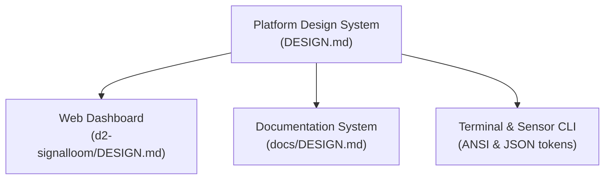

# Platform design system

This document defines the platform design system for OSRAMP and Signal Loom.
It coordinates visual styles, typography, and information architecture across all
interfaces.

## The three interfaces

The platform provides three user interfaces:

| Interface | Technology | Location | Primary guide |
| :--- | :--- | :--- | :--- |
| **Web Dashboard** | React, Vite, DashKit | [`d2-signalloom/apps/dashboard-signalloom/`](d2-signalloom/apps/dashboard-signalloom/) | [`d2-signalloom/DESIGN.md`](d2-signalloom/DESIGN.md) |
| **Documentation** | Astro, Starlight, Markdown | [`d2-signalloom/apps/docs-signalloom/`](d2-signalloom/apps/docs-signalloom/), [`docs/`](docs/) | [`docs/DESIGN.md`](docs/DESIGN.md) |
| **Command Line** | Bash, BATS, Python | [`scripts/`](scripts/), [`test/`](test/) | [`AGENTS.md`](AGENTS.md) |

The diagram shows how the design system guides all three interfaces.

## Colour system

The platform uses a dark palette across all interfaces. The colours communicate
status, security boundary, and data classification.

### Palette tokens

| Token | Hex value | Terminal ANSI | Semantic role |
| :--- | :--- | :--- | :--- |
| `--bg` | `#020617` | `\033[48;5;232m` | Page background |
| `--surface` | `#0F172A` | `\033[48;5;234m` | Cards, sidebars, and dialogs |
| `--surface2` | `#1E293B` | `\033[48;5;236m` | Elevated headers and hover states |
| `--border` | `#1E293B` | `\033[38;5;236m` | Structural borders and dividers |
| `--cyan` | `#06B6D4` | `\033[38;5;44m` | Primary accent, links, and code highlights |
| `--violet` | `#8B5CF6` | `\033[38;5;135m` | Agent identity, SPIFFE, and crypto proofs |
| `--teal` | `#10B981` | `\033[38;5;42m` | Healthy state, active workload, and pass |
| `--amber` | `#D97706` | `\033[38;5;214m` | Warning, degraded, or suspended state |
| `--error` | `#DC2626` | `\033[38;5;196m` | Error, revoked credential, and denial |
| `--text` | `#F8FAFC` | `\033[38;5;255m` | Primary text and headers |
| `--muted` | `#94A3B8` | `\033[38;5;244m` | Secondary text, helper labels, and timestamps |

## Core design principles

### 1. Zero customer payload invariant

The platform never displays, logs, or stores customer payload text. Customer
payload includes prompt text, model completions, and source files. All metrics,
event streams, and audit tables display observable metadata only:

- Process lifecycle events and exit codes.
- Resource counters (resident memory bytes, CPU execution time).
- Cryptographic digests (SHA-256 hashes of manifests and binaries).
- Network endpoints, ports, and socket domains.

### 2. Deterministic lifecycle progression

Interactive consoles and terminal tools use deterministic state machines. Each
stage requires explicit completion before the next stage starts. Transitions
display stage indicators with explicit status badges (`confirmed`, `pending`,
`active`).

### 3. Progressive disclosure

Interfaces show high-level summaries first. Each summary row or card permits
inspection of technical detail on demand. Users can expand audit records, raw
manifest digests, and Landlock rulesets without cluttering primary views.

### 4. Accessible and honest telemetry

When a measurement is unavailable, the interface states that fact clearly. An
unavailable field never displays a simulated zero or estimated number.

## Component specifications

Detailed visual specifications live with their respective subsystems:

- For the React dashboard component library, read [`d2-signalloom/DESIGN.md`](d2-signalloom/DESIGN.md).
- For documentation layout, diagrams, and typography, read [`docs/DESIGN.md`](docs/DESIGN.md).
- For writing style and word rules, read [`docs/documentation-style.md`](docs/documentation-style.md).
