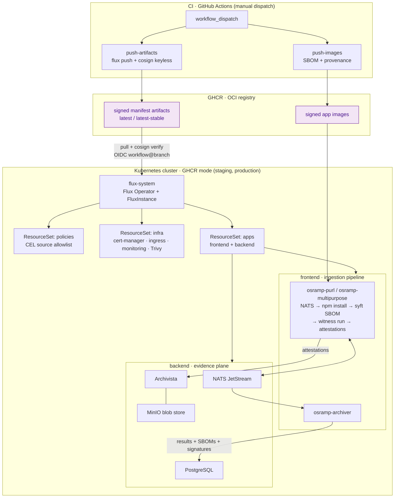
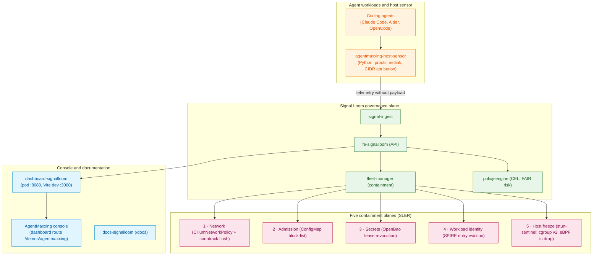

# OSRAMP demo for Acme Co.

OSRAMP (Open Source Risk and Asset Management Platform) controls the risk of
open source software in regulated organisations. This repository is a working
demonstration of OSRAMP. The example client is Acme Co., an investment bank.

The demo runs locally on a [kind](https://kind.sigs.k8s.io/) cluster with open
source tools. It also runs on GCP in four independent lanes.

> **Start here:** [`docs/README.md`](docs/README.md) is the documentation index.
> It tells you which document answers which question.
> Agents and engineers who need commands start with [`AGENTS.md`](AGENTS.md).
> Developers and designers read [`DESIGN.md`](DESIGN.md) for the platform design system.

## The problem

Third-party packages cross the trust boundary of the organisation. Each package
brings the vulnerabilities of its supply chain. Security scanners report many
CVE findings. Most of the findings cannot be exploited in context.

OSRAMP gives:

- SBOM attestations for the images that the image workflow publishes.
- A signed attestation for each pipeline step.
- OpenVEX documents that record a triage decision once and share it across teams.
- Policy gates that permit promotion only on verified evidence.

## The maturity model

OSRAMP has four maturity levels and one agent proof of concept. It delivers
them in four phases:

| Level | Phase | What it gives | Owner |
| --- | --- | --- | --- |
| L1 Triage and prioritisation uplift | 1 | SBOMs per image, VEX suppression of findings that cannot be exploited, signing keys, baseline CVE metrics | Security team (VA sub-team) and a pilot application team |
| L2 Central traceability | 2 | Witness attestations in CI, Archivista as the system of record, reusable workflows, test evidence | Platform team and the application teams that adopt it |
| L3 Verifiable builds and releases | 3 | SLSA L3 provenance, a Witness policy for each pipeline step, detection of supply chain compromise | Security team writes the policy. Platform team enforces it. |
| L4 Policy-driven automation | 3 | Three reconciliation loops (ingestion, SDLC, deployment) joined by policy enforcement, admission control, rollback | Security team writes the policy. Platform team enforces it. |
| Agentic remediation PoC | 4 | A human-in-the-loop agent that analyses CVEs, proposes fixes, opens PRs, and makes Witness attestations | Security and platform teams together. Application teams review the PRs. |

## Team ownership

Acme Co. uses a shared responsibility model. Application teams use the platform.

| Team | Responsibilities |
| --- | --- |
| Security | Software ingestion, base image policy, internal repositories, and security policies. Keeps scanners clear with time-limited VEX exemptions. |
| Platform | Middleware images, base image builds, versioned policy as code, and availability incidents. |
| Application | First-party code, application security settings, dependency updates, and exception evidence for the security team. |

Examples:

- A base image CVE: the security team distributes a patched base image.
- A middleware CVE (nginx, Spring Boot): the platform team patches the service with help from the security team.
- An application dependency CVE: the application team gets an automated PR.

## Architecture

The diagram shows how signed artifacts go from CI to the cluster, and how the
ingestion pipeline records its evidence. Both publish workflows start only by
manual dispatch. The [CI](#ci) section lists the workflows. The cluster part of
the diagram shows GHCR mode. Local mode checks the signatures with the cosign
key from `make signing-keys`, and starts without the `apps` and `olly` tenants
(see [`d2-osramp-fleet/tenants/local/kustomization.yaml`](d2-osramp-fleet/tenants/local/kustomization.yaml)).



### The Signal Loom agent governance platform

Signal Loom enforces runtime security, data protection, and containment for AI
agents. The diagram shows the path from an agent to the five containment planes
of Fleet Manager. The slice guide is [`d2-signalloom/AGENTS.md`](d2-signalloom/AGENTS.md).



> **Interactive system map.** [`docs/system-map/`](docs/system-map/) shows 28
> core services with their ports, namespaces, and communication paths. It does
> not show every app in the repository. Serve it with
> `python3 -m http.server 8901 -d docs/system-map`.

### The ingestion flow, step by step

1. A package URL (purl) arrives on the NATS subject `tasks.purl`.
2. The purl listener gets the purl and sends it to the processor through a Unix socket.
3. The processor parses the purl and checks its local cache. A cached purl returns the earlier result.
   A new purl adds an `npm_install` task to `tasks.input`.
4. The multipurpose worker installs the package in an isolated directory. It runs `syft` to make an
   SPDX SBOM under `witness run`, which makes a signed in-toto attestation. The worker uploads the
   attestation to Archivista.
5. The worker publishes the results, SBOMs, and signatures to `tasks.results`, `tasks.sbom`, and
   `tasks.signatures`.
6. The archiver reads the results, SBOMs, and signatures from NATS. It writes them to PostgreSQL.
   Teams can query this audit record.

The later phases use this evidence:

- Phase 1: Grype scans and `vexctl` triage.
- Phase 2: Attested tests and VEX evidence.
- Phase 3: Witness promotion policy, Kyverno admission control, and trust revocation.
- Phase 4: The agent remediation harness.

### GitOps delivery (Flux D2, gitless GitOps)

The cluster does not pull state from git at runtime.

1. CI packs each D2 source directory into an OCI artifact.
2. CI signs each artifact with keyless cosign and GitHub OIDC.
3. CI pushes the artifacts to GHCR.
4. Flux pulls the artifacts into the cluster. It checks that the signature identity is the approved
   workflow and branch.
5. Flux reconciles the manifests.

Staging follows the `latest` tag. Production follows the `latest-stable` tag. Use the `flux tag`
command to roll back a release. A CEL ValidatingAdmissionPolicy rejects a tenant Flux source that is
not on the allowlist.

Local mode keeps this model without GitHub:

- `make push-local` pushes the artifacts to the in-cluster Zot registry.
- It signs the artifacts with a local cosign key.
- The fleet definition [`d2-osramp-fleet/clusters/local/`](d2-osramp-fleet/clusters/local/) checks
  the signatures against the local public key.

## Repository layout

| Path | Description |
| --- | --- |
| [`d2-signalloom/`](d2-signalloom/) | Signal Loom agent governance slice: dashboard, FastAPI backend, Fleet Manager, host sensors, the identity plane (`infra/inf-bao`), and Kagent (`infra/kagent`). Guide: [`d2-signalloom/AGENTS.md`](d2-signalloom/AGENTS.md). |
| [`d2-signalloom/apps/docs-signalloom/`](d2-signalloom/apps/docs-signalloom/) | The user documentation site (Astro Starlight), served at `/docs` from its own container |
| [`d2-osramp-apps/`](d2-osramp-apps/) | OSRAMP application slice: Go services (`apps/`), manifests (`components/`), BATS tests (`test/`). Guide: [`d2-osramp-apps/AGENTS.md`](d2-osramp-apps/AGENTS.md). |
| [`d2-k8s-afm/`](d2-k8s-afm/) | KubeSec-AFM slice: formal-methods RBAC privilege-escalation analysis. Guide: [`d2-k8s-afm/AGENTS.md`](d2-k8s-afm/AGENTS.md). |
| [`d2-osramp-fleet/`](d2-osramp-fleet/) | Cluster definitions (`clusters/`), tenant ResourceSets (`tenants/`), and Terraform bootstrap (`terraform/`). Guide: [`d2-osramp-fleet/AGENTS.md`](d2-osramp-fleet/AGENTS.md). |
| [`d2-infra/`](d2-infra/) | Cluster add-ons: cert-manager, Envoy Gateway, monitoring, Trivy. Guide: [`d2-infra/AGENTS.md`](d2-infra/AGENTS.md). |
| [`d2-agent-trust/`](d2-agent-trust/) | SPIFFE agent trust: A2A identity, OpenBao JWT roles, NetworkPolicies. Guide: [`d2-agent-trust/AGENTS.md`](d2-agent-trust/AGENTS.md). |
| [`d2-cpai/`](d2-cpai/) | CPAI runtime proxy: an OpenAI-compatible server that runs OpenCode against Vertex AI. The caller selects the model. Guide: [`d2-cpai/AGENTS.md`](d2-cpai/AGENTS.md). |
| [`olly-replica/`](olly-replica/) | Olly Sentinel replica tenant: manifests, contracts, seed data, and eval harness. Guide: [`olly-replica/README.md`](olly-replica/README.md). |
| [`ui/`](ui/) + [`tools/demo-console/`](tools/demo-console/) | The Estate 95 console (`make console`, port 8675): an architecture map in plain HTML, CSS, and JavaScript, and the Go service that runs its commands and streams the output |
| [`tools/audit-gen/`](tools/audit-gen/) | Generator of synthetic multi-plane containment audit logs |
| [`tools/harness-dash/`](tools/harness-dash/) | Dashboard for coding-agent harness telemetry |
| [`tools/riskctl/`](tools/riskctl/) | The FAIR quantitative risk CLI that `make riskctl` builds. `d2-signalloom/cmd/riskctl/` is a small bridge to it. |
| [`risk/`](risk/) | FAIR risk packs, posture data, and FX rates. Guide: [`risk/README.md`](risk/README.md). |
| [`scripts/`](scripts/) | The scripts behind the make targets: `setup.sh`, local publish and sign, the VEX, promotion, admission, and revocation demos, attested tests, and CI ([`scripts/ci/README.md`](scripts/ci/README.md)) |
| [`test/`](test/) | Repository-level BATS suites and the Playwright acceptance suite ([`test/acceptance/`](test/acceptance/)). See [`TESTING.md`](TESTING.md). |
| [`bin/`](bin/) | Helper executables: `agent-git`, `node-capability-guard`, `policy-compiler` |
| [`policy/`](policy/) | The Witness promotion policy, the Kyverno image verification policy, and [compliance frameworks](policy/frameworks/README.md) |
| [`config/`](config/) | `security-invariants.yaml` |
| [`nono/`](nono/) | The `nono` sandbox profile for worktree agents |
| [`agent/`](agent/) | The phase 4 remediation harness and its [guardrails](agent/GUARDRAILS.md) |
| [`terraform/`](terraform/) | The GCP estate: three Terraform roots (bootstrap, platform, environments). See [`terraform/README.md`](terraform/README.md) and [`terraform/CONTRACT.md`](terraform/CONTRACT.md). |
| [`deploy/gcp/`](deploy/gcp/) | Project inputs and lane hand-off files. Most of its contents are gitignored. See [`deploy/gcp/README.md`](deploy/gcp/README.md). |
| [`docs/`](docs/) | All other documentation, indexed by [`docs/README.md`](docs/README.md) |
| [`ci-evidence/`](ci-evidence/) | Evidence bundles from named CI runs (decision records) |
| [`MEMORY/`](MEMORY/), [`Plans/`](Plans/) | Session records of earlier work (decision records) |
| `vex/out/` | VEX demo output: SBOMs, scans, statements. Not committed. |

## Getting started

### Prerequisites

`./scripts/setup.sh` installs the tools in the first table. It pins each
version except skopeo. Skopeo comes from the system package manager. The script
does not install a tool that is already present.

| Tool | Used for |
| --- | --- |
| kind | The local Kubernetes cluster |
| kubectl | Applying manifests and inspecting the cluster |
| kustomize | Building the manifest overlays |
| flux CLI | Pushing OCI artifacts and installing Flux |
| helm | The Flux Operator install during bootstrap |
| cosign | Signing artifacts |
| jq, yq, bats-core | Scripts and the end-to-end test suite |
| skopeo, crane | Copying and inspecting images |
| syft, grype, govulncheck, vexctl, witness | The VEX triage demo and attested evidence |
| Go (setup pins 1.24.5) | Go builds. Some modules need Go 1.25. Go then downloads that toolchain. |

Install these yourself. `setup.sh` does not install them:

| Tool | Used for |
| --- | --- |
| Docker | Building images and running kind |
| openssl | Making the witness key |
| bun | The Playwright acceptance suite (`make acceptance-test`) and the dashboard build |
| python3 | Test helpers and several make targets |
| nono + claude CLI (optional, Linux) | The phase 4 agent demo only |

On Windows, run all commands from WSL2 or Git Bash. The Makefiles need a POSIX shell.

### Local quickstart (no GitHub credentials)

The setup script installs the missing tools. It then makes the shared GitOps
foundation: a Kind cluster, an in-cluster Zot registry, cosign-signed foundation
artifacts, and Flux reconciliation.

CAUTION: On the local fleet the `apps` tenant is disabled in
[`d2-osramp-fleet/tenants/local/kustomization.yaml`](d2-osramp-fleet/tenants/local/kustomization.yaml).
Re-enable it before you run `make demo-osramp-up`. The script patches the
`apps` ResourceSet, which that file does not include. Not verified: what the
target does on a fresh local cluster with the tenant disabled.

```bash
./scripts/setup.sh    # Install the tools and make a healthy cluster
make demo-osramp-up   # Deploy the OSRAMP workload
make test             # Run the OSRAMP BATS suite
make acceptance-test  # Run the Playwright browser suite
```

- To install the tools without a build, run `./scripts/setup.sh --tools-only`.
- To make the foundation without a tool install, run `make up`.

[`TESTING.md`](TESTING.md) tells you how to run the browser tests and read the
results. [`HUMAN_VALIDATION.md`](HUMAN_VALIDATION.md) lists the manual checks.

For normal development, keep the cluster running. `make up` makes the
foundation, checks its health, and prints the optional targets:

- `make demo-signalloom-up`
- `make demo-osramp-up`
- `make demo-olly-up`
- `make demo-bao-up`
- `make demo-cpai-up`

CAUTION: On the local fleet the `apps` and `olly` tenants are disabled in
[`d2-osramp-fleet/tenants/local/kustomization.yaml`](d2-osramp-fleet/tenants/local/kustomization.yaml).
Re-enable the tenant before you run `make demo-osramp-up` or `make demo-olly-up`.

The Zot cache in `.cache/zot` stays after `make down`. See
[the Zot cache pitfall](AGENTS.md#the-zot-cache-stays-after-make-down).

If `KUBECONFIG` is not set, make uses `/tmp/osramp-kubeconfig.yaml`. Export that
path before you run `kubectl`.

CAUTION: `make teardown` removes the local signing keys and the build state. Use
it only for a full reset. Both targets keep your `.env` file.

WARNING: `make teardown-all` also deletes kind, kubectl, flux, Go, and the other
setup tools. It deletes them even if you installed them.

Observability (`kube-prometheus-stack` and `trivy-system`) is off by default.
To turn it on, run:

```bash
ENABLE_OBSERVABILITY=true make up
```

To test the ingestion flow manually:

```bash
./scripts/publish-purl.sh pkg:npm/lodash@4.17.21
kubectl logs -n frontend -l app=osramp-multipurpose -c processor -f
make -C d2-osramp-apps postgres-shell
# In the postgres shell: SELECT * FROM task_results;
```

### The Estate 95 console

```bash
make console    # Open http://localhost:8675
```

The console shows the architecture map in three lanes: Deliver, Operate, and
Assure. Each card is one step. Select a card to see its details and its run
buttons. Each button runs the CLI command and streams the output.

### The VEX triage demo (phase 1)

```bash
make vex-demo
```

The demo does these steps:

1. Publishes the service images to the local registry.
2. Makes syft SBOMs.
3. Scans the registry images with Grype.
4. Triages the findings into OpenVEX statements.
5. Merges the statements with `vexctl`.
6. If Archivista, `witness`, and `.keys/witness.pem` are available, signs the merged file under
   `witness run` and stores it in Archivista. If not, it skips this step.
7. Scans the images again to show the suppressed findings.

### Governance demos (phase 3)

```bash
make promotion-demo    # Witness policy gate: approved and tampered artifacts
make admission-demo    # Kyverno admission: signed image admitted, unsigned image denied
make revocation-demo   # Revoke artifact trust and show that Flux blocks the deployment
```

The promotion gate checks artifacts against a signed Witness policy. The
admission demo shows that Kyverno stops an unsigned image. The revocation demo
pushes an unsigned artifact and shows that Flux blocks it.

### Remediation agent demo (phase 4)

```bash
make agent-demo                            # Analyse a CVE and make a proposal
agent/harness.sh CVE-2022-32149 --approve  # Apply the recommendation to a PR branch
```

The harness collects the evidence bundle. It runs Claude inside the `nono`
sandbox, which limits network and filesystem access at the kernel level. The
agent gives a structured recommendation: a dependency update or a VEX proposal.

A change needs human approval. Witness attests each action into Archivista.
[`agent/GUARDRAILS.md`](agent/GUARDRAILS.md) describes the safety boundaries.

### The AgentMaxxing containment demo

The AgentMaxxing console demonstrates five-stage deterministic agent containment
at the dashboard route `/demos/agentmaxxing`. It verifies that an external coding
agent operates within strict kernel-level boundaries.

```bash
# Deploy Signal Loom and the AgentMaxxing console
make demo-signalloom-up

# Run the AgentMaxxing test suites
make demo-agentmaxxing-contract-test   # Operator lifecycle contracts
make demo-agentmaxxing-host-test       # Linux host sensor and Landlock confinement
make demo-agentmaxxing-ui-test         # Timeline tests and Playwright acceptance
make demo-agentmaxxing-acceptance-test # End-to-end local journey
```

The console executes five sequential stages:

1. `operator_init`: A dual-lock asynchronous gate checks OIDC tokens and mints credentials.
2. `host_enrolled`: The host sensor creates Landlock LSM rules and checks file hashes.
3. `confinement_streaming`: Streams progressive telemetry and verifies that zero customer payload bytes leave the host.
4. `adversarial_tamper`: Injects a simulated file tamper and triggers an anti-tamper quarantine.
5. `revocation_denied`: The operator revokes credentials and verifies that the agent receives 403 Forbidden responses.

The architecture and contracts are in
[`d2-signalloom/apps/agentmaxxing-host-sensor/README.md`](d2-signalloom/apps/agentmaxxing-host-sensor/README.md)
and
[`d2-signalloom/apps/dashboard-signalloom/src/components/demos/BRIDGE-CONTRACT.md`](d2-signalloom/apps/dashboard-signalloom/src/components/demos/BRIDGE-CONTRACT.md).

### The Olly Sentinel replica (`olly-replica` tenant)

The repository holds an internal replica of an AI SRE pipeline, Olly Sentinel.
Flux reconciles the `olly-replica` tenant from its own signed OCI artifact
(`olly/olly-replica`). The tenant contains:

- A single-broker Redpanda event bus.
- An ECK-managed Elasticsearch cluster with synthetic logs.
- Three tenant applications: `inventory-service`, `payments-api`, and `customer-portal`.
- An agent on Google ADK that communicates through A2A.
- A Grafana instance for observability.

The design is in
[`olly-replica/agentic-sre-design-doc.md`](olly-replica/agentic-sre-design-doc.md).
The component guide is [`olly-replica/README.md`](olly-replica/README.md).

### Running on GCP (four lanes)

The stack runs on Google Cloud in four independent lanes: `demo-1`, `demo-2`,
`ci-1`, and `ci-2`. Terraform makes the lane VM. A second step deploys the
estate to the VM. The commands are in [`AGENTS.md`](AGENTS.md#the-gcp-estate-four-lanes).
The step-by-step guide is [`docs/gcp-demo/RUNBOOK.md`](docs/gcp-demo/RUNBOOK.md).

WARNING: A lane VM costs money until you remove it. After
`make gcp-tf-destroy ENV=<lane> CONFIRM=<lane>`, run
`./scripts/gcp-tf/teardown-verify.sh` to check that no resource remains.

### GHCR-published mode (staging and production)

The fleet definitions also run against artifacts in GHCR:

- The `push-artifacts` and `push-images` workflows publish signed artifacts under `ghcr.io/<owner>/<repo>`.
- The fleet expects `ghcr.io/acme-co/osramp`. To publish from a different repository, change
  `REGISTRY_BASE` in [`runtime-info.yaml`](d2-osramp-fleet/clusters/staging/flux-system/runtime-info.yaml)
  and the OIDC subject in [`apps.yaml`](d2-osramp-fleet/tenants/base/apps.yaml).
- Staging clusters check the keyless OIDC identity of the publishing workflow.
- Production clusters follow the `latest-stable` tag.

## CI

The workflows are in [`.github/workflows/`](.github/workflows/).

| Workflow | Trigger | Description |
| --- | --- | --- |
| `e2e-local` | Manual (`workflow_dispatch`) | Foundation setup, attested tests, the VEX demo, the Olly tests, and the promotion, admission, and revocation demos in a CI Kind cluster |
| `push-artifacts` | Manual (`workflow_dispatch`) | Packs the fleet, infra, apps, Signal Loom, agent trust, and Olly manifests as cosign-signed OCI artifacts |
| `push-images` | Manual (`workflow_dispatch`) | Builds multi-arch container images with SBOMs and provenance |
| `release-artifacts` | Manual (`workflow_dispatch`) | Publishes versioned artifacts and moves the `latest-stable` pointer |
| `reusable-witness-step` | `workflow_call` | Runs commands under `witness run` to record signed evidence |
| `signalloom-ci` | Manual, and a daily schedule at 02:00 UTC | Signal Loom D2 end-to-end tests |
| `terraform-validate` | Manual, and a pull request to `main` that changes Terraform, `scripts/gcp-tf/`, the Terraform tests, or the `Makefile` | Offline, read-only Terraform validation |

## Current state and roadmap

Available now:

- A fully local, signed GitOps loop with Kind, Zot, and Flux.
- The ingestion pipeline from purl to syft SBOM, Archivista, and PostgreSQL.
- The phase 1 VEX workflow with `vexctl` triage.
- Phase 2 evidence: attested tests and VEX retrieval.
- The Estate 95 console with live command runs and streamed output.
- The phase 3 governance demos: admission policy and trust revocation.
- The phase 4 remediation agent in the `nono` sandbox.
- Signal Loom Enforcement and Response (SLER): containment on five planes (network, admission, OpenBao, SPIRE, host freeze).
- The AgentMaxxing console: browser scenarios with a proof ledger and automated checks.
- Coding Agent Detective Telemetry (SLCD): host sensor, inference CIDR attribution, and no customer payload.
- Signal Loom Data Protection (SLDP): cryptographic erasure, soft tombstones, and KMS retention control.

Roadmap:

1. Witness attestation checks at admission time, with Kyverno.
2. Keyless workload signing through Fulcio and Kubernetes OIDC.
3. Works Council sign-off and the final GDPR Article 6(1)(f) lawful basis for production.
