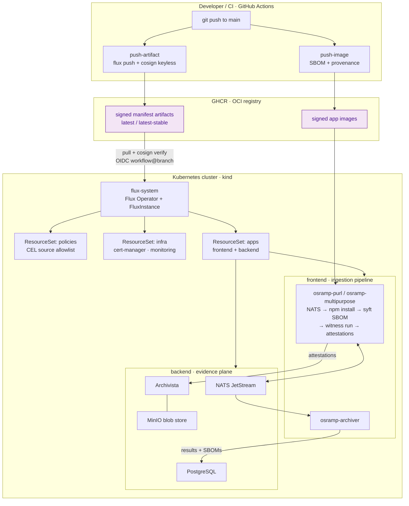

# OSRAMP demo for Acme Co.

OSRAMP (Open Source Risk and Asset Management Platform) is a tiered framework for managing the risk of open source software in a regulated environment. This repository is a working demo of it, built for Acme Co., an investment banking firm that is the fictional client for this proof of concept. Everything runs locally on a [kind](https://kind.sigs.k8s.io/) cluster with open source tooling only, and the same pipeline runs in GitHub Actions.

The problem it addresses: every third-party package an organization ingests crosses its trust boundary and drags the package's own supply chain in with it. Scanners then bury teams in CVE findings, most of which are not exploitable in context. OSRAMP answers with SBOMs, signed attestations for every pipeline step, VEX documents that record triage decisions once and share them everywhere, and policy that gates promotion on evidence instead of on a green checkbox someone hopes is meaningful.

## The maturity model

OSRAMP progresses through four levels, delivered in four phases:

| Level | Phase | What it delivers | Owner |
| --- | --- | --- | --- |
| L1 Triage and prioritization uplift | 1 | SBOMs per image, operationalized VEX turning non-exploitable findings green, signing keys and trust anchors, baseline CVE metrics | Security team (VA sub-team), with the pilot application team |
| L2 Centralized traceability | 2 | Witness attestations in CI, Archivista as the queryable system of record, reusable workflow templates, test evidence capture | Platform team, application teams adopting |
| L3 Verifiable builds and releases | 3 | SLSA L3 provenance, Witness policies verifying every pipeline step, catching simulated supply chain compromises | Security team authors policy, platform team enforces it |
| L4 Policy-driven automation | 3 | Three reconciliation loops (ingestion, SDLC, deployment) chained by policy enforcement points, admission control, governed rollback | Security team authors policy, platform team enforces it |
| Agentic remediation PoC | 4 | Human-in-the-loop agent that analyzes a CVE, proposes remediation, opens a PR on approval, and produces Witness-attested outputs at every step | Security and platform jointly, application teams review the PRs |

## Team ownership

Acme Co. runs a shared responsibility model. Application teams consume the platform rather than run it.

| Team | Owns |
| --- | --- |
| Security | Software ingestion, base image policy and composition, the internal software repositories (base images, OS packages, application libraries, binary artifacts), policy authorship for pipeline, admission, and container build, security incident response. Its Vulnerability Assessment sub-team keeps scanners green with time-limited VEX exemptions. |
| Platform | Middleware images built and patched as a service, base image builds to security's policy, deployment of versioned policy as code at every enforcement point, availability incident response. |
| Application | First-party code, application images and their security configuration, dependency hygiene against internally provided packages, responding to dependency-update PRs, and providing exception evidence to security. |

In practice: a base image CVE means security ships a patched image to everyone. A middleware CVE (nginx, Spring Boot) is platform's, with security assisting on ingestion. An application dependency CVE arrives at the application team as a PR from the internal repositories.

## Architecture



### The ingestion flow, step by step

This is the OSRAMP ingestion data flow as implemented today:

1. An artifact enters as a package URL (purl), published to the `tasks.purl` NATS subject.
2. The purl listener picks it up and hands it to its processor over a Unix socket.
3. The processor parses the purl and checks a local cache. A hit returns the prior result; a miss queues an `npm_install` task on `tasks.input`.
4. The multipurpose worker installs the package in an isolated directory, then generates an SPDX SBOM with syft. The SBOM step runs under `witness run`, so it produces a signed in-toto attestation that is uploaded to Archivista.
5. Results, the full SBOM, and signatures are published back to NATS on `tasks.results`, `tasks.sbom`, and `tasks.signatures`.
6. The archiver consumes results and SBOMs and writes them to PostgreSQL, giving security and platform teams a queryable record.

The later phases build on this stored evidence rather than changing the core flow: grype scans and vexctl triage (Phase 1), attested test and VEX evidence (Phase 2), witness promotion policy, Kyverno admission and trust revocation (Phase 3), and the agent harness (Phase 4). Each is runnable as its own demo, documented below.

### GitOps delivery (Flux D2, gitless GitOps)

Cluster state is not pulled from git at runtime. CI packages each logical D2 source directory's manifests as OCI artifacts, signs them with cosign keyless (GitHub OIDC), and pushes them to GHCR. Flux inside the cluster pulls the artifacts, verifies that the signature identity matches the exact workflow and branch that was supposed to publish them, and reconciles. Staging tracks the `latest` tag, production tracks `latest-stable`, and a rollback is one `flux tag` command. A CEL ValidatingAdmissionPolicy rejects any tenant Flux source that is not on the allowlist, so a compromised tenant cannot point the cluster at an arbitrary registry.

Local mode keeps the whole model intact without GitHub: `make push-local` pushes the same artifacts to a zot registry running inside the cluster and signs them with a locally generated cosign key, and the `clusters/local` fleet definition verifies against that key's public half. The trust chain is identical in shape; only the identity provider differs.

## Repository layout

| Path | What it is |
| --- | --- |
| `d2-osramp-apps/` | Application logical source directory: the three Go services (`apps/`), Kubernetes manifests (`components/`), bats end-to-end test suite (`test/`), and component-local workflows. Owned by the application team; its Flux reconciliation boundary is namespace-scoped, not a separate Git repository. |
| `d2-infra/` | Infrastructure logical source directory: cluster add-ons (cert-manager with a self-signed issuer, Envoy Gateway ingress, kube-prometheus-stack and metrics-server) in the controllers/configs layout the fleet expects. Owned by the platform team. Its infrastructure tenants intentionally retain cluster-admin authority. |
| `d2-osramp-fleet/` | Platform logical source directory: cluster definitions (`clusters/`), tenant ResourceSets (`tenants/`), Terraform bootstrap (`terraform/`), and e2e workflows. Owned by the platform team. |
| `d2-signalloom-{fleet,infra,apps}/` | Planned Signal Loom logical source directories in this monorepo. They will reuse the D2 patterns while retaining separate signed OCI artefacts and reconciliation boundaries; they are not new Git repositories. |
| `olly-replica/` | The Olly Sentinel replica tenant: contracts (versioned JSON schemas), the ELK/Redpanda/Grafana data plane as Flux manifests, seed data with the injection corpus, and scaffolds for the MCP server, stubs, agent, and eval harness. See [olly-replica/README.md](olly-replica/README.md). |
| `ui/` + `tools/demo-console/` | The interactive architecture map (plain HTML/CSS/JS) and the Go service that executes its actions with streamed output. |
| `scripts/` | The orchestration behind the make targets: `setup.sh` (tool install plus full build), local publish and sign, the VEX, promotion, admission, and revocation demos, attested tests, VEX retrieval. |
| `policy/` | The witness promotion policy generator output and the Kyverno image verification policy. |
| `agent/` | The Phase 4 remediation harness and its guardrails document. |
| `vex/out/` | Generated VEX demo artifacts (SBOMs, scans, statements); not committed. |

## Getting started

### Prerequisites

| Tool | Used for |
| --- | --- |
| Docker | building images, running kind |
| kind | the local Kubernetes cluster |
| kubectl | applying manifests, inspecting the cluster |
| kustomize | building the manifest overlays |
| flux CLI | pushing OCI artifacts, installing Flux |
| helm | the Flux Operator install during bootstrap |
| cosign + openssl | signing artifacts and generating the witness key |
| jq + bats-core | scripts and the end-to-end test suite |
| syft, grype, govulncheck, vexctl, witness, crane | the VEX triage demo and attested evidence |
| Go 1.23 | the interactive console (`make console`) |
| nono + claude CLI (optional, Linux) | the Phase 4 agent demo only |

You do not install these by hand: `./scripts/setup.sh` installs everything except Docker (and the optional agent tools) at pinned versions, skipping whatever is already present. On Windows, run everything from WSL2 or Git Bash; the Makefiles assume a POSIX shell.

### Local quickstart (no GitHub credentials needed)

One script installs every missing tool (pinned versions, skips what you have) and creates the shared GitOps foundation: a kind cluster, an in-cluster Zot registry, cosign-signed foundation artifacts, and Flux reconciliation. Docker is the only precondition.

```bash
./scripts/setup.sh    # install tools, then create a healthy shared cluster
make demo-osramp-up   # opt into the OSRAMP workload before its end-to-end suite
make test             # run the OSRAMP bats end-to-end suite
make acceptance-test  # run the browser acceptance suite
```

`./scripts/setup.sh --tools-only` installs without building; `make up` creates
the shared foundation without installing tools or building demo images.

Browser acceptance setup, diagnostics, and the latest observed baseline are documented in [TESTING.md](TESTING.md). Use [HUMAN_VALIDATION.md](HUMAN_VALIDATION.md) when a person needs to review the live browser experience and record evidence.

For the normal fast loop, keep the cluster running: `make up` creates the shared foundation and confirms it is healthy without starting a demo. It prints the available opt-in targets: `make demo-signalloom-up`, `make demo-osramp-up`, `make demo-olly-up`, and `make demo-bao-up`. `make signalloom-images` builds the local Signalloom frontend and pushes it into Zot. Zot stores OCI data in the host-backed `ZOT_CACHE_DIR` (default `.cache/zot`), mounted through Kind into the Zot pod at `/var/lib/zot`; this survives `make down && make up` and makes cluster restarts reuse already-pushed foundation artifacts. Use `make zot-cache-reset && make up` when a deliberately empty registry is required. Use `make teardown` (or `./scripts/teardown.sh`) only for a full bootstrap/trust-root reset because it also removes local keys and generated build state; `make teardown-all` also uninstalls the CLIs `setup.sh` added. Your `.env` is left untouched.

`make up` composes only foundation targets (`make help` lists them): `cluster`, `registry` (Zot), `signing-keys` (a local cosign key pair plus a witness key), `push-local-foundation` (the fleet and shared infrastructure), `bootstrap-local` (Flux Operator with a FluxInstance that verifies signatures against the local public key), `wait`, and `healthcheck`. Demo images, workloads, and secrets are activated only by their corresponding `demo-*-up` command. Nothing reaches the cluster unsigned, even locally.

For a faster local foundation without monitoring or Trivy, run `ENABLE_OBSERVABILITY=false make up`. The default is `true`; this mode packages a local-only fleet artifact without those tenants, while preserving their installer sources and Flux Operator management.

There is also a shortcut that skips GitOps entirely for tight inner-loop work on the services: `make -C d2-osramp-apps local-dev` applies the manifests directly with kustomize.

To poke at it manually, ingest a package and watch it flow:

```bash
./scripts/publish-purl.sh pkg:npm/lodash@4.17.21
kubectl logs -n frontend -l app=osramp-multipurpose -c processor -f   # watch the SBOM generation
make -C d2-osramp-apps postgres-shell                                 # then: SELECT * FROM task_results;
```

### The interactive console

```bash
make console    # then open http://localhost:8675
```

The console is the architecture map as a working control surface: three lanes (deliver, operate, assure), one card per step, each labeled with its owning team and OSRAMP phase. Clicking a card opens its detail and its run buttons; every button executes the exact command the CLI uses and streams the output live. Planned steps (the witness policy gate, the agent) appear on the map, marked as roadmap items.

### The VEX triage demo (Phase 1)

```bash
make vex-demo
```

The demo publishes the three service images to the local registry, generates syft SBOMs as the attested analysis evidence, and scans the registry images with grype (scanner passes target image digests because grype's VEX product matching binds to them; SPDX files do not carry image identity through). It then triages three canonical findings into signed OpenVEX statements: a base image CVE shared across containers, CVE-2022-32149 on the pinned `golang.org/x/text` module that govulncheck proves unreachable (statements are issued for the CVE and every alias the scanner reports it under), and a finding recorded as mitigated by the pod hardening. The statements merge with vexctl, the merged document is signed under `witness run` with the vex attestor and stored in Archivista, the rescan with VEX applied asserts the triaged findings are suppressed, and `./scripts/fetch-vex.sh` retrieves the attested document from Archivista the way another team's pipeline would. If govulncheck ever reports the vulnerable symbol as reachable, the demo refuses to issue the `not_affected` statement and fails; unrelated reachable findings are reported as remediation items rather than swept into the VEX.

### The governance demos (Phase 3)

```bash
make promotion-demo    # witness policy gate: attested artifact approved, tampered one rejected
make admission-demo    # Kyverno at the API server: signed image admitted, unsigned denied
make revocation-demo   # revoke artifact trust, watch Flux block it, restore and promote
```

The promotion gate verifies artifacts against a signed witness policy (the security team signs the policy, the pipeline key is the functionary) and records both decisions in Archivista. The admission demo installs Kyverno and proves an unsigned image cannot even be scheduled. The revocation walkthrough pushes an unsigned frontend artifact, shows Flux failing verification closed while the running workload stays on the last good state, then signs a fixed artifact and follows it in.

### The agent demo (Phase 4)

```bash
make agent-demo                          # analyze, recommend, stop at the human gate
agent/harness.sh CVE-2022-32149 --approve  # apply the recommendation as a PR branch
```

The harness assembles the evidence bundle (scans, reachability, attested VEX), runs the claude CLI sandboxed under nono (kernel-enforced filesystem and network restrictions, boundary-injected API key), and produces a structured recommendation: a dependency bump or a VEX proposal, nothing else. Applying it needs an explicit approval, is restricted to the allowed change shapes, and every step is witness-attested into Archivista. The full boundary is documented in [agent/GUARDRAILS.md](agent/GUARDRAILS.md). Requires Linux (WSL2 works), nono, and the claude CLI.

### The Olly Sentinel replica (olly-replica tenant)

The repo also hosts a ControlPlane-internal replica of an AI SRE pipeline
(Olly Sentinel / Eye in the Sky) built on this same substrate: a fourth
tenant, `olly-replica`, reconciled by Flux from its own signed artifact
(`olly/olly-replica`). It carries a single-broker Redpanda, an ECK-managed
Elasticsearch seeded with synthetic logs (including an injection corpus and
planted fake secrets for the safety evals), and three managed tenant apps
(`inventory-service`, `payments-api`, `customer-portal`) that run as real
workloads emitting request, error, and latency metrics. The agent runs on
Google ADK and speaks A2A, serving a committed AgentCard as its
identity/skills/auth contract, and enriches incidents that the IO Mapping
Service stub writes to a ServiceNow PDI. A dedicated Grafana is the Eye in
the Sky: an estate view plus a per-tenant view that ties each app's live
metrics, its Trivy vulnerabilities, its ServiceNow enrichment activity, and its slice of
the agent lifecycle together. Trivy Operator
(`d2-infra/components/trivy-system`) plays the Aqua role, feeding runtime
vulnerability data through the monitoring stack. The tenant namespace is
allowlist-gated like the app tenants, and its chart repositories are pinned
in the fleet policy. Design doc:
[olly-replica/agentic-sre-design-doc.md](olly-replica/agentic-sre-design-doc.md);
component detail in [olly-replica/README.md](olly-replica/README.md).

### GHCR-published mode (staging and production clusters)

The same fleet definitions run against GHCR-published artifacts: the `push-artifacts` and `push-images` workflows publish and cosign-sign everything under `ghcr.io/<owner>/<repo>`, staging clusters verify the keyless OIDC identity of the exact publishing workflow and branch, and production clusters track `latest-stable` from the release workflow. The canonical identity in the manifests is `acme-co/osramp`; a fork updates the `REGISTRY_BASE`/`IMAGE_BASE` values in `d2-osramp-fleet/clusters/*/flux-system/runtime-info.yaml` and the verify subjects to its own owner, then runs `make -C d2-osramp-fleet bootstrap-staging` with a `read:packages` PAT.

## CI

The same pipeline runs in GitHub Actions, so local and CI behavior match. The root workflows are the active ones for this monorepo:

| Workflow | Trigger | What it does |
| --- | --- | --- |
| `e2e-local` | manual (`workflow_dispatch`) | the parity pipeline: runs the same make targets as `make up` in a CI kind cluster, then the attested test suite, the olly enrichment-loop suite, and the VEX demo. Manual because the full stack oversubscribes a standard 2-vCPU runner (Prometheus and Redpanda land Pending); run it from the Actions tab on a machine with room |
| `push-artifacts` | push to `main` | packages fleet, infra, and apps manifests as OCI artifacts, cosign keyless signs, tags `latest` |
| `push-images` | push touching `d2-osramp-apps/apps/` | multi-arch image builds with SBOM and provenance, signed, pushed to GHCR |
| `release-artifacts` | `v*` tag | versioned artifacts plus the `latest-stable` pointer production tracks |
| `reusable-witness-step` | `workflow_call` | wraps any command in `witness run` so its evidence is signed and preserved |

The component-local workflows inside `d2-osramp-apps`, `d2-infra`, and `d2-osramp-fleet` remain intact to support their current logical ownership boundaries and any future extraction justified by CI, release or access-control needs.

## Validation status

The historical validation run on 2026-07-09 covered the full signed local GitOps loop, all eight OSRAMP end-to-end tests, the VEX demo, witness-attested evidence, governance demos, and the interactive console. The latest V2.5 browser baseline on 2026-07-26 passed four tests (Grafana and SignalLoom) and failed four tests because the Archivista and Olly customer-portal services were unavailable. See [TESTING.md](TESTING.md) and [HUMAN_VALIDATION.md](HUMAN_VALIDATION.md) for reproducible commands and review evidence.

## Current state and roadmap

Working today:

- The fully local, fully signed GitOps loop: `make up` builds the cluster, the zot registry, pushes cosign-signed manifest artifacts, and Flux verifies every one before reconciling. The identical pipeline runs in CI (`e2e-local`).
- The ingestion pipeline: purl to isolated install to syft SBOM under `witness run` to Archivista, with results archived in PostgreSQL and the bats e2e suite proving it.
- The Phase 1 VEX workflow (`make vex-demo`): three canonical triage cases issued with vexctl, merged, applied, and the rescan asserted green for the triaged findings.
- Phase 2 evidence: test runs attested into Archivista (`make attested-test`), attested VEX retrieval (`scripts/fetch-vex.sh`), and the reusable witness workflow for CI steps.
- The interactive console (`make console`): the architecture map with owner and phase labels, running every implemented step live with streamed output.

Also working: the Phase 3 governance demos (witness policy promotion gate with both decisions in Archivista, Kyverno signature verification at admission, the trust revocation walkthrough) and the Phase 4 agent harness (nono-sandboxed, human-gated, witness-attested, guardrails in [agent/GUARDRAILS.md](agent/GUARDRAILS.md)).

Remaining refinements:

1. Witness attestation verification at admission time (today admission verifies image signatures; attestation-level policy runs at the promotion gate) via a small witness-verify external-data service for Kyverno.
2. Keyless signing for workloads (Fulcio with Kubernetes service account OIDC) to retire the static ed25519 secret.
3. The KPI dashboard fed from the PostgreSQL archive.

MinIO stays as the Archivista blob store for now, flagged in the manifests as nearing end of support.
