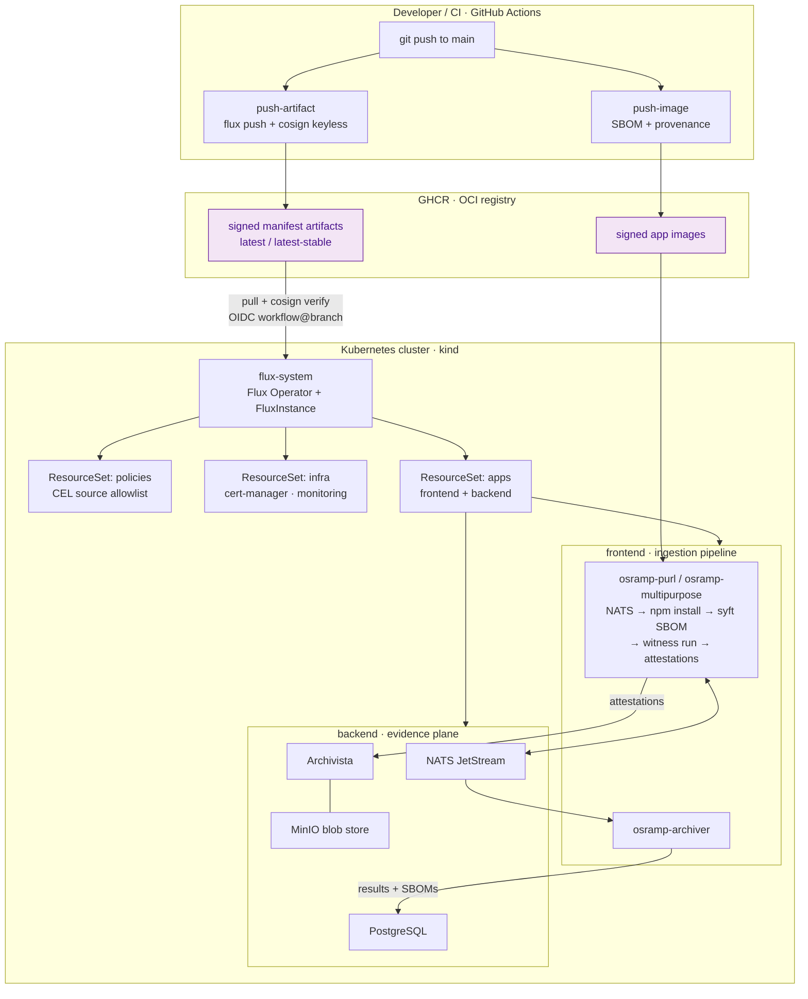

# OSRAMP demo for Acme Co.

OSRAMP (Open Source Risk and Asset Management Platform) manages open source software
risk in regulated environments. This repository provides a working demonstration of OSRAMP.
Acme Co., an investment banking firm, is the example client.

The demo runs locally on a [kind](https://kind.sigs.k8s.io/) cluster using open source tools.
The same pipeline runs in GitHub Actions. The stack also runs on GCP across four independent lanes.

> **Start here:** [`docs/README.md`](docs/README.md) is the documentation index. It maps
> each document to the question it answers.

The problem: third-party packages cross the organizational trust boundary. Packages introduce
vulnerabilities from their supply chains. Security scanners output many CVE findings.
Most findings cannot be exploited in context.

OSRAMP provides:
- SBOMs for every image.
- Signed attestations for each pipeline step.
- OpenVEX documents to record triage decisions once and share them across teams.
- Policy gates that permit promotion based on verified evidence.

## The Maturity Model

OSRAMP progresses through four levels across four phases:

| Level | Phase | What It Delivers | Owner |
| --- | --- | --- | --- |
| L1 Triage and prioritization uplift | 1 | SBOMs per image, VEX suppression for non-exploitable findings, signing keys, baseline CVE metrics | Security team (VA sub-team) and pilot application team |
| L2 Centralized traceability | 2 | Witness attestations in CI, Archivista as system of record, reusable workflows, test evidence | Platform team and adopting application teams |
| L3 Verifiable builds and releases | 3 | SLSA L3 provenance, Witness policies for each pipeline step, supply chain compromise detection | Security team authors policy; platform team enforces policy |
| L4 Policy-driven automation | 3 | Three reconciliation loops (ingestion, SDLC, deployment) chained by policy enforcement, admission control, rollback | Security team authors policy; platform team enforces policy |
| Agentic remediation PoC | 4 | Human-in-the-loop agent that analyzes CVEs, proposes fixes, opens PRs, and makes Witness attestations | Security and platform teams jointly; application teams review PRs |

## Team Ownership

Acme Co. uses a shared responsibility model. Application teams consume the platform.

| Team | Responsibilities |
| --- | --- |
| Security | Manages software ingestion, base image policy, internal repositories, and security policies. Keeps scanners clear using time-limited VEX exemptions. |
| Platform | Provides middleware images, builds base images, deploys versioned policy as code, and manages availability incidents. |
| Application | Develops first-party code, sets application security, updates dependencies, and provides exception evidence to security. |

In practice:
- A base image CVE: Security distributes a patched base image.
- A middleware CVE (nginx, Spring Boot): Platform patches the service with help from security.
- An application dependency CVE: The application team receives an automated PR.

## Architecture



> **Interactive system map.** For a visual overview of all 28 services, their ports, namespaces, and the control/data/identity/GitOps paths between them, see the [isometric system map](docs/system-map/). Serve with `python3 -m http.server 8901 -d docs/system-map`.

### The Ingestion Flow, Step by Step

This sequence describes the current OSRAMP ingestion flow:

1. A package URL (purl) arrives on the `tasks.purl` NATS subject.
2. The purl listener receives the purl and sends it to the processor across a Unix socket.
3. The processor parses the purl and checks the local cache. If cached, it returns the prior result. If missing, it adds an `npm_install` task to `tasks.input`.
4. The multipurpose worker installs the package in an isolated directory. It runs `syft` to make an SPDX SBOM. This step runs under `witness run` to create a signed in-toto attestation. The worker uploads the attestation to Archivista.
5. The worker publishes results, SBOMs, and signatures to `tasks.results`, `tasks.sbom`, and `tasks.signatures`.
6. The archiver reads results and SBOMs from NATS and writes them to PostgreSQL. This gives teams a queryable audit record.

Later phases build on this evidence:
- Phase 1: Grype scans and vexctl triage.
- Phase 2: Attested test and VEX evidence.
- Phase 3: Witness promotion policy, Kyverno admission control, and trust revocation.
- Phase 4: Agent remediation harness.

### GitOps Delivery (Flux D2, Gitless GitOps)

The cluster does not pull state directly from git at runtime.

1. CI packages each logical D2 source directory into an OCI artifact.
2. CI signs each artifact using keyless Cosign with GitHub OIDC.
3. CI pushes the artifacts to GHCR.
4. Flux pulls the artifacts inside the cluster. It checks that the signature identity matches the approved workflow and branch.
5. Flux reconciles the manifests.

Staging tracks the `latest` tag. Production tracks the `latest-stable` tag. Roll back a release with the `flux tag` command. A CEL ValidatingAdmissionPolicy rejects any tenant Flux source not on the allowlist.

Local mode keeps this model intact without GitHub:
- The command `make push-local` pushes artifacts to an in-cluster Zot registry.
- It signs artifacts using a local Cosign key.
- The `clusters/local` fleet definition checks signatures against the local public key.

## Repository Layout

| Path | Description |
| --- | --- |
| `d2-osramp-apps/` | Application logical source directory: Go services (`apps/`), Kubernetes manifests (`components/`), BATS e2e tests (`test/`), and workflows. |
| `d2-infra/` | Infrastructure directory: cluster add-ons (cert-manager, Envoy Gateway, monitoring stack). |
| `d2-osramp-fleet/` | Platform directory: cluster definitions (`clusters/`), tenant ResourceSets (`tenants/`), and Terraform bootstrap (`terraform/`). |
| `d2-signalloom/` | Signal Loom slice: dashboard SPA, FastAPI backend, and identity plane (`infra/inf-bao`: OpenBao and SPIRE). See [d2-signalloom/AGENTS.md](d2-signalloom/AGENTS.md). |
| `d2-agent-trust/` | Contract-first SPIFFE agent trust hierarchy (A2A identity, OpenBao JWT roles, NetworkPolicies). See [d2-agent-trust/AGENTS.md](d2-agent-trust/AGENTS.md). |
| `olly-replica/` | Olly Sentinel replica tenant: data plane manifests, contracts, seed data, and eval harness. See [olly-replica/README.md](olly-replica/README.md). |
| `docs/system-map/` | Interactive system map. 28 services with control, data, and identity paths. Run `python3 -m http.server 8901 -d docs/system-map` to view. |
| `ui/` + `tools/demo-console/` | The interactive architecture map (plain HTML/CSS/JS) and the Go service that executes its actions with streamed output. |
| `scripts/` | The orchestration behind the make targets: `setup.sh` (tool install plus full build), local publish and sign, the VEX, promotion, admission, and revocation demos, attested tests, VEX retrieval. |
| `policy/` | The witness promotion policy generator output and the Kyverno image verification policy. |
| `agent/` | The Phase 4 remediation harness and its guardrails document. |
| `vex/out/` | Generated VEX demo artifacts (SBOMs, scans, statements); not committed. |
| `terraform/` | The GCP estate: three Terraform roots (bootstrap, platform, environments) and the per-lane environment model. See [terraform/README.md](terraform/README.md) and [terraform/CONTRACT.md](terraform/CONTRACT.md). |
| `deploy/gcp/` | The real project inputs and the per-lane hand-off files. Most of its contents are gitignored operational state. See [deploy/gcp/README.md](deploy/gcp/README.md). |
| `docs/` | All documentation, indexed by [docs/README.md](docs/README.md). |

## Getting started

### Prerequisites

| Tool | Used for |
| --- | --- |
| Docker | building images, running kind |
| kind | the local Kubernetes cluster |
| kubectl | applying manifests, inspecting the cluster |
| kustomize | building the manifest overlays |
| flux CLI | pushing OCI artifacts, installing Flux |
| helm | the Flux Operator install during bootstrap |
| cosign + openssl | signing artifacts and generating the witness key |
| jq + bats-core | scripts and the end-to-end test suite |
| syft, grype, govulncheck, vexctl, witness, crane | the VEX triage demo and attested evidence |
| Go 1.23 | the interactive console (`make console`) |
| nono + claude CLI (optional, Linux) | the Phase 4 agent demo only |

You do not install these by hand: `./scripts/setup.sh` installs everything except Docker (and the optional agent tools) at pinned versions, skipping whatever is already present. On Windows, run everything from WSL2 or Git Bash; the Makefiles assume a POSIX shell.

### Local Quickstart (No GitHub Credentials Needed)

The setup script installs missing tools at pinned versions. It creates the shared
GitOps foundation: a Kind cluster, an in-cluster Zot registry, Cosign-signed
foundation artifacts, and Flux reconciliation.

Docker is the only required precondition.

```bash
./scripts/setup.sh    # Install tools and create a healthy shared cluster
make demo-osramp-up   # Deploy the OSRAMP workload before tests
make test             # Run the OSRAMP BATS test suite
make acceptance-test  # Run the Playwright browser test suite
```

- Run `./scripts/setup.sh --tools-only` to install tools without building.
- Run `make up` to create the shared foundation without installing tools.

Read [TESTING.md](TESTING.md) for browser acceptance test instructions and diagnostics.
Read [HUMAN_VALIDATION.md](HUMAN_VALIDATION.md) for manual verification steps.

For normal development, keep the cluster running. The command `make up` creates the
foundation and checks health. It prints available opt-in targets:
- `make demo-signalloom-up`
- `make demo-osramp-up`
- `make demo-olly-up`
- `make demo-bao-up`

Zot stores OCI artifacts in `.cache/zot`. This cache survives `make down && make up`.
Cluster restarts reuse existing artifacts from the cache. Run `make zot-cache-reset`
if you require an empty registry.

Run `make teardown` only for a complete reset. It removes local signing keys and
build state. Run `make teardown-all` to also remove CLI tools installed by `setup.sh`.
Your `.env` file is preserved.

Observability (`kube-prometheus-stack` and `trivy-system`) is disabled by default.
To enable observability, run:

```bash
ENABLE_OBSERVABILITY=true make up
```

To test the ingestion flow manually:

```bash
./scripts/publish-purl.sh pkg:npm/lodash@4.17.21
kubectl logs -n frontend -l app=osramp-multipurpose -c processor -f
make -C d2-osramp-apps postgres-shell
# Inside postgres shell: SELECT * FROM task_results;
```

### The Interactive Console

Run the interactive console:

```bash
make console    # Open http://localhost:8675
```

The console shows the architecture map across three lanes: Deliver, Operate, and Assure.
Each card corresponds to one step. Click a card to see details and run buttons.
Each button executes the underlying CLI command and streams the output.

### The VEX Triage Demo (Phase 1)

Run the VEX triage demo:

```bash
make vex-demo
```

The demo performs these steps:
1. Publishes service images to the local registry.
2. Makes syft SBOMs as attested analysis evidence.
3. Scans the registry images using Grype.
4. Triages findings into signed OpenVEX statements.
5. Merges statements with `vexctl` and signs the merged file under `witness run`.
6. Stores the signed document in Archivista.
7. Rescans the images to confirm suppressed CVE findings.

### Governance Demos (Phase 3)

Run the governance demos:

```bash
make promotion-demo    # Witness policy gate: approved vs tampered artifacts
make admission-demo    # Kyverno admission: signed admitted, unsigned denied
make revocation-demo   # Revoke artifact trust, verify Flux blocks deployment
```

The promotion gate checks artifacts against a signed witness policy.
The admission demo checks that Kyverno blocks unsigned images from scheduling.
The revocation walkthrough pushes an unsigned artifact and confirms Flux blocks it.

### Remediation Agent Demo (Phase 4)

Run the agent demo:

```bash
make agent-demo                          # Analyze CVE and create proposal
agent/harness.sh CVE-2022-32149 --approve  # Apply recommendation to PR branch
```

The harness collects the evidence bundle. It runs Claude inside the `nono` sandbox
with kernel-level network and filesystem restrictions. The agent produces a
structured recommendation: a dependency update or a VEX proposal.

Applying the change requires human approval. Each action is witness-attested into Archivista.
Read [agent/GUARDRAILS.md](agent/GUARDRAILS.md) for safety boundary details.

### The Olly Sentinel Replica (`olly-replica` Tenant)

The repository hosts an internal replica of an AI SRE pipeline (Olly Sentinel).
The tenant `olly-replica` reconciles through Flux from its own signed OCI artifact
(`olly/olly-replica`).

It contains:
- A single-broker Redpanda event bus.
- An ECK-managed Elasticsearch cluster seeded with synthetic logs.
- Three managed tenant applications: `inventory-service`, `payments-api`, and `customer-portal`.
- An agent that runs on Google ADK and communicates via A2A.
- A dedicated Grafana instance for unified observability.

Read [olly-replica/agentic-sre-design-doc.md](olly-replica/agentic-sre-design-doc.md) for design details.
Read [olly-replica/README.md](olly-replica/README.md) for component instructions.

### Running on GCP (Four Lanes)

The stack runs on Google Cloud across four independent lanes: `demo-1`, `demo-2`, `ci-1`, and `ci-2`.
Terraform provisions each lane VM. A second step deploys the software estate to the VM.

```bash
export TF_STATE_BUCKET=<your-state-bucket>

make gcp-tf-up      ENV=demo-1               # Plan, review, apply, and save hand-off
make gcp-tf-demo-up ENV=demo-1               # Deliver code, build estate, and test
make gcp-tf-ts-up   ENV=demo-1               # Serve estate on Tailscale; prints URL
make doctor-node    ENV=demo-1               # Check node-level health for that lane

make gcp-tf-destroy ENV=demo-1 CONFIRM=demo-1 # Destroy resources to stop billing
./scripts/gcp-tf/teardown-verify.sh          # Check that all resources were removed
```

Running VMs incur costs until removed. Always run the teardown step.
Read [`docs/gcp-demo/RUNBOOK.md`](docs/gcp-demo/RUNBOOK.md) for step-by-step instructions.
Read [`docs/gcp-demo/OPERATIONS.md`](docs/gcp-demo/OPERATIONS.md) for lane operations.

### GHCR-Published Mode (Staging and Production)

The fleet definitions also run against GHCR-published artifacts:
- The workflows `push-artifacts` and `push-images` publish signed artifacts under `ghcr.io/<owner>/<repo>`.
- Staging clusters check keyless OIDC identity from the publishing workflow.
- Production clusters track the `latest-stable` tag.

## CI

The CI pipeline runs in GitHub Actions. Monorepo root workflows include:

| Workflow | Trigger | Description |
| --- | --- | --- |
| `e2e-local` | Manual (`workflow_dispatch`) | Runs foundation setup, attested tests, and the VEX demo in a CI Kind cluster. |
| `push-artifacts` | Push to `main` | Packages fleet, infra, and apps manifests as OCI artifacts with Cosign signatures. |
| `push-images` | Push to `d2-osramp-apps/apps/` | Builds multi-arch container images with SBOMs and provenance. |
| `release-artifacts` | Tag `v*` | Publishes versioned artifacts and updates the `latest-stable` pointer. |
| `reusable-witness-step` | `workflow_call` | Runs commands under `witness run` to record signed evidence. |

## Current State and Roadmap

Working features:
- Fully local, signed GitOps loop with Kind, Zot, and Flux.
- Ingestion pipeline from purl to syft SBOM, Archivista, and PostgreSQL.
- Phase 1 VEX workflow with `vexctl` triage.
- Phase 2 evidence collection with attested tests and VEX retrieval.
- Interactive console with live command execution and output streaming.
- Phase 3 governance demos (admission policy and trust revocation).
- Phase 4 remediation agent under `nono` sandbox.

Planned refinements:
1. Admission-time Witness attestation verification with Kyverno.
2. Keyless workload signing via Fulcio and Kubernetes OIDC.
3. KPI dashboard connected to PostgreSQL.
