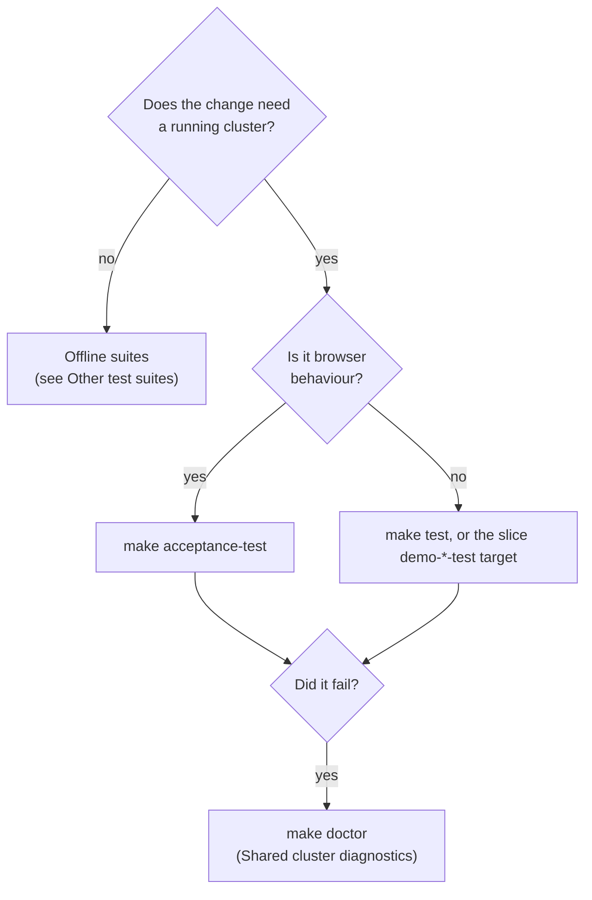

# Testing

This repository has deterministic tests, Kubernetes end-to-end tests, and
Playwright browser acceptance tests. This page tells you how to run them.

For manual browser checks, read [HUMAN_VALIDATION.md](HUMAN_VALIDATION.md).

## Select a suite

The diagram shows how to select a suite. Start with a check that needs no
cluster. Run `make doctor` before you debug a failure that needs a cluster.



The sections are [Browser acceptance tests](#browser-acceptance-tests),
[Shared cluster diagnostics](#shared-cluster-diagnostics), and
[Other test suites](#other-test-suites).

## Browser acceptance tests

The browser suite uses Playwright, Bun, and Google Chrome.

[`test/acceptance/SPEC-REGISTRY.tsv`](test/acceptance/SPEC-REGISTRY.tsv) is the
one source for where each spec runs. The CI check
[`test/acceptance-spec-coverage.bats`](test/acceptance-spec-coverage.bats)
compares the registry with `playwright.config.ts`, the `Makefile`, and
[`scripts/ci/vm-pipeline.sh`](scripts/ci/vm-pipeline.sh).

Read `SPEC-REGISTRY.tsv` for the current spec assignments. Do not copy its rows
into this page. The coverage check fails CI when the registry drifts. Copied
text has no such check.

CAUTION: Playwright gives no warning when no project claims a spec. It reports
a lower total and exits 0. Add each new spec to a Playwright project.

NOTE: `make acceptance-test` without arguments runs all suites. The tests
`supercred-ui-lifecycle` and `supercred-evidence-lifecycle` have 30-minute
timeouts.

To run one spec file, give its name as an argument.

### Prerequisites

- Install Docker, Kind, kubectl, Bun, and Google Chrome.
- Select the `kind-osramp` context.
- Deploy the target workloads and check their health.
- Make sure that the local ports `13000`, `15556`, `18000`, `18080`, `18082`,
  and `18443` are free. [`scripts/acceptance-test.sh`](scripts/acceptance-test.sh)
  forwards them.

Install the acceptance test dependencies:

```bash
cd test/acceptance
bun install --frozen-lockfile
bunx playwright install ffmpeg
cd ../..
```

### Commands

Run the full acceptance suite from the repository root:

```bash
make acceptance-test
```

The script runs the cluster diagnostics, starts the port-forwards, runs
Playwright, and stops the port-forwards when it exits.

To filter the tests, give arguments to the script:

```bash
./scripts/acceptance-test.sh --grep "SignalLoom Frontend"
```

### Diagnostics and artifacts

Playwright keeps these artifacts for a failed run:

- HTML report: `test/acceptance/playwright-report/index.html`
- Test artifacts: `test/acceptance/test-results/`
- Traces: `trace.zip`
- Failure screenshots: `failure-screenshot-*.png`
- Failure videos: `video.webm`
- Browser logs: `browser-diagnostics-*.txt`

To open a trace:

```bash
cd test/acceptance
bunx playwright show-trace test-results/<failed-test>/trace.zip
```

Check the cluster health before you debug a browser test failure.

## Shared cluster diagnostics

Run this read-only command before you debug a demo or test failure:

```bash
make doctor  # Same as: make cluster-debug
```

`make doctor` and `make cluster-debug` make the same read-only report. It shows
cluster connectivity, unhealthy pods, restart counts, recent warning events,
Flux objects that are not ready, node metrics, and image-pull failures. It exits
non-zero when it finds an unhealthy pod.

### Inspect Flux resources that are not ready

```bash
# List each Flux resource that is not Ready
flux get all -A --status-selector ready=false

# Show Flux controller activity and recent errors
kubectl get events -n flux-system --sort-by='.lastTimestamp'
kubectl -n flux-system logs deployment/kustomize-controller --tail=200
kubectl -n flux-system logs deployment/source-controller --tail=200

# Show the status and events of one Kustomization
kubectl describe kustomization <name> -n <namespace>
```

### Inspect workloads and warning events

```bash
# Pod status in all namespaces
kubectl get pods -A -o wide
kubectl get deployments,statefulsets,daemonsets -A

# Warning events in all namespaces
kubectl get events -A --field-selector type=Warning --sort-by='.lastTimestamp'

# Logs of a failing workload
kubectl -n <namespace> logs deployment/<deployment> --tail=200
```

### Inspect the Kubernetes API server logs

Kind runs the API server as a static pod. Get its pod name, then read its logs:

```bash
kubectl -n kube-system get pods -l component=kube-apiserver
kubectl -n kube-system logs pod/kube-apiserver-osramp-control-plane --tail=200
```

More field notes, including probes that give false answers, are in
[`docs/cluster-debugging.md`](docs/cluster-debugging.md).

## Check the deployed code against the source

The tests check the local source tree. They do not prove what runs in the
cluster. Use the staleness check to find drift:

```bash
make check-deployed-staleness                                 # All instrumented workloads
./scripts/check-deployed-staleness.sh supercred-demo-runner   # One workload
```

| Exit code | Meaning | Description |
|---|---|---|
| `0` | **Fresh** | The check reached the workload, and its build fingerprint matches the working tree. |
| `1` | **Drift** | The running container does not match the working tree, or it is not deployed. |
| `2` | **Cannot check** | The check could not connect to the cluster or read the container filesystem. |

Exit code 2 does not mean fresh. The check compares content fingerprints made at
build time. It does not compare git tags or SHA strings.

To test the staleness checker without a cluster, run:

```bash
make test-deployed-staleness
```

## Other test suites

Run these suites from the repository root.

| Suite | Command | Cluster |
|---|---|---|
| Documentation lint | `make docs-lint` | Not needed |
| Documentation lint self-test | `make docs-lint-test` | Not needed |
| Deployed staleness guard (mock kubectl) | `make test-deployed-staleness` | Not needed |
| Audit anchor unit suite | `make audit-anchor-test` | Not needed |
| Audit anchor tamper proof | `make audit-anchor-tamper-demo` | Needed |
| Audit anchor key-path guard | `bats test/audit-anchor-keys-path.bats` | Not needed |
| OSRAMP application suite | `make test` | Needed |
| Signal Loom topology check | `d2-signalloom/test/validate-topology.sh` | Not needed |
| Signal Loom topology edge rules | `bats d2-signalloom/test/topology.bats` | Not needed |
| Fleet ResourceSet patch indexes | `bats d2-signalloom/test/fleet-patch-indexes.bats` | Not needed |
| Acceptance spec registry | `bats test/acceptance-spec-coverage.bats` | Not needed |
| CI build parity (Makefile and CI recipes) | `make test-ci-build-parity` | Not needed |
| Dashboard route collisions | `bats d2-signalloom/test/dashboard-route-collisions.bats` | Not needed |
| Agent discovery RBAC drift | `bats d2-signalloom/test/agent-discovery-rbac.bats` | Not needed |
| SuperCred image build guard (mock docker and kind) | `make demo-signalloom-supercred-images-test` | Not needed |
| SuperCred proxy unit suite | `make -C d2-signalloom/apps/fake-integration-proxy test` | Not needed |

NOTE: `make fx` is not a check. It writes the files in `risk/fx/` again from
`rates.yaml`. After you run it, `git diff` shows whether the committed copies
were out of date.
