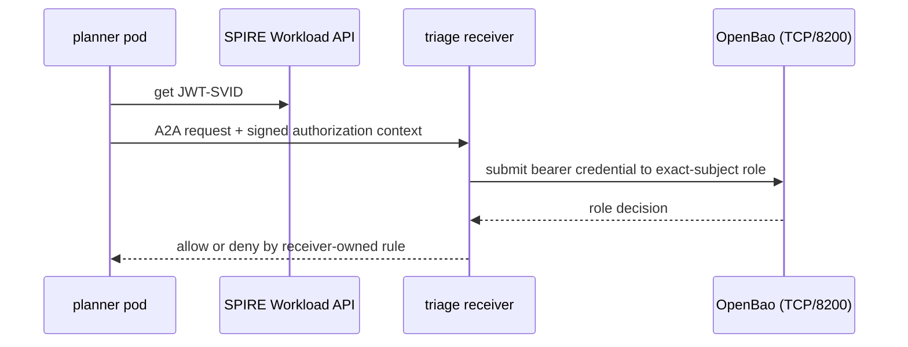

# SPIFFE Agent Trust Hierarchy demo

`d2-agent-trust` is an additive, self-contained static proof for the hierarchy
`platform → tenant → project → agent`. It models two tenants (`acme`,
`northstar`), two Acme projects (`payments`, `risk`), and a deterministic
planner-to-triage A2A call.

```bash
make -C d2-agent-trust test
make demo-agent-trust-up
make demo-agent-trust-test-config
make demo-agent-trust-test
make demo-agent-trust-down
```

## Security boundaries

* **Reachability:** namespace default-deny NetworkPolicies, explicit DNS,
  planner → triage, and planner → OpenBao intent. NetworkPolicy is not
  identity or authorization.
* **Identity:** exact Kubernetes selectors map service accounts to the
  versioned SPIFFE grammar. `adapters/spire_workload_api.py` is the authentic
  runtime boundary. Tests use labeled local RSA fixtures because they cannot
  run a SPIRE Workload API.
* **Authorization:** triage independently verifies issuer, audience, SPIFFE
  subject, tenant/project, action/resource, `nbf`/`exp`, signature, and `jti`
  replay before its receiver-owned allow rule admits a request.

## Integration seam

The diagram shows the planner-to-triage call and the two boundaries that admit
it: the NetworkPolicy path and the OpenBao role check.



- Workload API adapter: [`adapters/spire_workload_api.py`](adapters/spire_workload_api.py)
- Receiver: [`a2a/service.py`](a2a/service.py)
- OpenBao role intent: [`contracts/openbao-role-intent.sh`](contracts/openbao-role-intent.sh)
- NetworkPolicies: [`manifests/boundaries.yaml`](manifests/boundaries.yaml)

`signalloom-spire-proof call-a2a` fetches the planner's JWT-SVID from the
mounted Workload API socket. The deployed triage receiver submits that bearer
credential to an exact-subject OpenBao role before applying its receiver-owned
action/resource rule. Each request carries an Ed25519-signed authorization
context. The context binds the JWT, body, timestamp, nonce, and
receiver-instance challenge. The bounded nonce cache rejects in-process replay.
The receiver-instance binding rejects captured requests after restart.
`make demo-agent-trust-network-test` runs this flow
over the planner-to-triage NetworkPolicy path. The richer Python
`a2a/service.py` additionally tests signed authorization context, bounded replay
protection, and mutation denials. `contracts/openbao-role-intent.sh` remains the
reviewable intent. The lifecycle applies equivalent five-minute roles through
the existing local-demo OpenBao administration path and removes them on down.

External cloud contracts are deliberately **modeled**, carry no cloud
credentials, and list assertion, stable binding, key custody, rotation/reload,
trust bundle, de-enrollment, assurance, and production gap.

## GitOps lifecycle and evidence

The Fleet supplies an opt-in `agent-trust` ResourceSet whose inputs default to
`[]`. It depends on Signal Loom infrastructure and the ready
`inf-bao/infra-configs` Kustomization. It consumes a signed OCI artifact at
`signalloom/agent-trust`, and verifies the same digest/tag signer convention as
the Signal Loom siblings. Its dedicated `agent-trust-flux` service account is
bound only in the six owned namespaces. It does not broaden the `inf-bao` Flux
identity. Namespace creation uses a narrowly-scoped ClusterRole because
Kubernetes RBAC cannot resourceName-limit `create`.

| Claim | State | Evidence |
|---|---|---|
| SPIFFE → OpenBao A2A | runtime-proven authenticated request | `make demo-agent-trust-network-test` |
| Signed authorization context | authentic unit implementation | `make -C d2-agent-trust test` |
| GitOps manifest delivery | authentic after lifecycle activation | signed OCIRepository and Flux readiness |
| NetworkPolicy behaviour | runtime-proven by allow/deny dataplane probes | `make demo-agent-trust-network-test` |
| OpenBao destination ingress | authentic GitOps policy after activation | ResourceSet-owned exact ingress selectors |
| Cloud enrollment | modeled | `contracts/external-enrollment.v1.json` |

`make demo-agent-trust-up` builds the bounded SPIRE helper and publishes only the fleet and Agent Trust artifacts.
It reconciles `flux-system/flux-system` and waits for the ResourceSet to exist. It then
waits for the prerequisite and exact six namespaces,
four deployments, and triage Service. It registers four exact SPIFFE entries
and applies two five-minute OpenBao JWT roles. `make demo-agent-trust-down` removes
those entries and roles, then patches the
ResourceSet to `inputs: []` and waits for Flux pruning. It deletes only the six owned
namespaces if they remain, and verifies absence. It never deletes `inf-bao`.
The parent Fleet's five-minute reconciliation could revert
imperatively activated ResourceSet inputs. To prevent that, `up` suspends the root
`flux-system` Kustomization after refreshing it and records ownership of that
suspension. Failure and `down` resume it. A pre-existing suspension is preserved.

The ResourceSet owns an additive `inf-bao` OpenBao ingress policy: only pods
labelled planner or triage from the Acme Payments namespace labels can reach
TCP/8200. It is pruned during teardown and does not alter `inf-bao`'s existing
same-namespace rule.

Runtime network evidence requires a present CNI daemonset and NetworkPolicy
API, then proves capability through the allow/deny dataplane probes. No CNI
implementation is trusted by name alone. On the observed cluster,
`kindnetd:v20260528-9350166c` passed every stated planner/triage/OpenBao/egress
probe. That is verified cluster evidence, not a generic compatibility claim.
Absent prerequisites fail clearly as `UNVERIFIED`, never skip, and this slice
neither installs nor replaces a CNI.
