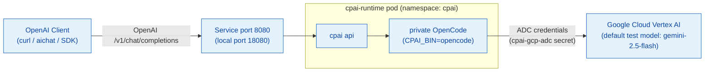

# AGENTS.md — d2-cpai (CPAI Runtime Proxy)

The `d2-cpai` slice deploys the CPAI runtime proxy. The proxy is an OpenAI-compatible API server. It forwards each request to a private OpenCode process, which calls Vertex AI. The proxy runs in the dedicated `cpai` namespace. The human guide is [`README.md`](README.md).

## Stack

| Component | Technology | Path |
|---|---|---|
| Runtime server | OpenAI-compatible API server. It is built from `Dockerfile.runtime` in the cpai-cli checkout. | `$CPAI_CLI_ROOT` |
| Manifests | Kustomize base and local overlay | [`apps/cpai-runtime/base/`](apps/cpai-runtime/base/), [`apps/cpai-runtime/local/`](apps/cpai-runtime/local/) |
| Lifecycle scripts | Bash | [`../scripts/cpai-up.sh`](../scripts/cpai-up.sh), [`../scripts/cpai-down.sh`](../scripts/cpai-down.sh) |
| Smoke tests | BATS suite | [`test/cpai-runtime.bats`](test/cpai-runtime.bats) |
| Multi-turn test | BATS suite with aichat | [`test/conversation.bats`](test/conversation.bats) |
| Client config | aichat configuration | [`test/aichat/config.yaml`](test/aichat/config.yaml) |

## Namespaces

| Namespace | Contents |
|---|---|
| `cpai` | CPAI runtime pod, service, and Google Cloud credentials secret |

## Architecture

The diagram shows the request path from a client through the runtime pod and OpenCode to Vertex AI.



- Deployment: [`deployment.yaml`](apps/cpai-runtime/base/deployment.yaml)
- Smoke test: [`test/cpai-runtime.bats`](test/cpai-runtime.bats)
- Client config: [`test/aichat/config.yaml`](test/aichat/config.yaml)

The manifest pins no model. `gemini-2.5-flash` is only the default that the tests ask for (`CPAI_TEST_MODEL`).

## Lifecycle

Run these lifecycle targets from the repository root:

```bash
make demo-cpai-up            # Build image, push to Zot, sign with Cosign, and deploy
make demo-cpai-test          # Run smoke tests and single-turn completion test
make demo-cpai-conversation  # Run multi-turn context recall test with aichat
make demo-cpai-down          # Delete the cpai namespace
```

`make demo-cpai-up` runs `make cpai-images` and then [`cpai-up.sh`](../scripts/cpai-up.sh). The script applies the manifests, creates or refreshes the `cpai-gcp-adc` Secret from your ADC file, and forces a rollout. The rollout makes the pod run the image that was built and signed. Without it, the `:latest` tag alone would make no change.

To run CPAI without the full foundation, use `make cpai-only`. It makes a
minimal foundation (`make cpai-foundation`: Kind, Zot, and cosign keys only)
and then deploys CPAI.

## Prerequisites

1. Start the cluster foundation with `make up`.
2. Check that `CPAI_CLI_ROOT` points to a checkout of `cpai-cli` that contains `Dockerfile.runtime`. It defaults to `/home/andy/src/cp/cpai-cli` ([`Makefile`](../Makefile)).
3. Run `gcloud auth application-default login`, or set
   `GOOGLE_APPLICATION_CREDENTIALS` to a service account key file.
   `make demo-cpai-up` makes the `cpai-gcp-adc` Secret from these credentials.
   If it cannot read them, it gives a warning, and the model calls fail.
4. Install `aichat` to run the multi-turn conversation test.

To replace expired credentials, run `make demo-cpai-up` again, then restart the
deployment:

```bash
kubectl -n cpai rollout restart deployment/cpai-runtime
```

The deployment also mounts the optional Secret `cpai-codex-auth` and sets
`CPAI_BIN=opencode`
([`deployment.yaml`](apps/cpai-runtime/base/deployment.yaml)).
The liveness and readiness probes both call `/healthz`.

## Direct Service Access

The port-forward and `curl` commands are in [`README.md`](README.md#talk-to-it-directly).

## Testing

- `make demo-cpai-test-config` renders the Kustomize overlays without a cluster (`make -C d2-cpai kustomize-check`).
- `make demo-cpai-test` runs [`test/cpai-runtime.bats`](test/cpai-runtime.bats) against the running cluster. It skips the completion test when the model backend returns an error.
- `make demo-cpai-conversation` runs [`test/conversation.bats`](test/conversation.bats) with aichat.

## Pitfalls

- **HTTP 5xx responses or skipped tests:** The `cpai-gcp-adc` Secret is missing or expired. Run `make demo-cpai-up` again and restart the deployment.
- **Image build failure:** `CPAI_CLI_ROOT` does not point to a checkout with `Dockerfile.runtime`. Set the variable when you run `make demo-cpai-up`.
- **Port-forward stops on rollout:** Restart the `kubectl port-forward` command after every deployment restart.
- **`aichat: command not found`:** Install `aichat`. Only the conversation test needs it.
