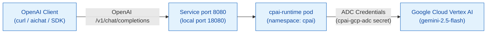

# AGENTS.md — d2-cpai (CPAI Runtime Proxy)

The `d2-cpai` slice deploys the CPAI runtime proxy. The proxy provides an OpenAI-compatible API server that forwards requests to Vertex AI. It runs in the dedicated `cpai` namespace.

## Stack

| Component | Technology | Path |
|---|---|---|
| Runtime server | Go API server with OpenAI compatibility | Built from `$CPAI_CLI_ROOT` |
| Manifests | Kustomize overlays | `apps/cpai-runtime/base/`, `local/` |
| Smoke tests | BATS test suite | `test/cpai-runtime.bats` |
| Multi-turn test | BATS test suite with aichat | `test/conversation.bats` |
| Client config | YAML client configuration | `test/aichat/config.yaml` |

## Namespaces

| Namespace | Contents |
|---|---|
| `cpai` | CPAI runtime pod, service, and Google Cloud credentials secret |

## Architecture



## Lifecycle

Run these lifecycle targets from the repository root:

```bash
make demo-cpai-up            # Build image, push to Zot, sign with Cosign, and deploy
make demo-cpai-test          # Run smoke tests and single-turn completion test
make demo-cpai-conversation  # Run multi-turn context recall test with aichat
make demo-cpai-down          # Delete the cpai namespace
```

## Prerequisites

1. Start the cluster foundation with `make up`.
2. Check that `$CPAI_CLI_ROOT` points to a checkout of `cpai-cli` that contains `Dockerfile.runtime`.
3. Create the Google Cloud secret from your Application Default Credentials:

```bash
kubectl -n cpai create secret generic cpai-gcp-adc \
  --from-file=adc.json="$HOME/.config/gcloud/application_default_credentials.json"
kubectl -n cpai rollout restart deployment/cpai-runtime
```

4. Install `aichat` to run multi-turn conversation tests.

## Direct Service Access

Forward the service port to query the runtime:

```bash
kubectl -n cpai port-forward svc/cpai-runtime 18080:8080 &

# Check health endpoint
curl -s http://localhost:18080/healthz

# List models
curl -s http://localhost:18080/v1/models | jq .

# Run one-shot completion
curl -s http://localhost:18080/v1/chat/completions \
  -H 'Content-Type: application/json' \
  -d '{
    "model": "google-vertex/gemini-2.5-flash",
    "messages": [{"role": "user", "content": "Say hello world"}],
    "max_tokens": 20
  }' | jq -r '.choices[0].message.content'
```

## Common Pitfalls

- **HTTP 5xx responses or skipped tests:** The `cpai-gcp-adc` secret is missing or expired. Recreate the secret and restart the deployment.
- **Image build failure:** `$CPAI_CLI_ROOT` does not point to the expected branch. Set the variable explicitly when you run `make demo-cpai-up`.
- **Port-forward stops on rollout:** Restart the `kubectl port-forward` command after every deployment restart.
