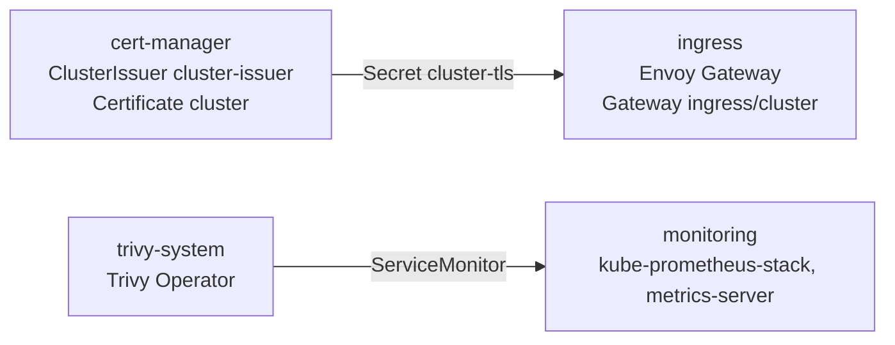

# d2-infra

Infrastructure logical source directory for the Acme Co. OSRAMP demo. It defines the Kubernetes cluster add-ons that the applications depend on, delivered as signed OCI artifacts and reconciled by Flux as the cluster admin. It pairs with `d2-osramp-fleet` (cluster and tenant definitions) and `d2-osramp-apps` (the OSRAMP application services). These are monorepo directories, not separate Git repositories.

## Scope and access control

This logical source directory is owned by the platform team. It defines infrastructure components such as:

- Cluster add-ons (CRD controllers, admission controllers, monitoring)
- Cluster-wide definitions (namespaces, gateway classes, RBAC)

It is reconciled on the cluster fleet by Flux as the cluster admin, so access is restricted to the platform team.

## Components

| Component | Contents |
| --- | --- |
| `cert-manager` | cert-manager controller plus a self-signed cluster issuer and a wildcard cluster certificate. A production deployment would swap the issuer for ACME with a DNS01 solver. |
| `ingress` | Envoy Gateway with a cluster-wide Gateway (HTTP redirected to HTTPS, TLS from the cluster certificate). |
| `monitoring` | kube-prometheus-stack (Prometheus and Grafana with the Flux dashboards) and metrics-server. Monitors opt in with the `osramp.acme.co/scrape: Enabled` label. |
| `trivy-system` | Trivy Operator vulnerability reports and monitoring integration. |

Flux applies the `infra-controllers` Kustomization first and then
`infra-configs` in each component namespace
([`infra.yaml`](../d2-osramp-fleet/tenants/base/infra.yaml)). The diagram
shows what each component supplies to another.



- [`components/cert-manager/`](components/cert-manager/)
- [`components/ingress/`](components/ingress/)
- [`components/monitoring/`](components/monitoring/)
- [`components/trivy-system/`](components/trivy-system/)

## Directory structure

- The `components` dir contains the Flux HelmReleases for cluster add-ons with custom configuration per environment.
- The `update-policies` dir contains the Flux configuration that updates the OCI charts of the Helm releases. It covers cert-manager, Envoy Gateway, and kube-prometheus-stack. Trivy Operator and metrics-server have no policy.

A cluster component is defined in a directory with the following structure:

```sh
component/
├── controllers # CRD definitions and controllers
│   ├── base # common definitions (Namespaces, RBAC, HelmRepositories, HelmReleases)
│   ├── local # local cluster overlay, built on staging
│   ├── preview # ephemeral preview environment values
│   ├── production # production specific HelmRelease values
│   └── staging # staging specific HelmRelease values
└── configs # Custom Resources of controllers
    ├── base # common definitions
    ├── local # local cluster overlay, built on staging
    ├── preview # ephemeral preview environment values
    ├── production # production specific values
    └── staging # staging specific values
```

The CRDs and their controllers are reconciled before the custom resources so the controllers are ready to process them.

## OCI artifacts

Each component is published to a dedicated OCI repository under this project's registry namespace and is tagged as:

- `latest` when an operator runs `push-artifacts.yaml` and the component changed.
- `latest-stable` when an operator runs `release-artifacts.yaml`. No workflow creates a `vX.Y.Z` tag.

Two workflows in the repository root publish and sign the artifacts. Both have only a
`workflow_dispatch` trigger, so an operator starts them from the Actions tab.

- [`push-artifacts.yaml`](../.github/workflows/push-artifacts.yaml) publishes each component artifact to GHCR with the `latest` tag.
  It signs the artifact with cosign keyless.
- [`release-artifacts.yaml`](../.github/workflows/release-artifacts.yaml) publishes the artifacts with the `latest-stable` tag and signs them.
  Its matrix does not include `trivy-system`.

The root has no `image-updates` workflow. This directory has its own `.github/workflows/` with
`push-artifact.yaml`, `release-artifact.yaml`, and `image-updates.yaml`. GitHub runs only the
workflows in the repository root, so those copies do not run.
