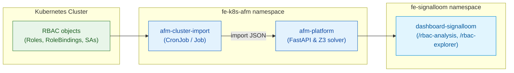

# AGENTS.md — d2-k8s-afm (KubeSec-AFM integration)

KubeSec-AFM is a formal-methods analysis platform for Kubernetes RBAC privilege
escalation. It runs in the `fe-k8s-afm` namespace. A ClusterRole gives its
import CronJob cluster-wide RBAC read access. The human guide is
[`README.md`](README.md).

The backend source is not in this repository. It is in the separate
`kubesec-afm` checkout. `make demo-k8s-afm-up` builds the image from
`$KUBESEC_AFM_ROOT`, or loads `$AFM_IMAGE_ARCHIVE` when no checkout exists
(default `.afm-image/kubesec-afm.tar.gz`). See the caution in the
[root guide](../AGENTS.md#d2-slices).

## Stack

| Component | Technology | Path |
|---|---|---|
| Backend (external) | FastAPI with a Z3 bounded model checker | `$KUBESEC_AFM_ROOT` |
| Kubernetes manifests | Kustomize base and local overlay | [`apps/afm-platform/base/`](apps/afm-platform/base/), [`apps/afm-platform/local/`](apps/afm-platform/local/) |
| Lifecycle script | Bash | [`../scripts/k8s-afm.sh`](../scripts/k8s-afm.sh) |
| Integration tests | BATS suites | [`test/`](test/) |

## Architecture

The diagram shows how cluster RBAC objects flow into KubeSec-AFM and reach the dashboard.



## Namespaces

| Namespace | Contents |
|---|---|
| `fe-k8s-afm` | The `afm-platform` Deployment and Service, the `afm-platform` HTTPRoute, and the `afm-cluster-import` CronJob |

The CronJob runs as the `afm-cluster-reader` ServiceAccount. The ClusterRole
`afm-rbac-reader` lets it list roles, bindings, namespaces, and service
accounts across the cluster
([`cluster-import.yaml`](apps/afm-platform/base/cluster-import.yaml)).

## Lifecycle

```bash
make demo-k8s-afm-up        # Build or load the image, deploy, import this cluster's RBAC, seed samples, and start one analysis
make demo-k8s-afm-status    # Show the pods and the /health endpoint
make demo-k8s-afm-test      # Run the backend pytest suite from the external source
make demo-k8s-afm-down      # Remove the slice
```

`up` loads the image into Kind and applies the local overlay. It then creates
the Job `afm-cluster-import-now` from the CronJob, because a CronJob does not
run on creation. When the source checkout exists, it posts the sample clusters.
Last, it starts one escalation analysis on the `local` cluster and waits for the
result.

## Platform capabilities

The [KubeSec-AFM project](https://github.com/controlplaneio/kubesec-afm)
describes four risk classes. This repository does not test them.

1. **Self-escalation:** a subject can raise its own privileges with the `escalate` verb.
2. **Impersonation:** unscoped cross-namespace impersonation of users and service accounts.
3. **Collusion:** two subjects can combine their permissions to escalate.
4. **Remediation priority:** min-cut and max-flow graph analysis, weighted by CVSS and EPSS.

## Testing

The Bats suites, their prerequisites, and their `make` targets are listed in
[`README.md`](README.md#testing).

## Pitfalls

- The Z3 solver uses much CPU. An analysis of a full production cluster takes a long time.
- The collusion phase forks one Z3 process per host core. Pass `{"check_pairs": false}` to the escalation analysis, or the pod exceeds its memory limit ([`deployment.yaml`](apps/afm-platform/base/deployment.yaml)).
- The engine analyses RBAC objects only. It does not examine container escapes or the contents of Secrets.
- The engine treats a group as one entity. It does not find the members of a group.
- In live mode, the dashboard route `/collusion-access` calls the KubeSec-AFM API. It shows fixture data only in demo mode.
