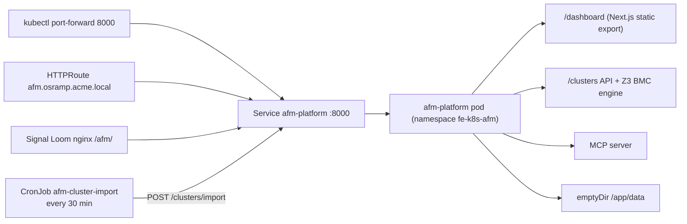

# d2-k8s-afm — KubeSec-AFM D2 Integration

Standalone deployment of the [KubeSec-AFM](https://github.com/controlplaneio/kubesec-afm)
RBAC privilege-escalation analysis platform in the OSRAMP demo cluster.
It runs in the `fe-k8s-afm` namespace. The `make` targets and the `up` steps
are in [`AGENTS.md`](AGENTS.md#lifecycle).

## What's inside

| Component | Stack | Details |
|-----------|-------|---------|
| Backend | FastAPI + Z3 BMC engine | RBAC escalation analysis, job queue, MCP server |
| Frontend | Next.js (static export) | Served at `/dashboard` by the backend |
| API | REST | `/clusters`, `/clusters/{id}/rbac`, `/clusters/{id}/analysis/escalation`, and others |
| Image | `kubesec-afm:latest` | Built from the `kubesec-afm` checkout at `$KUBESEC_AFM_ROOT`, or loaded from `$AFM_IMAGE_ARCHIVE` |

## Access

```bash
kubectl -n fe-k8s-afm port-forward svc/afm-platform 8000:8000
# Dashboard: http://localhost:8000/dashboard
# API health: http://localhost:8000/health
# Swagger:   http://localhost:8000/docs
```

Or via the cluster gateway: `https://afm.osramp.acme.local/dashboard`

## Architecture

One pod runs FastAPI, which serves the Next.js static export, the Z3 BMC
engine, and the optional MCP server on port 8000. No external database is
deployed. The pod mounts an `emptyDir` at `/app/data` (`KUBESEC_DATA_DIR`), so
stored data does not survive a pod restart. A CronJob imports this cluster's
RBAC every 30 minutes.

The diagram shows the three ways into the pod, the import CronJob, and what the
one process serves.



- Manifests: [`apps/afm-platform/base/`](apps/afm-platform/base/)
  ([`deployment.yaml`](apps/afm-platform/base/deployment.yaml),
  [`service.yaml`](apps/afm-platform/base/service.yaml),
  [`gateway-route.yaml`](apps/afm-platform/base/gateway-route.yaml),
  [`cluster-import.yaml`](apps/afm-platform/base/cluster-import.yaml))
- Signal Loom proxy: [`nginx.conf`](../d2-signalloom/apps/dashboard-signalloom/nginx.conf)

## Testing

- **Backend pytest**: unit, integration, e2e, and API tests in the source repo — `make demo-k8s-afm-test`
- **Frontend**: TypeScript typecheck (`npm run typecheck`)
- **Contract**: `check-types.sh` checks OpenAPI ↔ frontend type drift. The script is under
  `scripts/` in the external
  [`kubesec-afm`](https://github.com/controlplaneio/kubesec-afm) repository, not in this repository.

The Bats suites in [`test/`](test/) run from the repository root:

| Suite | Needs | Make target |
| --- | --- | --- |
| [`afm-smoke.bats`](test/afm-smoke.bats) | AFM deployed (`make demo-k8s-afm-up`) and a port-forward on 18000 | `make test-all-cluster` |
| [`afm-live.bats`](test/afm-live.bats) | AFM deployed (`make demo-k8s-afm-up`) | None. Run `bats d2-k8s-afm/test/afm-live.bats`. |
| [`afm-converter.bats`](test/afm-converter.bats) | Nothing. It checks the converter contract and RBAC manifests offline, against fixtures. | None. Run `bats d2-k8s-afm/test/afm-converter.bats`. |

## Bridging (future)

This D2 is allowed to bridge to Signal Loom's shared infrastructure:
- **Postgres** (`inf-signalloom`) for persistent cluster storage
- **Redis** (`inf-signalloom`) for job queue
- **OpenBao** (`inf-bao`) for SPIFFE workload identity (KTP integration)
