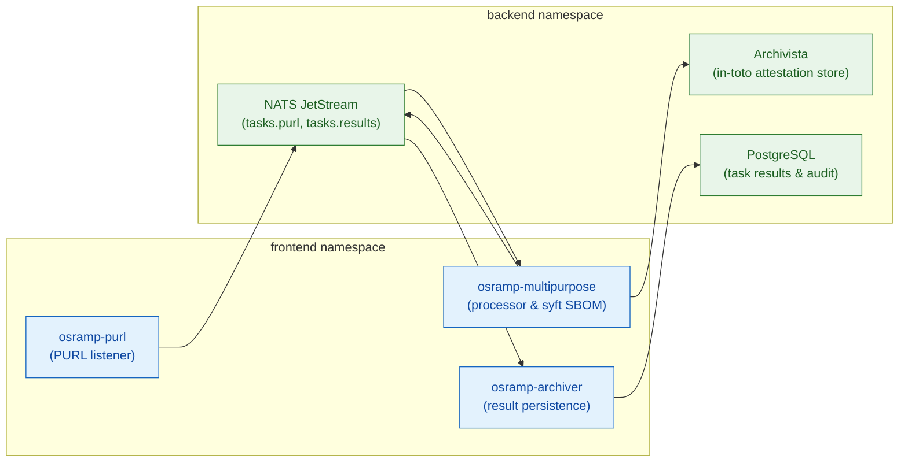

# AGENTS.md — d2-osramp-apps (OSRAMP application slice)

This slice is the application tenant of the Acme Co. OSRAMP demonstration. Flux
reconciles it into the `frontend` and `backend` namespaces. The human guide is
[`README.md`](README.md).

CAUTION: On the local fleet, the `apps` tenant is disabled. Re-enable it in
[`../d2-osramp-fleet/tenants/local/kustomization.yaml`](../d2-osramp-fleet/tenants/local/kustomization.yaml)
before you run `make demo-osramp-up`. The script
[`../scripts/osramp-up.sh`](../scripts/osramp-up.sh) patches the ResourceSet
`apps`, which the local fleet does not create.

## Stack

| Component | Technology | Path |
|---|---|---|
| Archiver | Go service | [`apps/archiver/`](apps/archiver/) |
| Listener | Go service | [`apps/listener/`](apps/listener/) |
| Processor | Go service (Witness attestation signer) | [`apps/processor/`](apps/processor/) |
| Components | Kustomize manifests. `frontend` holds three Deployments. `backend` holds PostgreSQL, a NATS HelmRelease, Archivista, and MinIO. | [`components/`](components/) |
| Image policies | Flux `ImageRepository` and `ImagePolicy` objects | [`update-policies/`](update-policies/) |
| Tests | BATS suites | [`test/`](test/) |

The `ImageUpdateAutomation` that uses the image policies is in
[`../d2-osramp-fleet/clusters/update/`](../d2-osramp-fleet/clusters/update/).

## Architecture

The diagram shows how packages flow through the frontend services and the backend evidence plane.



## Lifecycle

```bash
make demo-osramp-up           # Deploy the OSRAMP frontend and backend
make demo-osramp-test         # Run the manifest checks and the BATS acceptance tests
make demo-osramp-down         # Remove OSRAMP. The foundation stays.
```

## Testing

```bash
make demo-osramp-test-config        # Check the manifests without a running slice
make demo-osramp-test               # Run the full acceptance tests on a running cluster
bats d2-osramp-apps/test/osramp.bats  # Run the BATS suite directly
```

## Namespaces

| Namespace | Contents | Path |
|---|---|---|
| `frontend` | Deployments `osramp-archiver`, `osramp-multipurpose`, `osramp-purl`, and the Secret `signing-key` | [`components/frontend/base/`](components/frontend/base/) |
| `backend` | PostgreSQL Pod, NATS HelmRelease, Archivista Deployment, MinIO Deployment | [`components/backend/base/`](components/backend/base/) |

## Resource scope

Flux applies this slice as the namespace admin. The scope is in
[`README.md`](README.md#scope-and-access-control).

CAUTION: `components/backend/base/` contains `minio-operator.yaml` and
`minio-tenant.yaml`. These files define Namespaces, CRDs, a ClusterRole, and a
ClusterRoleBinding. No `kustomization.yaml` includes them, so Flux does not
apply them. Do not add them to the backend kustomization. The tenant identity
cannot apply them, and the reconciliation then fails.

## Pitfalls

- The licence is the GNU Affero General Public License, version 3 ([`LICENSE`](LICENSE)).
- The processor signs attestations with an ed25519 key. `make workload-key` at
  the repository root makes it. The slice target `make -C d2-osramp-apps signing-key`
  makes the Secret `signing-key` in `frontend` directly with `kubectl`.
- No active release uses the three image policies. They target podinfo, redis
  and memcached. The backend kustomization comments out redis and memcached.
