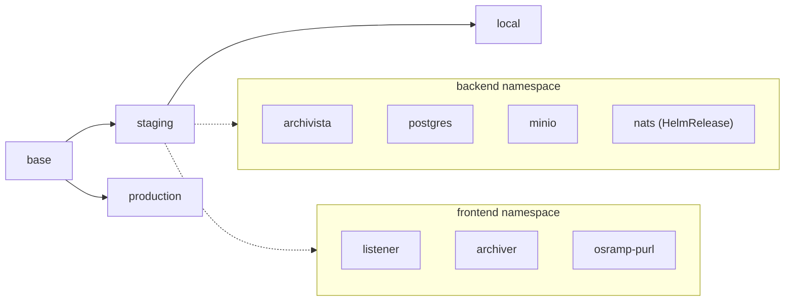

# d2-osramp-apps

> [!NOTE]
> This logical source directory is the application tenant of the Acme Co. OSRAMP demo,
> following the Flux D2 reference architecture together with the
> `d2-osramp-fleet` and `d2-infra` directories of the monorepo.

## Scope and Access Control

This logical source directory is managed by the dev teams who are responsible for
the delivery of applications to the Kubernetes cluster fleet.

It defines the application components:

- Kustomize manifests for the `frontend` and `backend` namespaces, with a values overlay per environment
- One Flux HelmRepository and HelmRelease pair, for NATS in [`components/backend/base/nats.yaml`](components/backend/base/nats.yaml)

It is reconciled on the cluster fleet by Flux as the **namespace admin**.
It can't contain Kubernetes cluster-wide definitions such as CRDs, Cluster Roles, Namespaces, etc.

The platform team that manages the `d2-osramp-fleet` directory assigns the
namespaces to the dev teams. The platform team also configures Flux with the
RBAC to reconcile these components across the cluster fleet. Cluster-wide resources the
applications depend on (CRD controllers, gateway classes, monitoring) live in
`d2-infra`.

Access is restricted to the dev teams and the Flux bot account.

NOTE: The policy is that the bot is the only account with direct push access to
the `main` branch. No file in this tree enforces the policy.

## Quickstart

The full environment is built from the repository root:

```bash
cd ..            # the monorepo root
make up          # healthy shared cluster foundation; no workloads start
make demo-osramp-up
make test        # end-to-end suite for the opted-in OSRAMP workload
```

For tight inner-loop work on the services themselves, this directory has a
direct path that bypasses GitOps:

Run `make up` from the repository root first. `make build` pushes to the
in-cluster Zot registry, and `make cluster-up` does not create that registry.

```bash
kubectl create ns frontend
make signing-key     # ed25519 key the processor signs attestations with
make local-dev       # apply backend + frontend manifests directly
make build           # build the three images and persist them in the in-cluster Zot registry
make test            # bats end-to-end suite
```

## Components

The diagram shows the two namespaces, the workloads in each, and the
environment overlays that Flux reconciles from them.



- Backend releases: [`components/backend/base/`](components/backend/base/)
- Frontend releases: [`components/frontend/base/`](components/frontend/base/)
- Overlays: [`components/backend/local/`](components/backend/local/),
  [`components/backend/staging/`](components/backend/staging/),
  [`components/backend/production/`](components/backend/production/)

## Directory structure

This logical source directory contains the following directories:

- The **components** dir contains the Kustomize manifests that define how Flux
  deploys the applications to the cluster fleet. A values overlay per environment
  patches the base.
- The **update-policies** dir contains Flux `ImageRepository` and `ImagePolicy`
  objects for podinfo, redis and memcached. No active release uses them.

The application components are grouped by namespace, and are defined in a directory with the following structure:

```sh
./components/
└── namespace (frontend, backend)
    ├── base
    │   ├── kustomization.yaml
    │   ├── workload1.yaml
    │   └── workload2.yaml
    ├── local (inherits from staging)
    │   ├── kustomization.yaml
    │   └── workload1-values.yaml   # frontend only; backend/local holds kustomization.yaml alone
    ├── production (inherits from base)
    │   ├── kustomization.yaml
    │   ├── workload1-values.yaml
    │   └── workload2-values.yaml
    └── staging (inherits from base)
        ├── kustomization.yaml
        ├── workload1-values.yaml
        └── workload2-values.yaml
```

Flux reconciles each namespace on its own. Each namespace holds several
workloads with a configuration patch per environment.
