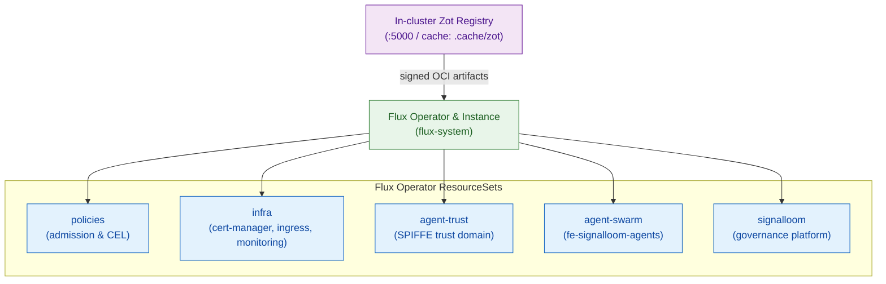

# AGENTS.md — d2-osramp-fleet (Flux fleet definitions)

This slice is the fleet configuration of the platform team. It defines the
clusters, the tenants, and the ResourceSets of the Flux Operator. The human
guide is [`README.md`](README.md).

## Stack

| Component | Technology | Path |
|---|---|---|
| Cluster definitions | Flux Operator CRDs, one directory per cluster | [`clusters/`](clusters/) |
| Tenant definitions | ResourceSets and RBAC | [`tenants/`](tenants/) |
| Local registry | The in-cluster Zot registry | [`local/zot.yaml`](local/zot.yaml) |
| Terraform | Cloud fleet bootstrap | [`terraform/`](terraform/) |
| Makefile | Registry and bootstrap targets | [`Makefile`](Makefile) |

## Architecture

The diagram shows how the in-cluster Zot registry supplies signed OCI artifacts to the Flux Operator ResourceSets.



## Key concepts

- A ResourceSet tells Flux which D2 slices to deploy to which clusters and namespaces.
- [`tenants/local/signalloom.yaml`](tenants/local/signalloom.yaml) is the one
  source for the Signal Loom Flux reconciliation. See
  [`../d2-signalloom/README.md`](../d2-signalloom/README.md#ownership).
- The tenant files in [`tenants/base/`](tenants/base/) set the identity of each
  tenant. The `infra` and `olly` tenants get `cluster-admin`. The `apps` tenant
  gets only the namespace `admin` role. The `agent-trust` and `agent-swarm`
  tenants get their own ClusterRoles.
- The local fleet, [`tenants/local/kustomization.yaml`](tenants/local/kustomization.yaml),
  applies policies, infra, agent-trust, agent-swarm and signalloom. It excludes
  apps and olly. `make demo-osramp-up` and `make demo-olly-up` add those two.

## Lifecycle

`make up` at the repository root runs the local steps in order: it creates the
Kind cluster, runs `zot-up`, makes the signing keys, and runs `bootstrap-local`.

```bash
make up                                   # Foundation only. No demo workload starts.
make -C d2-osramp-fleet zot-up            # Deploy the in-cluster Zot registry
make -C d2-osramp-fleet bootstrap-local   # Install the Flux Operator and sync from Zot
```

`bootstrap-local` needs `COSIGN_PUB` to point at the local Cosign public key.
It stores the key in the Secret `cosign-pub` in `flux-system`.

## Namespaces

| Tenant | Namespaces | Source |
|---|---|---|
| `infra` | `cert-manager`, `ingress`, `monitoring`, `trivy-system` | [`tenants/base/infra.yaml`](tenants/base/infra.yaml) |
| `policies` | `flux-system` | [`tenants/base/policies.yaml`](tenants/base/policies.yaml) |
| `apps` | Set at run time by [`../scripts/osramp-up.sh`](../scripts/osramp-up.sh). The base file has empty inputs. | [`tenants/base/apps.yaml`](tenants/base/apps.yaml) |
| `olly` | Set at run time by [`../scripts/olly-up.sh`](../scripts/olly-up.sh). The base file has empty inputs. | [`tenants/base/olly.yaml`](tenants/base/olly.yaml) |
| `agent-trust` | `agent-trust-platform` and five tenant and project namespaces | [`tenants/base/agent-trust.yaml`](tenants/base/agent-trust.yaml) |
| `agent-swarm` | `fe-signalloom-agents` | [`tenants/base/agent-swarm.yaml`](tenants/base/agent-swarm.yaml) |
| `signalloom-infra`, `signalloom-apps` | `inf-bao`, `inf-signalloom`, `fe-signalloom` | [`tenants/local/signalloom.yaml`](tenants/local/signalloom.yaml) |

## Makefile targets

Each target in the fleet Makefile changes a cluster or a registry. None of them
is a dry run.

| Target | Action |
|---|---|
| `make -C d2-osramp-fleet zot-up` | Deploy the in-cluster Zot registry |
| `make -C d2-osramp-fleet bootstrap-local` | Install the Flux Operator and sync from Zot |
| `make -C d2-osramp-fleet push` | Push the manifests to GitHub Container Registry |
| `make -C d2-osramp-fleet bootstrap-staging` | Install the Flux Operator on the staging cluster |
| `make -C d2-osramp-fleet bootstrap-production` | Install the Flux Operator on the `prod-eu` cluster. No target bootstraps `prod-us`. |
| `make -C d2-osramp-fleet bootstrap-update` | Install the Flux Operator on the image-update cluster |

For local work, use `make up` at the repository root. It runs the local steps.

## Testing

This slice has no test directory. The root suites that read the fleet files
include [`../test/resourceset-inputs-declarative.bats`](../test/resourceset-inputs-declarative.bats),
[`../test/demo-lifecycle.bats`](../test/demo-lifecycle.bats) and
[`../test/zot-cache.bats`](../test/zot-cache.bats).

```bash
bats test/resourceset-inputs-declarative.bats   # From the repository root
```

## Pitfalls

- The manifests in this directory apply with `cluster-admin` access.
- Every ResourceSet `readyExpr` checks the `Ready` condition. Keep new ones
  the same.
- Git does not hold the Terraform state files.
