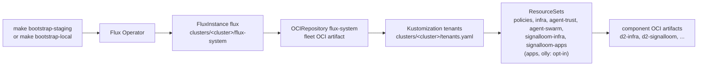

# d2-osramp-fleet

> [!NOTE]
> This logical source directory is part of the reference architecture for the
> [ControlPlane Enterprise for Flux CD](https://fluxcd.control-plane.io/).
>
> The `d2` reference architecture is comprised of the
> `d2-osramp-fleet`, `d2-infra` and `d2-osramp-apps` directories of the Acme Co. OSRAMP monorepo.
> It is a set of best practices and production-ready examples for using Flux Operator
> and OCI Artifacts. They manage the continuous delivery of Kubernetes infrastructure and
> applications on multi-cluster multi-tenant environments.
>
> Download the guide: [Flux D2 Architectural Reference](https://raw.githubusercontent.com/controlplaneio-fluxcd/distribution/main/guides/ControlPlane_Flux_D2_Reference_Architecture_Guide.pdf)

## Scope and Access Control

The platform team manages this logical source directory. The platform team is responsible for
the Kubernetes infrastructure and has direct access to the fleet of clusters.

The platform team that manages this directory must have **admin** rights to the monorepo path.
It must also have **cluster admin** rights to all clusters in the fleet. Those rights permit the following tasks:

- Bootstrap Flux Operator with multi-tenancy restrictions on the fleet of clusters.
- Configure the delivery of platform components (defined in [d2-infra](../d2-infra)).
- Configure the delivery of applications (defined in [d2-osramp-apps](../d2-osramp-apps)).

## OCI Artifacts

The content of the D2 logical source directories is packaged as OCI Artifacts. GitHub Actions
workflows in this monorepo publish the artifacts to GitHub Container Registry.
GitHub Actions signs them with the Cosign keyless procedure and the GitHub Actions OIDC.
The local fleet signs with a key pair and verifies with the Secret `cosign-pub`
([`clusters/local/flux-system/flux-instance.yaml`](clusters/local/flux-system/flux-instance.yaml)
and [`tenants/local/kustomization.yaml`](tenants/local/kustomization.yaml)).

Flux running in the clusters, pulls the OCI Artifacts to reconcile the desired state and
verifies the integrity of the content using the Cosign signature. On production clusters,
the artifacts signature subject must match the GitHub repository, Git tag and the
GitHub workflow used to publish the artifact.

### Fleet Artifacts

The artifacts published to `oci://ghcr.io/acme-co/osramp/fleet` are tagged as:

- `latest` from [`push-artifacts.yaml`](../.github/workflows/push-artifacts.yaml)
  and from `make push`. No workflow publishes `main-<sha>`.
- `latest-stable` from [`release-artifacts.yaml`](../.github/workflows/release-artifacts.yaml).
  No workflow creates a `vX.Y.Z` tag.

Both workflows run only by manual trigger.

The Flux Operator running on the Kubernetes clusters in the fleet is configured with a
[FluxInstance](../d2-osramp-fleet/clusters/staging/flux-system/flux-instance.yaml).
The FluxInstance points to the OCI Artifact that defines the desired state of each cluster. The staging clusters
are synced from the `latest` tag, while the production clusters are synced from the `latest-stable` tag.

### Components Artifacts

The infrastructure components from `d2-infra` and the applications from `d2-osramp-apps` follow the same pattern
and are packaged as OCI Artifacts. The delivery of these components is performed by the Flux Operator
using the [ResourceSet](tenants) definitions.

Each component is published to a dedicated OCI repository, for example, the `frontend` component
is published to `oci://ghcr.io/acme-co/osramp/apps/frontend` and is tagged as:

- `latest` from `push-artifacts.yaml`, when the component content changed.
- `latest-stable` from `release-artifacts.yaml`. No workflow creates a
  `vX.Y.Z` tag. The tag list is the same as for the
  [fleet artifacts](#fleet-artifacts).

A component artifact contains the Kubernetes manifests (Flux resources and Kustomize overlays).
Those manifests define the desired state of the component for the whole fleet of clusters:

```text
.
├── base
│   ├── kustomization.yaml
│   └── helm-release.yaml
├── production
│   ├── kustomization.yaml
│   └── values-patch.yaml
└── staging
    ├── kustomization.yaml
    └── values-patch.yaml
```

When Flux Operator reconciles the `ResourceSet` for the components, it configures the components tagged
as `latest` to be deployed on the staging clusters. It configures the ones tagged as
`latest-stable` to be deployed in production.

Roadmap: with semver tags, a rollback in production moves the `latest-stable` tag to a previous version,
for example, `flux tag oci://ghcr.io/acme-co/osramp/apps/frontend:v1.2.3 --tag latest-stable`.

The semver tags are considered immutable, while the `latest-stable` tag act as a pointer to the
latest release of the component.

## Bootstrap Procedure

The bootstrap procedure is a one-time operation that installs the Flux Operator on the cluster.
It configures the Flux controllers and the delivery of platform components and applications.

The diagram shows the order from bootstrap to the tenant workloads.



- Cluster definitions: [`clusters/`](clusters/)
- Tenant ResourceSets: [`tenants/base/`](tenants/base/) and [`tenants/local/`](tenants/local/)
- Terraform bootstrap: [`terraform/`](terraform/)

After bootstrap, changes to the Flux configuration and version upgrades are done by
modifying the [FluxInstance](../d2-osramp-fleet/clusters/staging/flux-system/flux-instance.yaml)
manifest and letting Flux reconcile the changes. There is no need to run bootstrap
again nor connect to the cluster.

### GitHub PAT Configuration

It is recommended to create a dedicated GitHub account for the Flux bot. This account will be used
by the Flux source-controller running on clusters to authenticate with GitHub Container Registry
to pull the OCI Artifacts.

The Flux bot account must have read access to the monorepo package namespace. The GitHub Personal Access Token (PAT) should grant read-only access to the GitHub Container Registry
by selecting the `read:packages` scope.

### Bootstrap a Kubernetes Cluster

Create a KinD cluster first. The target creates no cluster. Then run
`make bootstrap-staging` with `GITHUB_TOKEN` set:

```shell
export GITHUB_TOKEN=<Flux Bot PAT>

make bootstrap-staging
```

Another option is to use Terraform or OpenTofu. An example of how to bootstrap a cluster with Terraform
is available in the [terraform](terraform) directory.

```shell
terraform apply \
  -var oci_token="${GITHUB_TOKEN}" \
  -var oci_url="oci://ghcr.io/acme-co/osramp/fleet" \
  -var oci_tag="latest" \
  -var oci_path="clusters/staging"
```

The bootstrap performs the following steps:

- Creates the `flux-system` namespace.
- Installs the Flux Operator using Helm.
- Creates a `FluxInstance` pointing to the `oci://ghcr.io/acme-co/osramp/fleet` artifact.
- Creates a Kubernetes image pull secret with the GitHub PAT.

After bootstrap, the Flux Operator Helm release and the Flux instance configuration
are being managed by Flux itself. Any changes to the Flux configuration from now on should be done
by modifying the manifests in the
[flux-system](clusters/staging/flux-system)
directory.

## Onboarding Platform Components

The platform team is responsible for onboarding the platform components defined as Flux HelmReleases in
[d2-infra](../d2-infra) and setting the dependencies
between the components.

Platform components are cluster add-ons such as CRDs and their respective controllers,
and are reconciled by Flux as the **cluster admin**.

The platform team onboards a component from the `d2-infra` directory in the root
[`push-artifacts.yaml`](../.github/workflows/push-artifacts.yaml) workflow. It adds an
entry for the component to the matrix:

```yaml
      ...
      matrix:
        include:
          - repository: infra/cert-manager
            path: ./d2-infra/components/cert-manager
          - repository: infra/monitoring
            path: ./d2-infra/components/monitoring
```

NOTE: `d2-infra/.github/workflows/push-artifact.yaml` also exists. GitHub runs only
the workflows in the repository root, so that file has no effect.

With this, an OCI Artifact will be published and signed for the new component.

In this fleet directory, the platform team must add a new set of inputs for the
`infra` `ResourceSet`:

```yaml
  ...
  inputs:
    - tenant: "cert-manager"
      tag: "${ARTIFACT_TAG}"
      environment: "${ENVIRONMENT}"
      artifactSubjectWorkflow: "${ARTIFACT_SUBJECT_WORKFLOW}"
      artifactSubjectGitRef: "${ARTIFACT_SUBJECT_GIT_REF}"
    - tenant: "monitoring"
      tag: "${ARTIFACT_TAG}"
      environment: "${ENVIRONMENT}"
      artifactSubjectWorkflow: "${ARTIFACT_SUBJECT_WORKFLOW}"
      artifactSubjectGitRef: "${ARTIFACT_SUBJECT_GIT_REF}"
```

With this, the set of base resources for a component will now also be created for the new component.
This set includes an `OCIRepository` object that points to the OCI Artifact, and two `Kustomization`
objects consuming the artifact, `infra-controllers` and `infra-configs`. Together they configure the
reconciliation of the new component.

The [`d2-infra`](../d2-infra/) logical source directory has four components.
Each component has this structure:

```shell
./components/
├── cert-manager
│   ├── configs
│   │   ├── base
│   │   ├── local
│   │   ├── preview
│   │   ├── production
│   │   └── staging
│   └── controllers
│       ├── base
│       ├── local
│       ├── preview
│       ├── production
│       └── staging
├── ingress
├── monitoring
└── trivy-system
```
