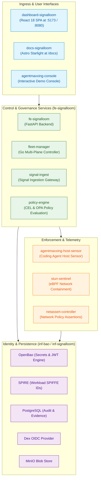

# AGENTS.md: Signal Loom Delivery Slice

Signal Loom is an agent governance platform. It provides a React dashboard SPA,
a FastAPI backend, Dex OIDC, OpenBao with SPIRE, Fleet Manager, and integration proxies.

## Platform Architecture



## Stack

| Component | Technology | Path |
|---|---|---|
| Dashboard SPA | React 18, Vite, TypeScript, nginx | `apps/dashboard-signalloom/` |
| User documentation | Astro Starlight, Mermaid, nginx | `apps/docs-signalloom/` |
| API backend | Python FastAPI | `apps/fe-signalloom/src/` |
| Fleet Manager | Go multi-plane controller | `apps/fleet-manager/` |
| Host Sensor | Go eBPF & procfs sensor | `apps/agentmaxxing-host-sensor/` |
| Stun Sentinel | Go & eBPF tc-drop filter | `apps/stun-sentinel/` |
| Integration services | Go and Python proxy | `apps/fake-integration-proxy/` |
| Identity | Dex OIDC (local static user) | `infra/inf-signalloom/base/dex.yaml` |
| Secrets and identity | OpenBao, SPIRE | `infra/inf-bao/` |
| Kagent control plane | CNCF Kagent CRDs and swarm | `infra/kagent/` |
| Persistence | PostgreSQL, Redis, MinIO | `infra/inf-signalloom/` |
| Go tools | proof-helper | `proof-helper/` |
| Kubernetes manifests | Kustomize overlays | `apps/fe-signalloom/base/`, `local/` |
| Tests | BATS and Vitest test suites | `test/` |

## Namespaces

| Namespace | Contents |
|---|---|
| `fe-signalloom` | Dashboard SPA, API backend, Gateway HTTPRoutes |
| `fe-signalloom-agents` | Demo agent workloads |
| `inf-signalloom` | Dex, PostgreSQL, Redis, MinIO, fake integration proxy |
| `inf-bao` | OpenBao server, SPIRE server, SPIRE agents |

## Lifecycle

```bash
make demo-signalloom-up           # Build images, sign, push, and reconcile Flux
make demo-signalloom-test         # Run topology and Flux readiness checks
make demo-signalloom-runtime-test # Run BATS and DETIK runtime assertions
make demo-signalloom-down         # Remove slice while keeping foundation
```

## Dashboard Access

```bash
# Port must be 5173. Dex issuer and redirect URIs require this exact port.
kubectl port-forward -n fe-signalloom svc/dashboard-signalloom 5173:8080
# Open: http://localhost:5173
# Login: demo-user@signalloom.local / demo-user

# Connect through Envoy Gateway (HTTPS)
kubectl -n ingress port-forward svc/envoy-ingress-cluster-* 18443:443
# curl -sk --resolve dashboard.osramp.acme.local:18443:127.0.0.1 https://dashboard.osramp.acme.local:18443/
```

## Dashboard Routes

| Route | Page Name | Purpose / Data Source | Superadmin Only |
|---|---|---|---|
| `/agents` | Agents (default) | Agent inventory & lifecycle status from API | |
| `/agents/:id` | Agent Detail | Metadata, credentials, and telemetry for one agent | |
| `/discovery` | Discovery | Discovered cloud accounts and identity providers | |
| `/discovery/accounts/:accountId` | Account Detail | Workloads discovered within a single cloud account | |
| `/topology` | Agent Trust Topology | SPIFFE trust domain relationships and network graphs | |
| `/activity` | The Weave | Live message bus and inter-agent transaction stream | |
| `/risk` | FAIR Risk Exposure | Quantitative financial loss exposure model | |
| `/policies` | Compliance Policies | Policy enforcement engine and rule evaluation | |
| `/compliance` | Compliance Overview | Multi-framework regulatory compliance posture | |
| `/compliance/posture` | Agent Posture | Fleet-wide agent posture assessment | |
| `/compliance/:frameworkId` | Framework Detail | Detailed control evaluation for one framework | |
| `/collusion-access` | Collusion & Access | Multi-agent privilege escalation analysis | ✓ |
| `/audit` | Audit Trail | Append-only immutable audit log from PostgreSQL | |
| `/federated-services` | Federated Services | External federated service connectors | ✓ |
| `/cryptography` | Cryptography | OpenBao and SPIRE cryptographic proof verification | ✓ |
| `/credential-inventory` | Credential Inventory | Active credentials, expiration leases, and rotation status | |
| `/rbac-analysis` | RBAC Analysis | Formal-methods privilege escalation analysis (AFM) | ✓ |
| `/rbac-explorer` | RBAC Explorer | Interactive RBAC graph exploration (AFM) | ✓ |
| `/signal-fusion` | Signal Fusion | Multi-sensor telemetry correlation | |
| `/distance-latency` | Distance & Latency | Inter-service network distance and latency metrics | |
| `/signal-store` | Signal Store | Raw and processed telemetry signals | |
| `/feeds` | Feeds Explorer | External threat intelligence feeds | |
| `/settings` | Settings | Platform configuration and API key management | |
| `/onboarding` | Setup Wizard | Initial platform and tenant setup wizard | |
| `/help/connectors/:provider` | Connector Help | Provider-specific connector configuration instructions | |
| `/network-tests` | Network Tests | In-cluster connectivity and SPIFFE trust boundaries | |
| `/supercred` | SuperCred Demo | High-privilege agent credential escalation simulation | |
| `/fleet` | Fleet Demo | Multi-cluster fleet topology and health metrics | |
| `/fleet/audience` | Fleet Audience View | Read-only presentation view for fleet demonstrations | |
| `/demos/agentmaxxing` | AgentMaxxing Demo | Interactive console for multi-plane containment | |
| `/design-system` | Design System | Component palette and typography showcase | |
| `/design-system/headers` | Design System Headers | Standardised header hierarchy reference | |
| `/redeem-invite` | Redeem Invite | User onboarding and invitation acceptance | |
| `/docs` | Documentation | Embedded Astro Starlight technical documentation | |

Utility routes: `/onboarding` (wizard) and `/redeem-invite` (user signup).

Controls at bottom-right:
- **ThemeToggle**: Switch between Dark, Light, and Andy themes.
- **DemoToggle**: Switch between live API data and local fixture data.

Superadmin is a navigation toggle. It appears only for `demo-user`. It hides or shows
the five marked navigation entries. It affects UI visibility only. Direct URLs remain
accessible.

Read [`docs/signalloom/dashboard-superadmin-themes-importer.md`](../docs/signalloom/dashboard-superadmin-themes-importer.md)
for details.

## Application Components

All application source code resides under `apps/`:

| Component | Path | Description |
|---|---|---|
| `agentmaxxing-host-sensor` | `apps/agentmaxxing-host-sensor/` | Host sensor for coding agent detection, netlink attribution, and inference CIDR mapping. |
| `cardvault` | `apps/cardvault/` | PCI-DSS simulated credit card storage service. |
| `cardvault-agent` | `apps/cardvault-agent/` | Semi-autonomous AI agent interacting with cardvault. |
| `cpai-engineer` | `apps/cpai-engineer/` | Automated coding agent worker implementation. |
| `dashboard-signalloom` | `apps/dashboard-signalloom/` | React 18 / TypeScript single-page application. |
| `docs-signalloom` | `apps/docs-signalloom/` | Astro Starlight documentation portal served at `/docs`. |
| `factory-appraiser` | `apps/factory-appraiser/` | Asset appraisal agent workload. |
| `fake-integration-proxy` | `apps/fake-integration-proxy/` | Deterministic fixture and discovery proxy for LLM and CRM endpoints. |
| `fe-signalloom` | `apps/fe-signalloom/` | FastAPI backend serving dashboard queries and audit transactions. |
| `fe-signalloom-agents` | `apps/fe-signalloom-agents/` | Inert podinfo pods representing target agent workloads. |
| `fleet-agents` | `apps/fleet-agents/` | Synthetic agents representing remote cluster fleets. |
| `fleet-manager` | `apps/fleet-manager/` | Go controller managing multi-plane containment across mesh, admission, OpenBao, SPIRE, and freeze. |
| `hosted-daytona-coder` | `apps/hosted-daytona-coder/` | Hosted cloud development environment agent. |
| `netassert-controller` | `apps/netassert-controller/` | Kubernetes controller verifying NetworkPolicy connectivity. |
| `node-capability-guard` | `apps/node-capability-guard/` | Node-level security capability monitor. |
| `nono-containment-probe` | `apps/nono-containment-probe/` | Kernel sandbox compliance and boundary verification probe. |
| `policy-engine` | `apps/policy-engine/` | CEL and OPA policy evaluation service. |
| `prod-deploy-gate` | `apps/prod-deploy-gate/` | Pre-deployment gating controller enforcing attestation checks. |
| `prompt-commit-summarizer` | `apps/prompt-commit-summarizer/` | Automated Git commit message summarisation agent. |
| `signal-ingest` | `apps/signal-ingest/` | High-throughput telemetry ingestion service. |
| `signalloom-stun-sentinel` | `apps/signalloom-stun-sentinel/` | STUN protocol network barrier daemon. |
| `stun-sentinel` | `apps/stun-sentinel/` | eBPF tc-drop filter and network containment controller. |
| `supercred-demo-runner` | `apps/supercred-demo-runner/` | Automated driver for the SuperCred credential escalation demo. |
| `swarm-governor` | `apps/swarm-governor/` | Governance controller orchestrating multi-agent coordination. |
| `triage-ci-worker` | `apps/triage-ci-worker/` | Automated CI failure triage agent. |
| `workspace-connector` | `apps/workspace-connector/` | Enterprise workspace integration service. |
| `zulip-chat-agent` | `apps/zulip-chat-agent/` | Chatbot agent integrating with Zulip streams. |

## Testing

Run these test commands for this slice:

| Command | Purpose | Duration |
|---|---|---|
| `make -C d2-signalloom test` | Run static topology and BATS tests | ~10s |
| `bats test/dashboard-routes.bats` | Check nginx SPA fallback (requires port 5173) | ~3s |
| `bats test/dashboard-route-collisions.bats` | Check proxy prefixes against SPA routes | ~2s |
| `bats test/agent-discovery-rbac.bats` | Check pod reading grants for discovery namespaces | ~2s |
| `bats test/fleet-patch-indexes.bats` | Check ResourceSet patch indexes | ~2s |
| `bats ../test/supercred-images.bats` | Check image build and load guard (no cluster required) | ~3s |
| `cd apps/fake-integration-proxy && PYTHONPATH=. python3 -m unittest discover -s test` | Run proxy discovery tests | ~2s |
| `bats test/gateway-dashboard.bats` | Check Envoy Gateway routes (requires port 18443) | ~3s |
| `bats test/dex-auth.bats test/dex-runtime.bats` | Check Dex OIDC contract | ~5s |
| `cd test/dex-templates && go test ./...` | Check Dex web template rendering | ~1s |
| `bats test/dex-config-reload.bats` | Check Dex restart on config change | ~1s |
| `bats test/dashboard-image.bats` | Check container image build and health | ~30s |
| `bats test/dashboard-supplychain.bats` | Check SBOM, provenance, and Cosign signature | ~5s |
| `cd apps/dashboard-signalloom && bun run test` | Run Vitest unit tests | ~2s |
| `cd apps/dashboard-signalloom && bun run typecheck` | Run TypeScript typecheck | ~2s |
| `cd apps/dashboard-signalloom && bun run lint` | Run ESLint | ~2s |
| `cd test/acceptance && bunx playwright test --project=smoke` | Run browser smoke tests | ~7s |
| `make demo-agentmaxxing-test` | Run AgentMaxxing acceptance test suite | ~15s |
| `make demo-signalloom-coding-agent-topology` | Validate coding agent detective telemetry | ~5s |
| `make demo-agentmaxxing-docs-test` | Run documentation render check with Playwright | ~5s |

## Building the Dashboard Image

```bash
make signalloom-dashboard-image
kubectl -n fe-signalloom rollout restart deploy/dashboard-signalloom
# Note: restart the port-forward after rollout completes
```

### Adding a New Dashboard Page

Read `DESIGN.md` for visual guidelines and component rules.

## Adding an Audited Endpoint

Audit events record actions the API performs directly.
Never accept audit events supplied by the client.
Never write audit events from browser code.
An audit row records only what the server observed.

Rules for auditing:
1. Complete the action. If writing to the database, open a transaction.
2. Write the audit row with `actor=principal.actor` inside the transaction.
   Never use hardcoded actors.
3. If no database transaction exists, write the audit event before the action.
4. Record only observed outcomes.
5. When adding an event type, update the database CHECK constraint, and update
   `EVENT_TYPES` and `EVENT_COLORS` in `src/views/AuditTrail.tsx`.

Read `docs/signalloom/audit-trail.md` for full implementation details.

## Common Pitfalls

- **`audit_events` table is append-only:** Modifying existing rows raises an error (`42501`).
  Use `make demo-signalloom-data-reset` to reset test data.
- **Currency values default to USD:** Convert GBP values using the FX exchange rate table.
- **Dex login requires an email address:** Use `demo-user@signalloom.local`, not a username.
- **File permissions in `public/`:** Set permissions to 644 or higher to prevent 403 errors from nginx.
- **Port-forwards stop on pod rollout:** Always restart port-forwards after `rollout restart`.
- **Proxy prefix collisions:** Nginx proxy paths must not match React Router paths.
  Route `/supercred-api/` avoids shadowing `/supercred`.
- **Silent BATS skips:** A skipped test outputs `ok`. Check logs for `# skip` to verify test execution.
- **Manifest changes require artifact push:** Flux overwrites manual `kubectl apply` changes on reconciliation.

### Diagnose Backend Service Connections

KubeSec-AFM deploys outside `make demo-signalloom-up`:

```bash
make demo-k8s-afm-up
```

Fleet Manager now deploys through the Signal Loom Flux path. Use
`make demo-signalloom-fleet-up` only as a direct-apply test escape hatch.

If a backend service is missing, test the connection from inside the dashboard pod:

```bash
kubectl -n fe-signalloom exec deploy/dashboard-signalloom -- \
  curl -sS -o /dev/null -w '%{http_code} %{content_type}\n' \
  http://localhost:8080/fleet-api/v1/fleet/topology
```

Interpret results:
- `200 application/json` — The service is healthy.
- `200 text/html` — Nginx proxy rule missing; the SPA catch-all returned `index.html`.
- `504 Gateway Timeout` — NetworkPolicy blocked the connection.
- `DNS failure` — The service is not deployed.

Read [`docs/deploying-a-backend-service.md`](../docs/deploying-a-backend-service.md) for more guidance.

## Supply Chain

Build the dashboard image with `scripts/build-sign-dashboard.sh`:
- Generates SPDX SBOM, SLSA provenance, and Cosign signature.
- Stores evidence in `docs/signalloom/evidence/`.
- Tested by `bats test/dashboard-supplychain.bats`.
