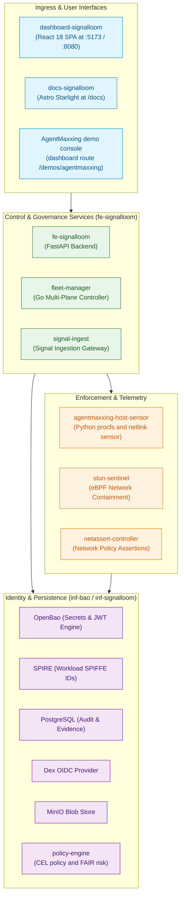

# AGENTS.md: Signal Loom Delivery Slice

Signal Loom is an agent governance platform. It provides a React dashboard SPA,
a FastAPI backend, Dex OIDC, OpenBao with SPIRE, Fleet Manager, and integration proxies.

## Platform Architecture

The diagram shows the four service groups of the slice and how they depend on each other.



## Stack

| Component | Technology | Path |
|---|---|---|
| Dashboard SPA | React 18, Vite, TypeScript, nginx | [`apps/dashboard-signalloom/`](apps/dashboard-signalloom/) |
| User documentation | Astro Starlight, Mermaid, nginx | [`apps/docs-signalloom/`](apps/docs-signalloom/) |
| API backend | Python FastAPI | [`apps/fe-signalloom/src/`](apps/fe-signalloom/src/) |
| Fleet Manager | Go multi-plane controller | [`apps/fleet-manager/`](apps/fleet-manager/) |
| Host Sensor | Python procfs and netlink sensor | [`apps/agentmaxxing-host-sensor/`](apps/agentmaxxing-host-sensor/) |
| Stun Sentinel | Go & eBPF tc-drop filter | [`apps/stun-sentinel/`](apps/stun-sentinel/) |
| Integration services | Python fixture and discovery proxy | [`apps/fake-integration-proxy/`](apps/fake-integration-proxy/) |
| Identity | Dex OIDC (local static user) | [`infra/inf-signalloom/base/dex.yaml`](infra/inf-signalloom/base/dex.yaml) |
| Secrets and identity | OpenBao, SPIRE | [`infra/inf-bao/`](infra/inf-bao/) |
| Kagent namespace | Namespace, NetworkPolicies, and controller manifests. `make swarm-kagent-up` installs the charts. | [`infra/kagent/`](infra/kagent/) |
| Agent swarm | The `fe-signalloom-agents` namespace, RBAC, NetworkPolicies, and one directory per swarm agent | [`infra/agent-swarm/`](infra/agent-swarm/) |
| Knative | Serving and Eventing manifests, a broker, and a GitHub source template | [`infra/knative/`](infra/knative/) |
| Persistence | PostgreSQL, Redis, MinIO | [`infra/inf-signalloom/`](infra/inf-signalloom/) |
| Agent profiles | `AgentProfile` manifests for the demo agents | [`agents/`](agents/) |
| Policy compiler | Go CLI. Compiles CEL invariants into admission policies and nono Landlock profiles. | [`cmd/policy-compiler/`](cmd/policy-compiler/) |
| Policy library | Go package for the policy compiler (CEL checks, CEL and Landlock output) | [`pkg/policy/`](pkg/policy/) |
| riskctl bridge | Go wrapper. Runs `tools/riskctl/riskctl` from the repository root. `make riskctl` builds that binary from [`tools/riskctl/`](../tools/riskctl/). | [`cmd/riskctl/`](cmd/riskctl/) |
| Host deployment manifests | Stun Sentinel DaemonSet and NetworkPolicy, Tetragon audit telemetry | [`deploy/`](deploy/) |
| Governance contracts | AgentMaxxing JSON Schemas, fixtures, and a Python schema checker | [`governance/`](governance/) |
| Design-system demo | Standalone React app with fixture data only | [`design-system-demo/`](design-system-demo/) |
| NetAssert runner | Agent pod resolver script for the NetAssert Job image | [`netassert-runner/`](netassert-runner/), [`netassert-runner.Dockerfile`](netassert-runner.Dockerfile) |
| Go tools | proof-helper | [`proof-helper/`](proof-helper/) |
| Kubernetes manifests | Kustomize overlays | [`apps/fe-signalloom/base/`](apps/fe-signalloom/base/), [`apps/fe-signalloom/local/`](apps/fe-signalloom/local/) |
| Delivery contracts | Discovery Portal bootstrap SQL | [`contracts/`](contracts/) |
| Tests | BATS suites | [`test/`](test/) |
| Unit tests | Vitest, run with `bun run test` | [`apps/dashboard-signalloom/`](apps/dashboard-signalloom/) |

## Namespaces

| Namespace | Contents |
|---|---|
| `fe-signalloom` | Dashboard SPA, docs site, API backend, fleet-manager, signal-ingest, supercred-demo-runner, Gateway HTTPRoutes |
| `fe-signalloom-agents` | Demo agent workloads |
| `inf-signalloom` | Dex, dex-ui, fake integration proxy, netassert-controller, PostgreSQL, Redis, MinIO. The SuperCred demo adds policy-engine and cardvault. |
| `inf-bao` | OpenBao server, SPIRE server, SPIRE agents |
| `kagent` | Kagent controller, from [`infra/kagent/base/namespace.yaml`](infra/kagent/base/namespace.yaml) |

## Lifecycle

```bash
make demo-signalloom-up           # Build images, sign, push, and reconcile Flux
make demo-signalloom-test         # Run topology and Flux readiness checks
make demo-signalloom-runtime-test # Run BATS and DETIK runtime assertions
make demo-signalloom-down         # Remove slice while keeping foundation
```

## Dashboard Access

Use local port 5173 for the dashboard port-forward. Dex allows the redirect URI
`http://localhost:5173/callback`. The Dex issuer is `${PUBLIC_ORIGIN}/dex`.
Its default is `https://dashboard.osramp.acme.local:30754/dex`, set in
[`dex.yaml`](infra/inf-signalloom/base/dex.yaml).

```bash
# Port 5173 matches a Dex redirect URI. Another local port fails the login.
kubectl port-forward -n fe-signalloom svc/dashboard-signalloom 5173:8080
# Open: http://localhost:5173
# Login: demo-user@signalloom.local / demo-user

# Connect through Envoy Gateway (HTTPS). kubectl does not expand a glob, so find the Service by label.
svc="$(kubectl -n ingress get svc -l gateway.envoyproxy.io/owning-gateway-name=cluster -o jsonpath='{.items[0].metadata.name}')"
kubectl -n ingress port-forward "svc/${svc}" 18443:443
# curl -sk --resolve dashboard.osramp.acme.local:18443:127.0.0.1 https://dashboard.osramp.acme.local:18443/
```

NOTE: The default Dex redirect list has no entry for port 18443. Dex rejects an
OIDC login through the gateway port-forward. Use it for HTTP checks only.

## Dashboard Routes

| Route | Page Name | Purpose / Data Source |
|---|---|---|
| `/agents` | Agents (default) | Agent inventory & lifecycle status from API |
| `/agents/:id` | Agent Detail | Metadata, credentials, and telemetry for one agent |
| `/discovery` | Discovery | Discovered cloud accounts and identity providers |
| `/discovery/accounts/:accountId` | Account Detail | Workloads discovered within a single cloud account |
| `/topology` | Agent Trust Topology | SPIFFE trust domain relationships and network graphs |
| `/activity`, `/weave` | The Weave | Live message bus and inter-agent transaction stream |
| `/risk` | FAIR Risk Exposure | Quantitative financial loss exposure model |
| `/policies` | Compliance Policies | Policy enforcement engine and rule evaluation |
| `/compliance` | Compliance Overview | Multi-framework regulatory compliance posture |
| `/compliance/posture` | Agent Posture | Fleet-wide agent posture assessment |
| `/compliance/risk` | Compliance Risk | Risk view inside the compliance section |
| `/compliance/policies` | Compliance Policies | Policy view inside the compliance section |
| `/compliance/:frameworkId` | Framework Detail | Detailed control evaluation for one framework |
| `/collusion-access` | Collusion & Access | Multi-agent privilege escalation analysis |
| `/audit` | Audit Trail | Append-only immutable audit log from PostgreSQL |
| `/federated-services` | Federated Services | External federated service connectors |
| `/cryptography` | Cryptography | OpenBao and SPIRE cryptographic proof verification |
| `/credential-inventory` | Credential Inventory | Active credentials, expiration leases, and rotation status |
| `/rbac-analysis` | RBAC Analysis | Formal-methods privilege escalation analysis (AFM) |
| `/rbac-explorer` | RBAC Explorer | Interactive RBAC graph exploration (AFM) |
| `/signal-fusion` | Signal Fusion | Multi-sensor telemetry correlation |
| `/distance-latency` | Distance & Latency | Inter-service network distance and latency metrics |
| `/signal-store` | Signal Store | Raw and processed telemetry signals |
| `/feeds` | Feeds Explorer | External threat intelligence feeds |
| `/settings` | Settings | Platform configuration and API key management |
| `/onboarding` | Setup Wizard | Initial platform and tenant setup wizard |
| `/help/connectors/:provider` | Connector Help | Provider-specific connector configuration instructions |
| `/network-tests` | Network Tests | In-cluster connectivity and SPIFFE trust boundaries |
| `/supercred` | SuperCred Demo | High-privilege agent credential escalation simulation |
| `/fleet` | Fleet Demo | Multi-cluster fleet topology and health metrics |
| `/fleet/audience` | Fleet Audience View | Read-only presentation view for fleet demonstrations |
| `/demos/agentmaxxing` | AgentMaxxing Demo | Interactive console for multi-plane containment |
| `/design-system` | Design System | Component palette and typography showcase |
| `/design-system/headers` | Design System Headers | Standardised header hierarchy reference |
| `/redeem-invite` | Redeem Invite | User onboarding and invitation acceptance |

`/docs` is not a React route. It is an nginx `location` in
[`nginx.conf`](apps/dashboard-signalloom/nginx.conf) that proxies to the Astro
Starlight docs site. The `Routes` block in
[`App.tsx`](apps/dashboard-signalloom/src/App.tsx) is the source of the route list.

Utility routes: `/onboarding` (wizard) and `/redeem-invite` (user signup).

Controls at bottom-right, from [`FloatingConfigControls.tsx`](apps/dashboard-signalloom/src/components/FloatingConfigControls.tsx):
- **WidthToggle**: Switch the content width.
- **ThemeToggle**: Switch between Dark, Light, and Andy themes.
- **DemoToggle**: Switch between live API data and local fixture data.

Superadmin is a navigation toggle. It appears only for `demo-user`. The `NAV`
array in [`Sidebar.tsx`](apps/dashboard-signalloom/src/components/Sidebar.tsx)
is the source of the entry list. The toggle hides or shows each `NAV` entry that
sets `superadminOnly: true`. It affects UI visibility only. Direct URLs stay
accessible.

Read [`docs/signalloom/dashboard-superadmin-themes-importer.md`](../docs/signalloom/dashboard-superadmin-themes-importer.md)
for details.

## Application Components

All application source code resides under `apps/`:

| Component | Path | Description |
|---|---|---|
| `agentmaxxing-host-sensor` | [`apps/agentmaxxing-host-sensor/`](apps/agentmaxxing-host-sensor/) | Host sensor for coding agent detection, netlink attribution, and inference CIDR mapping. |
| `cardvault` | [`apps/cardvault/`](apps/cardvault/) | PCI-DSS simulated credit card storage service. |
| `cardvault-agent` | [`apps/cardvault-agent/`](apps/cardvault-agent/) | Semi-autonomous AI agent interacting with cardvault. |
| `cpai-engineer` | [`apps/cpai-engineer/`](apps/cpai-engineer/) | Automated coding agent worker implementation. |
| `dashboard-signalloom` | [`apps/dashboard-signalloom/`](apps/dashboard-signalloom/) | React 18 / TypeScript single-page application. |
| `docs-signalloom` | [`apps/docs-signalloom/`](apps/docs-signalloom/) | Astro Starlight documentation portal served at `/docs`. |
| `factory-appraiser` | [`apps/factory-appraiser/`](apps/factory-appraiser/) | Asset appraisal agent workload. |
| `fake-integration-proxy` | [`apps/fake-integration-proxy/`](apps/fake-integration-proxy/) | Deterministic fixture and discovery proxy for LLM and CRM endpoints. |
| `fe-signalloom` | [`apps/fe-signalloom/`](apps/fe-signalloom/) | FastAPI backend serving dashboard queries and audit transactions. |
| `fe-signalloom-agents` | [`apps/fe-signalloom-agents/`](apps/fe-signalloom-agents/) | One probe script. [`apps/README.md`](apps/README.md#fe-signalloom-agents) explains where the namespace and RBAC live. |
| `fleet-agents` | [`apps/fleet-agents/`](apps/fleet-agents/) | Synthetic agents representing remote cluster fleets. |
| `fleet-manager` | [`apps/fleet-manager/`](apps/fleet-manager/) | Go controller managing multi-plane containment across mesh, admission, OpenBao, SPIRE, and freeze. |
| `hosted-daytona-coder` | [`apps/hosted-daytona-coder/`](apps/hosted-daytona-coder/) | Hosted cloud development environment agent. |
| `netassert-controller` | [`apps/netassert-controller/`](apps/netassert-controller/) | Kubernetes controller verifying NetworkPolicy connectivity. |
| `node-capability-guard` | [`apps/node-capability-guard/`](apps/node-capability-guard/) | Node-level security capability monitor. |
| `nono-containment-probe` | [`apps/nono-containment-probe/`](apps/nono-containment-probe/) | Kernel sandbox compliance and boundary verification probe. |
| `policy-engine` | [`apps/policy-engine/`](apps/policy-engine/) | Go service. Evaluates CEL policies (cel-go) and computes FAIR risk (`fair/`, `money/`). |
| `prod-deploy-gate` | [`apps/prod-deploy-gate/`](apps/prod-deploy-gate/) | Pre-deployment gating controller enforcing attestation checks. |
| `prompt-commit-summarizer` | [`apps/prompt-commit-summarizer/`](apps/prompt-commit-summarizer/) | Automated Git commit message summarisation agent. |
| `signal-ingest` | [`apps/signal-ingest/`](apps/signal-ingest/) | High-throughput telemetry ingestion service. |
| `signalloom-stun-sentinel` | [`apps/signalloom-stun-sentinel/`](apps/signalloom-stun-sentinel/) | STUN protocol network barrier daemon. |
| `stun-sentinel` | [`apps/stun-sentinel/`](apps/stun-sentinel/) | eBPF tc-drop filter and network containment controller. |
| `supercred-demo-runner` | [`apps/supercred-demo-runner/`](apps/supercred-demo-runner/) | Automated driver for the SuperCred credential escalation demo. |
| `swarm-governor` | [`apps/swarm-governor/`](apps/swarm-governor/) | Governance controller orchestrating multi-agent coordination. |
| `triage-ci-worker` | [`apps/triage-ci-worker/`](apps/triage-ci-worker/) | Automated CI failure triage agent. |
| `workspace-connector` | [`apps/workspace-connector/`](apps/workspace-connector/) | Enterprise workspace integration service. |
| `zulip-chat-agent` | [`apps/zulip-chat-agent/`](apps/zulip-chat-agent/) | Chatbot agent integrating with Zulip streams. |

## Testing

Run each command from the repository root.

| Command | Purpose | Duration |
|---|---|---|
| `make -C d2-signalloom test` | Run the topology checks, the Go test packages, the BATS suites, and the mutation proofs | Minutes |
| `bats d2-signalloom/test/dashboard-routes.bats` | Check nginx SPA fallback (requires port 5173) | ~3s |
| `bats d2-signalloom/test/dashboard-route-collisions.bats` | Check proxy prefixes against SPA routes | ~2s |
| `bats d2-signalloom/test/agent-discovery-rbac.bats` | Check pod reading grants for discovery namespaces | ~2s |
| `bats d2-signalloom/test/fleet-patch-indexes.bats` | Check ResourceSet patch indexes | ~2s |
| `bats test/supercred-images.bats` | Check image build and load guard (no cluster required). One test waits `SUPERCRED_CRI_ADOPT_TIMEOUT` seconds per image. | 12s or more |
| `make -C d2-signalloom/apps/fake-integration-proxy test` | Run proxy discovery tests | ~2s |
| `bats d2-signalloom/test/gateway-dashboard.bats` | Check Envoy Gateway routes (requires port 18443) | ~3s |
| `bats d2-signalloom/test/dex-auth.bats d2-signalloom/test/dex-runtime.bats` | Check Dex OIDC contract | ~5s |
| `cd d2-signalloom/test/dex-templates && go test ./...` | Check Dex web template rendering | ~1s |
| `bats d2-signalloom/test/dex-config-reload.bats` | Check Dex restart on config change | ~1s |
| `bats d2-signalloom/test/dashboard-image.bats` | Check container image build and health | ~30s |
| `bats d2-signalloom/test/dashboard-supplychain.bats` | Check SBOM, provenance, and Cosign signature | ~5s |
| `cd d2-signalloom/apps/dashboard-signalloom && bun run test` | Run Vitest unit tests | ~2s |
| `cd d2-signalloom/apps/dashboard-signalloom && bun run typecheck` | Run TypeScript typecheck | ~2s |
| `cd d2-signalloom/apps/dashboard-signalloom && bun run lint` | Run ESLint | ~2s |
| `scripts/acceptance-test.sh --project smoke` | Run browser smoke tests. The script starts the port-forwards that the specs need. | ~7s |
| `make test-dashboard-weave` | Run Weave, Signal Fusion, and weaveApi vitest suites | ~2s |
| `make demo-agentmaxxing-contract-test` | Run operator lifecycle contracts | ~2s |
| `make demo-agentmaxxing-host-test` | Run host sensor and Landlock confinement tests | ~4s |
| `make demo-agentmaxxing-ingest-test` | Run audit session ingest and deduplication tests | ~3s |
| `make demo-agentmaxxing-ui-test` | Run timeline vitest and console acceptance suite | ~10s |
| `make demo-agentmaxxing-acceptance-test` | Run AgentMaxxing acceptance test suite | ~15s |
| `make demo-signalloom-coding-agent-topology` | Validate coding agent detective telemetry | ~5s |
| `make demo-agentmaxxing-docs-test` | Run documentation render check with Playwright | ~5s |

## Building the Dashboard Image

```bash
make signalloom-dashboard-image
kubectl -n fe-signalloom rollout restart deploy/dashboard-signalloom
# Note: restart the port-forward after rollout completes
```

### Adding a New Dashboard Page

Read [`DESIGN.md`](DESIGN.md) for the visual guidelines and component rules.

## Adding an Audited Endpoint

Audit events record actions the API performs directly.
Never accept audit events supplied by the client.
Never write audit events from browser code.
An audit row records only what the server observed.

Rules for auditing:
1. Complete the action. If writing to the database, open a transaction.
2. Write the audit row with `actor=principal.actor` inside the transaction.
   Never use hardcoded actors.
3. If no database transaction exists, write the audit event before the action.
4. Record only observed outcomes.
5. When adding an event type, update the database CHECK constraint, and update
   `EVENT_TYPES` and `EVENT_COLORS` in
   [`apps/dashboard-signalloom/src/views/AuditTrail.tsx`](apps/dashboard-signalloom/src/views/AuditTrail.tsx).

Read [`docs/signalloom/audit-trail.md`](../docs/signalloom/audit-trail.md) for the implementation details.

## Pitfalls

- **`audit_events` table is append-only:** Modifying existing rows raises an error (`42501`).
  Use `make demo-signalloom-data-reset` to reset test data.
- **Currency values default to USD:** Convert GBP values using the FX exchange rate table.
- **Dex login requires an email address:** Use `demo-user@signalloom.local`, not a username.
- **File permissions in [`apps/dashboard-signalloom/public/`](apps/dashboard-signalloom/public/):** Set permissions to 644 or higher to prevent 403 errors from nginx.
- **Port-forwards stop on pod rollout:** Always restart port-forwards after `rollout restart`.
- **Proxy prefix collisions:** Nginx proxy paths must not match React Router paths.
  Route `/supercred-api/` avoids shadowing `/supercred`.
- **Silent BATS skips:** A skipped test outputs `ok`. Check logs for `# skip` to verify test execution.
- **Manifest changes require artifact push:** Flux overwrites manual `kubectl apply` changes on reconciliation.

### Diagnose Backend Service Connections

This section is the canonical triage for the dashboard backend proxies, such as
`/fleet-api/`. The root [`AGENTS.md`](../AGENTS.md) links here.

`make demo-signalloom-up` deploys Fleet Manager through the Signal Loom Flux
path. KubeSec-AFM deploys outside that target. Start it with
`make demo-k8s-afm-up`.

If a backend service is missing, test the connection from inside the dashboard pod:

```bash
kubectl -n fe-signalloom exec deploy/dashboard-signalloom -- \
  curl -sS -o /dev/null -w '%{http_code} %{content_type}\n' \
  http://localhost:8080/fleet-api/v1/fleet/topology
```

| Result | Cause | Remedy |
|---|---|---|
| `200 application/json` | The service is healthy. | None |
| `200 text/html` | The nginx proxy rule is missing. The SPA catch-all returned `index.html`. | Add the `location` block to [`nginx.conf`](apps/dashboard-signalloom/nginx.conf). Then run `make signalloom-dashboard-image`. |
| `504 Gateway Timeout` | A NetworkPolicy blocked the connection. | Add the egress and ingress rules for the path. |
| `502 Bad Gateway`, and the nginx log shows `could not be resolved` | DNS has no record for the service. The service is not deployed. | Run `make demo-signalloom-up`. For KubeSec-AFM, run `make demo-k8s-afm-up`. |

NOTE: `make demo-signalloom-fleet-up` applies Fleet Manager directly and bypasses
Flux. It is a test escape hatch only. It is not the remedy for a missing service.

Read [`docs/deploying-a-backend-service.md`](../docs/deploying-a-backend-service.md) for more guidance.

## Supply Chain

Build the dashboard image with `scripts/build-sign-dashboard.sh`:
- Generates SPDX SBOM, SLSA provenance, and Cosign signature.
- Stores evidence in `docs/signalloom/evidence/`.
- Tested by [`test/dashboard-supplychain.bats`](test/dashboard-supplychain.bats). Run `bats d2-signalloom/test/dashboard-supplychain.bats` from the repository root.
