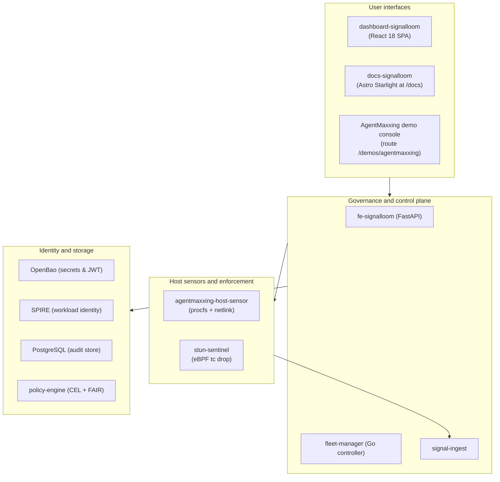

# Signal Loom D2 delivery slice

Split-ready, non-production delivery boundary. This subtree has no Flux
bootstrap configuration and cannot create a second control plane.
`d2-osramp-fleet` is the sole local fleet authority.

## Ownership

| Path | Owner | Responsibility |
| --- | --- | --- |
| `infra/` | Infrastructure | The `inf-bao` and `inf-signalloom` component roots, plus `agent-swarm`, `kagent`, `knative`, `systemd`, and the API audit policy. [`infra/README.md`](infra/README.md) lists them. |
| `apps/` | Application delivery | One directory per application. The [Application Components](AGENTS.md#application-components) table in `AGENTS.md` lists them. |
| `contracts/` | Cross-slice | Generated and reviewed delivery contracts. |
| `test/` | Cross-slice | Static topology and render validation. |

The Signal Loom tenant ResourceSet is in the fleet only, at
`d2-osramp-fleet/tenants/local/signalloom.yaml`. Flux reconciles files
inside the fleet OCI artifact. This slice has no duplicate copy.
`make -C d2-signalloom test` checks the fleet-owned source directly.

## Validation

Run the slice check from the repository root:

```shell
make -C d2-signalloom test
```

NOTE: The root `make test` runs the `d2-osramp-apps` suite, not this slice.

This target runs the topology checks, the Go test packages, the BATS suites,
and the mutation proofs. It does not start Flux, publish artifacts, create a
cluster, or deploy workloads.

## Architecture

The diagram shows how the user interfaces connect to the governance control plane, the host sensor, and the identity layer.



The service topology details are in [`AGENTS.md`](AGENTS.md#platform-architecture).
The interactive system map is in [`../docs/system-map/`](../docs/system-map/). Serve
it from the repository root:

```bash
python3 -m http.server 8901 -d docs/system-map   # from repo root
```
