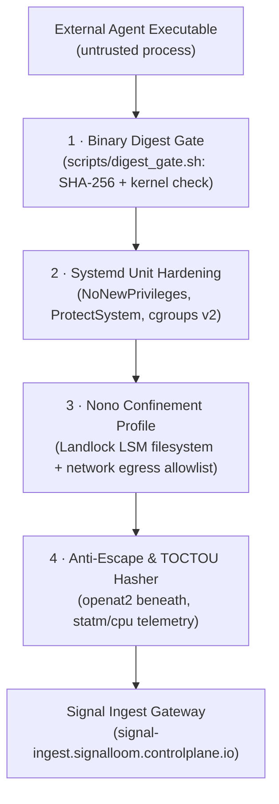

# AgentMaxxing Linux Host Sensor & Confinement (`agentmaxxing-host-sensor`)

This component protects external AgentMaxxing Linux agents. It provides:

- defense-in-depth Linux host confinement
- fail-closed nono 0.73.0 profiles
- hardened systemd services
- bounded allowlisted process telemetry collection
- descriptor-relative artifact anti-escape validation
- rate-limited TOCTOU artifact hashing

---

## 1. Confinement Architecture

The diagram shows the four isolation layers that protect the partner host from untrusted agent operations.



The external AgentMaxxing Linux agent executes directly on partner Linux host infrastructure under multi-layered isolation:

1. **Systemd Unit Hardening (`agentmaxxing-agent.service`)**:
   - `NoNewPrivileges=yes` prevents suid/sgid privilege elevation.
   - `ProtectSystem=strict` and `ProtectHome=yes` isolate root filesystems and user directories.
   - Pinned `ReadOnlyPaths` (`/opt/agentmaxxing`, `/etc/ssl/certs`, `/srv/agentmaxxing/input`, `/usr`, `/lib`, `/lib64`).
   - Pinned `ReadWritePaths` (`/var/lib/agentmaxxing/work`, `/var/lib/agentmaxxing/output`, `/var/lib/agentmaxxing/audit`, `/run/agentmaxxing`).
   - `InaccessiblePaths` (`/root`, `/etc/shadow`, `/etc/gshadow`, `/etc/sudoers`).
   - Cgroup v2 resource limits (`MemoryMax=512M`, `TasksMax=64`, `CPUQuota=200%`).

2. **Binary Digest Preflight Gate (`scripts/digest_gate.sh`)**:
   - Validates Linux kernel Landlock LSM support.
   - Validates nono 0.73.0 binary presence and pinned SHA-256 digest (`71581b92e7683c86276bbbd91c80b059e0fe2d7b1aa95b1176870456ee22ad5c`).
   - Computes SHA-256 digest of the agent executable before execution.
   - Fails closed if the binary has been modified, tampered with, or does not match the approved digest.

3. **Nono 0.73.0 Confinement Profile (`profile.json`)**:
   - Landlock LSM confinement strictly limiting filesystem writes to designated workspace roots.
   - Default deny for all unauthorized network egress.
   - Approved egress allowlist:
     - `signal-ingest.signalloom.controlplane.io:443` (TCP/TLS)
     - `api.agentmaxxing.com:443` (TCP/TLS)
   - Environment stripping of sensitive secrets and cloud credentials (`AWS_*`, `SSH_*`, `GITHUB_*`, `KUBECONFIG`, `VAULT_TOKEN`).

---

## 2. Zero-Payload Isolation & Privacy Invariants

In compliance with the **Signal Loom Host Policy** and **AMXO Charter**, the sensor strictly enforces:

1. **Zero Memory Inspection:** The sensor never reads `/proc/<pid>/mem`, `/proc/<pid>/maps`, `/proc/<pid>/stack`, or process registers.
2. **Zero Environment or Command Secret Extraction:** The sensor never reads `/proc/<pid>/environ` or parses commandline arguments/secrets from `/proc/<pid>/cmdline`.
3. **Zero Customer File or Payload Harvesting:** Sensor records contain no customer data, file payloads, or network request/response bodies.
4. **Strict Field Allowlisting:** Emitted records strictly contain only:
   - `health_state`: Lifecycle state (`starting`, `running`, `stopped`, `failed`, `unknown`)
   - `cpu_time_ms`: Total CPU time consumed in milliseconds (`utime` + `stime` or cgroup `cpu.stat`)
   - `resident_memory_bytes`: RSS memory usage in bytes (`statm` / `status` / `memory.current`)
   - `exit_code`: Process exit code (integer if terminated, `null` if active)
   - `restart_count`: Monotonically increasing restart counter across process respawns
   - Extended metrics: `cpu_percent`, `pid`, `ppid`

---

## 3. Descriptor-Relative Anti-Escape & TOCTOU Hashing

1. **Descriptor Pinning (`file_validator.py`, `openat2.py`)**:
   - Pinned directory file descriptors opened with `O_PATH | O_DIRECTORY | O_CLOEXEC`.
   - Child file opening uses `openat2` with `RESOLVE_BENEATH | RESOLVE_NO_SYMLINKS | RESOLVE_NO_XDEV`.
   - Rejects all symlinks, directory traversal (`..`), hardlinks (`st_nlink > 1`), and device boundary crossings with 0 bytes read.

2. **TOCTOU Pre/Post-Read Validation (`hasher.py`)**:
   - Pre-hash `fstat` captures baseline inode, mount ID, size, link count, and timestamps (`mtime_ns`, `ctime_ns`).
   - Post-hash `fstat` verifies that no metadata mutation occurred while reading bytes.
   - Mutation or concurrent modification invalidates the digest and sets `observation_state="unobserved"`, `sha256=null`, and `reason_code="toctou_mutation_detected"`.
   - Rate limiter enforces bounded windows (`max_files_per_window`, `max_bytes_per_window`, `max_file_size`).

---

## 4. Telemetry Schema & Wire Format

Process lifecycle records strictly conform to the Signal Loom evidence contract (`process-lifecycle-telemetry.v1.schema.json`):

```json
{
  "schema_version": "1.0.0",
  "session_id": "amxo-session-0001",
  "sequence": 0,
  "observed_at": "2026-09-13T18:30:00Z",
  "source": "host-sensor-v1",
  "evidence_type": "process",
  "observation_state": "observed",
  "integrity_state": "not-integrity-verified",
  "agent_id": "agentmaxxing-linux-001",
  "host_id": "amx-host-001",
  "attributes": {
    "health_state": "running",
    "cpu_time_ms": 241,
    "resident_memory_bytes": 33554432,
    "exit_code": null,
    "restart_count": 0
  }
}
```

---

## 5. CLI Usage

### Inspect Process
```bash
python3 -m agentmaxxing_host_sensor inspect --pid 1234
```

### Collect Single Telemetry Record
```bash
python3 -m agentmaxxing_host_sensor collect --pid 1234 --session-id sess-001 --pretty
```

### Hash Artifact Relative to Pinned Root
```bash
python3 -m agentmaxxing_host_sensor hash-relative --root-dir /var/lib/agentmaxxing/work --relpath output.json
```

### Dump Schema
```bash
python3 -m agentmaxxing_host_sensor schema
```

### Verify Host Environment
```bash
python3 -m agentmaxxing_host_sensor verify
```

---

## 6. Running Tests

```bash
make demo-agentmaxxing-host-test
```
