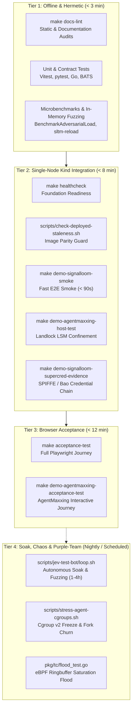
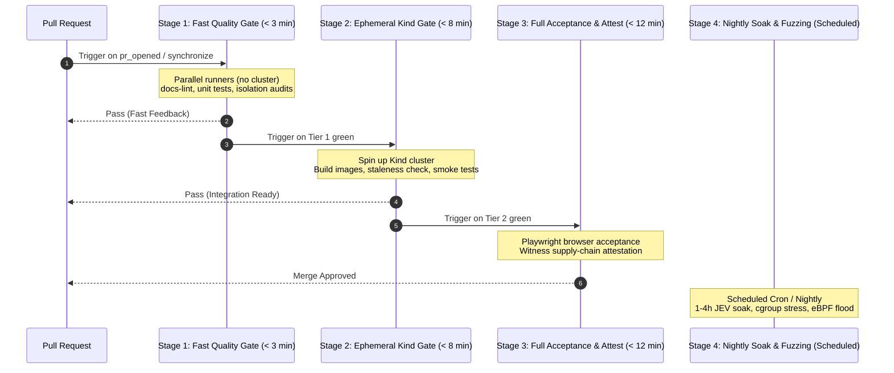

Signal Loom maintains a comprehensive test suite hierarchy. The suites span fast offline linting, Kubernetes integration tests, Playwright browser journeys, eBPF saturation floods, and soak-testing bots.

This guide catalogs every test suite, documents their isolation guarantees, and outlines how to structure them in a GitHub Enterprise Actions CI/CD pipeline.

---

## 1. Test Isolation and Independence

A core design requirement is that **test suites must run independently without mutual interference**. Multiple CI jobs or local test runs can run in parallel on the same runner or workstation.

### Isolation Mechanisms

- **Dynamic Port Selection**: Integration harnesses never bind hardcoded service ports. Services bind ephemeral free ports (discovered dynamically through socket probes in ranges `41000–44999`), leaving default port ranges undisturbed.
- **Strict Isolation Audit**: The test `test/test-isolation-audit.bats` scans all acceptance test definitions to enforce zero hardcoded ports or fixed global `/tmp` paths.
- **Isolated Target Namespaces**: Stress tests deploy into dedicated namespaces (such as `slaat-p1-4-cgroup-stress`). They use ephemeral credentials and do not change demonstration workloads.
- **Zero-Staleness Gate**: `./scripts/check-deployed-staleness.sh` verifies that pods running in the target cluster match the exact source fingerprint (`source_id`) of the working tree. Tests never pass vacuously against outdated container builds.

---

## 2. Test Suite Catalog

The diagram shows the four tiers of the test hierarchy, from offline checks to soak tests.



### Tier 1: Offline & Hermetic Suites (No Cluster Required)

These suites require zero cloud or Kubernetes dependencies and run in seconds inside any container or runner environment.

| Target / Command | Scope | Description |
| :--- | :--- | :--- |
| `make docs-lint` | Documentation | Checks links, anchor integrity, diagrams, path references, and STE style rules. |
| `make docs-render-check` | Documentation Portal | Builds the Starlight site, audits internal links, and render-checks pages in headless Chromium. |
| `bats test/test-count-floor.bats` | Regression Guard | Checks that total test counts do not decrease across releases. |
| `make test-dashboard-weave` | Frontend UI | Vitest suites checking the Weave, Signal Fusion, and WebSocket telemetry stream components. |
| `make demo-signalloom-coding-agent-topology` | Dashboard UI | Playwright test rendering the agent topology graph against an in-process mock server (`--port 0`). Needs no cluster. |
| `make demo-signalloom-api-test` | FastAPI Gateway | Contract tests checking API routing, permissions, and request validation models. |
| `make test-sldc-offline` | Governance & Fleet | Full offline verification covering BATS, Go (`fe-signalloom`, `kusari-agent`, `stun-sentinel`, `signal-ingest`), pytest, and bun. |
| `go test -bench=BenchmarkAdversarialLoad` | Ingestion Engine | Sustained in-memory adversarial load benchmark checking a p99 latency ceiling of 25ms under high throughput. |
| `bats test/sltm-ingest-reload-ratelimit.bats` | Rate Limiter | Checks atomic key rotations without restarts and asserts HTTP 429 `Retry-After` on traffic bursts. |

---

### Tier 2: Ephemeral Cluster Integration Suites

These suites run against a local Kind cluster (`osramp`) or an ephemeral runner cluster.

| Target / Command | Scope | Description |
| :--- | :--- | :--- |
| `make healthcheck` | Foundation | Validates Kubernetes API readiness, node status, Flux controller health, and ResourceSets. |
| `./scripts/check-deployed-staleness.sh` | Build Integrity | Fails closed if running pods diverge from the checked-out source code fingerprint. |
| `make demo-signalloom-smoke` | Smoke Verification | Sub-90-second automated verification of cluster health, onboarding wizard, dual-agent claim, and initial telemetry. |
| `make demo-agentmaxxing-host-test` | LSM Confinement | Verifies Linux Landlock filesystem restriction enforcement and host sensor status. |
| `make demo-agentmaxxing-contract-test` | Operator Lifecycle | Asserts five-stage deterministic agent containment state transitions. |
| `make demo-signalloom-supercred-evidence` | Credential Chain | Executes six automated probes verifying OpenBao dynamic secrets, SPIFFE workload IDs, and JWT rotation. |
| `make demo-agent-trust-network-test` | Network Isolation | Verifies SPIFFE agent-to-agent NetworkPolicy boundaries. |
| `make attested-test` | Supply Chain & Attestation | Executes the OSRAMP suite under cryptographic in-toto Witness provenance recording with FrostDB replay validation. |

---

### Tier 3: Browser Acceptance Suites

Full end-to-end user journeys executed via Playwright against the deployed Signal Loom dashboard:

| Target / Command | Scope | Description |
| :--- | :--- | :--- |
| `make acceptance-test` | Platform Acceptance | Drives Playwright across tenant switching, agent onboarding, timeline inspection, and alert handling. |
| `make demo-agentmaxxing-ui-test` | Interactive Demo | End-to-end browser journey exercising the interactive five-stage containment console. |

---

### Tier 4: Soak, Chaos, and Purple-Team Batteries

Designed for scheduled runs, nightlies, or dedicated stress environments:

| Harness / Script | Target Subsystem | Description |
| :--- | :--- | :--- |
| [`scripts/jev-test-bot/loop.sh`](file:///home/andy/src/cp/osramp-demo/scripts/jev-test-bot/loop.sh) | Web Dashboard & APIs | Autonomous exploratory testing loop running for arbitrary iterations or durations (`--duration SEC`). Drives real Chromium with DOM error oracles to detect memory leaks, unhandled exceptions, and dead buttons. |
| [`scripts/jev-test-bot/explore_30m.py`](file:///home/andy/src/cp/osramp-demo/scripts/jev-test-bot/explore_30m.py) | Full Surface Exploration | 30-minute automated fuzzer performing stochastic exploration and latency distribution logging. |
| [`scripts/stress-agent-cgroups.sh`](file:///home/andy/src/cp/osramp-demo/scripts/stress-agent-cgroups.sh) | Cgroup v2 Freezer | Stresses the Linux cgroup v2 freezer under rapid fork-bomb process churn, PID namespace unsharing, and concurrent resume races. |
| [`d2-signalloom/apps/stun-sentinel/pkg/tc/flood_test.go`](file:///home/andy/src/cp/osramp-demo/d2-signalloom/apps/stun-sentinel/pkg/tc/flood_test.go) | eBPF TC Monitor | Injects 20,000 DNS + 30,000 TLS synthetic packets to saturate the 4 MiB kernel BPF ringbuffer, asserting 100% accounting via drop counters and bounded RSS (< 64 MiB). |
| [`scripts/jev-test-bot/test_new_routes_fuzz.py`](file:///home/andy/src/cp/osramp-demo/scripts/jev-test-bot/test_new_routes_fuzz.py) | Administrative APIs | Boundary condition, malformed payload, and SQLi fuzzing against user management, feature flags, and fleet stun endpoints. |

---

## 3. Recommended GitHub Enterprise Actions Pipeline

When migrating to GitHub Enterprise, structure your workflow stages into a graduated four-stage pipeline:

### Workflow Stage Structure

The sequence diagram shows the four pipeline stages from pull request to merge.



### GitHub Enterprise Action Configuration Example

Example workflow configuration for pull request validation:

```yaml
name: CI / Verification Pipeline

on:
  push:
    branches: [main, feat/*]
  pull_request:
    branches: [main]

concurrency:
  group: ${{ github.workflow }}-${{ github.ref }}
  cancel-in-progress: true

jobs:
  # ── STAGE 1: FAST LINT & OFFLINE CHECKS (< 3m) ──────────────────────
  fast-gate:
    name: Fast Lint & Unit Gate
    runs-on: ubuntu-latest
    steps:
      - uses: actions/checkout@v4
      - uses: oven-sh/setup-bun@v1
      - uses: actions/setup-go@v5
        with:
          go-version: '1.27'
      - uses: actions/setup-python@v5
        with:
          python-version: '3.12'

      - name: Documentation Lint & Render Check
        run: |
          make docs-lint
          make docs-render-check

      - name: Isolation and Regression Audits
        run: |
          bats test/test-isolation-audit.bats
          bats test/test-count-floor.bats

      - name: Offline Contract & Unit Tests
        run: |
          make test-sldc-offline
          make demo-signalloom-api-test

  # ── STAGE 2: EPHEMERAL CLUSTER INTEGRATION (< 8m) ───────────────────
  integration-gate:
    name: Ephemeral Kind Integration Gate
    needs: fast-gate
    runs-on: ubuntu-latest
    steps:
      - uses: actions/checkout@v4
      - uses: helm/kind-action@v1
        with:
          cluster_name: osramp
          config: d2-osramp-fleet/clusters/local/kind-config.yaml

      - name: Bootstrap Foundation & Images
        run: |
          make up
          make healthcheck
          make signalloom-images
          ./scripts/check-deployed-staleness.sh

      - name: Run Rapid Smoke Test
        run: make demo-signalloom-smoke

      - name: Landlock & Host Sensor Confinement Tests
        run: |
          make demo-agentmaxxing-host-test
          make demo-agentmaxxing-contract-test

      - name: Cryptographic Credential & Trust Boundary Verification
        run: |
          make demo-signalloom-supercred-evidence
          make demo-agent-trust-network-test

  # ── STAGE 3: FULL ACCEPTANCE & ATTESTATION (< 12m) ─────────────────
  acceptance-attestation:
    name: Browser Acceptance & Witness Attestation
    needs: integration-gate
    runs-on: ubuntu-latest
    steps:
      - uses: actions/checkout@v4
      - name: Browser Acceptance Journeys
        run: make acceptance-test
      - name: Cryptographic Attestation Proof
        run: make attested-test
```

### Nightly Soak & Adversarial Matrix Workflow

Example scheduled workflow configuration for nightly soak testing:

```yaml
name: Nightly Soak & Adversarial Chaos

on:
  schedule:
    - cron: '0 2 * * *' # 02:00 UTC daily
  workflow_dispatch:

jobs:
  soak-and-chaos:
    name: 1-Hour JEV Soak & Kernel Cgroup Stress
    runs-on: [self-hosted, linux, privileged]
    steps:
      - uses: actions/checkout@v4
      - name: Bootstrap Cluster
        run: |
          make up
          make demo-signalloom-up
      - name: Run 1-Hour JEV Autonomous Exploratory Soak
        run: ./scripts/jev-test-bot/loop.sh --duration 3600 --mode browser
      - name: Run Cgroup Freeze Adversarial Battery
        run: ./scripts/stress-agent-cgroups.sh
      - name: Run eBPF TC Ringbuffer Saturation Flood
        run: |
          cd d2-signalloom/apps/stun-sentinel
          go test -v ./pkg/tc -run TestRingbufferFlood
```
