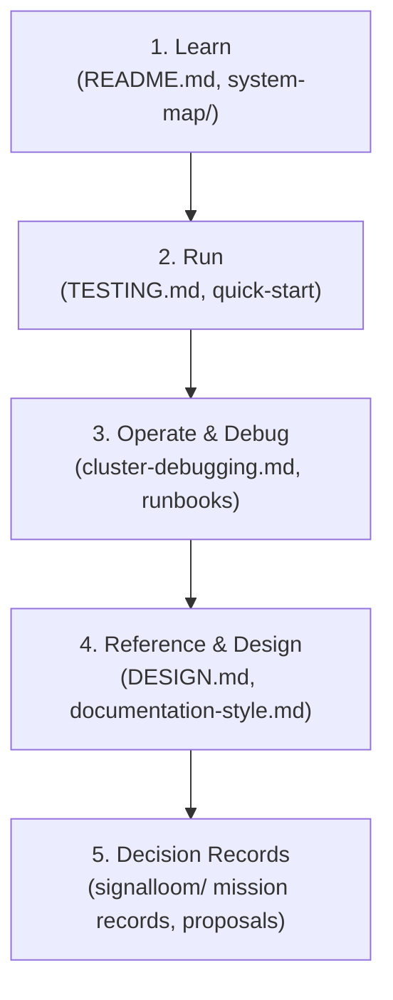

# Documentation design specification

This document defines the visual design, information architecture, and component
standards for repository documentation and the Astro Starlight portal.

For prose and grammar rules, read [`documentation-style.md`](documentation-style.md).
For the platform palette, read [`../DESIGN.md`](../DESIGN.md).

## Documentation architecture

Documentation separates content into five structured tiers:


The diagram shows the five reading tiers from entry point to decision records.

| Tier | Target reader | Purpose | Format |
| :--- | :--- | :--- | :--- |
| **Learn** | Evaluator, new engineer | Understand architecture and core capabilities | Overview guides, flow maps |
| **Run** | Developer, operator | Deploy and test slices | Step-by-step procedures |
| **Operate** | SRE, security engineer | Manage runtime, investigate alerts | Runbooks, triage matrices |
| **Reference** | All contributors | Look up contracts, tokens, and style | Tables, specifications |
| **Records** | Auditor, maintainer | Historical context and signed evidence | Point-in-time reports |

## Astro Starlight portal design

The user documentation portal lives at
[`../d2-signalloom/apps/docs-signalloom/`](../d2-signalloom/apps/docs-signalloom/).
It uses Astro Starlight with custom styling and interactive components.

### Page layout

Every Starlight documentation page contains:

1. **Frontmatter**: Title and description metadata for search indexing.
2. **Lead paragraph**: A concise summary of the page outcome.
3. **Architecture diagram**: A visual model of the subsystem when applicable.
4. **Actionable sections**: Step-by-step procedures or structured tables.
5. **Related links**: Next steps and cross-references.

### Callout blocks (Admonitions)

Starlight pages use four callout types to highlight important context:

```markdown
:::note
Informational context that helps the reader understand background details.
:::

:::tip
Helpful recommendation for efficiency or performance.
:::

:::caution
Warning about actions that could disrupt a cluster, lane, or test suite.
:::

:::danger
Critical warning about permanent data loss, security exposure, or financial cost.
:::
```

Use callout blocks sparingly. A page must not contain more than two callout
blocks in a single section.

## Diagram standards

Diagrams clarify complex topologies, message sequences, and state lifecycles.
All diagrams use Mermaid syntax.

### Diagram rules

1. Put one descriptive prose sentence directly before every Mermaid diagram.
2. Put text links next to or below the diagram for screen reader accessibility.
3. Use `flowchart TD` or `flowchart LR` for architectural topologies.
4. Use `sequenceDiagram` for network wire protocols and authentication handshakes.
5. Use `stateDiagram-v2` for finite state machines and lifecycle steppers.

The diagram shows standard class styling for system components.


## Code blocks and command syntax

Code blocks use fenced syntax with explicit language tags:

- Use `bash` for terminal commands and shell transcripts.
- Use `typescript` or `tsx` for React components and type definitions.
- Use `yaml` for Kubernetes manifests and Helm values.
- Use `json` for wire contracts and API payloads.

Always show commands with their arguments. Separate command execution from
sample output:

```bash
make healthcheck
```

Expected output:

```text
[healthcheck] foundation services ready
```

## Tables and contract matrices

Use tables for multi-attribute reference data. Follow these table rules:

1. Use title case for table headers.
2. Left-align text descriptions.
3. Use inline code for command targets, paths, and environment variables.
4. Format all file references as active Markdown links.
