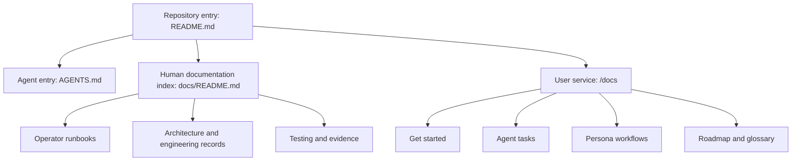

# Repository Documentation Audit

## Decision summary

The repository has strong operational depth but weak audience separation.
Operator runbooks, implementation proposals, generated evidence, historical
research, and user tasks often share the same navigation surface. This makes
correct information harder to find than it should be.

The new `/docs` service is the canonical user-facing surface. Keep engineering
records in `docs/`, keep slice-local operational guidance beside each slice,
and use `docs/README.md` as the human navigation hub for repository documents.

## Scope and method

The review covered maintained Markdown, root and slice indexes, lifecycle
commands, workflow triggers, relative links, heading anchors, repeated
operational facts, Mermaid usage, and repository coverage. Generated reports,
tool caches, temporary trees, dependency directories, and Algorithm memory were
excluded from maintained-document counts.

The scan found 244 maintained Markdown files on 9 September 2026. Of these,
119 are below `docs/`, 36 are below `d2-signalloom/`, and 30 are below
`terraform/`. Counts describe this review only; do not copy them into evergreen
onboarding pages.

## Repository coverage

| Surface | Primary entry | Review result |
| --- | --- | --- |
| Shared foundation | `README.md`, `AGENTS.md`, `TESTING.md` | Corrected lifecycle, workflow, prerequisite, and test-registry claims. |
| Human navigation | `docs/README.md` | Added user-service, audit, style, collaborator, and proposal routes. |
| Signal Loom | `d2-signalloom/AGENTS.md` | Added docs ownership and corrected Fleet Manager deployment guidance. |
| OSRAMP apps | `d2-osramp-apps/AGENTS.md` | Entry point exists; no conflicting docs-service claim found. |
| KubeSec-AFM | `d2-k8s-afm/AGENTS.md` | Entry point exists; external checkout prerequisite remains visible. |
| Fleet | `d2-osramp-fleet/AGENTS.md` | Entry point exists; Flux ownership remains explicit. |
| Infrastructure | `d2-infra/README.md` | Added the omitted Trivy Operator component. |
| Agent trust | `d2-agent-trust/AGENTS.md` | Entry point exists; lifecycle remains distinct from Signal Loom. |
| CPAI | `d2-cpai/README.md` | Entry point exists; no duplicate user-docs ownership introduced. |
| Olly replica | `olly-replica/README.md` | Entry point exists; independent lifecycle remains explicit. |
| Kagent | `docs/kagent-d5.md` | Large standalone guide remains indexed from root navigation. |
| GCP lanes | `docs/gcp-demo/RUNBOOK.md` | Runbook, operations, and incident separation remains appropriate. |
| Older CI lanes | `scripts/ci/README.md` | Distinction from four-lane GCP estate remains explicit. |
| Terraform | `terraform/README.md` | Large contract and runbooks remain operator-facing. |
| User journeys | `/docs` Starlight service | Added task and persona navigation without mixing engineering records. |

## Findings and actions

| Priority | Finding | Evidence | Action |
| --- | --- | --- | --- |
| P0 | User tasks had no dedicated publication surface. | User guidance was mixed with operator and design records. | Added the Astro Starlight service at `/docs`. |
| P0 | Fleet Manager deployment guidance conflicted. | Root and slice guides said it was outside `demo-signalloom-up`; the Flux graph deploys it. | Corrected both guides and labelled the direct target as a test escape hatch. |
| P0 | Workflow trigger descriptions were stale. | Three artifact and image workflows use `workflow_dispatch`. | Corrected the root workflow table. |
| P1 | Go prerequisite was stale. | `scripts/setup.sh` and CI install Go 1.24.5. | Corrected `README.md`. |
| P1 | Static acceptance assignments duplicated the registry. | `TESTING.md` copied registry rows that changed independently. | Replaced the copy with a canonical registry reference. |
| P1 | The infrastructure index omitted Trivy Operator. | The component and artifact workflow include `trivy-system`. | Added it to `d2-infra/README.md`. |
| P1 | Four links embedded an obsolete worktree path. | `durable-port-forwarding.md` used `file:///home/.../.worktrees/38c06`. | Replaced them with repository-relative links. |
| P1 | The documentation index used stale manual counts. | Slice and target counts changed without index updates. | Removed volatile counts from navigation text. |
| P2 | Design records dominate Signal Loom navigation. | Large audit, research, proposal, and errata documents share one directory. | Keep the records, but route end users to `/docs` and add status labels to future records. |
| P2 | Mermaid usage was sparse but mostly purposeful. | Existing diagrams describe architecture and operational flows. | Added user-task architecture and containment sequence diagrams to `/docs`; avoided decorative diagrams. |
| P2 | Some historical documents repeat headings intentionally. | Option comparisons and imported dependency documentation reuse section headings. | Do not rewrite historical records solely to remove repeated headings. |

## Correctness boundaries

The review distinguishes four statement classes:

1. **Implemented:** repository code and tests provide direct evidence.
2. **Demonstrated:** a documented demo path exists, but it is not a production
   authorization guarantee.
3. **Roadmap:** the capability is planned and is not available now.
4. **TODO:** required work has no completed implementation evidence.

This distinction is important for persona documentation. The current `viewer`
credential is not a technical view-only boundary. The `advanced`,
`security-team`, and `platform-admin` personas are documentation workflows, not
implemented authorization roles. The user guides state these limits explicitly.

## Information architecture

The repository index owns navigation. Slice guides own deployment and test
details. The `/docs` service owns user journeys. Generated evidence proves a
run but does not define expected behaviour.

## Repetition policy

Keep a fact in one canonical location when it changes frequently:

- `Makefile` owns target names and `make help` descriptions.
- `test/acceptance/SPEC-REGISTRY.tsv` owns acceptance-spec assignments.
- workflow YAML owns workflow triggers.
- Kustomize manifests own deployed resources.
- `/docs` owns user task procedures.
- slice `AGENTS.md` files own agent implementation guidance.

Other pages can summarize stable intent, but they must link to the canonical
source for current values.

## Remaining documentation work

- Add automated relative-link and rendered-anchor checks for maintained pages.
- Add record metadata that identifies `current`, `historical`, or `superseded`
  engineering documents.
- Move generated evidence behind an evidence index instead of mixing it with
  explanatory documents.
- Add ownership metadata to high-change runbooks.
- Review the largest GCP, Kagent, eBPF, and Terraform guides as separate work;
  their size makes a safe rewrite unsuitable for this change.

## Collaborator evidence

KPAI and Antigravity were inspected through their help and test surfaces. Both
were invoked as one-shot collaborators. Neither model produced an answer in the
current execution boundary:

- KPAI stopped because its drift guard could not read its reference `pai.ts`.
- Antigravity stopped because the outer sandbox could not resolve its inherited
  profile and could not write its state directory.

Their shared operational lesson is useful even without model prose: one-shot
collaboration needs a preflight that proves readable configuration, writable
state, bounded execution, and captured standard error before the main work
depends on it. The repository changes do not weaken either collaborator's
sandbox to bypass those controls.

## Applied writing standard

The audit and user pages follow
[`documentation-style.md`](documentation-style.md). The adapted rules came from
the indexed first 100 lines of the STE-Code ASD-STE100-derived system prompt.
