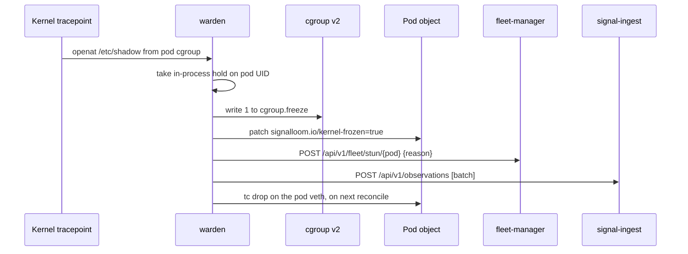

# Kusari pilot: enforcement

This page describes what the warden does when an agent misbehaves. It covers
the triggers, the records, the resume path, and the forensic bundle. It
describes the tree at commit `02d18d07`. It derives from ADR-12
and ADR-13 in
[the Spireless proposal](../Proposal%20—%20Signal%20Loom%20Spireless%20Token-Based%20Agent%20Identity%20Migration%20%282026-Q4%29.md),
from the live status in
[`SLDC-P5-1-E2E-CONTAINMENT.md`](../eap/SLDC-P5-1-E2E-CONTAINMENT.md), and
from the warden source under
[`apps/signalloom-stun-sentinel/`](../../d2-signalloom/apps/signalloom-stun-sentinel/)
and [`apps/stun-sentinel/`](../../d2-signalloom/apps/stun-sentinel/).

## What triggers a detection

The warden loads one eBPF program with four tracepoints: `sys_enter_openat`,
`sys_enter_openat2`, `sys_enter_execve`, and `sys_enter_connect`. The
correlator in
[`ebpf_correlator.go`](../../d2-signalloom/apps/stun-sentinel/pkg/correlator/ebpf_correlator.go)
turns kernel events into observations. Every observation it emits has severity
`CRITICAL`. The `WARN` severity exists in the types but is never assigned.

| Detection | Trigger | Freezes the pod |
| :--- | :--- | :--- |
| `sys_enter_openat` | An open of a path that equals or is under a sensitive prefix | Yes, when the pod is an agent pod |
| `sys_enter_execve` | An exec whose binary path is a sensitive prefix | Yes, when the pod is an agent pod |
| `evasive_syscall_burst` | 20 or more `execve` calls from one cgroup within one second | Yes, when the pod is an agent pod |
| `tcp_connect` | Mapped from the connect tracepoint | Never emitted. The probe records no target for a connect, so the filter never matches. |

The sensitive prefixes are one table in `ebpf_correlator.go`. The eBPF header
is generated from it.

| Prefix |
| :--- |
| `/etc/passwd` |
| `/etc/shadow` |
| `/var/run/secrets/kubernetes.io/serviceaccount` |
| `/run/secrets/kubernetes.io/serviceaccount` |
| `/root/.ssh` |

An agent pod is one that carries `signalloom.ai/agent=true`, or a non-empty
`signalloom.ai/agent-name`, or a non-empty `tenant` or `kusari` label. The
warden's informer only lists pods with `signalloom.ai/agent=true`, so in
practice that label is the switch.

The warden suppresses three classes of event. Its own pod never produces an
observation. A `/etc/passwd` read by the container runtime's user lookup is
dropped when the opener's binary is the node's `runc`
([`runtime_lookup.go`](../../d2-signalloom/apps/stun-sentinel/pkg/correlator/runtime_lookup.go)).
An event whose cgroup resolves to no watched pod is counted and dropped.

### The pilot stub

The Kusari agent stub on the central cluster provokes a detection on request.
`POST /act/read-passwd` opens `/etc/passwd`. `POST /act/read-shadow` opens
`/etc/shadow`. `POST /act/cpu-burn` burns CPU. The stub never returns file
content. The README is
[`apps/kusari-agent/README.md`](../../d2-signalloom/apps/kusari-agent/README.md).

## The enforcement chain

The sequence shows the order of actions on a freeze-worthy detection. Steps 1
to 3 are local to the node. Steps 4 and 5 are records sent to the central
cluster.



1. **Hold.** The warden takes a hold on the pod UID under the same mutex the
   reconciler uses before any thaw
   ([`stunhold.go`](../../d2-signalloom/apps/signalloom-stun-sentinel/stunhold.go)).
   The log line is `correlator_freeze_held` with decision
   `hold_until_authorised_resume`.
2. **Freeze.** The warden resolves the pod cgroup by pod UID across the known
   kubelet layouts and writes `1` to `cgroup.freeze`
   ([`freezer.go`](../../d2-signalloom/apps/stun-sentinel/pkg/cgroup/freezer.go)).
   It reads `cgroup.events` back to confirm `frozen 1`. Every process in the pod
   stops at once. The pod stays `Running` and its restart count stays `0`.
3. **Kernel truth.** On every reconcile the warden reads `cgroup.events` and
   patches `signalloom.io/kernel-frozen` and `signalloom.io/kernel-observed-at`
   on the pod
   ([`kernel.go`](../../d2-signalloom/apps/signalloom-stun-sentinel/kernel.go)).
   The annotation says what the kernel says, not what the labels say. A pod
   that is frozen with no stun record anywhere is counted in the metric
   `sentinel_frozen_unlabelled_pods`.
4. **Stun record.** The warden posts
   `POST {FLEET_MANAGER_URL}/api/v1/fleet/stun/{pod}` with the body
   `{"reason": "signalloom-warden detection: <syscall> <target>"}`
   ([`fleetstun.go`](../../d2-signalloom/apps/signalloom-stun-sentinel/fleetstun.go)).
   It retries six times with exponential backoff on a transport error or a
   `5xx`. A `400`, `401`, `403`, or `404` is `refused` and not retried. The
   freeze stays in place either way. The counter `fleet_stun_failures` on
   `/healthz` shows refusals.
5. **Observation.** The warden posts a JSON array of observations to
   `POST {SIGNAL_INGEST_URL}/api/v1/observations` with the bearer token and
   the batch chain headers `X-SignalLoom-Batch-Epoch`, `-Seq`, `-Prev`
   ([`sender.go`](../../d2-signalloom/apps/stun-sentinel/pkg/correlator/sender.go)).
   Each observation carries `layer: endpoint_host`, `source: stun-sentinel`,
   `confidence: 0.95`, the pod's ServiceAccount as `actor_id`, and labels
   `syscall`, `target`, `pod_name`, `namespace`, `tenant_id`, `severity`,
   `direct_reaction`, `cgroup_path`. `direct_reaction` is `cgroup_frozen` or
   `none`. A `401` or `403` drops the batch. A `5xx` or network error spools it.
6. **Network drop.** The reconciler acts when it next sees the pod labelled
   stunned. It finds the host veth through netlink inside the pod's network
   namespace. It then attaches `tc` drop filters on ingress and egress
   ([`network.go`](../../d2-signalloom/apps/signalloom-stun-sentinel/network.go)).
   Liveness probe traffic is preserved so the kubelet does not restart the pod.

### What fleet-manager does with the record

On the central cluster, `fleet-manager` resolves the pod name to an agent and
runs the containment cascade
([`cascade.go`](../../d2-signalloom/apps/fleet-manager/cascade.go)). It writes
the stun labels on the pod, `signalloom.ai/state=stunned`,
`signalloom.io/stunned=true`, and `signalloom.io/containment-mode=frozen`
([`enforcement.go`](../../d2-signalloom/apps/fleet-manager/enforcement.go)).
It then pins the pod and its owning Deployment with
`kustomize.toolkit.fluxcd.io/reconcile=disabled`, so Flux cannot roll the
frozen pod away
([`k8sclient.go`](../../d2-signalloom/apps/fleet-manager/k8sclient.go)). It
suspends GitOps only after the state write succeeded. It also revokes the
agent's OpenBao tokens and checks its SPIRE entry, when those exist.

`fleet-manager` holds no stun database. The record is the Kubernetes state it
wrote. The endpoint `GET /api/v1/fleet/consistency/{id}` compares the pod, the
pins, the kernel annotation, OpenBao and SPIRE, and lists every disagreement in
`split_brain`
([`consistency.go`](../../d2-signalloom/apps/fleet-manager/consistency.go)).

The portal records the stun as an audit event. The dashboard reads the stun
state of an agent from the audit trail, event type `agent.stunned`
([`api_compat.py`](../../d2-signalloom/apps/fe-signalloom/src/api_compat.py),
`_latest_stun_index`). The agent dossier at `/agents/:id` shows it. See
[pages](pages.md#agentsid).

## What this means on the Kusari cluster

Steps 1 to 3 and 6 happen on the Kusari node and need no round trip. ADR-12
states this and the code confirms it. Steps 4 and 5 cross the gateway. Two
things differ from the central cluster.

First, `fleet-manager` resolves the pod name against its own cluster. Its
inventory
([`fleet-config.yaml`](../../d2-signalloom/apps/fleet-manager/base/fleet-config.yaml))
names five demo agents, and its fallback reads a pod in its own
`AGENT_NAMESPACE`
([`agent_resolution.go`](../../d2-signalloom/apps/fleet-manager/agent_resolution.go)).
A pod that exists only on the Kusari cluster resolves to nothing. The stun
POST gets `404 unknown agent`, which the warden classifies as `refused`. The
freeze holds. No stun labels, no Flux pin, no `agent.stunned` audit event, and
no dossier state are written for that pod.

Second, the observation path works when the key is valid and the TLS chain
validates. With the self-signed certificate of the central cluster it does
not. See [secondary-cluster](secondary-cluster.md#5-check-the-network-path-and-tls).

## How to resume

A hold is released only by an authorised resume. The rule in
[`stunhold.go`](../../d2-signalloom/apps/signalloom-stun-sentinel/stunhold.go)
has two parts. The pod must first have been seen stunned, through its labels
or an owner record, so the hold is adopted. The pod must then be affirmatively
resumed: `signalloom.io/stunned=false`, or a `signalloom.ai/state` that is not
`stunned`. The warden confirms this against the API server, not its cache. A
label that is merely absent or removed never releases a hold. A later
detection takes a new generation and wins over an in-flight release.

On the central cluster the resume is `POST /api/v1/fleet/resume/{id}` on
`fleet-manager`. The caller needs the `resume` scope, which only the
`operator` key holds
([`fleet-manager/base/deployment.yaml`](../../d2-signalloom/apps/fleet-manager/base/deployment.yaml)).
The body carries an Ed25519 multi-signature resume token, schema
`sler.signalloom.io/v1alpha1`
([`resume_token.go`](../../d2-signalloom/apps/stun-sentinel/pkg/auth/resume_token.go)).
`fleet-manager` then writes the resume label through its in-cluster client.
The dashboard's **Recover Fleet** button uses the `dashboard` key, which has no
`resume` or `recover` scope, so it answers `403`.

On the Kusari cluster there is no product path to resume. The warden exposes
no resume endpoint and never polls `fleet-manager`. `fleet-manager` cannot
write labels on a pod in another cluster. The hold lives in the warden process
and dies with it. What releases a freeze on the Kusari cluster today:

1. A Kusari operator writes the labels by hand on the frozen pod, after a stun
   label was present:

```bash
kubectl -n fe-signalloom-agents label pod "$FROZEN" signalloom.io/stunned=true --overwrite
kubectl -n fe-signalloom-agents label pod "$FROZEN" signalloom.io/stunned=false --overwrite
```

   The first command lets the warden adopt the hold. The second is the
   affirmative release. The warden thaws the cgroup and removes the `tc`
   filters on the next reconcile.

2. Deleting the pod. The hold is keyed by pod UID and the replacement pod is
   a new UID. Flux or the Deployment controller recreates the pod with no
   stun record on it.

3. Restarting the warden DaemonSet. The in-process hold is lost. The cgroup
   stays frozen until something writes `0` to `cgroup.freeze`. Do not use this
   as a resume path.

CAUTION: Deleting a frozen pod destroys the forensic state. Capture the
cgroup events, the pod object, and the warden log before you delete it.

## How a detection is recorded

| Where | What | Who can read it |
| :--- | :--- | :--- |
| Warden log, stdout | `correlator_freeze_held`, `fleet_stun_*`, `ingest_*`, `spool_*` events as JSON lines | Anyone with `kubectl logs` on the Kusari cluster |
| Pod annotations | `signalloom.io/kernel-frozen`, `signalloom.io/kernel-observed-at` | Anyone with `kubectl get pod` on the Kusari cluster |
| Pod cgroup | `cgroup.events` shows `frozen 1` | A node shell, or the warden's `/host-cgroup` mount |
| `signal-ingest` store, central | The observation, tenant `kusari` when the map names the pod | A key or user with read grants for tenant `kusari`. The warden key cannot read. |
| `/weave` dashboard page | The observation, as an endpoint-host signal | A signed-in Kusari user |
| `fleet-manager`, central | Stun labels and Flux pins, only for pods in the central cluster | `GET /api/v1/fleet/consistency/{id}`, no key needed |
| `audit_events` table, central | `agent.stunned`, `agent.stun_failed`, only for stuns the portal proxied | `/audit` for the tenant |

## The forensic bundle

The bundle is the signed evidence package of one containment run. The
specification is
[`FORENSIC-BUNDLE-SPECIFICATION.md`](../eap/FORENSIC-BUNDLE-SPECIFICATION.md).
A shell toolchain produces it, not the warden and not `fleet-manager`.
[`scripts/package-eap-evidence.sh`](../../scripts/package-eap-evidence.sh)
packages a directory of step artefacts.
[`scripts/verify-eap-evidence.sh`](../../scripts/verify-eap-evidence.sh)
checks a tarball. Nothing produces a bundle on its own when a freeze happens.

The bundle holds eleven files.

| File | Content |
| :--- | :--- |
| `preflight-manifest.json` | Capture time, tenant `kusari` with hash `4b53ab6b`, the two cluster contexts, the git commit |
| `step1-flux-reconcile.txt` | The Flux reconcile output. Every `restartCount` must be `0`. |
| `step2-registry-claim.json` | The registry claim row, `tenant_hash: 4b53ab6b` |
| `step3-provocation-act.log` | The request to the stub and its answer |
| `step4-ebpf-observation.json` | The normalised observation from `signal-ingest` |
| `step5-cgroup-freeze.txt` | The primary proof: `frozen 1`, no `frozen 0`, `restartCount: 0`, CPU seconds unchanged between two samples |
| `step5-cadvisor-metrics.prom` | The cAdvisor sample |
| `audit-signature.sha256` | Seven lines, `sha256  name`, in order |
| `bundle-header.json` | The manifest digest, `evidence_origin` of `live`, `fixture`, or `unknown`, and the signing time |
| `bundle-header.json.sig` | A raw 64-byte Ed25519 signature over the header |
| `signing-key.pub.pem` | The public key. Trust comes from the published fingerprint, not from this file. |

The tarball is `kusari-eap-evidence-<UTC time>.tar.gz` with a `.sha256` next
to it, in `$EAP_OUT_DIR` or `ci-evidence/`. It is byte-reproducible under
`SOURCE_DATE_EPOCH`. To check one:

```bash
scripts/verify-eap-evidence.sh kusari-eap-evidence-20261002T143000Z.tar.gz --require-live
```

`--require-live` refuses a bundle whose `evidence_origin` is not `live`. A
certification bundle must pass it.

NOTE: The specification lists `tcp_connect` as a valid step 4 syscall and omits
`evasive_syscall_burst`. The code never emits the first and does emit the
second. The specification also expects `filename` and `remote_endpoint` fields
that the warden does not send. It sends `labels.target` and
`labels.cgroup_path`.

NOTE: No bundle from a green live run exists in the tree.
[`SLDC-MISSION-CERTIFICATION.md`](../eap/SLDC-MISSION-CERTIFICATION.md)
records that the packager refused the last candidate on five contract
violations. The sealed bundle that
[`SLDC-P6-PREFLIGHT.md`](../eap/SLDC-P6-PREFLIGHT.md) names is fixture-origin.

### Reading a capture

The warden serves its captures on the health listener at `/captures`,
`/captures/<stun-id>` (the manifest) and `/captures/<stun-id>/<artifact>`.
The route is closed until two things hold. The source address must be
inside `CAPTURES_ALLOW_CIDRS`, which defaults to loopback, so a reader must
be on the node itself. The request must carry the bearer stored in the
optional Secret `signalloom-warden-captures-token`. Without that Secret the
route answers `403 captures_disabled`. A wrong bearer answers `401`. A
source outside the list answers `403 captures_source_not_allowed` before
the bearer is examined.

The warden runs with host networking, and the usual CNIs do not enforce a
NetworkPolicy on such a pod. The allow-list is therefore the control that
holds. The base still ships `signalloom-warden-captures`, an ingress policy
that admits only pods labelled `signalloom.ai/captures-reader=true`, for a
CNI that does enforce on host-network pods.

To read on the pilot cluster, use a node debug pod: it shares the node's
network namespace, so its loopback is the warden's loopback. The warden
image carries no HTTP client of its own.

```bash
kubectl -n fe-signalloom-agents create secret generic signalloom-warden-captures-token \
  --from-literal=token="$(openssl rand -base64 32)"
TOKEN="$(kubectl -n fe-signalloom-agents get secret signalloom-warden-captures-token -o jsonpath='{.data.token}' | base64 -d)"
NODE="$(kubectl -n fe-signalloom-agents get pods -l app.kubernetes.io/name=signalloom-warden -o jsonpath='{.items[0].spec.nodeName}')"
kubectl debug "node/$NODE" -q --image=curlimages/curl:8.5.0 --attach=true -- \
  curl -s -H "Authorization: Bearer $TOKEN" http://127.0.0.1:8081/captures
```

The mounted Secret is read on every request, so creating it after the
warden started is enough. Only the manifest and the two artifacts are
served. The quarantine snapshot stays on the node's spool. Delete the
debug pod afterwards; `kubectl debug` leaves it behind.

## Live status of the chain

[`SLDC-P5-1-E2E-CONTAINMENT.md`](../eap/SLDC-P5-1-E2E-CONTAINMENT.md) records
the last live run on the two-cluster lab, dated 2026-10-02. Steps 1, 3, and 4
passed, with a detection delta of 27 to 31 ms. Step 2, the registry claim,
failed because no Dex subject mapped to tenant `kusari` at that time. The
`kusari-operator` identity in this tree closes that gap. Step 5 reached
`frozen 1` and then a legacy reconciler thawed the pod after about 14 seconds.
The Deployment pin that stops that is written by `fleet-manager`, which does
not reach a remote cluster.
