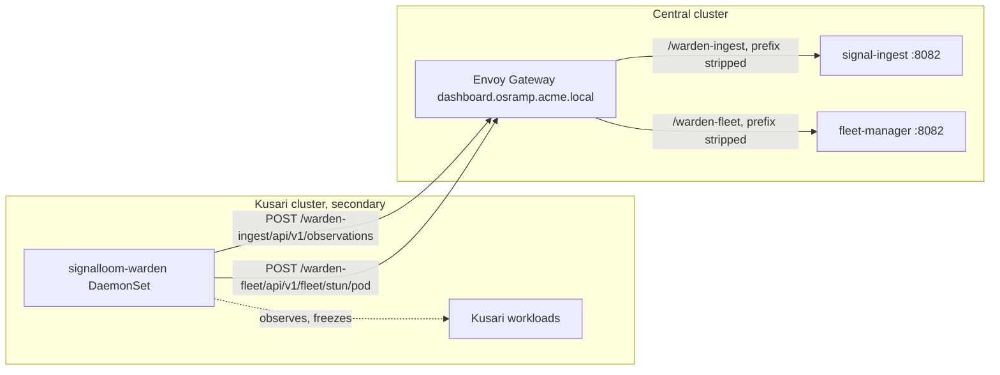

# Kusari pilot: the secondary cluster

This page says exactly what runs on the Kusari cluster, what the central
cluster needs before that, and how to check each step. It describes the tree
at commit `dfc1a849`. It derives from ADR-12 and ADR-14 in
[the Spireless proposal](../Proposal%20—%20Signal%20Loom%20Spireless%20Token-Based%20Agent%20Identity%20Migration%20%282026-Q4%29.md)
and from the manifests under
[`d2-signalloom/infra/agent-swarm/signalloom-warden/`](../../d2-signalloom/infra/agent-swarm/signalloom-warden/).

Result: the `signalloom-warden` DaemonSet runs on every node of the Kusari
cluster with its two named keys. It posts observations and stun records to the
central cluster through the gateway.

Prerequisites:

- `kubectl` access to the Kusari cluster with cluster-admin rights.
- `kubectl` access to the central cluster for the ControlPlane operator who
  mints the keys. Kusari never mints a key.
- Nodes with cgroup v2, `debugfs` mounted at `/sys/kernel/debug`, and a kernel
  that can load the eBPF tracepoint programs. The DaemonSet comments at
  [`daemonset.yaml`](../../d2-signalloom/infra/agent-swarm/signalloom-warden/daemonset.yaml)
  explain each mount and capability.
- A network path from every Kusari node to
  `https://dashboard.osramp.acme.local` on port 443. See
  [step 5](#5-check-the-network-path-and-tls).

## What the shape is

The diagram shows the two clusters and the only two paths between them. Both
paths go from the Kusari cluster to the central cluster. Nothing on the
central cluster calls into the Kusari cluster.



The gateway routes are in
[`gateway-route.yaml`](../../d2-signalloom/apps/fe-signalloom/base/gateway-route.yaml),
object `signalloom-remote-warden`. Each rule is a `PathPrefix` match with a
`URLRewrite` that replaces the prefix with `/`. The gateway adds no
authentication. Each backend checks its own named key.

## What runs on the Kusari cluster

ADR-12 states the list. The overlay
[`remote-tenant/kustomization.yaml`](../../d2-signalloom/infra/agent-swarm/signalloom-warden-overlays/remote-tenant/kustomization.yaml)
implements it.

| Object | Namespace | Source | Notes |
| :--- | :--- | :--- | :--- |
| DaemonSet `signalloom-warden` | `fe-signalloom-agents` | [`daemonset.yaml`](../../d2-signalloom/infra/agent-swarm/signalloom-warden/daemonset.yaml) | One pod per node. `hostPID`, `hostNetwork`, `dnsPolicy: ClusterFirstWithHostNet`, tolerates every taint. |
| ServiceAccount `signalloom-warden` | `fe-signalloom-agents` | [`service-account.yaml`](../../d2-signalloom/infra/agent-swarm/signalloom-warden/service-account.yaml) | |
| Role `signalloom-warden` | `fe-signalloom-agents` | [`agent-swarm/rbac.yaml`](../../d2-signalloom/infra/agent-swarm/rbac.yaml) | `pods: get, list, watch, patch` and `replicasets, deployments: get`. ADR-14 keeps the Role in the base. |
| RoleBinding `signalloom-warden` | `fe-signalloom-agents` | [`rbac.yaml`](../../d2-signalloom/infra/agent-swarm/signalloom-warden/rbac.yaml) | Binds the ServiceAccount to the Role. |
| ConfigMap `signalloom-warden-config` | `fe-signalloom-agents` | [`configmap.yaml`](../../d2-signalloom/infra/agent-swarm/signalloom-warden/configmap.yaml) | `SIGNAL_INGEST_URL`, `FLEET_MANAGER_URL`, `SENTINEL_TENANT_MAP`. The overlay patches the two URLs. |
| Secret `signalloom-warden-ingest-token` | `fe-signalloom-agents` | Copied from the central cluster | Key `token`. The value of the `signal-ingest` named key `signalloom-warden`. |
| Secret `signalloom-warden-fleet-key` | `fe-signalloom-agents` | Copied from the central cluster | Key `token`. The value of the `fleet-manager` caller key `signalloom-warden`. |
| CronJob `signalloom-rbac-exporter` | `fe-signalloom-agents` | [`rbac-exporter-cronjob.yaml`](../../d2-signalloom/infra/agent-swarm/signalloom-warden/rbac-exporter-cronjob.yaml) | Rendered by the base. Not usable on a remote cluster in this tree. See [the RBAC exporter](#the-rbac-exporter). |

The overlay does not render SPIRE, OpenBao, `signal-ingest`, `fe-signalloom`,
or the dashboard. It does not render the Role either. The Role comes from
[`agent-swarm/rbac.yaml`](../../d2-signalloom/infra/agent-swarm/rbac.yaml),
which the base `signalloom-warden` Kustomization does not include. You apply
it in [step 3](#3-apply-the-warden-overlay).

### Image

The DaemonSet pins
`ghcr.io/controlplaneio-in-toto/signalloom-warden:src-66581dce2356`. The tag
is the source fingerprint, written by `make -C d2-signalloom sentinel-image-pin`
and checked by [`test/sentinel-image-provenance.bats`](../../test/sentinel-image-provenance.bats).
The remote-tenant overlay keeps the public `ghcr.io` reference. The two kind
overlays rewrite it to the in-cluster Zot registry.

The image is built from
[`apps/signalloom-stun-sentinel/Dockerfile`](../../d2-signalloom/apps/signalloom-stun-sentinel/Dockerfile)
with build context `apps/`. The binary is `/usr/local/bin/stun-sentinel` on a
`wolfi-base` image. The Go sources are
[`apps/signalloom-stun-sentinel/`](../../d2-signalloom/apps/signalloom-stun-sentinel/)
and [`apps/stun-sentinel/`](../../d2-signalloom/apps/stun-sentinel/).

### Container security context

The container is not privileged. It has a read-only root filesystem and adds
four capabilities: `SYS_PTRACE`, `BPF`, `NET_ADMIN`, `SYS_ADMIN`. It mounts
three host paths:

| Mount | Host path | Mode | Why |
| :--- | :--- | :--- | :--- |
| `/host-cgroup` | `/sys/fs/cgroup` | read-write | The freeze is a write to `cgroup.freeze`. |
| `/sys/kernel/debug` | `/sys/kernel/debug` | read-only | The tracepoint ids. Without it no probe attaches. |
| `/var/lib/signalloom/spool` | `/var/lib/signalloom/spool` | read-write | The observation spool when the hub is unreachable. |

[`least_privilege_test.go`](../../d2-signalloom/apps/stun-sentinel/deploy/least_privilege_test.go)
fails if a mount or capability is added without a reason.

### Environment

| Variable | Source | Value in the overlay |
| :--- | :--- | :--- |
| `WATCH_NAMESPACE` | literal | `fe-signalloom-agents` |
| `SIGNAL_INGEST_URL` | ConfigMap | `https://dashboard.osramp.acme.local/warden-ingest` |
| `FLEET_MANAGER_URL` | ConfigMap | `https://dashboard.osramp.acme.local/warden-fleet` |
| `SENTINEL_TENANT_MAP` | ConfigMap | The base map. It names the central cluster's agents, not Kusari's. See [step 4](#4-map-your-workloads-to-the-tenant). |
| `SIGNAL_INGEST_TOKEN` | Secret `signalloom-warden-ingest-token`, key `token`, optional | |
| `FLEET_MANAGER_STUN_KEY` | Secret `signalloom-warden-fleet-key`, key `token`, optional | |
| `STUN_FREEZE_TOKEN`, `STUN_RESUME_TOKEN` | Secret `signalloom-warden-governance`, optional | Gate the warden's own cgroup writes. Absent in the overlay. |
| `NODE_NAME`, `POD_NAME`, `POD_NAMESPACE`, `POD_UID` | downward API | Self-identity. The warden never freezes itself. |
| `HEALTH_ADDR` | literal | `:8081`. Serves `/healthz`, `/readyz`, `/metrics` only. |

WARNING: Both key references are `optional: true`. A warden that starts
before its Secrets exist runs without keys. It then logs every observation to
stdout and drops it, and it never records a stun. Create the Secrets before
you apply the DaemonSet, or restart the DaemonSet after.

## Hub-side prerequisites

The ControlPlane operator does these on the central cluster. Kusari needs the
output of steps 2 and 3.

### 1. Mint the named keys

Two scripts mint the keys. Both are idempotent and both write Secrets only.
Neither prints a key value.

| Key | Script | Make target | Issuer Secret (central) | Consumer Secret (central) |
| :--- | :--- | :--- | :--- | :--- |
| `signal-ingest` key `signalloom-warden` | [`scripts/sldc-ingest-bearer.sh`](../../scripts/sldc-ingest-bearer.sh) | `make sldc-ingest-keys CONTEXT=<ctx>` | `fe-signalloom/signal-ingest-key-signalloom-warden`, keys `token` and `expires` | `fe-signalloom-agents/signalloom-warden-ingest-token`, key `token` |
| `fleet-manager` caller key `signalloom-warden` | [`scripts/fleet-manager-caller-keys.sh`](../../scripts/fleet-manager-caller-keys.sh) | `make fleet-manager-keys CONTEXT=<ctx>` | `fe-signalloom/fleet-manager-caller-keys`, key `signalloom-warden` | `fe-signalloom-agents/signalloom-warden-fleet-key`, key `token` |

`demo-signalloom-up` runs both targets first, then `afm-importer-key`
([`Makefile`](../../Makefile), target `demo-signalloom-up`). The comment there
records why the order matters: a pod that starts before its Secret stays
keyless until restarted.

The ingest key expires 90 days after minting. `signal-ingest` refuses a key
with a longer life
([`static_bearer.go`](../../d2-signalloom/apps/signal-ingest/api/static_bearer.go),
`MaxStaticKeyLifetime`). Rotate with `--rotate`. Then restart the `signal-ingest` Deployment and the
warden DaemonSet.

The grant of the `signalloom-warden` ingest key is `observations:write` and
`tenant:cross-write` for tenant `kusari`
([`jwt-auth-config.yaml`](../../d2-signalloom/apps/signal-ingest/deploy/jwt-auth-config.yaml),
`SIGNAL_AUTH_STATIC_KEYS`). The key cannot read anything. The `fleet-manager`
caller `signalloom-warden` has the scope `stun` only
([`fleet-manager/base/deployment.yaml`](../../d2-signalloom/apps/fleet-manager/base/deployment.yaml),
`FLEET_MANAGER_KEY_SIGNALLOOM_WARDEN_SCOPES`).

Check, on the central cluster:

```bash
kubectl -n fe-signalloom get secret signal-ingest-key-signalloom-warden -o jsonpath='{.data.expires}' | base64 -d; echo
kubectl -n fe-signalloom-agents get secret signalloom-warden-ingest-token signalloom-warden-fleet-key
```

The first command prints a date within 90 days. The second lists both Secrets.

### 2. Copy the two consumer Secrets to the Kusari cluster

The Secrets travel as Kubernetes objects. The operator exports them from the
central cluster and Kusari applies them.

```bash
# Operator, on the central cluster
for s in signalloom-warden-ingest-token signalloom-warden-fleet-key; do
  kubectl --context "$CENTRAL" -n fe-signalloom-agents get secret "$s" -o json \
    | jq 'del(.metadata.uid, .metadata.resourceVersion, .metadata.creationTimestamp, .metadata.managedFields, .metadata.ownerReferences)' \
    > "/secure/transfer/$s.json"
done
```

Hand the two files to Kusari over an agreed secure channel. Kusari applies them
in [step 2 of the Kusari steps](#2-create-the-namespace-and-the-secrets).

### 3. Confirm the gateway route exists

```bash
kubectl --context "$CENTRAL" -n fe-signalloom get httproute signalloom-remote-warden \
  -o jsonpath='{range .spec.rules[*]}{.matches[0].path.value}{" -> "}{.backendRefs[0].name}{":"}{.backendRefs[0].port}{"\n"}{end}'
```

Expected output:

```text
/warden-ingest -> signal-ingest:8082
/warden-fleet -> fleet-manager:8082
```

## Kusari-side steps

### 1. Check the nodes

1. On one node, run `stat -f -c %T /sys/fs/cgroup`. The output is `cgroup2fs`.
2. Run `mount | grep debugfs`. One line names `/sys/kernel/debug`.
3. Run `kubectl get nodes -o wide`. Note the kernel version of each node.

### 2. Create the namespace and the Secrets

1. Run `kubectl apply -f d2-signalloom/infra/agent-swarm/namespace.yaml`. The
   file is [`namespace.yaml`](../../d2-signalloom/infra/agent-swarm/namespace.yaml).
2. Run `kubectl apply -f /secure/transfer/signalloom-warden-ingest-token.json`.
3. Run `kubectl apply -f /secure/transfer/signalloom-warden-fleet-key.json`.
4. Delete the transfer files.

Check: `kubectl -n fe-signalloom-agents get secret` lists both Secrets, each
with one data key, `token`.

### 3. Apply the warden overlay

1. Run `kubectl apply -f d2-signalloom/infra/agent-swarm/rbac.yaml`. This
   creates the Role the RoleBinding needs. ADR-14 records why the Role must
   exist before the binding is applied.
2. Run `kubectl apply -k d2-signalloom/infra/agent-swarm/signalloom-warden-overlays/remote-tenant`.
3. Wait for the DaemonSet: `kubectl -n fe-signalloom-agents rollout status ds/signalloom-warden`.

NOTE: The agent-swarm `rbac.yaml` also defines Roles for the other swarm
agents. They are harmless on the Kusari cluster, but they are not needed.

Check: every warden pod is `Running` and `1/1`. Then read the readiness
endpoint on one pod:

```bash
POD=$(kubectl -n fe-signalloom-agents get pod -l app.kubernetes.io/name=signalloom-warden -o jsonpath='{.items[0].metadata.name}')
kubectl -n fe-signalloom-agents exec "$POD" -- wget -qO- http://127.0.0.1:8081/readyz
kubectl -n fe-signalloom-agents logs "$POD" | grep -E 'ebpf_probe_attached|cutover|tenant_map'
```

`/readyz` answers `200`. The log holds one `ebpf_probe_attached` line that
names four tracepoints. A `cutover_waiting` state means the warden found an
older `stun-sentinel` pod on the same node and will not arm until it is gone
([`cutover.go`](../../d2-signalloom/apps/signalloom-stun-sentinel/cutover.go)).

### 4. Map your workloads to the tenant

The warden observes pods in `WATCH_NAMESPACE` that carry the label
`signalloom.ai/agent=true`
([`main.go`](../../d2-signalloom/apps/signalloom-stun-sentinel/main.go),
informer selector). A pod without the label is never watched and never
frozen. A pod with the label but without a tenant map entry is observed and
frozen, and its observations carry `tenant_id: __unattributed__`
([`tenancy.go`](../../d2-signalloom/apps/stun-sentinel/pkg/correlator/tenancy.go)).

The tenant never comes from a pod label. It comes from `SENTINEL_TENANT_MAP`,
one `namespace/serviceaccount=tenant` or `namespace=tenant` entry per line. The
remote-tenant overlay does not patch the map, so it ships the central cluster's
agents.

1. Label every Kusari workload pod template with `signalloom.ai/agent: "true"`
   and `signalloom.ai/tenant: kusari`. Run them in `fe-signalloom-agents`, or
   change `WATCH_NAMESPACE` in a local patch.
2. Patch the ConfigMap so the map names your namespace:

```bash
kubectl -n fe-signalloom-agents patch configmap signalloom-warden-config --type merge \
  -p '{"data":{"SENTINEL_TENANT_MAP":"fe-signalloom-agents=kusari\n"}}'
kubectl -n fe-signalloom-agents rollout restart ds/signalloom-warden
```

CAUTION: One malformed entry rejects the whole map. The warden then logs
`tenant_map_invalid` and every observation is unattributed. Check the log
after the restart.

Check: `kubectl -n fe-signalloom-agents logs ds/signalloom-warden | grep tenant_map`
prints no `invalid` event.

### 5. Check the network path and TLS

The warden posts over HTTPS to `dashboard.osramp.acme.local`. Three things
must hold on every node.

1. The name resolves. The warden uses cluster DNS first and then the node's
   resolver (`ClusterFirstWithHostNet`). Add the record to cluster DNS or to
   each node's `/etc/hosts`.
2. Port 443 is reachable. The warden's URLs carry no port. The local lab serves
   the gateway on NodePort `30754`, so a lab needs a port mapping or a patched
   URL.
3. The certificate chain validates. The central cluster's certificate comes
   from a self-signed `ClusterIssuer`
   ([`cluster-issuer.yaml`](../../d2-infra/components/cert-manager/configs/base/cluster-issuer.yaml)).
   The warden's HTTP clients use the Go default transport with the container's
   system roots and have no CA option
   ([`ebpf_correlator.go`](../../d2-signalloom/apps/stun-sentinel/pkg/correlator/ebpf_correlator.go),
   `httpClient`, and [`fleetstun.go`](../../d2-signalloom/apps/signalloom-stun-sentinel/fleetstun.go)).

WARNING: With the self-signed certificate the warden's posts fail with
`x509: certificate signed by unknown authority`. Observations go to the spool
and stun records are retried six times and then dropped. There is no
environment variable for a CA bundle and no mount for one. Until the central
cluster serves a certificate from a CA the nodes trust, or the image carries
the CA, the forwarding path does not work. See
[faq-and-limits](faq-and-limits.md#the-warden-cannot-reach-the-hub).

Check, from a warden pod, once the record and certificate are in place:

```bash
kubectl -n fe-signalloom-agents exec "$POD" -- \
  wget -qO- --header "Authorization: Bearer $(kubectl -n fe-signalloom-agents get secret signalloom-warden-ingest-token -o jsonpath='{.data.token}' | base64 -d)" \
  --post-data '[]' --header 'Content-Type: application/json' \
  https://dashboard.osramp.acme.local/warden-ingest/api/v1/observations
```

An empty array returns `201` or `200` from `signal-ingest`. A `401` means the
key does not match the issuer Secret. A TLS error means item 3 is not done.

### 6. Check the spool

The spool holds batches that could not be delivered. It is bounded at 256 MiB
and 8 hours by default (`SIGNAL_INGEST_SPOOL_MAX_BYTES`,
`SIGNAL_INGEST_SPOOL_MAX_AGE` in
[`config.go`](../../d2-signalloom/apps/signalloom-stun-sentinel/config.go)).
Replay is first in, first out. While the spool is not empty, new batches join
the tail.

```bash
kubectl -n fe-signalloom-agents exec "$POD" -- ls -la /var/lib/signalloom/spool
```

An empty directory means every batch was delivered. Files that keep growing
mean the hub is unreachable.

## The RBAC exporter

The base renders a CronJob `signalloom-rbac-exporter` every 30 minutes. It
reads the cluster's RBAC objects with its own ServiceAccount and posts them to
`AFM_IMPORT_URL`, which is the in-cluster portal Service
`fe-signalloom-api.fe-signalloom.svc.cluster.local:8000`
([`rbac-exporter-cronjob.yaml`](../../d2-signalloom/infra/agent-swarm/signalloom-warden/rbac-exporter-cronjob.yaml)).
It needs a Secret `signalloom-rbac-exporter-afm-key`, which
[`scripts/afm-importer-key.sh`](../../scripts/afm-importer-key.sh) writes on
the central cluster, and a non-empty `AFM_CLUSTER_ID`, which the base leaves
empty.

On the Kusari cluster none of those hold. The Service does not exist there.
The overlay does not patch the URL to a gateway prefix. No gateway prefix
routes to the import endpoint. The import key is bound to cluster
`kind-osramp`
([`fe-signalloom/base/deployment.yaml`](../../d2-signalloom/apps/fe-signalloom/base/deployment.yaml),
`AFM_IMPORT_KEYS`). The CronJob therefore fails on every run. Suspend it:

```bash
kubectl -n fe-signalloom-agents patch cronjob signalloom-rbac-exporter -p '{"spec":{"suspend":true}}'
```

The `kind-signalloom-hub` overlay does the same, for the same reason. See
[faq-and-limits](faq-and-limits.md#rbac-analysis-shows-no-kusari-cluster).

## Local stand-in for the pilot topology

The repository has a two-cluster lab that stands in for the pilot.
[`scripts/dual-cluster-up.sh`](../../scripts/dual-cluster-up.sh) attaches
`kind-osramp` and creates `kind-signalloom-hub` on one Docker bridge. The
record is [`SLDC-P2-DUAL-CLUSTER.md`](../eap/SLDC-P2-DUAL-CLUSTER.md).

NOTE: The SLDC records call `kind-osramp` the workload plane and
`kind-signalloom-hub` the control plane. In the ADR-12 sense it is the other
way round. Every central service runs on `kind-osramp`, and the hub overlay
[`kind-signalloom-hub/kustomization.yaml`](../../d2-signalloom/infra/agent-swarm/signalloom-warden-overlays/kind-signalloom-hub/kustomization.yaml)
is applied by hand and posts to its own `signal-ingest`, not across the bridge.
Map yourself onto `kind-signalloom-hub` when you read those records, and onto
`kind-osramp` for the services you talk to.

No test in the tree renders the `remote-tenant` overlay or exercises the
`/warden-ingest` and `/warden-fleet` routes.
[`test/signalloom-warden-manifests.bats`](../../test/signalloom-warden-manifests.bats)
renders the two kind overlays only.
