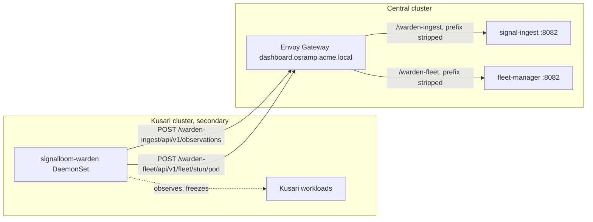

# Kusari pilot: the secondary cluster

This page says exactly what runs on the Kusari cluster, what the central
cluster needs before that, and how to check each step. It describes the tree
at commit `02d18d07`. It derives from ADR-12 and ADR-14 in
[the Spireless proposal](../Proposal%20—%20Signal%20Loom%20Spireless%20Token-Based%20Agent%20Identity%20Migration%20%282026-Q4%29.md)
and from the manifests under
[`d2-signalloom/infra/agent-swarm/signalloom-warden/`](../../d2-signalloom/infra/agent-swarm/signalloom-warden/).

Result: the `signalloom-warden` DaemonSet runs on every node of the Kusari
cluster with its two named keys. It posts observations and stun records to the
central cluster through the gateway.

Prerequisites:

- `kubectl` access to the Kusari cluster with cluster-admin rights.
- `kubectl` access to the central cluster for the ControlPlane operator who
  mints the keys. Kusari never mints a key.
- Nodes with cgroup v2, `debugfs` mounted at `/sys/kernel/debug`, and a kernel
  that can load the eBPF tracepoint programs. The DaemonSet comments at
  [`daemonset.yaml`](../../d2-signalloom/infra/agent-swarm/signalloom-warden/daemonset.yaml)
  explain each mount and capability.
- A network path from every Kusari node to
  `https://dashboard.osramp.acme.local` on port 443. See
  [step 5](#5-check-the-network-path-and-tls).

## What the shape is

The diagram shows the two clusters and the only two paths between them. Both
paths go from the Kusari cluster to the central cluster. Nothing on the
central cluster calls into the Kusari cluster.



The gateway routes are in
[`gateway-route.yaml`](../../d2-signalloom/apps/fe-signalloom/base/gateway-route.yaml),
object `signalloom-remote-warden`. Each rule is a `PathPrefix` match with a
`URLRewrite` that replaces the prefix with `/`. The gateway adds no
authentication. Each backend checks its own named key.

## What runs on the Kusari cluster

ADR-12 states the list. The overlay
[`remote-tenant/kustomization.yaml`](../../d2-signalloom/infra/agent-swarm/signalloom-warden-overlays/remote-tenant/kustomization.yaml)
implements it.

| Object | Namespace | Source | Notes |
| :--- | :--- | :--- | :--- |
| DaemonSet `signalloom-warden` | `fe-signalloom-agents` | [`daemonset.yaml`](../../d2-signalloom/infra/agent-swarm/signalloom-warden/daemonset.yaml) | One pod per node. `hostPID`, `hostNetwork`, `dnsPolicy: ClusterFirstWithHostNet`, tolerates every taint. |
| ServiceAccount `signalloom-warden` | `fe-signalloom-agents` | [`service-account.yaml`](../../d2-signalloom/infra/agent-swarm/signalloom-warden/service-account.yaml) | |
| Role `signalloom-warden` | `fe-signalloom-agents` | [`remote-tenant/role.yaml`](../../d2-signalloom/infra/agent-swarm/signalloom-warden-overlays/remote-tenant/role.yaml) | `pods: get, list, watch, patch` and `replicasets, deployments: get`. Rendered by the overlay. A test pins it to the central copy. |
| RoleBinding `signalloom-warden` | `fe-signalloom-agents` | [`rbac.yaml`](../../d2-signalloom/infra/agent-swarm/signalloom-warden/rbac.yaml) | Binds the ServiceAccount to the Role. |
| ConfigMap `signalloom-warden-config` | `fe-signalloom-agents` | [`configmap.yaml`](../../d2-signalloom/infra/agent-swarm/signalloom-warden/configmap.yaml) | `SIGNAL_INGEST_URL`, `FLEET_MANAGER_URL`, `SENTINEL_TENANT_MAP`. The overlay patches the two URLs. |
| Secret `signalloom-warden-ingest-token` | `fe-signalloom-agents` | Copied from the central cluster | Key `token`. The value of the `signal-ingest` named key `signalloom-warden`. |
| Secret `signalloom-warden-fleet-key` | `fe-signalloom-agents` | Copied from the central cluster | Key `token`. The value of the `fleet-manager` caller key `warden`, scope `report`. |
| Secret `signalloom-hub-ca` | `fe-signalloom-agents` | Created by the pilot | Optional. A PEM bundle for the hub's certificate. See [step 5](#5-check-the-network-path-and-tls). |
| CronJob `signalloom-rbac-exporter` | `fe-signalloom-agents` | [`rbac-exporter-cronjob.yaml`](../../d2-signalloom/infra/agent-swarm/signalloom-warden/rbac-exporter-cronjob.yaml) | Rendered by the base. Not usable on a remote cluster in this tree. See [the RBAC exporter](#the-rbac-exporter). |

The overlay does not render SPIRE, OpenBao, `signal-ingest`, `fe-signalloom`,
or the dashboard. It does render the Role, from
[`remote-tenant/role.yaml`](../../d2-signalloom/infra/agent-swarm/signalloom-warden-overlays/remote-tenant/role.yaml).
The base ships the RoleBinding and not the Role, because ADR-14 keeps the Role
one layer earlier on the central cluster. A remote cluster runs no such layer,
so the overlay carries its own copy. The copy is a deliberate trade, and `role.yaml` records why. Kustomize refuses
a file above its own root. A reference would therefore need a flag on every
render. `test/signalloom-warden-manifests.bats`
fails if the two copies disagree, so RBAC cannot drift.

### Image

The DaemonSet pins
`ghcr.io/controlplaneio-in-toto/signalloom-warden:src-66581dce2356`. The tag
is the source fingerprint, written by `make -C d2-signalloom sentinel-image-pin`
and checked by [`test/sentinel-image-provenance.bats`](../../test/sentinel-image-provenance.bats).
The remote-tenant overlay keeps the public `ghcr.io` reference. The two kind
overlays rewrite it to the in-cluster Zot registry.

The image is built from
[`apps/signalloom-stun-sentinel/Dockerfile`](../../d2-signalloom/apps/signalloom-stun-sentinel/Dockerfile)
with build context `apps/`. The binary is `/usr/local/bin/stun-sentinel` on a
`wolfi-base` image. The Go sources are
[`apps/signalloom-stun-sentinel/`](../../d2-signalloom/apps/signalloom-stun-sentinel/)
and [`apps/stun-sentinel/`](../../d2-signalloom/apps/stun-sentinel/).

### Container security context

The container is not privileged. It has a read-only root filesystem and adds
four capabilities: `SYS_PTRACE`, `BPF`, `NET_ADMIN`, `SYS_ADMIN`. It mounts
three host paths:

| Mount | Host path | Mode | Why |
| :--- | :--- | :--- | :--- |
| `/host-cgroup` | `/sys/fs/cgroup` | read-write | The freeze is a write to `cgroup.freeze`. |
| `/sys/kernel/debug` | `/sys/kernel/debug` | read-only | The tracepoint ids. Without it no probe attaches. |
| `/var/lib/signalloom/spool` | `/var/lib/signalloom/spool` | read-write | The observation spool when the hub is unreachable. |

[`least_privilege_test.go`](../../d2-signalloom/apps/stun-sentinel/deploy/least_privilege_test.go)
fails if a mount or capability is added without a reason.

### Environment

| Variable | Source | Value in the overlay |
| :--- | :--- | :--- |
| `WATCH_NAMESPACE` | literal | `fe-signalloom-agents` |
| `SIGNAL_INGEST_URL` | ConfigMap | `https://dashboard.osramp.acme.local/warden-ingest` |
| `FLEET_MANAGER_URL` | ConfigMap | `https://dashboard.osramp.acme.local/warden-fleet` |
| `SENTINEL_TENANT_MAP` | ConfigMap | The base map. It names the central cluster's agents, not Kusari's. See [step 4](#4-map-your-workloads-to-the-tenant). |
| `SIGNAL_INGEST_TOKEN` | Secret `signalloom-warden-ingest-token`, key `token`, required | |
| `FLEET_MANAGER_STUN_KEY` | Secret `signalloom-warden-fleet-key`, key `token`, required | |
| `SIGNAL_CLUSTER_ID` | literal | `kusari-prod`. Change it per pilot. |
| `FLEET_REPORT_INTERVAL` | literal | `60s`. The report period. |
| `FLEET_POLL_INTERVAL` | literal | `10s`. The stun-state poll period. |
| `SIGNAL_TLS_CA_FILE` | literal, with a mount | `/etc/signalloom/hub-ca/ca.pem` from optional Secret `signalloom-hub-ca`. |
| `SIGNAL_TLS_INSECURE_SKIP_VERIFY` | `remote-tenant-dev` only | Unset in `remote-tenant`. |
| `SIGNAL_DEV_MODE` | `remote-tenant-dev` only | Unset in `remote-tenant`. |
| `STUN_FREEZE_TOKEN`, `STUN_RESUME_TOKEN` | Secret `signalloom-warden-governance`, optional | Gate the warden's own cgroup writes. Absent in the overlay. |
| `NODE_NAME`, `POD_NAME`, `POD_NAMESPACE`, `POD_UID` | downward API | Self-identity. The warden never freezes itself. |
| `HEALTH_ADDR` | literal | `:8081`. Serves `/healthz`, `/readyz`, `/metrics` only. |

Both key references are required in this overlay, unlike the central cluster
where both are optional. A remote warden with no keys cannot report its
workloads and cannot record a stun, so the hub never learns the cluster exists.
A pod created before its Secrets therefore waits in `ContainerCreating` instead
of running and doing nothing. Apply the two Secrets first and the wait is zero.

### Every parameter of the overlay

The overlay's own `kustomization.yaml` carries this table and a note on each
row. It is repeated here so a reader of this page does not have to open the
manifest.

| Parameter | Where to change it |
| :--- | :--- |
| `SIGNAL_INGEST_URL`, `FLEET_MANAGER_URL` | the ConfigMap patch in `kustomization.yaml` |
| `SENTINEL_TENANT_MAP` | the ConfigMap patch in `kustomization.yaml` |
| `SIGNAL_CLUSTER_ID` | `daemonset-remote.yaml` |
| `FLEET_REPORT_INTERVAL`, `FLEET_POLL_INTERVAL` | `daemonset-remote.yaml` |
| `SIGNAL_TLS_CA_FILE`, Secret `signalloom-hub-ca` | `daemonset-remote.yaml` |
| `SIGNAL_TLS_INSECURE_SKIP_VERIFY`, `SIGNAL_DEV_MODE` | the `remote-tenant-dev` overlay |

The first three rows are ConfigMap keys, so an operator can patch them on a
live cluster and restart the DaemonSet. The rest are literals on the pod
template. Each one is a statement about what the cluster is, so such a change
should arrive as a commit.

## Hub-side prerequisites

The ControlPlane operator does these on the central cluster. Kusari needs the
output of steps 2 and 3.

### 1. Mint the named keys

Two scripts mint the keys. Both are idempotent and both write Secrets only.
Neither prints a key value.

| Key | Script | Make target | Issuer Secret (central) | Consumer Secret (central) |
| :--- | :--- | :--- | :--- | :--- |
| `signal-ingest` key `signalloom-warden` | [`scripts/sldc-ingest-bearer.sh`](../../scripts/sldc-ingest-bearer.sh) | `make sldc-ingest-keys CONTEXT=<ctx>` | `fe-signalloom/signal-ingest-key-signalloom-warden`, keys `token` and `expires` | `fe-signalloom-agents/signalloom-warden-ingest-token`, key `token` |
| `fleet-manager` caller key `warden` | [`scripts/fleet-manager-caller-keys.sh`](../../scripts/fleet-manager-caller-keys.sh) | `make fleet-manager-keys CONTEXT=<ctx>` | `fe-signalloom/fleet-manager-caller-keys`, key `warden` | `fe-signalloom-agents/signalloom-warden-fleet-key`, key `token` |

`demo-signalloom-up` runs both targets first, then `afm-importer-key`
([`Makefile`](../../Makefile), target `demo-signalloom-up`). The comment there
records why the order matters: a pod that starts before its Secret stays
keyless until restarted.

The ingest key expires 90 days after minting. `signal-ingest` refuses a key
with a longer life
([`static_bearer.go`](../../d2-signalloom/apps/signal-ingest/api/static_bearer.go),
`MaxStaticKeyLifetime`). Rotate with `--rotate`. Then restart the `signal-ingest` Deployment and the
warden DaemonSet.

The grant of the `signalloom-warden` ingest key is `observations:write` and
`tenant:cross-write` for tenant `kusari`
([`jwt-auth-config.yaml`](../../d2-signalloom/apps/signal-ingest/deploy/jwt-auth-config.yaml),
`SIGNAL_AUTH_STATIC_KEYS`). The key cannot read anything.

There are two `fleet-manager` callers for the warden, and a remote cluster gets
the second one
([`fleet-manager/base/deployment.yaml`](../../d2-signalloom/apps/fleet-manager/base/deployment.yaml)).

| Caller | Scope | Who holds it | What it may do |
| :--- | :--- | :--- | :--- |
| `signalloom-warden` | `stun` | the warden on the central cluster | record a freeze it already performed |
| `warden` | `report` | the warden on a remote cluster | report workloads, read stun state, acknowledge it |

Two callers rather than one widened caller. `stun` lets a caller request a
freeze of any agent the hub knows, including the central cluster's own. A
remote node reports what it sees and obeys what it is told, so it needs none of
that. One key carrying both scopes would let a pilot cluster freeze the central
estate. The scopes are disjoint and each has its own Secret key.

Check, on the central cluster:

```bash
kubectl -n fe-signalloom get secret signal-ingest-key-signalloom-warden -o jsonpath='{.data.expires}' | base64 -d; echo
kubectl -n fe-signalloom-agents get secret signalloom-warden-ingest-token signalloom-warden-fleet-key
```

The first command prints a date within 90 days. The second lists both Secrets.

### 2. Copy the two consumer Secrets to the Kusari cluster

The Secrets travel as Kubernetes objects. One command on the central cluster
writes both, under the names the overlay reads.

```bash
# Operator, on the central cluster
scripts/fleet-manager-caller-keys.sh --context "$CENTRAL" \
  --emit-remote-secrets /secure/transfer
```

It writes `signalloom-warden-fleet-key.yaml` (the `warden` caller key) and
`signalloom-warden-ingest-token.yaml` to a directory it creates mode `0700`,
each file mode `0600`. It reads the ingest key rather than minting one, so run
`scripts/sldc-ingest-bearer.sh --context "$CENTRAL" --key signalloom-warden`
first. That script takes the same flag for its own consumer Secrets.

The two files hold key material in clear base64. Hand them to Kusari over an
agreed secure channel, then delete them. Kusari applies them in
[step 2 of the Kusari steps](#2-create-the-namespace-and-the-secrets).

### 3. Confirm the gateway route exists

```bash
kubectl --context "$CENTRAL" -n fe-signalloom get httproute signalloom-remote-warden \
  -o jsonpath='{range .spec.rules[*]}{.matches[0].path.value}{" -> "}{.backendRefs[0].name}{":"}{.backendRefs[0].port}{"\n"}{end}'
```

Expected output:

```text
/warden-ingest -> signal-ingest:8082
/warden-fleet -> fleet-manager:8082
```

## Kusari-side steps

### 1. Check the nodes

1. On one node, run `stat -f -c %T /sys/fs/cgroup`. The output is `cgroup2fs`.
2. Run `mount | grep debugfs`. One line names `/sys/kernel/debug`.
3. Run `kubectl get nodes -o wide`. Note the kernel version of each node.

### 2. Create the namespace and the Secrets

1. Run `kubectl apply -f d2-signalloom/infra/agent-swarm/namespace.yaml`. The
   file is [`namespace.yaml`](../../d2-signalloom/infra/agent-swarm/namespace.yaml).
2. Run `kubectl apply -f /secure/transfer/signalloom-warden-ingest-token.yaml`.
3. Run `kubectl apply -f /secure/transfer/signalloom-warden-fleet-key.yaml`.
4. Delete the transfer files.

Check: `kubectl -n fe-signalloom-agents get secret` lists both Secrets, each
with one data key, `token`.

### 3. Apply the warden overlay

1. Run `kubectl apply -k d2-signalloom/infra/agent-swarm/signalloom-warden-overlays/remote-tenant`.
2. Wait for the DaemonSet: `kubectl -n fe-signalloom-agents rollout status ds/signalloom-warden`.

That one command is the whole apply. The overlay renders the Role as well, so
there is no separate `kubectl apply -f` of the agent-swarm RBAC and no chance
of skipping it. Skipping it used to produce a `Running` pod whose pod informer
was forbidden, which reads as a broken probe rather than as a missing Role.

Set the three parameters that are specific to your cluster before this step:
`SIGNAL_CLUSTER_ID` in `daemonset-remote.yaml`, the two hub URLs, and
`SENTINEL_TENANT_MAP`. The map is covered in [step 4](#4-map-your-workloads-to-the-tenant).

Check: every warden pod is `Running` and `1/1`. Then read the readiness
endpoint on one pod:

```bash
POD=$(kubectl -n fe-signalloom-agents get pod -l app.kubernetes.io/name=signalloom-warden -o jsonpath='{.items[0].metadata.name}')
kubectl -n fe-signalloom-agents exec "$POD" -- wget -qO- http://127.0.0.1:8081/readyz
kubectl -n fe-signalloom-agents logs "$POD" | grep -E 'ebpf_probe_attached|cutover|tenant_map'
```

`/readyz` answers `200`. The log holds one `ebpf_probe_attached` line that
names four tracepoints. A `cutover_waiting` state means the warden found an
older `stun-sentinel` pod on the same node and will not arm until it is gone
([`cutover.go`](../../d2-signalloom/apps/signalloom-stun-sentinel/cutover.go)).

### 4. Map your workloads to the tenant

The warden observes pods in `WATCH_NAMESPACE` that carry the label
`signalloom.ai/agent=true`
([`main.go`](../../d2-signalloom/apps/signalloom-stun-sentinel/main.go),
informer selector). A pod without the label is never watched and never
frozen. A pod with the label but without a tenant map entry is observed and
frozen, and its observations carry `tenant_id: __unattributed__`
([`tenancy.go`](../../d2-signalloom/apps/stun-sentinel/pkg/correlator/tenancy.go)).

The tenant never comes from a pod label. It comes from `SENTINEL_TENANT_MAP`,
one `namespace/serviceaccount=tenant` or `namespace=tenant` entry per line. The
remote-tenant overlay replaces the whole map with one entry,
`fe-signalloom-agents=kusari`, so a pilot pod is attributed to the pilot tenant
and never to `__unattributed__`. Change the tenant name there if yours differs.

1. Label every Kusari workload pod template with `signalloom.ai/agent: "true"`
   and `signalloom.ai/tenant: kusari`. Run them in `fe-signalloom-agents`, or
   change `WATCH_NAMESPACE` in a local patch.
2. Patch the ConfigMap so the map names your namespace:

```bash
kubectl -n fe-signalloom-agents patch configmap signalloom-warden-config --type merge \
  -p '{"data":{"SENTINEL_TENANT_MAP":"fe-signalloom-agents=kusari\n"}}'
kubectl -n fe-signalloom-agents rollout restart ds/signalloom-warden
```

CAUTION: One malformed entry rejects the whole map. The warden then logs
`tenant_map_invalid` and every observation is unattributed. Check the log
after the restart.

Check: `kubectl -n fe-signalloom-agents logs ds/signalloom-warden | grep tenant_map`
prints no `invalid` event.

### 5. Check the network path and TLS

The warden posts over HTTPS to `dashboard.osramp.acme.local`. Three things
must hold on every node.

1. The name resolves. The warden uses cluster DNS first and then the node's
   resolver (`ClusterFirstWithHostNet`). Add the record to cluster DNS or to
   each node's `/etc/hosts`.
2. Port 443 is reachable. The warden's URLs carry no port. The local lab serves
   the gateway on NodePort `30754`, so a lab needs a port mapping or a patched
   URL.
3. The certificate chain validates. The central cluster's certificate comes
   from a self-signed `ClusterIssuer`
   ([`cluster-issuer.yaml`](../../d2-infra/components/cert-manager/configs/base/cluster-issuer.yaml)),
   which no node trusts. Mount the hub's CA so the warden's two HTTP clients
   add it to their root pool.

```bash
# Operator, on the central cluster
kubectl --context "$CENTRAL" -n ingress get secret cluster-tls \
  -o jsonpath='{.data.ca\.crt}' | base64 -d > ca.pem

# Kusari
kubectl -n fe-signalloom-agents create secret generic signalloom-hub-ca \
  --from-file=ca.pem
```

The overlay already sets `SIGNAL_TLS_CA_FILE` to `/etc/signalloom/hub-ca/ca.pem`
and mounts that Secret, so no manifest change is needed. The mount is optional,
so a hub that serves a publicly trusted certificate needs no Secret at all.

WARNING: Without a trusted chain the warden's posts fail with
`x509: certificate signed by unknown authority`. Observations go to the spool
and stun records are retried and then dropped. A lab that cannot present a
trusted certificate uses the `remote-tenant-dev` overlay, which sets
`SIGNAL_TLS_INSECURE_SKIP_VERIFY=true` and `SIGNAL_DEV_MODE=true`. The warden
refuses to start with the first of those unless the second is also set.
Verification can therefore never be skipped by one stray variable. Never apply that
overlay to a pilot cluster. See
[faq-and-limits](faq-and-limits.md#the-warden-cannot-reach-the-hub).

Check, from a warden pod, once the record and certificate are in place:

```bash
kubectl -n fe-signalloom-agents exec "$POD" -- \
  wget -qO- --header "Authorization: Bearer $(kubectl -n fe-signalloom-agents get secret signalloom-warden-ingest-token -o jsonpath='{.data.token}' | base64 -d)" \
  --post-data '[]' --header 'Content-Type: application/json' \
  https://dashboard.osramp.acme.local/warden-ingest/api/v1/observations
```

An empty array returns `201` or `200` from `signal-ingest`. A `401` means the
key does not match the issuer Secret. A TLS error means item 3 is not done.

### 6. Check the spool

The spool holds batches that could not be delivered. It is bounded at 256 MiB
and 8 hours by default (`SIGNAL_INGEST_SPOOL_MAX_BYTES`,
`SIGNAL_INGEST_SPOOL_MAX_AGE` in
[`config.go`](../../d2-signalloom/apps/signalloom-stun-sentinel/config.go)).
Replay is first in, first out. While the spool is not empty, new batches join
the tail.

```bash
kubectl -n fe-signalloom-agents exec "$POD" -- ls -la /var/lib/signalloom/spool
```

An empty directory means every batch was delivered. Files that keep growing
mean the hub is unreachable.

## The RBAC exporter

The base renders a CronJob `signalloom-rbac-exporter` every 30 minutes. It
reads the cluster's RBAC objects with its own ServiceAccount and posts them to
`AFM_IMPORT_URL`, which is the in-cluster portal Service
`fe-signalloom-api.fe-signalloom.svc.cluster.local:8000`
([`rbac-exporter-cronjob.yaml`](../../d2-signalloom/infra/agent-swarm/signalloom-warden/rbac-exporter-cronjob.yaml)).
It needs a Secret `signalloom-rbac-exporter-afm-key`, which
[`scripts/afm-importer-key.sh`](../../scripts/afm-importer-key.sh) writes on
the central cluster, and a non-empty `AFM_CLUSTER_ID`, which the base leaves
empty.

On the Kusari cluster none of those hold. The Service does not exist there.
The overlay does not patch the URL to a gateway prefix. No gateway prefix
routes to the import endpoint. The import key is bound to cluster
`kind-osramp`
([`fe-signalloom/base/deployment.yaml`](../../d2-signalloom/apps/fe-signalloom/base/deployment.yaml),
`AFM_IMPORT_KEYS`). The CronJob therefore fails on every run. Suspend it:

```bash
kubectl -n fe-signalloom-agents patch cronjob signalloom-rbac-exporter -p '{"spec":{"suspend":true}}'
```

The `kind-signalloom-hub` overlay does the same, for the same reason. See
[faq-and-limits](faq-and-limits.md#rbac-analysis-shows-no-kusari-cluster).

## Local stand-in for the pilot topology

The repository has a two-cluster lab that stands in for the pilot.
[`scripts/dual-cluster-up.sh`](../../scripts/dual-cluster-up.sh) attaches
`kind-osramp` and creates `kind-signalloom-hub` on one Docker bridge. The
record is [`SLDC-P2-DUAL-CLUSTER.md`](../eap/SLDC-P2-DUAL-CLUSTER.md).

NOTE: The SLDC records call `kind-osramp` the workload plane and
`kind-signalloom-hub` the control plane. In the ADR-12 sense it is the other
way round. Every central service runs on `kind-osramp`, and the hub overlay
[`kind-signalloom-hub/kustomization.yaml`](../../d2-signalloom/infra/agent-swarm/signalloom-warden-overlays/kind-signalloom-hub/kustomization.yaml)
is applied by hand and posts to its own `signal-ingest`, not across the bridge.
Map yourself onto `kind-signalloom-hub` when you read those records, and onto
`kind-osramp` for the services you talk to.

[`test/signalloom-warden-manifests.bats`](../../test/signalloom-warden-manifests.bats)
renders all four overlays. For `remote-tenant` and `remote-tenant-dev` it
checks every parameter in the table above. It also checks the Role against the
central copy, the two required key references, and the route naming no
method. It cannot
check that the routes carry live traffic.

[`scripts/remote-tenant-lab.sh`](../../scripts/remote-tenant-lab.sh) does that,
against the two local Kind clusters. It mints the keys and applies the Secrets and
the `remote-tenant-dev` overlay. It then waits for the workload report, stuns a
remote pod, waits for the acknowledgement, resumes and waits again. Last it
prints a pass or fail table. `--dry-run` prints every step and changes nothing.
[`test/remote-tenant-lab.bats`](../../test/remote-tenant-lab.bats) covers the
dry run.
