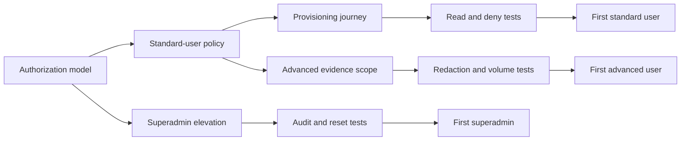

# First User and Privileged-User Onboarding Proposal

## Recommendation

Build one evidence-backed onboarding path for a standard user first, then add
separate superadmin and advanced-user paths on the same identity and policy
foundation. Do not represent documentation personas as authorization roles
until policy enforcement and tests prove the distinction.

## Desired outcomes

- A standard user can sign in, understand estate state, inspect one agent, and
  leave without privileged credentials.
- A superadmin can perform a bounded demonstration, identify every privileged
  action, and recover from expected failures.
- An advanced user can inspect detailed evidence without gaining mutation
  rights by accident.
- Support staff can diagnose onboarding failures from one evidence bundle.
- Product language distinguishes implemented behaviour from roadmap work.

## Workstream 1: standard user

1. Create a real read-only authorization policy.
2. Map one identity-provider group to that policy.
3. Remove mutation controls from read-only pages.
4. Return `403 Forbidden` for direct mutation requests.
5. Add an invitation or account-provisioning procedure.
6. Add a first-login landing page with one guided estate journey.
7. Add contextual links from empty and error states to `/docs`.
8. Add acceptance tests for permitted reads and denied writes.
9. Add an account removal and access-review procedure.

**Exit evidence:** one newly provisioned account completes the guided journey;
browser and API tests prove that the same account cannot mutate state.

## Workstream 2: superadmin

1. Replace shared demonstration credentials with individually attributable
   privileged identities.
2. Require a time-bounded privilege elevation step.
3. Record the actor, reason, target, and result for each privileged action.
4. Add a pre-demo readiness check for dependencies and evidence streams.
5. Add a deterministic reset procedure for demo state.
6. Add negative tests for expired, absent, and insufficient privilege.
7. Define the incident procedure for leaked demonstration credentials.

**Exit evidence:** a named operator runs the demo, produces an audit trail, and
returns the estate to its initial state without shared static credentials.

## Workstream 3: advanced user

1. Define the advanced user's additional read surfaces.
2. Keep mutation permissions separate from diagnostic depth.
3. Add downloadable evidence bundles with sensitivity labels.
4. Add query limits and pagination for high-volume evidence.
5. Add redaction tests for secrets and tenant-specific data.
6. Add saved views only after tenant and ownership semantics exist.

**Exit evidence:** an advanced account can inspect deep evidence that a standard
account cannot see, while both accounts remain unable to mutate the estate.

## Cross-cutting usability work

| Area | Next work | Verification |
| --- | --- | --- |
| Identity | Define provisioning, recovery, expiry, and removal flows. | Lifecycle tests cover each transition. |
| Authorization | Create a policy-to-route and policy-to-action matrix. | Denial tests cover each prohibited action. |
| Navigation | Align dashboard labels, `/docs` labels, breadcrumbs, and page titles. | Browser checks traverse each primary journey. |
| Empty states | Explain why data is absent and what action is safe. | Fixture tests cover no-data states. |
| Errors | Use stable error codes and link to recovery guidance. | API and browser tests assert code-to-guide mapping. |
| Accessibility | Test keyboard order, focus, headings, contrast, and reduced motion. | Automated scans plus human keyboard review pass. |
| Mobile | Define supported widths for read-only and incident workflows. | Browser projects pass at each supported width. |
| Help | Add page-level documentation links and searchable terminology. | Each primary page resolves to a relevant guide. |
| Feedback | Provide a route that captures page, role, and correlation ID. | A submitted report reaches the documented owner. |
| Telemetry | Measure onboarding completion without collecting secrets. | Events contain approved fields only. |

## Delivery sequence

Start the superadmin identity work in parallel with standard-user usability,
but do not onboard an advanced user until the read-only boundary is proven.

## Decisions required

1. Choose the identity provider and group source of truth.
2. Name the owner who approves standard and advanced access.
3. Set the maximum privilege-elevation duration for superadmins.
4. Define which evidence fields advanced users can access.
5. Define retention and deletion rules for onboarding telemetry.

## Risks

- A friendly dashboard label can create false confidence if the API does not
  enforce the same authorization boundary.
- Shared credentials prevent attribution and make revocation unsafe.
- Combining “advanced” visibility with mutation rights creates unnecessary
  privilege.
- A successful demo can conceal unsupported recovery and empty-state paths.
- Documentation can drift unless acceptance tests verify its commands and
  links against the deployed system.

## Definition of ready

Begin onboarding only when the relevant path has an accountable owner, an
implemented policy, positive and negative tests, a recovery procedure, and a
current `/docs` guide. A persona name alone is not evidence of readiness.
