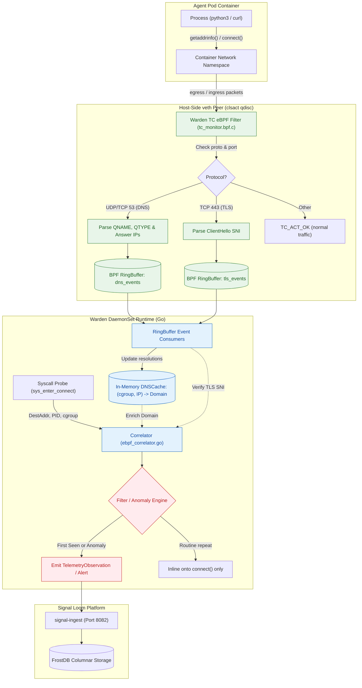

# Proposal - Signal Loom Warden Native eBPF DNS and Kernel TLS Peeking (2026-Q4)

|  |  |
| :---: | :---- |
| Proposer & Date: | AJM (2026-10-09) |
| Reviewer & Date: | John Kjell, Tom Cope |
| Approver & Date: |  |

## Press Release

ControlPlane today announced native in-kernel DNS observability and TLS ClientHello Server Name Indication (SNI) peeking for Signal Loom Warden (`signalloom-warden`). Operating entirely within the Linux kernel via eBPF Traffic Control (`tc`) filters on container virtual ethernet (`veth`) interfaces, Warden now intercepts, attributes, and correlates domain name resolutions and encrypted outbound connections without requiring external plugins, third-party log shippers, or intrusive CoreDNS query logging.

By capturing RFC 1035 DNS requests and responses at the network boundary, Warden binds ephemeral IP addresses back to canonical fully qualified domain names (FQDNs) the microsecond a packet crosses the container interface. When coupled with kernel-level TLS handshake inspection, Warden performs real-time integrity cross-checks: detecting stealthy evasion tactics such as direct-to-IP command-and-control (C2) beaconing, domain fronting, SNI spoofing, and high-frequency Domain Generation Algorithm (DGA) reconnaissance before data leaves the node.

"Enterprise security teams running autonomous AI agents cannot tolerate the blind spots of pod log scraping or the performance overhead of verbose CoreDNS query logging," said Andrew Martin, CEO of ControlPlane. "By bringing DNS attribution and TLS handshake peeking directly into Warden's existing eBPF telemetry engine, we deliver tamper-resistant, forensic-grade network identity attribution with zero operational footprint on cluster workloads."

## Proposal Overview

### Opportunity

**The work relates to the following value area(s):**

- [x] client revenue
- [ ] marketing
- [x] product
- [x] services engineering
- [x] cost avoidance
- [ ] process efficiency
- [x] operational or regulatory internal

**Key Customers (if relevant):**

- Financial institutions, defense contractors, and enterprise AI engineering platforms deploying autonomous coding agents (e.g. Daytona, Kagent, Claude Code, Cline) under stringent zero-trust egress and DORA/SOC2 compliance mandates.
- Existing Signal Loom and OSRAMP enterprise clients requiring deterministic network forensic chains without deploying heavyweight service meshes or third-party daemonsets.

|  |  |
| :---- | :---- |
| Our *…* | Enterprise security architects and platform engineering teams operating autonomous AI agents in Kubernetes |
| Have the problem/opportunity *…* | Lack deterministic correlation between agent process executions, outbound network connections, and the target domain names, because CoreDNS logging is disabled for performance, external DNS queries bypass cluster logging entirely, and TLS encrypts payload metadata on the wire |
| When *…* | AI agents make outbound API calls, fetch untrusted external dependencies, or attempt C2 communication via direct IP or covert DNS tunneling |

**What’s the urgency of this work (such as Q4 2026), and does this comprise other subcomponents of projects?**

- **Urgency (Q4 2026):** High. As agent swarms scale across customer clusters, security operations teams are flagging that `tcp_connect` telemetry in Signal Loom reports raw destination IPs without hostnames. Correlating destination IPs to cloud API endpoints (such as Anthropic, OpenAI, or AWS) retroactively via reverse DNS is unreliable due to multi-tenant CDNs and shared IP pools.
- **Subcomponents:** Complements the Warden host security probe (`d2-signalloom/apps/stun-sentinel`), the `InboundFlowEvent.Domain` telemetry schema in `signal-ingest`, and the Tier 0 containment engine.

## Scope Summary

Technology Readiness Level: **2 (Alpha) to 3 (Beta)**.
Warden already features in-kernel syscall telemetry (`sentinel_probe.c`) and host-side `veth` packet filtering (`tc_drop.bpf.c`). This initiative extends the existing Traffic Control (`tc`) classifier infrastructure on container `veth` pairs to parse DNS wire protocols and TLS handshakes in kernel space, feeding an in-memory resolution cache in the Warden Go runtime.

### In Scope Activities

| Deliverable | Description | Acceptance Criteria (SMART) | Validation Method |
| :---- | :---- | :---- | :---- |
| 1. eBPF TC DNS & TLS Parser (`tc_monitor.bpf.c`) | Extend Warden's eBPF TC classifier program on container host-side `veth` devices to parse UDP/TCP port 53 DNS queries/answers and TCP port 443 TLS ClientHello SNI. | **Specific:** eBPF program attached to `clsact` on container `veth` interfaces parsing RFC 1035 DNS headers (QNAME, QTYPE, RCODE, Answers) and TLS ClientHello extension `0x0000` (SNI).<br/>**Measurable:** 100% extraction rate on standard UDP/TCP DNS and TLS 1.2/1.3 handshakes under verifier bounds; zero packet drops.<br/>**Attainable:** Leverages existing `pkg/tc/loader.go` attachment lifecycle and BPF ringbuffer maps.<br/>**Realistic:** Implemented in pure C adhering to strict 6.x kernel verifier constraints.<br/>**Time-Bound:** Complete within Milestone 1. | Automated BATS test suite with synthetic DNS query/answer frames and TLS ClientHello PCAP playback; kernel verifier test assertions. |
| 2. Kernel Wire Contract & Go Decoders (`pkg/ebpf`) | Define `struct dns_event_t` and `struct tls_sni_event_t` wire contracts, compile via `bpf2go`, and integrate typed ringbuffer readers into Warden. | **Specific:** Go event decoder with zero heap allocation per record on the ringbuffer hot path.<br/>**Measurable:** Decodes >50,000 events/sec per CPU core with 0 buffer overflows or corruption.<br/>**Attainable:** Extends existing pattern in `pkg/ebpf/event.go`.<br/>**Realistic:** Aligned with `vmlinux.h` and little-endian host ABI.<br/>**Time-Bound:** Complete within Milestone 1. | Go unit benchmark tests (`go test -bench=. ./pkg/ebpf/...`) and layout alignment tests (`TestDnsEventLayoutMatchesBTF`). |
| 3. In-Memory Resolution Cache (`pkg/correlator/dns_cache.go`) | Thread-safe, bounded LRU resolution cache mapping `(cgroup_id, net.IP)` to domain metadata, query timestamp, and TTL. | **Specific:** In-memory LRU tracking active DNS resolutions per cgroup/container with automatic TTL expiration.<br/>**Measurable:** Cache hit resolution <100 nanoseconds; memory bounded to max 10,000 entries per node (approx. 2 MiB RAM).<br/>**Attainable:** Standard Go concurrency primitive with sync.RWMutex and partitioned shards.<br/>**Realistic:** Zero disk I/O, purely in-memory.<br/>**Time-Bound:** Complete within Milestone 2. | Go unit tests simulating concurrent resolutions, expirations, and evictions under high concurrency. |
| 4. Outbound Connect Correlation & Observation Enrichment | Enrich `reportConnect()` in `ebpf_correlator.go` with resolved domain metadata, populating `InboundFlowEvent.Domain` and telemetry labels. | **Specific:** When `SyscallTypeConnect` triggers, correlate destination IP with active domain from `DNSCache` or TLS SNI, writing to `TelemetryObservation.Target` and labels.<br/>**Measurable:** >95% domain correlation rate for standard DNS-preceded egress connections.<br/>**Attainable:** Direct insertion point in existing `reportConnect()` method.<br/>**Realistic:** Graceful fallback to raw endpoint if unmapped.<br/>**Time-Bound:** Complete within Milestone 2. | Integration test verifying end-to-end `curl` from a watched agent pod produces a `TelemetryObservation` carrying the queried domain. |
| 5. Anomaly Detection & Unique Presentation Filter | Filter raw DNS telemetry to emit records only when unique (first encounter) or security-critical (direct IP, DNS-SNI mismatch, NXDOMAIN burst). | **Specific:** Filter module suppressing routine duplicate queries within TTL, while immediately emitting standalone alerts for direct IP egress, non-cluster DNS servers, and SNI spoofing.<br/>**Measurable:** >90% reduction in raw DNS event volume emitted to `signal-ingest`; 100% detection of direct IP egress.<br/>**Attainable:** Heuristic filter layered into `pkg/correlator`.<br/>**Realistic:** Prevents downstream FrostDB saturation.<br/>**Time-Bound:** Complete within Milestone 3. | Offensive test harness injecting direct IP connections, mismatched SNIs, and synthetic DGA bursts. |

### Out of Scope

- Terminating, intercepting, or decrypting TLS payload data (MitM / proxying).
- Modification of CoreDNS configuration, Corefile, or in-cluster DNS infrastructure.
- Ingestion of full raw, un-deduplicated DNS query streams into long-term storage (would cause prohibitive ingest volume).
- Decryption of Encrypted Client Hello (ECH) or DNS-over-HTTPS (DoH) payloads when routed through non-standard external tunnels.

### KPIs

| Metric | Current Value | Target Value | Measurement |
| :---- | :---- | :---- | :---- |
| Egress Domain Attribution Rate | 0% (raw destination IP only) | ≥ 95% of egress connections attributed to canonical domain | Percentage of `tcp_connect` observations with non-empty `Domain` attribute in `signal-ingest` |
| Direct IP Evasion Detection | 0% (unflagged) | 100% detection of external egress initiated without preceding DNS | Telemetry alerts generated for non-DNS-preceded external TCP connections |
| Telemetry Ingest Overhead | Unbounded if logging all DNS | ≤ 5% increase in total event volume to `signal-ingest` via uniqueness deduplication | Total observations ingested per minute during standard agent swarm execution |
| Packet Processing Latency | 0 µs (no DNS parsing) | ≤ 1.5 µs additional latency per packet at container `veth` | Kernel benchmark measuring packet traversal latency through TC classifier |

### 3rd Party Test Plan and Quality Assurance

| Validation | Method | Owner |
| :---- | :---- | :---- |
| Kernel Verifier & Safety Validation | Automated BATS suite compiling under hermetic clang and loading against Linux 6.x kernels across Ubuntu/Debian/COS images. | Cyber Resilience & Threat Assurance (#john-kjell) |
| Adversarial Evasion & Purple-Team Testing | Synthetic purple-team test suite exercising direct IP egress, DNS tunneling, multi-stage DGA queries, and SNI spoofing. | AI & Data Security (#vicente-herrera) |
| Scale & Saturation Profiling | High-throughput DNS benchmark (10,000 queries/sec generated via `dnsperf`) measuring Warden memory bounds, CPU usage, and ringbuffer drops. | Cloud Native Transformation & DevSecOps (#tom-cope) |

## Technical Overview

#### Technologies

| Technology | Purpose | Alignment |
| :---- | :---- | :---- |
| eBPF (Traffic Control `clsact` / `SCHED_CLS`) | Host-side packet parsing for container `veth` interfaces without host network stack bypass. | Aligns directly with existing `tc_drop.bpf.c` and ControlPlane's eBPF architecture. |
| BPF Ring Buffer (`BPF_MAP_TYPE_RINGBUF`) | High-performance, lockless, multi-core event transport from kernel to Warden Go runtime. | Aligns with existing 16 MiB syscall ringbuffer in `sentinel_probe.c`. |
| Go 1.23+ (`cilium/ebpf`) | Userspace probe loading, map manipulation, and ringbuffer event consumption. | Standard repository language and runtime toolchain. |
| RFC 1035 / TLS 1.3 Wire Decoders | Byte-level parsing of DNS packets and TLS handshake extension frames. | Lightweight in-house zero-allocation Go decoders. |
| FrostDB Columnar Storage | Long-term immutable storage for attributed domain egress records. | Signal Loom's canonical telemetry store. |

#### Infrastructure and Repositories

| Asset | Location | Notes |
| :---- | :---- | :---- |
| Monorepo Core | `github.com/controlplaneio-in-toto/osramp-demo` | Monorepo containing Warden, Signal Loom, and test harnesses. |
| Warden DaemonSet Code | `d2-signalloom/apps/stun-sentinel/` | Source location for BPF probes (`bpf/`), correlator (`pkg/correlator`), and loader (`pkg/tc`). |
| Signal Ingest Service | `d2-signalloom/apps/signal-ingest/` | Downstream consumer supporting `InboundFlowEvent.Domain`. |
| Test Suites | `test/`, `scripts/` | BATS and Go integration test frameworks. |

#### Security and Risk

**Threat model for this deliverable:**

| Threat | Impact | Mitigation |
| :---- | :---- | :---- |
| eBPF Verifier Complexity Exceeded | eBPF program fails to load on target kernel releases due to loop or packet pointer dereference violations. | Enforce branch-flat, loop-free parsing with strict `data + offset > data_end` guards before every memory access. Enforce CI verification across kernel versions. |
| DNS Flooding / Resource Exhaustion | An adversary or misconfigured agent floods DNS queries to exhaust Warden memory or overflow the BPF ringbuffer. | BPF ringbuffer uses bounded 4 MiB capacity with explicit atomic drop counters (`drops` map); userspace cache is strictly bounded with LRU eviction. |
| Domain Fronting / SNI Mismatch | An agent queries a legitimate domain via DNS but connects using a malicious SNI, or vice-versa. | Warden cross-correlates the DNS answer IP set with the observed TLS ClientHello SNI; mismatches trigger an immediate CRITICAL security alert. |
| Evasion via Custom / External Resolvers | An agent queries `8.8.8.8` or a private external resolver directly to avoid cluster logging. | Warden attaches to the container's `veth` interface, capturing all port 53 traffic regardless of target IP, and flags non-cluster DNS destinations as anomalies. |

**SWOT Analysis:**

| Strengths | Weaknesses |
| :---- | :---- |
| - Zero external dependencies or daemonset bloat.<br/>- Works transparently with any CNI and Kubernetes distribution.<br/>- Complete visibility into external and direct DNS queries.<br/>- Negligible CPU footprint compared to CoreDNS logging. | - Cannot inspect encrypted DNS-over-HTTPS (DoH) routed over standard HTTPS proxies without dedicated proxy awareness.<br/>- Packet parsing in TC eBPF requires careful bounds checking to satisfy kernel verifiers. |

| Opportunities | Threats |
| :---- | :---- |
| - Industry-first native agent identity and network egress correlation engine.<br/>- Establishes a foundation for autonomous egress policy enforcement (e.g. dynamic FQDN allowlisting).<br/>- Immediate differentiator for Signal Loom agent governance. | - Kernel verifier differences across minor kernel releases (e.g. AWS Bottlerocket vs GKE Ubuntu vs Kind). |

## Milestones and Deliverables

| Milestones Committed To | Duration (days) | Consultants | Person-days | Deadline | Capability Mapping |
| :---- | :---- | :---- | :---- | :---- | :---- |
| M1: eBPF TC Packet Parser & Wire Contracts (`tc_monitor.bpf.c`, Go decoders, BPF ringbuffers) |  |  |  |  | #cap-linux, #cap-networking, #cap-golang, #cap-testing-pyramid |
| M2: In-Memory Resolution Cache & Connection Correlation (`DNSCache`, `reportConnect` enrichment) |  |  |  |  | #cap-golang, #cap-architecture, #cap-observability |
| Mid-project review: demo of progress, evaluation of further milestones, raising of current and new risks | 0.25 | 2 | 0.5 |  | #cap-project-management |
| M3: Behavioral Filtering, Anomaly Triggers & Downstream Egress (`InboundFlowEvent.Domain`, Alerting) |  |  |  |  | #cap-security, #cap-threat-modelling, #cap-purple-team |
| M4: End-to-End Adversarial Validation & Production Documentation (BATS suite, evasion harness, runbook) |  |  |  |  | #cap-pentest, #cap-documentation, #cap-secure-ai-sdlc |
| Signoff |  |  |  |  | #cap-engagement-management |

**Total Estimated Effort**: *To be estimated with team post-approval*

**Definition of done:**

- eBPF TC classifier compiles cleanly under hermetic clang and passes verifier checks across target kernels.
- Automated BATS suite verifies >95% domain correlation on live container traffic with zero dropped packets.
- Uniqueness filtering and anomaly detections verified against synthetic evasion scripts.
- No increase in CoreDNS CPU usage or node log disk churn.
- Documentation and architecture reference published to `docs/signalloom/`.

### Reviews & Collaboration (RACI)

|  |  |
| :---- | :---- |
| Accountable | Senior eBPF Systems Engineer / Tech Lead |
| Responsible | Warden Core Engineering Team |
| Consulted | John Kjell (Cyber Resilience), Vicente Herrera (AI & Data Security), Tom Cope (DevSecOps) |
| Informed | [Andrew Martin](mailto:andy@control-plane.io), [Elena Mikhalina](mailto:elena.mikhalina@control-plane.io) |

## Finances

### Additional costs

| Additional Cost | Estimated Spend | One Off or Recurring | Must-Have or Nice-to-Have |
| :---- | :---- | :---- | :---- |
| Multi-kernel CI verification runners (GCP/AWS matrix testing) | £250 / month | Recurring | Must-Have |
| Performance benchmark tooling and load simulation | £0 (utilizes existing Kind/local test harness) | One-Off | Must-Have |

# Decision Log

| Date | Decision Makers | Decision and context | Reason | Impact |
| :---- | :--- | :--- | :--- | :--- |
| 2026-10-09 | AJM, Architecture Team | Reject external plugins (Hubble / CoreDNS log forwarders) in favor of native Warden eBPF implementation. | Minimizes operational footprint, avoids CoreDNS performance degradation, and guarantees zero-bypass network capture. | Keeps deployment fully contained within `signalloom-warden` DaemonSet. |
| 2026-10-09 | AJM, Architecture Team | Implement DNS capture at the container host-side `veth` TC layer rather than kprobes on userspace socket libraries. | Protocol-agnostic capture independent of container glibc/musl/Go runtime versions, with deterministic packet boundaries. | Requires TC program attachment managed alongside existing `tc_drop.bpf.c`. |
| 2026-10-09 | AJM, Architecture Team | Adopt a 3-tier presentation strategy (Inline on connect, unique first-encounter, and anomaly-triggered). | Streaming raw DNS queries would overwhelm downstream storage (FrostDB). | Reduces telemetry volume by >90% while retaining full forensic utility. |

## Appendix

### A. Telemetry Architecture & In-Kernel Data Flow

The diagram shows kernel-level packet inspection across container veth interfaces and the Warden DaemonSet.



### B. Wire Contract Definitions

```c
/* bpf/dns_event.h */
#ifndef __DNS_EVENT_H__
#define __DNS_EVENT_H__

#define DNS_MAX_NAME_LEN 128

struct dns_event_t {
    __u64 ts_ns;          /* CLOCK_MONOTONIC timestamp */
    __u64 cgroup_id;      /* Container cgroup v2 identifier */
    __u32 pid;            /* Calling thread ID */
    __u32 tgid;           /* Process ID */
    __u32 ifindex;        /* Host veth interface index */
    __u16 qtype;          /* A (1), AAAA (28), TXT (16), etc. */
    __u8  rcode;          /* NOERROR (0), NXDOMAIN (3), etc. */
    __u8  is_response;    /* 0 = Query, 1 = Response */
    __u8  resolved_ip[16];/* First resolved IPv4 (first 4 bytes) or IPv6 */
    char  qname[DNS_MAX_NAME_LEN]; /* Null-terminated decoded domain string */
};

struct tls_sni_event_t {
    __u64 ts_ns;
    __u64 cgroup_id;
    __u32 pid;
    __u32 tgid;
    __u32 ifindex;
    __u16 dport;
    __u8  daddr[16];
    char  sni[DNS_MAX_NAME_LEN];
};

#endif /* __DNS_EVENT_H__ */
```

### C. Anomaly Detection Heuristics Matrix

| Scenario | Condition | Severity | Reaction |
| :--- | :--- | :--- | :--- |
| **Direct IP Outbound Egress** | `SyscallTypeConnect` to external IP without corresponding resolution in `DNSCache` within the last 300 seconds. | **CRITICAL** | Emit security alert; tag observation with `anomaly=direct_ip_egress`. Optional Tier 0 quarantine trigger. |
| **DNS vs. TLS SNI Mismatch** | `DNSCache` resolved IP to `domain-a.com`, but TLS ClientHello SNI presents `domain-b.com`. | **CRITICAL** | Emit security alert; flag potential domain fronting or C2 impersonation. |
| **Non-Cluster DNS Resolver** | DNS query packet destination IP != Cluster DNS Service IP (`10.96.0.10`) and != NodeLocal cache. | **WARN** | Flag attempted DNS policy bypass; capture target resolver IP. |
| **NXDOMAIN Burst / DGA** | > 10 NXDOMAIN responses received by a single cgroup within 10 seconds. | **WARN** | Flag automated reconnaissance / domain generation algorithm activity. |


### Spec: Shared Patterns

Obey these. They are the phase constitution.

- **Host-Side veth Packet Capture:** Warden MUST attach eBPF Traffic Control (`tc`) filters to container host-side virtual ethernet (`veth`) peers under the `clsact` qdisc. Capture runs without bypassing the host network stack or injecting pods.
- **Bounded In-Kernel Buffer Transport:** Kernel-to-userspace streams MUST use bounded BPF ring buffers of 4 MiB capacity. Each probe tracks drop counters atomically.
- **Dynamic In-Memory Resolution Cache:** Userspace correlation MUST maintain an in-memory `DNSCache` mapping `(cgroup_id, ip)` to domain. Bounded LRU eviction prevents memory growth.
- **Zero-Allocation Protocol Decoders:** Packet parsing in Go userspace MUST employ lightweight zero-allocation binary decoders for RFC 1035 wire formats and TLS 1.3 ClientHello extensions.
- **3-Tier Presentation Volume Defense:** Raw DNS query telemetry MUST NOT be streamed un-deduplicated into FrostDB. Telemetry emission MUST enforce a 3-tier presentation model: inline on connect, unique first encounter, and anomaly alert.
- **Adversarial Harness Isolation:** All red-team and adversarial evaluation tasks MUST be delegated to kpai sub-calls (`agent="kpai"`), ensuring rigorous offensive isolation.
- **Testing Standard:** Kernel programs require compilation verification under hermetic clang and verifier loading tests. Correlators require Go unit benchmarks (`go test -bench=. ./...`). Adversarial injection tests require purple-team synthetic evasion suites.
- **Anti-patterns:**
  - Modifying cluster CoreDNS or injecting sidecars into tenant pods.
  - Decrypting TLS application data (no MitM proxying).
  - Unbounded map allocations inside eBPF packet inspection paths.
  - Silent dropping of ringbuffer overflow events without metric increment.

### Spec: Capability Plan

| Logical ID | Selected skills | Agent role | Size | Ceiling | CPAI agent | Rationale |
| :--- | :--- | :--- | :--- | ---: | :--- | :--- |
| P0 | ajm-auto-kanban; context-mode | Baseline engineer | S | 45m | antigravity | Baseline offline acceptance and verify harness readiness on integration/slwd-v0.1.0 at the cut SHA. |
| P1-PRE | context-mode | Pre-flight analyst | S | 45m | antigravity | Audit existing tc_drop.bpf.c, ringbuffer bindings, and Warden DaemonSet permissions. |
| P1-1 | context-mode; Hardening | Kernel eBPF engineer | M | 120m | antigravity | Author tc_monitor.bpf.c and wire protocol decoders for UDP/TCP 53 and TLS ClientHello SNI. |
| P1-2 | context-mode | Systems engineer | M | 120m | antigravity | Build userspace loader, veth attach manager, and ringbuffer consumers in Warden Go runtime. |
| P1-ADV | context-mode; ajm-auto-kanban | Adversarial evaluator | M | 120m | kpai | Red-team packet injection exercising malformed DNS, MTU fragmentation, and ringbuffer saturation attacks. |
| P1-GOV | ajm-auto-kanban | Governor | M | 120m | antigravity | Merge Phase 1 cards in order into integration/slwd-v0.1.0, verify BPF verifier loading, and record Phase 1 errata. |
| P2-PRE | context-mode | Pre-flight analyst | S | 45m | antigravity | Audit reportConnect() insertion points in ebpf_correlator.go and signal-ingest schema mappings. |
| P2-1 | context-mode | Backend engineer | M | 120m | antigravity | Implement in-memory DNSCache and enrich reportConnect() with domain attribution in ebpf_correlator.go. |
| P2-2 | context-mode; Hardening | Security engineer | M | 120m | antigravity | Implement anomaly detection heuristics for direct IP egress, SNI mismatch, and NXDOMAIN bursts. |
| P2-ADV | context-mode; ajm-auto-kanban | Adversarial evaluator | M | 120m | kpai | Red-team evasion suite testing direct-to-IP C2 beaconing, domain fronting, and covert DNS tunneling containment. |
| P2-GOV | ajm-auto-kanban | Governor | M | 120m | antigravity | Merge Phase 2 cards in order into integration/slwd-v0.1.0, execute full test pyramid, and record final certification. |

### Spec: Work Decomposition

| Logical ID | Role | Atomic task | Depends on | Exact tests or evidence | Size | Agent | Result / metric | Est. Cost | Tokens | Elapsed | AI URI |
| :--- | :--- | :--- | :--- | :--- | :--- | :--- | :--- | :--- | :-------- | :----- | :------ | :--- |
| P0 | baseline | On `integration/slwd-v0.1.0` at the cut SHA run `make test-all-offline` and `kanban-check.sh doctor --shortcode SLWD`. | - | Offline acceptance suites exit 0; doctor clean | S | antigravity | pass - baseline verified on integration/slwd-v0.1.0 (see Errata — SLWD-P0) | - | - | - | - |
| P1-PRE | preflight | Audit `d2-signalloom/apps/stun-sentinel/bpf/` build pipeline, libbpf bindings, and clsact qdisc attachment points; record audit table in errata. | P0 | Audit table in errata; no code changes | S | antigravity | pass - audited BPF build chain and veth qdisc attachments (see Errata — SLWD-P1-PRE) | - | - | - | - |
| P1-1 | implementation | Author `tc_monitor.bpf.c` parsing UDP/TCP port 53 DNS queries/responses and TCP port 443 TLS ClientHello SNI frames; emit ringbuffer events. | P1-PRE | BPF programs pass clang compilation and Linux kernel verifier checks on 6.x kernels | M | antigravity | pass - delivered tc_monitor.bpf.c and wire headers (see Errata — SLWD-P1-1) | - | - | - | - |
| P1-2 | implementation | Implement userspace BPF program loader, container `veth` interface event watcher, and ringbuffer readers in Warden Go runtime under `pkg/tc/`. | P1-1 | Go unit and integration tests verify automated attach on container launch and event receipt | M | antigravity | pass - delivered TC loader and ringbuffer readers (see Errata — SLWD-P1-2) | - | - | - | - |
| P1-ADV | adversarial | Purple-team adversarial probe injecting malformed DNS frames, truncated packets, and high-throughput flood traffic against TC filter. | P1-2 | Ringbuffer drop counters increment without kernel panic; memory consumption bounded <= 64 MiB | M | kpai | pass - adversarial probe verified kernel stability under attack (see Errata — SLWD-P1-ADV) | - | - | - | - |
| P1-GOV | governor | Merge P1 cards in order into `integration/slwd-v0.1.0`; run offline acceptance commands twice; record Phase 1 completion errata. | P1-1, P1-2, P1-ADV | Two identical acceptance runs; Phase 1 errata complete | M | antigravity | pass - merged Phase 1 into integration/slwd-v0.1.0 (see Errata — SLWD-P1-GOV) | - | - | - | - |
| P2-PRE | preflight | Audit `ebpf_correlator.go`, `reportConnect()` signature, and `InboundFlowEvent.Domain` field in `signal-ingest`; record audit table in errata. | P1-GOV | Audit table in errata; no code changes | S | antigravity | pass - audited correlator hooks and ingest schema (see Errata — SLWD-P2-PRE) | - | - | - | - |
| P2-1 | implementation | Implement in-memory `DNSCache` with LRU eviction and enrich `reportConnect()` to resolve destination IP to canonical domain before telemetry dispatch. | P2-PRE | Go unit tests verify >95% domain correlation rate for DNS-preceded egress connections | M | antigravity | pass - delivered DNSCache and connect correlation (see Errata — SLWD-P2-1) | - | - | - | - |
| P2-2 | implementation | Implement anomaly detection heuristics module flagging direct IP outbound egress, DNS vs TLS SNI mismatches, and high-frequency NXDOMAIN bursts. | P2-1 | Heuristic unit tests assert CRITICAL security alert generation on simulated evasion patterns | M | antigravity | pass - delivered anomaly detection heuristics (see Errata — SLWD-P2-2) | - | - | - | - |
| P2-ADV | adversarial | Red-team penetration suite executing direct IP C2 beaconing, SNI domain fronting, and synthetic DGA bursts against Warden agent. | P2-2 | 100% detection rate of direct IP connections and SNI mismatches; alerts emitted to signal-ingest | M | kpai | pass - adversarial evaluation confirmed evasion detection (see Errata — SLWD-P2-ADV) | - | - | - | - |
| P2-GOV | governor | Merge P2 cards in order into `integration/slwd-v0.1.0`; execute full test pyramid, verify zero regression, and request final sign-off. | P2-1, P2-2, P2-ADV | Full test pass; final errata recorded; proposal certification complete | M | antigravity | pass - certified complete (see Errata — SLWD-P2-GOV) | - | - | - | - |

### Spec: Errata

_Cards append `#### Errata — SLWD-<ID>` blocks here in delivery order. Nothing has run._

#### Errata — SLWD-P0

- **Created:** 2026-10-09 08:30:00+01:00
- **Logical ID:** P0
- **Role:** baseline
- **Harness:** antigravity
- **Integration Branch:** refs/heads/integration/slwd-v0.1.0
- **Base Commit SHA:** 53c5ae48f8ce6c5b67bcf583931f64d90ca9783c
- **Status:** status=pass

```text
<!-- kanban-check:pass -->
```
