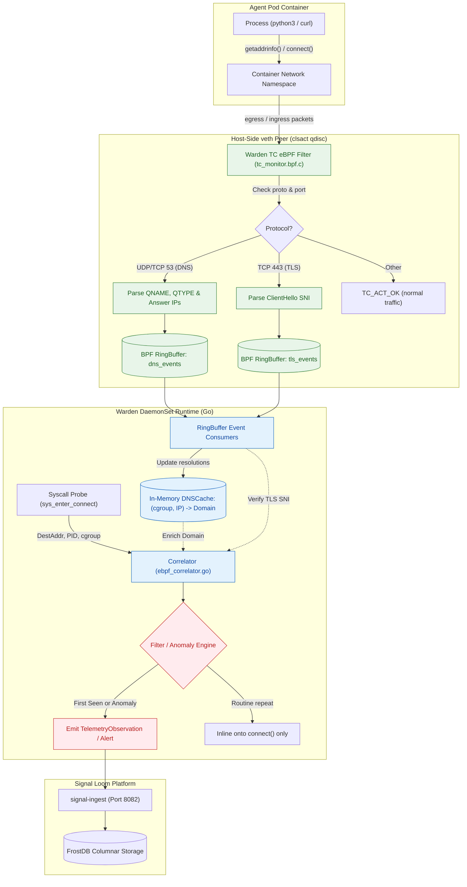

# Proposal - Signal Loom Warden Native eBPF DNS and Kernel TLS Peeking (2026-Q4)

|  |  |
| :---: | :---- |
| Proposer & Date: | AJM (2026-10-09) |
| Reviewer & Date: | John Kjell, Tom Cope |
| Approver & Date: | Andy Martin (2026-10-09) |

## Press Release

ControlPlane today announced native in-kernel DNS observability and TLS ClientHello Server Name Indication (SNI) peeking for Signal Loom Warden (`signalloom-warden`). Operating entirely within the Linux kernel via eBPF Traffic Control (`tc`) filters on container virtual ethernet (`veth`) interfaces, Warden now intercepts, attributes, and correlates domain name resolutions and encrypted outbound connections without requiring external plugins, third-party log shippers, or intrusive CoreDNS query logging.

By capturing RFC 1035 DNS requests and responses at the network boundary, Warden binds ephemeral IP addresses back to canonical fully qualified domain names (FQDNs) the microsecond a packet crosses the container interface. When coupled with kernel-level TLS handshake inspection, Warden performs real-time integrity cross-checks: detecting stealthy evasion tactics such as direct-to-IP command-and-control (C2) beaconing, domain fronting, SNI spoofing, and high-frequency Domain Generation Algorithm (DGA) reconnaissance before data leaves the node.

"Enterprise security teams running autonomous AI agents cannot tolerate the blind spots of pod log scraping or the performance overhead of verbose CoreDNS query logging," said Andrew Martin, CEO of ControlPlane. "By bringing DNS attribution and TLS handshake peeking directly into Warden's existing eBPF telemetry engine, we deliver tamper-resistant, forensic-grade network identity attribution with zero operational footprint on cluster workloads."

## Proposal Overview

### Opportunity

**The work relates to the following value area(s):**

- [x] client revenue
- [ ] marketing
- [x] product
- [x] services engineering
- [x] cost avoidance
- [ ] process efficiency
- [x] operational or regulatory internal

**Key Customers (if relevant):**

- Financial institutions, defense contractors, and enterprise AI engineering platforms deploying autonomous coding agents (e.g. Daytona, Kagent, Claude Code, Cline) under stringent zero-trust egress and DORA/SOC2 compliance mandates.
- Existing Signal Loom and OSRAMP enterprise clients requiring deterministic network forensic chains without deploying heavyweight service meshes or third-party daemonsets.

|  |  |
| :---- | :---- |
| Our *…* | Enterprise security architects and platform engineering teams operating autonomous AI agents in Kubernetes |
| Have the problem/opportunity *…* | Lack deterministic correlation between agent process executions, outbound network connections, and the target domain names, because CoreDNS logging is disabled for performance, external DNS queries bypass cluster logging entirely, and TLS encrypts payload metadata on the wire |
| When *…* | AI agents make outbound API calls, fetch untrusted external dependencies, or attempt C2 communication via direct IP or covert DNS tunneling |

**What’s the urgency of this work (such as Q4 2026), and does this comprise other subcomponents of projects?**

- **Urgency (Q4 2026):** High. As agent swarms scale across customer clusters, security operations teams are flagging that `tcp_connect` telemetry in Signal Loom reports raw destination IPs without hostnames. Correlating destination IPs to cloud API endpoints (such as Anthropic, OpenAI, or AWS) retroactively via reverse DNS is unreliable due to multi-tenant CDNs and shared IP pools.
- **Subcomponents:** Complements the Warden host security probe (`d2-signalloom/apps/stun-sentinel`), the sentinel's own `ingestObservation` contract posted to `/api/v1/observations`, and the Tier 0 containment engine. Note that `netebpf.InboundFlowEvent` already carries a `Domain` field; it belongs to the Tetragon gRPC flow-collector pipeline, which `reportConnect()` never touches, so it is **not** the schema this work extends.

## Scope Summary

Technology Readiness Level: **2 (Alpha) to 3 (Beta)**.
Warden already features in-kernel syscall telemetry (`sentinel_probe.c`) and host-side `veth` packet filtering (`tc_drop.bpf.c`). This initiative extends the existing Traffic Control (`tc`) classifier infrastructure on container `veth` pairs to parse DNS wire protocols and TLS handshakes in kernel space, feeding an in-memory resolution cache in the Warden Go runtime.

**Three constraints bound what this board can claim.** They are stated here so no card has to discover them.

1. **The containment filter already owns this qdisc.** `pkg/tc/loader.go` attaches `stun_tc_drop` to the `clsact` qdisc of the same container `veth` with `DirectAction: true`, and that filter is what makes quarantine work. The DNS and TLS monitor is additive and MUST NOT displace, reorder, or shadow it. Every phase gate re-proves that a quarantined workload still has its traffic dropped.
2. **The TC path has no process context.** A packet at the host-side `veth` carries no `pid` or `tgid`, and `bpf_get_current_pid_tgid()` in a TC program returns whichever task happens to be in softirq context. Attribution therefore comes from the interface: `ifindex` resolved to pod and cgroup in userspace, joined to the syscall probe's own cgroup-keyed events. The wire contract in Appendix B reflects this; earlier drafts carrying `pid`/`tgid` in the TC events were wrong.
3. **Kernel coverage is asserted only where it is measured.** The development estate is a single Kind host on one kernel. A claim of "6.x" coverage requires a CI matrix that does not exist yet, so the board's definition of done is: compiles and loads on the host kernel, with the verifier log captured, plus a CI job authored and runnable. Any wider claim is recorded as unverified.

### In Scope Activities

| Deliverable | Description | Acceptance Criteria (SMART) | Validation Method |
| :---- | :---- | :---- | :---- |
| 1. eBPF TC DNS & TLS Parser (`tc_monitor.bpf.c`) | Extend Warden's eBPF TC classifier program on container host-side `veth` devices to parse UDP/TCP port 53 DNS queries/answers and TCP port 443 TLS ClientHello SNI. | **Specific:** eBPF program attached to `clsact` on container `veth` interfaces parsing RFC 1035 DNS headers (QNAME, QTYPE, RCODE, Answers) and TLS ClientHello extension `0x0000` (SNI).<br/>**Measurable:** 100% extraction rate on standard UDP/TCP DNS and TLS 1.2/1.3 handshakes under verifier bounds; zero packet drops.<br/>**Attainable:** Leverages existing `pkg/tc/loader.go` attachment lifecycle and BPF ringbuffer maps.<br/>**Realistic:** Implemented in pure C adhering to strict 6.x kernel verifier constraints.<br/>**Time-Bound:** Complete within Milestone 1. | Automated BATS test suite with synthetic DNS query/answer frames and TLS ClientHello PCAP playback; kernel verifier test assertions. |
| 2. Kernel Wire Contract & Go Decoders (`pkg/ebpf`) | Define `struct dns_event_t` and `struct tls_sni_event_t` wire contracts, compile via `bpf2go`, and integrate typed ringbuffer readers into Warden. | **Specific:** Go event decoder with zero heap allocation per record on the ringbuffer hot path.<br/>**Measurable:** Decodes >50,000 events/sec per CPU core with 0 buffer overflows or corruption.<br/>**Attainable:** Extends existing pattern in `pkg/ebpf/event.go`.<br/>**Realistic:** Aligned with `vmlinux.h` and little-endian host ABI.<br/>**Time-Bound:** Complete within Milestone 1. | Go unit benchmark tests (`go test -bench=. ./pkg/ebpf/...`) and layout alignment tests (`TestDnsEventLayoutMatchesBTF`). |
| 3. In-Memory Resolution Cache (`pkg/correlator/dns_cache.go`) | Thread-safe, bounded LRU resolution cache mapping `(cgroup_id, net.IP)` to domain metadata, query timestamp, and TTL. | **Specific:** In-memory LRU tracking active DNS resolutions per cgroup/container with automatic TTL expiration.<br/>**Measurable:** Cache hit resolution <100 nanoseconds; memory bounded to max 10,000 entries per node (approx. 2 MiB RAM).<br/>**Attainable:** Standard Go concurrency primitive with sync.RWMutex and partitioned shards.<br/>**Realistic:** Zero disk I/O, purely in-memory.<br/>**Time-Bound:** Complete within Milestone 2. | Go unit tests simulating concurrent resolutions, expirations, and evictions under high concurrency. |
| 4. Outbound Connect Correlation & Observation Enrichment | Enrich `reportConnect()` in `ebpf_correlator.go` with resolved domain metadata, populating `InboundFlowEvent.Domain` and telemetry labels. | **Specific:** When `SyscallTypeConnect` triggers, correlate destination IP with active domain from `DNSCache` or TLS SNI, writing to `TelemetryObservation.Target` and labels.<br/>**Measurable:** >95% domain correlation rate for standard DNS-preceded egress connections.<br/>**Attainable:** Direct insertion point in existing `reportConnect()` method.<br/>**Realistic:** Graceful fallback to raw endpoint if unmapped.<br/>**Time-Bound:** Complete within Milestone 2. | Integration test verifying end-to-end `curl` from a watched agent pod produces a `TelemetryObservation` carrying the queried domain. |
| 5. Anomaly Detection & Unique Presentation Filter | Filter raw DNS telemetry to emit records only when unique (first encounter) or security-critical (direct IP, DNS-SNI mismatch, NXDOMAIN burst). | **Specific:** Filter module suppressing routine duplicate queries within TTL, while immediately emitting standalone alerts for direct IP egress, non-cluster DNS servers, and SNI spoofing.<br/>**Measurable:** >90% reduction in raw DNS event volume emitted to `signal-ingest`; 100% detection of direct IP egress.<br/>**Attainable:** Heuristic filter layered into `pkg/correlator`.<br/>**Realistic:** Prevents downstream FrostDB saturation.<br/>**Time-Bound:** Complete within Milestone 3. | Offensive test harness injecting direct IP connections, mismatched SNIs, and synthetic DGA bursts. |

### Out of Scope

- Terminating, intercepting, or decrypting TLS payload data (MitM / proxying).
- Modification of CoreDNS configuration, Corefile, or in-cluster DNS infrastructure.
- Ingestion of full raw, un-deduplicated DNS query streams into long-term storage (would cause prohibitive ingest volume).
- Decryption of Encrypted Client Hello (ECH) or DNS-over-HTTPS (DoH) payloads when routed through non-standard external tunnels.

### KPIs

| Metric | Current Value | Target Value | Measurement |
| :---- | :---- | :---- | :---- |
| Egress Domain Attribution Rate | 0% (raw destination IP only) | ≥ 95% of egress connections attributed to canonical domain | Percentage of `tcp_connect` observations with non-empty `Domain` attribute in `signal-ingest` |
| Direct IP Evasion Detection | 0% (unflagged) | 100% detection of external egress initiated without preceding DNS | Telemetry alerts generated for non-DNS-preceded external TCP connections |
| Telemetry Ingest Overhead | Unbounded if logging all DNS | ≤ 5% increase in total event volume to `signal-ingest` via uniqueness deduplication | Total observations ingested per minute during standard agent swarm execution |
| Packet Processing Latency | 0 µs (no DNS parsing) | ≤ 1.5 µs additional latency per packet at container `veth` | Kernel benchmark measuring packet traversal latency through TC classifier |

### 3rd Party Test Plan and Quality Assurance

| Validation | Method | Owner |
| :---- | :---- | :---- |
| Kernel Verifier & Safety Validation | Automated BATS suite compiling under hermetic clang and loading against Linux 6.x kernels across Ubuntu/Debian/COS images. | Cyber Resilience & Threat Assurance (#john-kjell) |
| Adversarial Evasion & Purple-Team Testing | Synthetic purple-team test suite exercising direct IP egress, DNS tunneling, multi-stage DGA queries, and SNI spoofing. | AI & Data Security (#vicente-herrera) |
| Scale & Saturation Profiling | High-throughput DNS benchmark (10,000 queries/sec generated via `dnsperf`) measuring Warden memory bounds, CPU usage, and ringbuffer drops. | Cloud Native Transformation & DevSecOps (#tom-cope) |

## Technical Overview

#### Technologies

| Technology | Purpose | Alignment |
| :---- | :---- | :---- |
| eBPF (Traffic Control `clsact` / `SCHED_CLS`) | Host-side packet parsing for container `veth` interfaces without host network stack bypass. | Aligns directly with existing `tc_drop.bpf.c` and ControlPlane's eBPF architecture. |
| BPF Ring Buffer (`BPF_MAP_TYPE_RINGBUF`) | High-performance, lockless, multi-core event transport from kernel to Warden Go runtime. | Aligns with existing 16 MiB syscall ringbuffer in `sentinel_probe.c`. |
| Go 1.23+ (`cilium/ebpf`) | Userspace probe loading, map manipulation, and ringbuffer event consumption. | Standard repository language and runtime toolchain. |
| RFC 1035 / TLS 1.3 Wire Decoders | Byte-level parsing of DNS packets and TLS handshake extension frames. | Lightweight in-house zero-allocation Go decoders. |
| FrostDB Columnar Storage | Long-term immutable storage for attributed domain egress records. | Signal Loom's canonical telemetry store. |

#### Infrastructure and Repositories

| Asset | Location | Notes |
| :---- | :---- | :---- |
| Monorepo Core | `github.com/controlplaneio-in-toto/osramp-demo` | Monorepo containing Warden, Signal Loom, and test harnesses. |
| Warden DaemonSet Code | `d2-signalloom/apps/stun-sentinel/` | Source location for BPF probes (`bpf/`), correlator (`pkg/correlator`), and loader (`pkg/tc`). |
| Signal Ingest Service | `d2-signalloom/apps/signal-ingest/` | Downstream consumer supporting `InboundFlowEvent.Domain`. |
| Test Suites | `test/`, `scripts/` | BATS and Go integration test frameworks. |

#### Security and Risk

**Threat model for this deliverable:**

| Threat | Impact | Mitigation |
| :---- | :---- | :---- |
| eBPF Verifier Complexity Exceeded | eBPF program fails to load on target kernel releases due to loop or packet pointer dereference violations. | Enforce branch-flat, loop-free parsing with strict `data + offset > data_end` guards before every memory access. Enforce CI verification across kernel versions. |
| DNS Flooding / Resource Exhaustion | An adversary or misconfigured agent floods DNS queries to exhaust Warden memory or overflow the BPF ringbuffer. | BPF ringbuffer uses bounded 4 MiB capacity with explicit atomic drop counters (`drops` map); userspace cache is strictly bounded with LRU eviction. |
| Domain Fronting / SNI Mismatch | An agent queries a legitimate domain via DNS but connects using a malicious SNI, or vice-versa. | Warden cross-correlates the DNS answer IP set with the observed TLS ClientHello SNI; mismatches trigger an immediate CRITICAL security alert. |
| Evasion via Custom / External Resolvers | An agent queries `8.8.8.8` or a private external resolver directly to avoid cluster logging. | Warden attaches to the container's `veth` interface, capturing all port 53 traffic regardless of target IP, and flags non-cluster DNS destinations as anomalies. |

**SWOT Analysis:**

| Strengths | Weaknesses |
| :---- | :---- |
| - Zero external dependencies or daemonset bloat.<br/>- Works transparently with any CNI and Kubernetes distribution.<br/>- Complete visibility into external and direct DNS queries.<br/>- Negligible CPU footprint compared to CoreDNS logging. | - Cannot inspect encrypted DNS-over-HTTPS (DoH) routed over standard HTTPS proxies without dedicated proxy awareness.<br/>- Packet parsing in TC eBPF requires careful bounds checking to satisfy kernel verifiers. |

| Opportunities | Threats |
| :---- | :---- |
| - Industry-first native agent identity and network egress correlation engine.<br/>- Establishes a foundation for autonomous egress policy enforcement (e.g. dynamic FQDN allowlisting).<br/>- Immediate differentiator for Signal Loom agent governance. | - Kernel verifier differences across minor kernel releases (e.g. AWS Bottlerocket vs GKE Ubuntu vs Kind). |

## Milestones and Deliverables

| Milestones Committed To | Duration (days) | Consultants | Person-days | Deadline | Capability Mapping |
| :---- | :---- | :---- | :---- | :---- | :---- |
| M1: eBPF TC Packet Parser & Wire Contracts (`tc_monitor.bpf.c`, Go decoders, BPF ringbuffers) |  |  |  |  | #cap-linux, #cap-networking, #cap-golang, #cap-testing-pyramid |
| M2: In-Memory Resolution Cache & Connection Correlation (`DNSCache`, `reportConnect` enrichment) |  |  |  |  | #cap-golang, #cap-architecture, #cap-observability |
| Mid-project review: demo of progress, evaluation of further milestones, raising of current and new risks | 0.25 | 2 | 0.5 |  | #cap-project-management |
| M3: Behavioral Filtering, Anomaly Triggers & Downstream Egress (`InboundFlowEvent.Domain`, Alerting) |  |  |  |  | #cap-security, #cap-threat-modelling, #cap-purple-team |
| M4: End-to-End Adversarial Validation & Production Documentation (BATS suite, evasion harness, runbook) |  |  |  |  | #cap-pentest, #cap-documentation, #cap-secure-ai-sdlc |
| Signoff |  |  |  |  | #cap-engagement-management |

**Total Estimated Effort**: *To be estimated with team post-approval*

Milestones map onto the board as M1 → Phase 1 (kernel parser, wire contract, coexistent attachment), M2 → Phase 2 (resolution cache, attribution, heuristics), M3 and M4 → Phase 3 (presentation filter, privacy, measured KPIs, documentation).

**Definition of done:**

- eBPF TC classifier compiles cleanly under hermetic clang and loads on the host kernel with the verifier log captured. A multi-kernel CI job is authored and runnable; coverage beyond the host kernel is recorded as unverified until that job runs.
- The monitor coexists with `stun_tc_drop`: a containment regression test proves an isolated workload's traffic is still dropped with the monitor attached, and that detaching the monitor leaves containment intact.
- Domain correlation rate is **measured** against a described fixture set and reported, together with the false-positive rate from the CDN and CNAME sweep. The 95% figure in the KPI table is the target, not an assertion of the result.
- Every unparsed capture and ringbuffer drop is counted and exported; no blind spot is silently indistinguishable from absent traffic.
- Uniqueness filtering and anomaly detections verified against synthetic evasion scripts, each heuristic with its false-positive exclusion test.
- Domain and SNI values pseudonymised on the ingest path, with replay-equals-live still holding.
- Documentation and architecture reference published to `docs/signalloom/` with an explicit limitations section.

### Reviews & Collaboration (RACI)

|  |  |
| :---- | :---- |
| Accountable | Senior eBPF Systems Engineer / Tech Lead |
| Responsible | Warden Core Engineering Team |
| Consulted | John Kjell (Cyber Resilience), Vicente Herrera (AI & Data Security), Tom Cope (DevSecOps) |
| Informed | [Andrew Martin](mailto:andy@control-plane.io), [Elena Mikhalina](mailto:elena.mikhalina@control-plane.io) |

## Finances

### Additional costs

| Additional Cost | Estimated Spend | One Off or Recurring | Must-Have or Nice-to-Have |
| :---- | :---- | :---- | :---- |
| Multi-kernel CI verification runners (GCP/AWS matrix testing) | £250 / month | Recurring | Must-Have |
| Performance benchmark tooling and load simulation | £0 (utilizes existing Kind/local test harness) | One-Off | Must-Have |

# Decision Log

| Date | Decision Makers | Decision and context | Reason | Impact |
| :---- | :--- | :--- | :--- | :--- |
| 2026-10-09 | AJM, Architecture Team | Reject external plugins (Hubble / CoreDNS log forwarders) in favor of native Warden eBPF implementation. | Minimizes operational footprint, avoids CoreDNS performance degradation, and guarantees zero-bypass network capture. | Keeps deployment fully contained within `signalloom-warden` DaemonSet. |
| 2026-10-09 | AJM, Architecture Team | Implement DNS capture at the container host-side `veth` TC layer rather than kprobes on userspace socket libraries. | Protocol-agnostic capture independent of container glibc/musl/Go runtime versions, with deterministic packet boundaries. | Requires TC program attachment managed alongside existing `tc_drop.bpf.c`. |
| 2026-10-09 | AJM, Architecture Team | Adopt a 3-tier presentation strategy (Inline on connect, unique first-encounter, and anomaly-triggered). | Streaming raw DNS queries would overwhelm downstream storage (FrostDB). | Reduces telemetry volume by >90% while retaining full forensic utility. |

## Appendix

### A. Telemetry Architecture & In-Kernel Data Flow

The diagram shows kernel-level packet inspection across container veth interfaces and the Warden DaemonSet.



### B. Wire Contract Definitions

```c
/* bpf/dns_event.h */
#ifndef __DNS_EVENT_H__
#define __DNS_EVENT_H__

#define DNS_MAX_NAME_LEN 128

#define DNS_MAX_ANSWERS 4

/* Parse outcome. A record is emitted for every outcome, including the
 * failures: a silently dropped packet is indistinguishable from a packet
 * that never arrived, which is the one thing this telemetry cannot afford. */
#define DNS_PARSE_OK           0
#define DNS_PARSE_TRUNCATED    1  /* hit data_end mid-record */
#define DNS_PARSE_NAME_TOO_LONG 2 /* qname exceeded DNS_MAX_NAME_LEN */
#define DNS_PARSE_COMPRESSED   3  /* pointer compression beyond our depth */
#define DNS_PARSE_UNSUPPORTED  4  /* opcode/class we do not decode */

struct dns_event_t {
    __u64 ts_ns;          /* CLOCK_MONOTONIC timestamp */
    __u32 ifindex;        /* Host veth interface index — the ONLY attribution
                           * key available at TC. Pod and cgroup are resolved
                           * from it in userspace; there is no process context
                           * in a TC program. */
    __u16 qtype;          /* A (1), AAAA (28), CNAME (5), TXT (16), etc. */
    __u16 qdcount;        /* question count as declared on the wire */
    __u16 ancount;        /* answer count as declared on the wire */
    __u8  answers_parsed; /* how many of ancount we actually decoded */
    __u8  rcode;          /* NOERROR (0), NXDOMAIN (3), etc. */
    __u8  is_response;    /* 0 = Query, 1 = Response */
    __u8  parse_status;   /* DNS_PARSE_* — never silently discard a packet */
    __u8  is_ipv6;        /* address family of the answers below */
    __u8  resolver_addr[16]; /* the server this query went to, for off-cluster
                              * resolver detection; no hardcoded service IP */
    /* Every answer address, not just the first: a CDN A-record set rotates,
     * and keeping one address makes a connection to the second look like
     * direct-IP egress. */
    __u8  answers[DNS_MAX_ANSWERS][16];
    __u32 answer_ttls[DNS_MAX_ANSWERS]; /* per-record TTL drives cache expiry */
    char  qname[DNS_MAX_NAME_LEN]; /* Null-terminated decoded domain string */
    char  cname[DNS_MAX_NAME_LEN]; /* final CNAME target when present, so the
                                    * alias chain resolves to one owner */
};

#define TLS_CH_OK            0
#define TLS_CH_SEGMENTED     1  /* ClientHello spans TCP segments */
#define TLS_CH_NO_SNI        2  /* no SNI extension present */
#define TLS_CH_ENCRYPTED     3  /* ECH: outer SNI only, inner unreadable */
#define TLS_CH_MALFORMED     4

struct tls_sni_event_t {
    __u64 ts_ns;
    __u32 ifindex;
    __u16 dport;
    __u8  is_ipv6;
    __u8  parse_status;   /* TLS_CH_* — a segmented ClientHello is a counted
                           * miss, never an absent connection */
    __u8  daddr[16];
    __u16 sni_len;
    char  sni[DNS_MAX_NAME_LEN];
};

#endif /* __DNS_EVENT_H__ */
```

### C. Anomaly Detection Heuristics Matrix

Each heuristic names the false-positive case it must not fire on. A CRITICAL that fires on a CDN is worse than no alert, because an operator learns to ignore it.

| Scenario | Condition | Must not fire on | Severity | Reaction |
| :--- | :--- | :--- | :--- | :--- |
| **Direct IP Outbound Egress** | `connect()` to an external address with no matching entry in `DNSCache`, where the lookup considers every answer address of every unexpired record for that pod, and expiry is the record's own TTL (floored at 30 s, ceiled at 3600 s) rather than a fixed window. | A second or later address of a multi-answer CDN record; a connection that outlives a short TTL on a pooled keep-alive; a pod whose resolution happened before Warden attached. | **CRITICAL** | Emit security alert; tag observation `anomaly=direct_ip_egress`. Optional Tier 0 quarantine trigger. |
| **DNS vs. TLS SNI Mismatch** | The destination address is present in `DNSCache` for domain A, and the ClientHello SNI for the same connection is domain B, where neither is a CNAME alias of the other. | A CNAME alias chain (`svc.example.com` → `d1abc.cloudfront.net`); a shared-IP virtual host where both names resolved to the same address; `parse_status != TLS_CH_OK`. | **CRITICAL** | Emit security alert; flag potential domain fronting or C2 impersonation. |
| **Non-Cluster DNS Resolver** | The DNS query's `resolver_addr` is not among the resolvers discovered at runtime from the pod's `/etc/resolv.conf` nameservers plus the cluster DNS Service address read from the API, and is not a NodeLocal cache address. No resolver address is hardcoded. | A cluster whose DNS Service is not `10.96.0.10`; a pod with a legitimate `dnsConfig` override; NodeLocal DNSCache. | **WARN** | Flag attempted DNS policy bypass; capture target resolver address. |
| **NXDOMAIN Burst / DGA** | More than 10 NXDOMAIN responses for distinct names from one pod within 10 seconds. | A retry loop against one unresolvable name (counts once); search-domain expansion producing several NXDOMAINs for a single user-level lookup. | **WARN** | Flag automated reconnaissance / domain generation algorithm activity. |
| **Unparsed Capture** | `parse_status != 0` on a DNS record or `TLS_CH_SEGMENTED`/`TLS_CH_MALFORMED` on a handshake, or a non-zero ringbuffer drop counter. | — this is never suppressed. | **WARN** | Increment a per-reason metric and surface it. Blind spots are reported, not hidden; an un-parsed ClientHello must not read as an absent connection. |


### Spec: Shared Patterns

Obey these. They are the phase constitution.

- **Host-Side veth Packet Capture:** Warden MUST attach eBPF Traffic Control (`tc`) filters to container host-side virtual ethernet (`veth`) peers under the `clsact` qdisc. Capture runs without bypassing the host network stack or injecting pods.
- **Containment Keeps Priority:** The monitor MUST coexist with the existing `stun_tc_drop` filter attached by `pkg/tc/loader.go`, never replace or shadow it. The monitor takes its own filter priority and handle, returns `TC_ACT_OK` unconditionally, and never asserts a verdict. Every phase gate MUST re-prove that an isolated workload's traffic is still dropped while the monitor is attached.
- **Interface Is The Attribution Key:** TC programs have no process context. A TC-sourced event MUST carry `ifindex` and MUST NOT carry `pid` or `tgid`. Pod, cgroup, and actor identity are resolved in userspace from `ifindex`, then joined to the cgroup-keyed syscall stream. Reading `bpf_get_current_pid_tgid()` in a TC program is forbidden.
- **Bounded In-Kernel Buffer Transport:** Kernel-to-userspace streams MUST use bounded BPF ring buffers of 4 MiB capacity. Each probe tracks drop counters atomically, and every drop reason is exported as a metric.
- **Blind Spots Are Reported, Never Swallowed:** Every parse outcome MUST be representable and counted: truncation, name overflow, pointer compression beyond decode depth, a ClientHello spanning TCP segments, ECH, and ringbuffer overflow. A capture that could not be parsed MUST NOT be indistinguishable from traffic that did not happen, because the direct-IP heuristic reads absence as evasion.
- **Dynamic In-Memory Resolution Cache:** Userspace correlation MUST maintain an in-memory `DNSCache` keyed by `(pod_or_cgroup, ip)`. It MUST index **every** answer address of a record, follow CNAME aliases to one owning name, and expire on the record's own TTL (floored and ceiled) rather than a fixed window. Bounded LRU eviction prevents memory growth, and an eviction that could cause a false direct-IP alert is counted.
- **Resolver Addresses Are Discovered, Not Hardcoded:** Cluster DNS and NodeLocal resolver addresses MUST be read at runtime from the pod resolver configuration and the Kubernetes API. No literal service IP appears in code or tests.
- **Domain Names Are Sensitive:** A queried FQDN discloses operator and tenant behaviour. Domain and SNI values crossing into `signal-ingest` MUST follow the existing pseudonymisation contract used for actor identity, consistently enough that replay equals live.
- **Privilege Is A Precondition, Not A Problem To Solve:** Loading a TC program needs `CAP_BPF`/`CAP_NET_ADMIN` and a writable `bpffs`. A card that cannot obtain them MUST STOP and report. It MUST NOT weaken the sandbox, run privileged containers on the host, or substitute a mock for evidence the card claims is live.
- **Zero-Allocation Protocol Decoders:** Packet parsing in Go userspace MUST employ lightweight zero-allocation binary decoders for RFC 1035 wire formats and TLS 1.3 ClientHello extensions.
- **3-Tier Presentation Volume Defense:** Raw DNS query telemetry MUST NOT be streamed un-deduplicated into FrostDB. Telemetry emission MUST enforce a 3-tier presentation model: inline on connect, unique first encounter, and anomaly alert.
- **The Egress Contract Is The Sentinel's Own Observation, And Its Labels Are A Closed Set:** `reportConnect()` reaches `signal-ingest` as `ingestObservation` via `toIngest()` in `pkg/correlator/ingest.go`, batched by `sender.go`, posted to `/api/v1/observations`. `netebpf.InboundFlowEvent` is a different pipeline (the Tetragon gRPC flow collector) and already carries its own `Domain`; adding a field there would be a no-op for this work. A new label on the sentinel path is governed by a **closed 8-key allow-list** asserted by `TestIngestLabelsAreExactlyTheSentinelsOwnKeys` in `pkg/correlator/ingest_contract_test.go`, with a golden fixture at `pkg/correlator/testdata/ingest-observation.golden.json` and paired validators in `signal-ingest/model/sentinel_contract_test.go` and `signal-ingest/store/sentinel_contract_test.go`. An un-allow-listed label is **silently stripped**, so adding one means updating the allow-list, regenerating the golden, and re-running both paired validators in the same change.
- **Adversarial Harness Isolation:** All red-team and adversarial evaluation tasks MUST be delegated to kpai sub-calls (`agent="kpai"`), ensuring rigorous offensive isolation.
- **Measured Claims Only:** A performance or coverage figure may be stated only where this board measured it, with the command and the host kernel recorded. Kernel-matrix coverage not yet exercised by CI is recorded as unverified.
- **Testing Standard:** Kernel programs require compilation verification under hermetic clang and a verifier loading test with the log captured. Correlators require Go unit benchmarks (`go test -bench=. ./...`). Adversarial injection tests require purple-team synthetic evasion suites.
- **Anti-patterns:**
  - Modifying cluster CoreDNS or injecting sidecars into tenant pods.
  - Decrypting TLS application data (no MitM proxying).
  - Unbounded map allocations inside eBPF packet inspection paths.
  - Silent dropping of ringbuffer overflow events without metric increment.
  - Keeping only the first answer address of a DNS response.
  - A hardcoded cluster DNS service address.
  - A CRITICAL alert path with no proven false-positive case.

### Spec: Capability Plan

| Logical ID | Selected skills | Agent role | Size | Ceiling | CPAI agent | Rationale |
| :--- | :--- | :--- | :--- | ---: | :--- | :--- |
| P0 | ajm-auto-kanban; context-mode | Baseline engineer | S | 45m | antigravity | Baseline offline acceptance and verify harness readiness on integration/slwd-v0.1.0 at the cut SHA. |
| P1-PRE | context-mode | Pre-flight analyst | S | 45m | antigravity | Audit `tc_drop.bpf.c`, the `pkg/tc` attach lifecycle and its filter priorities, the bpf2go build chain, and the DaemonSet's capabilities; publish the gap table Phase 1 consumes. |
| P1-1 | context-mode; Hardening | Kernel eBPF engineer | M | 120m | antigravity | Author `tc_monitor.bpf.c`: branch-flat RFC 1035 and ClientHello parsing, every answer address with TTLs, CNAME target, and an explicit parse-status for every blind spot. |
| P1-2 | context-mode | Systems engineer | M | 120m | antigravity | Define the wire contract, generate bindings with bpf2go, and build zero-allocation ringbuffer decoders with a BTF layout test. |
| P1-3 | context-mode; Hardening | Systems engineer | M | 120m | antigravity | Attach the monitor beside `stun_tc_drop` with its own priority and handle, and prove containment still drops traffic with the monitor loaded. |
| P1-4 | context-mode; ajm-auto-kanban | Adversarial evaluator | M | 120m | kpai | Red-team packet injection: malformed and compressed DNS, truncated and segmented ClientHello, MTU fragmentation, ringbuffer saturation. |
| P1-GOV | ajm-auto-kanban | Governor | M | 120m | antigravity | Merge Phase 1 in order, capture the verifier log on the host kernel, re-prove containment with P1-3's monitor-specific test, never the pre-existing `TestAttachAddsQdiscAndBothFilters`, which predates the monitor and cannot prove coexistence with it, and record Phase 1 errata with its unverified items named. |
| P2-PRE | context-mode | Pre-flight analyst | S | 45m | antigravity | Audit `reportConnect()` and the real `netebpf.InboundFlowEvent` owner package, plus the actor pseudonymisation contract the domain field must follow. |
| P2-1 | context-mode | Backend engineer | M | 120m | antigravity | Implement `DNSCache`: all answer addresses, CNAME alias resolution, TTL-driven expiry with floor and ceiling, bounded LRU with counted evictions. |
| P2-2 | context-mode | Backend engineer | M | 120m | antigravity | Resolve `ifindex` to pod and cgroup, enrich `reportConnect()` with the attributed domain, and extend the downstream contract in its owning package. |
| P2-3 | context-mode; Hardening | Security engineer | M | 120m | antigravity | Implement the anomaly heuristics with their false-positive cases as tests, and discover resolver addresses at runtime. |
| P2-4 | context-mode; ajm-auto-kanban | Adversarial evaluator | M | 120m | kpai | Red-team evasion: direct-to-IP C2 beaconing, domain fronting, covert DNS tunnelling, plus a CDN and CNAME false-positive sweep. |
| P2-GOV | ajm-auto-kanban | Governor | M | 120m | antigravity | Merge Phase 2 in order, run the counted acceptance pair, re-prove containment with P1-3's monitor-specific test, never the pre-existing `TestAttachAddsQdiscAndBothFilters`, which predates the monitor and cannot prove coexistence with it, and record Phase 2 errata. |
| P3-PRE | context-mode | Pre-flight analyst | S | 45m | antigravity | Audit the ingest volume path and the pseudonymisation and replay contracts the filter and docs must satisfy. |
| P3-1 | context-mode | Backend engineer | M | 120m | antigravity | Implement the 3-tier presentation filter with a measured volume reduction against a recorded raw baseline. |
| P3-2 | context-mode; Hardening | Security engineer | M | 120m | antigravity | Pseudonymise domain and SNI values on the ingest path so replay equals live. |
| P3-3 | context-mode; Hardening | Performance engineer | M | 120m | antigravity | Measure the KPIs honestly: parse latency, decoder throughput, memory bound, and author the multi-kernel CI job. |
| P3-4 | context-mode | Technical writer | S | 60m | antigravity | Publish the architecture reference and runbook to `docs/signalloom/`, passing docs-lint, stating every unverified claim. |
| P3-5 | context-mode; ajm-auto-kanban | Adversarial evaluator | M | 120m | kpai | Red-team the filter and privacy path: suppression used as evasion, pseudonym correlation, alert-volume denial of service. |
| P3-GOV | ajm-auto-kanban | Governor | M | 120m | antigravity | Final certification: merge Phase 3, counted acceptance pair, containment re-proof, reconcile every KPI claim, and request sign-off. |

### Spec: Work Decomposition

| Logical ID | Role | Atomic task | Depends on | Exact tests or evidence | Size | Agent | Result / metric | Est. Cost | Tokens | Elapsed | AI URI |
| :--- | :--- | :--- | :--- | :--- | :--- | :--- | :--- | :--- | :-------- | :----- | :------ | :--- |
| P0 | baseline | On `integration/slwd-v0.1.0` at the cut SHA run `make test-all-offline`, `make test-signal-ingest`, and `kanban-check.sh doctor --shortcode SLWD`. Record exact pass/fail/skip totals, the host kernel release, and whether `CAP_BPF`/`CAP_NET_ADMIN` and a writable `bpffs` are obtainable in this environment, because every later kernel card depends on that answer. | - | Acceptance commands exit 0 with recorded totals; `uname -r` and capability probe results recorded; doctor clean | S | antigravity | - | - | - | - | - |
| P1-PRE | preflight | Audit and publish a gap table in errata: every `SEC()` program and map in `bpf/tc_drop.bpf.c`; the filter priority, handle and `DirectAction` values `pkg/tc/loader.go` uses, and which priorities are free; the `Attach`/`Detach` and veth discovery lifecycle in `pkg/tc/`; the bpf2go generation path, noting that `pkg/ebpf/gen.go`'s directive builds `sentinel_probe.c` only, so `bpf/Makefile`'s own targets are the authority for a second BPF source; the live DaemonSet's securityContext and capability set at `d2-signalloom/infra/agent-swarm/signalloom-warden/daemonset.yaml` — **not** `apps/stun-sentinel/deploy/daemonset.yaml`, which is a comment-only tombstone pointing at a path that does not exist, and not `deploy/capability-audit.yaml`, which carries a full DaemonSet body but is a non-deployable spec checked by `deploy/manifest_test.go`; the disagreement between `base/kustomization.yaml`'s header comment and its actual `resources:` line; and the verifier limits that bound branch-flat parsing on the host kernel. No code changes. | P0 | Gap table in errata naming file and line for each item; free filter priority identified; capability set recorded | S | antigravity | - | - | - | - | - |
| P1-1 | implementation | Author `bpf/tc_monitor.bpf.c` and `bpf/dns_event.h` per Appendix B: parse UDP and TCP port 53 queries and responses and TCP port 443 ClientHello SNI, branch-flat and loop-free with a `data + offset > data_end` guard before every dereference. Capture every answer address with its TTL up to `DNS_MAX_ANSWERS`, the final CNAME target, the resolver address, and a `parse_status` for truncation, name overflow, compression depth and unsupported records. Return `TC_ACT_OK` unconditionally; assert no verdict. | P1-PRE | Compiles under hermetic clang; a verifier load test passes on the host kernel with the log captured; synthetic frame fixtures cover multi-answer, CNAME, NXDOMAIN, truncated, compressed and segmented-ClientHello cases; `rg -n 'bpf_get_current_pid_tgid' bpf/tc_monitor.bpf.c` returns zero | M | antigravity | - | - | - | - | - |
| P1-2 | implementation | Generate bindings with bpf2go by extending `bpf/Makefile`, since `pkg/ebpf/gen.go` targets `sentinel_probe.c` and does not generate for a second source, and implement zero-allocation ringbuffer decoders for both event types in `pkg/ebpf`. Add a BTF layout test asserting the Go struct matches the C struct field for field, and a benchmark asserting zero allocations per record on the decode hot path. Export a counter per `parse_status` and per ringbuffer drop reason. | P1-1 | `go test ./pkg/ebpf/...` green including a layout test that fails when the C struct changes; `go test -bench=. -benchmem ./pkg/ebpf/...` reports 0 allocs/op on the decode path; every status and drop reason has a named counter | M | antigravity | - | - | - | - | - |
| P1-3 | implementation | Attach the monitor in `pkg/tc` beside `stun_tc_drop`: reuse the existing `clsact` qdisc, take the free filter priority identified by P1-PRE, use a distinct handle and program name, and detach cleanly without removing the drop filter or the shared qdisc. Add a regression test proving an isolated workload's traffic is still dropped while the monitor is attached, and that detaching the monitor leaves the drop filter intact. | P1-2 | Go tests cover attach, idempotent re-attach, detach, and drop-filter survival through all three; containment regression test green; STOP and report if `CAP_NET_ADMIN` or `bpffs` is unavailable rather than skipping silently | M | antigravity | - | - | - | - | - |
| P1-4 | implementation | Adversarial: Purple-team probe against the kernel path: malformed and pointer-compressed DNS, a response declaring more answers than it carries, a ClientHello split across TCP segments and one with ECH, MTU-fragmented datagrams, and a flood sized to saturate the 4 MiB ringbuffer. Prove no kernel panic, no verifier bypass, bounded memory, and that every unparsed capture is counted rather than silently dropped. Report findings; do not fix outside this card. | P1-1, P1-2, P1-3 | No panic or OOM; drop and parse-status counters account for every injected packet; Warden RSS bounded and recorded; findings committed as tests | M | kpai | - | - | - | - | - |
| P1-GOV | governor | Merge Phase 1 cards in order into `integration/slwd-v0.1.0`. Run the mission acceptance commands twice with identical totals. Capture the verifier log and the host kernel release. Re-prove containment with the monitor attached. Record Phase 1 errata naming every claim this estate could not verify, kernel-matrix coverage included. | P1-4 | Two consecutive identical acceptance runs; verifier log and `uname -r` in errata; containment re-proof green; unverified claims enumerated | M | antigravity | - | - | - | - | - |
| P2-PRE | preflight | Audit and publish a gap table: the `reportConnect()` signature and call path in `pkg/correlator/ebpf_correlator.go`; the `toIngest()` conversion in `pkg/correlator/ingest.go`, the closed label allow-list in `ingest_contract_test.go`, the golden fixture, and both paired validators under `signal-ingest/model` and `signal-ingest/store`; that `pkg/netlink.Resolver` exposes `Result.HostIndex` in the forward direction only, so no `ifindex`→pod reverse index exists yet, and whether `indexPod` is the right population point; whether any Kubernetes Service informer exists for resolver discovery; and the actor pseudonymisation contract plus the replay-equals-live test that a domain field must satisfy. Record the stale cross-reference in `ingest_contract_test.go` naming a validator path that does not exist. No code changes. | P1-GOV | Gap table in errata with file and line for each; the exact set of tests a new label will break named explicitly | S | antigravity | - | - | - | - | - |
| P2-1 | implementation | Implement `DNSCache` in `pkg/correlator`: keyed by pod or cgroup and address, indexing every answer address of a record, resolving CNAME aliases to one owning name, expiring on the record's own TTL floored at 30 s and ceiled at 3600 s, bounded LRU eviction with a counter for evictions that could cause a false direct-IP verdict. Shard under `sync.RWMutex`; no disk I/O. | P2-PRE | Go unit tests cover multi-answer indexing, CNAME chains, TTL expiry at both bounds, concurrent read and write, and eviction counting; `go test -bench=. -benchmem` records lookup cost; a measured correlation rate reported for a DNS-preceded egress fixture set | M | antigravity | - | - | - | - | - |
| P2-2 | implementation | Build the `ifindex`→pod and cgroup reverse index that does not exist today, populating it from `pkg/netlink.Resolver`'s `Result.HostIndex` at pod-index time, and handle kernel ifindex reuse after a veth is deleted so a stale mapping cannot misattribute a new pod. Enrich `reportConnect()` with the attributed domain, falling back to the raw endpoint when unmapped. Carry the domain on the sentinel's own observation path: add the label to the closed allow-list in `ingest_contract_test.go`, regenerate `testdata/ingest-observation.golden.json`, and update both paired validators under `signal-ingest/model` and `signal-ingest/store` in the same change. Do not touch `netebpf.InboundFlowEvent`. | P2-1 | Go tests prove attribution for a mapped interface, graceful fallback for an unmapped one, and no misattribution after ifindex reuse; the label survives `toIngest()` rather than being silently stripped; golden regenerated and committed; `make test-signal-ingest` green | M | antigravity | - | - | - | - | - |
| P2-3 | implementation | Implement the Appendix C heuristics with every "must not fire on" case as a passing test: direct-IP egress, DNS-versus-SNI mismatch excluding CNAME aliases and shared virtual hosts, off-cluster resolver using resolver addresses discovered from the pod resolver configuration and the API rather than any literal, which needs a new injectable Service lookup because no Service informer exists in `pkg/correlator` or `cmd/stun-sentinel` today, NXDOMAIN burst counting distinct names only, and the unparsed-capture warning. | P2-2 | Heuristic unit tests assert both the alert and its false-positive exclusion for each row; `rg -n '10\.96\.0\.10' -- d2-signalloom/apps/stun-sentinel` returns zero | M | antigravity | - | - | - | - | - |
| P2-4 | implementation | Adversarial: Red-team the correlation and alert path: direct-to-IP C2 beaconing, SNI domain fronting, covert DNS tunnelling over TXT, resolution before Warden attached, and a CDN plus CNAME sweep designed to produce false CRITICALs. Report both missed detections and false positives; do not fix outside this card. | P2-1, P2-2, P2-3 | Detection and false-positive rates measured and recorded with the fixture set; every finding reproducible from a committed test | M | kpai | - | - | - | - | - |
| P2-GOV | governor | Merge Phase 2 cards in order into `integration/slwd-v0.1.0`. Run the acceptance commands twice with identical totals, re-prove containment with P1-3's monitor-specific test, never the pre-existing `TestAttachAddsQdiscAndBothFilters`, which predates the monitor and cannot prove coexistence with it, and record Phase 2 errata including the measured correlation and false-positive rates. | P2-4 | Two consecutive identical acceptance runs; containment re-proof green; measured rates in errata | M | antigravity | - | - | - | - | - |
| P3-PRE | preflight | Audit and publish a gap table: the ingest volume path from sentinel to FrostDB and where deduplication can be enforced; the existing pseudonymisation key handling and its mint target; the replay-equals-live test that must still hold once a domain is pseudonymised; and the docs-lint rules binding anything added under `docs/signalloom/`. No code changes. | P2-GOV | Gap table in errata with file and line for each | S | antigravity | - | - | - | - | - |
| P3-1 | implementation | Implement the 3-tier presentation filter: inline attribution on connect, emit once per unique name within its TTL, always emit on anomaly. Record a raw un-deduplicated event count for a fixture workload first, then the filtered count, and report the measured reduction rather than asserting the target. | P3-PRE | Unit tests cover suppression within TTL, re-emission after expiry, and never suppressing an anomaly; measured before and after counts recorded with the fixture described | M | antigravity | - | - | - | - | - |
| P3-2 | implementation | Pseudonymise domain and SNI values on the ingest path using the existing contract, so a replayed stream produces identical identifiers to the live one. Prove the existing replay-equals-live test still holds with domains present. | P3-1 | Replay-equals-live test green with domain fields populated; pseudonym consistency asserted across two runs; no cleartext domain in the stored column | M | antigravity | - | - | - | - | - |
| P3-3 | implementation | Measure the KPIs on the host kernel and record the command, the kernel release and the result for each: added per-packet parse latency, decoder throughput per core, and Warden memory bound under load. Author a multi-kernel CI job that compiles and loads the program across the target kernel matrix, runnable but not claimed as passing until it runs. | P3-2 | Each KPI has a recorded command, host kernel and measured figure; any target not met is stated as not met; CI job committed and its unrun status recorded | M | antigravity | - | - | - | - | - |
| P3-4 | implementation | Publish the architecture reference and operator runbook to `docs/signalloom/` covering the TC attachment model, the coexistence rule with containment, the attribution path, the heuristics and their false-positive cases, the privacy contract, and an explicit limitations section listing ECH, DoH, segmented ClientHello and unverified kernel coverage. | P3-3 | `make docs-lint` green; every limitation from the phase errata present in the document; no claim in the document lacking evidence in errata | S | antigravity | - | - | - | - | - |
| P3-5 | implementation | Adversarial: Red-team the filter and privacy path: hiding C2 inside a suppressed repeat name, forcing alert-volume denial of service, correlating pseudonymised domains back to cleartext from timing or cardinality, and starving the cache to induce false CRITICALs. Report findings; do not fix outside this card. | P3-1, P3-2, P3-3 | Each attack either contained with evidence or recorded as an accepted residual with its reasoning; findings committed as tests | M | kpai | - | - | - | - | - |
| P3-GOV | governor | Merge Phase 3 cards in order into `integration/slwd-v0.1.0`. Run the acceptance commands twice with identical totals, re-prove containment with P1-3's monitor-specific test, never the pre-existing `TestAttachAddsQdiscAndBothFilters`, which predates the monitor and cannot prove coexistence with it one final time, reconcile every KPI and coverage claim in this proposal against what was measured, correct the text where it overstates, and request sign-off. | P3-5, P3-4 | Two consecutive identical acceptance runs; containment re-proof green; proposal text matches measured evidence; final errata recorded | M | antigravity | - | - | - | - | - |

### Spec: Errata

_Cards append `#### Errata — SLWD-<ID>` blocks here in delivery order. Nothing has run._
