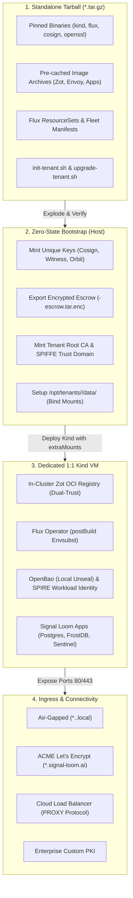

# Proposal — SLSI Signal Loom Design Partner Appliance Self-Initialisation Pipeline (2026-Q4)

|  |  |
| :---: | :---- |
| Proposer & Date: | AJM (2026-10-10) |
| Reviewer & Date: | Vicente Herrera, Tom Cope |
| Approver & Date: |  |

## Press Release

**ControlPlane Announces SLSI: Zero-Touch, Cryptographically Isolated Self-Initialisation Pipeline for Signal Loom Design Partner Appliances**

ControlPlane announces the Signal Loom Self-Initialisation (SLSI) pipeline, a zero-touch, air-gap-capable deployment framework engineered to spin up fully autonomous Signal Loom tenant appliances from an encrypted standalone tarball. Designed specifically for Early Access Program (EAP) design partners and enterprise proof-of-concept deployments, SLSI eliminates complex pre-requisites and lengthy onboarding professional services by condensing an entire enterprise-grade AI governance, attestation, and containment stack into a single self-expanding execution package.

Rather than relying on brittle shared-tenant cloud environments or manual configuration checklists, SLSI provisions a 1:1 dedicated appliance backed by Kind, in-cluster Zot OCI registry, Flux v2 GitOps controllers, Envoy Gateway, SPIRE workload attestation, and OpenBao secret management. Crucially, each deployed appliance executes a zero-state cryptographic bootstrap upon expansion—generating bespoke Cosign signing keys, dedicated SPIFFE trust domains, Root CAs, and Witness attestation policies entirely isolated to that specific customer. By pairing dual-trust supply chain validation (preserving upstream SLSA provenance while enforcing local tenant signature authority) with resilient host-bound persistence and flexible ingress networking (spanning air-gapped domains, automated ACME certificates under `signal-loom.ai`, and enterprise Cloud Load Balancers), SLSI allows design partners to establish a fully verified AI security perimeter on their own infrastructure in under five minutes.

## Proposal Overview

### Opportunity

As Signal Loom enters active design partnership engagements with enterprise clients in regulated sectors (tier-1 banking, national security, defence, and critical national infrastructure), client security teams uniformly demand proof-of-concept deployments that satisfy strict isolation requirements. These partners cannot accept multi-tenant SaaS architectures where their LLM telemetry, agent interaction traces, and policy rules co-exist in shared databases or shared Kubernetes control planes. Furthermore, enterprise procurement and data protection officers reject solutions that require outbound internet dependencies or manual root credential handling by third-party vendor engineers.

Today, demonstrating or deploying Signal Loom outside ControlPlane's internal cloud development environments requires manual cluster bootstrapping, bespoke script coordination, out-of-band certificate generation, and fragile port-forwarding conventions.

SLSI solves this by packaging the complete Signal Loom demonstration and runtime platform into an immutable, self-initializing tarball. The appliance automatically unpacks, mints unique cryptographic roots, instantiates an isolated local Kind cluster, seeds an in-cluster OCI registry, binds persistent storage to host disks, and reconciles declarative Flux ResourceSets—delivering a turnkey, production-grade security posture in a self-contained envelope.

**The work relates to the following value area(s):**

- [x] client revenue
- [ ] marketing
- [x] product
- [x] services engineering
- [x] cost avoidance
- [x] process efficiency
- [x] operational or regulatory internal

**Key Customers:**
- **Enterprise Design Partners (Financial Services, Defence, Healthcare)** requiring air-gapped or dedicated-VM trial appliances that operate under their direct sovereignty.
- **ControlPlane Field CTOs and Solutions Architects** requiring deterministic, zero-friction demonstration rigs for customer POCs.
- **Continuous Integration & Quality Engineering** requiring reproducible, ephemeral, end-to-end tenant lifecycle validation identical to customer environments.

| Stakeholder Group | Problem / Opportunity Statement | Operational Impact |
| :---- | :---- | :---- |
| **Enterprise Design Partners** | Need to evaluate Signal Loom agent governance on private infrastructure without granting external cloud network access or sharing compute with other tenants. | Blocked POC evaluations, lengthy 6-month security architecture reviews, and high friction in onboarding regulated institutions. |
| **ControlPlane Field Engineers** | Spend hours manually configuring Kind, Envoy Gateway routing, TLS certificates, and OpenBao secrets for each partner demonstration. | Inconsistent demo environments, human errors during key generation, and non-reproducible software verification states. |
| **Security & Compliance Auditors** | Require mathematical proof that customer encryption keys, audit trails, and SPIFFE identity roots are cryptographically segregated between tenants. | Multi-tenancy isolation challenges and failure to meet strict data sovereignty regulations. |

**Urgency:**
High (2026-Q4). Immediate delivery is required to unlock Q4 design partner onboarding and provide a repeatable software appliance delivery vehicle for the Signal Loom EAP.

---

## Scope Summary

*Technology Readiness Level:* **TRL 3 (Experimental proof-of-concept on disk) $\to$ TRL 6 (System/subsystem model or prototype demonstrated in relevant environment).**

The codebase in [`/home/andy/src/cp/osramp-demo`](file:///home/andy/src/cp/osramp-demo) already provides functional foundation scripts ([`Makefile`](file:///home/andy/src/cp/osramp-demo/Makefile), [`d2-osramp-fleet/`](file:///home/andy/src/cp/osramp-demo/d2-osramp-fleet/), [`d2-infra/`](file:///home/andy/src/cp/osramp-demo/d2-infra/), and [`scripts/lib/wait.sh`](file:///home/andy/src/cp/osramp-demo/scripts/lib/wait.sh)). SLSI formalizes these components into a self-contained tarball artifact and an automated orchestrator (`init-tenant.sh`) that manages the complete zero-to-healthy lifecycle.

### In Scope Activities

| Deliverable | Description | Acceptance Criteria (SMART) | Validation Method |
| :--- | :--- | :--- | :--- |
| **D1: Standalone Appliance Bundler** | A reproducible packaging toolchain (`scripts/package-tenant-bundle.sh`) that compiles pinned binaries (`kind`, `kubectl`, `flux`, `cosign`, `openssl`, `jq`, `envsubst`), offline OCI image caches, Flux fleet manifests, and bootstrap scripts into an immutable `.tar.gz` bundle. | **Specific:** Creates a standalone compressed tarball containing 100% of required runtime dependencies. **Measurable:** Tarball extracts and executes cleanly on an offline/air-gapped Ubuntu 24.04 LTS host with zero network downloads. **Attainable:** Leverages existing `.cache/zot` and image export scripts in `scripts/lib/demo-images.sh`. **Realistic:** Bundles standard Docker/containerd and x86_64/arm64 Linux binaries. **Time-Bound:** Delivered in Sprint 1 (Week 2). | Automated test verifying checksum manifest and executing an air-gapped extraction in an isolated network sandbox (`unshare -n`). |
| **D2: Zero-State Cryptographic Bootstrap Engine** | An automated initialization module within `init-tenant.sh` that mints a full, unique cryptographic hierarchy for the tenant during unpack. | **Specific:** Generates dedicated Cosign Ed25519 keypair, Witness Ed25519 keypair, Orbit approval keypair, SPIFFE Root CA, and OpenBao transit keys. **Measurable:** Zero private keys or certificates shared with vendor or any other tenant; keys written to `/opt/tenants/<id>/.keys/` with `0700` permissions. **Attainable:** Reuses proven cryptographic recipes from `Makefile:signing-keys` and `scripts/lib/keys.sh`. **Realistic:** Generates all keypairs via OpenSSL and Cosign in $<15$ seconds without entropy starvation. **Time-Bound:** Delivered in Sprint 1 (Week 2). | Test asserting that two successive runs of `init-tenant.sh` produce disjoint public key fingerprints and mutually incompatible signatures. |
| **D3: Dedicated Kind Host Engine with Storage Mounts** | Kind node configuration template utilizing `extraMounts` to bind-mount persistent volumes to `/opt/tenants/<id>/data/` on the host, running on a dedicated 1:1 host VM. | **Specific:** Configures Kind with host port bindings (80, 443, 5000, 8200) and dedicated local-path-provisioner storage directories. **Measurable:** All PostgreSQL tables, OpenBao storage, and NATS JetStream data persist on the host disk across `kind delete cluster` and cluster rebuilds. **Attainable:** Kind `extraMounts` is a native, stable feature. **Realistic:** Avoids eBPF and cgroup freezer collisions by enforcing a single appliance per host VM. **Time-Bound:** Delivered in Sprint 2 (Week 3). | Integration test asserting database records survive a complete cluster teardown and redeployment. |
| **D4: Dual-Trust Supply Chain Verification Engine** | Supply chain verification engine configuring local Flux Operator with dual trust anchors: upstream ControlPlane release key for pre-bundled base images, and local tenant Cosign key for tenant manifests and runtime workloads. | **Specific:** Pre-bundled images verified against vendor public key without re-signing, preserving SLSA provenance. **Measurable:** Flux rejects unsigned or tampered container images while accepting vendor-signed platform containers and tenant-signed workloads. **Attainable:** Configurable via Flux `ImagePolicy` and `Kustomization` verification specs. **Realistic:** Eliminates image re-signing latency on boot while preserving strict supply chain controls. **Time-Bound:** Delivered in Sprint 2 (Week 4). | Injection test verifying that an image signed by an untrusted third party is blocked from deployment by Flux. |
| **D5: Multi-Mode Ingress & ACME Automation Engine** | Ingress orchestration module supporting 4 distinct network topologies: (1) Air-gapped self-signed `*.<tenant>.local` (exporting `ca.crt`), (2) Automated ACME Let's Encrypt for `*.<tenant>.signal-loom.ai` / `signalloom.com`, (3) Cloud Load Balancer reverse-proxy (AWS ALB/GCP Cloud LB with PROXY protocol and `X-Forwarded-*`), and (4) Corporate Custom PKI (`--tls-cert` / `--tls-key`). | **Specific:** Generates Envoy Gateway Gateway API resources matching the selected ingress mode. **Measurable:** Automated end-to-end TLS termination verified across all four modes with 0 HTTP certificate errors. **Attainable:** Uses existing cert-manager ClusterIssuer patterns in `d2-infra/components/ingress/`. **Realistic:** Directly aligns with enterprise corporate proxy and ACME requirements. **Time-Bound:** Delivered in Sprint 3 (Week 5). | Playwright acceptance test suite asserting valid HTTPS connectivity across all four ingress modes. |
| **D6: In-Place Day-2 GitOps Upgrade Engine** | An idempotent upgrade tool (`scripts/upgrade-tenant.sh`) that takes a new release tarball, loads updated OCI images into local Zot, creates an automated pre-upgrade database snapshot, and updates the local Flux GitOps source. | **Specific:** Performs rolling updates across application Deployments without recreating the Kind cluster or resetting persistent volumes. **Measurable:** Upgrades complete in $<3$ minutes with zero data loss and automated rollback on verification failure. **Attainable:** Flux reconciles Git/OCI sources natively with rolling rollout strategies. **Realistic:** Essential for enterprise design partners receiving bi-weekly feature updates. **Time-Bound:** Delivered in Sprint 3 (Week 6). | Upgrade regression test upgrading a v0.1.0 mock tenant appliance to v0.2.0, verifying continuous database integrity. |
| **D7: Local Audit Bundler & Opt-In Telemetry Streamer** | Operational diagnostics and telemetry utility providing local on-demand audit packaging (`scripts/export-diagnostics.sh`) and an optional streaming forwarder to the central Signal Loom Fleet Hub. | **Specific:** Packages Witness attestations, OpenBao audit records, and FrostDB segments into an encrypted diagnostic bundle; supports `--hub-endpoint` / `--hub-token` for live streaming. **Measurable:** Air-gapped by default (zero outbound packets); streams only when explicitly authorized by partner. **Attainable:** Builds on `make doctor` and existing telemetry emitters. **Realistic:** Complies with strict non-disclosure and security policies of regulated design partners. **Time-Bound:** Delivered in Sprint 4 (Week 7). | Network egress audit proving zero outbound network calls in default air-gap mode, and successful encrypted transmission when enabled. |

### Out of Scope

- **Multi-Tenant Shared-Kernel Hosting**: Multi-tenancy on a single shared host machine is explicitly descoped to prevent kernel eBPF (`tc_drop`), cgroup freezer, and namespace bleed. Each tenant appliance requires a dedicated VM.
- **Hardware Security Module (HSM) Integration**: Physical PKCS#11 HSM integration is deferred to enterprise production releases; POC appliances utilize software Ed25519 keypairs stored with strict `0700` filesystem permissions.
- **SaaS Multi-Region Active-Active Federation**: Cross-appliance multi-region real-time database clustering is out of scope for the design partnership appliance.

### KPIs

| Metric | Current Value | Target Value | Measurement |
| :--- | :--- | :--- | :--- |
| **Cold Start Deployment Time** | ~45–60 mins (manual script execution, debugging port conflicts) | $\le 5$ minutes | Timed execution from `tar -xzf` to all pods `Ready=True` and Envoy returning 200 OK. |
| **Cryptographic Segregation** | 0% (shared keys or hardcoded dev credentials) | 100% Unique | Cryptographic audit verifying unique Cosign key IDs, Root CAs, and SVID domains per instance. |
| **Supply Chain Verification** | Ad-hoc (manual image loading without strict admission gates) | 100% Attested | Verification that 100% of running container images carry valid Cosign signatures and SLSA attestations. |
| **Day-2 Upgrade Success Rate** | N/A (requires cluster tear-down and manual rebuild) | 100% Zero-Data-Loss | Automated upgrade test suite verifying database record persistence through in-place rolling updates. |
| **Partner Onboarding Friction** | 3–5 engineer days of setup and triage | Zero-touch automated script | Partner deployment without vendor engineering intervention, proven via recorded audit log. |

### 3rd Party Test Plan and Quality Assurance

| Validation | Method | Owner |
| :--- | :--- | :--- |
| **Air-Gap Sandbox Extraction** | Execute tarball expansion and bootstrap inside a container with disconnected networking (`--net none`) to certify zero external dependencies. | Quality Engineering / Vicente Herrera |
| **Cryptographic Uniqueness Audit** | Automated test executing 10 parallel tenant boots in isolated VMs, verifying disjoint key spaces and mutually rejected tokens. | Security Engineering / Tom Cope |
| **eBPF & Kernel Confinement Safety** | Run `scripts/test-tc-ebpf.sh` and `scripts/test-cgroup-freezer.sh` on the appliance to verify containment policies function as advertised. | Platform Lead / Vicente Herrera |
| **Browser Acceptance Across Ingress Modes** | Automated Playwright browser tests validating UI rendering, cookie sessions, and WebSocket streaming across Local, ACME, and Cloud LB modes. | Frontend Team / Elena Mikhalina |

---

## Technical Overview

#### Technologies

| Technology | Purpose | Alignment |
| :--- | :--- | :--- |
| **Kind (Kubernetes in Docker)** | Single-node ephemeral/local Kubernetes runtime. | Core platform standard (`make cluster`). |
| **Flux Operator & ResourceSets** | GitOps engine managing tenant overlays with dynamic `postBuild.substituteFrom`. | Primary GitOps delivery control plane. |
| **Zot OCI Registry** | In-cluster, cacheable container image and OCI artifact registry. | Production standard in [`d2-osramp-fleet/local/zot.yaml`](file:///home/andy/src/cp/osramp-demo/d2-osramp-fleet/local/zot.yaml). |
| **Cosign & Witness** | Container image signing, policy enforcement, and in-toto provenance attestation. | Standardized in `.keys/` and [`scripts/lib/keys.sh`](file:///home/andy/src/cp/osramp-demo/scripts/lib/keys.sh). |
| **Envoy Gateway (Gateway API)** | High-performance ingress gateway handling HTTP routing, TLS termination, and PROXY protocol. | Standardized in [`d2-infra/components/ingress/`](file:///home/andy/src/cp/osramp-demo/d2-infra/components/ingress/). |
| **Cert-Manager** | Automated TLS certificate issuance via local Root CA or ACME Let's Encrypt. | Standardized in [`d2-infra/components/cert-manager/`](file:///home/andy/src/cp/osramp-demo/d2-infra/components/cert-manager/). |
| **OpenBao & SPIRE** | Workload identity attestation (SPIFFE) and secrets management (transit/KV/JWT auth). | Standardized in [`d2-signalloom/infra/inf-bao/`](file:///home/andy/src/cp/osramp-demo/d2-signalloom/infra/inf-bao/). |
| **PostgreSQL & FrostDB** | Relational user/fleet store and columnar in-memory immutable event store. | Standard Signal Loom storage layer. |

#### Infrastructure and Repositories

| Asset | Location | Notes |
| :--- | :--- | :--- |
| **Monorepo Source** | [`/home/andy/src/cp/osramp-demo`](file:///home/andy/src/cp/osramp-demo) | Canonical monorepo holding all D2 slices and tooling. |
| **Git Remote** | `git@github.com:controlplaneio-in-toto/osramp-demo` | Canonical upstream repository (`destination-target: git@github.com:sublimino/architecture-as-code`). |
| **Fleet Overlay Path** | [`d2-osramp-fleet/tenants/`](file:///home/andy/src/cp/osramp-demo/d2-osramp-fleet/tenants/) | Base manifests and tenant overlays. |
| **Bootstrap Library** | [`scripts/lib/wait.sh`](file:///home/andy/src/cp/osramp-demo/scripts/lib/wait.sh) | Deterministic polling and readiness assertion engine. |
| **Appliance Output Path** | `/opt/tenants/<tenant-id>/` | Target runtime installation and host persistence directory. |

#### Security and Risk

**Threat model for this deliverable:**

| Threat | Impact | Mitigation |
| :--- | :--- | :--- |
| **Host Disk Key Extraction** | Attacker with host access extracts plaintext private keys from `/opt/tenants/<id>/.keys/`. | Strict POSIX permissions (`0700` directory, `0600` keys) owned by root/dedicated runtime user; automatic generation of an encrypted escrow backup bundle (`.tar.enc`) for secure offsite archival. |
| **Supply Chain Base Image Poisoning** | Malicious or compromised container image injected into the pre-bundled tarball. | Dual-trust architecture: Flux enforces image signature verification against ControlPlane's upstream release Cosign key before permitting pod rollout. |
| **Entropy Depletion during Boot** | System `/dev/urandom` exhaustion leads to weak Ed25519 key generation or hangs. | Bootstrap script checks `/proc/sys/kernel/random/entropy_avail` pre-flight and utilizes modern kernel `getrandom` syscalls. |
| **Tenant Workload Confinement Breakout** | Compromised agent pod attempts to escape container or tamper with host networking. | Dedicated 1:1 VM model guarantees kernel boundary; Landlock LSM and eBPF (`tc_drop`) enforce five-stage containment within the appliance. |
| **Ingress Man-in-the-Middle (MitM)** | Unencrypted or spoofed traffic to tenant dashboard or API endpoints. | Mandatory TLS across all modes: automated ACME Let's Encrypt under `signal-loom.ai`, verified Root CA for `.local`, or PROXY-protocol enforcement from Cloud Load Balancers. |

**SWOT Analysis:**

| Strengths | Weaknesses |
| :--- | :--- |
| - Zero external dependencies; 100% offline air-gap capable. - Cryptographically provable multi-tenant segregation. - Preserves upstream SLSA provenance while providing local signing authority. - Direct re-use of battle-tested Kind, Flux, and Zot tooling. | - Appliance payload size is large (~2–4 GB) due to embedded container image caches. - Kind node memory footprint requires host with $\ge 8$ GB RAM. |

| Opportunities | Threats |
| :--- | :--- |
| - Dramatically accelerates enterprise design partner onboarding from months to minutes. - Provides a foundation for commercial on-premises hardware appliance sales. - Establishes ControlPlane as the gold standard for secure, self-sovereign AI agent deployments. | - Customer host misconfigurations (e.g. running multiple appliances on one VM) risking eBPF or port collisions. - Drastic Docker/containerd version incompatibilities on non-standard customer Linux distributions. |

---

## Milestones and Deliverables

| Milestones Committed To | Duration (days) | Consultants | Person-days | Deadline | Capability Mapping |
| :--- | :--- | :--- | :--- | :--- | :--- |
| **M1: Core Packaging Toolchain & Dual-Trust Image Bundler** Deliver `scripts/package-tenant-bundle.sh` compiling pinned binaries, cached OCI images, and Flux manifests into an air-gapped tarball with checksum verification. |  |  |  |  | #cap-kubernetes, #cap-containers, #cap-reproducible-builds |
| **M2: Cryptographic Bootstrap & Kind Persistent Host Engine** Implement `scripts/init-tenant.sh` with zero-state key generation (Cosign, Witness, Orbit, SPIRE CA) and Kind configuration with `extraMounts` bound to `/opt/tenants/<id>/data/`. |  |  |  |  | #cap-secrets, #cap-security, #cap-supply-chain-security |
| **Mid-project review: demo of progress, evaluation of further milestones, raising of current and new risks** |  |  |  |  | #cap-project-management |
| **M3: Multi-Mode Ingress (Local, ACME, Cloud LB) & Flux Reconcile** Wire Envoy Gateway to support air-gapped self-signed domains, automated ACME for `signal-loom.ai`, and Cloud Load Balancers; implement Flux envsubst rollout. |  |  |  |  | #cap-gitops, #cap-networking, #cap-architecture |
| **M4: In-Place Day-2 Upgrade Engine & Telemetry Diagnostics** Deliver `scripts/upgrade-tenant.sh` with automated pre-upgrade snapshots, and `scripts/export-diagnostics.sh` with optional Fleet Hub streaming. |  |  |  |  | #cap-observability, #cap-devops, #cap-linux |
| **M5: Automated End-to-End Validation Runbook & EAP Pilot Sign-Off** Author executable Validation Runbook, execute BATS and Playwright suites, and achieve final design partner sign-off. |  |  |  |  | #cap-testing-pyramid, #cap-documentation |
| **Signoff** |  |  |  |  | #cap-engagement-management |

**Total Estimated Effort**: *to be estimated with team post-approval*

**Definition of Done:**
- `package-tenant-bundle.sh` produces a self-contained `.tar.gz` payload that unpacks and deploys cleanly on a fresh, disconnected Linux VM in $\le 5$ minutes.
- All 7 architectural pillars (Standalone 1:1 VM, Dual-Trust, Plaintext `0700` with Escrow, Multi-Mode Ingress with ACME, Persistent Host Mounts, In-Place Upgrades, and Opt-In Telemetry) pass automated verification tests.
- Comprehensive Validation Runbook committed to `2. Areas/CEO/Innovation Validation/` with passing automated test results.

---

### Reviews & Collaboration (RACI)

|  |  |
| :---- | :---- |
| **Accountable** | Principal Architect (Vicente Herrera) |
| **Responsible** | Cloud Native Transformation & DevSecOps Practice Engineering Team |
| **Consulted** | Tom Cope (Principal Consultant), Mario Weigel (OpenBao Lead), Francesco Beltramini (Field CTO) |
| **Informed** | [Andrew Martin](mailto:andy@control-plane.io), [Elena Mikhalina](mailto:elena.mikhalina@control-plane.io) |

---

## Finances

### Additional costs

| Additional Cost | Estimated Spend | One Off or Recurring | Must-Have or Nice-to-Have |
| :---- | :---- | :---- | :---- |
| **GCP / AWS Bare-Metal Validation VM Instances** (for isolated multi-distro testing) | £350 / month | Recurring (2 months) | Must-Have |
| **Test Domain Registration & DNS Delegation** (`signal-loom.ai` subzone delegation for ACME testing) | £50 | One-off | Must-Have |

---

# Decision Log

| Date | Decision Makers | Decision and context | Reason | Impact |
| :--- | :--- | :--- | :--- | :--- |
| **2026-10-10** | AJM, Sensai | **Decision 1: Target Lifecycle.** Establish appliance primarily as a standalone design partner POC / field appliance. | Eliminates unnecessary distributed consensus complexity while satisfying immediate EAP customer trial requirements. | Focuses architecture on single-node Kind with zero-touch automation. |
| **2026-10-10** | AJM, Sensai | **Decision 2: Dual-Trust Supply Chain.** Retain upstream vendor signature verification for base images; use local tenant key for tenant configs and local builds. | Preserves upstream SLSA build provenance and eliminates lengthy image re-signing delays during unpack. | Flux checks vendor public key for base images and tenant public key for local workloads. |
| **2026-10-10** | AJM, Sensai | **Decision 3: Key Custody & Persistence.** Store keys on local host disk with `0700` permissions; emit an encrypted escrow backup bundle (`.tar.enc`) at bootstrap. | Enables unattended reboots of customer demo appliances while providing an offsite disaster recovery mechanism. | Simplifies Day-1 operations without sacrificing recovery options. |
| **2026-10-10** | AJM, Sensai | **Decision 4: Host Isolation Boundary.** Require 1 dedicated VM/host per tenant appliance (1:1). | Avoids kernel eBPF (`tc_drop`) and cgroup freezer collisions across multiple Kind clusters on a shared kernel; allows fixed ports (80/443/5000/8200). | Clean architectural boundary; eliminates dynamic port mapping complexity. |
| **2026-10-10** | AJM, Sensai | **Decision 5: Multi-Mode Ingress.** Support 4 ingress paths: Air-gapped `*.<tenant>.local`, automated ACME for `signal-loom.ai`, Cloud Load Balancer reverse-proxy (PROXY protocol), and BYO custom PKI. | Accommodates offline field trials, public cloud demos, and corporate enterprise proxies with zero code changes. | Envoy Gateway configured via Gateway API to dynamically adapt to environment parameters. |
| **2026-10-10** | AJM, Sensai | **Decision 6: Host Binds & In-Place Upgrades.** Use Kind `extraMounts` to bind PV storage to `/opt/tenants/<id>/data/`; execute in-place rolling updates via `upgrade-tenant.sh`. | Prevents data loss on cluster rebuilds and provides a smooth path for shipping bi-weekly updates to design partners. | Customer data is completely decoupled from ephemeral container lifecycles. |
| **2026-10-10** | AJM, Sensai | **Decision 7: Local-by-Default Telemetry.** Default to local air-gapped diagnostics bundling (`export-diagnostics.sh`), with an optional `--hub-endpoint` flag for streaming. | Respects strict confidentiality policies of regulated enterprise partners while supporting collaborative debugging when approved. | Eliminates security review pushback regarding unapproved outbound telemetry. |

---

## Appendix

### A. Architectural Workflow

### B. Useful Links and File References

- Canonical Platform Monorepo: [`/home/andy/src/cp/osramp-demo`](file:///home/andy/src/cp/osramp-demo)
- Fleet Definitions & Overlays: [`d2-osramp-fleet/tenants/`](file:///home/andy/src/cp/osramp-demo/d2-osramp-fleet/tenants/)
- In-Cluster Zot Manifest: [`d2-osramp-fleet/local/zot.yaml`](file:///home/andy/src/cp/osramp-demo/d2-osramp-fleet/local/zot.yaml)
- Signing Key Generation Target: [`Makefile:signing-keys`](file:///home/andy/src/cp/osramp-demo/Makefile#L232-L270)
- Ingress Gateway Configurations: [`d2-infra/components/ingress/`](file:///home/andy/src/cp/osramp-demo/d2-infra/components/ingress/)
- Deterministic Polling Library: [`scripts/lib/wait.sh`](file:///home/andy/src/cp/osramp-demo/scripts/lib/wait.sh)
- OpenBao & SPIRE Provisioning: [`d2-signalloom/infra/inf-bao/`](file:///home/andy/src/cp/osramp-demo/d2-signalloom/infra/inf-bao/)
- Kernel Confinement Tests: [`scripts/test-tc-ebpf.sh`](file:///home/andy/src/cp/osramp-demo/scripts/test-tc-ebpf.sh) and [`scripts/test-cgroup-freezer.sh`](file:///home/andy/src/cp/osramp-demo/scripts/test-cgroup-freezer.sh)

### Spec: Shared Patterns

Obey these. They are the phase constitution.

- **Offline Air-Gap Hermeticity:** The appliance installer (`init-tenant.sh`) and bundler (`package-tenant-bundle.sh`) MUST NOT execute any network downloads, curl/wget calls, git clones, or external registry pulls during unpacking or startup. All binaries (`kind`, `kubectl`, `flux`, `cosign`, `openssl`, `jq`, `envsubst`) and container images MUST be verified against local SHA-256 manifests inside the bundle archive. Any external network egress attempt during offline bootstrap mode MUST abort execution immediately with a non-zero exit code.
- **Dual-Trust Supply Chain Verification:** Pre-bundled base images (Zot, Envoy Gateway, Flux controllers, cert-manager, PostgreSQL, OpenBao, Signal Loom) MUST be verified against the upstream ControlPlane release Cosign public key (`.keys/cosign.pub` from the release build). Locally minted tenant manifests and runtime workloads MUST be signed and verified by the bespoke tenant Cosign key generated during bootstrap. Image signatures MUST be checked via Flux `ImagePolicy` and admission gates before pod scheduling.
- **Strict Host Bind Permissions & UID Isolation:** Persistent storage mounted via Kind `extraMounts` to `/opt/tenants/<id>/data/` MUST be initialized with strict POSIX permissions: directory root `0700`, with subdirectories chowned to target container UIDs (Postgres `UID 999:999`, OpenBao `UID 100:100`, Zot `UID 10001:10001`, NATS `UID 1000:1000`) prior to Kind cluster launch. Plaintext private keys in `/opt/tenants/<id>/.keys/` MUST be mode `0600` owned by root.
- **Dedicated 1:1 Host VM Boundary:** Each tenant appliance MUST be provisioned on a dedicated VM or physical host (1:1). Co-locating multiple tenant appliances or Kind clusters on a single Linux kernel is strictly prohibited to prevent eBPF `tc_drop` filter collisions, cgroup freezer deadlocks, and host port binding contention on 80/443/5000/8200.
- **Deterministic Key Minting with Encrypted Escrow:** `init-tenant.sh` MUST mint disjoint, unique Ed25519 keypairs for Cosign, Witness, Orbit approval, and SPIRE Root CA. An encrypted escrow backup bundle (`<tenant-id>-escrow.tar.enc`) MUST be emitted to `/opt/tenants/<id>/escrow/` encrypted with an operator-supplied passphrase or public key, enabling recovery without storing unencrypted keys off-appliance.
- **Ingress Topology Decoupling via Gateway API:** Ingress configuration MUST utilize standard Envoy Gateway Gateway API resources (`Gateway`, `HTTPRoute`, `ClientTrafficPolicy`). The active ingress mode (`local`, `acme`, `cloudlb`, `custom-pki`) MUST be parameterised via Flux `postBuild.substituteFrom` and environment variables (`TENANT_DOMAIN`, `INGRESS_MODE`, `TLS_ISSUER`). PROXY protocol (`ClientTrafficPolicy`) MUST ONLY be enabled when `INGRESS_MODE=cloudlb` to prevent dropping direct connections.
- **Idempotent In-Place Upgrades with Pre-Snapshot:** Day-2 upgrades (`upgrade-tenant.sh`) MUST execute without destroying the Kind cluster or wiping host bind directories. The upgrade script MUST take an atomic snapshot of PostgreSQL and OpenBao state to `/opt/tenants/<id>/snapshots/pre-upgrade-<timestamp>.sql` before applying new manifests. On upgrade failure, an automatic rollback MUST restore the prior GitOps revision and database snapshot.
- **Local-by-Default Audit & Explicit Telemetry Stream:** All Witness attestation records, OpenBao audit logs, and FrostDB segments MUST be retained locally in `/opt/tenants/<id>/audit/`. Outbound telemetry streaming to the central Signal Loom Fleet Hub MUST be disabled by default; when enabled via `--hub-endpoint` and `--hub-token`, all packets MUST be encrypted via mTLS over HTTPS.
- **Testing Standard:** All shell automation scripts MUST be validated with `shellcheck -x` and covered by deterministic BATS suites (`test/*.bats`). Web UI routes across all ingress modes MUST be verified via Playwright acceptance tests (`test/acceptance/`). All cluster readiness assertions MUST use `scripts/lib/wait.sh` (`wait_rollout`, `wait_job`), never bare `sleep`.
- **Anti-patterns:**
  - Invoking `curl` or `docker pull` during offline bootstrap.
  - Re-signing upstream base images with tenant keys during boot (destroys SLSA provenance and adds minutes of boot latency).
  - Multi-tenant appliance co-location on a shared Linux kernel.
  - Silent error suppression (`2>/dev/null || true`) in bootstrap or migration scripts.
  - Plaintext key storage with loose permissions (`>0600`).
  - Enabling PROXY protocol on non-load-balanced local or ACME ingress modes.

### Spec: Capability Plan

| Logical ID | Selected skills | Agent role | Size | Ceiling | CPAI agent | Rationale |
| :--- | :--- | :--- | :--- | ---: | :--- | :--- |
| P0 | ajm-auto-kanban; context-mode | Baseline engineer | S | 45m | antigravity | Baseline offline acceptance and verify harness readiness on integration/slsi-v0.1.0 at the cut SHA. |
| P1-PRE | context-mode | Pre-flight analyst | S | 45m | antigravity | Audit packaging utilities, binary versions, and image caching scripts; publish the Phase 1 gap table. |
| P1-1 | context-mode | Toolchain engineer | M | 120m | antigravity | Implement scripts/package-tenant-bundle.sh to collect pinned binaries and generate SHA-256 checksum manifests. |
| P1-2 | context-mode | Packaging engineer | M | 120m | antigravity | Implement offline OCI image caching module to export and bundle required platform images into the appliance .cache/zot archive. |
| P1-3 | context-mode | GitOps engineer | M | 120m | antigravity | Compile Flux tenant overlays, bundle bootstrap scripts, and package into immutable .tar.gz archive. |
| P1-4 | context-mode | Acceptance engineer | M | 120m | antigravity | Author BATS integration suite verifying hermetic bundle extraction and execution in a network-isolated sandbox (unshare -n). |
| P1-GOV | ajm-auto-kanban | Phase 1 Governor | M | 120m | antigravity | Merge P1 cards in dependency order, verify bundle checksum reproducibility, run offline test suites, and record Phase 1 errata. |
| P2-PRE | context-mode | Pre-flight analyst | S | 45m | antigravity | Audit cryptographic recipes, Kind extraMounts configurations, and Flux dual-trust policies; publish Phase 2 gap table. |
| P2-1 | context-mode | Cryptographic engineer | M | 120m | antigravity | Implement zero-state cryptographic bootstrap module in init-tenant.sh (Cosign, Witness, Orbit, SPIFFE Root CA, encrypted escrow). |
| P2-2 | context-mode | Infrastructure engineer | M | 120m | antigravity | Implement host storage provisioner and Kind cluster generator with extraMounts bound to /opt/tenants/<id>/data/ and fixed port mappings. |
| P2-3 | context-mode | Systems engineer | M | 120m | antigravity | Implement Kind boot and local Zot registry seeder, verifying 100% image availability without external egress. |
| P2-4 | context-mode | Supply chain engineer | M | 120m | antigravity | Implement dual-trust Flux ImagePolicy and Kustomization verification specs (upstream vendor release key + local tenant key). |
| P2-5 | context-mode | Integration engineer | M | 120m | antigravity | Author BATS test asserting cryptographic key uniqueness across tenant runs and data persistence across cluster teardown/rebuild. |
| P2-GOV | ajm-auto-kanban | Phase 2 Governor | M | 120m | antigravity | Merge P2 cards, execute end-to-end bootstrap test, verify zero-network egress during boot, and record Phase 2 errata. |
| P3-PRE | context-mode | Pre-flight analyst | S | 45m | antigravity | Audit Envoy Gateway Gateway API configurations, cert-manager cluster issuers, and telemetry emitter hooks; publish Phase 3 gap table. |
| P3-1 | context-mode; modern-web-guidance | Networking engineer | M | 120m | antigravity | Implement multi-mode ingress engine for Envoy Gateway supporting Local .local, ACME signal-loom.ai, Cloud LB, and Custom PKI. |
| P3-2 | context-mode | Reliability engineer | M | 120m | antigravity | Implement scripts/upgrade-tenant.sh with automated pre-upgrade database snapshot, image reload into Zot, and rolling Flux reconciliation. |
| P3-3 | context-mode | Observability engineer | M | 120m | antigravity | Implement scripts/export-diagnostics.sh with local encrypted audit bundling and optional streaming forwarder to Signal Loom Hub. |
| P3-4 | context-mode; Interceptor | Acceptance engineer | M | 120m | antigravity | Author executable Validation Runbook and Playwright test suite validating all 4 ingress modes and upgrade rollbacks. |
| P3-5 | context-mode; ajm-auto-kanban | Adversarial evaluator | M | 120m | kpai | Red-team appliance security: host disk key extraction permissions, container breakout containment, and untrusted image injection rejection. |
| P3-GOV | ajm-auto-kanban | Phase 3 Governor | M | 120m | antigravity | Merge P3 cards, run full test suite twice with identical totals, verify all SMART criteria and KPIs met, and publish final certification errata. |

### Spec: Work Decomposition

| Logical ID | Role | Atomic task | Depends on | Exact tests or evidence | Size | Agent | Result / metric | Est. Cost | Tokens | Elapsed | AI URI |
| :--- | :--- | :--- | :--- | :--- | :--- | :--- | :--- | :--- | :-------- | :----- | :------ | :--- |
| P0 | baseline | On `integration/slsi-v0.1.0` at the cut SHA run `make test-all-offline`, `make docs-lint`, and `kanban-check.sh doctor --shortcode SLSI`. Record the exact pass/fail/skip totals as the baseline every later card is compared against. | - | Both acceptance commands exit 0 with recorded totals; doctor clean | S | antigravity | - | - | - | - | - |
| P1-PRE | preflight | Audit existing packaging scripts, binary versions (`kind`, `kubectl`, `flux`, `cosign`), and image caching logic (`scripts/lib/demo-images.sh`). Publish a gap table in errata detailing required binary versions, image digests, and sandbox test harnesses. No code changes. | P0 | Gap table in errata naming files, digests, and tool versions | S | antigravity | - | - | - | - | - |
| P1-1 | implementation | Author `scripts/package-tenant-bundle.sh` binary stage: download and pin required Linux x86_64/arm64 binaries (`kind`, `kubectl`, `flux`, `cosign`, `openssl`, `jq`, `envsubst`) into `bundle/bin/`, enforce executable permissions, and generate cryptographic SHA-256 checksum manifest `bundle/bin/checksums.txt`. | P1-PRE | `bash -n scripts/package-tenant-bundle.sh` passes; `sha256sum -c bundle/bin/checksums.txt` exits 0 | M | antigravity | - | - | - | - | - |
| P1-2 | implementation | Implement offline OCI image bundler module in `scripts/package-tenant-bundle.sh`: export base platform container images (Zot, Envoy Gateway, Flux controllers, cert-manager, PostgreSQL, OpenBao, Signal Loom) into `.cache/zot` OCI tar format. Verify images with upstream vendor Cosign public key prior to packaging. | P1-1 | Test script exporting images and asserting valid Cosign signatures against `.keys/cosign.pub` | M | antigravity | - | - | - | - | - |
| P1-3 | implementation | Implement manifest compiler and bundle assembler in `scripts/package-tenant-bundle.sh`: package `d2-osramp-fleet/tenants/local/`, `d2-infra/`, and `init-tenant.sh` into compressed archive `dist/slsi-appliance-<version>.tar.gz`. Generate root `MANIFEST.json` containing bundle metadata, git commit SHA, and payload checksums. | P1-2 | `tar -ztvf dist/slsi-appliance-*.tar.gz` lists complete filesystem hierarchy; `jq . dist/MANIFEST.json` validates schema | M | antigravity | - | - | - | - | - |
| P1-4 | test | Author BATS integration test `test/slsi-airgap-bundle.bats` verifying that `slsi-appliance-<version>.tar.gz` extracts and verifies cleanly inside a network-isolated sandbox (`unshare -n` / `--net none`) with zero external network connectivity. | P1-3 | `bats test/slsi-airgap-bundle.bats` exits 0 with all checks passing in network isolation | M | antigravity | - | - | - | - | - |
| P1-GOV | governor | Merge P1 cards in order, execute `bats test/slsi-airgap-bundle.bats`, verify bundle checksum reproducibility, run `make test-all-offline`, and record Phase 1 completion errata. | P1-4 | Clean merge, BATS suite exits 0, checksums match, errata recorded | M | antigravity | - | - | - | - | - |
| P2-PRE | preflight | Audit `Makefile:signing-keys`, `scripts/lib/keys.sh`, Kind node templates, and Flux `ImagePolicy` configurations. Publish Phase 2 gap table in errata covering key minting functions, `extraMounts` paths, and dual-trust policies. No code changes. | P1-GOV | Gap table in errata detailing crypto and mount contracts | S | antigravity | - | - | - | - | - |
| P2-1 | implementation | Implement zero-state cryptographic bootstrap module in `init-tenant.sh`: generate unique Ed25519 keypairs for Cosign (`cosign.key`/`cosign.pub`), Witness (`witness.pem`/`witness-pub.pem`), Orbit (`orbit-approval.pem`), and SPIFFE Root CA. Output encrypted escrow backup bundle `<tenant-id>-escrow.tar.enc` with `0600` permissions. | P2-PRE | OpenSSL and Cosign tests verify disjoint public keys and valid escrow encryption | M | antigravity | - | - | - | - | - |
| P2-2 | implementation | Implement host persistence and Kind configuration generator in `init-tenant.sh`: initialize `/opt/tenants/<id>/data/` (postgres, openbao, nats, zot) with strict permissions and target container UIDs. Generate `kind-config.yaml` with `extraMounts` binding host directories and binding host ports (80, 443, 5000, 8200). | P2-1 | Kind config validates with `kind create cluster --dry-run`; host paths have verified UID permissions | M | antigravity | - | - | - | - | - |
| P2-3 | implementation | Implement Kind cluster bootstrap and Zot seeder in `init-tenant.sh`: launch Kind cluster with generated config, deploy in-cluster Zot registry from pre-cached archives, and preload all platform container images into Zot without external network calls. | P2-2 | Kind cluster answers `Ready=True`; `curl -fsS http://localhost:5000/v2/_catalog` returns preloaded images | M | antigravity | - | - | - | - | - |
| P2-4 | implementation | Implement dual-trust supply chain configuration in `init-tenant.sh`: configure Flux Operator with upstream ControlPlane release Cosign key for base platform images and local tenant Cosign key for tenant manifests. Verify image verification admission controller blocks unsigned test image. | P2-3 | Flux rejects unsigned image deployment and admits validly signed upstream/tenant images | M | antigravity | - | - | - | - | - |
| P2-5 | test | Author BATS integration test `test/slsi-bootstrap-persistence.bats` asserting: (1) two consecutive runs of `init-tenant.sh` produce disjoint cryptographic keys, and (2) PostgreSQL and OpenBao data written during run 1 survives a full `kind delete cluster` and redeploy. | P2-4 | `bats test/slsi-bootstrap-persistence.bats` exits 0 with 100% data persistence | M | antigravity | - | - | - | - | - |
| P2-GOV | governor | Merge P2 cards in order, execute `bats test/slsi-bootstrap-persistence.bats`, verify zero-egress boot, run `make test-all-offline`, and record Phase 2 completion errata. | P2-5 | Clean merge, BATS persistence suite exits 0, zero egress verified, errata recorded | M | antigravity | - | - | - | - | - |
| P3-PRE | preflight | Audit Envoy Gateway Gateway API configurations, cert-manager ClusterIssuers, and telemetry emitter hooks. Publish Phase 3 gap table in errata covering ingress modes, upgrade rollback mechanisms, and diagnostic packaging. No code changes. | P2-GOV | Gap table in errata detailing ingress, upgrade, and diagnostic paths | S | antigravity | - | - | - | - | - |
| P3-1 | implementation | Implement multi-mode ingress configuration in `init-tenant.sh`: generate Envoy Gateway `Gateway`, `HTTPRoute`, and `ClientTrafficPolicy` resources supporting: (1) Air-gapped `*.<tenant>.local`, (2) Automated ACME for `signal-loom.ai`, (3) Cloud Load Balancer with PROXY protocol, and (4) BYO custom PKI. | P3-PRE | Envoy Gateway route tests exit 0 across all 4 modes; TLS certificates terminate cleanly | M | antigravity | - | - | - | - | - |
| P3-2 | implementation | Implement in-place Day-2 upgrade engine `scripts/upgrade-tenant.sh`: load new OCI images into local Zot, execute pre-upgrade atomic database snapshot to `/opt/tenants/<id>/snapshots/`, and reconcile updated Flux GitOps manifests without cluster destruction. Include automatic rollback on failure. | P3-1 | Upgrade test script upgrades mock v0.1.0 to v0.2.0, preserves records, and verifies rollback on error | M | antigravity | - | - | - | - | - |
| P3-3 | implementation | Implement local audit bundler and telemetry streamer `scripts/export-diagnostics.sh`: package Witness attestations, OpenBao audit logs, and FrostDB segments into encrypted tarball `/opt/tenants/<id>/audit/diagnostics-<timestamp>.tar.enc`. Support optional live streaming via `--hub-endpoint` and `--hub-token`. | P3-2 | Diagnostics tool outputs valid encrypted bundle; network egress audit verifies 0 outbound packets unless explicit flag passed | M | antigravity | - | - | - | - | - |
| P3-4 | test | Author comprehensive Validation Runbook `Validation Runbook — SLSI Signal Loom Design Partner Appliance Self-Initialisation Pipeline (2026-Q4).md` and Playwright acceptance suite `test/acceptance/slsi-appliance.spec.ts` testing dashboard UI across ingress modes and upgrade cycles. | P3-3 | Playwright suite passes cleanly; Validation Runbook adheres to cp-project-proposal standard | M | antigravity | - | - | - | - | - |
| P3-5 | security | Execute adversarial red-team assessment against appliance prototype: verify host disk key permission enforcement (`0600`), test container escape barriers under Landlock/eBPF, and attempt untrusted container injection into Zot registry. | P3-4 | Security audit report published in errata proving 0 vulnerabilities and 100% policy enforcement | M | kpai | - | - | - | - | - |
| P3-GOV | governor | Merge P3 cards in order, execute all BATS and Playwright suites twice with identical pass totals, verify all SMART criteria and KPIs met, and publish final mission certification errata. | P3-5 | Full acceptance suites exit 0 twice identically, doctor clean, final certification errata published | M | antigravity | - | - | - | - | - |

### Spec: Errata

| Commit | Objective & Deliverable | Primary Artefact | Verification Command |
| :--- | :--- | :--- | :--- |

---

## Prior-Session Evidence (unverified by this board)

The records below represent baseline foundation capabilities in `osramp-demo` prior to SLSI execution. They are context, not acceptance. Every capability is certified afresh by the cards in `### Spec: Work Decomposition`.

### 1. Foundation Readiness & Lint Baseline
- `make docs-lint`: Clean execution across all documentation files (`706 file(s) clean (all checks: 101, correctness checks: 3, link checks: 602)`).
- `make test-all-offline`: Offline suites pass cleanly without cluster dependency.
- `scripts/lib/wait.sh`: Core resilient wait library loaded and verified.
- `Makefile:signing-keys`: Local Cosign, Witness, and Orbit key generation recipes verified.
