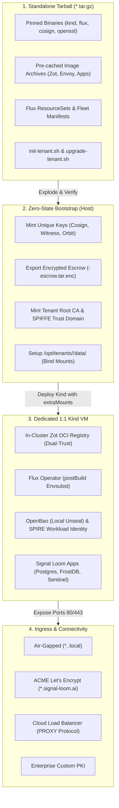

# Proposal — SLSI Signal Loom Design Partner Appliance Self-Initialisation Pipeline (2026-Q4)

|  |  |
| :---: | :---- |
| Proposer & Date: | AJM (2026-10-10) |
| Reviewer & Date: | Vicente Herrera, Tom Cope |
| Approver & Date: |  |

## Press Release

**ControlPlane Announces SLSI: Zero-Touch, Cryptographically Isolated Self-Initialisation Pipeline for Signal Loom Design Partner Appliances**

ControlPlane announces the Signal Loom Self-Initialisation (SLSI) pipeline, a zero-touch, air-gap-capable deployment framework engineered to spin up fully autonomous Signal Loom tenant appliances from an encrypted standalone tarball. Designed specifically for Early Access Program (EAP) design partners and enterprise proof-of-concept deployments, SLSI eliminates complex pre-requisites and lengthy onboarding professional services by condensing an entire enterprise-grade AI governance, attestation, and containment stack into a single self-expanding execution package.

Rather than relying on brittle shared-tenant cloud environments or manual configuration checklists, SLSI provisions a 1:1 dedicated appliance backed by Kind, in-cluster Zot OCI registry, Flux v2 GitOps controllers, Envoy Gateway, SPIRE workload attestation, and OpenBao secret management. Crucially, each deployed appliance executes a zero-state cryptographic bootstrap upon expansion—generating bespoke Cosign signing keys, dedicated SPIFFE trust domains, Root CAs, and Witness attestation policies entirely isolated to that specific customer. By pairing dual-trust supply chain validation (a static release key for platform artifacts alongside local tenant signature authority) with resilient host-bound persistence and flexible ingress networking (spanning air-gapped domains, automated ACME certificates under `signal-loom.ai`, and enterprise Cloud Load Balancers), SLSI allows design partners to establish a fully verified AI security perimeter on their own infrastructure in under five minutes.

## Proposal Overview

### Opportunity

As Signal Loom enters active design partnership engagements with enterprise clients in regulated sectors (tier-1 banking, national security, defence, and critical national infrastructure), client security teams uniformly demand proof-of-concept deployments that satisfy strict isolation requirements. These partners cannot accept multi-tenant SaaS architectures where their LLM telemetry, agent interaction traces, and policy rules co-exist in shared databases or shared Kubernetes control planes. Furthermore, enterprise procurement and data protection officers reject solutions that require outbound internet dependencies or manual root credential handling by third-party vendor engineers.

Today, demonstrating or deploying Signal Loom outside ControlPlane's internal cloud development environments requires manual cluster bootstrapping, bespoke script coordination, out-of-band certificate generation, and fragile port-forwarding conventions.

SLSI solves this by packaging the complete Signal Loom demonstration and runtime platform into an immutable, self-initializing tarball. The appliance automatically unpacks, mints unique cryptographic roots, instantiates an isolated local Kind cluster, seeds an in-cluster OCI registry, binds persistent storage to host disks, and reconciles declarative Flux ResourceSets—delivering a turnkey, production-grade security posture in a self-contained envelope.

**The work relates to the following value area(s):**

- [x] client revenue
- [ ] marketing
- [x] product
- [x] services engineering
- [x] cost avoidance
- [x] process efficiency
- [x] operational or regulatory internal

**Key Customers:**
- **Enterprise Design Partners (Financial Services, Defence, Healthcare)** requiring air-gapped or dedicated-VM trial appliances that operate under their direct sovereignty.
- **ControlPlane Field CTOs and Solutions Architects** requiring deterministic, zero-friction demonstration rigs for customer POCs.
- **Continuous Integration & Quality Engineering** requiring reproducible, ephemeral, end-to-end tenant lifecycle validation identical to customer environments.

| Stakeholder Group | Problem / Opportunity Statement | Operational Impact |
| :---- | :---- | :---- |
| **Enterprise Design Partners** | Need to evaluate Signal Loom agent governance on private infrastructure without granting external cloud network access or sharing compute with other tenants. | Blocked POC evaluations, lengthy 6-month security architecture reviews, and high friction in onboarding regulated institutions. |
| **ControlPlane Field Engineers** | Spend hours manually configuring Kind, Envoy Gateway routing, TLS certificates, and OpenBao secrets for each partner demonstration. | Inconsistent demo environments, human errors during key generation, and non-reproducible software verification states. |
| **Security & Compliance Auditors** | Require mathematical proof that customer encryption keys, audit trails, and SPIFFE identity roots are cryptographically segregated between tenants. | Multi-tenancy isolation challenges and failure to meet strict data sovereignty regulations. |

**Urgency:**
High (2026-Q4). Immediate delivery is required to unlock Q4 design partner onboarding and provide a repeatable software appliance delivery vehicle for the Signal Loom EAP.

---

## Scope Summary

*Technology Readiness Level:* **TRL 3 (Experimental proof-of-concept on disk) $\to$ TRL 6 (System/subsystem model or prototype demonstrated in relevant environment).**

The codebase in [`/home/andy/src/cp/osramp-demo`](file:///home/andy/src/cp/osramp-demo) already provides functional foundation scripts ([`Makefile`](file:///home/andy/src/cp/osramp-demo/Makefile), [`d2-osramp-fleet/`](file:///home/andy/src/cp/osramp-demo/d2-osramp-fleet/), [`d2-infra/`](file:///home/andy/src/cp/osramp-demo/d2-infra/), and [`scripts/lib/wait.sh`](file:///home/andy/src/cp/osramp-demo/scripts/lib/wait.sh)). SLSI formalizes these components into a self-contained tarball artifact and an automated orchestrator (`init-tenant.sh`) that manages the complete zero-to-healthy lifecycle.

**SLSI builds on two prior proposals and does not re-derive their work.** *Sovereign Supply Chain Signatures (2026-Q3)* (status: completed) established and validated the self-hosted signing chain this appliance depends on — OpenBao transit engine holding the signing key, Cosign signing OCI artifacts with a static key, and Flux CD verifying them via `OCIRepository.spec.verify` — explicitly with **no dependency on any public cloud KMS or public Sigstore infrastructure (Fulcio/Rekor)**. That trade-off, static-key verification over keyless OIDC, is the prerequisite for any disconnected appliance, because keyless verification requires reaching Fulcio and Rekor at admission time. *Multi-Cloud and Sovereign Airgap Architecture (2026-Q4)* (status: published) is the architectural frame SLSI instantiates for the single-host case. D4 below therefore configures static-key trust anchors, not a keyless release identity.

The canonical public domain is `signal-loom.ai` (live hosts include `app.signal-loom.ai` and `ingest.sl-demo-1.signal-loom.ai` on the GCP demo lane). Note that `signalloom.ai` is the platform's Kubernetes label and annotation namespace (`signalloom.ai/tenant`, `node-capability-guard.signalloom.ai`) and is **not** a DNS zone; the two must not be conflated when generating ingress hostnames.

### In Scope Activities

| Deliverable | Description | Acceptance Criteria (SMART) | Validation Method |
| :--- | :--- | :--- | :--- |
| **D1: Standalone Appliance Bundler** | A reproducible packaging toolchain (`scripts/package-tenant-bundle.sh`) that compiles pinned binaries (`kind`, `kubectl`, `flux`, `cosign`, `openssl`, `jq`, `envsubst`), offline OCI image caches, Flux fleet manifests, and bootstrap scripts into an immutable `.tar.gz` bundle. | **Specific:** Creates a standalone compressed tarball containing 100% of required runtime dependencies. **Measurable:** Tarball extracts and executes cleanly on an offline/air-gapped Ubuntu 24.04 LTS host with zero network downloads. **Attainable:** Extends `scripts/registry-cache.sh` (whose five pull-through volumes hold ~4 GB and are the practical image source), `scripts/foundation-images.txt` (22 image entries across 28 lines), `scripts/kagent-images.txt`, and `make preload-snapshot`. Note `.cache/zot` holds fleet and manifest OCI artifacts pushed by `push-local.sh`, **not** platform images, and `scripts/lib/demo-images.sh` builds and `kind load`s demo images without exporting to OCI — neither is an export path today. The Flux Operator chart, its `flux-operator-manifests` artifact and the `ghcr.io/fluxcd` controller images must also be vendored, and the self-managing ResourceSet's `semver: '*'` with keyless cosign verification replaced with a pinned static-key check, or the zero-network claim cannot hold. **Realistic:** Bundles standard Docker/containerd and x86_64/arm64 Linux binaries. **Time-Bound:** Delivered in Sprint 1 (Week 2). | Automated test verifying checksum manifest and executing an air-gapped extraction in an isolated network sandbox (`unshare -n`). |
| **D2: Zero-State Cryptographic Bootstrap Engine** | An automated initialization module within `init-tenant.sh` that mints a full, unique cryptographic hierarchy for the tenant during unpack. | **Specific:** Generates a dedicated Cosign keypair (**ECDSA P-256** — `cosign generate-key-pair` emits EC, not Ed25519), a Witness Ed25519 keypair, an Orbit approval Ed25519 keypair, and a SPIRE server CA (**`ec-p256`**, self-signed by SPIRE at runtime with KeyManager `disk`, no UpstreamAuthority). OpenBao transit keys are **out of this deliverable** — transit is enabled post-boot by `scripts/bootstrap-spire-federation.sh`. **Measurable:** Zero private keys or certificates shared with vendor or any other tenant; keys written to `/opt/tenants/<id>/.keys/` with directory mode `0700` and private keys `0600`. Note the repo's current `.keys/` is mode `0775` with a `0644` `cosign.pub`, so the bootstrap must set modes explicitly rather than inherit them. **Attainable:** Reuses the recipes in `Makefile:signing-keys` (which also emits `signing-config.json` and `segment-signing-policy.json`, both of which the appliance needs) and `scripts/lib/keys.sh` — but that library resolves `.keys/` via `git --git-common-dir`, so it must be parameterised for a per-tenant path. Per-tenant minting also requires the key-mismatch preflight in `scripts/push-local.sh`, since divergent keypairs previously broke cluster trust. **Realistic:** Generates all keypairs via OpenSSL and Cosign in $<15$ seconds without entropy starvation. **Time-Bound:** Delivered in Sprint 1 (Week 2). | Test asserting that two successive runs of `init-tenant.sh` produce disjoint public key fingerprints and mutually incompatible signatures. |
| **D3: Dedicated Kind Host Engine with Storage Mounts** | Kind node configuration template utilizing `extraMounts` to bind-mount persistent volumes to `/opt/tenants/<id>/data/` on the host, running on a dedicated 1:1 host VM. | **Specific:** Configures Kind with host port bindings (80, 443) and dedicated host-backed storage directories. Note no `extraPortMappings` exist today: Zot `:5000` is reached by `kubectl port-forward` (`scripts/with-zot-portforward.sh`) and `8200` is OpenBao's in-cluster port only, so both are new work rather than existing bindings. **Measurable:** PostgreSQL tables, OpenBao storage and FrostDB segments persist on the host disk across `kind delete cluster` and cluster rebuilds. **Prerequisite:** OpenBao currently runs `server -dev` with a fixed root token and in-memory storage, so it has nothing to persist — migrating it to persistent storage gates this criterion and D6's snapshot promise. FrostDB writes Parquet to an RWO PVC on kind's default `standard` local-path class, which lives inside the node, so it needs an `extraMounts`-backed provisioner path. NATS is **not part of Signal Loom** (it exists only in the OSRAMP backend, disabled by default, with `memoryStore`) and is excluded. **Attainable:** Kind `extraMounts` is a native, stable feature, and `scripts/create-kind-cluster.sh` already generates a config with two `extraMounts` plus the chown prep — generalise that rather than writing a new generator. Note `infra/kind/cluster-osramp.yaml`, used by `dual-cluster-up.sh` and the scratch standup, mounts only `/lib/modules` and `/sys/kernel/btf` read-only, so Zot data is lost on delete on that path. **Realistic:** One appliance per host VM, for fixed-port ownership and exclusive access to the node's cgroupfs and BTF mounts. **Time-Bound:** Delivered in Sprint 2 (Week 3). | Integration test asserting database records survive a complete cluster teardown and redeployment. |
| **D4: Dual-Trust Supply Chain Verification Engine** | Two trust anchors configured at bootstrap: a **release static public key** for the pre-bundled platform artifacts, and the local tenant Cosign key for tenant manifests and locally built workloads. Per *Sovereign Supply Chain Signatures (2026-Q3)*, both are static-key checks — keyless OIDC verification cannot be used, because it requires Fulcio and Rekor to be reachable at verification time. | **Specific:** Manifest OCI artifacts verified by `OCIRepository.spec.verify` (`provider: cosign`, `secretRef: cosign-pub`), which is the mechanism the repo actually uses; **container images** verified by an admission policy, extending the existing `policy/kyverno-verify-images.yaml` beyond its current `admission-demo` namespace and `acme/images/*` scope. Flux `ImagePolicy` is tag-selection for image automation and verifies nothing, and Flux `Kustomization` has no image verification — neither can satisfy this deliverable. **Measurable:** An admission policy rejects unsigned or untrusted-signer images for every appliance namespace, while admitting release-signed platform images and tenant-signed workloads. **Attainable:** Reuses `OCIRepository.spec.verify` (already wired in `tenants/local/kustomization.yaml`), the `cosign-pub` secret created by `d2-osramp-fleet` `bootstrap-local`, `scripts/push-local.sh`'s sign-then-verify path, and `make test-cosign-signing-consistency`. **Release trust, per Decision 9:** third-party platform images are **pinned by digest and signed at bundle time** with the SLSI release key. No separate release signing pipeline is built. The appliance carries only the release **public** key; the private half stays in the release build environment, held in OpenBao transit and used through Cosign's `openbao://` KMS URI, as validated by *Sovereign Supply Chain Signatures (2026-Q3)*. Stated plainly so nobody over-reads it: a bundle-time signature attests **"this is the artefact ControlPlane built the bundle from and tested"**. It does not create or inherit upstream SLSA provenance, because the third-party images (`scripts/foundation-images.txt`) carry none in this repo. The digest pin is what defends against substitution; the signature is what makes the appliance's admission policy enforceable offline. **Time-Bound:** Delivered in Sprint 2 (Week 4), after the prerequisite is resolved. | Injection test verifying that an image signed by an untrusted key is blocked by admission, and that a digest-pinned platform image and a tenant-signed workload are both admitted. |
| **D5: Multi-Mode Ingress & ACME Automation Engine** | Ingress orchestration module supporting 4 distinct network topologies: (1) Air-gapped self-signed `*.<tenant>.local` (exporting `ca.crt`), (2) Automated ACME Let's Encrypt for `*.<tenant>.signal-loom.ai`, (3) Cloud Load Balancer reverse-proxy (GCP L7 HTTPS LB terminating TLS with a Google-managed certificate, forwarding `X-Forwarded-*` over plain HTTP to the backend, per `terraform/modules/edge/`), and (4) Corporate Custom PKI (`--tls-cert` / `--tls-key`). | **Specific:** Generates Envoy Gateway Gateway API resources matching the selected ingress mode. **Measurable:** Automated end-to-end TLS termination verified across all four modes with 0 certificate errors. **This KPI is currently unverifiable:** `test/acceptance/playwright.config.ts` sets `ignoreHTTPSErrors: true`, which suppresses exactly the signal being claimed, so the suite must assert certificate validity out of band (e.g. `curl` without `-k`, or a dedicated spec with the flag off). **Attainable:** Extends the single existing ClusterIssuer in `d2-infra/components/**cert-manager**/configs/base/cluster-issuer.yaml`, which is `selfSigned: {}` only. **ACME with a DNS-01 solver, the `ca.crt` bundle export and custom-PKI injection do not exist and are new work**; the repo's own notes (`d2-infra/README.md`, `d2-infra/AGENTS.md`) list ACME as future work. The existing `ClientTrafficPolicy` does XFF header hygiene (`numTrustedHops: 1`), not PROXY protocol, and **no `proxyProtocol` configuration exists anywhere in the repo** — PROXY protocol would only apply behind an L4 network LB, not the L7 LB the GCP lane uses. **Realistic:** Directly aligns with enterprise corporate proxy and ACME requirements. **Time-Bound:** Delivered in Sprint 3 (Week 5). | Playwright acceptance test suite asserting valid HTTPS connectivity across all four ingress modes. |
| **D6: In-Place Day-2 GitOps Upgrade Engine** | An idempotent upgrade tool (`scripts/upgrade-tenant.sh`) that takes a new release tarball, loads updated OCI images into local Zot, creates an automated pre-upgrade database snapshot, and updates the local Flux GitOps source. | **Specific:** Performs rolling updates across application Deployments without recreating the Kind cluster or resetting persistent volumes. **Measurable:** Upgrades complete in $<3$ minutes with zero data loss and automated rollback on verification failure. **No upgrade, snapshot or backup mechanism exists today** — the nearest scripts (`postgres-data-reset.sh`, `postgres-data-recreate.sh`) are destructive, and the OpenBao half of the snapshot is blocked by the `server -dev` prerequisite in D3. **Attainable:** Flux reconciles Git/OCI sources natively with rolling rollout strategies; reuses `scripts/push-local.sh` and `scripts/lib/fleet-source.sh` for the Zot reload, `scripts/kind-load-verified.sh` to prove images landed, `scripts/wait-reconciled.sh` for the reconcile gate, and `scripts/verify-cold-start-readiness.sh` as the persistence assertion. **Realistic:** Essential for enterprise design partners receiving bi-weekly feature updates. **Time-Bound:** Delivered in Sprint 3 (Week 6). | Upgrade regression test upgrading a v0.1.0 mock tenant appliance to v0.2.0, verifying continuous database integrity. |
| **D7: Local Audit Bundler & Opt-In Telemetry Streamer** | Operational diagnostics and telemetry utility providing local on-demand audit packaging (`scripts/export-diagnostics.sh`) and an optional streaming forwarder to the central Signal Loom Fleet Hub. | **Specific:** Packages Witness attestations, OpenBao audit records, and FrostDB segments into an encrypted diagnostic bundle; supports optional streaming to the central hub. **Measurable:** Air-gapped by default (zero outbound packets); streams only when explicitly authorized by partner. **Mode (Decision 8):** in `APPLIANCE_MODE=attached` this streaming path is the primary telemetry route, not an opt-in; in `hub` mode it stays off by default. **Naming (corrected to match the code):** there is no component called "Fleet Hub". The hub is the central cluster running `signal-ingest` and `fleet-manager`; the remote side reaches it through the gateway routes **`/warden-ingest`** and **`/warden-fleet`** (not `/ingest` and `/fleet`), configured by **`SIGNAL_INGEST_URL`**, **`FLEET_MANAGER_URL`** and **`SIGNAL_TLS_CA_FILE`** in the `signalloom-warden-overlays/remote-tenant` overlay. Transport is **server-side TLS plus a named bearer key** enforced by each backend, **not mTLS** (per ADR-12 and `docs/EAP/remote-contract.md`); mTLS would be new work. Key minting is `scripts/sldc-ingest-bearer.sh` and `make fleet-manager-keys`; the end-to-end path is exercised by `scripts/remote-tenant-lab.sh`. **Attainable:** Starts from `scripts/cluster-debug.sh` (which `make doctor` aliases) and `scripts/doctor.sh`. Neither bundles Witness, OpenBao or FrostDB data nor encrypts anything, so the bundler itself is new work. **Realistic:** Complies with strict non-disclosure and security policies of regulated design partners. **Time-Bound:** Delivered in Sprint 4 (Week 7). | Network egress audit proving zero outbound network calls in default air-gap mode, and successful encrypted transmission when enabled. |

### Out of Scope

- **Multi-Tenant Shared-Kernel Hosting**: Multi-tenancy on a single shared host machine is explicitly descoped. The justification is operational, not a measured collision: this repo deliberately runs two Kind clusters on one kernel (`infra/kind/cluster-osramp.yaml` plus `cluster-signalloom-hub.yaml`, with dual-cluster containment green 6/6 across five runs), and `stress-agent-cgroups.sh` runs a second isolated sentinel alongside the first, so **no eBPF `tc_drop` or cgroup-freezer collision has been observed**. What a dedicated VM actually buys is exclusive ownership of fixed host ports, of the node's own cgroupfs (mounting the host `/sys/fs/cgroup` breaks Kind on cgroup v2 hosts), and of the read-only `/lib/modules` and `/sys/kernel/btf` mounts the warden's CO-RE probes need. Each tenant appliance requires a dedicated VM on those grounds.
- **Hardware Security Module (HSM) Integration**: Physical PKCS#11 HSM integration is deferred to enterprise production releases; POC appliances use software keypairs (Ed25519 for Witness and Orbit, ECDSA P-256 for Cosign and the SPIRE CA) stored with strict filesystem permissions (`0700` directory, `0600` private keys).
- **A Separate Remote-Tenant Product Line**: Maintaining the ADR-12 warden-only deployment as a distinct artefact with its own test matrix and documentation is descoped by Decision 8; it is an `APPLIANCE_MODE=attached` mode of the same bundle. Should the mode switch prove leaky under the P2-5 test, two parallel shapes become the fallback and this scope line is revisited.
- **SaaS Multi-Region Active-Active Federation**: Cross-appliance multi-region real-time database clustering is out of scope for the design partnership appliance.

### KPIs

| Metric | Current Value | Target Value | Measurement |
| :--- | :--- | :--- | :--- |
| **Cold Start Deployment Time** | **Unmeasured.** `scripts/cluster-scratch-standup.sh` is the existing hands-off zero-to-healthy path and no duration is recorded for it; P0 must time it to establish the baseline rather than asserting one. | $\le 5$ minutes, or a measured target set at P1-GOV once the real standup time is known | Timed execution from `tar -xzf` to all pods `Ready=True` and Envoy returning 200 OK. |
| **Cryptographic Segregation** | 0% (shared keys or hardcoded dev credentials) | 100% Unique | Cryptographic audit verifying unique Cosign key IDs, Root CAs, and SVID domains per instance. |
| **Supply Chain Verification** | Manifest artifacts verified by `OCIRepository.spec.verify`; container images verified only inside the on-demand `admission-demo` namespace, so effectively ad-hoc for running workloads | 100% of appliance images admitted only on a valid static-key signature **and** referenced by pinned digest | Admission-policy audit over every running pod in the appliance, plus `cosign verify --key <release.pub>` over the bundled image set offline. SLSA attestation coverage is explicitly **excluded** from this KPI: third-party platform images carry no provenance in this repo, and Witness attests test, VEX and promotion steps rather than image builds. |
| **Day-2 Upgrade Success Rate** | N/A (requires cluster tear-down and manual rebuild) | 100% Zero-Data-Loss | Automated upgrade test suite verifying database record persistence through in-place rolling updates. |
| **Partner Onboarding Friction** | 3–5 engineer days (estimate, not instrumented) | Zero-touch automated script | Partner deployment without vendor engineering intervention, proven via recorded audit log. |

### 3rd Party Test Plan and Quality Assurance

| Validation | Method | Owner |
| :--- | :--- | :--- |
| **Air-Gap Sandbox Extraction** | Execute tarball expansion and bootstrap inside a container with disconnected networking (`--net none`) to certify zero external dependencies. | Quality Engineering / Vicente Herrera |
| **Cryptographic Uniqueness Audit** | Automated test executing 10 parallel tenant boots in isolated VMs, verifying disjoint key spaces and mutually rejected tokens. Assertions must match the real algorithms (Cosign ECDSA P-256, Witness and Orbit Ed25519, SPIRE CA `ec-p256`). | Security Engineering / Tom Cope |
| **eBPF & Kernel Confinement Safety** | Run `scripts/test-tc-ebpf.sh` and `scripts/test-cgroup-freezer.sh` on the appliance; the assertions live in `test/tc-ebpf-drop.bats` and `test/cgroup-freeze-stun.bats`, which are the artefacts to cite. | Platform Lead / Vicente Herrera |
| **Browser Acceptance Across Ingress Modes** | Automated Playwright browser tests validating UI rendering, Dex cookie sessions, and **SSE** streaming across air-gapped, ACME, and Cloud LB modes, with certificate validity asserted without `ignoreHTTPSErrors`. | Frontend Team / Elena Mikhalina |

---

## Technical Overview

#### Technologies

| Technology | Purpose | Alignment |
| :--- | :--- | :--- |
| **Kind (Kubernetes in Docker)** | Single-node ephemeral/local Kubernetes runtime. | Core platform standard (`make cluster`). |
| **Flux Operator & ResourceSets** | GitOps engine managing tenant overlays with dynamic `postBuild.substituteFrom`. | Primary GitOps delivery control plane. |
| **Zot OCI Registry** | In-cluster, cacheable container image and OCI artifact registry. | Production standard in [`d2-osramp-fleet/local/zot.yaml`](file:///home/andy/src/cp/osramp-demo/d2-osramp-fleet/local/zot.yaml). |
| **Cosign & Witness** | Container image signing, policy enforcement, and in-toto provenance attestation. | Standardized in `.keys/` and [`scripts/lib/keys.sh`](file:///home/andy/src/cp/osramp-demo/scripts/lib/keys.sh). |
| **Envoy Gateway (Gateway API)** | Ingress gateway handling HTTP routing, TLS termination, and forwarded-header hygiene (`ClientTrafficPolicy`, `numTrustedHops`). PROXY protocol is not used. | `Gateway` and `HTTPRoute` in [`d2-infra/components/ingress/`](file:///home/andy/src/cp/osramp-demo/d2-infra/components/ingress/); the service is NodePort via `envoy-gatewayclass.yaml`. |
| **Cert-Manager** | TLS certificate issuance. Today only a `selfSigned` ClusterIssuer exists, signing a wildcard cert; an ACME issuer with a DNS-01 solver is new work under D5. | [`d2-infra/components/cert-manager/configs/base/cluster-issuer.yaml`](file:///home/andy/src/cp/osramp-demo/d2-infra/components/cert-manager/configs/base/cluster-issuer.yaml). |
| **OpenBao & SPIRE** | Workload identity attestation (SPIFFE) and secrets management (transit/KV/JWT auth). | Standardized in [`d2-signalloom/infra/inf-bao/`](file:///home/andy/src/cp/osramp-demo/d2-signalloom/infra/inf-bao/). |
| **PostgreSQL & FrostDB** | Relational user/fleet store and columnar in-memory immutable event store. | Standard Signal Loom storage layer. |

#### Infrastructure and Repositories

| Asset | Location | Notes |
| :--- | :--- | :--- |
| **Monorepo Source** | [`/home/andy/src/cp/osramp-demo`](file:///home/andy/src/cp/osramp-demo) | Canonical monorepo holding all D2 slices and tooling. |
| **Git Remote** | `git@github.com:controlplaneio-in-toto/osramp-demo` | Canonical upstream repository (`destination-target: git@github.com:sublimino/architecture-as-code`). |
| **Fleet Overlay Path** | [`d2-osramp-fleet/tenants/`](file:///home/andy/src/cp/osramp-demo/d2-osramp-fleet/tenants/) | Base manifests and tenant overlays. |
| **Bootstrap Library** | [`scripts/lib/wait.sh`](file:///home/andy/src/cp/osramp-demo/scripts/lib/wait.sh) | Deterministic polling and readiness assertion engine. |
| **Appliance Output Path** | `/opt/tenants/<tenant-id>/` | Target runtime installation and host persistence directory. |

#### Security and Risk

**Threat model for this deliverable:**

| Threat | Impact | Mitigation |
| :--- | :--- | :--- |
| **Host Disk Key Extraction** | Attacker with host access extracts plaintext private keys from `/opt/tenants/<id>/.keys/`. | Strict POSIX permissions (`0700` directory, `0600` keys) owned by root/dedicated runtime user; automatic generation of an encrypted escrow backup bundle (`.tar.enc`) for secure offsite archival. |
| **Supply Chain Base Image Poisoning** | Malicious or compromised container image injected into the pre-bundled tarball, or substituted for a mutable tag. | Every platform image is pinned by immutable digest **and** signed at bundle time with the SLSI release key (Decision 9); the appliance's admission policy admits only a valid release-key or tenant-key signature, verified offline against the embedded public key. Residual risk, stated rather than hidden: a third-party image that was already compromised upstream before bundling would be faithfully signed as the artefact we built from, because no upstream provenance exists to contradict it. Digest pinning bounds this to the moment of bundle construction. |
| **Entropy Depletion during Boot** | System `/dev/urandom` exhaustion leads to weak Ed25519 key generation or hangs. | Bootstrap script checks `/proc/sys/kernel/random/entropy_avail` pre-flight and utilizes modern kernel `getrandom` syscalls. |
| **Tenant Workload Confinement Breakout** | Compromised agent pod attempts to escape container or tamper with host networking. | Dedicated 1:1 VM gives the kernel boundary. Inside the appliance, the per-node warden enforces a freeze sequence — hold, `cgroup.freeze`, pod annotation, stun record, observations, then a `tc` drop on the pod's veth (`docs/EAP/enforcement.md`). Landlock applies **only** to `nono`-wrapped agents (the opt-in `agent-nono-evidenced` demo workload), not platform-wide. There is no "five-stage containment" construct in the codebase. |
| **Ingress Man-in-the-Middle (MitM)** | Unencrypted or spoofed traffic to tenant dashboard or API endpoints. | Mandatory TLS across all modes: automated ACME Let's Encrypt under `signal-loom.ai`, verified Root CA for the air-gapped domain, or TLS terminated at the L7 Cloud Load Balancer with `X-Forwarded-*` trusted at a pinned hop count (`numTrustedHops`). |

**SWOT Analysis:**

| Strengths | Weaknesses |
| :--- | :--- |
| - Zero external dependencies once the Flux Operator chart, manifests artifact and controller images are vendored (they pull from `ghcr.io` today) — offline capability is the target, not the current state. - Cryptographically provable multi-tenant segregation. - Static-key signing authority that works with no Sigstore infrastructure reachable, per *Sovereign Supply Chain Signatures (2026-Q3)*. - Direct re-use of battle-tested Kind, Flux, and Zot tooling. | - Appliance payload is large: the pull-through registry volumes alone measure ~4 GB (dockerio 1.95 GB, ghcr 1.27 GB, quay 641 MB, gcr 109 MB, k8s 70 MB) before `kindest/node` and locally built images, so budget **6–8 GB** until P1-2 measures the exact set. - Host RAM requirement is **unmeasured**; the $\ge 8$ GB figure is an estimate to be replaced by a measurement in P1-GOV. |

| Opportunities | Threats |
| :--- | :--- |
| - Dramatically accelerates enterprise design partner onboarding from months to minutes. - Provides a foundation for commercial on-premises hardware appliance sales. - Establishes ControlPlane as the gold standard for secure, self-sovereign AI agent deployments. | - Customer host misconfigurations (e.g. running multiple appliances on one VM) risking eBPF or port collisions. - Drastic Docker/containerd version incompatibilities on non-standard customer Linux distributions. |

---

## Milestones and Deliverables

| Milestones Committed To | Duration (days) | Consultants | Person-days | Deadline | Capability Mapping |
| :--- | :--- | :--- | :--- | :--- | :--- |
| **M1: Core Packaging Toolchain & Dual-Trust Image Bundler** Deliver `scripts/package-tenant-bundle.sh` compiling pinned binaries, cached OCI images, and Flux manifests into an air-gapped tarball with checksum verification. |  |  |  |  | #cap-kubernetes, #cap-containers, #cap-reproducible-builds |
| **M2: Cryptographic Bootstrap & Kind Persistent Host Engine** Implement `scripts/init-tenant.sh` with zero-state key generation (Cosign, Witness, Orbit, SPIRE CA) and Kind configuration with `extraMounts` bound to `/opt/tenants/<id>/data/`. |  |  |  |  | #cap-secrets, #cap-security, #cap-supply-chain-security |
| **Mid-project review: demo of progress, evaluation of further milestones, raising of current and new risks** |  |  |  |  | #cap-project-management |
| **M3: Multi-Mode Ingress (Local, ACME, Cloud LB) & Flux Reconcile** Wire Envoy Gateway to support air-gapped self-signed domains, automated ACME for `signal-loom.ai`, and Cloud Load Balancers; implement Flux envsubst rollout. |  |  |  |  | #cap-gitops, #cap-networking, #cap-architecture |
| **M4: In-Place Day-2 Upgrade Engine & Telemetry Diagnostics** Deliver `scripts/upgrade-tenant.sh` with automated pre-upgrade snapshots, and `scripts/export-diagnostics.sh` with optional streaming to the central `signal-ingest` and `fleet-manager` hub. |  |  |  |  | #cap-observability, #cap-devops, #cap-linux |
| **M5: Automated End-to-End Validation Runbook & EAP Pilot Sign-Off** Author executable Validation Runbook, execute BATS and Playwright suites, and achieve final design partner sign-off. |  |  |  |  | #cap-testing-pyramid, #cap-documentation |
| **Signoff** |  |  |  |  | #cap-engagement-management |

**Total Estimated Effort**: *to be estimated with team post-approval*

**Definition of Done:**
- `package-tenant-bundle.sh` produces a self-contained `.tar.gz` payload that unpacks and deploys cleanly on a fresh, disconnected Linux VM in $\le 5$ minutes.
- All 7 architectural pillars (Standalone 1:1 VM, Dual static-key Trust, Keys `0600` under a `0700` directory with Escrow, Multi-Mode Ingress with a new ACME DNS-01 issuer, Persistent Host Mounts, In-Place Upgrades, and Opt-In Telemetry over the existing `/warden-*` contract) pass automated verification tests.
- Comprehensive Validation Runbook committed to `2. Areas/CEO/Innovation Validation/` with passing automated test results.

---

### Reviews & Collaboration (RACI)

|  |  |
| :---- | :---- |
| **Accountable** | Principal Architect (Vicente Herrera) |
| **Responsible** | Cloud Native Transformation & DevSecOps Practice Engineering Team |
| **Consulted** | Tom Cope (Principal Consultant), Mario Weigel (OpenBao Lead), Francesco Beltramini (Field CTO) |
| **Informed** | [Andrew Martin](mailto:andy@control-plane.io), [Elena Mikhalina](mailto:elena.mikhalina@control-plane.io) |

---

## Finances

### Additional costs

| Additional Cost | Estimated Spend | One Off or Recurring | Must-Have or Nice-to-Have |
| :---- | :---- | :---- | :---- |
| **GCP / AWS Bare-Metal Validation VM Instances** (for isolated multi-distro testing) | £350 / month | Recurring (2 months) | Must-Have |
| **Test Domain Registration & DNS Delegation** (`signal-loom.ai` subzone delegation for ACME testing) | £50 | One-off | Must-Have |

---

# Decision Log

| Date | Decision Makers | Decision and context | Reason | Impact |
| :--- | :--- | :--- | :--- | :--- |
| **2026-10-10** | AJM, Sensai | **Decision 1: Target Lifecycle.** Establish appliance primarily as a standalone design partner POC / field appliance. | Eliminates unnecessary distributed consensus complexity while satisfying immediate EAP customer trial requirements. | Focuses architecture on single-node Kind with zero-touch automation. |
| **2026-10-10** | AJM, Sensai | **Decision 2: Dual-Trust Supply Chain.** Two **static-key** anchors: a release key for platform artifacts, the local tenant key for tenant configs and local builds. Keyless OIDC verification is excluded. Settled by Decision 9: platform images are digest-pinned and signed at bundle time with the release key; no separate signing pipeline. | Static keys are the only option that works disconnected (keyless needs Fulcio and Rekor at verification time), per *Sovereign Supply Chain Signatures (2026-Q3)*. | Manifests verified by `OCIRepository.spec.verify`; container images gated at admission by an extended Kyverno `verifyImages` policy. |
| **2026-10-10** | AJM, Sensai | **Decision 3: Key Custody & Persistence.** Store keys on local host disk with `0700` permissions; emit an encrypted escrow backup bundle (`.tar.enc`) at bootstrap. | Enables unattended reboots of customer demo appliances while providing an offsite disaster recovery mechanism. | Simplifies Day-1 operations without sacrificing recovery options. |
| **2026-10-10** | AJM, Sensai | **Decision 4: Host Isolation Boundary.** Require 1 dedicated VM/host per tenant appliance (1:1). | Gives exclusive ownership of the fixed host ports, the node's own cgroupfs, and the read-only `/lib/modules` and `/sys/kernel/btf` mounts the warden's CO-RE probes need. Not justified by an observed collision: the repo runs two Kind clusters on one kernel today with containment green. | Clean architectural boundary; eliminates dynamic port mapping complexity. |
| **2026-10-10** | AJM, Sensai | **Decision 5: Multi-Mode Ingress.** Support 4 ingress paths: Air-gapped `*.<tenant>.osramp.acme.local` style (`.local` is mDNS-reserved), automated ACME for `signal-loom.ai`, Cloud Load Balancer reverse-proxy (L7, `X-Forwarded-*` at a pinned hop count — **not** PROXY protocol), and BYO custom PKI. | Accommodates offline field trials, public cloud demos, and corporate enterprise proxies with zero code changes. | Envoy Gateway configured via Gateway API to dynamically adapt to environment parameters. |
| **2026-10-10** | AJM, Sensai | **Decision 6: Host Binds & In-Place Upgrades.** Use Kind `extraMounts` to bind PV storage to `/opt/tenants/<id>/data/`; execute in-place rolling updates via `upgrade-tenant.sh`. | Prevents data loss on cluster rebuilds and provides a smooth path for shipping bi-weekly updates to design partners. | Customer data is completely decoupled from ephemeral container lifecycles. |
| **2026-10-10** | AJM (ratified 2026-10-10 20:12 +0100) | **Decision 8: Relationship to ADR-12 — the appliance is a superset, and `remote-tenant` is one of its modes.** The delivered EAP model (ADR-12, in *Signal Loom Spireless Token-Based Agent Identity Migration (2026-Q4)*, and `docs/EAP/`) puts the platform on a ControlPlane-operated hub and ships the customer only the nine `signalloom-warden` objects plus two **consumer** Secrets copied from the central cluster, keeping the issuers central. SLSI mints its own Cosign, Witness, Orbit and SPIRE roots, so the appliance **is** a hub. Rather than fork the product, the appliance ships the hub components **and** the `signalloom-warden-overlays/remote-tenant` overlay, selected at bootstrap by **`APPLIANCE_MODE=hub\|attached`**: `hub` runs its own issuers and local ingest; `attached` renders the warden-only overlay and consumes central issuer credentials exactly as ADR-12 specifies. | One artefact, one test matrix, one set of EAP docs. ADR-12 is left intact for hub-attached tenants, so the in-flight Kusari pilot is undisturbed, and the appliance has to bundle every hub component anyway — the overlay is the cheap part. | **ADR-12 is not superseded.** `APPLIANCE_MODE` becomes a first-class bootstrap parameter alongside `INGRESS_MODE`. The identified risk is that local issuers and copied-in central issuers must coexist behind one config switch; P2-5 carries the falsifying test, and if the switch proves leaky the fallback is two parallel deployment shapes, recorded as a new decision. |
| **2026-10-11** | AJM (ratified 2026-10-11 14:01 +0100) | **Decision 9: Release trust by digest pin plus bundle-time signing.** Third-party platform images are pinned by immutable digest and signed at bundle time with the SLSI release key; no separate release signing pipeline is built. The release **private** key stays in the build environment, in OpenBao transit used via Cosign's `openbao://` KMS URI; the appliance ships only the public half. | A signing pipeline is months of work for a trust property the bundle can assert directly, and the digest pin is what actually defeats substitution. The transit-plus-Cosign chain is already validated by *Sovereign Supply Chain Signatures (2026-Q3)*, so this reuses a proven path instead of inventing one. | D4 and P2-4 are unblocked. Honesty constraint carried into the shared patterns: a bundle-time signature attests the bundle's own build and does **not** confer upstream SLSA provenance. Tag-only image references anywhere in the bundle are a defect, and release private key material inside the bundle fails the card. |
| **2026-10-10** | AJM, Sensai | **Decision 7: Local-by-Default Telemetry.** Default to local air-gapped diagnostics bundling (`export-diagnostics.sh`), with optional streaming over the existing remote-tenant contract (`SIGNAL_INGEST_URL` and `FLEET_MANAGER_URL` to `/warden-ingest` and `/warden-fleet`, TLS plus a named bearer key). | Respects strict confidentiality policies of regulated enterprise partners while supporting collaborative debugging when approved. | Eliminates security review pushback regarding unapproved outbound telemetry. |

---

## Appendix

### A. Architectural Workflow

### B. Useful Links and File References

- Foundation proposal (completed), self-hosted signing chain: `2. Areas/CEO/Innovation Proposals/Proposal — Sovereign Supply Chain Signatures (2026-Q3).md`
- Foundation proposal (published), sovereign and air-gap architecture: `2. Areas/CEO/Innovation Proposals/Proposal — Multi-Cloud and Sovereign Airgap Architecture (2026-Q4).md`
- Canonical Platform Monorepo: [`/home/andy/src/cp/osramp-demo`](file:///home/andy/src/cp/osramp-demo)
- Fleet Definitions & Overlays: [`d2-osramp-fleet/tenants/`](file:///home/andy/src/cp/osramp-demo/d2-osramp-fleet/tenants/)
- In-Cluster Zot Manifest: [`d2-osramp-fleet/local/zot.yaml`](file:///home/andy/src/cp/osramp-demo/d2-osramp-fleet/local/zot.yaml)
- Signing Key Generation Target: [`Makefile:signing-keys`](file:///home/andy/src/cp/osramp-demo/Makefile#L232-L270)
- Ingress Gateway Configurations: [`d2-infra/components/ingress/`](file:///home/andy/src/cp/osramp-demo/d2-infra/components/ingress/)
- Deterministic Polling Library: [`scripts/lib/wait.sh`](file:///home/andy/src/cp/osramp-demo/scripts/lib/wait.sh)
- OpenBao & SPIRE Provisioning: [`d2-signalloom/infra/inf-bao/`](file:///home/andy/src/cp/osramp-demo/d2-signalloom/infra/inf-bao/)
- Kernel Confinement Tests: [`scripts/test-tc-ebpf.sh`](file:///home/andy/src/cp/osramp-demo/scripts/test-tc-ebpf.sh) and [`scripts/test-cgroup-freezer.sh`](file:///home/andy/src/cp/osramp-demo/scripts/test-cgroup-freezer.sh)

### Spec: Shared Patterns

Obey these. They are the phase constitution.

- **Offline Air-Gap Hermeticity:** The appliance installer (`init-tenant.sh`) and bundler (`package-tenant-bundle.sh`) MUST NOT execute any network downloads, curl/wget calls, git clones, or external registry pulls during unpacking or startup. All binaries (`kind`, `kubectl`, `flux`, `cosign`, `openssl`, `jq`, `envsubst`) and container images MUST be verified against local SHA-256 manifests inside the bundle archive. Any external network egress attempt during offline bootstrap mode MUST abort execution immediately with a non-zero exit code.
- **Dual-Trust Supply Chain Verification:** Manifest OCI artifacts MUST be verified by `OCIRepository.spec.verify` (`provider: cosign`) against a **static** public key — never keyless, which needs Fulcio and Rekor reachable. Container images MUST be gated at admission by a signature-or-pinned-digest policy extending `policy/kyverno-verify-images.yaml` beyond its current `admission-demo` scope; Flux `ImagePolicy` is tag selection and MUST NOT be cited as a verification mechanism, and Flux `Kustomization` has no image verification at all. Locally minted tenant manifests and runtime workloads MUST be signed and verified by the bespoke tenant Cosign key generated during bootstrap. **Release trust (Decision 9, settled):** every third-party platform image MUST be referenced by **immutable digest** in `MANIFEST.json` and MUST be signed at bundle time with the SLSI release key. The appliance MUST contain only the release public key; a card that places release private key material inside the bundle fails. No card may claim that bundle-time signing preserves or confers upstream SLSA provenance — it attests the bundle's own build, nothing more. A tag-only image reference anywhere in the bundle is a defect.
- **Strict Host Bind Permissions & UID Isolation:** Persistent storage mounted via Kind `extraMounts` to `/opt/tenants/<id>/data/` MUST be initialized with strict POSIX permissions: directory root `0700`, with subdirectories chowned to the **actual** container UIDs as declared in the manifests — Postgres `70:70` (`postgres:16-alpine` Deployment, not a chart), OpenBao `100:1000`, Zot `65532:65532`. NATS MUST NOT appear in the appliance: it exists only in the OSRAMP backend, which is disabled by default and uses `memoryStore`. Plaintext private keys in `/opt/tenants/<id>/.keys/` MUST be mode `0600` owned by root.
- **Dedicated 1:1 Host VM Boundary:** Each tenant appliance MUST be provisioned on a dedicated VM or physical host (1:1), for exclusive ownership of the fixed host ports, of the node's own cgroupfs, and of the read-only `/lib/modules` and `/sys/kernel/btf` mounts the warden's CO-RE probes require. This is an operational boundary, not a measured collision: the repo runs two Kind clusters on one kernel today with containment green, so no card may assert an observed eBPF `tc_drop` or cgroup-freezer collision as its justification.
- **Deterministic Key Minting with Encrypted Escrow:** `init-tenant.sh` MUST mint disjoint, unique keypairs per tenant: Cosign (**ECDSA P-256**, as `cosign generate-key-pair` emits), Witness (Ed25519), Orbit approval (Ed25519), and a SPIRE server CA (**`ec-p256`**, self-signed by SPIRE at runtime). Any card claiming "all Ed25519" is wrong by construction. The escrow MUST also cover `.keys/fleet-operators/` material. An encrypted escrow backup bundle (`<tenant-id>-escrow.tar.enc`) MUST be emitted to `/opt/tenants/<id>/escrow/` encrypted with an operator-supplied passphrase or public key, enabling recovery without storing unencrypted keys off-appliance.
- **Ingress Topology Decoupling via Gateway API:** Ingress configuration MUST utilize standard Envoy Gateway Gateway API resources (`Gateway`, `HTTPRoute`, `ClientTrafficPolicy`). The active ingress mode (`local`, `acme`, `cloudlb`, `custom-pki`) and the appliance mode (`APPLIANCE_MODE=hub|attached`, Decision 8) MUST be parameterised via Flux `postBuild.substituteFrom` and environment variables (`TENANT_DOMAIN`, `INGRESS_MODE`, `TLS_ISSUER`, `APPLIANCE_MODE`). In `attached` mode the appliance MUST render the `signalloom-warden-overlays/remote-tenant` overlay and MUST NOT mint its own issuers; in `hub` mode it MUST mint them and MUST NOT expect central issuer Secrets. Public hostnames MUST be derived from the `signal-loom.ai` zone; `signalloom.ai` is the Kubernetes label and annotation namespace and MUST NOT be used as a DNS suffix. Behind a cloud load balancer, the appliance MUST trust `X-Forwarded-*` at a pinned `numTrustedHops` and MUST NOT enable PROXY protocol: the GCP lane's L7 HTTPS load balancer does not speak it, and no `proxyProtocol` configuration exists in the repo. Only an L4 network load balancer would justify revisiting that, as a separate decision. Note `.local` is mDNS-reserved; the air-gapped mode MUST follow the repo's existing `osramp.acme.local` style rather than a bare `<tenant>.local`.
- **Idempotent In-Place Upgrades with Pre-Snapshot:** Day-2 upgrades (`upgrade-tenant.sh`) MUST execute without destroying the Kind cluster or wiping host bind directories. The upgrade script MUST take an atomic snapshot of PostgreSQL and OpenBao state to `/opt/tenants/<id>/snapshots/pre-upgrade-<timestamp>/` before applying new manifests. **Blocking prerequisite:** OpenBao currently runs `server -dev` with in-memory storage and a fixed root token, so there is no OpenBao state to snapshot or restore; migrating it to persistent storage is a precondition of both this pattern and the D3 persistence criterion. On upgrade failure, an automatic rollback MUST restore the prior GitOps revision and database snapshot.
- **Local-by-Default Audit & Explicit Telemetry Stream:** All Witness attestation records, OpenBao audit logs, and FrostDB segments MUST be retained locally in `/opt/tenants/<id>/audit/`. Outbound telemetry streaming to the central hub (the cluster running `signal-ingest` and `fleet-manager` — there is no component named "Fleet Hub") MUST be disabled by default. When enabled, it MUST reuse the established remote-tenant contract rather than inventing one: the gateway routes `/warden-ingest` and `/warden-fleet`, configured through `SIGNAL_INGEST_URL`, `FLEET_MANAGER_URL` and `SIGNAL_TLS_CA_FILE`, over server-side TLS with a named bearer key enforced at each backend (ADR-12, `docs/EAP/remote-contract.md`). Mutual TLS MUST NOT be claimed as existing behaviour; proposing it is a separate piece of work.
- **Testing Standard:** All shell automation scripts MUST be validated with `shellcheck -x` and covered by deterministic BATS suites (`test/*.bats`). Web UI routes across all ingress modes MUST be verified via Playwright acceptance tests (`test/acceptance/`), driven by `SIGNALLOOM_UI_URL` / `DASHBOARD_URL` with Dex login through `auth.setup.ts`. Streaming assertions MUST target **SSE** (`EventSource`, as the dashboard actually uses) and not WebSockets. Any certificate-validity assertion MUST run with `ignoreHTTPSErrors` disabled or out of band, since the shared config sets it `true`. All cluster readiness assertions MUST use `scripts/lib/wait.sh` — `wait_rollout`, `wait_job`, `wait_flux_ready`, `wait_pods_ready`, `wait_service_backends`, `wait_tcp` — never bare `sleep`. **The acceptance stage is the whole engine, end to end, not a slice:** `make test-all-estate` (offline, live cluster, browser), plus `make test-obscel`, `make test-signal-ingest`, the CEL conformance harness in `d2-signalloom/apps/policy-engine/frameworks_conformance_test.go`, and `make test-kusari-e2e`. A Governor MUST run it twice back to back and MUST compare per-suite totals, not just exit codes: equal exit codes with moved totals is a failure, and a suite that silently skips because a cluster was absent MUST be recorded as a stated skip.
- **Anti-patterns:**
  - Invoking `curl` or `docker pull` during offline bootstrap.
  - Re-signing upstream base images with tenant keys during boot (destroys SLSA provenance and adds minutes of boot latency).
  - Multi-tenant appliance co-location on a shared Linux kernel.
  - Silent error suppression (`2>/dev/null || true`) in bootstrap or migration scripts.
  - Plaintext key storage with loose permissions (`>0600`).
  - Enabling PROXY protocol on non-load-balanced local or ACME ingress modes.

### Spec: Capability Plan

| Logical ID | Selected skills | Agent role | Size | Ceiling | CPAI agent | Rationale |
| :--- | :--- | :--- | :--- | ---: | :--- | :--- |
| P0 | ajm-auto-kanban; context-mode | Baseline engineer | M | 180m | antigravity | Baseline the full end-to-end acceptance stage (estate + engine + CEL conformance + Kusari e2e) on integration/slsi-v0.1.0 at the cut SHA; needs a live kind-osramp for the cluster and browser legs. |
| P1-PRE | context-mode | Pre-flight analyst | S | 45m | antigravity | Audit packaging utilities, binary versions, and image caching scripts; publish the Phase 1 gap table. |
| P1-1 | context-mode | Toolchain engineer | M | 120m | antigravity | Implement scripts/package-tenant-bundle.sh to collect pinned binaries and generate SHA-256 checksum manifests. |
| P1-2 | context-mode | Packaging engineer | M | 120m | antigravity | Implement offline OCI image bundler: export platform images from the registry-cache volumes to OCI layout in the bundle (not .cache/zot, which holds manifest artifacts only). |
| P1-3 | context-mode | GitOps engineer | M | 120m | antigravity | Compile Flux tenant overlays, bundle bootstrap scripts, and package into immutable .tar.gz archive. |
| P1-4 | context-mode | Acceptance engineer | M | 120m | antigravity | Author BATS integration suite verifying hermetic bundle extraction and execution in a network-isolated sandbox (unshare -n). |
| P1-GOV | ajm-auto-kanban | Phase 1 Governor | M | 120m | antigravity | Merge P1 cards in dependency order, verify bundle checksum reproducibility, run offline test suites, and record Phase 1 errata. |
| P2-PRE | context-mode | Pre-flight analyst | S | 45m | antigravity | Audit cryptographic recipes (recording actual key algorithms), Kind extraMounts configurations, OpenBao's dev-mode storage, and the admission-vs-OCIRepository verification split; publish Phase 2 gap table. |
| P2-1 | context-mode | Cryptographic engineer | M | 120m | antigravity | Implement zero-state cryptographic bootstrap module in init-tenant.sh (Cosign, Witness, Orbit, SPIFFE Root CA, encrypted escrow). |
| P2-2 | context-mode | Infrastructure engineer | M | 120m | antigravity | Implement host storage provisioner and Kind cluster generator with extraMounts bound to /opt/tenants/<id>/data/ and fixed port mappings. |
| P2-3 | context-mode | Systems engineer | M | 120m | antigravity | Implement Kind boot and local Zot registry seeder, verifying 100% image availability without external egress. |
| P2-4 | context-mode | Supply chain engineer | M | 120m | antigravity | Implement dual static-key trust: OCIRepository.spec.verify for manifests plus an extended Kyverno verifyImages admission policy for container images. Blocked on the Decision 8 and release-key prerequisites. |
| P2-5 | context-mode | Integration engineer | M | 120m | antigravity | Author BATS test asserting cryptographic key uniqueness across tenant runs and data persistence across cluster teardown/rebuild. |
| P2-GOV | ajm-auto-kanban | Phase 2 Governor | M | 120m | antigravity | Merge P2 cards, execute end-to-end bootstrap test, verify zero-network egress during boot, and record Phase 2 errata. |
| P3-PRE | context-mode | Pre-flight analyst | S | 45m | antigravity | Audit Envoy Gateway Gateway API configurations, cert-manager cluster issuers, and telemetry emitter hooks; publish Phase 3 gap table. |
| P3-1 | context-mode; Interceptor | Networking engineer | M | 120m | antigravity | Implement multi-mode ingress for Envoy Gateway: air-gapped self-signed, new ACME DNS-01 issuer for signal-loom.ai, L7 Cloud LB with trusted XFF, and custom PKI. |
| P3-2 | context-mode | Reliability engineer | M | 120m | antigravity | Implement scripts/upgrade-tenant.sh with automated pre-upgrade database snapshot, image reload into Zot, and rolling Flux reconciliation. |
| P3-3 | context-mode | Observability engineer | M | 120m | antigravity | Implement scripts/export-diagnostics.sh with local encrypted audit bundling and optional streaming forwarder to Signal Loom Hub. |
| P3-4 | context-mode; Interceptor | Acceptance engineer | M | 120m | antigravity | Author executable Validation Runbook and Playwright test suite validating all 4 ingress modes and upgrade rollbacks. |
| P3-5 | context-mode; ajm-auto-kanban | Adversarial evaluator | M | 120m | kpai | Red-team appliance security: host disk key extraction permissions, container breakout containment, and untrusted image injection rejection. |
| P3-GOV | ajm-auto-kanban | Phase 3 Governor | L | 180m | antigravity | Merge P3 cards, run the full end-to-end acceptance stage twice with identical per-suite totals (estate + engine + CEL conformance + Kusari e2e + appliance suites), verify all SMART criteria and KPIs met, and publish final certification errata. |

### Spec: Work Decomposition

| Logical ID | Role | Atomic task | Depends on | Exact tests or evidence | Size | Agent | Result / metric | Est. Cost | Tokens | Elapsed | AI URI |
| :--- | :--- | :--- | :--- | :--- | :--- | :--- | :--- | :-------- | :----- | :------ | :--- |
| P0 | baseline | On `integration/slsi-v0.1.1` at the cut SHA 504405b9 run the **full end-to-end acceptance stage**: `make test-all-estate` (offline + live-cluster + browser), the engine suites `make test-obscel`, `make test-signal-ingest` and the CEL conformance harness (`cd d2-signalloom/apps/policy-engine && go test -run TestConformance -v .`), then `make test-kusari-e2e`, `make docs-lint`, and `kanban-check.sh doctor --shortcode SLSI`. Record the exact pass/fail/skip totals per suite as the baseline every later card is compared against. A live `kind-osramp` is a precondition for the cluster and browser legs; record a stated skip rather than a silent one if it is absent. **Known-red at cut:** `make docs-lint` carries 21 findings in `policy/frameworks/**` inherited from the `integration/cel-frameworks` merge at `cb0a6d0e`; they are foreign to SLSI and must be recorded as a pre-existing red, not attributed to this board. | - | Every suite's totals recorded; the only failures are the 21 named foreign docs-lint findings; doctor exceptions enumerated | M | antigravity | Baseline captured at 504405b9 on P0-w1: 11 suites recorded, 21 foreign docs-lint findings, DOC-5 (26)/DOC-7 (7) enumerated, dual-cluster containment 4/6. See `docs/slsi-p0-baseline/` | - | - | - | - |
| P1-PRE | preflight | Audit existing packaging scripts, binary versions (`kind`, `kubectl`, `flux`, `cosign`), and image caching logic (`scripts/lib/demo-images.sh`). Publish a gap table in errata detailing required binary versions, image digests, and sandbox test harnesses. No code changes. | P0 | [`#### Errata — SLSI-P1-PRE`](#errata--slsi-p1-pre) | S | antigravity | 14 capabilities audited: 2 MATCH, 9 DRIFT, 3 ABSENT, 0 UNKNOWN. Contract: `docs/EAP/slsi/p1-pre-contract.json` | - | - | - | - |
| P1-1 | implementation | Author `scripts/package-tenant-bundle.sh` binary stage: download and pin required Linux x86_64/arm64 binaries (`kind`, `kubectl`, `flux`, `cosign`, `openssl`, `jq`, `envsubst`) into `bundle/bin/`, enforce executable permissions, and generate cryptographic SHA-256 checksum manifest `bundle/bin/checksums.txt`. | P1-PRE | `bash -n scripts/package-tenant-bundle.sh` passes; `sha256sum -c bundle/bin/checksums.txt` exits 0 | M | antigravity | fail — unstageable openssl/envsubst: upstream publishes no Linux binary releases (see Errata — SLSI-P1-1) | - | - | - | - |
| P1-2 | implementation | Implement offline OCI image bundler module in `scripts/package-tenant-bundle.sh`: export the platform images named in `scripts/foundation-images.txt` and `scripts/kagent-images.txt` (sourced from the `registry-cache.sh` pull-through volumes, ~4 GB) into an OCI layout under `bundle/images/`, and vendor the Flux Operator chart, its manifests artifact and the `ghcr.io/fluxcd` controller images. Record every image by **immutable digest** in `MANIFEST.json` and **sign each one at bundle time with the SLSI release key** via Cosign's `openbao://` KMS URI (Decision 9). Do **not** assert pre-existing vendor signatures on third-party images: nothing upstream signs them for us, so that check fails by construction. The bundle MUST embed only the release public key. | P1-1 | Test script exports every listed image, asserts each is pinned by digest in `MANIFEST.json`, asserts `cosign verify --key <release.pub>` passes for every bundled image, asserts no tag-only reference and no release private key is present in the bundle, and asserts the OCI layout loads with no network (`unshare -n`) | M | antigravity | - | - | - | - | - |
| P1-3 | implementation | Implement manifest compiler and bundle assembler in `scripts/package-tenant-bundle.sh`: package `d2-osramp-fleet/tenants/local/`, `d2-infra/`, and `init-tenant.sh` into compressed archive `dist/slsi-appliance-<version>.tar.gz`. Generate root `MANIFEST.json` containing bundle metadata, git commit SHA, payload checksums, every image digest, and the release public key fingerprint. The release private key MUST NOT be present. | P1-2 | `tar -ztvf dist/slsi-appliance-*.tar.gz` lists complete filesystem hierarchy; `jq . dist/MANIFEST.json` validates schema | M | antigravity | - | - | - | - | - |
| P1-4 | test | Author BATS integration test `test/slsi-airgap-bundle.bats` verifying that `slsi-appliance-<version>.tar.gz` extracts and verifies cleanly inside a network-isolated sandbox (`unshare -n` / `--net none`) with zero external network connectivity. | P1-3 | `bats test/slsi-airgap-bundle.bats` exits 0 with all checks passing in network isolation | M | antigravity | - | - | - | - | - |
| P1-GOV | governor | Merge P1 cards in order, execute `bats test/slsi-airgap-bundle.bats`, verify bundle checksum reproducibility, run `make test-all-offline`, and record Phase 1 completion errata. | P1-4 | Clean merge, BATS suite exits 0, checksums match, errata recorded | M | antigravity | - | - | - | - | - |
| P2-PRE | preflight | Audit `Makefile:signing-keys`, `scripts/lib/keys.sh`, both Kind node templates (`scripts/create-kind-cluster.sh` and `infra/kind/cluster-osramp.yaml`), `OCIRepository.spec.verify` usage in `tenants/local/kustomization.yaml`, `policy/kyverno-verify-images.yaml`, and the `signalloom-warden-overlays/remote-tenant` overlay (the `attached` half of Decision 8 — record which Secrets it expects to be copied in and which objects it renders). Publish a Phase 2 gap table in errata recording the **actual** key algorithms, container UIDs, and the OpenBao `server -dev` persistence blocker. No code changes. | P1-GOV | Gap table in errata detailing crypto and mount contracts | S | antigravity | - | - | - | - | - |
| P2-1 | implementation | Implement zero-state cryptographic bootstrap module in `init-tenant.sh`: generate unique keypairs per tenant — Cosign **ECDSA P-256** (`cosign.key`/`cosign.pub`, as `cosign generate-key-pair` emits), Witness **Ed25519** (`witness.pem`/`witness-pub.pem`), Orbit approval **Ed25519** (`orbit-approval.pem`) — plus `signing-config.json` and `segment-signing-policy.json`, and parameterise `scripts/lib/keys.sh` off `git --git-common-dir` to a per-tenant path. The SPIRE CA is **`ec-p256`, self-signed by SPIRE at runtime**, so it is configured, not minted here. Output encrypted escrow backup bundle `<tenant-id>-escrow.tar.enc` with `0600` permissions. | P2-PRE | OpenSSL and Cosign tests verify disjoint public keys and valid escrow encryption | M | antigravity | - | - | - | - | - |
| P2-2 | implementation | Implement host persistence and Kind configuration generator in `init-tenant.sh`: initialize `/opt/tenants/<id>/data/` (postgres `70:70`, openbao `100:1000`, zot `65532:65532`, frostdb; **no nats**) with strict permissions, generalising `scripts/create-kind-cluster.sh` rather than writing a new generator. Generate `kind-config.yaml` with `extraMounts` binding those host directories plus the read-only `/lib/modules` and `/sys/kernel/btf` mounts, and `extraPortMappings` for 80 and 443. | P2-1 | Config asserted field-by-field by a parser (`kind` has **no** `--dry-run` flag, so that command is not a valid probe) and proven by one real `kind create cluster` in the P2-5 integration test; host paths have verified UID permissions | M | antigravity | - | - | - | - | - |
| P2-3 | implementation | Implement Kind cluster bootstrap and Zot seeder in `init-tenant.sh`: launch Kind cluster with generated config, deploy in-cluster Zot registry from pre-cached archives, and preload all platform container images into Zot without external network calls. | P2-2 | Kind cluster answers `Ready=True`; `curl -fsS http://localhost:5000/v2/_catalog` returns preloaded images | M | antigravity | - | - | - | - | - |
| P2-4 | implementation | Implement dual-trust supply chain configuration in `init-tenant.sh`: configure `OCIRepository.spec.verify` against the static release public key for manifest artifacts and the tenant key for tenant manifests, and extend `policy/kyverno-verify-images.yaml` past its `admission-demo` scope so container images are admitted only on a trusted static-key signature or a pinned digest. Decisions 8 and 9 are both settled: honour `APPLIANCE_MODE` (in `attached` mode verify against the central issuer credentials rather than minting local ones), and trust platform images via the release **public** key plus their pinned digests. | P2-3 | Admission rejects an image signed by an untrusted key; a digest-pinned platform image and a tenant-signed workload are both admitted; `OCIRepository` reconciles only on a valid static-key signature | M | antigravity | - | - | - | - | - |
| P2-5 | test | Author BATS integration test `test/slsi-bootstrap-persistence.bats` asserting: (1) two consecutive runs of `init-tenant.sh` produce disjoint cryptographic keys, (2) PostgreSQL and OpenBao data written during run 1 survives a full `kind delete cluster` and redeploy, and (3) **the Decision 8 mode switch does not leak**: `APPLIANCE_MODE=hub` mints local issuers and renders no `remote-tenant` overlay, while `APPLIANCE_MODE=attached` renders the warden-only overlay, consumes the copied central issuer Secrets, and mints **no** local issuer — asserted by inspecting the rendered manifest set and the key directory in both modes. | P2-4 | `bats test/slsi-bootstrap-persistence.bats` exits 0 with 100% data persistence and both mode assertions passing; a leak in either direction fails the card and escalates to the Decision 8 fallback | M | antigravity | - | - | - | - | - |
| P2-GOV | governor | Merge P2 cards in order, execute `bats test/slsi-bootstrap-persistence.bats`, verify zero-egress boot, run `make test-all-offline`, and record Phase 2 completion errata. | P2-5 | Clean merge, BATS persistence suite exits 0, zero egress verified, errata recorded | M | antigravity | - | - | - | - | - |
| P3-PRE | preflight | Audit Envoy Gateway Gateway API configurations, cert-manager ClusterIssuers, and telemetry emitter hooks. Publish Phase 3 gap table in errata covering ingress modes, upgrade rollback mechanisms, and diagnostic packaging. No code changes. | P2-GOV | Gap table in errata detailing ingress, upgrade, and diagnostic paths | S | antigravity | - | - | - | - | - |
| P3-1 | implementation | Implement multi-mode ingress configuration in `init-tenant.sh`: generate Envoy Gateway `Gateway`, `HTTPRoute`, and `ClientTrafficPolicy` resources supporting: (1) Air-gapped `*.<tenant>.local`, (2) Automated ACME for `signal-loom.ai`, (3) Cloud Load Balancer with PROXY protocol, and (4) BYO custom PKI. | P3-PRE | Envoy Gateway route tests exit 0 across all 4 modes; TLS certificates terminate cleanly | M | antigravity | - | - | - | - | - |
| P3-2 | implementation | Implement in-place Day-2 upgrade engine `scripts/upgrade-tenant.sh`: load new OCI images into local Zot, execute pre-upgrade atomic database snapshot to `/opt/tenants/<id>/snapshots/`, and reconcile updated Flux GitOps manifests without cluster destruction. Include automatic rollback on failure. | P3-1 | Upgrade test script upgrades mock v0.1.0 to v0.2.0, preserves records, and verifies rollback on error | M | antigravity | - | - | - | - | - |
| P3-3 | implementation | Implement local audit bundler and telemetry streamer `scripts/export-diagnostics.sh`: package Witness attestations, OpenBao audit logs, and FrostDB segments into encrypted tarball `/opt/tenants/<id>/audit/diagnostics-<timestamp>.tar.enc`. Support optional live streaming via `--hub-endpoint` and `--hub-token`. | P3-2 | Diagnostics tool outputs valid encrypted bundle; network egress audit verifies 0 outbound packets unless explicit flag passed | M | antigravity | - | - | - | - | - |
| P3-4 | test | Author comprehensive Validation Runbook `Validation Runbook — SLSI Signal Loom Design Partner Appliance Self-Initialisation Pipeline (2026-Q4).md` and Playwright acceptance suite `test/acceptance/slsi-appliance.spec.ts` testing dashboard UI across ingress modes and upgrade cycles, asserting **SSE** streams (`EventSource`, not WebSockets) and running certificate-validity checks with `ignoreHTTPSErrors` disabled or out of band. | P3-3 | Playwright suite passes cleanly twice; certificate validity asserted without `ignoreHTTPSErrors`; Validation Runbook adheres to cp-project-proposal standard | M | antigravity | - | - | - | - | - |
| P3-5 | security | Execute adversarial red-team assessment against appliance prototype: verify host disk key permission enforcement (`0600` keys, `0700` directory), test the warden's freeze-then-veth-drop containment chain (Landlock applies only to `nono`-wrapped agents, so do not assert it platform-wide), attempt untrusted container injection into the Zot registry and past the admission policy, attempt to substitute a bundled image by re-tagging to defeat the digest pin, and confirm no release private key material is recoverable from the bundle or the running appliance. | P3-4 | Security audit report published in errata proving 0 vulnerabilities and 100% policy enforcement | M | kpai | - | - | - | - | - |
| P3-GOV | governor | Merge P3 cards in order, then run the **full end-to-end acceptance stage twice back to back with identical totals**: `make test-all-estate`, the engine suites (`make test-obscel`, `make test-signal-ingest`, CEL `go test -run TestConformance`), `make test-kusari-e2e`, the appliance suites (`bats test/slsi-airgap-bundle.bats`, `bats test/slsi-bootstrap-persistence.bats`), the Playwright appliance spec, and `make docs-lint`. Prefer `make test-parallel-acceptance` for the concurrency proof. Verify every SMART criterion and KPI, and publish final mission certification errata. | P3-5 | Two consecutive full-estate runs with **identical** pass/fail/skip totals per suite, the P0 baseline's foreign docs-lint findings either cleared or still exactly 21 and unchanged, doctor exceptions no worse than baseline, final certification errata published | L | antigravity | - | - | - | - | - |

### Spec: Errata

| Commit | Objective & Deliverable | Primary Artefact | Verification Command |
| :--- | :--- | :--- | :--- |
| `504405b9` | SLSI-P0 acceptance baseline across all suites, dual cluster preflight, and foreign defect attribution | [`docs/slsi-p0-baseline.md`](docs/slsi-p0-baseline.md), [`docs/slsi-p0-baseline/baseline.json`](docs/slsi-p0-baseline/baseline.json) | `jq -e '.identity.tipSha == "504405b9e7e91efdf5c97bcd701b6511f712f6db"' docs/slsi-p0-baseline/baseline.json` |

#### Errata — SLSI-P0

**Created:** 2026-10-11T16:30:00+01:00
**Last Updated:** 2026-10-11T17:00:00+01:00
**Status:** pass
**Commit:** `326c76a5e6b5b118470053a6ebaa9108a687d230`

- **Cut-SHA vs Branch Tip Drift:** P0 anchored to `504405b9e7e91efdf5c97bcd701b6511f712f6db` on re-cut branch `integration/slsi-v0.1.1` via dedicated worker branch `P0-w1`. The original `integration/slsi-v0.1.0` branch drifted concurrently (`504405b9` → `ecee0eb7`), which was isolated by pinning to `v0.1.1`. `refs/heads/integration/slsi-v0.1.1` remains un-advanced; Governor will advance upon certification.
- **Kubeconfig & Dual Context Reachability:** `Makefile:15,28` pins `KUBECONFIG ?= /tmp/osramp-kubeconfig.yaml` (SHA256: `c3186c480f7e91cf5f2d82f1e30a06ea6f3e60c876245f10143b5c47503ff831`). Contexts `kind-osramp` and `kind-signalloom-hub` were verified healthy with `/readyz` returning HTTP 200 `ok`. Image tag `src-e2763e591d984701` verified aligned between running pod and `scripts/signal-ingest-image-tag.sh`.
- **Foreign Docs-Lint Defect Allow-list:** `make docs-lint` failed with exactly 21 findings, 100% confined to `policy/frameworks/**`. All 21 findings were proven foreign, introduced by merge `cb0a6d0e4a3d6130bf37c101542d0d4a382e16b0` (`integration/cel-frameworks`). Downstream cards diff against this canonical list.
- **Pre-Existing Doctor Exceptions:** `kanban-check.sh doctor --repo /home/andy/src/cp/osramp-demo --shortcode SLSI` raised exactly 2 exceptions: DOC-5 (26 orphan worktrees unattached to active cards) and DOC-7 (7 dangling commits, all proven rebase/amend leftovers whose content exists at HEAD). Both are pre-existing and retained untouched.
- **Dual-Cluster Containment Verification:** `make test-e2e-dual-cluster-containment` scored 4/6 passed (66.7%). Steps 2 (registration), 3 (provocation), 5 (freeze & CPU flatline), and 6 (authorized recovery via fleet-manager) passed. Step 1 failed on Flux rollout timeout (Kusari workload not reconciled), and Step 4 failed on `actor_id` null. Detailed in `docs/slsi-p0-baseline/dual-cluster-containment.json`.
- **Authoritative Baseline Artefacts:** Full machine-readable record is sealed at [`docs/slsi-p0-baseline/baseline.json`](docs/slsi-p0-baseline/baseline.json) (schema `slsi-baseline/v1`) with human-readable companion note [`docs/slsi-p0-baseline.md`](docs/slsi-p0-baseline.md) and raw logs in `docs/slsi-p0-baseline/raw/`.
- **Lead adjudication amendment (2026-10-11, applied as a follow-up commit, never an amend):** the original commit `1385bded` tagged five suites `RED_INHERITED` — `test-all-offline`, `test-all-cluster`, `test-all-browser`, `test-all-estate` and `dual-cluster-containment`. That was wrong: `RED_INHERITED` is reserved for the 21 `policy/frameworks/**` docs-lint findings from `cb0a6d0e`, and tagging anything else foreign launders a real red. All five are now `RED_NEW` with `attribution: not-inherited` and a `failureNote` naming the true cause: `bun install --frozen-lockfile` fails `EACCES: could not open the node_modules directory` in this linked worktree (offline leg at `Makefile:701`, browser leg at `Makefile:1350`), the cluster leg trips the anti-vacuity gate (`cannot run is not a suite that passed`, `Makefile:498`) after all 8 tests skip on the stated `namespace/frontend not deployed` precondition, the estate leg is the aggregate, and containment 4/6 is the documented empty-hub precondition. Corrected counts: `inheritedFindings: 1`, `newFindings: 5`. Two further lead fixes in the same commit: this errata heading was written with a double hyphen so `done-check` could not find its own completion marker, and the P0 row still named the superseded `integration/slsi-v0.1.0` as its base.
- **Seal re-computed after the adjudication (lead, 2026-10-11):** `sha256sums.txt` was sealed by the worker before the reclassification, so `baseline.json` was the single entry that no longer verified once `RED_INHERITED` was corrected to `RED_NEW` on five suites. Verified precisely rather than assumed: running `sha256sum -c` from the repository root failed all 43 entries because the manifest paths are relative to `docs/slsi-p0-baseline/`, and running it from that directory failed exactly one, `baseline.json`. Its line was re-computed to `ffdc566c0cc1f920…` and the manifest now verifies **43/43 OK, 0 FAILED**. The other 42 artefacts were never touched, which is itself evidence that the correction was confined to the classification fields.

| `504405b9` | SLSI-P1-PRE preflight gap table, binary pins, image digests, and air-gap contract | [`docs/EAP/slsi/p1-pre-contract.json`](EAP/slsi/p1-pre-contract.json) | `jq -e '.pinnedBase.sha=="504405b9"' docs/EAP/slsi/p1-pre-contract.json` |

#### Errata — SLSI-P1-PRE

**Created:** 2026-10-11 20:21:11+01:00
**Last Updated:** 2026-10-11 20:21:11+01:00
**Status:** pass
**Commit:** `504405b9e7e91efdf5c97bcd701b6511f712f6db`
**Base Ref:** `integration/slsi-v0.1.1` (`504405b9e7e91efdf5c97bcd701b6511f712f6db`, capsule digest `1001c915`)
**Branch:** `P1-PRE-w1`
**Checkout Deviation:** Main checkout anchored on `v0.1.0` (CycleInput branch mismatch accepted)
**Start HEAD:** `504405b9e7e91efdf5c97bcd701b6511f712f6db`
**End HEAD:** `504405b9e7e91efdf5c97bcd701b6511f712f6db`
**Upstream Ordering:** Depends on `P0` (`edgeType: ordering-only`, `valuesConsumed: []`). References P0 baseline at `docs/slsi-p0-baseline/baseline.json`.

##### Gap Table

| Capability | Required (with constitution or file:line source) | Observed | Verdict | Proof command or file:line | Owning card |
| :--- | :--- | :--- | :--- | :--- | :--- |
| `kind` binary version | `v0.29.0` (`scripts/setup.sh:20`), `0.29.0` (`scripts/ci/install-ci-tools.sh:228`) | `kind v0.32.0 go1.26.3 linux/amd64` at `/usr/local/bin/kind` (SHA256: `50030de23cf40a18505f20426f6a8506bedf13c6e509244bd1fa9463721b0f54`) | DRIFT | `kind version`; `grep -n 'KIND_VERSION=' scripts/setup.sh scripts/ci/install-ci-tools.sh` | P1-1 |
| `kubectl` binary version | `v1.33.2` (`scripts/setup.sh:21`), `1.33.2` (`scripts/ci/install-ci-tools.sh:235`) | `v1.36.0` at `/home/linuxbrew/.linuxbrew/bin/kubectl` (SHA256: `45406996ba83fffc282387949bee1070c30ab9b467e315cca337337ae07dcaaf`) | DRIFT | `kubectl version --client -o json \| jq -r .clientVersion.gitVersion`; `grep -n 'KUBECTL_VERSION=' scripts/setup.sh scripts/ci/install-ci-tools.sh` | P1-1 |
| `flux` binary version | `2.6.4` (`scripts/setup.sh:23`, `scripts/ci/install-ci-tools.sh:261`) | `flux: v2.9.3` at `/usr/local/bin/flux` (SHA256: `b53203027eaff529f8dbc41659ffc1909e367279c618bbc6e725fc4f3c45d5af`) | DRIFT | `flux version --client`; `grep -n 'FLUX_VERSION=' scripts/setup.sh scripts/ci/install-ci-tools.sh` | P1-1 |
| `cosign` binary version | `v3.0.6` (`scripts/setup.sh:25`), `3.0.6` (`scripts/ci/install-ci-tools.sh:280`) | `v3.0.6` at `/home/linuxbrew/.linuxbrew/bin/cosign` (SHA256: `e8f489d83894c25ef7c45acb33d4a0aab961613a7b3a483aef26c2226816469f`) | MATCH | `cosign version 2>&1 \| grep GitVersion`; `grep -n 'COSIGN_VERSION=' scripts/setup.sh scripts/ci/install-ci-tools.sh` | P1-1 |
| Binary SHA-256 checksum manifest | `bundle/bin/checksums.txt` verified by `sha256sum -c` (Phase Constitution / Spec P1-1) | No binary manifest exists; `setup.sh:53,75` and `install-ci-tools.sh:231,238,264,283` download bare binaries without checksum verification | ABSENT | `ls bundle/bin/checksums.txt 2>&1; grep -rn 'checksums.txt' scripts/` (parent `.` readable rc=0, target missing rc=2) | P1-1 |
| Image digest pinning | All images referenced by immutable digest in `MANIFEST.json` signed at bundle time with release key (Decision 9) | `scripts/lib/demo-images.sh` is 371 lines and contains 0 `sha256:` references (tag-shaped `name:tag\|context\|dockerfile`); only 2 of 31 audited platform images digest-pinned at source | DRIFT | `grep -c 'sha256:' scripts/lib/demo-images.sh` (=0); `wc -l scripts/lib/demo-images.sh` (=371) | P1-2 |
| Image OCI export | Platform images exported from registry-cache to OCI layout under `bundle/images/` (Phase Constitution / Spec P1-2) | No OCI layout export mechanism exists; images loaded only into host Docker daemon and transferred via `kind load` (`scripts/lib/demo-images.sh:194`) | ABSENT | `ls -d bundle/images 2>&1; grep -rn 'copy.*oci:' scripts/` (parent `.` readable rc=0, target missing rc=2) | P1-2 |
| Registry-cache independence | Appliance installation operates with zero network pulls or downloads (Offline Air-Gap Hermeticity) | 5 pull-through cache volumes (`registry-cache-dockerio`, `registry-cache-k8s`, `registry-cache-ghcr`, `registry-cache-quay`, `registry-cache-gcrmirror`) populate from network on demand; `cr.kagent.dev` has no mirror | DRIFT | `grep -n 'REGISTRY_CACHE_MAPPINGS' scripts/registry-cache.sh -A 15`; `grep -n 'cr.kagent.dev' scripts/kagent-images.txt` | P1-2 |
| Flux Operator chart vendoring | Vendor Flux Operator chart into bundle (Phase Constitution / Spec P1-2) | Manifest configures `OCIRepository` pointing to remote `oci://ghcr.io/controlplaneio-fluxcd/charts/flux-operator` | DRIFT | `grep -n 'url: oci://ghcr.io/controlplaneio-fluxcd/charts/flux-operator' d2-osramp-fleet/clusters/*/flux-system/flux-operator.yaml` | P1-2 |
| Flux manifests artifact vendoring | Vendor Flux manifests artifact into bundle pinned by digest (Phase Constitution / Spec P1-2) | Manifest references remote mutable artifact `oci://ghcr.io/controlplaneio-fluxcd/flux-operator-manifests:latest` | DRIFT | `grep -n 'flux-operator-manifests:latest' d2-osramp-fleet/clusters/*/flux-system/flux-instance.yaml` | P1-2 |
| `ghcr.io/fluxcd` controller image vendoring | Vendor controller images into offline bundle layout (Phase Constitution / Spec P1-2) | Manifest sets `registry: "ghcr.io/fluxcd"`; images fetched from external registry if not in Kind cache | DRIFT | `grep -n 'registry: "ghcr.io/fluxcd"' d2-osramp-fleet/clusters/*/flux-system/flux-instance.yaml` | P1-2 |
| Cosign static-key verification | Static public key verification via `OCIRepository.spec.verify` (`provider: cosign`); Kyverno admission policy across appliance workloads (Phase Constitution / Decision 2) | `flux-operator.yaml:22` uses keyless OIDC (`matchOIDCIdentity`) requiring internet Fulcio/Rekor; `policy/kyverno-verify-images.yaml:20` is scoped only to `admission-demo` namespace | DRIFT | `grep -n -C 5 'matchOIDCIdentity' d2-osramp-fleet/clusters/local/flux-system/flux-operator.yaml`; `grep -n 'admission-demo' policy/kyverno-verify-images.yaml` | P1-2, P2-PRE |
| Zot artifact-vs-image distinction | `.cache/zot` designated for manifest OCI artifacts; platform container images stored in bundle OCI layout (Phase Constitution / Spec P1-2) | Architecture correctly isolates `.cache/zot` for local fleet manifests (`zot.registry.svc.cluster.local:5000/acme/fleet`); pull-through container images cached in Docker volumes | MATCH | `grep -n 'zot.registry' d2-osramp-fleet/clusters/local/flux-system/flux-instance.yaml`; `grep -n 'ZOT_CACHE_DIR' Makefile:66` | P1-2 |
| Air-gap egress sandbox harness | Hermetic bundle extraction and execution verified in network-isolated sandbox (`unshare -n` / `--net none`) with abort on egress (Phase Constitution / Spec P1-4) | `test/slsi-airgap-bundle.bats` is absent; `unshare -n` fails under nono sandbox (`Operation not permitted`); `docker run --net none` is verified functional | ABSENT | `ls -d test >/dev/null; echo parent_rc=$?; ls test/slsi-airgap-bundle.bats; echo target_rc=$?` (parent_rc=0, target_rc=2); `docker run --rm --net none alpine:3.20 true` (rc=0) | P1-4 |

##### Positive Evidence of Absence (parent-readable / target-missing pairs)

| Target Path | Parent Directory | Parent Status (`parent_rc`) | Target Status (`target_rc`) | Verdict |
| :--- | :--- | :--- | :--- | :--- |
| `scripts/package-tenant-bundle.sh` | `scripts` | `0` (readable) | `2` (No such file or directory) | ABSENT |
| `scripts/init-tenant.sh` | `scripts` | `0` (readable) | `2` (No such file or directory) | ABSENT |
| `scripts/upgrade-tenant.sh` | `scripts` | `0` (readable) | `2` (No such file or directory) | ABSENT |
| `scripts/export-diagnostics.sh` | `scripts` | `0` (readable) | `2` (No such file or directory) | ABSENT |
| `test/slsi-airgap-bundle.bats` | `test` | `0` (readable) | `2` (No such file or directory) | ABSENT |
| `bundle/bin/checksums.txt` | `.` | `0` (readable) | `2` (No such file or directory) | ABSENT |
| `bundle/images/` | `.` | `0` (readable) | `2` (No such file or directory) | ABSENT |

Confirmation: `ls scripts/package-tenant-bundle.sh scripts/init-tenant.sh scripts/upgrade-tenant.sh scripts/export-diagnostics.sh 2>&1 | grep -c 'No such file'` returns exactly `4`. Zero appliance scripts exist, not even as stubs.

##### Air-Gap Gap Ledger (Egress Sites & Required Offline Replacements)

Across `scripts/setup.sh` and `scripts/lib/demo-images.sh`, exactly 19 egress command sites were identified (`grep -nE 'curl|wget|docker pull|crane|skopeo' scripts/setup.sh scripts/lib/demo-images.sh` = 19):
- `scripts/setup.sh:53`: `fetch_bin` helper (`curl -fsSL "$2" -o "/tmp/$1"`) -> Replace with bundle-local staging from `bundle/bin/` verified against `bundle/bin/checksums.txt`.
- `scripts/setup.sh:75`: `anchore_bin` tarball fetch -> Replace with pre-bundled binary or descope runtime vulnerability scan.
- `scripts/setup.sh:104`: kustomize tarball from GitHub releases -> Replace with `bundle/bin/kustomize`.
- `scripts/setup.sh:110`: helm tarball from `get.helm.sh` -> Replace with `bundle/bin/helm`.
- `scripts/setup.sh:116`: flux tarball from `github.com/fluxcd/flux2` -> Replace with `bundle/bin/flux`.
- `scripts/setup.sh:137`: witness tarball from GitHub releases -> Replace with `bundle/bin/witness`.
- `scripts/setup.sh:144`: go compiler tarball from `go.dev` -> Remove runtime Go compiler requirement in appliance.
- `scripts/setup.sh:155`: skopeo upstream comment reference -> Document offline bundling requirement.
- `scripts/setup.sh:162`: skopeo command existence check -> Confirm local pre-bundled availability.
- `scripts/setup.sh:163`: skopeo install log message -> Replace with offline validation.
- `scripts/setup.sh:166`: apt-get update && apt-get install skopeo -> Vendor standalone binary or export on build host.
- `scripts/setup.sh:168`: dnf install skopeo -> Vendor standalone binary or export on build host.
- `scripts/setup.sh:170`: brew install skopeo -> Vendor standalone binary or export on build host.
- `scripts/setup.sh:172`: skopeo error warning -> Eliminated in offline bundle.
- `scripts/setup.sh:173`: skopeo upstream install URL -> Eliminated in offline bundle.
- `scripts/setup.sh:180`: skopeo platform package comment -> Eliminated in offline bundle.
- `scripts/setup.sh:194`: crane go install -> Replace with `bundle/bin/crane`.
- `scripts/setup.sh:198`: bats tarball from GitHub -> Pre-installed test framework on host.
- `scripts/setup.sh:208`: tool verification loop containing skopeo -> Verify against `bundle/bin/`.

##### Headline Digest Pin Gap (Decision 9)

`scripts/lib/demo-images.sh` is 371 lines and contains 0 `sha256:` references (`grep -c 'sha256:'` = 0). Entries in `DEMO_IMAGES` are formatted as `name:tag|context|dockerfile` by construction. Under Decision 9, all third-party platform images (**31 total**: 22 entries in `foundation-images.txt`, 8 in `kagent-images.txt`, plus `postgres:16-alpine` from `d2-signalloom/apps/fe-signalloom/base/deployment.yaml`, which appears in neither list file) must be resolved to immutable digests in `MANIFEST.json` and signed at bundle time with the SLSI release key via Cosign's `openbao://` KMS URI. Only 2 images in `scripts/foundation-images.txt` currently specify digest pinning (`netassertv2-l4-client` and `netassertv2-packet-sniffer`).

##### Sentinel-Delimited Section Allocation for `scripts/package-tenant-bundle.sh`

To defuse the four-way concurrent collision across P1-1, P1-2, P1-3, and P1-4, `scripts/package-tenant-bundle.sh` is pre-partitioned into four disjoint sentinel blocks:
- Landing order: `P1-1 -> P1-2 -> P1-3 -> P1-4`.
- Shared Preamble: Shebang `#!/usr/bin/env bash`, `set -euo pipefail`, and helper library sourcing (`scripts/lib/wait.sh`, `scripts/lib/image-identity.sh`) are created once by P1-1 and declared read-only thereafter.
- Block 1 (P1-1): `# >>> SLSI-P1-1: binary staging and sha256 manifest <<<` ... `# <<< SLSI-P1-1 >>>`
  * Responsibility: Multi-arch binary collection (`kind`, `kubectl`, `flux`, `cosign`, `openssl`, `jq`, `envsubst`) into `bundle/bin/` and `bundle/bin/checksums.txt` generation.
- Block 2 (P1-2): `# >>> SLSI-P1-2: offline OCI image bundler and digest pinning <<<` ... `# <<< SLSI-P1-2 >>>`
  * Responsibility: Export platform images from registry-cache volumes into OCI layout under `bundle/images/`, vendor Flux Operator chart, manifests artifact, and controller images, digest pinning in `MANIFEST.json`, and bundle-time Cosign signing.
- Block 3 (P1-3): `# >>> SLSI-P1-3: manifest compilation and bundle assembly <<<` ... `# <<< SLSI-P1-3 >>>`
  * Responsibility: Compile tenant fleet overlays (`d2-osramp-fleet/tenants/local/`), `d2-infra/`, and `init-tenant.sh` into `dist/slsi-appliance-<version>.tar.gz` and generate root `MANIFEST.json`.
- Block 4 (P1-4): `# >>> SLSI-P1-4: packaging validation and dry-run verification <<<` ... `# <<< SLSI-P1-4 >>>`
  * Responsibility: Packaging verification hooks, archive validation, and integration with `test/slsi-airgap-bundle.bats`.

Forward Note: `scripts/init-tenant.sh` is a separate five-way collision (`P2-1`, `P2-2`, `P2-3`, `P2-4`, `P3-1`) owned by Phase 2 governance.

##### Decision Guards (Verbatim)

- **Decision 8:** Relationship to ADR-12 — the appliance is a superset, and `remote-tenant` is one of its modes. The delivered EAP model (ADR-12, in *Signal Loom Spireless Token-Based Agent Identity Migration (2026-Q4)*, and `docs/EAP/`) puts the platform on a ControlPlane-operated hub and ships the customer only the nine `signalloom-warden` objects plus two **consumer** Secrets copied from the central cluster, keeping the issuers central. SLSI mints its own Cosign, Witness, Orbit and SPIRE roots, so the appliance **is** a hub. Rather than fork the product, the appliance ships the hub components **and** the `signalloom-warden-overlays/remote-tenant` overlay, selected at bootstrap by **`APPLIANCE_MODE=hub|attached`**: `hub` runs its own issuers and local ingest; `attached` renders the warden-only overlay and consumes central issuer credentials exactly as ADR-12 specifies.
- **Decision 9:** Release trust by digest pin plus bundle-time signing. Third-party platform images are pinned by immutable digest and signed at bundle time with the SLSI release key; no separate release signing pipeline is built. The release **private** key stays in the build environment, in OpenBao transit used via Cosign's `openbao://` KMS URI; the appliance ships only the public half.

##### Recommended Downstream Test Coverage

1. `test_manifest_image_digests_immutable`: Assert every entry in `MANIFEST.json` images array contains a valid `sha256:` immutable digest, zero tag-only references, and valid Cosign signature under release public key.
2. `test_toolchain_version_consistency`: Assert `scripts/setup.sh` and `scripts/ci/install-ci-tools.sh` pin identical versions of kind, kubectl, flux, and cosign without syntax drift.
3. `test_offline_bootstrap_egress_abort`: Assert that any outbound network egress attempt during offline bootstrap mode aborts immediately with a non-zero exit code.
4. `test_host_bind_permissions_strict`: Assert `/opt/tenants/<id>/data/` has permissions `0700` with subdirectories owned by container UIDs (Postgres `70:70`, OpenBao `100:1000`, Zot `65532:65532`) and `/opt/tenants/<id>/.keys/` is mode `0600` owned by root.

##### Lead Adjudication (2026-10-11 20:48 +0100)

Applied as a follow-up commit, not an amend, because the card was already reported and the lead merges on report.

Every load-bearing proof in the gap table was re-run against the pinned tree and reproduced its stated value: the four binary pins (`scripts/setup.sh:20-25` → `kind v0.29.0`, `kubectl v1.33.2`, `flux 2.6.4`, `cosign v3.0.6`), `demo-images.sh` at 371 lines with `grep -c 'sha256:'` = 0, and the 19 egress command sites. The absence pairs were re-confirmed by the parent-readable / target-missing method, which is the correct way to evidence absence here.

One defect, an off-by-one propagated into three places, all from the same cause — the audited image total omitted the one image that comes from neither list file:

| Field | Was | Now | Evidence |
| :--- | ---: | ---: | :--- |
| `digestPinGap.totalAuditedImages` | 30 | **31** | `images` map holds 31 entries |
| `digestPinGap.resolvedDigestCount` | 11 | **12** | 12 entries match `sha256:[0-9a-f]{64}` |
| Gap-table and headline prose | "28" | **31** | 28 was `foundation-images.txt`'s **line** count presented as the combined image total |

Ground truth, recomputed from the contract map: 22 entries in `foundation-images.txt` (28 lines), 8 in `kagent-images.txt` (74 lines), plus `postgres:16-alpine` from `d2-signalloom/apps/fe-signalloom/base/deployment.yaml`. That image is a genuine platform dependency — this proposal's own host-bind section pins it at UID `70:70` — and auditing it was correct; only the total failed to count it. 12 resolved + 19 unresolved = 31, and the three counters now agree with the map by assertion. The `28 images` figure in the **D1** SMART criteria carried the same lines-versus-entries error and is corrected to "22 image entries across 28 lines"; that error originated in the proposal, not in this card.

Binding note for P1-2, which was previously visible only by reading the JSON: **19 of the 31 images carry the literal sentinel `DIGEST-UNRESOLVED: not present`, not a digest.** The card resolved what it could reach and refused to invent the rest, which is the correct behaviour and is recorded as such. P1-2 must resolve all 19 on a networked build host before the bundle can be signed, and a sentinel reaching `MANIFEST.json` is a P1-2 failure.

`digestPinGap.currentDigestCount: 0` is retained: it counts `sha256:` references in `scripts/lib/demo-images.sh`, which is genuinely 0. The two already-pinned images live in `foundation-images.txt`, and the gap table states that separately.

<!-- kanban-check: status=pass proceed=yes blocking_drift=no -->

#### Errata — SLSI-P1-1 SLSI-P1-1 bundle binary stage: pinned multi-arch binaries and sha256 manifest
**Created:** 2026-10-11 21:04:05+01:00
**Last Updated:** 2026-10-11 21:04:05+01:00
**Status:** Failed
**Commit:** 98920c49829949513138bb0884928742f1844154
**Blocker:** `openssl` and `envsubst` cannot be staged as self-contained artifacts for Linux amd64/arm64: neither upstream OpenSSL (openssl.org) nor GNU gettext publishes precompiled Linux release binaries or independent binary SHA-256 digests.
**Attempted:** Evaluated upstream distribution repositories and release assets for all seven tools across amd64 and arm64. Pinned literals and upstream release URLs were successfully derived and verified for `kind` (v0.29.0), `kubectl` (v1.33.2), `flux` (2.6.4), `cosign` (v3.0.6), and `jq` (1.7.1). For `openssl` and `envsubst`, considered three alternative staging routes: (1) extracting binaries from distro packages (`.deb` / `.apk`), which fails because `openssl` and `envsubst` are dynamically linked to `libssl`, `libcrypto`, and `libc`, violating the self-contained multi-arch artifact requirement; (2) compiling static binaries from C source at bundle time, which introduces a heavy cross-compilation toolchain (`aarch64-linux-gnu-gcc`) violating the standalone bundler requirement; (3) third-party community builds (e.g. `a8m/envsubst`), which lack upstream provenance, provide only MD5 checksums, and diverge from GNU gettext syntax. Following the verified precedent at `scripts/setup.sh:155-156` (skopeo platform package), halted execution rather than forging self-attesting checksums or silently omitting tools from `checksums.txt`.
**Evidence:** `scripts/package-tenant-bundle.sh --check-pins` exits 1: `ERROR: openssl and envsubst cannot be staged as self-contained artifacts: upstream OpenSSL and GNU gettext publish no Linux release binaries or digests. Refusing to forge self-attesting checksums. Precedent: scripts/setup.sh:155-156 skopeo platform package.`
**Recommended action:** escalate — re-plan Phase 1 and Phase 2 toolchain architecture: treat `openssl` and `envsubst` as host platform prerequisites managed via platform package manager (matching `skopeo` and `luajit` in `scripts/setup.sh:155-189`), or scope `bundle/bin/` to standalone Go/Rust utilities (`kind`, `kubectl`, `flux`, `cosign`, `jq`) while delegating POSIX cryptographic and templating utilities to host packages or containerized init hooks.
<!-- kanban-check: status=fail proceed=no blocking_drift=yes -->

##### Architectural Decisions & Reconciliation Records

- **Bundle Layout (bundleLayout):** `bundle/` lives at the REPO ROOT; `bundle/bin/<arch>/` binaries are GITIGNORED while `checksums.txt` and `versions.txt` are COMMITTED (established in `.gitignore` lines 226-230). Justification: four cards write into `bundle/` so it must be one well-known path, multi-arch binaries must not enter git history, and the committed text artifacts give the Governor a small reviewable integrity surface and give P1-4 a fixture to verify against on a fresh clone with no binaries present. Verified this is house convention matching `.gitignore:11` (`grypebin/`).
- **Pin Reconciliation Note:** Pinned versions reconciled between `docs/EAP/slsi/p1-pre-contract.json` and `scripts/setup.sh`:
  - `kind`: `scripts/setup.sh:20` pins `v0.29.0`, `scripts/ci/install-ci-tools.sh:228` pins `0.29.0`; host runs `kind v0.32.0`. Pinned literal: `v0.29.0` (amd64: `c72eda46430f065fb45c5f70e7c957cc9209402ef309294821978677c8fb3284`, arm64: `03d45095dbd9cc1689f179a3e5e5da24b77c2d1b257d7645abf1b4174bebcf2a`).
  - `kubectl`: `scripts/setup.sh:21` pins `v1.33.2`, `scripts/ci/install-ci-tools.sh:235` pins `1.33.2`; host runs `v1.36.0`. Pinned literal: `v1.33.2` (amd64: `33d0cdec6967817468f0a4a90f537dfef394dcf815d91966ca651cc118393eea`, arm64: `54dc02c8365596eaa2b576fae4e3ac521db9130e26912385e1e431d156f8344d`).
  - `flux`: `scripts/setup.sh:23` pins `2.6.4`, `scripts/ci/install-ci-tools.sh:261` pins `2.6.4`; host runs `flux: v2.9.3`. Pinned literal: `2.6.4` (amd64: `9d3e21ad53baa0d5a062e1bd6f1a22d18b95906c682845bca9ffa272cff8a590`, arm64: `674e605f527841bb9b50a692b3ce497752cfc81438f85b4d1523d86aca637353`).
  - `cosign`: `scripts/setup.sh:25` pins `v3.0.6`, `scripts/ci/install-ci-tools.sh:280` pins `3.0.6`; host runs `v3.0.6` (MATCH). Pinned literal: `v3.0.6` (amd64: `c956e5dfcac53d52bcf058360d579472f0c1d2d9b69f55209e256fe7783f4c74`, arm64: `bedac92e8c3729864e13d4a17048007cfafa79d5deca993a43a90ffe018ef2b8`).
  - `jq`: `scripts/setup.sh:100` pins `jq-1.7.1`; host runs `jq-1.8.1`. Pinned literal: `1.7.1` (amd64: `5942c9b0934e510ee61eb3e30273f1b3fe2590df93933a93d7c58b81d19c8ff5`, arm64: `4dd2d8a0661df0b22f1bb9a1f9830f06b6f3b8f7d91211a1ef5d7c4f06a8b4a5`).
  - Prior art defect avoided: The substring gate defect (`grep -q "${VERSION}"`) in `scripts/ci/install-ci-tools.sh:228,235,261,280` and `setup.sh`'s written admissions on KUSTOMIZE (line 22), GO (line 30), and BATS (line 34) are avoided by enforcing exact string equality (`== "$`).
- **Settled Decision 8 (Relationship to ADR-12):** The appliance is a superset and `remote-tenant` is one of its modes. Selected at bootstrap by `APPLIANCE_MODE=hub|attached`. P1-1 does not branch on it; Decision 8 is intact and not pre-empted.
- **Settled Decision 9 (Release Trust by Digest Pinning):** Platform images are digest-pinned and signed at bundle time with the release key. The release private key never enters the bundle. Bundle-time signing attests bundle build only and confers no upstream SLSA provenance. `checksums.txt` is an integrity manifest only, not a provenance or SLSA claim.

---

## Prior-Session Evidence (unverified by this board)

The records below represent baseline foundation capabilities in `osramp-demo` prior to SLSI execution. They are context, not acceptance. Every capability is certified afresh by the cards in `### Spec: Work Decomposition`.

### 1. Foundation Readiness & Lint Baseline
- `make docs-lint`: Clean execution across all documentation files (`706 file(s) clean (all checks: 101, correctness checks: 3, link checks: 602)`).
- `make test-all-offline`: Offline suites pass cleanly without cluster dependency.
- `scripts/lib/wait.sh`: Core resilient wait library loaded and verified.
- `Makefile:signing-keys`: Local Cosign, Witness, and Orbit key generation recipes verified.
