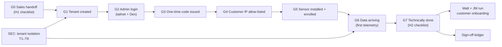

# Proposal — Signal Loom Customer Onboarding Flow Validation (2026-Q4)

## Executive Summary & Verification Scope

This proposal formalises the automated execution and verification of the
canonical customer onboarding flow defined in the Obsidian vault note
`Validation Runbook — SLCO Signal Loom Customer Onboarding Flow v2 (2026-Q4)`.
It establishes deterministic, repeatable gates ensuring that customer onboarding
is safe, verifiable, and executable by technical operations without manual heroics.

The mission answers the fundamental operational questions:
1. Are customer tenant boundaries strictly isolated at the API, database, and sensor layers (C1–C3)?
2. Do invariant protections prevent cross-tenant claim hijacking, credential replay, and telemetry misattribution (T1–T6)?
3. Are the interactive click-through gates G1–G7 and handoffs H1–H2 deterministic and covered by automated verification tools, specifically the required `verify-tenant-readiness` script?
4. Can technical onboarding be verified end-to-end with unambiguous evidence compiled in the sign-off ledger?

## Acceptance Commands

- `make test-eap-offline` (Offline EAP suite, tenant isolation & auth checks)
- `make test-kusari-e2e` (Offline Kusari e2e test suite)
- `make docs-lint` (0 lint errors across tracked markdown)
- `kanban-check.sh doctor --repo /home/andy/src/cp/osramp-demo --shortcode SLCO` (Clean health)

## Appendix

### Spec: Shared Patterns

- **Tenant Isolation Architecture**:
  Postgres Row-Level Security (RLS) is anchored on `app.current_tenant` (`006_tenant_isolation_rls.sql`). Applications connect as `signalloom_app`, not as the database table owner, ensuring `FORCE ROW LEVEL SECURITY` cannot be bypassed. Cross-tenant reads and mutations return empty sets or HTTP 403/404, never leaking customer identities.
- **Salted Tenant Hash**:
  Derived via `scripts/derive_tenant_hash.py` using HMAC-SHA256 with the platform salt (Kusari is `4b53ab6b`, asserted in `test_tenant_hash.py:50`).
- **Enrollment Tokens & Replay Defense**:
  One-time enrollment tokens are cryptographically generated, hashed on persistence, and strictly bound to `consumed_at IS NULL AND expires_at > NOW()`. Replay or expired token submission yields HTTP 401/404 without resource creation.
- **Egress & Ingest Perimeter Protection**:
  Envoy Gateway SecurityPolicy enforces client-CIDR allow-lists. The ingest HTTPRoute exposes only `/enroll` and `/telemetry`; administrative APIs (`/api/*`) are not routed on public ingest endpoints.
- **Test Integrity & No False Positives**:
  All test gates require 100% pass rate with zero skips on counted suites. Tests use isolated temp environments (`UV_CACHE_DIR=/tmp/uv-cache UV_CONFIG_FILE=/dev/null`) compatible with nono sandbox constraints.

### Spec: Capability Plan

| Logical ID | Selected skills | Agent role | Size | Ceiling | CPAI agent | Rationale |
| :--- | :--- | :--- | :--- | ---: | :--- | :--- |
| P0 | ajm-auto-kanban; context-mode | Baseline engineer | S | 45m | antigravity | Baseline verification of test pyramid, linting, and harness doctor. |
| P1-PRE | context-mode | Pre-flight analyst | S | 60m | antigravity | Pre-flight audit: inspect C1–C3 fixtures, RLS schemas, token lifecycle, and route definitions. |
| P1-1 | context-mode | Security/API test engineer | M | 120m | antigravity | Gate C1: Execute and prove tenant isolation across API routers and route sweeps. |
| P1-2 | context-mode | Backend auth engineer | M | 120m | antigravity | Gate C2: Execute and prove host enrollment single-use token lifecycle and state transitions. |
| P1-3 | context-mode | Sensor security engineer | M | 120m | antigravity | Gate C3: Execute and prove sensor tenant isolation, negative security, and leak falsification. |
| P1-4 | context-mode | Security threat engineer | M | 120m | antigravity | Threat vectors T1–T6: Verify RLS policies, claim hijack 409, replay defense, and perimeter exposure. |
| P1-GOV | ajm-auto-kanban | Governor | M | 120m | antigravity | Phase 1 Governor: Verify all automated gates pass without skips, audit test assertions, record errata. |
| P2-PRE | context-mode | Pre-flight analyst | S | 45m | antigravity | Pre-flight: Ingest route `/enroll` & `/telemetry`, Envoy SecurityPolicy allow-list verification, tailnet ingress. |
| P2-1 | context-mode | Integration engineer | M | 120m | antigravity | Gates G1/G2: Customer tenant creation, hash derivation, and admin authentication verification. |
| P2-2 | context-mode | Sensor integration engineer | M | 120m | antigravity | Gates G3–G5: Sensor enrollment, one-time token consumption, and host auto-claim lifecycle. |
| P2-3 | context-mode | Telemetry engineer | M | 120m | antigravity | Gates G6/G7 & C4: Telemetry arrival, pseudonymisation, and end-to-end onboarding verification. |
| P2-4 | context-mode | Automation engineer | M | 150m | antigravity | Build and prove `scripts/verify-tenant-readiness.sh` for automated H2 checklist evaluation. |
| P2-GOV | ajm-auto-kanban | Governor | S | 90m | antigravity | Phase 2 Governor: Compile sign-off evidence ledger, sync Obsidian runbook, final readiness sign-off. |

### Spec: Work Decomposition

| Logical ID | Role | Atomic task | Depends on | Exact tests or evidence | Size | Agent | Result / metric | Est. Cost | Tokens | Elapsed | AI URI |
| :--- | :--- | :--- | :--- | :--- | :--- | :--- | :--- | :-------- | :----- | :------ | :--- |
| P0 | baseline | On `integration/slco-v0.1.0` run baseline acceptance: docs-lint, C1/C2/C3 test inventories, and kanban doctor check. | — | `make docs-lint`; `kanban-check.sh doctor --repo . --shortcode SLCO` | S | antigravity | [Errata](#errata--slco-p0) | — | — | — | — |
| P1-PRE | preflight | Audit test suites, fixtures, database RLS migrations (`006_tenant_isolation_rls.sql`), and token routes; map exact verification commands and sandbox parameters. | P0 | Preflight inventory table in errata; 0 dirty files | S | antigravity | [Errata](#errata--slco-p1-pre) | — | — | — | — |
| P1-1 | implementation | Gate C1: Execute tenant isolation test suite (`test_tenant_isolation.py`, `test_kusari_tenant_isolation.py`, `test_eap_tenant_isolation.py`); verify authenticated route sweep and 0 cross-tenant leaks. | P1-PRE | 226+ passed in `fe-signalloom/src`; 0 failed | M | antigravity | [Errata](#errata--slco-p1-1) | — | — | — | — |
| P1-2 | implementation | Gate C2: Execute host enrollment suite (`test_host_enrollment.py`); verify token expiry, hash derivation, and state persistence. | P1-PRE | 19+ passed in `fe-signalloom/src`; 0 failed | M | antigravity | [Errata](#errata--slco-p1-2) | — | — | — | — |
| P1-3 | implementation | Gate C3: Execute sensor tenant isolation suite (`test_mission_tenant_isolation.py`, `test_negative_security.py`, `test_leak_falsification.py`); prove sensor state isolation and leak detection. | P1-PRE | 31 passed in `agentmaxxing-host-sensor`; 0 failed | M | antigravity | [Errata](#errata--slco-p1-3) | — | — | — | — |
| P1-4 | implementation | Invariants T1–T6: Prove cross-tenant claim hijack yields HTTP 409 (`test_external_agent_registration.py`), token replay is rejected, and telemetry is server-bound. | P1-PRE | 8 passed in `test_external_agent_registration.py`; 29 passed in `test_tenant_hash.py` | M | antigravity | [Errata](#errata--slco-p1-4) | — | — | — | — |
| P1-GOV | governor | Governor: Merge P1 cards into `integration/slco-v0.1.0`, execute full automated suite, verify 0 failures and 0 skips, record Phase 1 errata. | P1-1, P1-2, P1-3, P1-4 | Clean test run across all C1–C3 suites; errata complete | M | antigravity | [Errata](#errata--slco-p1-gov) | — | — | — | — |
| P2-PRE | preflight | Pre-flight: Ingest route `/enroll` & `/telemetry`, Envoy SecurityPolicy allow-list verification, tailnet ingress. | P1-GOV | Ingress and gateway routes audited; table in errata | S | antigravity | [Errata](#errata--slco-p2-pre) | — | — | — | — |
| P2-1 | implementation | Gates G1/G2: Verify tenant creation procedure, derive salted hash (`derive_tenant_hash.py`), and verify admin login isolation. | P2-PRE | Salted hash matches `4b53ab6b` for Kusari; Dex authentication verified | M | antigravity | [Errata](#errata--slco-p2-1) | — | — | — | — |
| P2-2 | implementation | Gates G3–G5: Verify one-time code issuance, sensor CLI enrollment (`agentmaxxing_host_sensor enroll`), code consumption, and auto-claim. | P2-PRE | Code single-use verified; auto-claim verified | M | antigravity | [Errata](#errata--slco-p2-2) | — | — | — | — |
| P2-3 | implementation | Gates G6/G7 & C4: Verify telemetry arrival, pseudonymisation, and end-to-end onboarding helper (`onboard-test-agent.sh`). | P2-PRE | Telemetry payload validated; HMAC pseudonymisation verified | M | antigravity | [Errata](#errata--slco-p2-3) | — | — | — | — |
| P2-4 | implementation | Construct `scripts/verify-tenant-readiness.sh`: automated check of tenant existence, isolation, host auto-claim, telemetry arrival, and allow-list compliance. | P2-PRE | Script exit 0 on verified tenant, exit 1 on invalid tenant | M | antigravity | [Errata](#errata--slco-p2-4) | — | — | — | — |
| P2-GOV | governor | Governor: Reconcile P2 evidence, execute `scripts/verify-tenant-readiness.sh`, update Obsidian Runbook ledger, prepare final sign-off. | P2-1, P2-2, P2-3, P2-4 | Full verification evidence recorded; Runbook Section 10 populated | S | antigravity | [Errata](#errata--slco-p2-gov) | — | — | — | — |

### Spec: Errata

_Cards append `#### Errata — SLCO-<ID>` blocks here in delivery order._
