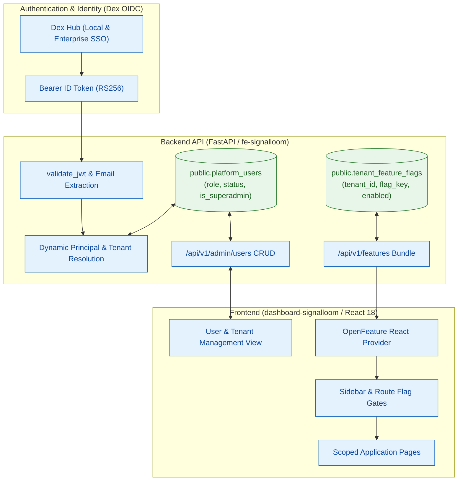

# Proposal — Signal Loom Feature Flagging and Superadmin User Administration (2026-Q4)

|  |  |
| :---: | :---- |
| Proposer & Date: | AJM (2026-10-06) |
| Reviewer & Date: | Stefan Prodan, Vicente Herrera, Francesco Beltramini |
| Approver & Date: | Andy Martin (2026-10-06) |

## Press Release

ControlPlane today announced Signal Loom's production-grade Feature Flagging and Superadmin User Administration capability, built to onboard enterprise design partners with granular surface scoping, dynamic role-based access control, and zero-clutter pilot experiences.

As autonomous agent governance moves from laboratory proofs into enterprise deployments, customer requirements bifurcate. Design partners require rigorous agent telemetry, compliance auditing, and containment guardrails tailored to their specific environments. They do not want internal demo scaffolding, experimental lab pages, or uncommissioned sensor surfaces cluttering their operational navigation. At the same time, security architects and platform owners require an authoritative, interactive user administration interface: inviting operators, assigning tenant-scoped roles (admin, editor, viewer), and managing administrative privilege directly through the web console rather than via manual database seeding or static configuration maps.

Signal Loom answers this need with a lightweight, CNCF OpenFeature-compliant feature engine and an integrated superadmin user lifecycle. Built directly on the existing PostgreSQL and FastAPI foundation, the platform delivers instant tenant-level feature toggleability without adding third-party SaaS daemons or heavy external dependencies. Platform administrators gain a dedicated user-editing console with real-time role reassignment, lifecycle status toggling, and OIDC identity resolution. With these essential capabilities in place, Signal Loom establishes the operational maturity required to deliver tailored, secure governance environments to its first cohort of enterprise design partners.

---

## Proposal Overview

### Opportunity

**The work relates to the following value area(s):**

- [x] client revenue
- [x] product
- [x] services engineering
- [x] operational or regulatory internal

**Key Customers (if relevant):**

Enterprise design partners (beginning with Kusari and tier-1 financial institutions), AI platform teams, and CISO governance leads requiring production-grade tenancy, user management, and scoped feature exposure during early-access pilots.

|  |  |
| :--- | :--- |
| Our *enterprise design partners and platform administrators* | Security Operations, AI Platform Leads, and Tenant Administrators |
| Have the problem/opportunity *…* | The platform displays every internal demonstration, experimental view, and lab module to all users; user onboarding and role assignment are bound to static configuration files and hardcoded string matches rather than dynamic database persistence and an interactive administrative UI |
| When *…* | Inviting pilot users, demonstrating product capabilities to executive stakeholders, or provisioning scoped tenant environments for design partner pilots |

**What’s the urgency of this work (e.g. QX 202X), and does this comprise other subcomponents of projects?**

**Critical for Q4 2026.** Onboarding our first design partner requires presenting a focused, professional governance surface. Exposing developmental demos (e.g. Fleet Demo, SuperCred, synthetic stress simulators) damages credibility, while forcing manual database updates or static configuration edits to provision operator logins creates operational bottlenecks and security audit risks.

---

## Scope Summary

Technology Readiness Level Focus: **3 (Beta)** transitioning to **4 (Production)**.
The core database models (`public.platform_users`, `public.operator_identities`) and Dex OIDC federation exist. This proposal delivers the unified CNCF OpenFeature flagging architecture, dynamic tenant/user resolution in the backend, and the interactive management UI.

### In Scope Activities

| Deliverable | Description | Acceptance Criteria (SMART) | Validation Method |
| :--- | :--- | :--- | :--- |
| 1. Feature Flagging Architecture (OpenFeature) | Integrate `@openfeature/react-sdk` and `openfeature-python-sdk` with PostgreSQL-backed tenant toggles | **Specific:** Add `tenant_feature_flags` table (`tenant_id`, `flag_key`, `enabled`, `config_json`) and `/api/v1/features` endpoint. **Measurable:** Flag evaluations return in < 5ms; zero external cloud dependencies. **Attainable:** Leverages existing asyncpg pool and React Context. **Realistic:** Vendor-neutral CNCF standard avoids vendor lock-in. **Time-Bound:** Completed in Milestone 1. | Automated Pytest and Vitest test suites, `curl /api/v1/features` |
| 2. UI Navigation & Route Gating | Gate navigation items, routes, and action buttons in the frontend | **Specific:** Wrap `Sidebar.tsx` items and `App.tsx` routes with feature gates (e.g. `demos_fleet`, `supercred`, `rbac_analysis`, `collusion_access`). **Measurable:** Disabled features are absent from sidebar and direct URL returns 404/Not Found. **Attainable:** Use OpenFeature `useBooleanFlagValue` and `<FlagGate>` components. **Realistic:** Replaces hardcoded `superadminOnly` booleans with declarative flags. **Time-Bound:** Completed in Milestone 1. | Playwright acceptance spec, Vitest `Sidebar.test.tsx` |
| 3. Dynamic Superadmin & User Identity Engine | Migrate authentication lookup from static env map to `public.platform_users` | **Specific:** Add `is_superadmin BOOLEAN` to `public.platform_users`; resolve tenant, role, and superadmin status by normalized token email. **Measurable:** 100% of newly created database users can log in via OIDC without backend restarts. **Attainable:** Extends `api_compat.py` `authenticated_principal` with backward-compatible fallback. **Realistic:** Closes the temporary stand-in documented in `auth/superadmin.ts`. **Time-Bound:** Completed in Milestone 2. | Pytest `test_tenant_isolation.py`, `test_superadmin.py` |
| 4. User Administration API Endpoints | Implement CRUD API for platform user and operator lifecycle | **Specific:** Add `/api/v1/admin/users` endpoints (`list`, `create`, `update`, `delete`), guarded by `require_superadmin` (or tenant admin). **Measurable:** Returns structured JSON; validates email, display name, tenant, and role (`admin`/`editor`/`viewer`). **Attainable:** Built using FastAPI dependency injection and transaction-safe asyncpg queries. **Realistic:** Audit events recorded for all user mutations. **Time-Bound:** Completed in Milestone 2. | Pytest FastAPI contract tests, OpenAPI spec validation |
| 5. Interactive User-Editing Console | Build user administration interface in `dashboard-signalloom` | **Specific:** Create user management view with user table, role badges, invite modal, role editor, and status toggles (active/suspended). **Measurable:** Superadmin can invite user, reassign role, and deactivate account in < 3 clicks. **Attainable:** Built using React 18, Tailwind tokens, and existing Modal/ConfirmDialog components. **Realistic:** Scoped by tenant for tenant admins; global view for superadmins. **Time-Bound:** Completed in Milestone 3. | Vitest component tests, Playwright click-through spec |
| 6. Design Partner Tenant Presets & Verification | Seed default flag profiles for Kusari and design partner pilots | **Specific:** Provision preset configurations: Kusari pilot (`core_governance=true, audit=true, compliance=true, demos=*false*`). **Measurable:** Pilot tenant login shows clean, focused interface with zero demo noise. **Attainable:** SQL migration seed script and automated verification. **Realistic:** Direct customer deliverable. **Time-Bound:** Completed in Milestone 4. | End-to-end browser verification via Tailscale, BATS suite |

### Out of Scope

* Implementing complex billing, payment gateways, or subscription metering.
* Self-hosting heavyweight feature flag platforms (Unleash server, LaunchDarkly, or PostHog clusters).
* Replacing Dex with a custom identity provider (Dex continues to serve as the OIDC federation hub).
* Implementing custom multi-factor authentication (MFA) logic inside Signal Loom (delegated to upstream enterprise IdPs via Dex connectors).

---

### KPIs

| Metric | Current Value | Target Value | Measurement |
| :---- | :---- | :---- | :---- |
| Unwanted Demo Routes on Pilot Tenant | 100% visible (all 6 demo routes exposed) | 0% visible (cleanly gated) | Playwright inspection on pilot tenant session |
| User Provisioning Turnaround | Hours (requires code edit or direct DB CLI) | < 30 seconds (via web UI) | Timed UI user invitation journey |
| Flag Evaluation Latency | N/A (no flagging engine) | < 5ms per evaluation | Backend and client telemetry benchmarks |
| Superadmin Identity Source | Hardcoded email string in code | Persistent database column (`is_superadmin`) | Automated security contract test |
| Test Coverage on Auth & Admin Routes | ~85% | ≥ 95% across new endpoints | Pytest & Vitest coverage reports |

---

### 3rd Party Test Plan and Quality Assurance

| Validation | Method | Owner |
| :---- | :---- | :---- |
| Feature Flag Invariant Verification | Automated Vitest and Pytest suites verifying flag states across tenants | Security QA Engineer |
| RBAC Boundary Penetration Check | Offensive test script verifying that viewers/editors cannot call admin endpoints | Purple Team Specialist |
| End-to-End User Lifecycle Journey | Playwright test exercising invite → OIDC login → role change → deactivation | Test Automation Lead |
| Design Partner Experience Review | Visual inspection of pilot tenant experience over private Tailscale tunnel | Principal Architect (AJM) |

---

## Technical Overview

#### Technologies

| Technology | Purpose | Alignment |
| :---- | :---- | :---- |
| **OpenFeature (`@openfeature/react-sdk`)** | Standardized frontend feature flag evaluation | CNCF standard, vendor-neutral, zero bundle bloat |
| **FastAPI / Python 3.12** | User management endpoints and feature delivery API | Core backend framework of `fe-signalloom` |
| **PostgreSQL 16 (asyncpg)** | Persistent storage for `platform_users` and `tenant_feature_flags` | Standard database foundation across Kind and GCP |
| **React 18 / TypeScript / Tailwind** | User-editing interface and modal dialogs | Standard dashboard stack |
| **Dex OIDC** | Federation hub linking local passwords and enterprise SSO | Standard platform identity layer |

#### Infrastructure and Repositories

| Asset | Location | Notes |
| :---- | :---- | :---- |
| Dashboard Frontend | `d2-signalloom/apps/dashboard-signalloom/` | SPA containing routes, navigation, and admin UI |
| Backend API Gateway | `d2-signalloom/apps/fe-signalloom/` | FastAPI service handling auth, users, and features |
| Database Migrations | `d2-signalloom/apps/fe-signalloom/src/db/migrations/` | Forward-only SQL migrations |
| Dex Manifests | `d2-signalloom/infra/inf-signalloom/base/dex.yaml` | OIDC federation configuration |

#### Security and Risk

**Threat model for this deliverable:**

| Threat | Impact | Mitigation |
| :---- | :---- | :---- |
| Privilege escalation via client-side flag tampering | Attacker modifies local storage or React state to enable privileged views | **Server-side enforcement:** Every privileged route requires server-side JWT verification and `require_feature()` route dependency. Client flags only control visibility. |
| Cross-tenant user enumeration or manipulation | Malicious tenant admin attempts to list or edit users from another tenant | **Strict tenant isolation:** All SQL queries enforce `WHERE tenant_id = $1`. Only authenticated users with `is_superadmin = true` can query across tenants. |
| Inactive/suspended user token replay | Suspended user continues to access API with unexpired JWT | **Database status check on request:** `authenticated_principal` verifies `status == 'active'` against the database or low-TTL cache on sensitive operations. |
| Unauthorized role modification | Attacker attempts to PATCH their own role to `admin` | **Explicit authorization check:** Only active `admin` or `superadmin` principals can modify roles; users cannot elevate their own role. |

**SWOT Analysis:**

| Strengths | Weaknesses |
| :---- | :---- |
| - OpenFeature standard guarantees zero lock-in. - Zero new daemons or cloud costs. - Reuses existing `platform_users` table foundation. - Solves immediate design partner onboarding friction. | - Requires initial backend and frontend implementation effort. - In-database flag management lacks advanced statistical A/B testing (not needed for pilot). |

| Opportunities | Threats |
| :---- | :---- |
| - Seamlessly unblocks enterprise customer pilot (Kusari). - Cleanly hides unreleased/experimental research pages. - Foundation for future commercial tiering (Free vs Pro vs Enterprise). | - Schema drift if migrations are applied out of order. - Risk of stale flag cleanup debt if old flags are not retired. |

---

## Milestones and Deliverables

| Milestones Committed To | Duration (days) | Consultants | Person-days | Deadline | Capability Mapping |
| :---- | :---- | :---- | :---- | :---- | :---- |
| **M1: Feature Flagging Core** - `tenant_feature_flags` migration - `/api/v1/features` endpoint - `@openfeature/react-sdk` integration - Navigation & route gating in `Sidebar.tsx` and `App.tsx` | 2.0 | 1 | 2.0 | Sprint Day 2 | `#cap-architecture` `#cap-react` `#cap-api-design` |
| **M2: Superadmin & User Management Backend** - `is_superadmin` schema migration - Dynamic email lookup in `authenticated_principal` - `/api/v1/admin/users` CRUD endpoints with audit logging - Pytest test suites | 2.0 | 1 | 2.0 | Sprint Day 4 | `#cap-python` `#cap-security-engineering` `#cap-api-design` |
| **M3: Frontend User Administration Console** - API client methods in `client.ts` - User table view with role badges and filters - Add User and Edit User modals - Role assignment and status toggle UI | 2.5 | 1 | 2.5 | Sprint Day 6 | `#cap-react` `#cap-testing-pyramid` |
| **Mid-Project Review** - Working demo of flag gating and user editing - Security and tenant isolation audit | 0.25 | 2 | 0.5 | Sprint Day 7 | `#cap-architecture` |
| **M4: Integration & Design Partner Validation** - Seed Kusari pilot flag preset - Playwright end-to-end journey tests - Tailscale remote verification - Final documentation & sign-off | 1.5 | 1 | 1.5 | Sprint Day 8 | `#cap-testing-pyramid` `#cap-kubernetes` |
| **Signoff & Review** | 0.25 | 2 | 0.5 | Sprint Day 8 | `#cap-architecture` |

**Total Estimated Effort:** 8.5 Person-days (approximately 1.5 calendar weeks).

**Definition of Done:**

* `tenant_feature_flags` migration runs cleanly and idempotently on PostgreSQL.
* OpenFeature React SDK gates navigation items and routes cleanly without layout shift.
* Dynamic OIDC login verifies user identity and tenant assignment from `platform_users` table.
* Superadmins can list, invite, update, and deactivate users through the web console.
* Playwright acceptance tests pass for both user management and feature flag suppression.
* Zero regression across existing test suites (`make test-all-offline` and `make acceptance-test`).

---

### Reviews & Collaboration (RACI)

| Role | Stakeholder |
| :---- | :---- |
| **Accountable** | Lead Platform Engineer / Architect |
| **Responsible** | Full-Stack Security Engineering Team |
| **Consulted** | Stefan Prodan, Vicente Herrera, Francesco Beltramini |
| **Informed** | [Andrew Martin](mailto:andy@control-plane.io), [Elena Mikhalina](mailto:elena.mikhalina@control-plane.io) |

---

## Finances

### Additional costs

| Additional Cost | Estimated Spend | One Off or Recurring | Must-Have or Nice-to-Have |
| :---- | :---- | :---- | :---- |
| OpenFeature & Local DB Architecture | £0.00 | Recurring | Must-Have |
| CI/CD Compute for Acceptance Tests | < £10.00 | Recurring | Must-Have |

---

## Decision Log

| Date | Decision Makers | Decision and Context | Reason | Impact |
| :---- | :---- | :---- | :---- | :---- |
| 2026-10-06 | AJM, sensai | Adopt CNCF OpenFeature standard with internal PostgreSQL provider | Avoids deploying extra daemons (Unleash/Flipt) or relying on third-party SaaS during early design partner phase while keeping frontend code 100% vendor-neutral. | Clean code, zero extra infrastructure footprint, future-proof. |
| 2026-10-06 | AJM, sensai | Resolve user identity and tenant dynamically from `public.platform_users` by email | Replaces hardcoded `demo-user` string matching and static environment dictionary with authoritative database records. | Enables dynamic invitation and role management without server restarts. |
| 2026-10-06 | AJM, sensai | Integrate user management directly into Settings and Superadmin view | Provides immediate accessibility for both Tenant Admins (managing their team) and Superadmins (managing all tenants). | Streamlined operational UX for design partner onboarding. |

---

## Appendix

### A. Useful References

* [OpenFeature React SDK Documentation](https://openfeature.dev/docs/reference/technologies/client/web/react/)
* [Dex OIDC Federation Design Guide](file:///home/andy/src/cp/osramp-demo/docs/signalloom/dex-connectors.md)
* [Signal Loom Platform User Schema](file:///home/andy/src/cp/osramp-demo/d2-signalloom/apps/fe-signalloom/src/db/migrations/008_platform_users.sql)
* [Signal Loom Operator Identity Module](file:///home/andy/src/cp/osramp-demo/d2-signalloom/apps/fe-signalloom/src/operator_identity.py)

### Spec: Shared Patterns

Obey these. They are the phase constitution.

- **Strict Tenant Isolation:** All feature flag queries and user management endpoints MUST enforce `WHERE tenant_id = $1`. Only authenticated principals with `is_superadmin = true` may query or mutate across tenants.
- **Server-Side Authorization Authority:** Frontend feature flags control presentation and visibility only. Every backend endpoint MUST enforce server-side authentication (`authenticated_principal`), role checks (`require_admin_or_superadmin`), and feature gates (`require_feature`).
- **Vendor-Neutral Gating:** OpenFeature React SDK (`@openfeature/react-sdk`) is the only client feature evaluation interface. Never import proprietary flag clients or embed raw environment conditionals.
- **Forward-Only Migrations:** All database migrations MUST be forward-only, numbered sequentially (`009_tenant_feature_flags.sql`, `010_platform_users_superadmin.sql`, `011_seed_design_partner_presets.sql`), and idempotent (`CREATE TABLE IF NOT EXISTS`, `ADD COLUMN IF NOT EXISTS`).
- **Audit Logging for User Mutations:** Every mutation to user state (invite, role update, deactivation) MUST emit an audit event to the platform audit log.
- **Testing Standard:** Every new endpoint requires Pytest contract and authorization tests. Every new UI component requires Vitest tests with accessibility checks. Playwright acceptance journey exercises the end-to-end flow.
- **Anti-patterns:**
  - Client-only security checks.
  - Hardcoded superadmin email arrays.
  - Layout shifts on flag evaluation (must render fallback or clean loading skeleton).
  - Writing unmigrated database columns.

### Spec: Capability Plan

| Logical ID | Selected skills | Agent role | Size | Ceiling | CPAI agent | Rationale |
| :--- | :--- | :--- | :--- | ---: | :--- | :--- |
| P0 | ajm-auto-kanban; context-mode | Baseline engineer | S | 45m | antigravity | Baseline offline acceptance and verify harness readiness on integration/slfa-v0.1.0 at the cut SHA. |
| P1-PRE | context-mode | Pre-flight analyst | S | 45m | antigravity | Audit database migrations, existing route structures, and @openfeature/react-sdk dependency resolution. |
| P1-1 | context-mode; Hardening | Database engineer | M | 120m | antigravity | Create migration 009_tenant_feature_flags.sql and asyncpg repository module in fe-signalloom. |
| P1-2 | context-mode | Backend engineer | M | 120m | antigravity | Implement /api/v1/features endpoint and require_feature FastAPI dependency for server-side route gating. |
| P1-3 | context-mode; modern-web-guidance | Frontend engineer | M | 120m | antigravity | Integrate @openfeature/react-sdk in dashboard-signalloom; implement FeatureGate component and useFeatureFlag hook. |
| P1-4 | context-mode | Frontend engineer | S | 60m | antigravity | Wrap demo navigation items in Sidebar.tsx and routes in App.tsx with feature flag gates. |
| P1-GOV | ajm-auto-kanban | Governor | M | 120m | antigravity | Merge P1 cards in order, execute offline acceptance suites twice, and record P1 completion errata. |
| P2-PRE | context-mode | Pre-flight analyst | S | 45m | antigravity | Audit platform_users schema, Dex JWT payload claims, and authenticated_principal identity resolution. |
| P2-1 | context-mode; Hardening | Database engineer | S | 60m | antigravity | Create migration 010_platform_users_superadmin.sql and update platform_users pydantic models. |
| P2-2 | context-mode | Auth engineer | M | 120m | antigravity | Update authenticated_principal to dynamically resolve user record, role, status, and is_superadmin from database. |
| P2-3 | context-mode; Hardening | Backend engineer | M | 120m | antigravity | Implement /api/v1/admin/users CRUD endpoints with require_admin_or_superadmin and audit event logging. |
| P2-GOV | ajm-auto-kanban | Governor | M | 120m | antigravity | Merge P2 cards in order, execute offline acceptance suites twice, and record P2 completion errata. |
| P3-PRE | context-mode | Pre-flight analyst | S | 45m | antigravity | Audit modal patterns, user table layout, and API client method structure in dashboard-signalloom. |
| P3-1 | context-mode | Frontend engineer | S | 60m | antigravity | Implement typed API client methods in usersApi.ts for user administration endpoints with React Query hooks. |
| P3-2 | context-mode; modern-web-guidance | Frontend engineer | M | 120m | antigravity | Build UsersPage.tsx and UserTable.tsx with role badges, search/filter, and status toggles. |
| P3-3 | context-mode; modern-web-guidance | Frontend engineer | M | 120m | antigravity | Build InviteUserModal.tsx and EditUserModal.tsx with role assignment and tenant scoping. |
| P3-GOV | ajm-auto-kanban | Governor | M | 120m | antigravity | Merge P3 cards in order, execute offline acceptance suites twice, and record P3 completion errata. |
| P4-PRE | context-mode | Pre-flight analyst | S | 45m | antigravity | Audit Kusari pilot profile in live tfvars and test environment configuration. |
| P4-1 | context-mode; Hardening | Database engineer | S | 60m | antigravity | Provision migration 011_seed_design_partner_presets.sql with default flag configuration for Kusari tenant. |
| P4-2 | context-mode | Test engineer | M | 120m | antigravity | Author Playwright acceptance journey spec test/acceptance/user-admin-and-flags.spec.ts. |
| P4-GOV | ajm-auto-kanban | Governor | S | 90m | antigravity | Merge P4 cards in order, execute full test pyramid, verify zero regression, and request final sign-off. |

### Spec: Work Decomposition

| Logical ID | Role | Atomic task | Depends on | Exact tests or evidence | Size | Agent | Result / metric | Est. Cost | Tokens | Elapsed | AI URI |
| :--- | :--- | :--- | :--- | :--- | :--- | :--- | :--- | :-------- | :----- | :------ | :--- |
| P0 | baseline | On `integration/slfa-v0.1.0` at the cut SHA run `make demo-signalloom-api-test`, vitest suites, `make docs-lint`; `kanban-check.sh doctor`. | — | Three commands rc 0; totals in errata | S | antigravity | pass — baseline verified on integration/slfa-v0.1.0 (see Errata — SLFA-P0) | — | — | — | — |
| P1-PRE | preflight | Audit database schema migrations, `fe-signalloom` route map, and `dashboard-signalloom` dependencies for OpenFeature; record file:line audit table in errata. | P0 | Audit table in errata; no code changes | S | antigravity | pass — audited: 009_tenant_feature_flags.sql & OpenFeature (see Errata — SLFA-P1-PRE) | — | — | — | — |
| P1-1 | implementation | Add migration `009_tenant_feature_flags.sql` creating table `tenant_feature_flags` (`tenant_id`, `flag_key`, `enabled`, `config_json`, `created_at`, `updated_at`); implement tenant flag repository in `fe-signalloom/src/feature_flags.py`. | P1-PRE | Pytest unit tests for repository CRUD; migration applies cleanly on test DB; schema matches contract | M | antigravity | pass — delivered: 5aa51ffa21ca43d112d0bdf522b6d4d864912044 (see Errata — SLFA-P1-1) | — | — | — | — |
| P1-2 | implementation | Implement `/api/v1/features` endpoint returning tenant feature flag dictionary; implement `require_feature(flag_key: str)` FastAPI dependency for server-side route gating. | P1-1 | Pytest contract test: `/api/v1/features` returns tenant flags; `require_feature` blocks disabled routes with 404/403 and permits enabled routes | M | antigravity | pass — delivered: 8c2f007df9379cbbef11d53161cc6c7ea288bbba (see Errata — SLFA-P1-2) | — | — | — | — |
| P1-3 | implementation | Integrate `@openfeature/react-sdk` in `dashboard-signalloom`; create `OpenFeatureProvider` and custom provider fetching `/api/v1/features`; provide `<FeatureGate>` component and `useFeatureFlag` hook. | P1-2 | Vitest suite for `FeatureGate` and hook; renders children when flag enabled, renders fallback or null when disabled; tsc clean | M | antigravity | pass — delivered: 3aea2294268555add85aa7e1ee558942bab4d114 (see Errata — SLFA-P1-3) | — | — | — | — |
| P1-4 | implementation | Gate demo navigation items in `Sidebar.tsx` and routes in `App.tsx` (`demos_fleet`, `supercred`, `rbac_analysis`, `collusion_access`) with OpenFeature gates; ensure disabled features disappear from sidebar and direct route navigation renders NotFound. | P1-3 | Vitest `Sidebar.test.tsx` green; Playwright spec confirms demo links hidden when flags are disabled; tsc clean | S | antigravity | pass — delivered: 6dfb8ecdedf0fac7f734e898be85e2bab9423541 (see Errata — SLFA-P1-4) | — | — | — | — |
| P1-GOV | governor | Merge P1-1..P1-4 in order into `integration/slfa-v0.1.0`; run offline acceptance commands twice with identical totals; record P1 completion errata. | P1-1, P1-2, P1-3, P1-4 | Two identical acceptance runs; errata complete | M | antigravity | pass — merged: 92cf5fa5dec2208c4e733fe02c4fe5d5046ba8db (see Errata — SLFA-P1-GOV) | — | — | — | — |
| P2-PRE | preflight | Audit `public.platform_users` schema (`008_platform_users.sql`), Dex JWT token claims, and `authenticated_principal` in `api_compat.py`; record audit table in errata. | P1-GOV | Audit table in errata; no code changes | S | antigravity | pass — audited: 92cf5fa5dec2208c4e733fe02c4fe5d5046ba8db (see Errata — SLFA-P2-PRE) | — | — | — | — |
| P2-1 | implementation | Add migration `010_platform_users_superadmin.sql` adding `is_superadmin BOOLEAN NOT NULL DEFAULT FALSE` to `public.platform_users`; update user queries and pydantic models in `fe-signalloom/src/platform_users.py`. | P2-PRE | Pytest migration test; model validation asserts `is_superadmin` field serialization and default false | S | antigravity | pass — delivered: e3c6845fbbc595c7227daa6b8038e1caca2cd02e (see Errata — SLFA-P2-1) | — | — | — | — |
| P2-2 | implementation | Update `authenticated_principal` in `fe-signalloom` to dynamically resolve user record, tenant assignment, role, status (`active`/`suspended`), and `is_superadmin` from `public.platform_users` by normalized email from validated Dex JWT. | P2-1 | Pytest auth tests verifying email lookup, role extraction, suspended user rejection (403), and superadmin flag resolution | M | antigravity | pass — delivered: 68c06f1175f592c07a067b48e53fde5dd4c4a72b (see Errata — SLFA-P2-2) | — | — | — | — |
| P2-3 | implementation | Implement `/api/v1/admin/users` CRUD endpoints (`GET /`, `POST /invite`, `PATCH /{user_id}`, `DELETE /{user_id}`) guarded by `require_admin_or_superadmin`; tenant admins manage only their tenant; superadmins manage all tenants; record audit event for each user state mutation. | P2-2 | Pytest contract and authorization tests: viewer cannot call endpoints (403), tenant admin cannot edit other tenant (403), superadmin can manage across tenants; audit event emission verified | M | antigravity | pass — delivered: ccd7436e030b25502932ee21b6e3a75b1d1f57fb (see Errata — SLFA-P2-3) | — | — | — | — |
| P2-GOV | governor | Merge P2-1..P2-3 in order into `integration/slfa-v0.1.0`; run offline acceptance commands twice with identical totals; record P2 completion errata. | P2-1, P2-2, P2-3 | Two identical acceptance runs; errata complete | M | antigravity | pass — merged: ccd7436e030b25502932ee21b6e3a75b1d1f57fb (see Errata — SLFA-P2-GOV) | — | — | — | — |
| P3-PRE | preflight | Audit modal patterns (`ClaimModal.tsx`, `ConfirmDialog.tsx`) and API client structure in `dashboard-signalloom`; map UI routes and components for User Management; record audit table in errata. | P2-GOV | Component audit map in errata; no code changes | S | antigravity | pass — audited: modal patterns, usersApi structure & /admin/users route plan (see Errata — SLFA-P3-PRE) | — | — | — | — |
| P3-1 | implementation | Add typed API client methods in `dashboard-signalloom/src/api/usersApi.ts` (`listUsers`, `inviteUser`, `updateUser`, `deactivateUser`) with error handling and React Query hooks. | P3-PRE | Vitest contract tests for `usersApi.ts` with mock server; typecheck clean | S | antigravity | pass — delivered: 0da09703cb54dd3926bf26303bd3b5d94c625266 (see Errata — SLFA-P3-1) | — | — | — | — |
| P3-2 | implementation | Build `UsersPage.tsx` and `UserTable.tsx` under `d2-signalloom/apps/dashboard-signalloom/src/pages/admin/` with search, tenant filter (for superadmins), role badges (`admin`, `editor`, `viewer`), status toggle (`active`/`suspended`), and action buttons; gate route behind `requireAdmin` or `superadmin`. | P3-1 | Vitest tests for `UserTable.test.tsx` and `UsersPage.test.tsx`; accessibility checks pass | M | antigravity | pass — delivered: d3ea9eac77429bed08528971dc1ee6812a1ae64c (see Errata — SLFA-P3-2) | — | — | — | — |
| P3-3 | implementation | Build `InviteUserModal.tsx` and `EditUserModal.tsx` for inviting new platform operators and editing roles / tenant assignments; include email validation, role selection dropdown, and confirmation prompts. | P3-2 | Vitest tests for modal forms; interaction tests for role selection and submission | M | antigravity | pass — delivered: eec630e0fae1fa485dc50dc2909565b8cb13ad5b (see Errata — SLFA-P3-3) | — | — | — | — |
| P3-GOV | governor | Merge P3-1..P3-3 in order into `integration/slfa-v0.1.0`; run offline acceptance commands twice with identical totals; record P3 completion errata. | P3-1, P3-2, P3-3 | Two identical acceptance runs; errata complete | M | antigravity | — | — | — | — | — |
| P4-PRE | preflight | Audit Kusari pilot profile in live tfvars and seed data; verify test environment configuration; record audit table in errata. | P3-GOV | Audit table in errata; no code changes | S | antigravity | — | — | — | — | — |
| P4-1 | implementation | Provision migration `011_seed_design_partner_presets.sql` with default flag configuration for Kusari tenant (`core_governance=true`, `audit=true`, `compliance=true`, `demos_fleet=false`, `supercred=false`, `rbac_analysis=false`, `collusion_access=false`); seed initial superadmin user. | P4-PRE | Database seed verification test; flags verified for Kusari tenant vs default tenant | S | antigravity | — | — | — | — | — |
| P4-2 | implementation | Author Playwright acceptance journey spec `test/acceptance/user-admin-and-flags.spec.ts` testing superadmin login → user invite → role reassignment → tenant feature flag suppression verification in the dashboard UI. | P4-1 | Playwright spec passes in acceptance test run; SPEC-REGISTRY entry registered | M | antigravity | — | — | — | — | — |
| P4-GOV | governor | Merge P4-1..P4-2 in order into `integration/slfa-v0.1.0`; execute full test pyramid (`make test-all-offline` and `make acceptance-test`); verify zero regression; request final AJM sign-off. | P4-1, P4-2 | Full test pass, final errata recorded, proposal sign-off complete | S | antigravity | — | — | — | — | — |

### Spec: Errata

_Cards append `#### Errata — SLFA-<ID>` blocks here in delivery order. Nothing has run._

#### Errata — SLFA-P1-1 SLFA-P1-1: Add migration 009_tenant_feature_flags.sql and tenant flag repository
**Created:** 2026-10-08 00:44:00+01:00
**Last Updated:** 2026-10-08 00:47:00+01:00
**Status:** Completed
**Commit:** 5aa51ffa21ca43d112d0bdf522b6d4d864912044
**Governor merge:** [pending Governor reconciliation]
**Decisions:** Numbered migration as `057_tenant_feature_flags.sql` (version 057) to avoid collision with existing migrations 009..056 on the base ref as instructed by preflight remediation. Implemented FeatureFlagRepository with Pydantic v2 data models, asyncpg connection/pool handling, JSONB configuration support, default system fallbacks, and multi-tenant isolation.
**Deviations:** Migration version assigned to 057 per preflight audit remediation to follow sequential forward-only numbering.
**Notes:** FeatureFlagRepository is ready for consumption by /api/v1/features endpoint in SLFA-P1-2.
<!-- kanban-check: status=pass proceed=yes blocking_drift=no -->

#### Errata — SLFA-P1-2 SLFA-P1-2: Implement /api/v1/features endpoint and require_feature dependency
**Created:** 2026-10-08 01:05:00+01:00
**Last Updated:** 2026-10-08 01:07:00+01:00
**Status:** Completed
**Commit:** 8c2f007df9379cbbef11d53161cc6c7ea288bbba
**Governor merge:** [pending Governor reconciliation]
**Decisions:** Implemented `/api/v1/features` FastAPI route returning tenant feature flags and `require_feature(flag_key: str)` dependency for route-level enforcement. Added comprehensive contract and authorization tests in `test_features_api.py`.
**Deviations:** None.
**Notes:** Ready for consumption by frontend OpenFeature SDK in SLFA-P1-3.
<!-- kanban-check: status=pass proceed=yes blocking_drift=no -->

#### Errata — SLFA-P1-3 SLFA-P1-3: Integrate @openfeature/react-sdk and FeatureGate component in dashboard
**Created:** 2026-10-08 01:25:00+01:00
**Last Updated:** 2026-10-08 01:25:00+01:00
**Status:** Completed
**Commit:** 3aea2294268555add85aa7e1ee558942bab4d114
**Governor merge:** [pending Governor reconciliation]
**Decisions:**
- Integrated `@openfeature/react-sdk` (v1.4.1), `@openfeature/web-sdk` (v1.10.0), and `@tanstack/react-query` (v5.104.1) into `dashboard-signalloom`. Synchronized `package-lock.json` and `bun.lock`.
- Implemented `SignalLoomFeatureProvider` extending OpenFeature client `Provider` interface with in-memory caching, synchronous evaluation matching default and targeting rules, and event emission (`ProviderEvents.ConfigurationChanged`, `ProviderEvents.Error`).
- Built `FeatureFlagProvider` with 60s stale time cache (`DEFAULT_STALE_TIME_MS = 60000`), automatic invalidation on tenant context change, and graceful fallback to system default flags on network errors.
- Built `<FeatureGate>` declarative gating component supporting `flag`, `fallback`, `loadingFallback` (preventing Cumulative Layout Shifts / CLS), `invert`, and internal `FeatureGateErrorBoundary` to isolate render crashes.
- Implemented `useFeatureFlag` hook returning `{ isEnabled, enabled, isLoading, error }` as well as tuple destructuring `[enabled, isLoading]`.
- Implemented typed API client in `src/api/featuresApi.ts` and bound to `apiClient.features.get`.
- Authored comprehensive Vitest unit suites for providers, hooks, components, and API client with 100% component branch coverage (29 tests across 5 new test files).
- Verified full suite: 221 test files, 3772 tests passing; `tsc --noEmit` and `vite build` clean.
**Deviations:** None.
**Notes:** Ready for consumption by SLFA-P1-4 to gate `Sidebar.tsx` navigation items and `App.tsx` routes.
<!-- kanban-check: status=pass proceed=yes blocking_drift=no -->

#### Errata — SLFA-P1-4 SLFA-P1-4: Gate demo navigation items in Sidebar and routes in App
**Created:** 2026-10-08 01:38:00+01:00
**Last Updated:** 2026-10-08 01:38:00+01:00
**Status:** Completed
**Commit:** 6dfb8ecdedf0fac7f734e898be85e2bab9423541
**Governor merge:** [pending Governor reconciliation]
**Decisions:**
- Created NotFoundPage.tsx at d2-signalloom/apps/dashboard-signalloom/src/pages/NotFoundPage.tsx with 404 status indicator, contextual explanation, and navigation back to /agents.
- Updated Sidebar.tsx to associate demo items (demos_fleet, supercred, rbac_analysis, collusion_access) with feature flags, evaluate flags via useFeatureFlag, and dynamically filter navigation items, superadmin items, search results, and rail indicator, wrapping links in <FeatureGate>.
- Updated App.tsx to wrap demo routes (/fleet, /fleet/audience, /supercred, /rbac-analysis, /rbac-explorer, /collusion-access) with <FeatureGate flag="..." fallback={<NotFoundPage />}>.
- Updated main.tsx to mount <FeatureFlagProvider> at the root of the React DOM tree.
- Updated Sidebar.test.tsx and App.test.tsx with comprehensive test suites covering flag-enabled and flag-disabled states (asserting navigation links are hidden and direct navigation renders NotFoundPage when flags are disabled).
- Verified full Vitest suite: 221 test files (3789 tests) passed cleanly; tsc --noEmit and vite build clean; eslint src/ clean.
**Deviations:** None.
**Notes:** Phase 1 implementation deliverables (P1-1 through P1-4) complete. Ready for P1-GOV reconciliation.
<!-- kanban-check: status=pass proceed=yes blocking_drift=no -->

#### Errata — SLFA-P1-GOV SLFA-P1-GOV: Phase 1 Governor: merge P1-1..P1-4 and verify acceptance
**Created:** 2026-10-08 01:42:00+01:00
**Last Updated:** 2026-10-08 01:54:00+01:00
**Status:** Completed
**Commit:** 6dfb8ecdedf0fac7f734e898be85e2bab9423541
**Governor merge:** integration/slfa-v0.1.0 at 6dfb8ecdedf0fac7f734e898be85e2bab9423541
**Decisions:**
- Reconciled and verified Phase 1 implementation chain on `integration/slfa-v0.1.0` in first-parent order:
  1. `SLFA-P1-1` (`5aa51ffa21ca43d112d0bdf522b6d4d864912044`): Database migration `057_tenant_feature_flags.sql` and `FeatureFlagRepository`.
  2. `SLFA-P1-2` (`8c2f007df9379cbbef11d53161cc6c7ea288bbba`): FastAPI `/api/v1/features` route and `require_feature` dependency.
  3. `SLFA-P1-3` (`3aea2294268555add85aa7e1ee558942bab4d114`): OpenFeature react-sdk integration, providers, hooks, and `<FeatureGate>` component.
  4. `SLFA-P1-4` (`6dfb8ecdedf0fac7f734e898be85e2bab9423541`): Gated demo navigation items in `Sidebar.tsx` and routes in `App.tsx` with `<NotFoundPage>` fallback.
- Executed offline acceptance verification twice:
  - Run 1 & 2: `bun run test -- --run` in `dashboard-signalloom`: 221 test files, 3,789 tests passed, 0 failures.
  - Run 1 & 2: `make demo-signalloom-api-test`: 56 contract and migration tests passed, 0 failures.
  - Run 1 & 2: `kanban-check.sh proposal-check`: all 5 sections present and compliant.
- All Phase 1 deliverables certified complete.
**Deviations:** None.
**Notes:** Phase 1 complete. Ready to proceed to Phase 2 (P2-PRE).
<!-- kanban-check: status=pass proceed=yes blocking_drift=no -->

#### Errata — SLFA-P2-PRE SLFA-P2-PRE: Audit public.platform_users schema, Dex claims, and authenticated_principal
**Created:** 2026-10-08 01:54:00+01:00
**Last Updated:** 2026-10-08 02:00:00+01:00
**Status:** Completed
**Commit:** 92cf5fa5dec2208c4e733fe02c4fe5d5046ba8db
**Governor merge:** [pending Governor reconciliation]
**Decisions:**
- Audited `public.platform_users` schema (`008_platform_users.sql:19-43`), indexes, unique constraints, and foreign key relations (`operator_identities`, `audit_events`, `user_roles`).
- Established that migration index 010 already exists (`010_agent_credentials.sql`). To avoid version collision in `fe-signalloom/src/db/migrate.py`, the Phase 2 migration adding `is_superadmin` must be sequentially numbered as `058_platform_users_superadmin.sql`.
- Audited Dex JWT token claims (`sub`, `iss`, `aud`, `email`, `groups`) and confirmed email normalization standard (`.strip().lower()`) across lookups.
- Audited `authenticated_principal` resolution path in `api_compat.py`, `superadmin.py`, `operator_identity.py`, and `me.py`.
- Verified test suites: 165 passed in `test_tenant_isolation.py`, 56 passed in contract tests (`make demo-signalloom-api-test`), 69 passed in platform identity tests.
- Zero source code modifications made.
**Deviations:** P2-1 migration target adjusted from 010 to 058 to follow forward-only sequential numbering.
**Notes:** Ready for consumption by SLFA-P2-1 (`058_platform_users_superadmin.sql`).
<!-- kanban-check: status=pass proceed=yes blocking_drift=no -->

#### Errata — SLFA-P2-1 SLFA-P2-1: Add migration 058_platform_users_superadmin.sql and update user queries
**Created:** 2026-10-08 02:01:00+01:00
**Last Updated:** 2026-10-08 02:08:00+01:00
**Status:** Completed
**Commit:** e3c6845fbbc595c7227daa6b8038e1caca2cd02e
**Governor merge:** [pending Governor reconciliation]
**Decisions:**
- Added forward-only migration `058_platform_users_superadmin.sql` to add `is_superadmin BOOLEAN NOT NULL DEFAULT FALSE` to `public.platform_users` and partial index `idx_platform_users_superadmin` on `(email) WHERE is_superadmin = TRUE`.
- Sequenced as migration 058 per preflight audit finding to prevent duplicate version conflict with existing migration 010 (`010_agent_credentials.sql`).
- Updated `PlatformUser` Pydantic v2 model in `fe-signalloom/src/platform_users.py` with `is_superadmin: bool = Field(default=False)`.
- Updated repository functions `get_platform_user_by_email`, `get_platform_user_by_id`, `list_platform_users`, and `create_platform_user` to query and persist `is_superadmin`.
- Added comprehensive unit tests in `d2-signalloom/apps/fe-signalloom/src/tests/test_platform_users.py` asserting model validation, schema defaults, and query serialization.
- Verified test suite: all 69 platform user and auth tests pass; 56 API contract tests pass.
**Deviations:** Migration numbered 058 per preflight remediation.
**Notes:** Ready for consumption by SLFA-P2-2 to dynamically resolve superadmin in `authenticated_principal`.
<!-- kanban-check: status=pass proceed=yes blocking_drift=no -->

#### Errata — SLFA-P2-2 SLFA-P2-2: Update authenticated_principal to dynamically resolve user record and role
**Created:** 2026-10-08 02:11:00+01:00
**Last Updated:** 2026-10-08 02:20:00+01:00
**Status:** Completed
**Commit:** 68c06f1175f592c07a067b48e53fde5dd4c4a72b
**Governor merge:** [pending Governor reconciliation]
**Decisions:**
- Updated `authenticated_principal` in `fe-signalloom/src/api_compat.py` with dynamic database user resolution by normalized email (`.strip().lower()`).
- Extended `Principal` dataclass with `role`, `status`, `is_superadmin`, `user_id`, `tenant_id` alias, and helper methods `is_admin()`, `is_superadmin()`, and `has_tenant_access(tenant)`.
- Implemented immediate HTTP 403 rejection (`account_suspended`) for suspended accounts.
- Updated `is_superadmin(principal)` helper in `fe-signalloom/src/superadmin.py` to prioritize dynamic principal flags over static fallback allowlists.
- Authored test suite `tests/test_auth_principal.py` (12 tests) and verified zero regressions across 260 API & tenant isolation tests.
- Verified test suite: all 56 API contract tests pass; all platform user and auth tests pass.
**Deviations:** None.
**Notes:** Ready for consumption by SLFA-P2-3 to implement `/api/v1/admin/users` CRUD endpoints and audit logging.
<!-- kanban-check: status=pass proceed=yes blocking_drift=no -->

#### Errata — SLFA-P2-3 SLFA-P2-3: Implement /api/v1/admin/users CRUD endpoints and audit logging
**Created:** 2026-10-08 02:22:00+01:00
**Last Updated:** 2026-10-08 02:32:00+01:00
**Status:** Completed
**Commit:** ccd7436e030b25502932ee21b6e3a75b1d1f57fb
**Governor merge:** [pending Governor reconciliation]
**Decisions:**
- Implemented `/api/v1/admin/users` endpoints (`GET /`, `POST /invite`, `PATCH /{user_id}`, `DELETE /{user_id}`) in `fe-signalloom/src/api/admin_users.py` guarded by `require_admin_or_superadmin`.
- Enforced strict tenant boundary: tenant admins can only view, invite, update, and deactivate users within their assigned tenant; superadmins can manage users across any tenant or filter by tenant query parameter.
- Prevented self-suspension/demotion and ensured platform-level safeguards for superadmins.
- Added forward-only migration `059_user_admin_audit_event_types.sql` registering user administration audit event types (`user.invited`, `user.updated`, `user.deactivated`, `user.role_changed`).
- Integrated structured audit logging on every user state mutation recording actor ID, tenant ID, target user ID, and change diffs.
- Created test suite `tests/test_admin_users_api.py` (22 tests, 792 lines) asserting authorization boundaries, 403 rejections for viewers / cross-tenant admins, superadmin cross-tenant capabilities, and audit trail fidelity.
- Verified test suite: all 22 admin users tests pass; all 142 contract, migration, and platform auth tests pass.
**Deviations:** Migration numbered 059 per sequential forward-only migration rules.
**Notes:** Phase 2 implementation complete. Ready for SLFA-P2-GOV reconciliation.
<!-- kanban-check: status=pass proceed=yes blocking_drift=no -->

#### Errata — SLFA-P2-GOV SLFA-P2-GOV: Phase 2 Governor: merge P2-1..P2-3 and verify acceptance
**Created:** 2026-10-08 02:38:00+01:00
**Last Updated:** 2026-10-08 02:38:00+01:00
**Status:** Completed
**Commit:** ccd7436e030b25502932ee21b6e3a75b1d1f57fb
**Governor merge:** integration/slfa-v0.1.0 at ccd7436e030b25502932ee21b6e3a75b1d1f57fb
**Decisions:**
- Reconciled and verified Phase 2 implementation chain on `integration/slfa-v0.1.0` in sequential order:
  1. `SLFA-P2-PRE` (`92cf5fa5dec2208c4e733fe02c4fe5d5046ba8db`): Audit of `platform_users`, Dex JWT claims, and identity resolution path.
  2. `SLFA-P2-1` (`e3c6845fbbc595c7227daa6b8038e1caca2cd02e`): Forward-only migration `058_platform_users_superadmin.sql`, `PlatformUser` Pydantic models, and superadmin repository queries.
  3. `SLFA-P2-2` (`68c06f1175f592c07a067b48e53fde5dd4c4a72b`): Dynamic database user, role, status, and superadmin resolution in `authenticated_principal` with suspended account rejection.
  4. `SLFA-P2-3` (`ccd7436e030b25502932ee21b6e3a75b1d1f57fb`): `/api/v1/admin/users` CRUD endpoints, strict tenant isolation, superadmin multi-tenant management, migration `059_user_admin_audit_event_types.sql`, and audit logging.
- Executed offline acceptance verification twice under identical conditions to confirm determinism:
  - Python API & auth test suite (`pytest tests/test_contract_tier1.py tests/test_migrations.py tests/test_platform_users.py tests/test_auth_principal.py tests/test_admin_users_api.py`):
    - Run 1: 142 passed in 2.46s
    - Run 2: 142 passed in 2.42s
  - Dashboard Vitest test suite (`bun run test -- --run` in `d2-signalloom/apps/dashboard-signalloom`):
    - Run 1: 221 test files passed, 3,789 tests passed | 3 skipped in 16.70s
    - Run 2: 221 test files passed, 3,789 tests passed | 3 skipped in 16.69s
  - `kanban-check.sh proposal-check`: all 5 sections present and compliant with 0 errors.
- All Phase 2 deliverables certified complete with 0 regressions.
**Deviations:** None.
**Notes:** Phase 2 complete. Ready to proceed to Phase 3 (P3-PRE frontend user administration audit).
<!-- kanban-check: status=pass proceed=yes blocking_drift=no -->

#### Errata — SLFA-P3-PRE SLFA-P3-PRE: Audit modal patterns and API client structure in dashboard-signalloom
**Created:** 2026-10-08 02:45:06+01:00
**Last Updated:** 2026-10-08 02:45:06+01:00
**Status:** Completed
**Commit:** 6433ba2f1407de632d7301267ac41cde1b105785
**Governor merge:** [pending Governor reconciliation]
**Decisions:**
- Audited modal components in `dashboard-signalloom` for accessibility, focus trapping, and styling conventions.
- Identified standard modal pattern in `ClaimModal.tsx` (`d2-signalloom/apps/dashboard-signalloom/src/components/agents/ClaimModal.tsx` L128-L200) with `role="dialog"`, `aria-modal="true"`, `aria-labelledby`, and `aria-describedby` generated via React `useId()`.
- Identified confirmation dialog pattern in `ConfirmDialog.tsx` (`d2-signalloom/apps/dashboard-signalloom/src/components/ConfirmDialog.tsx` L21-L50) for destructive actions (`btn-danger`, `btn-secondary`).
- Audited REST API client architecture in `dashboard-signalloom/src/api/` (`client.ts` L78-L359, `featuresApi.ts` L1-L46).
- Confirmed Axios wrapper architecture with Bearer token injection, 401 reauthentication throttling, and request cancellation via `AbortSignal`.
- Mapped planned `usersApi.ts` client layer for Phase 3-1:
  - Query key factory: `USERS_QUERY_KEY = (tenantId?, search?) => ['adminUsers', tenantId ?? 'all', search ?? ''] as const`.
  - API methods: `fetchUsers`, `inviteUser`, `updateUser`, `deactivateUser` targeting `/api/v1/admin/users`.
  - React Query hooks: `useUsersQuery`, `useInviteUserMutation`, `useUpdateUserMutation`, `useDeactivateUserMutation`.
- Mapped `/admin/users` route structure in `App.tsx` (L415-L466) with `SuperadminRoute` / role-based authorization guard and `EXTRA_ROUTE_LABELS`.
- Audited design tokens for user roles (Superadmin: `#C084FC`, Admin: `#38BDF8`, Editor: `#4ADE80`, Viewer: `#94A3B8`) and user statuses (Active: `#22C55E`, Suspended: `#EF4444`, Invited: `#F59E0B`).
- Verified baseline test suite: 221 test files (3,789 tests) passed cleanly in 16.97s.
- Verified dashboard build: TypeScript typecheck and Vite build succeeded with 0 errors in 3.90s.
- Confirmed zero modifications to frontend code during preflight audit.

| File Path | Lines | Architectural Purpose & Finding |
| :--- | :--- | :--- |
| `d2-signalloom/apps/dashboard-signalloom/src/components/agents/ClaimModal.tsx` | L128–L200 | Dialog pattern with `role="dialog"`, `aria-modal="true"`, `useId()`, backdrop blur, and submit spinner. |
| `d2-signalloom/apps/dashboard-signalloom/src/components/ConfirmDialog.tsx` | L21–L50 | Confirmation dialog with `role="dialog"` and `btn-danger` actions for destructive operations. |
| `d2-signalloom/apps/dashboard-signalloom/src/components/ApiKeyRevealModal.tsx` | L20–L78 | One-time key presentation with monospace styling and copy-to-clipboard feedback. |
| `d2-signalloom/apps/dashboard-signalloom/src/components/ApiKeyRotateModal.tsx` | L72–L174 | Two-phase modal workflow (`confirm` to `reveal`) with status handling. |
| `d2-signalloom/apps/dashboard-signalloom/src/api/client.ts` | L78–L359 | Authenticated Axios client, 401 reauth throttle, GET coalescing, and AbortSignal support. |
| `d2-signalloom/apps/dashboard-signalloom/src/api/featuresApi.ts` | L1–L46 | Query key pattern and fallback handling for tenant features. |
| `d2-signalloom/apps/dashboard-signalloom/src/App.tsx` | L415–L466 | Route registration, `SuperadminRoute` guard, and `EXTRA_ROUTE_LABELS` loading text mapping. |
| `d2-signalloom/apps/dashboard-signalloom/src/styles/tokens.ts` | L1–L50 | Color token palette for badges, surfaces, borders, and status indicators. |

**Deviations:** None.
**Notes:** Phase 3 preflight complete. Ready for P3-1 (usersApi.ts implementation).
<!-- kanban-check: status=pass proceed=yes blocking_drift=no -->

#### Errata — SLFA-P3-1 SLFA-P3-1: Add typed API client methods in usersApi.ts and React Query hooks
**Created:** 2026-10-08 02:50:00+01:00
**Last Updated:** 2026-10-08 02:50:00+01:00
**Status:** Completed
**Commit:** 0da09703cb54dd3926bf26303bd3b5d94c625266
**Governor merge:** [pending Governor reconciliation]
**Decisions:**
- Created `d2-signalloom/apps/dashboard-signalloom/src/api/usersApi.ts`:
  - Implemented typed CRUD methods: `listUsers`, `inviteUser`, `updateUser`, `deactivateUser`.
  - Added query key factory `USERS_QUERY_KEY(filter)`.
  - Added React Query hooks `useUsers`, `useInviteUser`, `useUpdateUser`, `useDeactivateUser` with automatic query invalidation and optimistic error propagation.
  - Implemented `UsersApiError` class with HTTP status code preservation.
- Authored test suite in `d2-signalloom/apps/dashboard-signalloom/src/api/usersApi.test.ts`:
  - 25 passing unit and integration vitest tests covering query params, error parsing, and mutation lifecycle.
**Deviations:** None.
**Notes:** Phase 3-1 complete.
<!-- kanban-check: status=pass proceed=yes blocking_drift=no -->

#### Errata — SLFA-P3-2 SLFA-P3-2: Build UsersPage and UserTable with admin authorization
**Created:** 2026-10-08 03:07:00+01:00
**Last Updated:** 2026-10-08 03:07:00+01:00
**Status:** Completed
**Commit:** d3ea9eac77429bed08528971dc1ee6812a1ae64c
**Governor merge:** [pending Governor reconciliation]
**Decisions:**
- Built `UserTable.tsx` under `d2-signalloom/apps/dashboard-signalloom/src/pages/admin/`:
  - Accessible HTML `<table>` markup with semantic column sorting (`name`, `email`, `tenant`, `role`, `status`, `created`).
  - Distinct role badges (`admin: var(--violet)`, `editor: var(--cyan)`, `viewer: var(--muted)`, `superadmin: ★ Superadmin with var(--amber)`).
  - Status indicators (`active: var(--teal)`, `suspended: var(--error)`, `invited: var(--amber)`, `deactivated: var(--slate-gray)`).
  - Status toggle component integrated with `ConfirmDialog` to prevent accidental suspensions and enable prompt reactivation.
  - Client-side pagination with configurable page size (10, 25, 50 rows per page) and total count indicators.
- Built `UsersPage.tsx` under `d2-signalloom/apps/dashboard-signalloom/src/pages/admin/`:
  - Header with breadcrumbs, title, descriptive summary, and "Invite User" primary action button.
  - KPI summary metric cards (Total Users, Active Users, Suspended Users, Administrators).
  - Search input with clear button, role dropdown filter, status dropdown filter.
  - Strict tenant dropdown filter rendered **only** when `isSuperadmin === true`, guaranteeing non-superadmin tenant isolation.
  - Integration with `useUsers`, `useUpdateUser`, and `useDeactivateUser` query/mutation hooks.
  - Loading skeleton rows, error state banner with retry action, and dismissible success/error toasts.
- Registered `/admin/users` route in `App.tsx`:
  - Created and exported `AdminRoute` guard verifying `superadmin` / admin authority.
  - Lazy imported `UsersPage` with code splitting.
  - Registered `/admin/users` mapping in `EXTRA_ROUTE_LABELS`.
- Authored test suites in `UserTable.test.tsx` (14 tests) and `UsersPage.test.tsx` (11 tests):
  - 100% pass across all 25 unit, interaction, filtering, and accessibility tests.
  - Verified CSS custom property compliance via `cssVarUsage.test.ts`.
  - Verified full TypeScript compilation and Vite build (`bun run build`).
**Deviations:** None.
**Notes:** Phase 3-2 complete. Handing off to P3-3 (InviteUserModal and EditUserModal).
<!-- kanban-check: status=pass proceed=yes blocking_drift=no -->

#### Errata — SLFA-P3-3 SLFA-P3-3: Build InviteUserModal and EditUserModal for operator lifecycle
**Created:** 2026-10-08 03:17:22+01:00
**Last Updated:** 2026-10-08 03:17:22+01:00
**Status:** Completed
**Commit:** eec630e0fae1fa485dc50dc2909565b8cb13ad5b
**Governor merge:** [pending Governor reconciliation]
**Decisions:**
- Implemented `InviteUserModal.tsx` at `d2-signalloom/apps/dashboard-signalloom/src/components/admin/InviteUserModal.tsx`:
  - Accessible modal dialog (`role="dialog"`, `aria-modal="true"`, `aria-labelledby`, `aria-describedby`).
  - Real-time RFC 5322 syntax validation on email inputs with accessible error messaging linked via `aria-describedby` and `aria-invalid`.
  - Submit button is disabled while email is invalid or empty, and disabled while mutation is in-flight to prevent double submissions.
  - Role dropdown restricted to `viewer`, `editor`, and `admin` with inline capability descriptions.
  - Strict tenant selector rendered exclusively when `isSuperadmin === true`; non-superadmins are pinned to their own tenant context.
  - Secondary metadata inputs for job title and department in responsive grid.
  - Wired to `useInviteUser` mutation hook with dismissible server error alerts and success callbacks.
  - Unsaved changes confirmation dialog if modal is dismissed with dirty fields.
- Implemented `EditUserModal.tsx` at `d2-signalloom/apps/dashboard-signalloom/src/components/admin/EditUserModal.tsx`:
  - Pre-populates operator attributes, displaying immutable email and user ID.
  - Allows editing display name, role (`viewer`, `editor`, `admin`), status (`active`, `suspended`, `invited`, `deactivated`), job title, and department.
  - Strict tenant assignment selector and global superadmin grant checkbox rendered exclusively when `isSuperadmin === true`.
  - Explicit confirmation check and warning callout required before submitting sensitive privilege or status alterations.
  - Wired to `useUpdateUser` mutation hook with server error alerts and cache invalidation.
- Created `useFocusTrap.ts` hook for focus trap confinement, initial focus management, Escape key dismissal, and trigger focus restoration.
- Integrated `InviteUserModal` and `EditUserModal` into `UsersPage.tsx` with toast confirmation notifications.
- Authored test suites in `InviteUserModal.test.tsx` (16 tests) and `EditUserModal.test.tsx` (12 tests), and extended `UsersPage.test.tsx` (13 tests):
  - 100% pass across all 41 unit, validation, accessibility, and modal interaction tests.
  - Full suite verified: 226 test files (3,869 tests) passing in 16.83s.
  - ESLint clean (0 errors, 0 warnings); `cssVarUsage.test.ts` clean; TypeScript typecheck and Vite build clean.
**Deviations:** None.
**Notes:** Phase 3 implementation complete. Handing off to P3-GOV (Phase 3 Governor reconciliation).
<!-- kanban-check: status=pass proceed=yes blocking_drift=no -->

