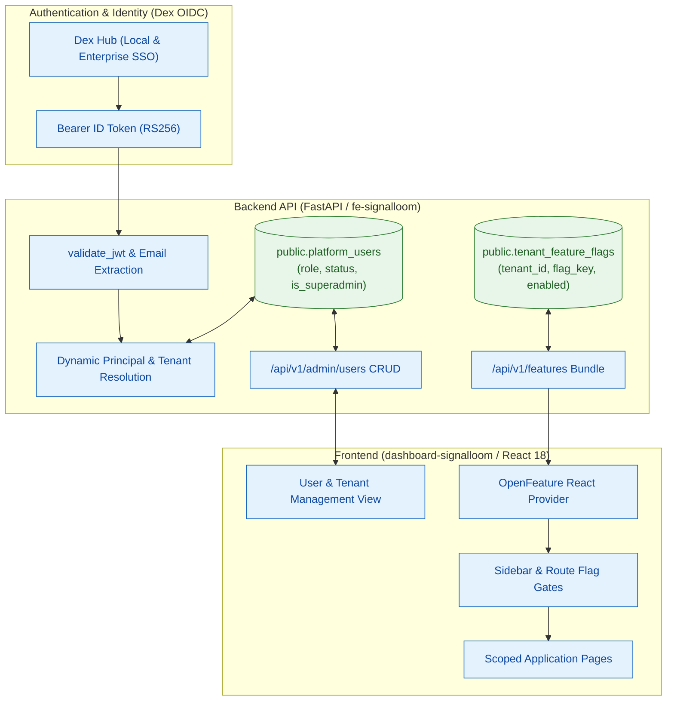

# Proposal — Signal Loom Feature Flagging and Superadmin User Administration (2026-Q4)

|  |  |
| :---: | :---- |
| Proposer & Date: | AJM (2026-10-06) |
| Reviewer & Date: | Stefan Prodan, Vicente Herrera, Francesco Beltramini |
| Approver & Date: | Andy Martin (2026-10-06) |

## Press Release

ControlPlane today announced Signal Loom's production-grade Feature Flagging and Superadmin User Administration capability, built to onboard enterprise design partners with granular surface scoping, dynamic role-based access control, and zero-clutter pilot experiences.

As autonomous agent governance moves from laboratory proofs into enterprise deployments, customer requirements bifurcate. Design partners require rigorous agent telemetry, compliance auditing, and containment guardrails tailored to their specific environments. They do not want internal demo scaffolding, experimental lab pages, or uncommissioned sensor surfaces cluttering their operational navigation. At the same time, security architects and platform owners require an authoritative, interactive user administration interface: inviting operators, assigning tenant-scoped roles (admin, editor, viewer), and managing administrative privilege directly through the web console rather than via manual database seeding or static configuration maps.

Signal Loom answers this need with a lightweight, CNCF OpenFeature-compliant feature engine and an integrated superadmin user lifecycle. Built directly on the existing PostgreSQL and FastAPI foundation, the platform delivers instant tenant-level feature toggleability without adding third-party SaaS daemons or heavy external dependencies. Platform administrators gain a dedicated user-editing console with real-time role reassignment, lifecycle status toggling, and OIDC identity resolution. With these essential capabilities in place, Signal Loom establishes the operational maturity required to deliver tailored, secure governance environments to its first cohort of enterprise design partners.

---

## Proposal Overview

### Opportunity

**The work relates to the following value area(s):**

- [x] client revenue
- [x] product
- [x] services engineering
- [x] operational or regulatory internal

**Key Customers (if relevant):**

Enterprise design partners (beginning with Kusari and tier-1 financial institutions), AI platform teams, and CISO governance leads requiring production-grade tenancy, user management, and scoped feature exposure during early-access pilots.

|  |  |
| :--- | :--- |
| Our *enterprise design partners and platform administrators* | Security Operations, AI Platform Leads, and Tenant Administrators |
| Have the problem/opportunity *…* | The platform displays every internal demonstration, experimental view, and lab module to all users; user onboarding and role assignment are bound to static configuration files and hardcoded string matches rather than dynamic database persistence and an interactive administrative UI |
| When *…* | Inviting pilot users, demonstrating product capabilities to executive stakeholders, or provisioning scoped tenant environments for design partner pilots |

**What’s the urgency of this work (e.g. QX 202X), and does this comprise other subcomponents of projects?**

**Critical for Q4 2026.** Onboarding our first design partner requires presenting a focused, professional governance surface. Exposing developmental demos (e.g. Fleet Demo, SuperCred, synthetic stress simulators) damages credibility, while forcing manual database updates or static configuration edits to provision operator logins creates operational bottlenecks and security audit risks.

---

## Scope Summary

Technology Readiness Level Focus: **3 (Beta)** transitioning to **4 (Production)**.
The core database models (`public.platform_users`, `public.operator_identities`) and Dex OIDC federation exist. This proposal delivers the unified CNCF OpenFeature flagging architecture, dynamic tenant/user resolution in the backend, and the interactive management UI.

### In Scope Activities

| Deliverable | Description | Acceptance Criteria (SMART) | Validation Method |
| :--- | :--- | :--- | :--- |
| 1. Feature Flagging Architecture (OpenFeature) | Integrate `@openfeature/react-sdk` and `openfeature-python-sdk` with PostgreSQL-backed tenant toggles | **Specific:** Add `tenant_feature_flags` table (`tenant_id`, `flag_key`, `enabled`, `config_json`) and `/api/v1/features` endpoint. **Measurable:** Flag evaluations return in < 5ms; zero external cloud dependencies. **Attainable:** Leverages existing asyncpg pool and React Context. **Realistic:** Vendor-neutral CNCF standard avoids vendor lock-in. **Time-Bound:** Completed in Milestone 1. | Automated Pytest and Vitest test suites, `curl /api/v1/features` |
| 2. UI Navigation & Route Gating | Gate navigation items, routes, and action buttons in the frontend | **Specific:** Wrap `Sidebar.tsx` items and `App.tsx` routes with feature gates (e.g. `demos_fleet`, `supercred`, `rbac_analysis`, `collusion_access`). **Measurable:** Disabled features are absent from sidebar and direct URL returns 404/Not Found. **Attainable:** Use OpenFeature `useBooleanFlagValue` and `<FlagGate>` components. **Realistic:** Replaces hardcoded `superadminOnly` booleans with declarative flags. **Time-Bound:** Completed in Milestone 1. | Playwright acceptance spec, Vitest `Sidebar.test.tsx` |
| 3. Dynamic Superadmin & User Identity Engine | Migrate authentication lookup from static env map to `public.platform_users` | **Specific:** Add `is_superadmin BOOLEAN` to `public.platform_users`; resolve tenant, role, and superadmin status by normalized token email. **Measurable:** 100% of newly created database users can log in via OIDC without backend restarts. **Attainable:** Extends `api_compat.py` `authenticated_principal` with backward-compatible fallback. **Realistic:** Closes the temporary stand-in documented in `auth/superadmin.ts`. **Time-Bound:** Completed in Milestone 2. | Pytest `test_tenant_isolation.py`, `test_superadmin.py` |
| 4. User Administration API Endpoints | Implement CRUD API for platform user and operator lifecycle | **Specific:** Add `/api/v1/admin/users` endpoints (`list`, `create`, `update`, `delete`), guarded by `require_superadmin` (or tenant admin). **Measurable:** Returns structured JSON; validates email, display name, tenant, and role (`admin`/`editor`/`viewer`). **Attainable:** Built using FastAPI dependency injection and transaction-safe asyncpg queries. **Realistic:** Audit events recorded for all user mutations. **Time-Bound:** Completed in Milestone 2. | Pytest FastAPI contract tests, OpenAPI spec validation |
| 5. Interactive User-Editing Console | Build user administration interface in `dashboard-signalloom` | **Specific:** Create user management view with user table, role badges, invite modal, role editor, and status toggles (active/suspended). **Measurable:** Superadmin can invite user, reassign role, and deactivate account in < 3 clicks. **Attainable:** Built using React 18, Tailwind tokens, and existing Modal/ConfirmDialog components. **Realistic:** Scoped by tenant for tenant admins; global view for superadmins. **Time-Bound:** Completed in Milestone 3. | Vitest component tests, Playwright click-through spec |
| 6. Design Partner Tenant Presets & Verification | Seed default flag profiles for Kusari and design partner pilots | **Specific:** Provision preset configurations: Kusari pilot (`core_governance=true, audit=true, compliance=true, demos=*false*`). **Measurable:** Pilot tenant login shows clean, focused interface with zero demo noise. **Attainable:** SQL migration seed script and automated verification. **Realistic:** Direct customer deliverable. **Time-Bound:** Completed in Milestone 4. | End-to-end browser verification via Tailscale, BATS suite |

### Out of Scope

* Implementing complex billing, payment gateways, or subscription metering.
* Self-hosting heavyweight feature flag platforms (Unleash server, LaunchDarkly, or PostHog clusters).
* Replacing Dex with a custom identity provider (Dex continues to serve as the OIDC federation hub).
* Implementing custom multi-factor authentication (MFA) logic inside Signal Loom (delegated to upstream enterprise IdPs via Dex connectors).

---

### KPIs

| Metric | Current Value | Target Value | Measurement |
| :---- | :---- | :---- | :---- |
| Unwanted Demo Routes on Pilot Tenant | 100% visible (all 6 demo routes exposed) | 0% visible (cleanly gated) | Playwright inspection on pilot tenant session |
| User Provisioning Turnaround | Hours (requires code edit or direct DB CLI) | < 30 seconds (via web UI) | Timed UI user invitation journey |
| Flag Evaluation Latency | N/A (no flagging engine) | < 5ms per evaluation | Backend and client telemetry benchmarks |
| Superadmin Identity Source | Hardcoded email string in code | Persistent database column (`is_superadmin`) | Automated security contract test |
| Test Coverage on Auth & Admin Routes | ~85% | ≥ 95% across new endpoints | Pytest & Vitest coverage reports |

---

### 3rd Party Test Plan and Quality Assurance

| Validation | Method | Owner |
| :---- | :---- | :---- |
| Feature Flag Invariant Verification | Automated Vitest and Pytest suites verifying flag states across tenants | Security QA Engineer |
| RBAC Boundary Penetration Check | Offensive test script verifying that viewers/editors cannot call admin endpoints | Purple Team Specialist |
| End-to-End User Lifecycle Journey | Playwright test exercising invite → OIDC login → role change → deactivation | Test Automation Lead |
| Design Partner Experience Review | Visual inspection of pilot tenant experience over private Tailscale tunnel | Principal Architect (AJM) |

---

## Technical Overview

#### Technologies

| Technology | Purpose | Alignment |
| :---- | :---- | :---- |
| **OpenFeature (`@openfeature/react-sdk`)** | Standardized frontend feature flag evaluation | CNCF standard, vendor-neutral, zero bundle bloat |
| **FastAPI / Python 3.12** | User management endpoints and feature delivery API | Core backend framework of `fe-signalloom` |
| **PostgreSQL 16 (asyncpg)** | Persistent storage for `platform_users` and `tenant_feature_flags` | Standard database foundation across Kind and GCP |
| **React 18 / TypeScript / Tailwind** | User-editing interface and modal dialogs | Standard dashboard stack |
| **Dex OIDC** | Federation hub linking local passwords and enterprise SSO | Standard platform identity layer |

#### Infrastructure and Repositories

| Asset | Location | Notes |
| :---- | :---- | :---- |
| Dashboard Frontend | `d2-signalloom/apps/dashboard-signalloom/` | SPA containing routes, navigation, and admin UI |
| Backend API Gateway | `d2-signalloom/apps/fe-signalloom/` | FastAPI service handling auth, users, and features |
| Database Migrations | `d2-signalloom/apps/fe-signalloom/src/db/migrations/` | Forward-only SQL migrations |
| Dex Manifests | `d2-signalloom/infra/inf-signalloom/base/dex.yaml` | OIDC federation configuration |

#### Security and Risk

**Threat model for this deliverable:**

| Threat | Impact | Mitigation |
| :---- | :---- | :---- |
| Privilege escalation via client-side flag tampering | Attacker modifies local storage or React state to enable privileged views | **Server-side enforcement:** Every privileged route requires server-side JWT verification and `require_feature()` route dependency. Client flags only control visibility. |
| Cross-tenant user enumeration or manipulation | Malicious tenant admin attempts to list or edit users from another tenant | **Strict tenant isolation:** All SQL queries enforce `WHERE tenant_id = $1`. Only authenticated users with `is_superadmin = true` can query across tenants. |
| Inactive/suspended user token replay | Suspended user continues to access API with unexpired JWT | **Database status check on request:** `authenticated_principal` verifies `status == 'active'` against the database or low-TTL cache on sensitive operations. |
| Unauthorized role modification | Attacker attempts to PATCH their own role to `admin` | **Explicit authorization check:** Only active `admin` or `superadmin` principals can modify roles; users cannot elevate their own role. |

**SWOT Analysis:**

| Strengths | Weaknesses |
| :---- | :---- |
| - OpenFeature standard guarantees zero lock-in. - Zero new daemons or cloud costs. - Reuses existing `platform_users` table foundation. - Solves immediate design partner onboarding friction. | - Requires initial backend and frontend implementation effort. - In-database flag management lacks advanced statistical A/B testing (not needed for pilot). |

| Opportunities | Threats |
| :---- | :---- |
| - Seamlessly unblocks enterprise customer pilot (Kusari). - Cleanly hides unreleased/experimental research pages. - Foundation for future commercial tiering (Free vs Pro vs Enterprise). | - Schema drift if migrations are applied out of order. - Risk of stale flag cleanup debt if old flags are not retired. |

---

## Milestones and Deliverables

| Milestones Committed To | Duration (days) | Consultants | Person-days | Deadline | Capability Mapping |
| :---- | :---- | :---- | :---- | :---- | :---- |
| **M1: Feature Flagging Core** - `tenant_feature_flags` migration - `/api/v1/features` endpoint - `@openfeature/react-sdk` integration - Navigation & route gating in `Sidebar.tsx` and `App.tsx` | 2.0 | 1 | 2.0 | Sprint Day 2 | `#cap-architecture` `#cap-react` `#cap-api-design` |
| **M2: Superadmin & User Management Backend** - `is_superadmin` schema migration - Dynamic email lookup in `authenticated_principal` - `/api/v1/admin/users` CRUD endpoints with audit logging - Pytest test suites | 2.0 | 1 | 2.0 | Sprint Day 4 | `#cap-python` `#cap-security-engineering` `#cap-api-design` |
| **M3: Frontend User Administration Console** - API client methods in `client.ts` - User table view with role badges and filters - Add User and Edit User modals - Role assignment and status toggle UI | 2.5 | 1 | 2.5 | Sprint Day 6 | `#cap-react` `#cap-testing-pyramid` |
| **Mid-Project Review** - Working demo of flag gating and user editing - Security and tenant isolation audit | 0.25 | 2 | 0.5 | Sprint Day 7 | `#cap-architecture` |
| **M4: Integration & Design Partner Validation** - Seed Kusari pilot flag preset - Playwright end-to-end journey tests - Tailscale remote verification - Final documentation & sign-off | 1.5 | 1 | 1.5 | Sprint Day 8 | `#cap-testing-pyramid` `#cap-kubernetes` |
| **Signoff & Review** | 0.25 | 2 | 0.5 | Sprint Day 8 | `#cap-architecture` |

**Total Estimated Effort:** 8.5 Person-days (approximately 1.5 calendar weeks).

**Definition of Done:**

* `tenant_feature_flags` migration runs cleanly and idempotently on PostgreSQL.
* OpenFeature React SDK gates navigation items and routes cleanly without layout shift.
* Dynamic OIDC login verifies user identity and tenant assignment from `platform_users` table.
* Superadmins can list, invite, update, and deactivate users through the web console.
* Playwright acceptance tests pass for both user management and feature flag suppression.
* Zero regression across existing test suites (`make test-all-offline` and `make acceptance-test`).

---

### Reviews & Collaboration (RACI)

| Role | Stakeholder |
| :---- | :---- |
| **Accountable** | Lead Platform Engineer / Architect |
| **Responsible** | Full-Stack Security Engineering Team |
| **Consulted** | Stefan Prodan, Vicente Herrera, Francesco Beltramini |
| **Informed** | [Andrew Martin](mailto:andy@control-plane.io), [Elena Mikhalina](mailto:elena.mikhalina@control-plane.io) |

---

## Finances

### Additional costs

| Additional Cost | Estimated Spend | One Off or Recurring | Must-Have or Nice-to-Have |
| :---- | :---- | :---- | :---- |
| OpenFeature & Local DB Architecture | £0.00 | Recurring | Must-Have |
| CI/CD Compute for Acceptance Tests | < £10.00 | Recurring | Must-Have |

---

## Decision Log

| Date | Decision Makers | Decision and Context | Reason | Impact |
| :---- | :---- | :---- | :---- | :---- |
| 2026-10-06 | AJM, sensai | Adopt CNCF OpenFeature standard with internal PostgreSQL provider | Avoids deploying extra daemons (Unleash/Flipt) or relying on third-party SaaS during early design partner phase while keeping frontend code 100% vendor-neutral. | Clean code, zero extra infrastructure footprint, future-proof. |
| 2026-10-06 | AJM, sensai | Resolve user identity and tenant dynamically from `public.platform_users` by email | Replaces hardcoded `demo-user` string matching and static environment dictionary with authoritative database records. | Enables dynamic invitation and role management without server restarts. |
| 2026-10-06 | AJM, sensai | Integrate user management directly into Settings and Superadmin view | Provides immediate accessibility for both Tenant Admins (managing their team) and Superadmins (managing all tenants). | Streamlined operational UX for design partner onboarding. |

---

## Appendix

### A. Useful References

* [OpenFeature React SDK Documentation](https://openfeature.dev/docs/reference/technologies/client/web/react/)
* [Dex OIDC Federation Design Guide](file:///home/andy/src/cp/osramp-demo/docs/signalloom/dex-connectors.md)
* [Signal Loom Platform User Schema](file:///home/andy/src/cp/osramp-demo/d2-signalloom/apps/fe-signalloom/src/db/migrations/008_platform_users.sql)
* [Signal Loom Operator Identity Module](file:///home/andy/src/cp/osramp-demo/d2-signalloom/apps/fe-signalloom/src/operator_identity.py)
