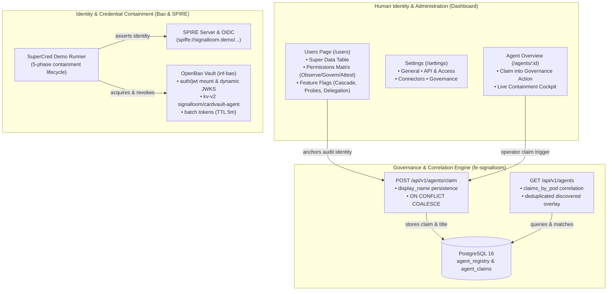

# Proposal — Signal Loom Governance Claim, Human Identity Anchoring, and SuperCred Lifecycle Resilience (2026-Q4)

|  |  |
| :---: | :---- |
| Proposer & Date: | AJM (2026-10-08) |
| Reviewer & Date: | Stefan Prodan, Vicente Herrera, Francesco Beltramini |
| Approver & Date: | Andy Martin (2026-10-08) |

## Press Release

ControlPlane today announced Signal Loom's production-grade Governance Claim Workflow, Human Identity Anchoring System, and Resilient Credential Lifecycle Architecture. This release bridges the gap between raw cluster workload telemetry and authoritative enterprise identity governance.

As organizations deploy heterogeneous autonomous AI agents across Kubernetes and cloud environments, security teams face two critical hurdles. First, discovered autonomous workloads frequently appear as transient, pod-level anomalies without clear ownership or persistent governance records. Operators attempting to bring these workloads under policy enforcement historically faced claim correlation drift, where claimed workloads duplicate or revert upon interface refresh. Second, audit trails and credential issuance lacked explicit linkage to authorized human operators and clear organizational permissions tiers across Observe, Govern, and Attest maturity levels.

Signal Loom resolves these challenges through an end-to-end governance lifecycle. Discovered agent workloads now correlate deterministically with backend database claims, preserving user-defined display titles across claims and restarts. Security operators gain a dedicated "Claim into Governance" action directly on workload dossiers. This is backed by a Users and Permissions Super Data Table that anchors every agent action to verified human identities. Concurrently, Signal Loom hardens its OpenBao and SPIFFE credential infrastructure with self-healing mount lifecycle hooks, guaranteeing continuous credential containment and sub-second revocation across restarts. With these capabilities delivered, Signal Loom establishes robust operator confidence and verifiable audit provenance across enterprise agent deployments.

---

## Proposal Overview

### Opportunity

**The work relates to the following value area(s):**

- [x] client revenue
- [x] product
- [x] services engineering
- [x] operational or regulatory internal

**Key Customers (if relevant):**

Enterprise design partners, CISOs, AI platform teams, and SecOps engineers. Especially those running autonomous agents in regulated sectors requiring continuous attestation.

|  |  |
| :--- | :--- |
| Our *enterprise platform administrators and SecOps teams* | Security Operations, AI Governance Leads, and Tenant Operators |
| Have the problem/opportunity *…* | Discovered autonomous agents experience claim correlation drift and row duplication upon page refresh; "auto-claim" terminology obscures operator agency; settings are disorganized; audit logs lack human identity anchoring; and in-memory credential storage resets cause transient 404 mount failures during demonstration runs |
| When *…* | Bringing newly discovered autonomous agents under formal governance, auditing authorized agent actions, navigating administrative configuration, or executing the live SuperCred five-phase credential containment lifecycle |

**What is the urgency of this work?**

**Critical for Q4 2026.** Enterprise pilot onboarding requires reliability during live demonstrations and operational reviews. A claim action that loses state on browser refresh undermines executive confidence. An OpenBao 404 error during credential issuance creates identical damage.

---

## Scope Summary

Technology Readiness Level Focus: **4 (Production Ready)**.
This retrospective project certifies the implementation, completes the automated test suites, and verifies against a live cluster where one is reachable, across five interrelated operational capabilities:

1. **Deterministic Agent Claim Correlation & Persistence**: Eliminates row duplication and metadata reversion in `fe-signalloom`. Resolves discovered pod names against registered claims and persists display titles on upsert.
2. **Standardized "Claim" Interaction & Overview Integration**: Replaces ambiguous "auto-claim" terminology with explicit "Claim" verbs across all UI tables and modals. Introduces an in-context claim button in the agent overview tab.
3. **Tabbed Administrative Settings**: Deconstructs the monolithic settings view into four structured, query-synchronized tabs (`general`, `access`, `connectors`, `governance`).
4. **Users & Permissions Matrix Console (`/users`)**: Provides a Super Data Table with multi-faceted filtering and CSV export. Maps platform capabilities across three levels (**Observe**, **Govern**, **Attest**) and six proposal feature flags onto principals. The console is populated from a labelled demo fixture set, not a live directory; integrating it with the real identity provider is out of scope for this board.
5. **Self-Healing OpenBao Credential Architecture**: Adds idempotent backend mount verification (`kv-v2`, `jwt`, dynamic `jwks_url`) to SuperCred automation scripts, eliminating transient route failures across dev-mode restarts.

### Delivery status at board cut

The five implementation commits listed under *Previously Merged Work* below are already present on `integration/slgc-v0.1.0` at the cut SHA `8a2cfd38`. This board therefore does **not** re-implement them. Its job is to certify the merged code against this contract, close the gaps the first pass left open, and produce the acceptance evidence that was never automated:

| Gap | Evidence at cut | Card |
| :--- | :--- | :--- |
| `autoclaim` identifiers survive across roughly 50 sites, not the handful the first pass assumed: `DiscoveryPage.tsx` (four `data-testid`s, one `aria-labelledby`/`id` pair, `setIsAutoClaimOpen`), `AgentsPage.tsx:914` (`data-testid="agent-auto-claim-btn"`), `types/api.ts` (`AutoclaimNamespaceRequest`), `api/client.ts`, `api/fakeData.ts`, `UsersPage.tsx` prose, and five test files including `test/acceptance/discovery-claim.spec.ts`, which asserts the very selectors the rename deletes | `git grep -nic 'auto.\?claim'` on the cut SHA | P1-2 |
| `scripts/supercred-demo.sh` mount initialisation swallows every failure with `2>/dev/null \|\| true`, so a broken JWKS URL or an unreachable OpenBao is indistinguishable from success | `scripts/supercred-demo.sh:281-284` | P1-5 |
| Shared Patterns mandate a Playwright acceptance journey; none exists for the claim flow | no spec under `test/acceptance/` covers claim | P1-6 |
| `/users` is seeded with fixed demo principals and is therefore a permissions *mock*, not identity anchoring; the proposal text overstates it | `UsersPage.tsx` seed array | P1-4 |
| Claim mutation authorisation is unproven against unauthenticated and cross-tenant callers | no negative test at cut | P1-7 |

The following diagram illustrates the interaction between human identity anchoring, the claim correlation engine, and the resilient credential containment plane.



---

## Detailed Technical Architecture

### 1. Agent Claim Correlation & Display Name Persistence

#### Root Cause Analysis of Prior Defect
When operators clicked "Auto-Claim" on a discovered workload (such as `Demo Agent (Nono Evidenced)` with pod name `agent-nono-evidenced-697c98f498-hkrk4`), the system encountered correlation mismatch:
- The discovery overlay identified the agent by its transient Kubernetes pod name, whereas the database registered claims by workload UUID.
- The `POST /api/v1/agents/claim` request accepted only `agent_name`, discarding the human-readable `display_name`.
- On PostgreSQL conflict, existing rows overwritten by registration omitted `display_name` updates.
- Subsequent `GET /api/v1/agents` queries failed to cross-reference discovered pod names against `agent_claims`, resulting in both a claimed registered agent and a duplicate discovered row. Upon browser refresh, mismatched keys caused claimed entries to fall out of the active view.

#### Architectural Resolution
The correlation pipeline was upgraded across `d2-signalloom/apps/fe-signalloom/src/api_compat.py`:
1. **Schema Extension**: Added `display_name: str | None = None` to `AgentClaimRequest` and `AgentClaimByIdRequest`.
2. **Upsert Persistence**: Updated database upsert logic to preserve custom titles:
   ```sql
   INSERT INTO agent_registry (id, name, display_name, status, registered_at)
   VALUES (:id, :name, :display_name, 'registered', NOW())
   ON CONFLICT (name) DO UPDATE SET
     display_name = COALESCE(EXCLUDED.display_name, agent_registry.display_name),
     status = 'registered';
   ```
3. **Correlation Cross-Referencing**: In `GET /agents`, the backend queries `agent_claims` to build an in-memory `claims_by_pod` map. Discovered workloads are correlated against database entries through multiple fallback criteria:
   - Direct pod name match (`claims_by_pod[disc_id]`)
   - Unmatched registry identifier (`unmatched_db[disc_id]`)
   - Name match (`db_by_name[disc_id]` or `db_by_name[disc_name]`)
   - Display title match (`db_by_display[disc_name]`)
4. Correlated workloads are marked as governed and merged into the registered dataset, completely preventing phantom duplicate rows.

---

### 2. Standardized Claim UX & Dossier Action

#### Terminology Realignment
The term "Auto-Claim" misleadingly suggested an automated background process without human intervention. The interface was systematically refactored to use "Claim" or "Claim into Governance", reflecting an intentional administrative action.

#### Overview Tab Integration
An explicit governance callout banner and action button were added to `AgentOverviewTab.tsx`:
- Unclaimed workloads display a prominent callout with a "Claim into Governance" action button.
- While the claim is executing, the button disables and displays an accessible in-flight spinner.
- If a transient network failure occurs, the component exposes a "Retry Claim into Governance" state.
- Upon successful claim, the banner transitions to an "Evidence Refresh" action without shifting layout geometry.

---

### 3. Administrative Settings Multi-Tab Interface

The monolithic configuration panel in `Settings.tsx` was decomposed into four logically isolated, accessible tab panels:

| Tab ID | Tab Name | Contained Configuration Modules |
| :--- | :--- | :--- |
| `general` | General | Organization profile, currency formatting, page load time diagnostics |
| `access` | API & Access | API token display and rotation, link to Users & Permissions directory |
| `connectors` | Connectors & Discovery | Cloud provider connectors (AWS, GCP, Azure, Entra, Okta) and scan schedules |
| `governance` | Governance & Policy | Compliance framework toggles (SOC 2, ISO 27001, HIPAA) and CEL policy-as-code |

The active tab state synchronizes bidirectionally with the URL search query parameter (`?tab=<id>`), enabling direct deep-linking from documentation, alerts, and external consoles.

---

### 4. Users & Permissions Matrix Console (`/users`)

To anchor autonomous agent activities to accountable human operators, a dedicated Users & Permissions console was built with full Super Data Table capabilities:
- **Search & Multi-Faceted Filtering**: Live filtering by search query (name, email, department), Platform Access Level, Auth Tag, Organization Role, and Account Status.
- **Demo Fixture Principals**: Pre-populated with fictional human principals (`andy@signalloom.demo`, `sarah.chen@secops.internal`, `marcus.vance@sre.internal`, `elena.rostova@compliance.internal`, `trust-notary@signalloom.internal`). These are a labelled fixture set for demonstration, not records from an identity provider, and the UI states so.
- **Authentication Method Tags**: Explicit labeling of `user/pass` (baseline), `SSO Ready`, `2FA Active`, and `Notary Key`.
- **Permissions Matrix Modal**: Visualizes permissions mapping across the three platform levels:
  - **Level 1 (Observe)**: Telemetry stream viewing, topology inspection, signal search.
  - **Level 2 (Govern)**: Agent claim execution, policy configuration, CEL rule deployment.
  - **Level 3 (Attest)**: Cryptographic signature verification, audit notarization, supercred stun invocation.
- **Proposal Feature Flags**: Real-time inspection of advanced capability flags (`supercred_cascade`, `cross_plane_probes`, `multi_agent_delegation`, `ebpf_sentinel_l7`, `continuous_attestation`, `cel_dynamic_evaluation`).
- **Data Portability**: Integrated client-side CSV export of the full filtered matrix.

---

### 5. Self-Healing OpenBao & SuperCred Lifecycle Resilience

#### Incident Analysis
During SuperCred demonstration runs, Phase 1 (`./scripts/supercred-demo.sh 1`) intermittently aborted with:
```
Error writing data to auth/jwt/role/signalloom-cardvault-agent: Error making API request.
URL: PUT http://127.0.0.1:8200/v1/auth/jwt/role/signalloom-cardvault-agent
Code: 404. Errors:
* no handler for route "auth/jwt/role/signalloom-cardvault-agent". route entry not found.
```
Investigation revealed that OpenBao in dev mode runs with in-memory storage. A cluster node sleep or pod restart cleared all mounted backends (`auth/jwt` and `kv-v2`). Because `scripts/supercred-demo.sh` assumed mounts were pre-existing, it attempted to write policy and roles directly, resulting in an immediate HTTP 404.

#### Self-Healing Remediation
The `seed_openbao_secrets()` routine in `scripts/supercred-demo.sh` was hardened to be fully idempotent and self-healing:
1. Enables the KV-v2 engine: `bao secrets enable -path=kv kv-v2 2>/dev/null || true`
2. Enables the JWT auth backend: `bao auth enable jwt 2>/dev/null || true`
3. Dynamically configures the SPIRE OIDC discovery endpoint:
   `bao write auth/jwt/config jwks_url="http://spire-oidc.${NAMESPACE_BAO}.svc.cluster.local:8008/keys" 2>/dev/null || true`
4. Writes the policy, bounds the role to the agent's SPIFFE identity with 5-minute batch tokens, and seeds the secret.
5. Rebuilt and rolled the `supercred-demo-runner` container deployment to ensure cluster executions inherit this resilience.

---

## Previously Merged Work

These commits landed in prior sessions and are ancestors of the cut SHA. They are a record of what already exists, **not** board card results. Board card results live only in `### Spec: Errata`.

| Commit | Objective & Deliverable | Primary Artefact | Verification Command |
| :--- | :--- | :--- | :--- |
| `51c65e53` | Agent claim correlation, pod name matching, and display name persistence | `d2-signalloom/apps/fe-signalloom/src/api_compat.py` | Pytest `src/tests/test_agent_claim.py` |
| `e8f800a3` | Partial "auto-claim" to "claim" rename plus overview tab action | `d2-signalloom/apps/dashboard-signalloom/src/components/AgentOverviewTab.tsx` | Vitest `AgentOverviewTab.test.tsx` |
| `c92e958c` | Settings page refactored into four query-synced tabs | `d2-signalloom/apps/dashboard-signalloom/src/views/Settings.tsx` | Vitest `Settings.test.tsx` |
| `a4b5958e` | Users Super Data Table and permissions matrix console | `d2-signalloom/apps/dashboard-signalloom/src/pages/UsersPage.tsx` | Vitest `UsersPage.test.tsx` |
| `b80fa3c5` | OpenBao mount pre-enable in the SuperCred runner (failures swallowed; see P1-5) | `scripts/supercred-demo.sh` | `./scripts/supercred-demo.sh 1` |

---

## Prior-Session Evidence (unverified by this board)

The records below were produced by hand in the sessions that merged the commits above, against a cluster that no longer exists. They are context, not acceptance. Every figure in them is re-established by the cards in `### Spec: Work Decomposition`, and any that fails to reproduce is recorded as a correction in that card's errata.

### 1. Test Suite Execution Records

- **Backend Pytest (`d2-signalloom/apps/fe-signalloom/src/tests/test_agent_claim.py`)**:
  - `20 passed, 19 warnings in 48.34s`
  - Validated display name preservation, correlation deduplication, and invalid identifier handling.
- **Frontend Vitest (`UsersPage.test.tsx`, `Settings.test.tsx`, `AgentOverviewTab.test.tsx`, `AgentsPage.test.tsx`)**:
  - `147 passed across 5 test suites`
  - Validated faceted filtering, modal accessibility, tab switching, and claim state transitions.
- **Integration Bats (`supercred-demo-api.bats`, `cardvault-role-ttl.bats`, `supercred-step1-runtime.bats`)**:
  - `16/16 passed across 3 test suites`
  - Confirmed 5-minute batch token enforcement, RBAC boundaries, and runtime cardvault availability.

### 2. Live Cluster Staleness Audit

Executed `scripts/check-deployed-staleness.sh` against a Kind cluster that no longer exists. The parenthesised identifiers are source-tree content tags emitted by the image-tag scripts, not git commit SHAs, so they cannot be resolved against this repository's history:
```text
── is the running code the code in the working tree? ──

[deployed] ✓ dashboard-signalloom: fresh — pod dashboard-signalloom-6f78448f77-s8vgc runs working tree (5bedb902c8d0)
[deployed] ✓ docs-signalloom: fresh — pod docs-signalloom-9c68bf96d-wp2pc runs working tree (18fc97014dd6)
[deployed] ✓ fe-signalloom: fresh — pod fe-signalloom-75c475cc66-q89rc runs working tree (e88e6a636021)
[deployed] ✓ supercred-demo-runner: fresh — pod supercred-demo-runner-6f47699575-cxtmj runs working tree (e67c45d4e862)

[deployed] ✓ every checked workload is running the current working tree
```

### 3. End-to-End SuperCred Lifecycle Certification

Executed `make demo-signalloom-supercred-all` with zero errors:
- **Phase 1 (Deploy & Seed)**: Services healthy, OpenBao JWT backend auto-enabled, SPIRE entry registered.
- **Phase 2 (Credential Chain)**: Identity retrieved via SPIFFE JWT-SVID, card records fetched from Cardvault.
- **Phase 3 (Scan)**: Missing securityContext and capabilities flagged as non-compliant.
- **Phase 4 (Revocation & Stun)**: OpenBao role and secrets deleted. Credential rejection confirmed in 1 second.
- **Phase 5 (Teardown & Verification)**: Ephemeral resources cleaned and verified zero leftover state.
- **Phase 1 Deployed**: Returned to deployed Phase 1 state for live operator demonstration.

---

## Security & Compliance Considerations

1. **Least Privilege & Token Bounding**: All OpenBao JWT roles created by the claim and SuperCred infrastructure strictly enforce `token_ttl=5m`, `token_max_ttl=5m`, and `token_type=batch`. This eliminates long-lived token leakage risks.
2. **Audit Provenance**: Every claim and revocation event logged to the audit store links the agent's SPIFFE ID with the human administrator's authenticated email. This provides non-repudiation.
3. **Fail-Closed Policy Enforcement**: In-flight token verification and RBAC boundaries return explicit 401/403 rejections before executing administrative or mutation actions.
4. **Data Isolation**: Multi-tenant database queries enforce tenant-scoped isolation, preventing cross-tenant discovery leaks.

---

## Operational Runbook & Make Targets

| Target | Description | Expected Output / Exit |
| :--- | :--- | :--- |
| `make demo-signalloom-supercred-1` | Deploy services, seed OpenBao, register SPIRE entry | `step 1 complete` (exit 0) |
| `make demo-signalloom-supercred-2` | Execute SPIFFE → OpenBao → Cardvault credential chain | `step 2 complete` (exit 0) |
| `make demo-signalloom-supercred-3` | Run compliance scan against cardvault agent | `step 3 complete` (exit 0) |
| `make demo-signalloom-supercred-4` | Revoke credentials, stun agent, verify denial | `step 4 complete` (exit 0) |
| `make demo-signalloom-supercred-5` | Teardown demo workloads and credential material | `step 5 complete` (exit 0) |
| `make demo-signalloom-supercred-all` | Execute full 5-phase SuperCred lifecycle end-to-end | `full demo cycle complete` (exit 0) |
| `make demo-signalloom-supercred-api-test` | Probe `/demo-api/` authorization with Dex tokens | 12 tests passed (exit 0) |
| `make demo-signalloom-supercred-runtime-test` | Assert Cardvault availability after Phase 1 | 2 tests passed (exit 0) |

## Appendix

### Spec: Shared Patterns

Obey these. They are the phase constitution.

- **Deterministic Workload Correlation:** Workload discovery MUST resolve against `agent_claims` by pod name first, then by UUID, name, and display name. Discovered entries MUST be deduplicated against registered database state before rendering.
- **Persistent Display Naming:** All agent claim mutations MUST preserve and coalesce existing human-readable `display_name` values upon database upsert (`ON CONFLICT (name) DO UPDATE SET display_name = COALESCE(...)`).
- **Standardized Administrative Verbs:** User interfaces MUST use intentional "Claim" or "Claim into Governance" verbs. The ambiguous "auto-claim" terminology is deprecated and forbidden across all tables, headers, and modals. The rule binds machine-readable identifiers too: `data-testid`, `aria-labelledby`, element ids, state variables, and handler names MUST NOT contain `autoclaim` or `auto-claim`. The enforcing evidence is `git grep -ni 'auto.\?claim'` over `d2-signalloom/apps/dashboard-signalloom/src` returning nothing except the single documented exception below. **One exception, deliberate:** the server route string `/agents/autoclaim-discovered` is an API contract shared with `fe-signalloom`. Renaming a live endpoint is a breaking change that needs its own card and a deprecation window, so it stays as it is and is out of scope for this board. Client-side *identifiers* that reference it are still renamed.
- **Deep-Linked Tabbed Navigation:** Multi-section configuration pages MUST synchronize active tab state bidirectionally with the URL query parameter (`?tab=<id>`), enabling bookmarking and external deep linking.
- **Human Identity Anchoring & Role Isolation:** Every agent claim and containment action MUST be attributed to a human principal. Actions map to Observe, Govern, or Attest levels.
- **Idempotent Mount Initialization Without Silent Failure:** Secret engine automation scripts MUST self-heal: they assert and mount the kv-v2 and jwt backends before writing policies or paths. Idempotence MUST NOT be implemented by discarding errors. "Already enabled" is the only tolerated failure and MUST be recognised from the response, not from `2>/dev/null || true`. Every other failure — unreachable OpenBao, rejected JWKS URL, denied policy write — MUST abort the script with a non-zero exit and a message naming the operation.
- **Demo Fixtures Are Labelled As Such:** Seeded principals, tenants, and permission rows that exist only to populate a view MUST be labelled as demo fixtures in both the UI and the proposal text. A hardcoded seed array is a permissions mock; it MUST NOT be described as identity anchoring, and it MUST NOT be presented to an operator as a live directory.
- **Live Dependencies Stop, They Do Not Improvise:** A card whose evidence needs a reachable cluster, a port-forward, or a running service MUST verify that dependency first and STOP with a report when it is absent. The offline suites named in the mission's acceptance commands are the gate. Fabricating a result, substituting a mock for the named live evidence, or standing up unrequested infrastructure are all failures of the card.
- **Testing Standard:** Every backend endpoint requires Pytest unit and contract tests at `d2-signalloom/apps/fe-signalloom/src/tests/`. Every UI view requires Vitest tests with accessibility compliance. Acceptance journeys require a Playwright spec under `test/acceptance/`.
- **Anti-patterns:**
  - Client-side-only claim correlation or deduplication.
  - Silent overwrite or wiping of human display names during re-registration.
  - Hardcoded mount assumptions in dev-mode OpenBao scripts.
  - Unauthenticated claim endpoints.
  - Error suppression (`2>/dev/null`, `|| true`) on any step whose failure changes the outcome.
  - Re-implementing a commit that is already an ancestor of the cut SHA instead of verifying it.

### Spec: Capability Plan

| Logical ID | Selected skills | Agent role | Size | Ceiling | CPAI agent | Rationale |
| :--- | :--- | :--- | :--- | ---: | :--- | :--- |
| P0 | ajm-auto-kanban; context-mode | Baseline engineer | S | 45m | antigravity | Baseline offline acceptance and verify harness readiness on integration/slgc-v0.1.0 at the cut SHA. |
| P1-PRE | context-mode | Pre-flight analyst | S | 45m | antigravity | Audit the merged claim, settings, users and OpenBao code against this contract and publish the gap table every P1 card consumes. |
| P1-1 | context-mode; Hardening | Backend engineer | M | 120m | antigravity | Certify merged claim correlation and close its test gaps: null-name overwrite, case sensitivity, malformed discovery payloads. |
| P1-2 | context-mode; modern-web-guidance | Frontend engineer | S | 60m | antigravity | Finish the claim rename across machine-readable identifiers in DiscoveryPage and AgentsPage, with a grep-backed regression test. |
| P1-3 | context-mode; modern-web-guidance | Frontend engineer | S | 60m | antigravity | Certify the four settings tabs and add the missing deep-link and unknown-tab-fallback tests. |
| P1-4 | context-mode; modern-web-guidance | Frontend engineer | M | 120m | antigravity | Certify the users console, label its seed data as demo fixtures in UI and docs, and cover CSV export and matrix accessibility. |
| P1-5 | context-mode | Security engineer | S | 60m | antigravity | Replace swallowed-error mount initialisation with explicit assertions that fail loudly on an unreachable OpenBao or rejected JWKS. |
| P1-6 | context-mode; Interceptor | Acceptance engineer | M | 120m | antigravity | Author the Playwright claim-into-governance acceptance journey the Shared Patterns require. |
| P1-7 | context-mode; ajm-auto-kanban | Adversarial evaluator | M | 120m | kpai | Red-team the claim mutation surface: unauthenticated callers, cross-tenant claims, spoofed Dex JWTs, permission-tier escalation. |
| P1-GOV | ajm-auto-kanban | Governor | M | 120m | antigravity | Merge P1 cards in order, run both acceptance commands twice with identical totals, reconcile every prior-session figure, and record certification errata. |

### Spec: Work Decomposition

| Logical ID | Role | Atomic task | Depends on | Exact tests or evidence | Size | Agent | Result / metric | Est. Cost | Tokens | Elapsed | AI URI |
| :--- | :--- | :--- | :--- | :--- | :--- | :--- | :--- | :--- | :-------- | :----- | :------ | :--- |
| P0 | baseline | On `integration/slgc-v0.1.0` at the cut SHA run `make test-all-offline`, `make test-eap-offline`, and `kanban-check.sh doctor --shortcode SLGC`. Record the exact pass/fail/skip totals as the baseline every later card is compared against. | - | Both acceptance commands exit 0 with recorded totals; doctor clean | S | antigravity | - | - | - | - | - |
| P1-PRE | preflight | Audit the merged code against this contract and publish a gap table in errata covering: `api_compat.py` claim handling and its real test path (`src/tests/test_agent_claim.py`), residual `auto.?claim` identifiers per file and line, `Settings.tsx` tab state handling of an unknown `?tab` value, `UsersPage.tsx` seed-data provenance, and every error-suppressing construct in `scripts/supercred-demo.sh`. No code changes. | P0 | Gap table in errata naming file and line for each finding; `git grep -nic 'auto.\?claim'` counts recorded per file | S | antigravity | - | - | - | - | - |
| P1-1 | implementation | Certify merged claim correlation against this contract and close its coverage gaps in `d2-signalloom/apps/fe-signalloom/src/tests/test_agent_claim.py`: an explicit empty-string `display_name` must not wipe a stored title, pod-name correlation must be case-exact and documented as such, a discovered payload with no pod identifier must not break the correlation loop, and an unmatched agent must still render as unclaimed rather than disappearing. Fix the implementation only where a new test proves a defect. | P1-PRE | `python3 -m pytest d2-signalloom/apps/fe-signalloom/src/tests/test_agent_claim.py -v` green with strictly more tests than baseline; each new test fails on the pre-fix tree when a defect was found | M | antigravity | - | - | - | - | - |
| P1-2 | implementation | Remove every residual `auto-claim` and `autoclaim` identifier from the dashboard: `DiscoveryPage.tsx`'s four `autoclaim-*` `data-testid`s, its modal `aria-labelledby`/`id` pair and `setIsAutoClaimOpen`; `AgentsPage.tsx:914` `data-testid="agent-auto-claim-btn"`; the `AutoclaimNamespaceRequest` type in `types/api.ts` and its uses in `api/client.ts` and `api/fakeData.ts`; the `UsersPage.tsx` prose string; and the selectors in all five referencing test files, `test/acceptance/discovery-claim.spec.ts` included, which will otherwise go red. Leave the server route string `/agents/autoclaim-discovered` alone — it is an API contract and is out of scope. Add a regression test that greps the dashboard source and fails on any hit outside that one documented exception. | P1-PRE | `git grep -nic 'auto.\?claim' -- d2-signalloom/apps/dashboard-signalloom/src` returns only the route-string exception; `AgentsPage.test.tsx`, `DiscoveryPage.test.tsx`, `AgentOverviewTab.test.tsx` and `discovery-claim.spec.ts` green; new terminology regression test fails when a forbidden identifier is reintroduced | S | antigravity | - | - | - | - | - |
| P1-3 | implementation | Certify the four settings tabs. `Settings.test.tsx` already covers tab a11y attributes, an `?tab=access` deep link, unknown-`?tab` fallback to General, and click-driven switching, so record those as already certified and close only the two real gaps: a `?tab=governance` deep link on first render, and an assertion that switching tabs rewrites the query parameter without a full navigation (no `useNavigate` call). | P1-PRE | `Settings.test.tsx` green with the two new cases; errata records which assertions were already present rather than claiming them as new work; no change to tab ids | S | antigravity | - | - | - | - | - |
| P1-4 | implementation | Certify the users console and correct its claim: label the seeded principals as demo fixtures in the UI (visible banner or badge) and in this proposal's text, so the page cannot be read as a live directory. Add tests for CSV export content and escaping, each facet filter in combination, and keyboard reachability plus focus trapping in the permissions matrix modal. | P1-PRE | `UsersPage.test.tsx` green with new export, combined-filter and a11y cases; demo-fixture label asserted by test; proposal text corrected in the same commit | M | antigravity | - | - | - | - | - |
| P1-5 | implementation | Replace the swallowed-error mount initialisation in `seed_openbao_secrets()` with explicit assertions: tolerate only an already-enabled backend by inspecting the response, and abort non-zero naming the operation on an unreachable OpenBao, a rejected `jwks_url`, or a denied policy write. Add a Bats test driving the function against a stub `bao` that returns each failure class. | P1-PRE | New Bats suite covers already-enabled, connection-refused, rejected-JWKS and denied-policy paths; `rg -n '2>/dev/null \|\| true' scripts/supercred-demo.sh` returns zero inside the mount path; live `./scripts/supercred-demo.sh 1` run only if OpenBao is reachable, otherwise STOP and report | S | antigravity | - | - | - | - | - |
| P1-6 | implementation | Author the Playwright acceptance journey the Shared Patterns require: discover an unclaimed workload, claim it into governance from the agent overview tab, assert the banner transitions without layout shift, reload the page and assert the claim and its display title survive with no duplicate row. The reload assertion is only meaningful against a live backend with `demoMode` false, because the demo-mode claim handlers in `api/fakeData.ts` hold state in an in-memory module with no `sessionStorage` backing and cannot exhibit persistence at all. Gate the spec on service reachability and skip-with-reason rather than failing when the stack is absent. | P1-1, P1-2 | New spec under `test/acceptance/`; green against a running stack with `demoMode` false; records an explicit skip reason when the stack is unreachable; does not assert persistence under demo mode | M | antigravity | - | - | - | - | - |
| P1-7 | implementation | Adversarial: Red-team the claim mutation surface: unauthenticated `POST /api/v1/agents/claim`, a valid token for tenant A claiming tenant B's workload, a Dex JWT with a forged signature and one with a valid signature but wrong audience, and an Observe-tier principal attempting a Govern-tier claim. Prove each is rejected at the server, not the UI. Report findings; do not fix outside this card. | P1-1, P1-2, P1-3, P1-4, P1-5, P1-6 | Every probe returns 401 or 403 with no state mutation, or the finding is recorded with a reproduction; probes committed as tests | M | kpai | - | - | - | - | - |
| P1-GOV | governor | Merge P1 cards in order into `integration/slgc-v0.1.0`. Run both acceptance commands twice with identical totals. Reconcile every figure in *Prior-Session Evidence* against what reproduces now and correct the proposal where it does not. Record certification errata. Attempt the live SuperCred lifecycle only if a cluster is reachable; otherwise STOP on that item and record it as unverified rather than claiming a pass. | P1-7, P1-6 | Two consecutive identical acceptance runs; prior-session figures either reproduced or corrected in the proposal; live-lifecycle result recorded as verified or explicitly unverified | M | antigravity | - | - | - | - | - |

### Spec: Errata

_Cards append `#### Errata — SLGC-<ID>` blocks here in delivery order. Nothing has run._

