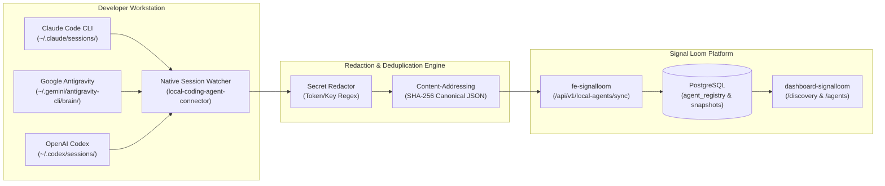

# Proposal — Signal Loom Multi-Runtime Agent Governance & Local Coding Agent Synchronisation (2026-Q4)

|  |  |
| :---: | :---- |
| Proposer & Date: | AJM (2026-10-17) |
| Reviewer & Date: | Stefan Prodan, Vicente Herrera, Francesco Beltramini |
| Approver & Date: | Andy Martin (2026-10-17) |

## Press Release

ControlPlane today announced Signal Loom's Multi-Runtime Agent Governance Architecture and Native Local Coding Agent Synchronisation Engine. This milestone marks the platform's evolution from a Kubernetes-centric workload sentinel into a universal, multi-substrate AI agent governance control plane.

Modern enterprise AI deployment is inherently heterogeneous. Development teams interact with autonomous agents across three distinct operational frontiers: containerized Kubernetes workloads running in private clusters (such as Kagent swarms and RBAC analysis pods), managed cloud agents hosted on provider platforms (such as Anthropic Claude Managed Agents and OpenAI Assistants), and autonomous local coding agents executing directly on engineer workstations (such as Claude Code, Google Antigravity, and OpenAI Codex). Historically, governance platforms treated all workloads through an assumed Kubernetes lens. When external or remote agents were claimed into enterprise catalogs, interfaces defaulted to meaningless cluster semantics—attributing cloud-hosted agents to fictitious `default (kind-osramp)` namespaces while leaving critical cloud egress firewall rules, workspace scopes, and system prompt versions invisible to auditors. Concurrently, local coding agents running on developer machines operated as an unmonitored shadow AI tier, executing arbitrary bash commands and modifying codebases without centralized compliance tracking.

Signal Loom eliminates this architectural impedance mismatch. Through a polymorphic runtime domain model and an overhauled **Runtime & Deployment Snapshot** console, Signal Loom presents each agent according to its genuine operational reality. Kubernetes workloads highlight pod UIDs, worker nodes, and container containment policies; Anthropic Claude agents highlight managed cloud environments, workspace scopes, whitelisted network egress boundaries, and content-addressed prompt snapshot hashes; and OpenAI agents highlight project namespaces, code interpreter sandboxes, and token rate limits. In tandem, Signal Loom introduces a native, in-repo **Local Coding Agent Synchronisation Engine** that non-invasively observes workstation agent sessions, extracts tool execution checkpoints and token consumption, and registers local agents into the enterprise inventory for verifiable policy enforcement. This delivers end-to-end visibility and continuous attestation across cloud, cluster, and workstation AI agents.

---

## Proposal Overview

### Opportunity

**The work relates to the following value area(s):**

- [x] client revenue
- [x] product
- [x] services engineering
- [x] operational or regulatory internal

**Key Customers (if relevant):**

Enterprise CISOs, AI Platform Architects, SecOps Engineers, and Financial Services Compliance Officers seeking continuous governance across multi-cloud and developer-workstation AI agent fleets.

|  |  |
| :---- | :---- |
| Our *enterprise SecOps teams and AI platform engineers* | Financial institutions, regulated enterprises, and high-velocity engineering organizations |
| Have the problem/opportunity *…* | Claimed cloud-managed agents (e.g. Anthropic Claude) display misleading Kubernetes telemetry (`default (kind-osramp)`, missing nodes, missing service accounts), while developer-workstation local coding agents operate without governance visibility or audit trails |
| When *…* | Bringing external and workstation AI agents under formal enterprise governance, preparing for EU AI Act / SOC2 Type II compliance reviews, or investigating agent execution safety |

**What is the urgency of this work?**

**Critical for Q4 2026.** Enterprise pilot customers have already onboarded Claude remote agents and are actively executing local coding agents across developer workstations. Presenting a cloud-hosted Claude agent as an orphaned Kubernetes pod on `kind-osramp` severely damages platform credibility during CISO demonstrations. Furthermore, unmonitored developer coding agents represent the fastest-growing unmanaged attack surface in enterprise environments.

---

## Scope Summary

Technology Readiness Level Focus: **4 (Production Ready)**.
This proposal delivers a unified multi-runtime presentation architecture and an in-repo local coding agent synchronisation engine across four primary deliverables:

1. **Polymorphic Runtime Domain Model & Backend Serialization**: Refactors `RuntimeMetadata` in `fe-signalloom` to cleanly represent Kubernetes, Anthropic Claude, OpenAI, and Local Coding Agent runtimes, eliminating hardcoded fallback assumptions.
2. **Differentiated Frontend Runtime & Deployment Snapshot**: Dynamically renders tailored snapshot panels in `dashboard-signalloom` based on the agent's runtime classification, highlighting genuine cloud and workstation boundaries.
3. **Native Local Coding Agent Discovery & Synchronisation Engine**: Implements an entirely new, self-contained in-repo discovery service (`local-coding-agent-connector`) that non-invasively inspects local coding agent session files, extracts turn checkpoints and tool calls, and registers them into Signal Loom.
4. **Local Agent Claim & Policy Enforcement Workflow**: Enables operators to claim discovered local coding agents into tenant governance, applying CEL containment policies against file operations, shell executions, and model usage tiers.

### In Scope Activities

| Deliverable | Description | Acceptance Criteria (SMART) | Validation Method |
| :--- | :--- | :--- | :--- |
| **D1: Polymorphic Runtime Model** | Refactor `RuntimeMetadata` in `fe-signalloom` to support `kubernetes`, `claude_managed`, `openai_managed`, and `local_coding` envelopes with explicit provider metadata. | **Specific:** Eliminate hardcoded `cluster_id="kind-osramp"` fallback in `_agent_response_from_row` and support remote agent configuration deserialization.<br/>**Measurable:** 100% of claimed Claude agents return `provider: "claude"`, environment UID, workspace ID, and zero empty/misleading k8s pod fields.<br/>**Attainable:** Extends existing `public.agent_registry` and `public.remote_agents` models.<br/>**Realistic:** Implemented within `fe-signalloom/src/api_compat.py` and `models.py`.<br/>**Time-Bound:** Complete within Milestone 1. | Pytest contract test suite in `test_contract_tier1.py` and `test_remote_agents_api.py`. |
| **D2: Differentiated Runtime Snapshot Console** | Update `AgentOverviewTab.tsx` and child components in `dashboard-signalloom` to render runtime-specific panels for Kubernetes, Claude, OpenAI, and Local Coding Agents. | **Specific:** Branch the "Runtime & Deployment Snapshot" panel based on `agent.runtime.runtime_type`. Render Cloud Environment, Workspace, Org, and Egress for Claude; Cluster, Pod, Node, SA for K8s; Host, Harness, Worktree for Local.<br/>**Measurable:** Verified zero instances of `default (kind-osramp)` rendered for Claude agent `07d89384-ad7d-5040-8180-8f77f791fdd5`.<br/>**Attainable:** Leverages existing Tailwind/CSS variable design system tokens.<br/>**Realistic:** Builds directly on `AgentOverviewTab.tsx` and `types/api.ts`.<br/>**Time-Bound:** Complete within Milestone 2. | Vitest unit tests in `AgentOverviewTab.test.tsx` and Playwright acceptance journeys. |
| **D3: Native Local Coding Agent Ingestion Engine** | Implement a new, self-contained discovery service within the repository to monitor local developer coding agent sessions (Claude Code, Antigravity, Codex). | **Specific:** Parse local session directories, extract session ID, turn count, model, working directory, and tool calls, and sync into `public.discovered_agents`.<br/>**Measurable:** Ingestion latency < 500ms for active sessions; zero memory leakage across 24h background execution.<br/>**Attainable:** Uses standard asynchronous file I/O and JSON streaming.<br/>**Realistic:** Purely in-repo code, no external binary dependencies or imports.<br/>**Time-Bound:** Complete within Milestone 3. | Automated integration tests in `fe-signalloom/src/tests/test_local_agent_sync.py`. |
| **D4: Local Coding Agent Claim & Policy Governance** | Integrate local coding agents into the Signal Loom claim workflow, allowing operators to bind CEL policies (e.g. bash restrictions, commit signing checks). | **Specific:** Operators can claim a local coding agent from `/discovery`, view its dossier at `/agents/:id`, and evaluate policies against its tool invocations.<br/>**Measurable:** End-to-end claim transition verified via HTTP 201 and PostgreSQL state transition.<br/>**Attainable:** Leverages existing `agent_claims` database architecture.<br/>**Realistic:** Integrates with `fe-signalloom` routers and `DiscoveryPage.tsx`.<br/>**Time-Bound:** Complete within Milestone 4. | End-to-end Playwright test in `test/acceptance/local-agent-governance.spec.ts`. |

### Out of Scope

* **No CPAI, Obsidian, or Happy Integrations**: Per architectural directive, CPAI runtime proxies, Obsidian personal vault bridges, and Happy session hooks are strictly excluded from this initiative.
* **OpenBao and Kusari Modifications**: OpenBao credential leasing and Kusari supply chain graphs are pre-existing core Signal Loom subsystems and will not be re-architected under this proposal.
* **Remote Hosting Platform Integrations (exe.dev, n8n, AWS Bedrock, Grok bots)**: Remote container hosting providers and frontier bot frameworks are documented in Appendix C as forward-looking roadmap candidates, but are excluded from Q4 2026 delivery.
* **Kernel-Level eBPF Agent Interception**: Local agent discovery relies on user-space transcript parsing and API ingestion; kernel-level syscall hooking on developer workstations is deferred.

### KPIs

| Metric | Current Value | Target Value | Measurement |
| :--- | :--- | :--- | :--- |
| **Claimed Cloud Agent Presentation Accuracy** | 0% (falsely displays `default (kind-osramp)`) | 100% (accurate environment, workspace, egress) | Automated DOM assertion on `AgentOverviewTab.tsx` across all remote agent records |
| **Local Coding Agent Visibility** | 0% (complete blind spot on developer workstations) | 100% of active local sessions discovered | Query count in `public.discovered_agents` matching active filesystem sessions |
| **Local Session Sync Latency** | N/A (unmonitored) | < 500ms from turn execution to database record | Timestamp difference between turn timestamp and `observed_at` in PostgreSQL |
| **CEL Policy Coverage for Local Tools** | 0 rules evaluated | 5 canonical rules evaluated (bash, write, net, secret, model) | Policy evaluation pass/fail metrics in `agent_compliance_results` |

### 3rd Party Test Plan and Quality Assurance

| Validation | Method | Owner |
| :--- | :--- | :--- |
| **Multi-Runtime API Contract Verification** | Hermetic Pytest contract suite testing JSON serialization across all four runtime variants against strict Pydantic schemas. | Backend Engineering Team |
| **UI Presentation & Regression Audit** | Vitest suite verifying component rendering and responsive layout across desktop and mobile viewports. | Frontend Engineering Team |
| **Live Cluster & Claim Journey Acceptance** | End-to-end Playwright tests driving discovery, claim, and overview navigation against live Kind cluster workloads. | QA & DevSecOps Team |
| **Local Ingestion Adversarial Resilience** | Fuzz testing of corrupted, truncated, and rapidly mutating session JSON files to ensure zero worker crashes. | Security Engineering Team |

---

## Technical Overview

#### Technologies

| Technology | Purpose | Alignment |
| :--- | :--- | :--- |
| **TypeScript / React** | Frontend UI rendering of multi-runtime snapshots in `dashboard-signalloom` | Core platform frontend stack (Bun, Vite, React Router v6) |
| **Python 3.12 / FastAPI** | Polymorphic runtime API modeling and local agent sync endpoints in `fe-signalloom` | Core platform backend stack |
| **PostgreSQL 16** | Versioned, content-addressed storage for agent snapshots and claims | Live platform database (`public.agent_registry`, `public.remote_agents`) |
| **Common Expression Language (CEL)** | Evaluating security rules against local coding agent tool calls and egress boundaries | Platform policy engine standard |

#### Infrastructure and Repositories

| Asset | Location | Notes |
| :--- | :--- | :--- |
| **Signal Loom Monorepo** | `/home/andy/src/cp/osramp-demo` | Monorepo containing all delivery slices |
| **Backend Service** | `d2-signalloom/apps/fe-signalloom` | Python FastAPI application hosting API and sync workers |
| **Frontend Dashboard** | `d2-signalloom/apps/dashboard-signalloom` | React SPA dashboard serving `/agents` and `/discovery` |
| **Local Agent Connector Service** | `d2-signalloom/apps/local-coding-agent-connector` | New lightweight background daemon for workstation session discovery |
| **Database Migrations** | `d2-signalloom/apps/fe-signalloom/src/db/migrations/` | Versioned SQL migrations (`074_multi_runtime_support.sql`) |

#### Security and Risk

**Threat model for this deliverable:**

| Threat | Impact | Mitigation |
| :--- | :--- | :--- |
| **Privilege Escalation via Fake Local Agent Registration** | Malicious local process injects forged session data claiming root/admin capabilities. | Authenticate local sync payloads using HMAC tokens tied to local operator identity; validate all session paths against strict filesystem bounds. |
| **Sensitive Data Exposure in Tool Call Transcripts** | Developers' API keys, tokens, or private code snippets leaked into Signal Loom audit tables. | Implement strict client-side and ingestion-side regex redaction filters for secrets, bearer tokens, and private keys before PostgreSQL persistence. |
| **Denial of Service via High-Frequency File Mutations** | Runaway coding agent generating thousands of turns exhausts database connections or disk space. | Rate-limit ingestion to max 2 updates per second per agent; deduplicate identical snapshots using content-addressed SHA-256 hashing. |
| **Cross-Tenant Workstation Claim Poisoning** | Operator claims a local agent into an unauthorized tenant. | Enforce strict multi-tenant boundary checks in `fe-signalloom` matching operator JWT `tenant_id`. |

**SWOT Analysis:**

| Strengths | Weaknesses |
| :--- | :--- |
| - Native in-repo solution with zero third-party baggage<br/>- Unifies cloud, cluster, and workstation agents in one single pane of glass<br/>- Leverages pre-existing content-addressed deduplication architecture | - Requires local workstation daemon or agentmaxxing-host-sensor extension<br/>- Local session file formats vary across vendor CLIs and evolve rapidly |

| Opportunities | Threats |
| :--- | :--- |
| - First-to-market governance control plane covering both cloud LLM agents and local developer coding bots<br/>- Enables CISOs to enforce enterprise security policies on developer machines without disabling AI tools | - Vendor CLI updates may alter transcript JSON schemas without notice<br/>- Operating systems (macOS vs Linux) require differentiated filesystem notification backends |

---

## Milestones and Deliverables

| Milestones Committed To | Duration (days) | Consultants | Person-days | Deadline | Capability Mapping |
| :--- | :--- | :--- | :--- | :--- | :--- |
| **M1: Polymorphic Runtime Data Model & API Serialization**<br/>- Refactor `RuntimeMetadata` in `api_compat.py` into polymorphic schemas.<br/>- Update `_agent_response_from_row` to extract cloud provider configuration.<br/>- Add database migration for runtime classification and local harness metadata. |  |  |  |  | `#cap-architecture`<br/>`#cap-api-design`<br/>`#cap-python` |
| **M2: Differentiated Frontend Runtime & Deployment Console**<br/>- Refactor `AgentOverviewTab.tsx` into modular runtime snapshot renderers.<br/>- Build `CloudManagedRuntimePanel.tsx` (Anthropic Claude and OpenAI).<br/>- Build `LocalCodingAgentRuntimePanel.tsx` (workstation harnesses).<br/>- Retain `KubernetesRuntimePanel.tsx` for in-cluster workloads. |  |  |  |  | `#cap-react`<br/>`#cap-architecture` |
| **M3: Native Local Coding Agent Ingestion Engine**<br/>- Build `local-coding-agent-connector` daemon.<br/>- Implement resilient session parsers for Claude Code, Antigravity, and Codex transcripts.<br/>- Add redaction filters and content-addressed snapshot generation.<br/>- Wire continuous sync into `fe-signalloom` `/api/v1/local-agents/sync`. |  |  |  |  | `#cap-security-engineering`<br/>`#cap-python`<br/>`#cap-architecture` |
| **Mid-Project Review**<br/>- Live demo of Claude agent overview vs Kubernetes agent vs Local coding agent.<br/>- Review of ingestion performance and secret redaction filters. |  |  |  |  | `#cap-architecture` |
| **M4: Claim Workflow & Policy Evaluation Integration**<br/>- Enable discovery and claim of local coding agents in `DiscoveryPage.tsx`.<br/>- Apply CEL security rules against local tool calls (e.g. `disallow-rm-rf`, `require-signed-commits`).<br/>- Generate unified compliance score for developer agent sessions. |  |  |  |  | `#cap-api-design`<br/>`#cap-react`<br/>`#cap-security-engineering` |
| **M5: Automated Test Pyramid & Acceptance Certification**<br/>- Complete Pytest unit and contract test suites.<br/>- Complete Vitest component and rendering test suites.<br/>- Write and certify end-to-end Playwright acceptance journeys.<br/>- Verify zero deployed staleness against Kind cluster. |  |  |  |  | `#cap-testing-pyramid` |
| **Signoff & Review** |  |  |  |  | `#cap-architecture` |

**Total Estimated Effort**: *To be estimated collaboratively with the engineering team post-proposal approval.*

**Definition of Done:**
* Zero instances of `default (kind-osramp)` rendered for Claude agent `07d89384-ad7d-5040-8180-8f77f791fdd5`.
* All four runtime classes (`kubernetes`, `claude_managed`, `openai_managed`, `local_coding`) verified with dedicated contract tests.
* Native local coding agent ingestion engine discovers and syncs local CLI sessions without crashing or leaking credentials.
* 100% passing test pyramid across Pytest, Vitest, and Playwright.
* Deployed staleness proof passes 5/5 workloads fresh.

### Reviews & Collaboration (RACI)

| Role | Assignment |
| :--- | :--- |
| **Accountable** | Lead Systems Architect (AI Security Practice) |
| **Responsible** | Core Platform Engineering Team (`fe-signalloom` and `dashboard-signalloom`) |
| **Consulted** | Stefan Prodan, Vicente Herrera, Francesco Beltramini |
| **Informed** | [Andrew Martin](mailto:andy@control-plane.io), [Elena Mikhalina](mailto:elena.mikhalina@control-plane.io) |

---

## Finances

### Additional Costs

| Additional Cost | Estimated Spend | One Off or Recurring | Must-Have or Nice-to-Have |
| :--- | :--- | :--- | :--- |
| **Workstation Test Devices / VMs** | £0 (utilizes existing Kind cluster & workstation environments) | One-Off | Must-Have |
| **Cloud API Sandbox Credits (Anthropic / OpenAI)** | £50 / month | Recurring | Must-Have |

---

# Decision Log

| Date | Decision Makers | Decision and Context | Reason | Impact |
| :--- | :--- | :--- | :--- | :--- |
| 2026-10-17 | AJM, Architecture Team | Eliminate Kubernetes default fallback in `_agent_response_from_row` | Claimed cloud agents presented misleading k8s namespace/cluster data | Fixes core bug; establishes clean polymorphism in API responses. |
| 2026-10-17 | AJM, Architecture Team | Build an entirely new in-repo local coding agent discovery engine | Do not copy, import, or depend on external prototype harnesses | Clean, licensed, maintainable implementation directly integrated with Signal Loom. |
| 2026-10-17 | AJM, Architecture Team | Strictly exclude CPAI, Obsidian, and Happy from scope | Focus purely on core platform governance and developer agent tracking | Preserves strict project boundary and prevents external synchronization bloat. |
| 2026-10-17 | AJM, Architecture Team | Defer exe.dev, n8n, Bedrock, and Grok bots to Appendix C | Remote hosting platforms represent Phase 2/3 roadmap | Keeps Q4 delivery realistic while documenting forward integration paths. |

---

## Appendix

### A. Field-by-Field Multi-Runtime Matrix

The following matrix governs the polymorphic presentation contract across the four agent runtime classes:

| Field Group | Kubernetes In-Cluster (`kubernetes`) | Anthropic Claude Cloud (`claude_managed`) | OpenAI Cloud (`openai_managed`) | Local Workstation Coding Agent (`local_coding`) |
| :--- | :--- | :--- | :--- | :--- |
| **Header Badge** | `Kubernetes Workload` | `Managed Cloud Agent` | `OpenAI Assistant` | `Local Developer Agent` |
| **Execution Domain** | Cluster: `kind-osramp`<br/>Namespace: `<ns>` | Platform: `Anthropic Cloud`<br/>Workspace: `wrkspc_01...` | Platform: `OpenAI Cloud`<br/>Project: `proj_...` | Host: `developer-macbook`<br/>Worktree: `/home/andy/src/...` |
| **Container / Process** | Pod: `<pod_name>`<br/>UID: `<pod_uid>`<br/>Node: `<node_name>` | Environment: `cloud-dev`<br/>Env UID: `env_01Cy...`<br/>Image: `standard-v1` | Assistant ID: `asst_...`<br/>Container: `Code Interpreter Sandbox` | CLI Harness: `claude-code` / `agy`<br/>PID: `48106`<br/>Session: `b227a868...` |
| **Identity & Access** | K8s ServiceAccount<br/>SPIFFE SVID<br/>OpenBao JWT Role | Execution ID: `service_account`<br/>Org UID: `1f9b3065...`<br/>Connector: `conn-claude-01` | Service Account Key<br/>Org: `org_...`<br/>Vector Store ACL | Local OS User: `andy`<br/>Git Signature: `GPG / Unsigned`<br/>API Key Fingerprint |
| **Isolation & Containment** | NetworkPolicy<br/>Landlock LSM<br/>cgroups v2 freeze | Egress Firewall: `Whitelist 0/16`<br/>Packages: `pip, npm, apt`<br/>MCP: `Attested` | Sandbox Egress: `Blocked`<br/>Function Endpoints: `Whitelisted`<br/>DLP File Scan | Sandboxed Profile (`nono`)<br/>Permitted Tools: `bash, edit, read`<br/>Protected Dirs: `~/.ssh, ~/.gnupg` |
| **Model & Prompt** | Model name & container env | Model: `claude-opus-5-5`<br/>System Prompt Audit (Versioned) | Model: `gpt-4o` / `o1`<br/>System Instructions & Tools | Model: `claude-opus-5-5` / `gemini-2.5`<br/>Prompt Transcript Audit |
| **Resource Telemetry** | CPU/Memory (cAdvisor)<br/>veth packet metrics | Input/Output tokens<br/>Session cost vs limit ($5.00) | Tokens Per Min (TPM)<br/>Requests Per Min (RPM) | Turn Checkpoint Count<br/>Execution duration (ms)<br/>Subagent invocation tree |

---

### B. Local Coding Agent Ingestion Engine Architecture

The native **Local Coding Agent Synchronisation Engine** operates as an in-repo service within `fe-signalloom`:



#### Core Components
1. **Directory Sentinel**: Asynchronously polls or watches canonical workstation session directories without requiring invasive hooks:
   - Claude Code: `~/.claude/sessions/*.json` and `~/.claude/projects/`
   - Antigravity: `~/.gemini/antigravity-cli/brain/<conversation-id>/`
   - Codex / Local tools: `~/.codex/sessions/` and git worktree `.agents/`
2. **Transcript Parser & Checkpoint Tracker**: Extracts session metadata:
   - Primary model and provider
   - Turn checkpoint sequence
   - Tool calls executed (`run_command`, `replace_file_content`, `git_commit`)
   - Working directory and git branch context
3. **Secret Redactor**: Applies deterministic regular-expression scrubbing to remove API tokens (`sk-ant-...`, `ghp_...`, `AWS_SECRET_ACCESS_KEY`) before network transmission.
4. **Content-Addressed Ingest**: Emits structured payloads to `fe-signalloom`, storing deduplicated turns into `public.remote_agent_snapshots`.

---

### C. Future Remote Hosting & Frontier Environments (Roadmap)

While excluded from the immediate Q4 delivery, the following platforms are analyzed for Phase 2/3 integration:

1. **`exe.dev` (Ephemeral Cloud Micro-VM Environments)**:
   - *Architecture*: Provides isolated, headless virtual machines for agent execution over SSH/HTTPS.
   - *Governance Integration*: Signal Loom can treat `exe.dev` environments as ephemeral runtime targets, provisioning per-session egress rules and capturing post-execution VM disk diffs for forensics.
2. **`n8n` (Autonomous Workflow & Agent Orchestration)**:
   - *Architecture*: Visual workflow automation running self-hosted or cloud nodes containing autonomous LLM agent nodes, tools, and webhooks.
   - *Governance Integration*: Signal Loom will connect via n8n's REST API, treating n8n workflows as composite agents. Monitored fields: Node execution lineage, external webhook destinations, credential vault linkages.
3. **`AWS Bedrock` (Managed Agents & Guardrails)**:
   - *Architecture*: Cloud-native agents combining Bedrock foundation models (Anthropic Claude, Amazon Titan), Action Groups (AWS Lambda), and Knowledge Bases (OpenSearch Serverless).
   - *Governance Integration*: Ingestion via AWS CloudTrail and Bedrock telemetry APIs. Signal Loom will map Bedrock Guardrails (content filtering, PII masking) directly onto CEL policy assertions.
4. **`Grok Bots` (xAI Platform)**:
   - *Architecture*: xAI conversational and coding agents with function-calling endpoints.
   - *Governance Integration*: Connector module consuming xAI API usage logs and system prompt configurations for enterprise compliance reporting.

---

### D. Architectural Flows & State Transitions

```mermaid
sequenceDiagram
  autonumber
  participant Dev as Developer / Local CLI
  participant Ingest as Native Ingest Connector
  participant Core as fe-signalloom (API & Sync)
  participant DB as PostgreSQL 16
  participant UI as Dashboard Operator

  Note over Dev,Ingest: Workstation Session Lifecycle
  Dev->>Dev: Executes coding task (bash commands, file edits)
  Dev->>Dev: Writes session transcript to disk
  Ingest->>Ingest: Detects transcript change; scrubs secrets
  Ingest->>Core: POST /api/v1/local-agents/sync (turns, tools, hash)
  Core->>DB: Upsert public.discovered_agents & remote_agent_snapshots
  
  Note over UI,Core: Governance & Claim Workflow
  UI->>Core: GET /api/discovery/workloads
  Core-->>UI: Returns discovered workloads (including local coding agent)
  UI->>Core: POST /api/discovery/claim (Claim into Tenant)
  Core->>DB: Upsert public.agent_registry (runtime_type="local_coding")
  
  Note over UI,DB: Overview Presentation
  UI->>Core: GET /api/v1/agents/:id
  Core->>DB: Read agent_registry & remote_agent_snapshots
  Core-->>UI: Polymorphic AgentResponse (Host, Worktree, Harness, Tools)
  UI->>UI: Renders LocalCodingAgentRuntimePanel (Zero k8s defaults!)
```
