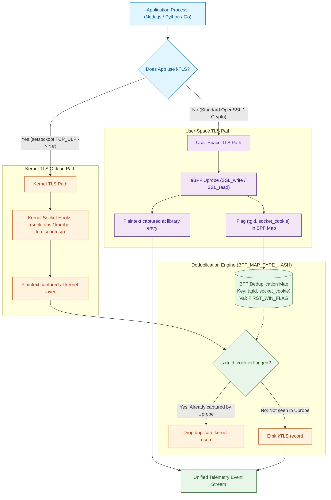
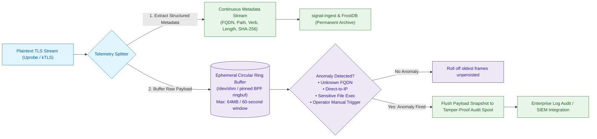
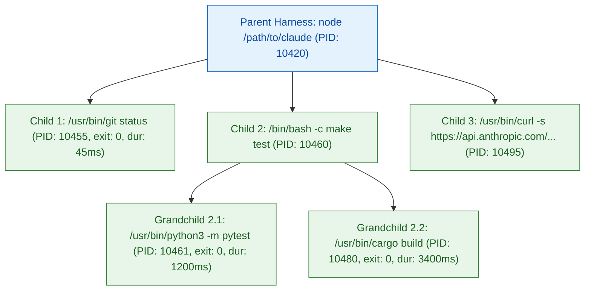
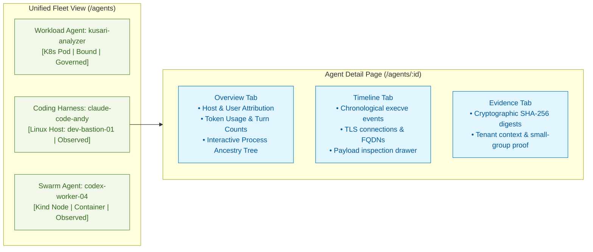

# Proposal — Signal Loom Remote Coding Agent Observability, eBPF Lineage & Dual-Path TLS Telemetry (2026-Q4)

|  |  |
| :---: | :---- |
| Proposer & Date: | AJM (2026-10-12) |
| Reviewer & Date: | James Callaghan, Vicente Herrera |
| Approver & Date: | Andy Martin (2026-10-12) |

> [!important] Why this, why now
> Coding agents run on remote Linux hosts, cloud virtual machines and Kubernetes nodes. This initiative extends Signal Loom's existing SLCD and Warden telemetry with bounded process lineage and evidence-backed TLS metadata. The commercial hypothesis is a supported pilot for regulated engineering teams, not a claim that existing security products provide no visibility.
> 
> After approved sensor deployment, supported harnesses require no per-harness shim or proxy configuration. Installation, privileges, tenant binding and operator consent remain prerequisites. TLS plaintext location and socket association must pass a synthetic feasibility gate before implementation. Unsupported traffic remains explicitly unobserved or encrypted. Raw payload recording is disabled by default.

**Correction approval:** Andrew approved the review corrections on 2026-10-12 and requested Antigravity for execution. This approval is not evidence that proposed probes work, a customer endorsement, payload-collection consent, or approval of a yet-unprepared mission digest. Vault reconciliation and canonical preparation remain outstanding. SLCD and SLWD are recorded as foundational related proposals, not asserted child Enhancements. The source note's tier, destination folder, project path and reciprocal links must be reconciled through the healthy vault bridge before digest binding; no silent move is performed here.

## Press Release

**Working-backwards pilot announcement: Signal Loom extends remote coding-agent observation with process lifetime lineage and supported TLS metadata, without per-harness shims.**

Platform teams need to correlate tool execution and network activity without acquiring command arguments or retaining prompts. This pilot reuses existing discovery and authenticated telemetry foundations. Competitor bypass, licensing and coverage claims require independent evidence before external publication.

The proposed release would display observed process lifetimes, ancestry confidence, coverage gaps and bounded destination metadata for a certified runtime matrix. It would distinguish observed ancestry from authenticated agent identity and recoverable current state from unavailable pre-attachment history.

The initial feasibility gate must prove runtime-specific user-TLS and kTLS capture locations, directional source ownership, completeness and event uniqueness. Metadata extraction may transiently inspect bounded plaintext only in approved supported paths. Payload recording, anomaly snapshots, inspection drawers and SIEM body export remain separately approval-gated.

The following original quotation is preserved verbatim as a historical aspirational statement. It is not a certified capability or deployment authorization.

"Enterprise security cannot depend on the voluntary cooperation of the software being supervised," said Andrew Martin, CEO of ControlPlane. "By bringing in-kernel process lineage and dual-path TLS observability into Signal Loom Warden, we give platform teams complete, authoritative insight into autonomous coding workflows across clusters and cloud hosts with zero configuration friction."

## Proposal Overview

### Opportunity

**Primary value area:** Client Revenue. Efficiency and risk reduction are supporting outcomes, not separate classifications.

**Key Customers (if relevant):** Enterprise CISOs, Head of Platform Engineering, AI Platform Architects, DevSecOps leads in regulated industries (financial services, defense, healthcare) deploying autonomous coding swarms and remote agent environments.

**Commercial validation gate:** No named design partner, validated £/hours/risk baseline, sponsor or willingness to deploy privileged sensors is evidenced here. Before a customer pilot, record one real account and a 90-day measurable outcome. Internal synthetic feasibility may proceed after mission approval without inventing an account or ROI.

|  |  |
| :---- | :---- |
| Our *…* | enterprise platform security teams, CISOs, and engineering directors |
| Have the problem/opportunity *…* | correlating supported coding-agent process lifetimes and encrypted egress while preserving developer privacy |
| When *…* | developers and automated pipelines adopt autonomous coding harnesses, risking intellectual property exfiltration, credential leakage, and unauthorized tool execution |

**Urgency.** 2026-Q4 planning horizon. Establish a bounded feasibility result before committing implementation cost. External differentiation and competitor assertions remain research hypotheses, not acceptance evidence.

## Scope Summary

**Technology Readiness Level:** Existing SLCD/Warden foundations are available; the new TLS capture path remains R&D until feasibility passes. The intended outcome is a supported beta pilot, not general production certification. Existing TC ClientHello/SNI observation does not decrypt HTTP, and the coding-agent MemoryStore is not evidence of FrostDB durability.

**MVP Scope:** First prove a supported TLS/hook/socket matrix on disposable synthetic nodes. Then implement process lifetime lineage, supported directional TLS metadata, authenticated ingest and persistence, read APIs and UI coverage states. Reuse SLCD discovery, `codingagent.v1`, backend routes and telemetry cards. Any schema extension requires a reviewed compatibility contract. Payload forensics stays optional and disabled.

### In Scope Activities

| Deliverable | Description | Acceptance Criteria (SMART) | Validation Method |
| :---- | :---- | :---- | :---- |
| Feasibility and frozen contracts | Prove runtime/version, library/ABI, packaging, architecture, kernel, TX/RX, protocol and attach-timing matrix. | **Specific:** Records exact hooks and verified fd/socket correlation. **Measurable:** Nonzero expected fixtures reconcile captured, rejected, dropped and unsupported counts. **Attainable:** Disposable Linux test nodes only. **Realistic:** Unsupported mandatory rows stop later phases. **Time-Bound:** Before P1-GOV permits implementation. | Real-kernel synthetic evidence, verifier/load logs and independent fixture oracle |
| Process lifetime lineage | Capture fork/clone, exec and exit without acquiring argv or environ. | **Specific:** Boot identity, PID namespace, PID, start identity and exec generation distinguish lifetimes. **Measurable:** Correct attribution of every expected supported fixture event, with zero false attribution. **Attainable:** Reuse Warden metadata and SLCD classification. **Realistic:** Restart, reparenting and losses are explicit gaps. **Time-Bound:** Before P3-GOV. | PID reuse, short-lived children, containers and restart fixtures |
| Supported dual-path TLS metadata | Runtime-specific user-TLS and proven kTLS adapters inspect only bounded permitted plaintext. | **Specific:** Emit approved method/length/destination categories and coverage states, not body or raw URL. **Measurable:** Complete supported fixture records in both directions, including retries and partial IO. **Attainable:** P1 evidence precedes code commitment. **Realistic:** ECH, QUIC, HTTP/2 and unsupported ABI rows are explicit exclusions unless proven. **Time-Bound:** Before P4-GOV. | Synthetic host/container matrix and attach-before/after-connect tests |
| Directional ownership and event identity | Separate socket capture source selection from record uniqueness. | **Specific:** Atomic ownership transitions, fallback, bounded maps and lifetime cleanup. **Measurable:** Zero duplicate records and no missing expected records over 10,000 flows plus repeated persistent requests. **Attainable:** Hook-context cookie access is demonstrated, not assumed. **Realistic:** Zero emissions fail the test. **Time-Bound:** Before P5-GOV. | Ground-truth concurrent-flow, fd transfer and source-failure tests |
| Optional payload forensics | Recorder, anomaly snapshots, operator drawer and SIEM payload export remain disabled by default. | **Specific:** Separate principal consent defines purpose, tenant, role, bounds, encryption and deletion. **Measurable:** Default deployment retains and exports zero payload bytes. **Attainable:** Synthetic-only feasibility, no customer collection. **Realistic:** No recorder implementation cards in this mission. **Time-Bound:** Authorization required before any later recorder work. | Negative collection, unauthorized trigger/export and retention tests |
| Ingest and persistence | Extend existing strict wire contract through authenticated producers and tenant-bound storage. | **Specific:** Reject unknown fields and producer/tenant mismatch before persistence. **Measurable:** Cross-tenant ingest/query/export fixtures denied, restart durability proven, p99 ingest below 50ms under the pinned profile. **Attainable:** Reuse existing schema and routes. **Realistic:** Aggregate k-floor privacy is separate from individual authorization. **Time-Bound:** Before P6-GOV. | Go contracts, producer authentication, persistence/restart and negative tenant tests |
| Read API and UI | Reuse existing coding-agent views for ancestry, chronology and visible loss/coverage. | **Specific:** No default payload drawer; confidence is not attestation. **Measurable:** p99 event-to-render below 2s, missing events fail, bounded-clock error recorded. **Attainable:** Freeze read API before UI work. **Realistic:** Fixture browser tests do not certify kernel behavior. **Time-Bound:** Before P8-GOV supported-pilot sign-off. | API negative tests, Vitest and real Playwright evidence |

### Out of Scope

* **Active Process Killing / Instant Stun (Deferred):** Phase 1 focuses strictly on passive observation, process lineage, and network detection. Automated stun (`cgroup.freeze`, `stun-tcctl isolate`) will be enabled in a subsequent enforcement proposal.
* **Mandatory In-Harness Shims:** Zero requirement for client-side configuration changes, proxy environment variables, or tool modifications.
* **Default Raw Payload Collection:** No payload recorder, anomaly snapshot, body export or inspection drawer is enabled or implemented under this mission. Optional forensics requires a separately reviewed contract and explicit approval. An anomaly or operator request is not authorization.
* **Universal TLS Coverage and Root-Adversary Guarantees:** No completeness claim outside the proven supported matrix. Root/kernel compromise is outside sensor tamper-resistance claims.
* **Production or Workstation Capture:** Privileged TLS experiments use disposable synthetic nodes. No production deployment, workstation session capture or cloud spend without separate permission.

### KPIs

| Metric | Current Value | Target Value | Measurement |
| :---- | :---- | :---- | :---- |
| **Per-harness configuration** | Existing baseline measured in P1 | No shim/proxy edits after authorized sensor deployment | Installation and consent costs reported separately |
| **Detection latency** | P1 baseline, not assumed unobserved | p99 below 1s for supported launches | Independent launch oracle; missing events fail |
| **Lineage completeness** | Existing SLCD baseline measured in P1 | Every expected supported fixture lifecycle event attributed correctly | Nonempty per-row denominator; false attribution and losses reported |
| **TLS uniqueness and completeness** | Existing SNI only; plaintext baseline unproven | Zero duplicates and no missing expected supported records | 10,000 flows at declared concurrency; both directions and repeated requests |
| **Sensor CPU overhead** | P1 measured detached baseline | Increment below 0.015 CPU-seconds per wall-second | Userspace plus attributable kernel work, 100 req/sec, 16 concurrent flows, 10-minute steady state after 60s warm-up |
| **Total sensor memory** | P1 measured baseline | Peak strictly below 64 MiB | RSS plus BPF maps, shared memory, buffers, queues and attributable allocations; excludes separately reported central services |
| **UI latency** | Existing view measured in P1 | p99 event-to-render below 2s | Clock error at most 10ms; missing events fail; ingest p99 below 50ms reported separately |

P1 pins hardware, architecture, kernel/runtime versions, workload, byte size, protocol, sample count and clock synchronization. These thresholds are targets, not achieved results. If feasibility cannot meet them, P1-GOV stops for revised approval rather than weakening the denominator or silently skipping rows. Candidate memory allocation: 32 MiB userspace, 8 MiB maps, 4 MiB transport, 8 MiB parser/reassembly, 4 MiB export queues; 8 MiB headroom within the total limit. Default recorder allocation is 0 MiB.

### 3rd Party Test Plan and Quality Assurance

| Validation | Method | Owner |
| :---- | :---- | :---- |
| Kernel and runtime feasibility | Candidate kernels 5.15, 6.1, 6.8 and 6.11 and version-pinned Node/Python/Go rows are proposals, not supported claims. Record hook feasibility, TX/RX and attach timing per row. | Cloud Native Transformation & DevSecOps |
| Completeness and uniqueness | Independent fixture oracle, partial IO, persistent connections, fd/PID reuse, source fallback and overload | AI & Data Security |
| Privacy and tenant negatives | Prohibited acquisition assertions, canaries on emitted/log/export surfaces, authentication spoofing and cross-tenant reads; no universal secret-absence proof from regex | AI & Data Security |
| Supported pilot acceptance | Planned SLCH aggregate must inventory offline, real-kernel, browser, security and performance suites, with nonzero expected tests and no silent skips | Governor review by nominated principal |
| Supply chain | SAST, scoped DAST, dependency and secrets scans, SBOM, signed images/OCI artifacts, provenance and digest verification; no unsigned release | Open Source & Supply Chain Security |

Existing regression commands are not substitutes for new capture evidence: `GOPROXY=off make test-signal-ingest`, `bats test/acceptance-spec-coverage.bats`, and `make demo-signalloom-coding-agent-topology`. Go commands fail closed if cached dependencies are absent; the browser target may install dependencies. `make demo-agentmaxxing-host-test` is host-sensitive and requires an isolated approved environment. The original `test-coding-harness-telemetry` target does not exist at correction time. P1 must add the fail-closed staged runner specified below. Prospective acceptance commands may be bound explicitly in a reviewed digest, but cannot pass before their runner and required suites exist. No current regression command is a replacement for the final supported-matrix acceptance.

## Technical Overview

#### Technologies

| Technology | Purpose | Alignment |
| :---- | :---- | :---- |
| **Linux eBPF (BCC / libbpf)** | In-kernel `execve` traps, process lifecycle tracking, and TC network filtering | Core technology of Signal Loom Warden and Sentinel |
| **Linux kTLS (`TCP_ULP`, `SOL_TLS`)** | Prove exact kernel plaintext hook and separate TX/RX crypto state; ULP attachment alone is insufficient | Runtime/kernel-specific feasibility gate |
| **Uprobes (`uprobe` / `uretprobe`)** | Supported library/ABI-specific bounded inspection, validating return values | OpenSSL symbols are not universal Go/Node interfaces |
| **BPF Hash Maps (`BPF_MAP_TYPE_HASH`)** | Bounded directional source ownership distinct from event identity | Prove cookie access in each hook context and clean up socket lifetimes |
| **Go 1.23+** | Warden host daemon, eBPF loader, and `signal-ingest` pipeline | Monorepo standard language |
| **Python 3.12** | `fe-signalloom` backend proxy and host sensor integration | Backend standard language |
| **FrostDB** | Columnar time-series store for structured metadata and correlation edges | Monorepo core telemetry database |
| **React, TypeScript & Tailwind** | Interactive process ancestry tree, timeline, and audit drawer in dashboard | Core dashboard stack |

#### Infrastructure and Repositories

| Asset | Location | Notes |
| :---- | :---- | :---- |
| **Platform Monorepo** | `/home/andy/src/cp/osramp-demo` | Canonical repository root |
| **Warden Sensor** | `d2-signalloom/apps/stun-sentinel/` & `apps/agentmaxxing-host-sensor/` | eBPF and procfs detective engine |
| **Ingestion Pipeline** | `d2-signalloom/apps/signal-ingest/` | Telemetry handler and correlation engine |
| **Backend API** | `d2-signalloom/apps/fe-signalloom/` | FastAPI gateway and discovery service |
| **Dashboard UI** | `d2-signalloom/apps/dashboard-signalloom/` | React dashboard and topology visualization |

#### Security and Risk

**Threat model for this deliverable:**

| Threat | Impact | Mitigation |
| :---- | :---- | :---- |
| **Secret acquisition** | Arguments, body, URL paths/query, raw headers or hashes leak source/customer data | Do not acquire argv/environ; bounded field allowlist before output; no retained payload or raw URL; minimize basenames and destination categories |
| **Resource exhaustion** | Map/queue/reassembly flood destabilizes a node | Total memory/CPU budget, bounds and explicit drop counters; reduce coverage rather than disrupt the observed workload |
| **Capture duplication or loss** | Source changes or persistent requests corrupt metrics | Directional socket-lifetime ownership, independent event identities, fallback and completeness oracle |
| **False identity** | Renamed/interpreted binary or reused PID is treated as attested harness | Observed confidence and boot/namespace/start/exec lifetime keys; authenticated producer identity is separate |
| **Tenant spoofing** | Producer submits another tenant or an unauthorized query/export | Verified producer authorization binds tenant at ingest and every storage/query/UI/export boundary |
| **Tamper/replay** | Forged, reordered or replayed events appear authoritative | Authenticated producer, epoch/sequence/replay rules, signed evidence manifests; a payload hash alone is not authenticity |
| **Sensor failure** | Restart, detach, ECH or unsupported protocol hides activity | Visible gaps and coverage states; no fabricated HTTP metadata or historical completeness |
| **Unauthorized forensics** | Anomaly or operator trigger enables plaintext collection | Disabled default, separate tenant/purpose/role authorization, audited retention/export; no recorder cards in this mission |
| **Supply-chain compromise** | Untrusted probe/image/parser enters privileged sensor | Scans, SBOMs, provenance, digest checks and cosign verification before release |

**SWOT Analysis:**

| Strengths | Weaknesses |
| :--- | :--- |
| • Reuses existing Signal Loom telemetry. • No per-harness shim for supported rows. • Explicit coverage and privacy boundaries. | • TLS ABI and kernel variation require proofs. • Deployment privileges and consent are required. • Observation only; root/kernel compromise is outside guarantees. |

| Opportunities | Threats |
| :--- | :--- |
| • Supported pilot can test commercial demand. • Evidence can inform later governance work. | • Packaging changes and static crypto break probe assumptions. • Unvalidated commercial demand and support costs. • Privileged collection can introduce privacy and node-security risk. |

## Milestones and Deliverables

| Milestones Committed To | Duration (days) | Consultants | Person-days | Deadline | Capability Mapping |
| :---- | :---- | :---- | :---- | :---- | :---- |
| **M0: Feasibility and frozen acceptance contracts** | | | | | `#cap-linux` `#cap-networking` `#cap-threat-modelling` |
| **M1: Kernel lifecycle and userspace lineage** | | | | | `#cap-linux` `#cap-golang` `#cap-security` |
| **M2: Supported TLS capture and directional ownership** | | | | | `#cap-networking` `#cap-security` `#cap-observability` |
| **M3: Authenticated ingest, persistence and read API** | | | | | `#cap-golang` `#cap-observability` |
| **Mid-Project Review: supported trace and privacy evidence** | | | | | `#cap-threat-modelling` `#cap-secure-ai-sdlc` |
| **M4: Process tree, chronology and honest coverage UI** | | | | | `#cap-observability` `#cap-secure-ai-sdlc` |
| **M5: Supported-pilot acceptance and sign-off** | | | | | `#cap-testing-pyramid` `#cap-purple-team` `#cap-supply-chain-security` |

**Effort and dates:** To be agreed collaboratively by engineering after review. No committed person-day total or delivery deadline is asserted.

**Definition of Done:**
* Supported matrix and limitations are evidence-backed; a mandatory unsupported row blocks certification.
* Process attribution and TLS metadata reconcile independent nonempty fixture denominators, uniqueness and loss counters.
* Default output/retention excludes payload, argv/environ, raw URLs/headers and payload hashes; authenticated tenant boundaries pass negative tests.
* Pinned resource and latency targets pass on approved synthetic nodes; skipped privileged tests do not pass.
* Exact staged runner inventories required offline, kernel, browser, security, performance and supply-chain gates, with evidence tied to integration SHA.
* Principal accepts the recorded supported-pilot evidence; no general production or payload-forensics authorization is inferred.

### Reviews & Collaboration (RACI)

|  |  |
| :---- | :---- |
| **Accountable** | James Callaghan, nominated from the current Principals list; acceptance of delivery ownership remains to be recorded |
| **Responsible** | AI & Data Security; Cloud Native Transformation & DevSecOps; Open Source & Supply Chain Security for artifact integrity |
| **Consulted** | Vicente Herrera; Governance, Risk & Compliance Enablement |
| **Informed** | Andrew Martin, Elena Mikhalina |

## Finances

Funded under Signal Loom core platform engineering and agent governance R&D allocation.

This is a funding context, not approval of new cloud spend or engineering estimates. The £750 infrastructure figures below are inherited provisional allowances; feasibility must record actual spend and approval before provisioning. Ongoing support and pilot ROI remain unvalidated.

### Additional costs

| Additional Cost | Estimated Spend | One Off or Recurring | Must-Have or Nice-to-Have |
| :---- | :---- | :---- | :---- |
| Cloud VM Test Matrix (Kernel 5.15, 6.1, 6.8, 6.11) | £450 | One Off | Must-Have |
| High-concurrency performance soak test infrastructure | £300 | One Off | Must-Have |

# Decision Log

Decisions 1–7 below are the preserved original record. The approved correction on 2026-10-12 supersedes their universal coverage, zero-configuration, per-socket seen-flag, payload-default and production-safety claims. They are not the executable acceptance contract. Current normative scope and the final specification appendix take precedence.

| Date | Decision Makers | Decision and context | Reason | Impact |
| :---- | :--- | :--- | :--- | :--- |
| **2026-10-12** | AJM, Sensai | **Decision 1: Core Platform Extension over Standalone Endpoint.** Position this capability as a direct extension of the Signal Loom platform, targeting remote agent runner nodes (Kubernetes clusters, remote Linux cloud hosts/VMs, DevContainers) as primary, with local developer laptops for build and testing. | Enterprise CISOs and Platform Leads want a unified governance pane across both server workloads and remote builder sessions without evaluating a fractured endpoint tool. | Unified single-pane architecture and shared telemetry ingest contracts. |
| **2026-10-12** | AJM, Sensai | **Decision 2: Observation-Only Posture for Phase 1.** Mandate strictly passive, non-intrusive observation for initial rollout; active process containment and kernel stun are deferred to a subsequent proposal. | Immediate deployment across developer fleets requires zero friction and zero risk of breaking active developer coding sessions. | Eliminates false-positive operational risk while establishing immediate visibility. |
| **2026-10-12** | AJM, Sensai | **Decision 3: Zero-Configuration Baseline.** Capture tool activity, process ancestry, and network flows exclusively via in-kernel eBPF tracepoints, socket filters, and session transcript watchers, requiring zero client-side shims or config changes. | Voluntary in-harness hooks (e.g. `--no-hooks`) are trivially bypassed, and configuring local proxies creates developer resistance. | Universal compatibility across Claude Code, Codex, Antigravity, Cursor, and custom Python agents. |
| **2026-10-12** | AJM, Sensai | **Decision 4: Dual-Path TLS Tracing (kTLS + Uprobes).** Support both standard user-space TLS (via uprobes on OpenSSL/Node/Go) and kernel-offloaded TLS (via kTLS `setsockopt TCP_ULP`). | Guarantees complete protocol-level inspection across legacy and modern networking stacks without breaking TLS handshakes. | Full visibility into encrypted egress destinations and HTTP metadata. |
| **2026-10-12** | AJM, Sensai | **Decision 5: "First Win" BPF Map Deduplication.** Coordinate user-space and kernel probes using a shared `BPF_MAP_TYPE_HASH` keyed by `(tgid, socket_cookie)`. | Prevents duplicate event emissions when an application communicates over standard TLS where data is visible at both layers. | Clean, non-redundant telemetry stream with zero duplicate frames. |
| **2026-10-12** | AJM, Sensai | **Decision 6: Ring-Buffer Flight Recorder for Payloads.** Stream lightweight metadata continuously; buffer raw decrypted payloads in local ephemeral circular memory, flushing to disk only on anomaly trigger or operator demand. | Continuously storing gigabytes of LLM token streams saturates storage and creates massive GDPR/data-residency liabilities. | Constant bounded memory overhead (<64MB) with forensic deep-dive capability when threats occur. |
| **2026-10-12** | AJM, Sensai | **Decision 7: Unified Process Tree & Timeline in Dashboard.** Render detected coding agents as first-class entities in the Signal Loom dashboard, showing an interactive process ancestry tree and chronological turn/step timeline. | Platform teams need to see what tools were invoked by which agent and understand the causal chain of operations at a glance. | High-impact visual observability across both host harnesses and containerized workloads. |

---

## Architecture Notes

### A. Useful Links

* Parent: [[Proposal — Signal Loom Agent Security Platform (2026-Q3)]]
* Foundational Sibling: [[Proposal — Signal Loom Coding Agent & Harness Detective Telemetry (2026-Q3)]]
* Foundational Sibling: [[Proposal - Signal Loom Warden Native eBPF DNS and Kernel TLS Peeking (2026-Q4)]]
* Canonical Codebase: `/home/andy/src/cp/osramp-demo`
* Warden Host Sensor: `d2-signalloom/apps/agentmaxxing-host-sensor/`
* Ingestion Spine: `d2-signalloom/apps/signal-ingest/`
* Dashboard UI: `d2-signalloom/apps/dashboard-signalloom/`

### B. SOTA Architecture Benchmark: Solo.io AgentDesktop vs. Signal Loom

The original [AgentDesktop reference](https://www.solo.io/blog/introducing-agentdesktop) motivates research, but its release date, licence, bypass claims and feature matrix are not independently verified here. The following original comparison is retained as historical design context, not external marketing evidence or a runtime guarantee. The corrected scope and final specification appendix supersede unconditional claims in these diagrams and tables.

#### 1. Architecture Paradigm Comparison

```mermaid
flowchart TD
  subgraph SOLO["Solo.io AgentDesktop Paradigm (Cooperative & Gateway Centric)"]
    AD_MDM["MDM Software Deployment"] --> AD_Daemon["agentdesktop Daemon"]
    AD_Daemon -->|"Writes native config files"| AD_ToolConfig["Tool Config (settings.json, config.toml)"]
    AD_Harness["Agent Harness (Claude Code, Cursor)"] -->|"Reads config"| AD_ToolConfig
    AD_Harness -->|"Voluntary SSO Token Request"| AD_Helper["Credential Helper"]
    AD_Helper -->|"Issues JWT (sub, act.sub, client_id)"| AD_Daemon
    AD_Harness -->|"Prompts + JWT"| AD_Gateway["agentgateway (LLM Proxy)"]
    AD_Gateway -->|"Injects real API Keys"| AD_Providers["Upstream LLMs (OpenAI, Anthropic)"]
    AD_Harness -.->|"UNPROXIED DIRECT EXECUTION"| AD_LocalTools["Local Tools & Bash (Unmonitored)"]
  end

  subgraph SL["Signal Loom Paradigm (Kernel Traps, Dual-Path TLS & Lineage)"]
    SL_Harness["Agent Harness (Any Framework / Remote Session)"] -->|"execve child tools"| SL_Trace["eBPF sched_process_exec Trap"]
    SL_Harness -->|"TLS Egress (kTLS / User-Space)"| SL_TLS["Dual-Path TLS Engine (kTLS + Uprobe)"]
    
    SL_Trace --> SL_Lineage["Process Lineage Tracker (Parent-Child Tree)"]
    SL_TLS --> SL_Dedup["First-Win BPF Deduplication Map"]
    
    SL_Dedup --> SL_Buffer["Flight-Recorder Ring Buffer (Circular Memory)"]
    SL_Lineage --> SL_Ingest["Signal Ingest & FrostDB (codingagent.v1)"]
    SL_Buffer -->|"Continuous Metadata + Anomaly Snapshots"| SL_Ingest
    
    SL_Ingest --> SL_UI["Signal Loom Dashboard (Process Tree & Timeline)"]
  end

  classDef solo fill:#fce4ec,stroke:#880e4f,color:#4a148c;
  classDef sl fill:#e8f5e9,stroke:#2e7d32,color:#1b5e20;
  class AD_MDM,AD_Daemon,AD_ToolConfig,AD_Harness,AD_Helper,AD_Gateway,AD_Providers,AD_LocalTools solo;
  class SL_Harness,SL_Trace,SL_TLS,SL_Lineage,SL_Dedup,SL_Buffer,SL_Ingest,SL_UI sl;
```

#### 2. Detailed Dimension Matrix

| Governance Dimension | Solo.io AgentDesktop | Signal Loom Platform |
| :--- | :--- | :--- |
| **Primary Target** | Developer laptops (MDM managed) | Remote Linux hosts, cloud bastions, Kubernetes clusters, and developer machines |
| **Harness Setup** | Writes native configuration files (`settings.json`, `config.toml`) | **Zero setup / zero configuration**: purely in-kernel passive eBPF observation |
| **Harness Bypass Resistance** | Low: bypassed via `--dangerously-skip-permissions`, `--no-hooks`, or unmanaged wrappers | **High**: in-kernel `execve` traps capture all execution unconditionally |
| **Tool Execution Visibility** | None: local MCP servers and bash tools run unmonitored | **Complete**: eBPF process lineage tracks all child tool executions and durations |
| **Encrypted Egress Inspection** | Gateway proxying of inference calls; direct network egress is unmonitored | **Dual-path TLS** (uprobes + kTLS) capturing all outbound destinations and HTTP paths |
| **TLS Deduplication** | N/A (single proxy point) | **Atomic BPF Map Deduplication** (`tgid, socket_cookie`) eliminating duplicate frames |
| **Payload Storage Impact** | Raw prompts flow through gateway | **Flight-Recorder Ring Buffer**: metadata streamed, raw payloads buffered locally |
| **Operator UI Experience** | Basic fleet inventory and token usage | **Interactive process ancestry tree**, chronological turn timeline, and audit drawer |

---

### C. Dual-Path TLS Tracing Architecture (kTLS & Uprobes with First-Win Deduplication)

This historical candidate diagram is not an implemented architecture. P1 must prove each capture location and socket association. `tcp_sendmsg`, sock_ops and SSL hooks must not be treated as universal plaintext access points.

#### Corrected ownership and record contract
1. Track socket lifetime and directional TX/RX crypto configuration. A successful `SOL_TCP/TCP_ULP="tls"` operation alone is not proof of both directions or plaintext location.
2. Prove how each hook maps runtime object, fd and socket lifetime to a supported kernel identity. Do not assume `bpf_get_socket_cookie()` accepts an SSL pointer or arbitrary uprobe context.
3. Source ownership is an atomic per-direction policy with explicit transition/fallback/cleanup and map capacity. A source win must not suppress later legitimate requests.
4. Event identity is independent: authenticated producer epoch, process/socket lifetime, direction and sequence/protocol position as specified by the frozen contract. Replays, partial IO, retries, fork/fd transfer and reuse must be tested.
5. Standard TLS TC observation sees ciphertext or handshake metadata, not a duplicate plaintext stream. Count only comparable semantic records, and prove completeness alongside uniqueness.

---

### D. Ring-Buffer Flight Recorder & Anomaly-Triggered Payload Spooling

Optional future payload forensics requires separate approval. The historical diagram below does not authorize capture. Default recorder memory is zero; anomaly and manual triggers are disabled. A BPF transport ring is not a rewindable recorder, and `/dev/shm` does not prove protection from swap or core dumps.

#### Separately required authorization contract
* Specify tenant/deployment scope, purpose, authorized roles, bytes/time bounds, retention/deletion, encryption/key ownership, crash cleanup, swap/core-dump exposure and audited export destinations before optional forensics work.
* Raw paths, queries, headers and payload hashes are excluded from default metadata. Hashes of low-entropy data can disclose information; SHA-256 correspondence alone does not authenticate producer or event order.
* Metadata retention is finite and must be pinned in P1; there is no default permanent archive or continuous body export. Missing/expired authorization leaves all payload capture disabled.
* Optional recorder allocation must fit a separately approved total budget. A 64 MiB recorder alone cannot satisfy a total sensor ceiling below 64 MiB.

---

### E. Process Ancestry Lineage & Execve Traps Specification

Planned lifecycle capture must distinguish observed process ancestry from attested agent identity. The following requirements extend existing Warden exec metadata; they are not claims of delivered SLCH functionality.

#### 1. Tracepoint Attachment
* Prove fork/clone, successful exec and exit capture against the supported kernel matrix; include execveat and threads where applicable.
* Key lifetime by host boot identity, PID namespace, PID and start identity, with exec generation. Normalize executable basename locally; do not export full paths or acquire argv/environ.
* Account for reparenting, daemonization, container/cgroup boundaries, short-lived children, fd transfer, PID reuse and sensor restart. Event loss and unavailable pre-attachment history must be visible.
* Tracepoint payload availability is kernel-specific. Do not assume a tracepoint automatically supplies PPID, wall duration, exit result or CPU ticks; the feasibility contract names the exact field sources and time units.

#### 2. Process Tree Reconstruction
The historical tree below illustrates intended relationships, not exported command strings. Current metadata excludes arguments and full paths.

#### 3. Zero-Customer-Payload Argument Filtering
Raw command arguments in `execve` can expose source code, private keys, or passwords. Warden enforces strict structural allowlisting:
* **Allowlisted Information:** Bounded executable category/basename, opaque host/process/cgroup identifiers, parent lifetime reference, duration and status when proven available. Full cgroup/executable paths are not default output.
* **Arguments:** Do not acquire argv or environ. Sensitive-flag denylisting is not an acceptable substitute for prohibited acquisition.
* **Procfs/Transcript Boundary:** Preserve SLCD prohibited `cmdline`, `environ`, `mem` and fd access rules. Existing transcript parsers transiently read raw JSONL bytes before emitting allowlisted counts; do not claim they never read payload. Use only existing approved metadata extraction, not broader transcript scraping.

---

### F. UI Topology & Process Tree Component Architecture

The proposed UI reuses existing coding-agent cards. Tree/timeline work consumes a frozen read API after its Governor merge; observed confidence, gaps and authenticated tenant authorization remain distinct. The historical payload-drawer illustration is not an enabled default.

#### UI Capabilities
1. **Interactive Process Tree:** An expandable tree graph rendering the hierarchy of the parent harness down to every spawned compiler, test runner, and shell script.
2. **Chronological Event Stream:** Merges step counts from session transcripts with real-time eBPF socket handshakes, displaying exact request timing, duration, and resolved endpoints.
3. **Coverage and Evidence Drawer:** Default UI shows producer identity, supported matrix, observed confidence, missing-history/loss states and evidence manifests. Payload inspection requires a later separately approved feature and is absent from this mission's cards.

## Appendix

### Spec: Shared Patterns

**Mission identity:** Repository `/home/andy/src/cp/osramp-demo`, shortcode `SLCH`, intended integration `integration/slch-v0.1.0`. Execution harness is `antigravity`, not a monitored-harness scope restriction. Claude Code, Codex, Antigravity and other candidate observed runtimes stay in the feasibility matrix. No cards, branch, worktree or controller are created by this document correction.

**Approval boundary:** Corrections were approved; this new detailed decomposition is a reviewable preparation draft. Exact mission digest approval is required before automatic starts. Optional payload forensics, production deployment, workstation capture, new cloud spend and destructive cleanup are not authorized. Vault reconciliation is blocked while the Obsidian bridge reports down. Do not raw-edit a vault note or restart Obsidian to bypass this condition.

**Reuse surface:**

- Kernel exec producer: [sentinel_probe.c](../d2-signalloom/apps/stun-sentinel/bpf/sentinel_probe.c).
- Existing SNI/coverage producer: [tc_monitor.bpf.c](../d2-signalloom/apps/stun-sentinel/bpf/tc_monitor.bpf.c) and [dns_event.h](../d2-signalloom/apps/stun-sentinel/bpf/dns_event.h).
- Discovery/privacy patterns: [collector.py](../d2-signalloom/apps/agentmaxxing-host-sensor/collector.py), [proc.py](../d2-signalloom/apps/agentmaxxing-host-sensor/proc.py) and [transcript.py](../d2-signalloom/apps/agentmaxxing-host-sensor/transcript.py).
- Closed schema and tenancy: [telemetry.go](../d2-signalloom/apps/signal-ingest/codingagent/telemetry.go), [telemetry_handler.go](../d2-signalloom/apps/signal-ingest/api/telemetry_handler.go) and [store.go](../d2-signalloom/apps/signal-ingest/codingagent/store.go).
- API/UI: [coding_agent_telemetry.py](../d2-signalloom/apps/fe-signalloom/src/coding_agent_telemetry.py), [CodingAgentsTab.tsx](../d2-signalloom/apps/dashboard-signalloom/src/components/CodingAgentsTab.tsx) and [CodingAgentCard.tsx](../d2-signalloom/apps/dashboard-signalloom/src/components/CodingAgentCard.tsx).
- Existing suite qualification: [SLCD certification](signalloom/slcd-mission-certification.md). Re-measure inherited failures; do not silently adopt an all-green baseline.
- Repository governance: [root AGENTS.md](../AGENTS.md), [slice AGENTS.md](../d2-signalloom/AGENTS.md), [testing guide](../TESTING.md) and [documentation style](documentation-style.md).

**Frozen contracts:** P1 records process/socket lifetime identifiers, authenticated producer epoch and tenant binding, direction/sequence/event identity, coverage enum, allowed fields, limits and counters. No argv/environ, body, raw URL/path/query/header, full executable/cgroup path or payload hashes in default events. Metadata inspection is not “never reads plaintext”; specify bounded transient parsing and discard. No broadened fallback capture. Pin finite metadata retention and deletion; individual tenant authorization is separate from aggregate privacy floors.

**Merge discipline:** Each producer phase must pass its Governor and merge before a consumer PRE starts. Only the dedicated Governor worktree writes the integration branch. No sibling worktree copies/cherry-picks and no implementation self-merges. Shared-file collisions are inspected before starts. Every PRE/GOV reads this constitution and records phase-specific amendments as needed, without changing approved scope silently.

**Test discipline:** Independent nonempty ground truth, explicit supported rows, no hidden skips, bounded host resources, negative tests at each trust boundary. Mock/fixture proofs do not certify a live hook. Planned staged runner must refuse missing suites or privileges rather than degrade to “smoke passed.” Bind real test commands only after their recipes and environment are reviewed. Performance baseline must show detached versus attached probes on the same pinned workload.

**Harness discipline:** Canonical `kanban-check.sh create` later receives `--agent antigravity` and `--agent-justification "Andrew explicitly selected Antigravity for SLCH execution."`. Installed helper resolves role-specific Antigravity models/effort; do not confuse size band with provider. Record resolved model provenance. No silent cross-provider fallback when Antigravity is unavailable; stop and report. P0 proves startup, output/evidence, budget and wall-clock contract, context-mode and isolation before other starts. Inspect the launcher's permission posture before execution; selecting a harness does not authorize production or sensitive-data operations.

**Preparation checks:** Healthy vault reconciliation, agreed proposal tier/backlinks, explicit branch-base SHA, existing integration in external Governor worktree, helper self-test, supported SLCH task-list collision check, doctor adjudication, capacity and acceptance commands. Do not use a moving principal checkout as an implicit base or delete foreign work to clear health. Card authoring later uses one bounded four-or-five-agent council, shared `card-brief` input per logical ID, compiler specificity floors and helper-only creation. No hand-authored card bodies.

### Spec: Capability Plan

All rows use Antigravity execution, justification above, algorithm mode, exact helper-generated token budget and retry ceiling, and the stated wall-clock maximum. PRE=triage, implementation=coder, GOV=architect role is resolved by the helper. Skill availability inside Antigravity is proved by P0; unavailable required skills are a blocker, not text-only simulated invocation. Listed agent roles are specialist lenses, not additional unbounded agent launches.

| Logical ID | Skills | Agent role | Size | Wall-clock minutes | Agent | Capability mapping | Rationale |
| --- | --- | --- | --- | --- | --- | --- | --- |
| P0 | ajm-auto-kanban, OpenCodeSystem | Harness smoke | S | 90 | antigravity | #cap-sdlc-tooling | Prove selected harness contract in isolated fixture |
| P1-PRE | cp-project-proposal, ripwire-before-you-build | Feasibility preflight | S | 90 | antigravity | #cap-architecture, #cap-threat-modelling | Check authorized scope, base and test estate |
| P1-1 | FirstPrinciples, Science, ripwire-before-you-build | Kernel/TLS feasibility | L | 180 | antigravity | #cap-linux, #cap-networking, #cap-testing-pyramid | Prove hooks and freeze schemas plus staged acceptance runner |
| P1-GOV | CodeReview, ripwire-change-check | Feasibility governor | M | 120 | antigravity | #cap-threat-modelling, #cap-architecture | Merge only supported evidence and stop infeasible requirements |
| P2-PRE | ripwire-before-you-build | Kernel preflight | S | 90 | antigravity | #cap-linux | Consume merged lifecycle contract |
| P2-1 | ripwire-before-you-build, ripwire-write-tests, ripwire-quality-bar | Kernel producer | L | 180 | antigravity | #cap-linux, #cap-golang, #cap-security | Deliver bounded lifetime event production |
| P2-GOV | CodeReview, ripwire-change-check | Kernel governor | M | 120 | antigravity | #cap-testing-pyramid | Merge verifier, loss and privacy evidence |
| P3-PRE | ripwire-before-you-build | Lineage preflight | S | 90 | antigravity | #cap-python | Consume merged producer fields |
| P3-1 | cp-coding-agent-telemetry, ripwire-write-tests, ripwire-quality-bar | Userspace lineage | L | 180 | antigravity | #cap-python, #cap-observability | Correlate lifetimes without command-line collection |
| P3-GOV | CodeReview, ripwire-change-check | Lineage governor | M | 120 | antigravity | #cap-security, #cap-testing-pyramid | Merge restart and reuse-safe attribution |
| P4-PRE | ripwire-before-you-build, FirstPrinciples | TLS preflight | S | 90 | antigravity | #cap-networking | Consume supported matrix and merged correlation |
| P4-1 | Science, ripwire-write-tests, ripwire-quality-bar | TLS adapters | L | 180 | antigravity | #cap-linux, #cap-networking | Deliver proven user-TLS and kTLS producers against frozen interface |
| P4-GOV | CodeReview, ripwire-change-check | TLS governor | M | 120 | antigravity | #cap-security | Merge only proven directions and ABI rows |
| P5-PRE | ripwire-before-you-build | Normalization preflight | S | 90 | antigravity | #cap-golang | Consume merged capture adapters |
| P5-1 | ripwire-security-scan, ripwire-write-tests, ripwire-quality-bar | Ownership and parsing | L | 180 | antigravity | #cap-golang, #cap-networking, #cap-security | Separate ownership, event identity and permitted protocol metadata |
| P5-GOV | CodeReview, ripwire-change-check | Normalization governor | M | 120 | antigravity | #cap-testing-pyramid | Merge completeness plus uniqueness and bounded parser proof |
| P6-PRE | ripwire-before-you-build | Ingest preflight | S | 90 | antigravity | #cap-golang | Consume merged metadata event contract |
| P6-1 | ripwire-security-scan, ripwire-write-tests, ripwire-quality-bar | Authenticated persistence | L | 180 | antigravity | #cap-golang, #cap-security, #cap-observability | Extend existing ingest/store without parallel spine |
| P6-GOV | CodeReview, ripwire-change-check | Persistence governor | M | 120 | antigravity | #cap-security | Merge migration, durability and tenant-negative evidence |
| P7-PRE | ripwire-before-you-build | API preflight | S | 90 | antigravity | #cap-python | Consume merged query interface |
| P7-1 | ripwire-security-scan, ripwire-write-tests, ripwire-quality-bar | Read API | M | 180 | antigravity | #cap-python, #cap-security | Freeze UI read/stream and authorization boundaries |
| P7-GOV | CodeReview, ripwire-change-check | API governor | M | 120 | antigravity | #cap-testing-pyramid | Merge API isolation and coverage semantics |
| P8-PRE | cp-project-proposal, ripwire-before-you-build | Pilot preflight | S | 90 | antigravity | #cap-testing-pyramid | Consume merged API and approved isolated fixtures |
| P8-1 | Browser, ripwire-write-tests, ripwire-quality-bar | UI and pilot evidence | L | 180 | antigravity | #cap-observability, #cap-secure-ai-sdlc, #cap-supply-chain-security | Deliver one bounded UI vertical slice and required staged evidence |
| P8-GOV | CodeReview, Browser, ripwire-change-check | Final governor | M | 120 | antigravity | #cap-purple-team, #cap-build-provenance | Merge evidence and request principal supported-pilot acceptance |

### Spec: Work Decomposition

This table is a preparation draft, not a claim that cards exist or any stage passed. Every implementation consumes only prior Governor-merged code. P8 may split UI and certification into additional phases only through reviewed scope amendment if it cannot meet the L/180-minute bound. The helper compiler enforces budgets and exact retry/wall-clock contracts; no bare goal or bypass of safety blockers.

**Planned runner interface:** `bash d2-signalloom/scripts/slch-verify.sh <stage>` is future work for P1, not an existing or executed command. Stages are `contract`, `feasibility`, `kernel`, `lineage`, `tls`, `normalization`, `ingest`, `api`, `ui`, `security`, `performance`, `supply-chain`, `acceptance`. Until implemented, missing runner/suite/permissions is a hard failure. `acceptance` must require every listed evidence category and a pinned integration SHA; fixtures alone cannot certify live capture. `contract` verifies frozen schemas/privacy/support definitions, not product completion. P1-GOV checks runner recipes before downstream phase starts; any change to digest-bound commands requires fresh preparation approval.

**Exact prospective final acceptance commands:** `bash d2-signalloom/scripts/slch-verify.sh acceptance`, `bash d2-signalloom/scripts/slch-verify.sh security`, `bash d2-signalloom/scripts/slch-verify.sh performance`, and `bash d2-signalloom/scripts/slch-verify.sh supply-chain`. They require explicit review/approval of the mission capsule, the future P1 runner and approved isolated fixtures. They have not been executed or bound into a prepared digest during this correction.

| Logical ID | Role | Task | Depends On | Deliverable | Tests / pass criterion | Size | Agent | Result / metric |
| --- | --- | --- | --- | --- | --- | --- | --- | --- |
| P0 | adhoc | Antigravity harness smoke | None | Isolated startup, context-mode, model and budget evidence | Nonempty output, safe fixture operation, exact helper contract and clean termination | S | antigravity | Not started |
| P1-PRE | preflight | Feasibility preflight | P0 | Source/base/privacy/environment gate | Reviewed source, no foreign claim, synthetic-node authorization | S | antigravity | Not started |
| P1-1 | implementation | Supported TLS and lifecycle contract spike | P1-PRE | Proven matrix, lifecycle/capture schema, resource/privacy contract and staged runner | `feasibility` plus `contract`; nonempty oracle, exact hooks/cookie proof, supported TX/RX, fail-closed missing-suite tests | L | antigravity | Not started |
| P1-GOV | governor | Freeze feasibility contract | P1-1 | Integration merge, supported/excluded rows and continuation verdict | Review real-kernel evidence, no mandatory unsupported row, no implicit payload approval | M | antigravity | Not started |
| P2-PRE | preflight | Kernel event preflight | P1-GOV | Producer gap and merge-base check | Prior schema available on integration, verifier prerequisites pinned | S | antigravity | Not started |
| P2-1 | implementation | Kernel lifetime event producer | P2-PRE | Fork/clone/exec/exit events, bounded buffers and losses | `kernel`; namespace, execveat, thread, reuse and overload fixtures; no argv/environ | L | antigravity | Not started |
| P2-GOV | governor | Merge kernel producer | P2-1 | Reviewed producer and kernel evidence | Verifier/load passes, independent event counts, privacy and memory bounds | M | antigravity | Not started |
| P3-PRE | preflight | Userspace lineage preflight | P2-GOV | Correlation interface and existing SLCD reuse plan | Kernel fields available on integration, protected procfs contract intact | S | antigravity | Not started |
| P3-1 | implementation | Userspace lifetime ancestry | P3-PRE | Bounded lineage, confidence and restart/gap state | `lineage`; reparent, daemon, short child, start-identity reuse and restart fixtures | L | antigravity | Not started |
| P3-GOV | governor | Merge userspace lineage | P3-1 | Attribution and frozen socket-correlation boundary | Zero false attribution, incomplete history explicit, privacy negatives pass | M | antigravity | Not started |
| P4-PRE | preflight | TLS adapters preflight | P3-GOV | Supported ABI/direction and correlation check | P1 matrix still valid, no unproven plaintext hook promoted | S | antigravity | Not started |
| P4-1 | implementation | Supported TLS capture adapters | P4-PRE | User-TLS and kTLS producers against merged interface | `tls`; partial IO, retries, both directions, attach timing and unsupported-state tests | L | antigravity | Not started |
| P4-GOV | governor | Merge TLS producers | P4-1 | Matrix-bound capture and evidence | Exact field sources/cookies proven, no expanded payload retention | M | antigravity | Not started |
| P5-PRE | preflight | Ownership and parser preflight | P4-GOV | Semantic record and capture transition plan | Capture producers merged, independent semantic oracle pinned | S | antigravity | Not started |
| P5-1 | implementation | Directional source ownership and metadata normalization | P5-PRE | Ownership/fallback, unique records, bounded allowlist parser | `normalization`; 10,000-flow and persistent-request uniqueness/completeness, reuse/fallback/fuzz tests | L | antigravity | Not started |
| P5-GOV | governor | Merge normalized metadata | P5-1 | Reviewed wire event and parser/loss evidence | Nonzero expected records, no missing or duplicate supported events, secret canaries blocked | M | antigravity | Not started |
| P6-PRE | preflight | Ingest and persistence preflight | P5-GOV | Schema migration, producer authentication and store design | Existing spine reused, tenant/epoch/loss fields frozen | S | antigravity | Not started |
| P6-1 | implementation | Authenticated ingest and durable tenant storage | P6-PRE | Closed schema, authenticated tenant store and isolated query interface | `ingest`; spoof/replay/cross-tenant negatives, restart durability, migration and p99 ingest | L | antigravity | Not started |
| P6-GOV | governor | Merge ingest persistence | P6-1 | Auth/storage evidence and integration query contract | No MemoryStore mislabeled durable, individual auth separate from k-floor | M | antigravity | Not started |
| P7-PRE | preflight | Read API preflight | P6-GOV | Read/stream contract against merged store | Query interface accessible, pagination/auth/coverage cases pinned | S | antigravity | Not started |
| P7-1 | implementation | Tenant-safe read API and event stream | P7-PRE | API for lineage, timeline and coverage | `api`; auth, enumeration, tenant negatives, order, pagination, disconnect/reconnect | M | antigravity | Not started |
| P7-GOV | governor | Merge API contract | P7-1 | Frozen UI API and authorization evidence | API negative fixtures and strict coverage semantics pass | M | antigravity | Not started |
| P8-PRE | preflight | UI and supported-pilot preflight | P7-GOV | UI fixture and certification environment gate | Merged API available, synthetic estate approved, no customer/production capture | S | antigravity | Not started |
| P8-1 | implementation | Process tree, chronology and pilot evidence | P8-PRE | Existing-card UI extension, real browser journeys, staged acceptance evidence | `ui`, `security`, `performance`, `supply-chain`, `acceptance`; no skipped privileged proof or fixture-as-live claim | L | antigravity | Not started |
| P8-GOV | governor | Supported-pilot certification | P8-1 | SHA-pinned evidence ledger and principal verdict request | Every required stage passes on supported matrix, signed artifacts, no default payload, final principal approval remains explicit | M | antigravity | Not started |

### Spec: Errata

#### SLCH correction record — 2026-10-12

- **Actor:** sensai, following Andrew's explicit correction approval.
- **Outcome:** Contract corrections applied to the repository proposal. Original quote, creation date and historical decisions preserved. Eight review blockers are addressed as normative requirements, not claimed runtime fixes.
- **Harness:** Antigravity planned through canonical `--agent antigravity` with explicit justification; installed helper support verified. Runtime startup/model availability not yet proven.
- **Preparation diagnostics:** Helper self-test PASS; capacity snapshot maxRunning=8 on 24 CPUs with 35141 MiB available. Snapshot is not an approved concurrency value. Mission status reports no prepared SLCH state. Scoped helper progress reports health exceptions. Canonical CLI task-list output was captured as command output and parsed completely: `ok=true`, workspace `/home/andy/src/cp/osramp-demo`, zero tasks with the `SLCH-` title prefix across all columns. Initial piped calls truncated JSON; they were not used as absence evidence. No runtime persistence access or foreign-card mutation was used.
- **Blocked:** Vault bridge status down; no canonical vault write/reclassification/backlink correction. Local integration branch absent; base selection remains unresolved because another mission is actively advancing the principal checkout. Acceptance runner is specified as P1 work and does not yet exist. No immutable digest, cards, controller or lease have been created.
- **Release posture:** Observation-only supported beta pilot. Payload forensics and production collection remain separately approval-gated. Governance nomination and named design-partner/ROI validation are explicit open items, not fabricated agreement.
