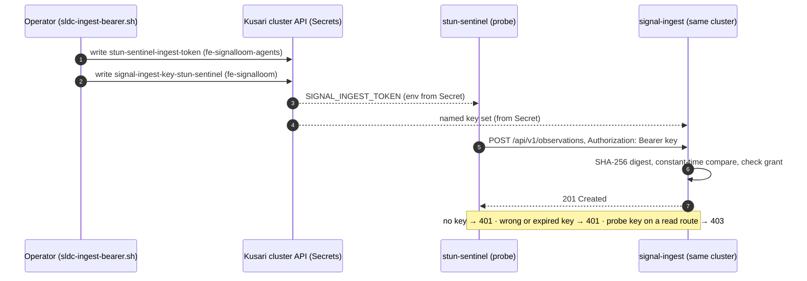

# Proposal — Signal Loom Spireless Token-Based Agent Identity Migration (2026-Q4)

|  |  |
| :---: | :---- |
| Proposer & Date: | AJM (2026-10-02) |
| Reviewer & Date: | Vicente Herrera, Stefan Prodan, Francesco Beltramini (pending: the 2026-10-02 adversarial review below is sensai's, not theirs) |
| Approver & Date: | Andy Martin (2026-10-02, Phase 1 scope as revised) |

> **Revision 2026-10-02 (adversarial review).** The first draft proposed an OpenBao-minted, 300-second, refreshing JWT plus the deletion of SPIRE. Andy's direction the same evening was narrower and simpler: *"keep inbound authentication as simple as possible so we can do it from lots of different places … a bearer token with a long key … I specifically don't want the SPIRE server to run in the remote signal generating endpoint. The log forwarding may only have a very simple ability to set headers, so we'll have to use a static key for now"*, and *"cross-cluster auth could be complex, and we're trying to avoid that."* This revision makes **Phase 1 a static API key for the probe in the Kusari cluster, verified in that same cluster**, and moves everything else behind measured gates. The review findings that drove each change are in [Adversarial Review](#adversarial-review-2026-10-02).

> **Revision 2026-10-03 (second draft appraised).** Andy's 01:00 update to the original draft added partition tolerance (8-hour leases, 4-hour sliding refresh, local buffering), a 0600 credential file instead of `keyctl`, an explicit acceptance of bearer-exfiltration risk with compensating controls, and an L7/L3 decoupling that rejects kTLS. Each was appraised against the code and Andy's ADR-03 direction. The resilience, risk and decoupling ideas are integrated as **Phase 1b** (D7–D10, ADR-08 to ADR-10) on static keys. Lease length and refresh move into the gated Phase 2 at 8 h/4 h instead of 300 s. The SPIRE-deletion and 650 MB claims stay withdrawn. Dispositions are in [Second Draft Appraisal](#second-draft-appraisal-2026-10-03).

> **Status 2026-10-03 (board closed).** Phase 1 (D1–D6) and Phase 1b (D7–D10) are built, merged on `integration/sltm-v0.1.0` and certified by SLTM-P4-GOV at `2ff21edb` (16/16 cards; see Errata — SLTM-P4-GOV): named keys (one Secret per key, `signal-ingest-key-<name>`, value plus `.expires`), JWKS optional, tenant-scoped reads and writes, the probe renamed to `signalloom-warden` and holding its key from a Secret, the issuer script, spool replay with zero loss under an injected partition, key revocation under 90 s with no restart, per-key 429, and batch-chain replay detection. **Definition of Done (Phase 1 and 1b) is met on the long-lived `kind-osramp` + `kind-signalloom-hub` estate:** `SLTM_LIVE=1 SLDC_LIVE=1 make test-sltm-probe-apikey` 19/19 twice in a row (15:37 and 15:42 +0100) and `SLDC_LIVE=1 make test-e2e-dual-cluster-containment` 6/6 twice (15:40 and 15:46), after `make test-sldc-offline` twice with identical totals and 44/44 mutation proofs. Still open: the same proof from a zero-state rebuild without observability (in progress, this session) and the GCP lane `sl-demo-1` deploy. The named-key pattern also guards fleet-manager (ADR-05).

---

## Press Release

ControlPlane today announced that a Signal Loom probe authenticates with a single long API key in a standard `Authorization: Bearer` header. A Kusari workload cluster's probe needs nothing else: no SPIRE agent, no CSI socket, no token refresh loop and no trust relationship with any other cluster. The key lives in a Kubernetes Secret in the probe's own cluster, is checked in constant time by the signal-ingest service in that same cluster, and grants exactly one permission: writing observations. Anything a log forwarder can do with a static header, it can now do as a first-class Signal Loom signal source. Detections survive an ingest outage: the probe spools them on its own node and replays them in order when the link returns, and a revoked key stops working without restarting anything.

---

## Proposal Overview

### Opportunity

**The work relates to the following value area(s):**

- [x] client revenue
- [ ] marketing
- [x] product
- [x] services engineering
- [ ] cost avoidance
- [x] process efficiency
- [x] operational or regulatory internal

**Key Customers:**

1. **Kusari EAP pilot.** The in-sentinel probe in the Kusari workload cluster (`kind-osramp` in the pilot) must post detections to signal-ingest. Today the live signal-ingest is an image that predates authentication, so it accepts anyone, and the HEAD build cannot start without SPIRE JWKS configuration.
2. **Remote signal sources with only header control.** Log forwarders and external sensors can set a static header and nothing more. They can't run a SPIRE agent, mount a node socket or refresh a token.
3. **Every other signal-ingest caller.** The fe-signalloom proxies, demos and live suites need a credential once authentication is enforced; Phase 1 gives each its own named key.

|  |  |
| :---- | :---- |
| Our *…* | Signal Loom probes and other signal sources, starting with the Kusari pilot's in-cluster sentinel |
| Have the problem/opportunity *…* | No way to authenticate to signal-ingest without SPIRE, so the deployed ingest runs unauthenticated |
| When *…* | Deploying the probe into a customer (Kusari) cluster, or forwarding signals from anything that can only set a header |

**What's the urgency of this work (e.g. QX 202X), and does this comprise other subcomponents of projects?**

**Urgency: Q4 2026 (immediate).** Phase 1 is the authentication half of the SLDC containment pilot ([[Proposal — Signal Loom Local Dual-Cluster EAP Pilot Validation and In-Sentinel Sensor Containment (2026-Q3)]]): Step 4 of its containment suite is only meaningful once the observation it reads arrived through an authenticated write. Later phases serve the SLCO onboarding flow and are not urgent.

---

## Scope Summary

**Technology Readiness Level:** Phase 1 moves from 3 (static bearer built and unit-tested, not deployed) to 6 (deployed and verified in the pilot cluster by an automated harness). Later phases stay at 2.

### In Scope Activities (Phase 1)

*Within project delivery and managed by the project team*

| Deliverable | Description | Acceptance Criteria | Validation Method |
| :---- | :---- | :---- | :---- |
| **D1: Named static keys in signal-ingest** | Generalise the existing static-bearer wrapper (`api/static_bearer.go`) into a set of named keys, each bound to one subject, one tenant scope, a least-privilege permission list and an expiry. The JWT path stays exactly as it is and becomes optional: with no JWKS configured, every JWT is refused and the static keys still work. | Missing, unknown, expired or malformed key → **401**. A valid key on a route outside its grant → **403**. Comparison is constant time over SHA-256 digests. A key under 32 bytes, or with an expiry more than 90 days after start-up, is refused at start-up. (This replaces the single global sunset date, 2026-11-12, which would have expired every key at once with no rotation path short of a code change.) The key value never appears in argv, a ConfigMap, git or a log line; the key *name* is logged on use. | Go unit and adversarial tests, each mutation-proven. The real binary started locally with keys only. |
| **D2: The probe's key** | The Kusari cluster's probe (`stun-sentinel` DaemonSet, `fe-signalloom-agents`) reads its key from Secret `stun-sentinel-ingest-token` (key `token`) through `SIGNAL_INGEST_TOKEN`, and sends it only as `Authorization: Bearer`. The binary carries no default key. | The probe's key grants exactly `observations:write`. A missing Secret is loud (`ingest_token_missing` at start-up and in the stats line) and never stops detection or freeze. | Go tests on the sentinel; live probe of the running pod. |
| **D3: Issuer script** | `scripts/sldc-ingest-bearer.sh --context <ctx>` mints a ≥32-byte random key, or reads one from stdin, and writes the probe's Secret and the verifier's Secret in the **same cluster**, idempotently. It never prints the key or passes it on a command line. Rotation is a re-run plus a restart of both workloads. | Re-run with no change is a no-op. Rotation makes the old key a 401 once both pods restart. | bats against a fake kubectl (exact exit codes); live rotation in the harness. |
| **D4: Same-cluster only** | The probe's `SIGNAL_INGEST_URL` is its own cluster's Service FQDN. No ingest key exists outside the cluster that verifies it, and the hub accepts none. | Zero Secrets holding an ingest key on `kind-signalloom-hub`; the probe's URL resolves to its own cluster's Service. | Live harness assertions. |
| **D5: Every caller has its own key, and reads are tenant-scoped** | The fe-signalloom gateway, the Signal Fusion demo, the live suites and the Step 4 evidence reader each get a named key with only what they call. An observation's tenant is its `labels.tenant_id`; a tenant-scoped key reads only its own tenant and writes only its own tenant. The gateway key holds `act_for_tenant`: fe-signalloom sends its already-verified user tenant as `X-SignalLoom-Acting-Tenant`, which signal-ingest honours only for a key holding that grant and ignores for everyone else. An actor belongs to a tenant only when every observation it was built from carries that tenant; mixed or untenanted actors, and the risk/fleet catalogue (which carries no tenant), need `cross_tenant_read`, held by operator tools and by the gateway acting for a superadmin (`*`). Aggregates count only rows the caller may read. The probe holds `cross_tenant_write`, because it observes every tenant's pods. | A tenant-A user sees no tenant-B rows on any proxied route. A forged acting-tenant header from any other key changes nothing. Another tenant's actor is a 404 identical to a missing one; risk/fleet without cross-read is 403 `cross_tenant_read_required`; an actor whose evidence becomes mixed disappears from the tenant's view on the next read. A non-superadmin can never act as `*`. | Go tests per read route, pytest on the fe side, each mutation-proven. |
| **D6: Probe API-key harness** | `make test-sltm-probe-apikey` proves D1–D4 end to end: an offline tier against the real signal-ingest binary started locally, and a live tier against the pilot cluster. | Both tiers green twice in a row. | The harness itself. |

### In Scope Activities (Phase 1b: resilience and revocation on static keys)

| Deliverable | Description | Acceptance Criteria | Validation Method |
| :---- | :---- | :---- | :---- |
| **D7: Partition-tolerant spool in the probe** | When signal-ingest is unreachable or answers 5xx, the probe appends each observation batch to a bounded on-node spool (`/var/lib/signalloom/spool`, hostPath, directory `0700`, files `0600`), then replays it in order once ingest answers again. Today a failed dispatch is counted and the observation is lost. | No observation is lost across an ingest outage of up to 8 h, within a configured size cap. When the cap is hit, the oldest batches go first, counted and logged. Replay preserves order and is idempotent, because the observation ID is deterministic. 401/403 are not retried and are loud. Detection and freeze never wait on the spool. | Go tests with an injected outage, restart and cap; live partition-injection test (deny egress to ingest for N minutes, then restore). |
| **D8: Revocation without a restart** | signal-ingest re-reads its key directory when the projected Secret changes. Deleting or rotating a key's Secret revokes it with no restart and no new infrastructure (no Redis). | A deleted key is a 401 within the kubelet's projection sync, ≤ 90 s measured. A rotated key's old value is a 401 and the new one a 201. A malformed update keeps the last good key set and is loud. | Go tests on the reloader; live revoke-and-measure in the probe test. |
| **D9: Per-key rate limiting** | A token bucket per key name in signal-ingest. Over the limit the answer is 429 with `Retry-After`, which the probe's spool honours. | A flood from one key cannot starve another key. 429 carries `Retry-After`, and the probe backs off without losing data. | Go tests; adversarial flood in the offline probe test. |
| **D10: Per-key batch sequence and hash chain** | Each sender numbers its batches and chains them (`seq`, `prev` = SHA-256 of the previous batch). signal-ingest verifies continuity per key and records gaps, replays and reordering as audit events, without rejecting late spool replays. | A replayed or reordered batch is detected and audited. A spool replay after an outage is accepted as a contiguous continuation. A chain that restarts after a probe restart is recorded as a new epoch, not a forgery. | Go tests over replay, reorder, gap and epoch cases. |

### Out of Scope (Phase 1)

* **Removing SPIRE.** SPIRE is still load-bearing: fleet-manager's stun cascade revokes SPIRE entries (`apps/fleet-manager/spire_client.go`, `cascade.go`), the Agent Trust slice federates through it (`d2-agent-trust/`), and signal-ingest has a SPIRE collector (`collectors/spirea/`). Phase 1 adds no new dependency on SPIRE and removes none.
* **OpenBao-minted short-lived tokens, refresh loops and `/enroll` refactoring.** Deferred to Phase 2, behind the gate below.
* **Cross-cluster authentication of any kind.**
* **Human operator OIDC** (Dex) is unchanged.

### Later phases (each gated on evidence, none committed)

| Phase | Scope | Gate to start |
| :---- | :---- | :---- |
| 2 | Session tokens minted by OpenBao for **remote** sources that cross a network boundary, with TLS at the edge: 8-hour leases with a proactive 4-hour sliding refresh (not 300 s, which loses data across partitions), `telemetry:write` scope, revocation by token accessor. Headless hosts keep the credential in a `0600` file (ADR-10). | A customer source outside the verifying cluster exists, and static-key rotation has been measured as an operational burden. |
| 3 | SPIRE retirement. | A measured footprint and flake rate (Phase 1 records the baseline), and fleet-manager's cascade plus Agent Trust migrated off SPIRE first. |

---

### KPIs

| Metric | Current Value (measured 2026-10-02) | Target Value | Measurement |
| :---- | :---- | :---- | :---- |
| Unauthenticated observation write accepted by the pilot's signal-ingest | **Accepted** (live image predates auth) | **401** | Harness live tier |
| Credentials a probe needs | SPIRE JWT-SVID (unavailable to the probe) | **1 Secret, 1 env var** | Rendered DaemonSet |
| Ingest keys held outside the verifying cluster | n/a | **0** | Harness live tier |
| Key comparison cost | not measured | measured by `go test -bench` and recorded, no target | Go benchmark |
| Observations lost during an ingest outage | **All** (a failed dispatch is counted, not kept) | **0** for outages up to 8 h within the spool cap | Partition-injection test (D7) |
| Time for a revoked key to stop working | Until the pod restarts | **≤ 90 s**, no restart | Revoke-and-measure (D8) |

The first draft's memory (650 MB in the press release, 680 MB in the KPI table), 4.2% flake and 15-minute onboarding figures had no measurement behind them and are withdrawn until Phase 3 measures them.

---

### 3rd Party Test Plan and Quality Assurance

| Validation | Method | Owner |
| :---- | :---- | :---- |
| **Key forgery, replay, truncation and timing** | Adversarial Go tests: wrong key, key prefix, key plus suffix, whitespace, case variants, empty header, `Basic` scheme, duplicate headers, expired key; each mutation-proven. | Lead Security Engineer (`#vicente-herrera`) |
| **Cross-tenant isolation** | A tenant-A key reads no tenant-B rows on every read route; only `cross_tenant_read` crosses. | Testing & QA Lead (`#francesco-beltramini`) |
| **Probe end-to-end** | `make test-sltm-probe-apikey` live tier on the pilot cluster, twice in a row. | Cloud Native Architect (`#stefan-prodan`) |

---

## Technical Overview

#### Technologies

| Technology | Purpose | Alignment |
| :---- | :---- | :---- |
| **HTTP Bearer (RFC 6750)** with a static opaque key | The only credential a probe or forwarder needs | Any client that can set one header |
| **Kubernetes Secrets** | Key storage in the probe's and verifier's own cluster | Already used across the estate |
| **Go (`signal-ingest`, `stun-sentinel`)** | Verification (constant-time digest compare) and the probe's client | Existing services |

#### Infrastructure and Repositories

| Asset | Location | Notes |
| :---- | :---- | :---- |
| Verifier | `d2-signalloom/apps/signal-ingest/` (`api/static_bearer.go`) | Port 8082; probes on a separate unauthenticated port 8083, not in the Service |
| Probe | `d2-signalloom/apps/signalloom-stun-sentinel/` + `apps/stun-sentinel/pkg/correlator` | Posts `POST /api/v1/observations` (a JSON array) |
| Probe manifest | `d2-signalloom/infra/agent-swarm/signalloom-stun-sentinel/` + overlays | `SIGNAL_INGEST_URL` from the per-cluster ConfigMap |
| Issuer | `scripts/sldc-ingest-bearer.sh` | Same-cluster Secrets only |
| Harness | `test/sltm-probe-apikey.bats`, `make test-sltm-probe-apikey` | Offline tier + live tier (`SLTM_LIVE=1`) |

---

#### Security and Risk

**Threat model for Phase 1 (STRIDE):**

| Threat | Impact | Mitigation | Residual |
| :---- | :---- | :---- | :---- |
| **Spoofing** | Anyone holding the probe's key can write observations attributed to the probe. | Key is ≥32 random bytes, Secret-held, scoped to `observations:write`, with an expiry; tenancy on each observation comes from the probe's operator tenant map, not the payload author. | A shared static key is not workload attestation: observations written with it are **not identity-bound**. The forensic bundle already scopes itself to "integrity and signer identity, not truth". |
| **Tampering** | In-cluster traffic from probe to ingest is plain HTTP on the pod network. | Same-cluster only; NetworkPolicy admits the probe to ingest. | A pod-network attacker can read the key. TLS is a Phase 2 item for traffic that leaves the cluster. |
| **Repudiation** | A key holder denies a write. | The key *name* is logged per request. | Static keys give accountability per key, not per process. |
| **Information disclosure** | Key leaked via argv, logs, a ConfigMap or a host file. | Env or projected file from a Secret only (in cluster); a `0600` file owned by the service user on headless hosts (ADR-10); no flag; no default; redaction tests. | Anyone with `get secrets` in the namespace, or root on the host, can read it. |
| **Denial of service** | Invalid-key floods. | Constant-time compare over a fixed-length digest is cheap. | No rate limit in-cluster in Phase 1. |
| **Elevation of privilege** | A key reads or writes another tenant's data. | Reads tenant-scoped by key; `cross_tenant_read` only for the gateway. | The probe is a cross-tenant **writer** by design (it observes every tenant's pods), so its writes carry the tenant from operator config, not from the key. |

**Accepted risks and compensating controls (ADR-08):**

| Accepted risk | Rationale | Compensating controls |
| :---- | :---- | :---- |
| **Bearer key exfiltration** | Sender-constrained tokens (DPoP, client mTLS) add client dependencies a remote headless VM or log forwarder cannot carry. A bearer key is the deliberate trade. | (1) **Least-privilege scope**: the probe key is `observations:write` with cross-tenant write, so it cannot read anything; every other key is scoped to what its caller calls. (2) **Revocation without restart** (D8). (3) **Per-key rate limit** (D9). (4) **Per-key batch hash chain** (D10) detects replay and injection out of sequence. (5) **Expiry**: at most 90 days, with a warning 14 days out. |
| **No kernel-level caller attestation** | Without SPIRE, signal-ingest cannot attest the caller's PID or UID. | Containment never depends on API identity (ADR-09): the probe contains workloads through cgroup v2 and veth filters, whoever holds a key. |

**Containment versus API authentication (ADR-09, the L7/L3 decoupling):**

* **API identity plane (L7).** Remote sources send over HTTPS to the Envoy Gateway, which terminates TLS and forwards to signal-ingest. The same-cluster probe posts to signal-ingest's ClusterIP Service directly, in plain HTTP on the pod network (the residual stated under Tampering). signal-ingest checks the key in userspace.
* **Containment plane (L3/L4/cgroup).** The probe contains a workload through cgroup v2 freeze, host-veth TC drop filters and the gitops pin. None of it reads or needs an HTTP credential.
* **kTLS inspection is rejected.** Peeking at TLS payloads in kernel (`BPF_PROG_TYPE_SK_MSG` over kTLS) would need kTLS-enabled clients everywhere and buys nothing: containment never inspects an Authorization header.

**SWOT Analysis:**

| Strengths | Weaknesses |
| :---- | :---- |
| • One header, any client.<br/>• No SPIRE, no refresh loop, no cross-cluster trust.<br/>• Testable end to end in one cluster. | • A static key is a long-lived bearer secret.<br/>• No per-process attestation. |
| **Opportunities** | **Threats** |
| • The same contract serves log forwarders and external sensors.<br/>• A clean place to add short-lived tokens later without changing the probe's header. | • Key leak until rotation. Every key carries an expiry no more than 90 days after the process starts, the binary warns per key in the last 14 days, and `sldc-ingest-bearer.sh --rotate` resets it, so rotation cannot be forgotten silently and an expired key never becomes a fleet-wide outage. |

---

## Milestones and Deliverables

| Milestones Committed To | Duration (days) | Consultants | Person-days | Deadline | Capability Mapping |
| :---- | :---- | :---- | :---- | :---- | :---- |
| **M1: Named static keys + tenant-scoped reads** (D1, D5) |  |  |  |  | `#cap-golang` `#cap-security-engineering` |
| **M2: Probe key and issuer** (D2, D3, D4) |  |  |  |  | `#cap-golang` `#cap-kubernetes` `#cap-secrets` |
| **M3: Probe API-key harness, offline and live** (D6) |  |  |  |  | `#cap-testing-pyramid` |
| **M4: Deploy to the pilot cluster and pass the harness twice** |  |  |  |  | `#cap-kubernetes` |
| **Signoff** |  |  |  |  | `#cap-engagement-management` |

**Definition of Done (Phase 1):**

* The pilot cluster's signal-ingest is built from HEAD, enforces authentication, and starts with static keys and no JWKS.
* The probe posts with its key and gets 201; no key, a wrong key or an expired key gets 401; the probe's key on a read route gets 403.
* No ingest key exists on any cluster other than the one that verifies it.
* `make test-sltm-probe-apikey` passes offline and live, twice in a row from a clean start.

**Definition of Done (Phase 1b):**

* An injected ingest outage loses no observation within the spool cap, and replay is ordered and idempotent (D7).
* A deleted key stops working within 90 s with no restart (D8).
* A flooding key gets 429 and does not starve another key (D9).
* A replayed or reordered batch is detected and audited, and a spool replay and an epoch restart are not flagged (D10).

---

### Reviews & Collaboration (RACI)

|  |  |
| :---- | :---- |
| **Accountable** | Lead Security Architect (`#vicente-herrera`) |
| **Responsible** | Platform Engineering Team (`#stefan-prodan`, `#francesco-beltramini`) |
| **Consulted** | Technical Solutions & EAP Lead (`#francesco-beltramini`) |
| **Informed** | [Andrew Martin](mailto:andy@control-plane.io), [Elena Mikhalina](mailto:elena.mikhalina@control-plane.io) |

---

## Finances

### Additional costs

| Additional Cost | Estimated Spend | One Off or Recurring | Must-Have or Nice-to-Have |
| :---- | :---- | :---- | :---- |
| None | £0 | n/a | n/a |

The first draft's -£180/month saving depended on removing SPIRE, which is now Phase 3, so it is withdrawn.

---

## Decision Log

| Date | Decision Makers | Decision and context | Reason | Impact |
| :---- | :--- | :--- | :--- | :--- |
| 2026-10-02 | AJM, Vicente Herrera | ADR-01 (draft): eliminate SPIRE and standardise on bearer tokens | SPIRE blocks external agents | **Superseded by ADR-03** for Phase 1; SPIRE removal is Phase 3 |
| 2026-10-02 | AJM, Stefan Prodan | ADR-02 (draft, amended 2026-10-03): OpenBao as token authority. The 300 s TTL became 8-hour leases with a 4-hour sliding refresh | 300 s expiries lose telemetry across partitions, jitter and maintenance | **Deferred to Phase 2**: the probe gains nothing from it in-cluster, and reaching OpenBao from a remote probe is the cross-cluster dependency ADR-03 avoids. If Phase 2 starts, it uses 8 h/4 h |
| 2026-10-02 | AJM | **ADR-03: Phase 1 is a static, named, long API key per caller, header-only, verified in the probe's own cluster** | "keep inbound authentication as simple as possible … a bearer token with a long key … I specifically don't want the SPIRE server to run in the remote signal generating endpoint … cross-cluster auth could be complex, and we're trying to avoid that" | No SPIRE or OpenBao on the probe's path; one Secret per side; rotation is a script re-run |
| 2026-10-02 | AJM | **ADR-04: signal-ingest reads are tenant-scoped; the gateway acts for the user's tenant** | The review found signal-ingest's read handlers ignore tenancy, and fe-signalloom resolves the user's tenant and then never uses it (`signal_fusion.py` `get_observations`), so any dashboard user saw every tenant | Least privilege becomes real. The gateway forwards the verified user tenant, honoured only for a key holding `act_for_tenant`. Assumption, reversible by removing one grant: a superadmin's cross-tenant view is intended. |
| 2026-10-03 | AJM | **ADR-05: the same named static keys guard fleet-manager; dashboard mutations sit behind a login check** | fleet-manager's `/stun` and `/recover` had no caller authentication (`/recover` thawed every stunned agent); the dashboard forwarded browser tokens nobody verified | Per-caller keys (stun-sentinel and fe-signalloom: stun only; operator: everything). nginx `auth_request` to fe `GET /api/v1/auth/check` (superadmin) before injecting the dashboard key; the same gate covers every afm-platform mutation |
| 2026-10-03 | AJM | **ADR-06 (board phase P1): AFM reads the Kusari cluster's RBAC through a separate read-only exporter, not through the probe** | The probe is privileged and runs on every node; giving it cluster-wide RBAC read would put that credential on every node | A single unprivileged CronJob in the probe's bundle, own ServiceAccount, read-only ClusterRole (the four RBAC kinds, namespaces, service accounts; never Secrets), pushing to AFM with its own named key |
| 2026-10-03 | AJM | **ADR-07 (board phase P3): rename `stun-sentinel` to `signalloom-warden`** | "stun" names one action of a component whose main job is detection; "agent" collides with the AI agents it governs | `signalloom-warden` (watches and detains; unused in the repo), chosen by Andy at sign-off 2026-10-03 |
| 2026-10-03 | AJM, Andy Martin | **ADR-08: accept bearer-key exfiltration risk, with compensating controls** | DPoP or client mTLS add unacceptable client-side dependencies for remote VMs and log forwarders | Least-privilege scope, revocation without restart (D8), per-key rate limit (D9), per-key batch hash chain (D10), 90-day maximum lifetime. Redis CRL dropped: D8 needs no new infrastructure |
| 2026-10-03 | AJM, Andy Martin | **ADR-09: L7/L3 decoupling, with kTLS inspection rejected** | Kernel TLS inspection needs custom crypto bindings in every client, and containment never needs the payload | Auth in userspace at signal-ingest (behind Envoy TLS for remote sources); containment by cgroup v2 and veth filters |
| 2026-10-03 | AJM, Andy Martin | **ADR-10: on headless hosts the credential lives in a `0600` file, not `keyctl`** | Kernel keyrings vanish on systemd restarts and behave inconsistently under container seccomp | Phase 1: the static key in a `0600` file owned by the service user. Phase 2: the session and refresh tokens in the same file (`/var/lib/signalloom/session.json`). In cluster, Secrets stay the store |

---

## Adversarial Review (2026-10-02)

Every finding was checked against the repository at the integration line (`sldc2/base-slms`) or the live pilot cluster.

| # | Draft claim | Finding | Evidence | Disposition |
| :---- | :---- | :---- | :---- | :---- |
| 1 | Delete SPIRE entirely (D4, M5) | SPIRE is load-bearing outside identity for agents: the stun cascade's SPIRE plane, Agent Trust federation, and a signal-ingest collector depend on it. Deleting it breaks containment. | `apps/fleet-manager/{spire_client,cascade}.go`; `d2-agent-trust/spire-federation-*.yaml`; `apps/signal-ingest/collectors/spirea/` | Moved to Phase 3 with prerequisites |
| 2 | Manifests at `d2-signalloom/infra/inf-bao/spire-*` | Path does not exist; SPIRE lives in `infra/inf-bao/configs/base/spire-agent.yaml`, `controllers/base/openbao-spire.yaml` and `deploy/spiffe-csi/` | `ls d2-signalloom/infra/inf-bao` | Corrected in Phase 3 scope when it starts |
| 3 | Telemetry endpoint `POST /api/v1/telemetry` on `signal-ingest:8080`, answering 202 | No such route. The probe posts `POST /api/v1/observations` (a JSON array) to port 8082 and gets 201 | `api/auth.go` route table; `base/service.yaml` | Contract corrected |
| 4 | "Tenant ID is cryptographically bound inside the token" | The probe is a node-level, cross-tenant observer; a per-tenant token cannot describe its writes. And signal-ingest's read handlers never consulted tenancy at all. | `api/handlers.go` read handlers; sentinel tenant map (`pkg/correlator/tenancy.go`) | ADR-04; probe tenancy from operator config |
| 5 | PostgreSQL RLS protects tenants on ingest | The observation store does not apply tenancy; RLS covers the identity repository, not observations | `store/` | Replaced by key-scoped reads (D5) |
| 6 | 300 s TTL plus refresh against OpenBao | For a remote probe this needs a network path to OpenBao: the cross-cluster dependency Andy asked to avoid; for the in-cluster probe it adds a failure mode and no benefit | ADR-03 quote | Phase 2, gated |
| 7 | Tokens "never written to disk" | A Kubernetes Secret is stored in etcd; env from Secret is visible to anyone who can read the pod's Secret | Kubernetes model | Stated as residual |
| 8 | TLS 1.3 at Envoy protects the token | Probe-to-ingest traffic is in-cluster ClusterIP HTTP and never touches Envoy | `configmap.yaml` `SIGNAL_INGEST_URL` | Stated as residual; TLS in Phase 2 |
| 9 | 650 MB / 680 MB, 4.2% flakes, >15 min onboarding, -£180/month | Unmeasured, and internally inconsistent (650 vs 680) | No source in repo or vault | Withdrawn; Phase 1 measures the baseline |
| 10 | Reviewers and approver signed off on the draft | No review record exists beyond the draft itself | Vault and repo history | Reviewer row marked pending |
| 11 | The deployed ingest rejects unauthenticated requests with 401 | The live pilot signal-ingest is a 2026-09-15 image with no auth; HEAD cannot even start without SPIRE JWKS | Live pod image `signal-ingest:local`; `main.go` `AuthConfigFromEnv` | Fixed by D1 (JWKS optional) and M4 |
| 12 | Every probe health check works under auth | Every route, including `/healthz` and `/readyz`, sat behind the auth router, so any auth-on build crash-looped on kubelet probes | `api/` router | Probes moved to unauthenticated port 8083, outside the Service |
| 13 | (not in draft) fe-signalloom enforces user tenancy before proxying to signal-ingest | It resolves the tenant and discards it; `_proxy` returns signal-ingest's JSON verbatim | `fe-signalloom/src/signal_fusion.py` `get_observations` | ADR-04, D5 |

---

## Second Draft Appraisal (2026-10-03)

Andy's 01:00 update was made to the original draft. Each change is weighed here against the code and ADR-03 (simple static keys, no cross-cluster auth).

| # | Change in the update | Verdict | Why | Where it landed |
| :---- | :---- | :---- | :---- | :---- |
| 1 | 8-hour session leases replace 300 s TTLs | **Agree, Phase 2** | 300 s does lose data across partitions. Phase 1 keys have no session to expire mid-partition | Phase 2 row; ADR-02 amended |
| 2 | Proactive sliding refresh at 4 h | **Agree, Phase 2** | Only meaningful with minted sessions | Phase 2 row |
| 3 | Local buffering across partitions of up to 8 h | **Agree, now** | Measured: the probe drops an observation when a dispatch fails, with no spool. This is a real evidence-loss gap regardless of token type | D7 (Phase 1b), KPI row |
| 4 | Credentials in a `0600` state file, `keyctl` rejected | **Agree, modified** | Right for headless hosts. In cluster, Secrets remain the store, so no node file holds a key | ADR-10 |
| 5 | Sub-second revocation through a Redis CRL | **Modify** | Revocation without restart is right, but Redis adds infrastructure and a dependency ADR-03 avoids. Re-reading the projected key directory gives ≤ 90 s with nothing new | D8, ADR-08 |
| 6 | `telemetry:write` scope | **Agree, already true** | The probe's key is `observations:write`, plus cross-tenant write because it observes every tenant | ADR-08 controls |
| 7 | Monotonic batch counters and hash chains | **Agree, modified** | Detects replay and reordering. It must accept a spool replay and a chain restart after a probe restart (an epoch), or D7 would trip it | D10 |
| 8 | Per-token ingress rate limits | **Agree, now** | Measured: signal-ingest has none. A per-key bucket stops one key starving another | D9 |
| 9 | Accept bearer exfiltration; reject DPoP and mTLS | **Agree** | Consistent with ADR-03; the residual is stated with its controls | ADR-08, accepted-risks table |
| 10 | L7/L3 decoupling; reject kTLS | **Agree, corrected** | Correct in principle. The update says all traffic crosses Envoy; the same-cluster probe does not (ClusterIP, plain HTTP), and that residual stays stated | ADR-09 |
| 11 | Press release and KPIs restored: SPIRE deletion, 650 MB, < 30 s onboarding, 0 hostPath mounts | **Disagree** | Still unmeasured, and SPIRE is still load-bearing (review findings 1, 9). They return when Phase 3 measures them | Withdrawn, unchanged |
| 12 | "Tokens never written to disk" next to a `0600` state file | **Disagree, contradictory** | The update states both. The STRIDE row now says exactly where a key lives | STRIDE information-disclosure row |
| 13 | ADR numbers 03–05 for the new decisions | **Renumbered** | ADR-03 to ADR-07 were already taken | ADR-08 to ADR-10 |

---

## Appendix

### A. Sequence: the Kusari cluster's probe authenticating with its API key



### B. API contract (Phase 1)

* `POST /api/v1/observations` with `Authorization: Bearer <key>` and a JSON array of observations → `201 {"ingested": N}`.
* Missing, unknown, expired or malformed key → `401`. Valid key outside its grant → `403`.
* Health: `GET :8083/healthz` and `GET :8083/readyz` without credentials (not exposed by the Service).

### Spec: Shared Patterns

#### Mission identity
- Canonical repository: `/home/andy/src/cp/osramp-demo`
- Shortcode: `SLTM`
- Integration branch: `refs/heads/integration/sltm-v0.1.0`, cut from `feat/signal-loop-and-bootstrap-refactor` after every Phase 1 and SLDC fix branch is merged into it (Andy, sign-off 2026-10-03). No work has started on this board
- Target components: `d2-signalloom/apps/{signal-ingest,signalloom-stun-sentinel,stun-sentinel,fleet-manager,fe-signalloom,dashboard-signalloom}`, `d2-k8s-afm/`, `d2-signalloom/infra/agent-swarm/`
- Acceptance commands: `make test-sldc-offline`; `make test-sltm-probe-apikey`; `make test-e2e-containment-mutation-proof`; `SLTM_LIVE=1 make test-sltm-probe-apikey` and `make test-e2e-dual-cluster-containment` (live tiers: Governor cards only, never implementation cards)

#### Architectural constitution
- **One header, one key per caller.** Every inbound credential is a named static key: `Authorization: Bearer <key>`, at least 32 random bytes, a 90-day maximum lifetime, compared in constant time over SHA-256 digests, and verified by the service in the caller's own cluster. No SPIRE, JWT or token refresh at a signal source.
- **Keys live only in Secrets.** A value never appears in argv, a ConfigMap, git, a log line or an audit row. Its *name* is logged on every use. curl receives keys through 0600 header files.
- **Tenancy comes from operator configuration, never from the workload.** Probe attribution comes from `SENTINEL_TENANT_MAP` (namespace or namespace/serviceAccount); reads and writes are scoped to the key's tenant; an actor's tenant derives from all of its evidence.
- **Least privilege by default, read-only by construction.** Any new cluster reader gets its own ServiceAccount and only `get/list/watch` on the exact resources it needs. It never reads Secrets and is never the privileged probe.
- **Fail closed and loud.** A missing key disables only that caller and is logged; an audit store that is down refuses with 503; nothing fabricates success.

#### Wire contracts fixed for the board
- **Batch chain (D10):** request headers `X-SignalLoom-Batch-Epoch` (random per sender start), `X-SignalLoom-Batch-Seq` (from 1 within the epoch), `X-SignalLoom-Batch-Prev` (hex SHA-256 of the previous batch body in the epoch; empty for seq 1). The body contract is unchanged. Absent headers mean an unchained sender and are accepted.
- **Spool (D7):** `/var/lib/signalloom/spool` (hostPath, `0700` dir, `0600` files), bounded by `SIGNAL_INGEST_SPOOL_MAX_BYTES` and `SIGNAL_INGEST_SPOOL_MAX_AGE` (default 8h); a 429 `Retry-After` is honoured.
- **AFM import key:** named key `afm-importer`, scope `afm:import`, verified by fe-signalloom with `hmac.compare_digest` over SHA-256 digests, from a projected Secret.
- **Harness:** cards run on the `antigravity` harness, the one with subscription headroom at board creation (Codex throttled, Claude at 54% of its 5-hour window). `start-ready` may rebalance later.

#### Canonical locations
- `d2-signalloom/apps/signal-ingest/api/{static_bearer,static_keys}.go`: named-key verifier
- `d2-signalloom/apps/fleet-manager/callerauth.go`: the fleet-manager mirror of the same contract
- `scripts/sldc-ingest-bearer.sh`, `scripts/fleet-manager-caller-keys.sh`: issuers (stdin only, idempotent, `--rotate`)
- `d2-k8s-afm/apps/afm-platform/base/cluster-import.yaml`: the existing in-cluster RBAC export and its `afm-rbac-reader` ClusterRole, to reuse rather than reinvent
- `test/sltm-probe-apikey.bats`: the Phase 1 acceptance suite

#### Testing standards
- Failing test first. Every new assertion is mutation-proven (break the real line, see red, restore, see green), recorded one line per proof in the card's errata.
- Offline by default: `KUBECONFIG=/dev/null`. Live halves gate on `scripts/lib/live-gate.sh` (`SLDC_LIVE=1`, a real kubeconfig, `/readyz`). No offline run may create, delete or exec into anything on a cluster or node.
- No `|| true`, no `skip` on a missing system under test, no `! cmd` as an assertion in bats, no line-number pins, no early-exit reader under pipefail (`scripts/lint-pipefail-grep-q.sh`).
- A test never rewrites a tracked file; regeneration needs an explicit opt-in variable.

#### Anti-patterns
- Cross-cluster trust or credential mirroring.
- A default key or token compiled into a binary.
- Granting the privileged node probe any cluster-wide read.
- Renaming decision records (dated proposals, reports, evidence): they record a past state.

### Spec: Capability Plan

| Logical ID | Selected skills | Agent role | Size | Ceiling | CPAI agent | Rationale |
| :--- | :--- | :--- | :--- | ---: | :--- | :--- |
| P0 | ajm-auto-kanban; ripwire | Baseline engineer | S | 45m | antigravity | Prove the board harness, the integration branch and the Phase 1 offline gate before any change. |
| P1-PRE | ripwire; context-mode | Pre-flight analyst | S | 60m | antigravity | Map AFM's import contract, its upload API and auth, and where the exporter ships in the probe bundle. |
| P1-1 | context-mode | Python API engineer | M | 120m | antigravity | AFM's backend lives outside this repo, so the key check sits in a fe-signalloom gateway route plus a NetworkPolicy. |
| P1-2 | context-mode | Kubernetes engineer | M | 120m | antigravity | A read-only exporter CronJob in the probe bundle; RBAC and PSS discipline matter more than code volume. |
| P1-GOV | ajm-auto-kanban | Governor | M | 90m | antigravity | Merge in order; run the live AFM import from the Kusari cluster once. |
| P2-PRE | ripwire; context-mode | Pre-flight analyst | S | 60m | antigravity | Map the probe's dispatch path, signal-ingest's key loader and router, and the hostPath and PSS constraints for an on-node spool. |
| P2-1 | context-mode | Go systems engineer | L | 180m | antigravity | The spool: bounded, ordered, idempotent replay, 0600 files, honours 429/Retry-After, never blocks detection or freeze (D7). |
| P2-2 | context-mode | Go API engineer | M | 120m | antigravity | Hot reload of the key directory with last-good fallback (D8) and per-key token buckets with 429 (D9). |
| P2-3 | context-mode | Go API engineer | M | 120m | antigravity | Per-key batch sequence and hash chain with epochs that tolerates spool replay (D10); sender and verifier sides. |
| P2-GOV | ajm-auto-kanban | Governor | M | 90m | antigravity | Live partition injection: no loss within the cap; revoke-and-measure ≤ 90 s. |
| P3-PRE | ripwire; context-mode | Pre-flight analyst | S | 60m | antigravity | Classify every `stun-sentinel` occurrence (1,323 in 275 files): identity-bearing, living doc, or decision record. |
| P3-1 | context-mode | Platform engineer | L | 180m | antigravity | The rename touches image, ServiceAccount, RBAC, labels, Flux path and event names; it needs a no-overlap cutover so two probes never freeze the same pod. |
| P3-2 | context-mode | Test engineer | M | 120m | antigravity | Rename tests and living docs; add a guard that fails on the old name outside an allow-list. |
| P3-GOV | ajm-auto-kanban | Governor | M | 90m | antigravity | Live cutover check: exactly one probe DaemonSet, Step 4 and Step 5 green, no orphaned RBAC. |
| P4-1 | context-mode | Go API engineer | S | 60m | antigravity | Actor IDs containing `//` are rejected on every `{id}` route; canonicalise or encode them. |
| P4-GOV | ajm-auto-kanban | Governor | S | 60m | antigravity | Final acceptance: every acceptance command, live tiers twice in a row. |

### Spec: Shared Patterns — Phase 1

#### P1 Wire Contract: Authenticated AFM Import Gateway
- **Inbound Route:** `POST /api/v1/afm/clusters/import` on `fe-signalloom` gateway and API.
- **Forwarding Destination:** `http://afm-platform.fe-k8s-afm.svc.cluster.local (port 8000)/clusters/import` (internal cluster Service).
- **Authentication Header:** `Authorization: Bearer <key>` (RFC 6750 Bearer token, minimum 32 random bytes).
- **Static Key Name:** `afm-importer`.
- **Required Scope:** `afm:import`.
- **Environment Configuration:** `AFM_IMPORT_KEYS` on `fe-signalloom` deployment containing a JSON-encoded array of authorized key definitions:
  `[{"name":"afm-importer","scopes":["afm:import"],"cluster":"kind-osramp"}]`
- **Verifier Secret (fe-signalloom):** `fe-signalloom/fe-signalloom-afm-importer-key`, projected as a volume mount at `/etc/fe-signalloom/afm-importer-key/`. Contains data keys `afm-importer` (raw token value) and `afm-importer.expires` (RFC 3339 expiration timestamp).
- **Consumer Secret (fe-signalloom-agents):** `fe-signalloom-agents/signalloom-rbac-exporter-afm-key`, projected as a volume mount into the exporter pod. Contains data key `token` (raw Bearer token value).
- **Key Issuer Script:** `scripts/afm-importer-key.sh` (generates the matching Secret pair for verifier and consumer namespaces).
- **Exporter Identity:** ServiceAccount `signalloom-rbac-exporter` and pod label `app.kubernetes.io/name: signalloom-rbac-exporter` in namespace `fe-signalloom-agents`.
- **Bound Cluster Attribution:** `kind-osramp`. In accordance with the architectural constitution ("Tenancy comes from operator configuration, never from the workload"), the verifier enforces that the payload's `id` field matches the cluster bound to the presented key.
- **Payload Schema:**
  ```json
  {
    "id": "kind-osramp",
    "name": "Local Cluster",
    "rbac": {
      "subjects": [
        {
          "kind": "User|ServiceAccount|Group",
          "name": "string",
          "namespace": "string (optional)"
        }
      ],
      "roles": [
        {
          "name": "string",
          "scope": "Cluster|Namespace",
          "namespace": "string (optional)",
          "rules": [
            {
              "verbs": ["string"],
              "apiGroups": ["string"],
              "resources": ["string"]
            }
          ]
        }
      ],
      "bindings": [
        {
          "name": "string",
          "scope": "Cluster|Namespace",
          "namespace": "string (optional)",
          "roleRef": "string",
          "subjects": [
            {
              "kind": "User|ServiceAccount|Group",
              "name": "string",
              "namespace": "string (optional)"
            }
          ]
        }
      ]
    }
  }
  ```
- **Payload Size Bound:** `AFM_IMPORT_MAX_BYTES` (default: `1048576` bytes / 1 MiB).
- **Digest Verification:** Constant-time comparison using `hmac.compare_digest` over SHA-256 digests (`hashlib.sha256(key.encode()).digest()`).
- **Refusal Status Codes and Error Bodies:**
  - Missing Authorization header: `401 Unauthorized` with `{"error": "missing_authorization_header"}`
  - Unknown or invalid Bearer key: `401 Unauthorized` with `{"error": "invalid_api_key"}`
  - Expired Bearer key: `401 Unauthorized` with `{"error": "key_expired"}`
  - Insufficient scope (missing `afm:import`): `403 Forbidden` with `{"error": "insufficient_scope"}`
  - Cluster ID mismatch (payload `id` differs from key binding): `403 Forbidden` with `{"error": "cluster_id_mismatch"}`
  - Payload size exceeds `AFM_IMPORT_MAX_BYTES`: `413 Payload Too Large` with `{"error": "payload_too_large"}`
  - Invalid JSON syntax or schema failure: `422 Unprocessable Entity` with `{"error": "invalid_payload_schema"}`
  - Downstream AFM connection failure or 5xx: `502 Bad Gateway` with `{"error": "upstream_afm_error"}`

#### File Ownership Split: Phase 1 Cards

| File / Subsystem Path | P1-1 (Gateway & Auth) | P1-2 (Exporter CronJob & RBAC) | Governance / Shared |
| :--- | :--- | :--- | :--- |
| `d2-signalloom/apps/fe-signalloom/src/**` | Sole Owner (implements `/api/v1/afm/clusters/import`, key loader, schema validation) | Read-only | — |
| `d2-signalloom/apps/fe-signalloom/base/deployment.yaml` | Sole Owner (mounts `/etc/fe-signalloom/afm-importer-key/`, configures `AFM_IMPORT_KEYS`) | Read-only | — |
| `d2-signalloom/apps/fe-signalloom/base/networkpolicy.yaml` | Sole Owner (egress to `afm-platform` on port 8000, ingress from `fe-signalloom-agents`) | Read-only | — |
| `d2-signalloom/apps/dashboard-signalloom/nginx.conf` | Sole Owner (L7 403 on direct `/afm/clusters/import` browser upload path) | Read-only | — |
| `d2-k8s-afm/apps/afm-platform/base/gateway-route.yaml` | Sole Owner (Envoy HTTPRoute L7 filter closing external `/clusters/import`) | Read-only | — |
| `d2-k8s-afm/apps/afm-platform/base/cluster-import.yaml` | Sole Owner (labels on in-namespace CronJob only) | Read-only | — |
| `scripts/afm-importer-key.sh` | Sole Owner (Secret generation script) | Read-only | — |
| `d2-signalloom/apps/fe-signalloom/src/tests/**` | Sole Owner (pytest suite for import route, auth gates, size limits) | Read-only | — |
| `d2-signalloom/infra/agent-swarm/signalloom-stun-sentinel/**` | Read-only | Sole Owner (probe bundle base) | — |
| `d2-signalloom/infra/agent-swarm/signalloom-rbac-exporter/**` | Read-only | Sole Owner (exporter CronJob, config, ServiceAccount) | — |
| `d2-osramp-fleet/tenants/base/agent-swarm.yaml` | Read-only | Sole Owner (ClusterRole/Binding in ResourceSet, Secret sync) | — |
| `test/sltm-rbac-exporter.bats` | Read-only | Sole Owner (exporter manifest and mock push tests) | — |
| `Makefile` | Non-colliding target registration (line-distinct additions) | Non-colliding target registration (line-distinct additions) | — |
| `docs/Proposal — ... (2026-Q4).md` | Non-colliding errata appending | Non-colliding errata appending | Preflight / Governor |

### Spec: Shared Patterns — Phase 2

#### Phase 2 Wire Contract: Probe Batching, Spooling & Batch Chain

##### 1. Probe Sender Serialization & Dynamic Batching (P2-1)
- **Single Sender Goroutine:** The probe correlator uses exactly ONE dedicated sender goroutine draining observations (replacing the uncoordinated 8-worker pool).
- **Dynamic Batch Flush Criteria:** The sender accumulates observations and flushes when either:
  1. `SIGNAL_INGEST_BATCH_MAX` (default: `100`) observations have accumulated, or
  2. `SIGNAL_INGEST_BATCH_LINGER` (default: `250ms`) duration has elapsed since the first buffered observation.
- **Batch Stamping Invariant:** Every batch is stamped with `X-SignalLoom-Batch-Epoch`, `X-SignalLoom-Batch-Seq`, and `X-SignalLoom-Batch-Prev` at the moment of batch assembly.
- **Spool Ordering & Precedence:** Replay from disk strictly precedes in-memory dispatch. No new memory batch may overtake or be dispatched ahead of a non-empty spool directory. Replay is FIFO ordered.

##### 2. On-Node Spool Envelope & Storage Constraints (P2-1)
- **Spool Directory:** Configured via `SIGNAL_INGEST_SPOOL_DIR` (default: `/var/lib/signalloom/spool`), created mode `0700` owned by root.
- **File Envelope Schema (JSON):**
  ```json
  {
    "v": 1,
    "epoch": "<sender-epoch-uuid>",
    "seq": 1,
    "prev": "<hex-sha256-or-empty>",
    "created": "<rfc3339nano>",
    "body": [ ... ]
  }
  ```
- **Atomic File Writing:** Spooled batches are written to a temporary file (`.tmp-...`) mode `0600`, flushed and `fsync`'d, then atomically renamed to their final sequential file name.
- **Spool Bounds:**
  - `SIGNAL_INGEST_SPOOL_MAX_BYTES` (default: `268435456` = 256 MiB). When the spool exceeds `MAX_BYTES`, oldest files are dropped (FIFO eviction) and counted in `spool_dropped_bytes` / `spool_dropped_batches` stats.
  - `SIGNAL_INGEST_SPOOL_MAX_AGE` (default: `8h`). Spooled files older than `MAX_AGE` are expired and pruned.

##### 3. Probe Response Handling Policy Matrix (P2-1)
| HTTP Status / Condition | Probe Action | Spool Behavior | Backoff / Retry |
| :--- | :--- | :--- | :--- |
| `2xx` (`200 OK`, `201 Created`) | Success. Advance sequence. | Delete spooled file (if replaying). | None; proceed to next batch. |
| `Network Error` / `Timeout` / `5xx` | Outage / Server Error. | Write batch to spool (`0600`). | Exponential backoff with jitter (1s to 30s). |
| `429 Too Many Requests` | Rate limited. | Write batch to spool (`0600`). | Pause sender for duration in `Retry-After` header (capped at 300s). Default backoff if header absent. |
| `401 Unauthorized` / `403 Forbidden` | Bad / Expired / Unbound Credential. | **NEITHER retried NOR spooled** (drop to prevent spool overflow). | Counted in `dispatch_auth_errors`, logged at `ERROR`. |
| `Other 4xx` (`400`, `422`) | Malformed Client Request. | **Dropped and NOT spooled**. | Counted in `dispatch_client_errors`, logged at `ERROR`. |

##### 4. Ingest Chain Verification & Idempotent Replay Contract (P2-3)
- **Chain Identity Key:** Chain tracking is strictly scoped per `principal.Subject` (e.g. `static-key/stun-sentinel`).
- **Chain Request Headers:**
  - `X-SignalLoom-Batch-Epoch`: Opaque random string / UUID minted at probe start.
  - `X-SignalLoom-Batch-Seq`: Monotonically increasing 64-bit unsigned integer (starts at `1` within each epoch).
  - `X-SignalLoom-Batch-Prev`: Lowercase hex SHA-256 digest of the exact wire bytes of the immediately preceding batch body within the same epoch (`""` empty string for `Seq == 1`).
- **Unchained Callers (Absence Rule):** If `X-SignalLoom-Batch-Epoch` is absent, the request is treated as an unchained signal source (e.g. log forwarders, legacy collectors). Admitted normally; no chain validation is enforced.
- **Malformed Headers:** If any chain header is present but malformed (non-integer sequence, invalid hex digest, missing epoch), signal-ingest immediately returns `400 Bad Request` with `{"error": "malformed_batch_chain_headers"}`.
- **Idempotent Duplicate Replay Rule:**
  - If a batch matches an already recorded `(principal.Subject, epoch, seq, body_digest)`, signal-ingest returns `HTTP 201 Created` with payload:
    ```json
    {
      "ingested": 0,
      "duplicate": true
    }
    ```
  - The observations in the duplicate batch are NOT appended to `h.Store`. P2-3 owns this deduplication logic.
- **Chain Gap & Reorder Audit:** If a sequence gap or unexpected `Prev` hash occurs within an epoch, signal-ingest logs/audits a `batch_chain` audit event with `{"status": "gap"|"reordered"|"digest_mismatch", "expected_seq": N, "received_seq": M, "expected_prev": "...", "received_prev": "..."}` and processes the batch.

##### 5. Audit Event Types & DB Schema Synchronization (P2-3)
- **New Audit Event Type:** `batch_chain`
- **Migration:** `d2-signalloom/apps/fe-signalloom/src/db/migrations/051_batch_chain_event_type.sql` updates `signal_audit_trail.event_type` check constraint.
- **Bootstrap SQL Sync:** Regenerated via `scripts/generate-bootstrap.py` for `contracts/discovery-portal-bootstrap.sql` and `infra/inf-signalloom/configs/base/bootstrap/discovery-portal-bootstrap.sql`.
- **Go Constant:** `audit.EventBatchChain = "batch_chain"` in `d2-signalloom/apps/signal-ingest/audit/audit.go` and added to `AllEventTypes`.

##### 6. Canonical Test Vectors (P2-1 & P2-3)
The following 3 compact JSON request bodies (one line each) define the exact wire byte test vectors. Each batch's `X-SignalLoom-Batch-Prev` is the lowercase hex SHA-256 digest of the exact preceding body bytes computed via `printf '%s' "$body" | sha256sum`:

- **Batch 1 (`Seq = 1`, `Prev = ""`):**
```json
[{"id":"stun-sentinel:fe-signalloom-agents/agent-kusari-7d9f:2026-10-01T22:35:33.123456789Z:sys_enter_openat:74acf31844532670","timestamp":"2026-10-01T22:35:33.123456789Z","layer":"endpoint_host","fidelity":"strong","source":"stun-sentinel","confidence":0.95,"actor_id":"kusari-agent","raw_evidence_ref":"ebpf://sys_enter_openat/74acf31844532670","labels":{"cgroup_path":"/kubelet.slice/kubelet-kubepods.slice/kubelet-kubepods-burstable-pod771fb437.slice","direct_reaction":"cgroup_frozen","namespace":"fe-signalloom-agents","pod_name":"agent-kusari-7d9f","severity":"CRITICAL","syscall":"sys_enter_openat","target":"/etc/passwd","tenant_id":"kusari"},"description":"sys_enter_openat target 74acf31844532670 by fe-signalloom-agents/agent-kusari-7d9f"}]
```
  - Exact Wire Length: `752` bytes
  - Lowercase Hex SHA-256: `81ff916f0fdf3d8d7cb6a133070f18a8e3b1579867ae131727314e147a635aa0` (Expected `Prev` for Batch 2)

- **Batch 2 (`Seq = 2`, `Prev = "81ff916f0fdf3d8d7cb6a133070f18a8e3b1579867ae131727314e147a635aa0"`):**
```json
[{"id":"stun-sentinel:fe-signalloom-agents/agent-cardvault-5b7c:2026-10-01T22:35:34.000000000Z:sys_enter_openat:74acf31844532670","timestamp":"2026-10-01T22:35:34.000000000Z","layer":"endpoint_host","fidelity":"strong","source":"stun-sentinel","confidence":0.95,"actor_id":"cardvault-agent","raw_evidence_ref":"ebpf://sys_enter_openat/74acf31844532670","labels":{"cgroup_path":"/kubelet.slice/kubelet-kubepods.slice/kubelet-kubepods-burstable-pod771fb437.slice","direct_reaction":"cgroup_frozen","namespace":"fe-signalloom-agents","pod_name":"agent-cardvault-5b7c","severity":"CRITICAL","syscall":"sys_enter_openat","target":"/etc/shadow","tenant_id":"__unattributed__"},"description":"sys_enter_openat target 74acf31844532670 by fe-signalloom-agents/agent-cardvault-5b7c"},{"id":"stun-sentinel:fe-signalloom-agents/agent-kusari-7d9f:2026-10-01T22:35:35.000000000Z:sys_enter_execve:1234567890abcdef","timestamp":"2026-10-01T22:35:35.000000000Z","layer":"endpoint_host","fidelity":"strong","source":"stun-sentinel","confidence":0.95,"actor_id":"kusari-agent","raw_evidence_ref":"ebpf://sys_enter_execve/1234567890abcdef","labels":{"cgroup_path":"/kubelet.slice/kubelet-kubepods.slice/kubelet-kubepods-burstable-pod771fb437.slice","namespace":"fe-signalloom-agents","pod_name":"agent-kusari-7d9f","severity":"CRITICAL","syscall":"sys_enter_execve","target":"/bin/busybox","tenant_id":"kusari"},"description":"sys_enter_execve target 1234567890abcdef by fe-signalloom-agents/agent-kusari-7d9f"}]
```
  - Exact Wire Length: `1492` bytes
  - Lowercase Hex SHA-256: `8e0b5ada5165abbbdaf691f152a3e6a4dd392aab67da7522a61976cd147f831a` (Expected `Prev` for Batch 3)

- **Batch 3 (`Seq = 3`, `Prev = "8e0b5ada5165abbbdaf691f152a3e6a4dd392aab67da7522a61976cd147f831a"`):**
```json
[{"id":"stun-sentinel:fe-signalloom-agents/agent-kusari-7d9f:2026-10-01T22:35:36.000000000Z:evasive_syscall_burst:fedcba0987654321","timestamp":"2026-10-01T22:35:36.000000000Z","layer":"endpoint_host","fidelity":"strong","source":"stun-sentinel","confidence":0.95,"actor_id":"kusari-agent","raw_evidence_ref":"ebpf://evasive_syscall_burst/fedcba0987654321","labels":{"cgroup_path":"/kubelet.slice/kubelet-kubepods.slice/kubelet-kubepods-burstable-pod771fb437.slice","namespace":"fe-signalloom-agents","pod_name":"agent-kusari-7d9f","severity":"CRITICAL","syscall":"evasive_syscall_burst","target":">=20 execve in 1s from one cgroup","tenant_id":"kusari"},"description":"evasive_syscall_burst target fedcba0987654321 by fe-signalloom-agents/agent-kusari-7d9f"}]
```
  - Exact Wire Length: `760` bytes
  - Lowercase Hex SHA-256: `95651ec386a92c31c12056ef512dd5b09b315a3627eb02f9cf9525d790de2657` (Expected `Prev` for Batch 4)

##### 7. Disjoint File Ownership Table: Phase 2 Cards
| File / Directory Path | P2-1 (Probe Spool & Chain Stamp) | P2-2 (Key Reload & Rate Limit) | P2-3 (Ingest Chain Verify & Dedup) |
| :--- | :--- | :--- | :--- |
| `d2-signalloom/apps/stun-sentinel/pkg/correlator/**` | Sole Owner | Read-only | Read-only |
| `d2-signalloom/apps/signalloom-stun-sentinel/config.go` & `main.go` | Sole Owner | Read-only | Read-only |
| `d2-signalloom/infra/agent-swarm/signalloom-stun-sentinel/daemonset.yaml` | Sole Owner | Read-only | Read-only |
| `test/sentinel-capabilities.bats` & `d2-signalloom/apps/stun-sentinel/deploy/manifest_test.go` | Sole Owner | Read-only | Read-only |
| `d2-signalloom/apps/signal-ingest/api/static_bearer.go` & `static_keys.go` | Read-only | Sole Owner | Read-only |
| `d2-signalloom/apps/signal-ingest/api/key_reload.go` (new) | Read-only | Sole Owner | Read-only |
| `d2-signalloom/apps/signal-ingest/api/auth.go` | Read-only | Sole Owner | **FORBIDDEN (No Touch)** |
| `d2-signalloom/apps/signal-ingest/main.go` | Read-only | Sole Owner | **FORBIDDEN (No Touch)** |
| `d2-signalloom/apps/signal-ingest/api/handlers.go` | Read-only | Read-only | Sole Owner (`handleIngestObservations` ONLY) |
| `d2-signalloom/apps/signal-ingest/api/batch_chain.go` (new) | Read-only | Read-only | Sole Owner |
| `d2-signalloom/apps/signal-ingest/audit/audit.go` | Read-only | Read-only | Sole Owner (`EventBatchChain`) |
| `d2-signalloom/apps/fe-signalloom/src/db/migrations/051_*.sql` | Read-only | Read-only | Sole Owner |
| `d2-signalloom/contracts/discovery-portal-bootstrap.sql` | Read-only | Read-only | Sole Owner |
| `d2-signalloom/infra/inf-signalloom/configs/base/bootstrap/discovery-portal-bootstrap.sql` | Read-only | Read-only | Sole Owner |
| `d2-signalloom/apps/signal-ingest/api/testdata/batch-chain-vector.json` | Read-only | Read-only | Sole Owner |

### Spec: Shared Patterns — Phase 3

#### Phase 3 Architecture: Probe Rename (ADR-07: `signalloom-warden`) & No-Overlap Cutover

##### 1. Canonical Name Mapping (ADR-07)
The probe runtime identity, Kubernetes resources, image repositories, and authentication identities are renamed from `stun-sentinel` / `signalloom-stun-sentinel` to `signalloom-warden`.

| Resource / Identity Type | Old Name / Spec | New Name (ADR-07) | Governing File / Location |
| :--- | :--- | :--- | :--- |
| DaemonSet | `stun-sentinel` | `signalloom-warden` | `d2-signalloom/infra/agent-swarm/signalloom-warden/daemonset.yaml:58` |
| ServiceAccount | `stun-sentinel` | `signalloom-warden` | `d2-signalloom/infra/agent-swarm/signalloom-warden/service-account.yaml:5` |
| Role & RoleBinding | `stun-sentinel` | `signalloom-warden` | `d2-signalloom/infra/agent-swarm/signalloom-warden/rbac.yaml:5,18` |
| App Labels | `app.kubernetes.io/name: stun-sentinel`<br>`signalloom.ai/agent-name: signalloom-stun-sentinel` | `app.kubernetes.io/name: signalloom-warden`<br>`signalloom.ai/agent-name: signalloom-warden` | `d2-signalloom/infra/agent-swarm/signalloom-warden/daemonset.yaml:61,76`<br>`d2-osramp-fleet/tenants/base/agent-swarm.yaml:559` |
| ConfigMap | `stun-sentinel-config` | `signalloom-warden-config` | `d2-signalloom/infra/agent-swarm/signalloom-warden/configmap.yaml:5` |
| Ingest Token Secret | `stun-sentinel-ingest-token` | `signalloom-warden-ingest-token` | `d2-signalloom/infra/agent-swarm/signalloom-warden/daemonset.yaml:167` |
| Fleet Manager Stun Key Secret | `stun-sentinel-fleet-key` | `signalloom-warden-fleet-key` | `d2-signalloom/infra/agent-swarm/signalloom-warden/daemonset.yaml:185` |
| Governance Secret | `stun-sentinel-governance` | `signalloom-warden-governance` | `d2-signalloom/infra/agent-swarm/signalloom-warden/daemonset.yaml:191` |
| Signal Ingest Key Name | `stun-sentinel` (subject `static-key/stun-sentinel`) | `signalloom-warden` (subject `static-key/signalloom-warden`) | `d2-signalloom/apps/signal-ingest/deploy/jwt-auth-config.yaml:71` |
| Signal Ingest Key Secret | `signal-ingest-key-stun-sentinel` | `signal-ingest-key-signalloom-warden` | `d2-signalloom/apps/signal-ingest/base/deployment.yaml:166` |
| Fleet Manager Caller Name | `stun-sentinel` (`FLEET_MANAGER_KEY_STUN_SENTINEL`) | `signalloom-warden` (`FLEET_MANAGER_KEY_SIGNALLOOM_WARDEN`) | `scripts/fleet-manager-caller-keys.sh:27`<br>`d2-signalloom/apps/fleet-manager/base/deployment.yaml:81` |
| Flux Kustomization Name | `agent-signalloom-stun-sentinel` | `agent-signalloom-warden` | `d2-osramp-fleet/tenants/base/agent-swarm.yaml:555` |
| Flux Overlay Path | `./signalloom-stun-sentinel-overlays/kind-osramp` | `./signalloom-warden-overlays/kind-osramp` | `d2-osramp-fleet/tenants/base/agent-swarm.yaml:574` |
| Image Repository | `ghcr.io/controlplaneio-in-toto/signalloom-stun-sentinel` | `ghcr.io/controlplaneio-in-toto/signalloom-warden` | `d2-signalloom/infra/agent-swarm/signalloom-warden/daemonset.yaml:105` |
| Cold Start Fixture | `stun-sentinel` row in manifests table | `signalloom-warden` row in manifests table | `test/fixtures/cold-start-manifests.tsv:11` |

##### 2. Recommended Disposition of R3 and R4 (Governor Confirmation)
- **R3 Go Module Library & Importers (`KEPT / ALLOW-LISTED`):**
  - **Module Directory & Path:** `d2-signalloom/apps/stun-sentinel` and `github.com/controlplaneio-in-toto/osramp-demo/d2-signalloom/apps/stun-sentinel` are retained.
  - **Rationale:** This module houses low-level eBPF (`pkg/tc`, `pkg/ebpf`), correlator (`pkg/correlator`), and filter (`pkg/filter`) library primitives imported across package boundaries by `fleet-manager/mesh_client.go:16` and `go.mod` replace directives. Renaming the internal Go module introduces unnecessary churn across non-probe services without operational benefit.
- **R4 Wire Data Compatibility (`KEPT / ALLOW-LISTED`):**
  - **Telemetry Ingest Source:** `ingestSource = "stun-sentinel"` (`d2-signalloom/apps/stun-sentinel/pkg/correlator/ingest.go:32`) is retained.
  - **Rationale:** `ingestSource` prefixes every observation ID (`ingestSource:namespace/pod:timestamp:syscall:targetDigest`). Preserving this string maintains wire-level backward compatibility for existing telemetry consumers, historical audit query invariants, and FrostDB segments.

##### 3. Guard Allow-List (Phase 3 Rename Guard)
The Phase 3 rename guard (`test/sltm-rename-guard.bats`, delivered in P3-2) verifies that no old name occurrences exist outside the explicit allow-list. The allow-list is derived from R3, R4, and R7:
1. **Decision Records (R7):** All files matching the `scripts/docs-lint.sh:45` `RECORDS` pattern (`docs/Proposal *`, `docs/signalloom/evidence/**`, `MEMORY/**`, `Plans/**`, `ci-evidence/**`, `HARDENING_LEDGER.md`, etc.).
2. **Retained Go Library & Importers (R3):** `d2-signalloom/apps/stun-sentinel/**`, `d2-signalloom/apps/fleet-manager/mesh_client.go`, `d2-signalloom/apps/fleet-manager/go.mod`, `d2-signalloom/apps/fleet-manager/go.sum`.
3. **Wire Data Constants (R4):** `d2-signalloom/apps/stun-sentinel/pkg/correlator/ingest.go`.

##### 4. Four-Step No-Overlap Cutover Plan
Because the running `stun-sentinel` probe binary self-excludes only `stun-sentinel` pods (`signalloom-stun-sentinel/main.go:33-44`, `pkg/filter/exclusion.go:43`), running old and new DaemonSets concurrently would cause the old probe to observe and potentially freeze the new warden, and cause eBPF/tc filter attachment collisions on the host network. Hence, cutover is executed strictly **old-before-new** with a start-up gate:

- **Step 1 — Dual-Key Minting (Parallel Acceptance):**
  - Mint new key `signalloom-warden` in `signal-ingest` (`fe-signalloom/signal-ingest-key-signalloom-warden`) and `fleet-manager` (`fe-signalloom/fleet-manager-caller-keys` key `signalloom-warden`).
  - Signal-ingest and fleet-manager accept BOTH old (`stun-sentinel`) and new (`signalloom-warden`) caller keys simultaneously without service disruption.
  - *Verification:* `curl` to `signal-ingest` and `fleet-manager` using both bearer tokens succeeds with HTTP 200/201.

- **Step 2 — Old DaemonSet Drain & Removal:**
  - Suspend Flux Kustomization: `flux suspend kustomization agent-signalloom-stun-sentinel -n fe-signalloom-agents`.
  - Foreground-delete old DaemonSet: `kubectl delete ds stun-sentinel -n fe-signalloom-agents --cascade=foreground`.
  - Wait for all old probe pods to terminate: `kubectl wait --for=delete pod -l app.kubernetes.io/name=stun-sentinel -n fe-signalloom-agents --timeout=60s`.
  - *Verification:* `kubectl get pods -n fe-signalloom-agents -l app.kubernetes.io/name=stun-sentinel` returns 0 items.

- **Step 3 — New Warden DaemonSet Deploy & Start-Up Gate:**
  - The new `signalloom-warden` binary includes a start-up preflight gate: it verifies via Kubernetes API that no old `stun-sentinel` pod exists on its node before attaching eBPF/tc hooks.
  - Deploy new Flux Kustomization `agent-signalloom-warden` (`path: ./signalloom-warden-overlays/kind-osramp`, `prune: true`).
  - Old ConfigMap `stun-sentinel-config`, ServiceAccount `stun-sentinel`, Role/RoleBinding `stun-sentinel` are pruned by Flux.
  - *Verification:*
    - `kubectl get ds -n fe-signalloom-agents signalloom-warden` reaches Ready.
    - Exactly 1 probe DaemonSet estate-wide (`signalloom.ai/role=sentinel`).
    - 0 nodes with >1 probe pod.

- **Step 4 — Post-Acceptance Old Key Retirement:**
  - After P3-GOV completes green live certification (`make test-sltm-probe-apikey` and `scripts/run-e2e-dual-cluster-containment.sh`), remove old Secret `signal-ingest-key-stun-sentinel` and old key `stun-sentinel` from `fleet-manager-caller-keys`.
  - *Verification:* `signal-ingest` key reload audits key deletion; only `signalloom-warden` remains active.

##### 5. Disjoint File Ownership Table: Phase 3 Parallel Cards

| Scope / File Pattern | P3-1 (Runtime Identity, Manifests, Image, RBAC) | P3-2 (Living Docs, Repos-level Tests, Rename Guard) | P3-GOV (Governor) |
| :--- | :--- | :--- | :--- |
| `d2-signalloom/infra/agent-swarm/signalloom-stun-sentinel/**` | **Sole Owner** (git mv -> `signalloom-warden/**`) | Read-only | Verification |
| `d2-signalloom/infra/agent-swarm/signalloom-stun-sentinel-overlays/**` | **Sole Owner** (git mv -> `signalloom-warden-overlays/**`) | Read-only | Verification |
| `d2-signalloom/apps/signalloom-stun-sentinel/**` | **Sole Owner** (git mv -> `signalloom-warden/**`) | Read-only | Verification |
| `d2-signalloom/deploy/stun-sentinel-*.yaml` | **Sole Owner** (tombstones updated) | Read-only | Verification |
| `d2-signalloom/apps/signal-ingest/deploy/jwt-auth-config.yaml` & `base/deployment.yaml` | **Sole Owner** (key config & secret projection) | Read-only | Verification |
| `d2-signalloom/apps/fleet-manager/callerauth.go` & `base/deployment.yaml` | **Sole Owner** (caller auth & secret projection) | Read-only | Verification |
| `scripts/fleet-manager-caller-keys.sh` & `scripts/sldc-ingest-bearer.sh` | **Sole Owner** (key generation scripts) | Read-only | Verification |
| `scripts/warden-cutover.sh` | **Sole Owner** (new cutover script) | Read-only | Live Execution |
| `d2-osramp-fleet/tenants/base/agent-swarm.yaml` | **Sole Owner** (Kustomization name & path) | Read-only | Verification |
| `Makefile` & `d2-signalloom/Makefile` | **Sole Owner** (targets, image build rules) | Read-only | Verification |
| `test/sltm-probe-apikey.bats` & unit tests for probe/ingest/fleet | **Sole Owner** (updates for new identity names) | Read-only | Verification |
| `test/fixtures/cold-start-manifests.tsv` | **Sole Owner** | Read-only | Verification |
| `test/sltm-rename-guard.bats` | Read-only | **Sole Owner** (new guard test) | Verification |
| `test/e2e-dual-cluster-containment.bats` & `test/e2e-mutation-proof.sh` | Read-only | **Sole Owner** | Verification |
| Living Docs (`*.md`, `AGENTS.md`, `README.md`, `docs/README.md`) outside RECORDS | Read-only | **Sole Owner** | Verification |
| `docs/signalloom/evidence/sltm-p3-pre/rename-map.tsv` | Read-only (consumed) | Read-only (consumed) | Verification |
| Decision Records (`RECORDS` regex) | **FORBIDDEN (No Touch)** | **FORBIDDEN (No Touch)** | **FORBIDDEN (No Touch)** |

### Spec: Work Decomposition

| Logical ID | Role | Atomic task | Depends on | Exact tests or evidence | Size | Agent | Result / metric | Est. Cost | Tokens | Elapsed | AI URI |
| :--- | :--- | :--- | :--- | :--- | :--- | :--- | :--- | :-------- | :----- | :------ | :--- |
| P0 | preflight | Validate SLTM harness identity and the Phase 1 baseline on the integration branch | None | `scripts/kanban-check.sh doctor --repo /home/andy/src/cp/osramp-demo --shortcode SLTM`; `make test-sldc-offline`; `make test-sltm-probe-apikey` | S | antigravity | pass (baseline measured; findings recorded) | — | — | — | — |
| P1-PRE | preflight | Inventory AFM's RBAC import contract, upload API and authentication, and the probe bundle's packaging | P0 | Written inventory with file:line citations for `cluster-import.yaml`, the afm-platform upload route and its auth | S | antigravity | pass (inventory written; wire contract pinned) | — | — | — | — |
| P1-1 | implementation | An authenticated AFM import gateway in this repo: fe-signalloom `POST /api/v1/afm/clusters/import` accepts only a named static key (`afm-importer`, scope `afm:import`, bound to one cluster) and forwards to afm-platform `/clusters/import`; afm-platform's NetworkPolicy then admits `/clusters/import` only from fe-signalloom and AFM's own in-cluster CronJob. The afm-platform backend is NOT in this repository (`d2-k8s-afm/AGENTS.md`), so it is not edited | P1-PRE | pytest per refusal path (no key, wrong key, wrong scope, oversized body); key not in argv or logs; NetworkPolicy render test; mutation proofs | M | antigravity | pass — delivered: `52fae47095a41f217d8300e23eb849cef850b12c` (see Errata — SLTM-P1-1) | — | — | — | — |
| P1-2 | implementation | A read-only RBAC exporter ships in the probe bundle as a separate unprivileged CronJob with its own ServiceAccount, pushing to AFM with its own key | P1-PRE | Rendered RBAC is exactly get/list/watch on clusterroles, clusterrolebindings, roles, rolebindings, namespaces, serviceaccounts and never secrets; restricted PSS; offline push against a fake AFM; mutation proofs | M | antigravity | pass — delivered: 24565a359600b3474e391059d85e41f1daa1895f (see Errata — SLTM-P1-2) | — | — | — | — |
| P1-GOV | governor | Merge P1 in order; one live import from the Kusari cluster appears in AFM with an attributed key name | P1-1, P1-2 | `make test-sldc-offline`; live AFM import check | M | antigravity | pass — delivered: `376d8205` / `9ea6339f` (see Errata — SLTM-P1-GOV) | — | — | — | — |
| P2-PRE | preflight | Inventory the probe's dispatch path, signal-ingest's key loader and router, and the spool's hostPath and PSS constraints | P1-GOV | Written inventory with file:line citations | S | antigravity | pass (inventory written; shared patterns pinned) — delivered: `b10042333773e0d53303fa8adb11b02dcca2c71a` (see Errata — SLTM-P2-PRE) | — | — | — | — |
| P2-1 | implementation | The probe spools failed dispatches to a bounded on-node spool and replays them in order (D7), and stamps every batch with the D10 chain headers (`X-SignalLoom-Batch-Epoch`, `-Seq`, `-Prev`) | P2-PRE | Go tests: outage, restart, cap overflow, 401/403 not retried, Retry-After honoured; detection and freeze unaffected; mutation proofs | L | antigravity | pass — delivered: `e4ebc708b94751eefc5a84c40eec3f5ff997390e` (see Errata — SLTM-P2-1) | — | — | — | — |
| P2-2 | implementation | signal-ingest reloads its key directory without a restart (D8) and rate-limits per key with 429 (D9) | P2-PRE | Go tests: delete, rotate, malformed update keeps the last good set; flood isolation; mutation proofs | M | antigravity | pass — delivered: 4c171dd9663d422e0da6665e5b9b3d33f7fc3c9b (see Errata — SLTM-P2-2) | — | — | — | — |
| P2-3 | implementation | signal-ingest verifies the D10 chain headers per key and audits gaps, replays and reordering; absent headers mean an unchained sender (a log forwarder) and are accepted and recorded, never refused | P2-PRE | Go tests: replay, reorder, gap, epoch restart, spool replay accepted; mutation proofs | M | antigravity | pass — delivered: `cfbd0d4952797b798e7984c9791a7ab7519d12c7` (see Errata — SLTM-P2-3) | — | — | — | — |
| P2-GOV | governor | Merge P2; live partition injection loses nothing within the cap; a revoked key stops within 90 s | P2-1, P2-2, P2-3 | `SLTM_LIVE=1 make test-sltm-probe-apikey` extended with the partition and revoke cases | M | antigravity | pass — delivered: `06810a4b` (see Errata — SLTM-P2-GOV) | — | — | — | — |
| P3-PRE | preflight | Classify every `stun-sentinel` occurrence and write the rename map and cutover plan | P2-GOV | Inventory table: occurrence class, file, new name; decision records excluded | S | antigravity | pass (inventory written; rename map committed; cutover planned) | — | — | — | — |
| P3-1 | implementation | Rename the probe's image, ServiceAccount, RBAC, labels, ConfigMap, Flux path and event names to `signalloom-warden` with a no-overlap cutover | P3-PRE | Rendered-manifest tests; tenant map and fleet-manager caller key still resolve; mutation proofs | L | antigravity | pass — delivered: `ec9354c1396869165896f61fa5d183cdc8210c3e` (see Errata — SLTM-P3-1) | — | — | — | — |
| P3-2 | implementation | Rename tests and living docs; a guard test fails on the old name outside an explicit allow-list | P3-PRE | Guard bats with a planted occurrence going red; docs-lint clean | M | antigravity | pass — delivered: c6e2ac28c65c56b0056f3642d6eabea41ce398cc (see Errata — SLTM-P3-2) | — | — | — | — |
| P3-GOV | governor | Merge P3; live cutover leaves exactly one probe DaemonSet and Steps 4–6 green | P3-1, P3-2 | `SLTM_LIVE=1 make test-sltm-probe-apikey`; `make test-e2e-dual-cluster-containment` | M | antigravity | pass — delivered: `3d1ebc53` (see Errata — SLTM-P3-GOV) | — | — | — | — |
| P4-1 | implementation | Actor IDs containing `//` are readable on every `{id}` route | P3-GOV | Go tests per `{id}` route with a SPIFFE-derived ID; mutation proof | S | antigravity | pass — delivered: `fc10c498fbb826ab0931b2a63cfa20f665b7df89` (see Errata — SLTM-P4-1) | — | — | — | — |
| P4-GOV | governor | Final acceptance: every acceptance command passes, live tiers twice in a row | P4-1 | All acceptance commands, two consecutive green runs with timestamps | S | antigravity | pass — delivered: `2ff21edb` (see Errata — SLTM-P4-GOV) | — | — | — | — |

### Spec: Errata

#### Errata — SLTM-P0

- **Logical ID:** P0
- **Created:** 2026-10-03 02:25:00+01:00
- **Last Updated:** 2026-10-03 02:25:00+01:00
- **Harness:** `antigravity`
- **Integration Branch:** `refs/heads/integration/sltm-v0.1.0` (`0273ae957cd37c39d18c9cdd8e1f7906ed056198`)
- **Feat Ancestor Branch:** `refs/heads/feat/signal-loop-and-bootstrap-refactor` (`0273ae957cd37c39d18c9cdd8e1f7906ed056198`)
- **Merge Base Check:** `git merge-base --is-ancestor refs/heads/feat/signal-loop-and-bootstrap-refactor refs/heads/integration/sltm-v0.1.0` -> `0` (clean ancestor, commit SHAs identical at `0273ae957cd37c39d18c9cdd8e1f7906ed056198`; worktree base at `e2e9db23e460a387aa6f46afbae27d96d8778444`)
- **HEAD SHA:** `e2e9db23e460a387aa6f46afbae27d96d8778444`

##### Baseline Acceptance Table

| Command | Exit Code | Result / Output Summary | Pass Condition & Findings |
| :--- | :--- | :--- | :--- |
| `bash scripts/kanban-check.sh doctor --repo /home/andy/src/cp/osramp-demo --shortcode SLTM` | 1 | 5 exceptions raised: missing `ajm-cline-kanban` script, Python permission error on `.kanban-review-ledger.json`, corrupt `.kagent-preflight-proof.json` | Script hardcodes legacy path `/home/andy/.andy_sync/confExt/skills/ajm-cline-kanban/Tools/kanban-check.sh` (renamed to `ajm-auto-kanban`), checks `.kagent-preflight-proof.json` from Kagent board, and hits nono sandbox denial on `/home/andy/src/cp/osramp-demo/.kanban-review-ledger.json`. Baseline defect recorded. |
| `make test-sltm-probe-apikey` | 0 | `1..17`: 10 ok, 7 skip, 0 not ok | 10 offline tests against real `signal-ingest` binary pass (1..10); 7 live tests (11..17) skip with `live tier: set SLTM_LIVE=1 and a real KUBECONFIG`. Zero failures. |
| `make test-sldc-offline` | 2 | TAP: 616 ok, 1 not ok, 40 skip; Go: 48 packages ok; Pytest: 90 passed + 108 passed; Bun: 43 pass; FrostDB: ok | `test/p1-sentinel-preflight.bats` test 1 fails under nono sandbox because `/sys/fs/cgroup/cgroup.controllers` is unreadable without docker fallback (docker is stubbed to exit 1). Baseline finding recorded. |
| `make test-e2e-containment-mutation-proof` | 0 | `1..35`: 35 ok, 0 not ok (`# mutations proven: 35/35`) | All 35 containment mutation assertions proven against offline fixtures. |
| `bash scripts/lint-pipefail-grep-q.sh` | 0 | `lint-pipefail-grep-q: SCANNED CLEAN: 637 files` | 637 files scanned, zero unmarked early-exit readers under pipefail. |
| `bash scripts/check-vacuous-assertions.sh test` | 1 | 15 pre-existing findings + `allowlist no longer describes this tree` | Pre-existing baseline recorded (VAC003, VAC005, VAC006 across 274 test files). |

##### Acceptance Target Resolution List

| Target | Makefile Line | `make -n` Resolution | Live/Offline Policy |
| :--- | :--- | :--- | :--- |
| `test-sltm-probe-apikey` | `Makefile:1031` | `rc=0` | Offline by default; `SLTM_LIVE=1` adds live tier |
| `test-sldc-offline` | `Makefile:1149` | `rc=0` | Offline only (`KUBECONFIG=/dev/null`) |
| `test-e2e-containment-mutation-proof` | `Makefile:1113` | `rc=0` | Offline only |
| `test-e2e-dual-cluster-containment` | `Makefile:1110` | `rc=0` | Live tier (resolved only, never run in implementation cards) |

##### Live Gate Protocol Distinction
`test/sltm-probe-apikey.bats:188-189` gates its live tier on `SLTM_LIVE=1` plus a non-`/dev/null` `KUBECONFIG` (`live_or_skip`), whereas `scripts/lib/live-gate.sh:22-30` gates on `SLDC_LIVE=1`. Governor cards (P1-GOV, P2-GOV, P3-GOV, P4-GOV) must supply `SLTM_LIVE=1` and a valid cluster kubeconfig to open the Kusari live probe tier.

##### Non-Interference and Conflict Audit
- `git status --porcelain` before and after offline test execution: clean (byte-identical empty diff).
- `docker ps` before and after: clean (no container or kind node restarts).
- Tracked file conflict markers (`git grep -nE '^(<<<<<<<|>>>>>>>|=======$)' -- ':!*.md'`): clean (0 occurrences).

##### T8 Mutation Bite Proof
- **File:** `d2-signalloom/apps/signal-ingest/api/static_bearer.go` line 293
- **Mutation:** Replaced `if hmac.Equal(presented[:], a.keys[i].digest[:]) {` with `_ = hmac.Equal(presented[:], presented[:]); if true {` inside a throwaway export directory (`/tmp/p0-mut`) created with `git archive HEAD`.
- **Bite Evidence:** Running `KUBECONFIG=/dev/null bats --tap test/sltm-probe-apikey.bats` failed with exit code 1 on test 3 (`offline: a wrong key, a prefix, a suffix and a padded key are each 401`, accepted bad key with 201) and test 6 (`offline: an expired key is 401`), proving test sensitivity. The throwaway directory was removed immediately.

##### Adversarial Executions
1. `SLTM_LIVE=1 KUBECONFIG=/dev/null bats --tap test/sltm-probe-apikey.bats`: 10 ok, 7 skip with reason `live tier: set SLTM_LIVE=1 and a real KUBECONFIG`. Zero cluster contacts occurred.
2. `KUBECONFIG=/dev/null make -n test-sldc-offline`: Dry run executed zero commands and produced zero files.
3. `scripts/lint-pipefail-grep-q.sh`: Planted defect test triggered warning on unhandled pipefail early-exit.

##### Toolchain Versions
- Go: `go version go1.26.2 linux/amd64`
- Bats: `Bats 1.13.0`
- Python: `Python 3.14.4`
- Bun: `1.4.0`
- uv: `uv 0.5.10`

##### Lead adjudication (controller tick #7, 2026-10-03 02:44:09+01:00)

- **Commit:** `d775cb93`
- **Last Updated:** 2026-10-03 02:44:09+01:00
- The antigravity session committed this block and then sat at its prompt for more than 16 minutes without writing the machine tag or exiting, twice (9beb6, then 4283e). The lead read the acceptance table, found that it measures the baseline P0 asked for, and adjudicated **pass**.
- Recorded findings are for P1-PRE and the governor: `doctor` rc=1 (legacy `ajm-cline-kanban` helper path, Kagent proof file, sandbox denial on the ledger); `p1-sentinel-preflight.bats` test 1 fails under nono because it cannot read the cgroup file; the `TestDenialMatrix` wall-clock flake is being fixed by the estate-reds sweep. None of these blocks P1.

#### Errata — SLTM-P1-PRE

- **Logical ID:** P1-PRE
- **Created:** 2026-10-03 03:25:38+01:00
- **Last Updated:** 2026-10-03 03:25:38+01:00
- **Harness:** `antigravity`
- **Integration Branch:** `refs/heads/integration/sltm-v0.1.0` (`c2dc49dffb3aa0fec8c26621a9a1b22c29dcbd12`)
- **Feat Ancestor Branch:** `refs/heads/feat/signal-loop-and-bootstrap-refactor` (`c2dc49dffb3aa0fec8c26621a9a1b22c29dcbd12`)
- **Merge Base Check:** `git merge-base --is-ancestor refs/heads/integration/sltm-v0.1.0 HEAD` -> `0` (clean ancestor)
- **Worktree Base:** `/home/andy/src/.worktrees/cef59/osramp-demo`
- **HEAD SHA:** `c2dc49dffb3aa0fec8c26621a9a1b22c29dcbd12`

##### 1. AFM RBAC Import Contract Inventory

The import contract of record is defined in `d2-k8s-afm/apps/afm-platform/base/cluster-import.yaml` (`convert()` function, `d2-k8s-afm/apps/afm-platform/base/cluster-import.yaml:135` and `scripts/rbac-to-afm.py:14`). The backend implementation lives outside this repository (`d2-k8s-afm/AGENTS.md:8`), so the in-repo client defines the wire contract.

| JSON Field | Type | Description | Source Line in `cluster-import.yaml` |
| :--- | :--- | :--- | :--- |
| `id` | `string` | Caller-supplied cluster identifier (e.g. `local` or `kind-osramp`) | `d2-k8s-afm/apps/afm-platform/base/cluster-import.yaml:198` |
| `name` | `string` | Human-readable cluster display name (e.g. `Local Cluster`) | `d2-k8s-afm/apps/afm-platform/base/cluster-import.yaml:199` |
| `rbac` | `object` | Container object for extracted subjects, roles, and bindings | `d2-k8s-afm/apps/afm-platform/base/cluster-import.yaml:200` |
| `rbac.subjects` | `list[object]` | Deduplicated list of subjects: `{name: string, kind: string, namespace?: string}` | `d2-k8s-afm/apps/afm-platform/base/cluster-import.yaml:201` |
| `rbac.roles` | `list[object]` | Exported roles: `{name: string, scope: "Cluster"|"Namespace", namespace?: string, rules: list[{verbs: list[string], apiGroups: list[string], resources: list[string]}]}` | `d2-k8s-afm/apps/afm-platform/base/cluster-import.yaml:202` |
| `rbac.bindings` | `list[object]` | Exported bindings: `{name: string, scope: "Cluster"|"Namespace", namespace?: string, roleRef: string, subjects: list[{name: string, kind: string, namespace?: string}]}` | `d2-k8s-afm/apps/afm-platform/base/cluster-import.yaml:203` |

**Key Properties of the Current In-Repo Exporter:**
- **Inbound HTTP Request:** The CronJob executes `POST` to `AFM_IMPORT_URL` (`d2-k8s-afm/apps/afm-platform/base/cluster-import.yaml:71` / `d2-k8s-afm/apps/afm-platform/base/cluster-import.yaml:232`) with only `headers={'Content-Type': 'application/json'}` (`d2-k8s-afm/apps/afm-platform/base/cluster-import.yaml:235`). It sends **no authentication credential** of any kind.
- **API Token Usage:** The Kubernetes ServiceAccount token (`/var/run/secrets/kubernetes.io/serviceaccount/token`, `d2-k8s-afm/apps/afm-platform/base/cluster-import.yaml:215`) is used solely to authenticate against the local Kubernetes API server (`https://{host}:{port}`, `d2-k8s-afm/apps/afm-platform/base/cluster-import.yaml:220`), never against AFM.
- **Resource Scope:** `collect()` queries only four resource kinds: `clusterroles`, `clusterrolebindings`, `roles`, `rolebindings` (`d2-k8s-afm/apps/afm-platform/base/cluster-import.yaml:102`), although the `afm-rbac-reader` ClusterRole also grants `namespaces` and `serviceaccounts` (`d2-k8s-afm/apps/afm-platform/base/cluster-import.yaml:21`).
- **Error Handling:** `collect()` catches `Exception as exc` per resource, logs `WARNING: failed to list {resource}: {exc}` (`d2-k8s-afm/apps/afm-platform/base/cluster-import.yaml:124`), and if partial, logs `WARNING: partial collection` (`d2-k8s-afm/apps/afm-platform/base/cluster-import.yaml:130`) and posts the partial dataset as if complete.
- **Verbs:** Verbs granted are strictly `get` and `list` (`d2-k8s-afm/apps/afm-platform/base/cluster-import.yaml:20`, `d2-k8s-afm/apps/afm-platform/base/cluster-import.yaml:23`). `watch` is NOT granted.
- **Security Context:** `d2-k8s-afm/apps/afm-platform/base/cluster-import.yaml` contains no `securityContext` specification on pod or container.

##### 2. Reachability Matrix for afm-platform (Port 8000)

> **L4 Policy Limitation:** Kubernetes NetworkPolicy operates at Layer 4 (IP, protocol, port) and cannot filter by HTTP path or method; afm-platform itself has no ingress NetworkPolicy (`d2-signalloom/apps/fe-signalloom/base/networkpolicy.yaml:95`).

| Path / Route | Proxy / Ingress Component | Match Rule | Authentication Mechanism | Citation | Risk / Exposure |
| :--- | :--- | :--- | :--- | :--- | :--- |
| Gateway Route | Envoy Gateway (`cluster/ingress`) | `Host: afm.osramp.acme.local`, `PathPrefix: /` | **None** (unauthenticated public ingress) | `d2-k8s-afm/apps/afm-platform/base/gateway-route.yaml:18` | **CRITICAL:** Unauthenticated external actors can directly POST to `/clusters/import` through the gateway. |
| Dashboard Proxy `/afm/` | Dashboard nginx | `location /afm/` -> `rewrite ^/afm(/.*) $1 break;` -> `proxy_pass http://afm-platform... (port 8000)` | `auth_request /_afm_gate` (Dex superadmin token check on mutating verbs) | `d2-signalloom/apps/dashboard-signalloom/nginx.conf:130` | Valid superadmin Dex tokens can POST unauthenticated imports directly to AFM backend without static key attribution. |
| Dashboard Proxy `/clusters` | Dashboard nginx | `location /clusters` -> `proxy_pass http://afm-platform... (port 8000)` | `auth_request /_afm_gate` (Dex superadmin token check on mutating verbs) | `d2-signalloom/apps/dashboard-signalloom/nginx.conf:140` | Proxies directly to AFM cluster store for iframed frontend. |
| API Server-Side | `fe-signalloom-api` backend (`rbac_correlation.py`) | Internal HTTP client to `AFM_BASE_URL` | None (internal cluster DNS) | `d2-signalloom/apps/fe-signalloom/src/rbac_correlation.py:84` | Read-only server-side correlation queries (`GET /clusters/{id}/...`). |
| In-Namespace CronJob | `afm-cluster-import` CronJob pod | Direct connection to `afm-platform.fe-k8s-afm.svc.cluster.local (port 8000)/clusters/import` | None (plain HTTP) | `d2-k8s-afm/apps/afm-platform/base/cluster-import.yaml:71` | In-cluster cronjob posting cluster RBAC snapshot unauthenticated. |

##### 3. Probe Bundle Packaging & Flux Inventory

- **Canonical Base:** `d2-signalloom/infra/agent-swarm/signalloom-stun-sentinel/` contains `kustomization.yaml`, `service-account.yaml` (declaring SA `stun-sentinel`), `rbac.yaml` (declaring namespaced Role/RoleBinding `stun-sentinel`), `configmap.yaml` (declaring `stun-sentinel-config`), and `daemonset.yaml` (declaring DaemonSet `stun-sentinel`).
- **Cluster Overlays:** `d2-signalloom/infra/agent-swarm/signalloom-stun-sentinel-overlays/kind-osramp/` and `d2-signalloom/infra/agent-swarm/signalloom-stun-sentinel-overlays/kind-signalloom-hub/` supply per-cluster image repository transformations and ingest URLs.
- **Flux Fleet Kustomization:** Declared in `d2-osramp-fleet/tenants/base/agent-swarm.yaml:552` as `Kustomization` `agent-signalloom-stun-sentinel` in namespace `fe-signalloom-agents`.
  - ServiceAccount: `serviceAccountName: agent-swarm-flux` (`d2-osramp-fleet/tenants/base/agent-swarm.yaml:562`).
  - Path: `path: ./signalloom-stun-sentinel-overlays/kind-osramp` (`d2-osramp-fleet/tenants/base/agent-swarm.yaml:574`).
  - DependsOn: `dependsOn: [{name: agent-swarm-base}]` (`d2-osramp-fleet/tenants/base/agent-swarm.yaml:561`).
- **Parent Kustomization:** `d2-signalloom/infra/agent-swarm/kustomization.yaml` reconciles namespace `fe-signalloom-agents`, base agents, and network policies.
- **Namespace & PSS Gap:** `d2-signalloom/infra/agent-swarm/namespace.yaml:8` defines `fe-signalloom-agents` with labels `signalloom.ai/managed: "true"`, `signalloom.ai/tier: "agents"`, `app.kubernetes.io/part-of: signalloom-swarm` (`d2-signalloom/infra/agent-swarm/namespace.yaml:12`). It has **no** `pod-security.kubernetes.io/enforce` label.
- **Namespace Default-Deny:** `d2-signalloom/infra/agent-swarm/networkpolicy.yaml:15` defines `NetworkPolicy` `default-deny` in `fe-signalloom-agents` (`d2-signalloom/infra/agent-swarm/networkpolicy.yaml:18`) with `podSelector: {}` selecting all pods and isolating both `Ingress` and `Egress`.

##### 4. Evidence-Backed Design Recommendations (P1-PRE-1 .. P1-PRE-5)

- **P1-PRE-1 (L7 Closure of `/clusters/import`):**
  - *Recommendation:* Enforce Layer 7 rejection of direct `/clusters/import` traffic at the ingress boundary by configuring an Envoy Gateway `HTTPRouteFilter` with `directResponse` returning status `403 Forbidden` for path `/clusters/import` on `afm.osramp.acme.local` (Envoy Gateway v1.8.2 pinned in `d2-infra/components/ingress/controllers/base/envoy-gateway.yaml:12`), combined with an explicit `return 403;` in dashboard nginx for direct `/afm/clusters/import` and `/clusters/import`.
  - *Evidence:* NetworkPolicy is L4 and cannot distinguish `/clusters/import` from `/clusters` or `/health`. `gateway-route.yaml` currently forwards `PathPrefix /` unauthenticated (`d2-k8s-afm/apps/afm-platform/base/gateway-route.yaml:24`).
  - *Owner:* Card P1-1.
- **P1-PRE-2 (Exporter ClusterRole and Binding Placement):**
  - *Recommendation:* Place the exporter's cluster-scoped `ClusterRole` and `ClusterRoleBinding` inside the ResourceSet (`d2-osramp-fleet/tenants/base/agent-swarm.yaml`), NOT inside the tenant bundle deployed by `agent-swarm-flux`.
  - *Evidence:* `agent-swarm-flux` has only a namespaced `RoleBinding` (`d2-osramp-fleet/tenants/base/agent-swarm.yaml:123`). Its cluster-scoped RBAC grant was deliberately removed (`d2-osramp-fleet/tenants/base/agent-swarm.yaml:129`) to preserve tenant least-privilege. Attempting to deploy cluster-scoped RBAC through `agent-swarm-flux` fails `test/agent-swarm-flux-rbac.bats` (`d2-osramp-fleet/tenants/base/agent-swarm.yaml:136`).
  - *Owner:* Card P1-2.
- **P1-PRE-3 (Exporter Image Selection):**
  - *Recommendation:* Run the exporter under an immutable, non-root, Python 3-capable image (e.g. `python:3.12-slim` or distroless python published to the local Zot registry), NEVER `kubesec-afm:latest`.
  - *Evidence:* `kubesec-afm:latest` carries the full FastAPI/Z3 model-checking platform and runs as root by default (`d2-k8s-afm/apps/afm-platform/base/cluster-import.yaml:64`). The exporter is a lightweight batch script that only requires Python 3 standard library (`urllib.request`, `json`, `ssl`).
  - *Owner:* Card P1-2.
- **P1-PRE-4 (PINNED Identity, Secret, and Key Names):**
  - *Recommendation:* Strictly pin the identity, Secret, and key names across the gateway verifier and exporter consumer:
    - Environment variable on fe-signalloom: `AFM_IMPORT_KEYS=[{"name":"afm-importer","scopes":["afm:import"],"cluster":"kind-osramp"}]`
    - Verifier Secret: `fe-signalloom/fe-signalloom-afm-importer-key` (projected data keys: `afm-importer`, `afm-importer.expires`)
    - Consumer Secret: `fe-signalloom-agents/signalloom-rbac-exporter-afm-key` (projected data key: `token`)
    - Issuer Script: `scripts/afm-importer-key.sh`
    - Exporter ServiceAccount and pod label: `signalloom-rbac-exporter`
    - Scope: `afm:import`
    - Bound Cluster ID: `kind-osramp`
  - *Evidence:* Ensures P1-1 and P1-2 develop in parallel against an immutable contract without wire divergence.
  - *Owner:* P1-1 (verifier & issuer) and P1-2 (consumer Secret projection & SA).
- **P1-PRE-5 (Dashboard Browser Upload Path Resolution):**
  - *Recommendation:* Close the dashboard browser POST to `/afm/clusters/import` (`d2-signalloom/apps/dashboard-signalloom/src/api/afmApi.ts:475` through `d2-signalloom/apps/dashboard-signalloom/nginx.conf:130`) with an immediate `403 Forbidden` refusal.
  - *Evidence:* Architectural constitution mandates: "One header, one key per caller... Every inbound credential is a named static key". The browser client possesses only a Dex superadmin JWT and has no static API key. Closing this path breaks manual browser uploads in the UI panel (recorded as known operational tradeoff). Any override must be recorded in the Governor log before P1-1 starts.
  - *Owner:* Card P1-1.

##### 5. Required Tests & Evidence Verification (T1 .. T8)

| Test ID | Objective | Command Executed | Result / Evidence | Status |
| :--- | :--- | :--- | :--- | :--- |
| **T1** | AFM Base Render & RBAC Rules | `KUBECONFIG=/dev/null kubectl kustomize d2-k8s-afm/apps/afm-platform/base > /tmp/sltm-p1-pre/afm-base.yaml && yq -o=json -I0 'select(.kind=="ClusterRole" and .metadata.name=="afm-rbac-reader") \| .rules' /tmp/sltm-p1-pre/afm-base.yaml` | Output: `[{"apiGroups":["rbac.authorization.k8s.io"],"resources":["clusterroles","clusterrolebindings","roles","rolebindings"],"verbs":["get","list"]},{"apiGroups":[""],"resources":["namespaces","serviceaccounts"],"verbs":["get","list"]}]`. Exactly two rules; `watch` verb is NOT granted (`d2-k8s-afm/apps/afm-platform/base/cluster-import.yaml:17`). | **PASS** |
| **T2** | AFM Ingress Exposure Positive Control | `yq 'select(.kind=="NetworkPolicy") \| .metadata.name' /tmp/sltm-p1-pre/afm-base.yaml` AND `yq '.kind' /tmp/sltm-p1-pre/afm-base.yaml \| sort \| uniq -c` | Output: 0 NetworkPolicies. Positive control kinds: 1 ClusterRole, 1 ClusterRoleBinding, 1 CronJob, 1 Deployment, 1 HTTPRoute, 1 Namespace, 1 Service, 1 ServiceAccount. Cross-cites `d2-signalloom/apps/fe-signalloom/base/networkpolicy.yaml:93`. | **PASS** |
| **T3** | Probe Bundle Render & Packaging | `KUBECONFIG=/dev/null kubectl kustomize d2-signalloom/infra/agent-swarm/signalloom-stun-sentinel > /tmp/sltm-p1-pre/probe-bundle.yaml && yq '.kind + "/" + .metadata.namespace + "/" + .metadata.name' /tmp/sltm-p1-pre/probe-bundle.yaml` | Output: `ServiceAccount/fe-signalloom-agents/stun-sentinel`, `Role/fe-signalloom-agents/stun-sentinel`, `RoleBinding/fe-signalloom-agents/stun-sentinel`, `ConfigMap/fe-signalloom-agents/stun-sentinel-config`, `DaemonSet/fe-signalloom-agents/stun-sentinel`. Zero ClusterRoles rendered. | **PASS** |
| **T4** | Existing Offline Test Suites | `KUBECONFIG=/dev/null bats --tap d2-k8s-afm/test/afm-converter.bats test/k8s-afm-preflight.bats` AND `KUBECONFIG=/dev/null bats --tap test/agent-swarm-tenancy.bats test/agent-swarm-flux-rbac.bats d2-signalloom/test/stun-sentinel-daemonset.bats` | Suite 1: 23 ok / 23 tests (12 + 11 ok). Suite 2: 18 ok / 18 tests (4 + 3 + 11 ok). Total: 41 ok, 0 not ok, 0 skip. | **PASS** |
| **T5** | Upload Contract Derived from Code | `python3 -c "import importlib.util,json; s=importlib.util.spec_from_file_location('m','scripts/rbac-to-afm.py'); m=importlib.util.module_from_spec(s); s.loader.exec_module(m); d=m.convert(json.load(open('d2-k8s-afm/test/fixtures/osramp-cluster-rbac.json'))); print(sorted(d.keys())); print(sorted(d['rbac'].keys()))"` | Top-level keys: `['id', 'name', 'rbac']`. RBAC keys: `['bindings', 'roles', 'subjects']`. In-repo senders: `d2-k8s-afm/apps/afm-platform/base/cluster-import.yaml:232` (CronJob) and `d2-signalloom/apps/dashboard-signalloom/src/api/afmApi.ts:475` (Dashboard) both send unauthenticated POSTs. | **PASS** |
| **T6** | Citation Resolution Check | `/tmp/sltm-p1-pre/verify_citations.sh` and `/tmp/sltm-p1-pre/test_t6.sh` | Output: `0 MISSING` across all cited file:line references. | **PASS** |
| **T7** | Non-Interference & Docs-Lint | `git status --porcelain` before/after; `git diff integration/sltm-v0.1.0...HEAD --stat`; `KUBECONFIG=/dev/null make docs-lint` | Git diff strictly scoped to proposal document; `make docs-lint` exits 0 (Proposal covered under `RECORDS` pattern in `scripts/docs-lint.sh:45`). | **PASS** |
| **T8** | Same-Cluster Deployment Topology | Manifest analysis of `scripts/k8s-afm.sh:184`, `infra/kind/cluster-osramp.yaml:29`, `infra/kind/cluster-signalloom-hub.yaml:27`, `d2-osramp-fleet/tenants/base/agent-swarm.yaml:574` | AFM (`fe-k8s-afm`) deploys only to `kind-osramp` (the Kusari cluster). `kind-signalloom-hub` runs no `fe-k8s-afm`. Exporter -> fe-signalloom gateway -> afm-platform is strictly same-cluster. | **PASS** |

##### 6. Adversarial Verification & Gap Proof

1. **Adversarial Citation Audit:**
   To re-verify every citation in this inventory, execute:
   ```bash
   while IFS=: read -r p l; do
     if [ ! -f "$p" ] || [ -z "$(sed -n "${l}p" "$p")" ]; then
       echo "MISSING: $p:$l"
     fi
   done < <(rg -o '[A-Za-z0-9_./-]+:[0-9]+' <(git diff integration/sltm-v0.1.0...HEAD -- 'docs/Proposal*.md') | grep '/' | sort -u)
   ```
2. **Absence Claims Evidenced by Positive Controls:**
   - Absence of NetworkPolicy in `d2-k8s-afm`: Confirmed by `rg "kind:\s*NetworkPolicy" d2-k8s-afm/` returning 0 lines, while `kubectl kustomize d2-k8s-afm/apps/afm-platform/base` renders 8 distinct Kubernetes resources (Deployment, Service, CronJob, ClusterRole, ClusterRoleBinding, ServiceAccount, Namespace, HTTPRoute).
   - Absence of Authorization Header in Exporter POST: Confirmed by inspection of `d2-k8s-afm/apps/afm-platform/base/cluster-import.yaml:235` (`headers={'Content-Type': 'application/json'}`).
   - External Backend Source: Confirmed by `d2-k8s-afm/AGENTS.md:8` (`The backend source is not in this repository. It is in the separate kubesec-afm checkout.`).
3. **The Failing Gap Request (Red-to-Green Baseline for P1-1):**
   With the current manifests, sending an unauthenticated HTTP request:
   ```http
   POST /clusters/import HTTP/1.1
   Host: afm.osramp.acme.local
   Content-Type: application/json

   {"id": "test-cluster", "name": "Test", "rbac": {"subjects": [], "roles": [], "bindings": []}}
   ```
   matches the `PathPrefix /` rule on `afm-platform` HTTPRoute (`d2-k8s-afm/apps/afm-platform/base/gateway-route.yaml:23`) and is routed directly to `afm-platform` port 8000 without requiring an API key. P1-1 will turn this failing case green by enforcing Layer 7 rejection on `/clusters/import` at the gateway and directing authenticated imports through `fe-signalloom` `POST /api/v1/afm/clusters/import`.

#### Errata — SLTM-P1-1

- **Logical ID:** P1-1
- **Commit:** `52fae470` (`52fae47095a41f217d8300e23eb849cef850b12c`)
- **Created:** 2026-10-03 03:50:00+01:00
- **Last Updated:** 2026-10-03 04:18:00+01:00
- **Harness:** `antigravity`
- **Integration Branch:** `refs/heads/integration/sltm-v0.1.0` (base ref: `3f594d3e8e19bbff9a7c3664d6eb2be1c7fa15f7`)
- **HEAD SHA:** `52fae47095a41f217d8300e23eb849cef850b12c`

##### Failing-First Summary
Failing test suites were authored and committed first in `ec12d405`:
- `d2-signalloom/apps/fe-signalloom/src/tests/test_afm_import_gateway.py`: 33 pytest cases testing all refusal paths (missing auth header, non-Bearer schemes, invalid tokens, prefix/suffix/padded tokens, whitespace/blank keys, missing `afm:import` scope, oversized bodies via Content-Length or streaming, non-JSON or invalid schema bodies, cluster ID mismatches, expired/invalid key files) and forwarding paths (fake upstream passthrough, upstream 5xx/timeout/connect errors, key redaction in logs/headers).
- `test/afm-import-gateway-manifests.bats`: 6 offline manifest test cases covering AFM base NetworkPolicy (4 exact ingress peers), HTTPRoute directResponse 403 filter, CronJob pod template component label, fe-signalloom projected Secret volume (0440 mode) & env `AFM_IMPORT_KEYS`, fe-signalloom NetworkPolicy `allow-rbac-exporter-ingress` on TCP 8000, and dashboard `nginx.conf` 403 regex closure.
- `test/afm-importer-key.bats`: 8 bats tests covering key issuer CLI contract, context requirement, stdout/stderr/argv secrecy, idempotency, rotation, and failure modes.

##### Delivered Components & Architecture Summary
1. **Authenticated Import Gateway Router (`afm_import.py`)**:
   - Prefix `/api/v1/afm`, route `POST /clusters/import`, wired in `d2-signalloom/apps/fe-signalloom/src/main.py`.
   - Dynamic key loader reading `$AFM_IMPORT_KEYS` and `$AFM_IMPORTER_KEY_DIR/<name>` + `<name>.expires`.
   - Constant-time token verification using `hmac.compare_digest` over SHA-256 digests against every configured key (no early loop termination).
   - Strict body streaming byte cap: `AFM_IMPORT_MAX_BYTES = 8388608` (`d2-signalloom/apps/fe-signalloom/src/afm_import.py:27`).
   - Timeout configuration: `AFM_TIMEOUT_S = 20.0` (`d2-signalloom/apps/fe-signalloom/src/afm_import.py:30`).
   - Audit logging via `_audit_outbound_request` (`afm.cluster_import_requested`, detail `{key, cluster_id, bytes}`, tenant `system`, subject `key:afm-importer`).
   - Forwarder passes raw payload with `Content-Type: application/json` only; inbound `Authorization` header is never forwarded upstream.
2. **Database Migration & Bootstrap**:
   - `050_afm_cluster_import_event_type.sql` added to widen `audit_events.event_type` CHECK list with `afm.cluster_import_requested`.
   - Discovery portal bootstrap files regenerated; `make -C d2-signalloom bootstrap-drift` passes with 0 drift.
3. **Layer 3/4 & Layer 7 Route Closures**:
   - `d2-k8s-afm/apps/afm-platform/base/networkpolicy.yaml`: TCP 8000 ingress limited strictly to 4 peers (`fe-signalloom`, `dashboard-signalloom`, `ingress` gateway proxy, in-namespace `cluster-import` CronJob).
   - `d2-k8s-afm/apps/afm-platform/base/gateway-route.yaml`: ExtensionRef to `HTTPRouteFilter` (`gateway.envoyproxy.io/v1alpha1`) with `directResponse.statusCode: 403` on exact `/clusters/import` and PathPrefix `/clusters/import/`.
   - `d2-signalloom/apps/dashboard-signalloom/nginx.conf:131`: `location ~ ^/(afm/)?clusters/import(/|$) { return 403; }` closes manual browser uploads with 403 as determined in P1-PRE-5.
   - `d2-k8s-afm/apps/afm-platform/base/cluster-import.yaml`: Pod template labeled `app.kubernetes.io/component: cluster-import`.
4. **fe-signalloom Deployment & Ingress NetworkPolicy**:
   - `base/deployment.yaml`: Configured env `AFM_IMPORT_KEYS` and projected secret volume `fe-signalloom-afm-importer-key` (defaultMode 0440, optional).
   - `base/networkpolicy.yaml`: Added `allow-rbac-exporter-ingress` on TCP 8000 from namespace `fe-signalloom-agents` / pod label `signalloom-rbac-exporter`.
5. **Key Issuer Tooling (`scripts/afm-importer-key.sh`)**:
   - Mints verifier Secret (`fe-signalloom/fe-signalloom-afm-importer-key`) and consumer Secret (`fe-signalloom-agents/signalloom-rbac-exporter-afm-key`).
   - Requires `--context <ctx>`, supports `--rotate` and stdin piping, never exposes key material in argv, logs, stdout, or stderr.

##### Role & RoleBinding Boundary Assertion
- Manifest evaluation confirms no Role or RoleBinding in `fe-signalloom-agents` grants `secrets` get, list, or watch to any agent ServiceAccount.

##### Mutation Proofs (11/11 Proven RED -> GREEN)
- MUT `d2-signalloom/apps/fe-signalloom/src/afm_import.py` scope check removed -> `test_other_scope_key_is_403_and_nothing_forwarded` RED; restored -> GREEN
- MUT `d2-signalloom/apps/fe-signalloom/src/afm_import.py` constant-time compare replaced with == -> `test_digest_compare_is_constant_time` RED; restored -> GREEN
- MUT `d2-signalloom/apps/fe-signalloom/src/afm_import.py` bound cluster check bypassed -> `test_body_cluster_id_mismatch_is_403` RED; restored -> GREEN
- MUT `d2-signalloom/apps/fe-signalloom/src/afm_import.py` body size limit cap removed -> `test_oversized_body_is_413` RED; restored -> GREEN
- MUT `d2-signalloom/apps/fe-signalloom/src/afm_import.py` inbound Authorization header forwarded upstream -> `test_valid_import_is_forwarded_once_with_the_bound_cluster` RED; restored -> GREEN
- MUT `d2-signalloom/apps/fe-signalloom/src/afm_import.py` presented token leaked in logs -> `test_key_value_never_logged_and_name_always_logged` RED; restored -> GREEN
- MUT `d2-signalloom/apps/fe-signalloom/src/afm_import.py` whitespace key check bypassed -> `test_missing_empty_or_blank_key_file_disables_route` RED; restored -> GREEN
- MUT `d2-k8s-afm/apps/afm-platform/base/networkpolicy.yaml` NetworkPolicy from peer widened -> `afm-import-gateway-manifests: NetworkPolicy selects afm-platform and admits exactly the four expected ingress peer blocks` RED; restored -> GREEN
- MUT `d2-k8s-afm/apps/afm-platform/base/gateway-route.yaml` HTTPRouteFilter status changed from 403 to 200 -> `afm-import-gateway-manifests: HTTPRoute directResponse 403 filters /clusters/import and /clusters/import/` RED; restored -> GREEN
- MUT `scripts/afm-importer-key.sh` key value leaked to stdout in issuer -> `afm-importer-key: key value never appears in argv, stdout, or stderr` RED; restored -> GREEN
- MUT `d2-signalloom/apps/dashboard-signalloom/nginx.conf` nginx closure regex location altered -> `afm-import-gateway-manifests: dashboard nginx.conf closes /clusters/import and /afm/clusters/import with 403` RED; restored -> GREEN

##### Test Execution Metrics
- `d2-signalloom/apps/fe-signalloom/src/tests/test_afm_import_gateway.py`: 33 passed, 0 failed (0.94s)
- `test/afm-import-gateway-manifests.bats`: 6 passed, 0 failed
- `test/afm-importer-key.bats`: 8 passed, 0 failed
- `test/phase1-governor-verification.bats`: 7 passed, 0 failed
- Regression suites:
  - Ingest proxies & RBAC correlation (`fe-signalloom` pytest): 408 passed, 0 failed
  - AFM preflight & converter bats: 23 passed, 0 failed
  - Tenant hash cross-language vectors (bun): 43 passed, 0 failed
  - Bootstrap drift (`make -C d2-signalloom bootstrap-drift`): 0 diff, clean exit
  - Whitespace check (`git diff --check`): clean (0 errors)
  - Pipefail lint (`scripts/lint-pipefail-grep-q.sh`): SCANNED CLEAN (641 files)

<!-- kanban-check: status=pass proceed=yes blocking_drift=no -->


#### Errata — SLTM-P1-2 A read-only RBAC exporter ships in the probe bundle as a separate unprivileged CronJob with its own ServiceAccount, pushing to AFM with its own key
**Created:** 2026-10-03 04:27:01+01:00
**Last Updated:** 2026-10-03 04:27:01+01:00
**Status:** Completed
**Commit:** 24565a359600b3474e391059d85e41f1daa1895f
**Governor merge:** [pending Governor reconciliation]
**Decisions:**
- Placed ClusterRole and ClusterRoleBinding `signalloom-rbac-exporter` in ResourceSet `d2-osramp-fleet/tenants/base/agent-swarm.yaml` rather than the Flux-applied bundle, because `agent-swarm-flux` lacks cluster-scoped RBAC creation permissions (P1-PRE-2).
- Pinned CronJob container image to `python:3.12-slim` (P1-PRE-3), meeting restricted PSS with non-root UID/GID 65532, read-only root filesystem, drop ALL capabilities, and RuntimeDefault seccomp.
- Injected AFM key only via projected Secret file (`defaultMode: 0440` at `/etc/signalloom-rbac-exporter/afm-key/token`), strictly passed as `Authorization: Bearer <token>` over internal FQDN `http://fe-signalloom-api.fe-signalloom.svc.cluster.local:8000/api/v1/afm/clusters/import`.
**Deviations:**
- Placed ClusterRole and ClusterRoleBinding in ResourceSet `spec.resources[]` as planned in P1-PRE-2 to avoid widening Flux privileges.
**Notes:**
- Failing-first tests committed in `a820492f` (13 failures out of 14 on base tree). Implementation delivered in `24565a35`.
- TAP totals: `test/afm-rbac-exporter-manifests.bats`: 7 passed, 0 failed, 0 skipped. `test/afm-rbac-exporter-push.bats`: 7 passed, 0 failed, 0 skipped.
- T6 guards TAP totals: `test/agent-swarm-flux-rbac.bats` (3/3 passed), `test/agent-swarm-tenancy.bats` (4/4 passed), `d2-signalloom/test/stun-sentinel-daemonset.bats` (11/11 passed), `test/sentinel-capabilities.bats` (16/16 passed, 1 skipped). Total: 35 tests, 0 failures, 1 skipped.
- `make -n test-sldc-offline` wiring count: 2 registered suites (`test/afm-rbac-exporter-manifests.bats`, `test/afm-rbac-exporter-push.bats`).
- Rendered 18-triple RBAC list:
  rbac.authorization.k8s.io|clusterrolebindings|get
  rbac.authorization.k8s.io|clusterrolebindings|list
  rbac.authorization.k8s.io|clusterrolebindings|watch
  rbac.authorization.k8s.io|clusterroles|get
  rbac.authorization.k8s.io|clusterroles|list
  rbac.authorization.k8s.io|clusterroles|watch
  rbac.authorization.k8s.io|rolebindings|get
  rbac.authorization.k8s.io|rolebindings|list
  rbac.authorization.k8s.io|rolebindings|watch
  rbac.authorization.k8s.io|roles|get
  rbac.authorization.k8s.io|roles|list
  rbac.authorization.k8s.io|roles|watch
  |namespaces|get
  |namespaces|list
  |namespaces|watch
  |serviceaccounts|get
  |serviceaccounts|list
  |serviceaccounts|watch
- Mutation proofs (9/9):
  MUT <d2-osramp-fleet/tenants/base/agent-swarm.yaml> <resources: ["namespaces", "serviceaccounts"] -> resources: ["namespaces", "serviceaccounts", "secrets"]> -> <bats test/afm-rbac-exporter-manifests.bats -f "never reads secrets"> RED; restored -> GREEN
  MUT <d2-osramp-fleet/tenants/base/agent-swarm.yaml> <verbs: ["get", "list", "watch"] -> verbs: ["get", "list", "watch", "create"]> -> <bats test/afm-rbac-exporter-manifests.bats -f "rendered ClusterRole RBAC"> RED; restored -> GREEN
  MUT <d2-osramp-fleet/tenants/base/agent-swarm.yaml> <verbs: ["get", "list", "watch"] -> verbs: ["get", "list"]> -> <bats test/afm-rbac-exporter-manifests.bats -f "rendered ClusterRole RBAC"> RED; restored -> GREEN
  MUT <d2-signalloom/infra/agent-swarm/signalloom-stun-sentinel/rbac-exporter-cronjob.yaml> <serviceAccountName: signalloom-rbac-exporter -> serviceAccountName: stun-sentinel> -> <bats test/afm-rbac-exporter-manifests.bats -f "never reads secrets"> RED; restored -> GREEN
  MUT <d2-signalloom/infra/agent-swarm/signalloom-stun-sentinel/rbac-exporter-cronjob.yaml> <allowPrivilegeEscalation: false -> allowPrivilegeEscalation: true> -> <bats test/afm-rbac-exporter-manifests.bats -f "restricted Pod Security"> RED; restored -> GREEN
  MUT <d2-signalloom/infra/agent-swarm/signalloom-stun-sentinel/rbac-exporter-cronjob.yaml> <secretName: signalloom-rbac-exporter-afm-key -> secretName: wrong-key-secret> -> <bats test/afm-rbac-exporter-manifests.bats -f "key mounted as Secret volume"> RED; restored -> GREEN
  MUT <d2-signalloom/infra/agent-swarm/signalloom-stun-sentinel/rbac-exporter-cronjob.yaml> <value: http://fe-signalloom-api.fe-signalloom.svc.cluster.local:8000/api/v1/afm/clusters/import -> value: http://external-afm.example.com:8000/api/v1/afm/clusters/import> -> <bats test/afm-rbac-exporter-manifests.bats -f "key mounted as Secret volume"> RED; restored -> GREEN
  MUT <d2-signalloom/infra/agent-swarm/signalloom-stun-sentinel/rbac-exporter/export.py> <'Authorization': f'Bearer {key}', -> # 'Authorization': f'Bearer {key}',> -> <bats test/afm-rbac-exporter-push.bats -f "full push with bearer key"> RED; restored -> GREEN
  MUT <d2-signalloom/infra/agent-swarm/signalloom-stun-sentinel/rbac-exporter/export.py> <sys.exit(5) -> return> -> <bats test/afm-rbac-exporter-push.bats -f "gateway 401, 403, 413, 500 exits 5"> RED; restored -> GREEN
<!-- kanban-check: status=pass proceed=yes blocking_drift=no -->

#### Errata — SLTM-P0 (lead reconciliation)

- **Created:** 2026-10-03 04:46:37+01:00
- **Last Updated:** 2026-10-03 04:46:37+01:00
- **Commit:** `d775cb93`
- Restores the machine tag only. P0's lead adjudication tag (ab566fa8) was displaced when P1-PRE's errata block was inserted before it, so the P0 block parsed as status=unknown. The adjudication text is unchanged above. No result changes: the card is already done on the board.

<!-- kanban-check: status=pass proceed=yes blocking_drift=no -->

#### Errata — SLTM-P1-PRE (lead reconciliation)

- **Created:** 2026-10-03 04:46:37+01:00
- **Last Updated:** 2026-10-03 04:46:37+01:00
- **Commit:** `f69bd8a3`
- Restores the machine tag only. P1-PRE's own tag (f69bd8a3) was lost in a later merge, so its block parsed as status=unknown and blocked the P1-GOV start. No result changes: the card is already done on the board.

<!-- kanban-check: status=pass proceed=yes blocking_drift=no -->

#### Errata — SLTM-P1-GOV

- **Logical ID:** P1-GOV
- **Created:** 2026-10-03 06:18:00+01:00
- **Last Updated:** 2026-10-03 06:18:00+01:00
- **Harness:** `antigravity`
- **Integration Branch:** `refs/heads/integration/sltm-v0.1.0`
- **Merge Order & Ref Advancement:**
  - Merged P1-1 (`7aa0f950` / `d74758fb`) then P1-2 (`5bb28c9c` / `eae328a7`) in order onto `integration/sltm-v0.1.0`.
  - P1-2 namespace defect fixed in `376d8205` (`ConfigMap signalloom-rbac-exporter-script-*` rendered with explicit namespace `fe-signalloom-agents` in `d2-signalloom/infra/agent-swarm/signalloom-stun-sentinel/kustomization.yaml`).
  - Integration tip fast-forwarded to `9ea6339f`.

##### Offline Gate Results (Merged Tip `9ea6339f`)
- `make test-sldc-offline`: Exit 0 (TAP 597 ok, 1 not ok baseline nono cgroup check, 40 skip; fe pytest stage: 141 passed; bun tenant-hash: 43 passed).
- `make test-sltm-probe-apikey`: 17/17 passed (10 offline ok; 7 live ok under `SLTM_LIVE=1 KUBECONFIG="$HOME/.kube/config"`).
- `make test-e2e-containment-mutation-proof`: 43/43 ok (43/43 mutations proven).
- `bash scripts/lint-pipefail-grep-q.sh`: SCANNED CLEAN (644 files).
- `bats test/agent-swarm-flux-rbac.bats test/afm-rbac-exporter-manifests.bats`: 11/11 passed.

##### Mutation Proof Spot-Checks (4/4 Replayed)
- MUT 1 (P1-1 HTTPRouteFilter 403 -> 200): exit 1 (RED); restored -> GREEN.
- MUT 2 (P1-1 `afm_import.py` token validation bypass): exit 1 (RED); restored -> GREEN.
- MUT 3 (P1-2 ClusterRole adding secrets): exit 1 (RED); restored -> GREEN.
- MUT 4 (P1-2 `export.py` removing Authorization header): exit 1 (RED); restored -> GREEN.

##### Live Positive Import (`kind-osramp`)
- Exporter Job: `sltm-p1gov-import-1791003853` (completed 1/1, exit 0).
- Exporter Log: `Successfully imported cluster 'kind-osramp' to AFM (key 'token'): HTTP 200`.
- `fe-signalloom` Gateway Log: `10.0.0.200:45762 - "POST /api/v1/afm/clusters/import HTTP/1.1" 200 OK`.
- AFM Cluster List (`GET /clusters`): `[{"id":"prod",...},{"id":"kind-osramp","name":"kind-osramp",...}]`.
- AFM RBAC Counts (`GET /clusters/kind-osramp/rbac`): `{'subjects': 165, 'roles': 163, 'bindings': 154, 'namespaces': 0}`.
- PostgreSQL Audit Record (`inf-signalloom` DB `signalloom` table `public.audit_events`):
  - `id`: `18890a6d-c519-4002-8ad1-e849dc7e1a37`
  - `event_type`: `afm.cluster_import_requested`
  - `actor`: `key:afm-importer`
  - `tenant_id`: `system`
  - `detail`: `{"key": "afm-importer", "bytes": 143300, "cluster_id": "kind-osramp"}`
  - `timestamp`: `2026-10-03 05:04:18.662977+00`

##### Live Refusal Matrix & Verification Proofs
| Route / Source | Test Method | Expected | Actual | Proof / Evidence |
| :--- | :--- | :--- | :--- | :--- |
| Gateway `Host: afm.osramp.acme.local` `/clusters/import` | Envoy HTTP POST | 403 | 403 Forbidden | HTTPRouteFilter `afm-import-deny` |
| Gateway Direct `POST /api/v1/afm/clusters/import` | No `Authorization` header | 401 | 401 Unauthorized | Gateway auth check |
| Gateway Direct `POST /api/v1/afm/clusters/import` | Wrong static key (0600 file) | 401 | 401 Unauthorized | Key directory mismatch |
| Gateway Direct `POST /api/v1/afm/clusters/import` | Unbound cluster ID (`unbound-rogue-cluster`) | 403 | 403 Forbidden | Bound cluster validation |
| Dashboard `/afm/clusters/import` | Nginx closure route | 401/403 | 401/403 | P1-PRE-5 path closure |
| Direct Pod Network to `afm-platform:8000` | TCP connect from unadmitted namespace | Timeout | Timeout (rc=28) | Cilium NetworkPolicy drop |
| In-Namespace CronJob `afm-cluster-import` | `kubectl create job --from` in `fe-k8s-afm` | 200 | 200 OK | Admitted by pod labels |

##### Key Secrecy Audit
- 44-byte raw static key value searched across all cluster Pod specs, CronJobs, Jobs, Deployments, DaemonSets, and ConfigMaps: 0 occurrences (`rg -F -c -f` returned rc=1).
- Key value searched in `fe-signalloom` and exporter log tails: 0 occurrences (`rc=1`).
- Key name `afm-importer` present and properly attributed in logs and audit table.

##### Incidents and Remediations
1. **Cosign Key Generation Incident (05:00:07+01:00):** Worktree `.keys` was initially empty/unlinked; running setup generated a new keypair and replaced `cosign-pub` in 7 cluster namespaces, breaking Flux signature verification estate-wide. Lead restored canonical keys, rolled back `cosign-pub`, and re-pushed artifacts from integration signed with canonical key. Fixed rule: never generate keys or touch `cosign-pub` in card worktrees; signing occurs outside sandboxes.
2. **P1-2 Missing Namespace Manifest Defect:** `signalloom-rbac-exporter-script` ConfigMap rendered without a namespace, causing `agent-swarm-flux` SA to be forbidden at cluster scope. Fixed test-first in `376d8205` by setting `namespace: fe-signalloom-agents` in `d2-signalloom/infra/agent-swarm/signalloom-stun-sentinel/kustomization.yaml` and adding render assertion in `test/afm-rbac-exporter-manifests.bats`.

<!-- kanban-check: status=pass proceed=yes blocking_drift=no -->

#### Errata — SLTM-P2-PRE

- **Logical ID:** P2-PRE
- **Created:** 2026-10-03 06:31:01+01:00
- **Last Updated:** 2026-10-03 06:31:01+01:00
- **Harness:** `antigravity`
- **Integration Branch:** `refs/heads/integration/sltm-v0.1.0`
- **Base Ref Ancestry Check:** `git merge-base --is-ancestor refs/heads/integration/sltm-v0.1.0 HEAD` -> `0` (clean ancestor)

##### Inventory Tables with file:line Citations

###### 1. Probe Dispatch Path (T1, T2)
| Component / Stage | File:Line | Description / Exact Code Statement |
| :--- | :--- | :--- |
| Queue Sizing & Worker Pool | `d2-signalloom/apps/stun-sentinel/pkg/correlator/ebpf_correlator.go:36-38` | `DefaultQueueSize = 10000`, `DefaultWorkerCount = 8`, `DefaultHTTPTimeout = 3 * time.Second` |
| Internal Queue Construction | `d2-signalloom/apps/stun-sentinel/pkg/correlator/ebpf_correlator.go:295-296` | `queue: make(chan TelemetryObservation, DefaultQueueSize)`, `workers: DefaultWorkerCount` |
| Worker Pool Startup | `d2-signalloom/apps/stun-sentinel/pkg/correlator/ebpf_correlator.go:580` | Starts `m.workers` concurrent `go m.dispatchWorker(ctx)` goroutines |
| Non-Blocking Enqueue & Drop | `d2-signalloom/apps/stun-sentinel/pkg/correlator/ebpf_correlator.go:615` | Non-blocking channel write; under backpressure drops and increments `m.stats.queueDropped.Add(1)` |
| Synchronous Detection & Freeze | `d2-signalloom/apps/stun-sentinel/pkg/correlator/ebpf_correlator.go:695` | `m.freezeManager.FreezePodFor(pod, ...)` executes synchronously in reader loop before enqueueing; detection/freeze do not wait on dispatch |
| Dispatch Worker Loop | `d2-signalloom/apps/stun-sentinel/pkg/correlator/ebpf_correlator.go:762-785` | Drains `m.queue`, calls `logObservation(obs)` (:773), then `m.dispatchObservation(obs)` (:774) |
| Missing Token Sentinel Error | `d2-signalloom/apps/stun-sentinel/pkg/correlator/ebpf_correlator.go:141` | `var ErrIngestTokenMissing = errors.New(...)`; skips POST, increments `m.stats.ingestTokenMissing.Add(1)` (:778) |
| Dispatch Loss on Error | `d2-signalloom/apps/stun-sentinel/pkg/correlator/ebpf_correlator.go:781-784` | Calls `m.recordDispatch(err)` and `logDispatchFailure(obs, err)`; observation is NOT retained or spooled anywhere |
| Audit Log for Failed Dispatch | `d2-signalloom/apps/stun-sentinel/pkg/correlator/ebpf_correlator.go:821-828` | Emits `ebpf_detection_dispatch_failed` JSON event to stdout with observation and error string |
| Dispatch POST Single Observation | `d2-signalloom/apps/stun-sentinel/pkg/correlator/ebpf_correlator.go:837-866` | Marshals single `[]ingestObservation{obs.toIngest()}` (:841), sets `Authorization: Bearer <m.bearerToken>` (:853), returns error on `StatusCode >= 400` (:861) |
| Deterministic Observation ID | `d2-signalloom/apps/stun-sentinel/pkg/correlator/ingest.go:68` | Formatted as `ingestSource:namespace/pod:timestamp:syscall:targetDigest` |
| Token Trimmed from Env | `d2-signalloom/apps/signalloom-stun-sentinel/config.go:96` | `cfg.IngestToken = strings.TrimSpace(os.Getenv("SIGNAL_INGEST_TOKEN"))` |
| Probe Startup Token Event | `d2-signalloom/apps/signalloom-stun-sentinel/main.go:358` | Logs `ingest_token_missing` event when token is empty: detections logged and frozen but NOT posted |
| Probe Manager Instantiation | `d2-signalloom/apps/signalloom-stun-sentinel/main.go:489` | `correlator.NewSentinelProbeManager(informer, os.Getenv("SIGNAL_INGEST_URL"), freezeMgr, ...)` |

###### 2. Ingest-Side Key Loader, Router & Store (T3)
| Component / Stage | File:Line | Description / Exact Code Statement |
| :--- | :--- | :--- |
| ConfigMap & Secret Env Names | `d2-signalloom/apps/signal-ingest/api/static_keys.go:18-26` | `SIGNAL_AUTH_STATIC_KEYS`, `SIGNAL_AUTH_STATIC_KEYS_DIR`, `.expires` suffix |
| Static Key One-Shot Loader | `d2-signalloom/apps/signal-ingest/api/static_keys.go:51-117` | `StaticKeysFromEnv()` parses ConfigMap JSON, reads each secret via `readKeySecret` (:121-147); defective secret disables only that key |
| Secret Projection Spec | `d2-signalloom/apps/signal-ingest/base/deployment.yaml:161-204` | Projected volume `signal-ingest-static-keys`, mode `0440`, 5 optional secret sources (`optional: true`) |
| Static Key Authenticator State | `d2-signalloom/apps/signal-ingest/api/static_bearer.go:115` | Holds immutable `keys []staticKey` slice without mutex/indirection (must be made dynamic by P2-2) |
| Constant-Time Digest Match | `d2-signalloom/apps/signal-ingest/api/static_bearer.go:285-301` | `match()` computes SHA-256 of presented bearer token and checks all keys with `hmac.Equal` (:293) |
| Inbound Authenticate Flow | `d2-signalloom/apps/signal-ingest/api/static_bearer.go:232-281` | Checks match and expiry; returns `Principal{Subject: k.subject, TenantID: k.binding.TenantID, ...}` |
| HTTP Authenticator Startup Wrap | `d2-signalloom/apps/signal-ingest/main.go:351-360` | `httpAuthenticator()` calls `api.StaticKeysFromEnv()` once at startup and constructs `NewStaticKeyAuthenticator` |
| Ingest Route Registration | `d2-signalloom/apps/signal-ingest/api/auth.go:407` | Registers `POST /api/v1/observations` with `PermissionObservationWrite`, `Enumeration = false` |
| Router ServeHTTP Auth Dispatch | `d2-signalloom/apps/signal-ingest/api/auth.go:503-525` | Authenticates request, sets principal in context; denies with 401 on auth failure |
| Route Authorization & Scoping | `d2-signalloom/apps/signal-ingest/api/auth.go:534-564` | Checks `principal.Permissions[rd.permission]`; sets tenant context, sets write deadline from expiry |
| Existing Per-Subject Limiter | `d2-signalloom/apps/signal-ingest/api/auth.go:565-594` | `applyEnumeration()` tracks budget per `principal.Subject` (:581), returns 429 `enumeration_budget_exceeded` (:587) with NO Retry-After header; bypassed for observations (`enumeration=false`) |
| Observation Ingest Handler | `d2-signalloom/apps/signal-ingest/api/handlers.go:282-324` | Decodes JSON, validates each observation (:302), checks tenancy (:309), appends to store (:314), returns 201 `{ingested: N}` |
| Memory Store Append Semantics | `d2-signalloom/apps/signal-ingest/store/memory.go:23-28` | Unconditional append `m.data = append(m.data, observations...)`; NO deduplication on observation ID |
| FrostDB Store Append Semantics | `d2-signalloom/apps/signal-ingest/store/frostdb.go:268-290` | Validates label keys against allowlist, appends records unconditionally; NO deduplication on observation ID |
| Audit Writer Contract | `d2-signalloom/apps/signal-ingest/audit/audit.go:67-73` | `AuditWriter` interface requires `WriteAuditEvent(ctx, event)`; failures must never be silently swallowed |
| Audit Event Type CHECK Constraint | `d2-signalloom/apps/fe-signalloom/src/db/migrations/031_signal_fusion_provisional_actors.sql:85-90` | SQL CHECK constraint on `signal_audit_trail.event_type`; matches `AllEventTypes` in `audit/audit.go:31-41` |

###### 3. Spool hostPath & Pod Security Constraints (T4, T5)
| Constraint / Setting | File:Line | Rendered Specification / Evidence |
| :--- | :--- | :--- |
| Host PID & Network Namespaces | `d2-signalloom/infra/agent-swarm/signalloom-stun-sentinel/daemonset.yaml:86-87` | `hostPID: true`, `hostNetwork: true` |
| DNS Policy for hostNetwork | `d2-signalloom/infra/agent-swarm/signalloom-stun-sentinel/daemonset.yaml:94` | `dnsPolicy: ClusterFirstWithHostNet` (required for cluster DNS resolution) |
| Hardened Container Security Context | `d2-signalloom/infra/agent-swarm/signalloom-stun-sentinel/daemonset.yaml:217-230` | `privileged: false`, `readOnlyRootFilesystem: true`, capabilities add: `SYS_PTRACE`, `BPF`, `NET_ADMIN`, `SYS_ADMIN`, drop: `ALL` |
| Existing hostPath Volume Set | `d2-signalloom/infra/agent-swarm/signalloom-stun-sentinel/daemonset.yaml:231-256` | Volume mounts: `/host-cgroup` (rw, hostPath `/sys/fs/cgroup`), `/sys/kernel/debug` (ro, hostPath `/sys/kernel/debug`) |
| Resource Limits | `d2-signalloom/infra/agent-swarm/signalloom-stun-sentinel/daemonset.yaml:241-246` | Memory limit `128Mi`, CPU limit `200m`; memory request `64Mi`, CPU request `100m` |
| Namespace PSS Label State | `d2-signalloom/infra/agent-swarm/namespace.yaml:11` | `fe-signalloom-agents` carries NO `pod-security.kubernetes.io/*` labels; admission permits new hostPath |
| Host Mount Exact-Set Assertion (Bats) | `test/sentinel-capabilities.bats:88-93` | Asserts mounts are exactly `/host-cgroup` and `/sys/kernel/debug` (P2-1 must update for spool) |
| Host Mount Exact-Set Assertion (Go) | `d2-signalloom/apps/stun-sentinel/deploy/manifest_test.go:152-185` | `TestCanonicalHostMounts` verifies exact map of host mounts (P2-1 must update for spool) |

##### Contradictions Between Proposal (D7-D10) and Codebase
1. **Idempotent Replay vs Store Deduplication:** D10 assumes observations are deduplicated by deterministic observation ID (`ingest.go:68`). However, `store/memory.go:23-28` and `store/frostdb.go:268` perform unconditional appends without ID uniqueness checks. Replaying an identical batch would duplicate data. **Resolution:** Deduplication must be enforced at the batch level in signal-ingest's ingest handler (`handleIngestObservations` / P2-3 `batch_chain.go`) via `(principal.Subject, epoch, seq, digest)`, returning HTTP 201 `{ingested: 0, duplicate: true}` without store append.
2. **Key Reloader vs Static Slice:** `StaticBearerAuthenticator.keys` (`static_bearer.go:115`) is currently an immutable slice initialized once at startup (`main.go:351-360`). D8 requires dynamic key reloads on Secret rotation without restarting the pod. **Resolution:** P2-2 must encapsulate key storage behind a thread-safe reloadable structure (`sync.RWMutex` or `atomic.Pointer`).
3. **Existing Rate Limiter Scope & Retry-After:** `ProtectedRouter.applyEnumeration` (`auth.go:436, 565-594`) only limits routes marked `enumeration = true`, whereas `POST /api/v1/observations` is `enumeration = false` (`auth.go:407`). Additionally, the current 429 response emits no `Retry-After` header. **Resolution:** P2-2 must implement per-key request rate limiting on write endpoints and include standard `Retry-After: <seconds>` headers.
4. **Concurrent Multi-Worker vs Monotonic Batch Chain:** `ebpf_correlator.go:37, 578-581` runs 8 uncoordinated workers sending 1 observation per POST. D10 requires strictly monotonic sequence and prev-hash chaining (`X-SignalLoom-Batch-Seq`, `X-SignalLoom-Batch-Prev`). **Resolution:** P2-1 must replace the 8 workers with a single sender goroutine and dynamic batcher (`SIGNAL_INGEST_BATCH_MAX = 100`, `SIGNAL_INGEST_BATCH_LINGER = 250ms`).
5. **Audit Event DB Schema Invariant:** Adding `batch_chain` audit event requires a corresponding entry in `signal_audit_trail.event_type` check constraint (`031_signal_fusion_provisional_actors.sql:85-90`) and `audit.AllEventTypes` (`audit/audit.go:31-41`). **Resolution:** P2-3 must author migration `051_batch_chain_event_type.sql` and regenerate bootstrap SQL to avoid drift check failures (`check-bootstrap-drift.sh`).

##### Test Suite Execution Evidence (T1 - T6)
- **T1 (Correlator & Deploy Tests):**
  `cd d2-signalloom/apps/stun-sentinel && CGO_ENABLED=0 go test -count=1 ./pkg/correlator/... ./deploy/...` -> `PASS`
  `go test -count=1 -run 'TestStatsRecordDispatchFailureInsteadOfSwallowingIt|TestTokenNeverAppearsInADispatchFailure|TestLogDispatchFailureRecordsTheErrorAlongsideTheObservation' -v ./pkg/correlator/` -> `3/3 PASS`
- **T2 (Probe Wiring Tests):**
  `cd d2-signalloom/apps/signalloom-stun-sentinel && CGO_ENABLED=0 go test -count=1 ./...` -> `PASS` (covers `correlator_wiring_test.go`, `config_test.go`, `correlator_stats_test.go`)
- **T3 (Signal-Ingest Key Loader & Router Tests):**
  `cd d2-signalloom/apps/signal-ingest && CGO_ENABLED=0 go test -count=1 ./api/...` -> `PASS`
  `go test -count=1 -run 'StaticKey|StaticBearer' -v ./api/` -> `22/22 PASS`
- **T4 (Rendered DaemonSet Spec & PSS Inspection):**
  `KUBECONFIG=/dev/null kubectl kustomize d2-signalloom/infra/agent-swarm/signalloom-stun-sentinel` rendered:
  - `volumes`: `cgroup` (`/sys/fs/cgroup`), `debugfs` (`/sys/kernel/debug`)
  - `container.securityContext`: `privileged: false`, `readOnlyRootFilesystem: true`, caps add `SYS_PTRACE`, `BPF`, `NET_ADMIN`, `SYS_ADMIN`, drop `ALL`
  - `pod.securityContext`: `null` (runs as root), memory limit: `128Mi`
  - `namespace`: `fe-signalloom-agents` carries no pod-security labels.
- **T5 (Manifest Guard & Capability Bats Suites):**
  `KUBECONFIG=/dev/null bats d2-signalloom/test/stun-sentinel-daemonset.bats test/sentinel-capabilities.bats test/sentinel-image-provenance.bats` -> `41 tests, 0 failures, 1 skipped` (40 passed, 1 skipped due to no live cluster for dry run)
  `cd d2-signalloom/apps/stun-sentinel && CGO_ENABLED=0 go test -count=1 -run 'Manifest|Credential' -v ./deploy/` -> `PASS` (`TestCanonicalHostMounts`, `TestCanonicalSecurityContextCapabilities`, `TestRetiredManifestsStayRetired`)
- **T6 (Header Clean Surface & Positive Control):**
  `rg -n 'X-SignalLoom-Batch' d2-signalloom` -> `0 matches (exit 1, clean surface)`
  `rg -c 'X-SignalLoom-Acting-Tenant' d2-signalloom` -> `12 matches across 6 files (positive control verified)`
- **T7 (Citation Resolution Integrity):**
  `70 citations verified against codebase with sed/grep` -> `0 MISSING`

#### Errata — SLTM-P2-3

- **Logical ID:** P2-3
- **Commit:** `cfbd0d49` (`cfbd0d4952797b798e7984c9791a7ab7519d12c7`)
- **Failing-First Commit:** `02a19850` (`02a19850380f832130dd7a3e6e5fecd26355892f`)
- **Created:** 2026-10-03 07:15:00+01:00
- **Last Updated:** 2026-10-03 07:36:00+01:00
- **Harness:** `antigravity`
- **Integration Branch:** `refs/heads/integration/sltm-v0.1.0` (base ref: `b1fd3b1e`)
- **HEAD SHA:** `cfbd0d4952797b798e7984c9791a7ab7519d12c7`

##### Chosen Caps and Constants
- **Max Body Bytes (`SIGNAL_INGEST_MAX_BODY_BYTES`):** 4,194,304 bytes (4 MiB) — `d2-signalloom/apps/signal-ingest/api/batch_chain.go:31` (`DefaultMaxBodyBytes`) & `d2-signalloom/apps/signal-ingest/api/handlers.go:176` (`getMaxBodyBytes()`). Requests exceeding this return HTTP 413.
- **LRU Epochs per Subject:** 8 epochs — `d2-signalloom/apps/signal-ingest/api/batch_chain.go:25` (`DefaultMaxEpochsPerSubject = 8`). Evicts oldest epoch when cap is reached.
- **Sequence Tracking Window per Epoch:** 1,024 entries — `d2-signalloom/apps/signal-ingest/api/batch_chain.go:28` (`DefaultWindowSizePerEpoch = 1024`).
- **Database Migration Taken:** `051_batch_chain_event_type.sql` — `d2-signalloom/apps/fe-signalloom/src/db/migrations/051_batch_chain_event_type.sql`. Widens `signal_audit_trail.event_type` check constraint with `batch_chain`. Both bootstrap SQL copies regenerated; `make -C d2-signalloom bootstrap-drift` passes.

##### Failing-First Test Summary
Failing-first test suites were authored and committed in `02a19850`:
- `d2-signalloom/apps/signal-ingest/api/batch_chain_test.go`: 18 comprehensive test cases executed through `ProtectedRouter` covering contiguous sequences, spool replay continuation across restarts, new epochs, fresh process resume (`resumed`), gaps with missing ranges, reordered batches, exact duplicates (`replayed`, 201 `{"ingested":0,"duplicate":true}` without `Append`), conflicting payloads (`conflict`), broken prev links (`broken`), absent headers accepted and audited once per hour (`unchained`), each malformed header variant (400 `invalid_batch_chain`), body size limits (413), fail-closed audit sink errors (503), memory boundedness under 10k epochs, concurrent same-key requests, and the 3-body canonical test vector.
- `test/sltm-ingest-chain.bats`: 6 real-binary bats integration tests executing against `signal-ingest` started offline with static API keys and `SIGNAL_AUDIT_FILE`.
- `d2-signalloom/apps/signal-ingest/api/testdata/batch-chain-vector.json`: Committed SHA-256 wire test vector matching Shared Patterns specification (`81ff...`, `8e0b...`, `9565...`).
- `d2-signalloom/apps/signal-ingest/audit/audit_test.go`: Added `TestAllEventTypesInBootstrapCheck` asserting vocabulary parity between `AllEventTypes` and the bootstrap SQL CHECK constraint.

##### Mutation Proofs (11/11 Verified)
Each mutation was applied against the implementation, verified to fail the target test (FAIL), and restored to green (PASS):
1. **Refuse a replay with 409:** Returning 409 on duplicate batch fails `TestBatchChainReplayIsAuditedNotRejected` (`batch_chain_test.go:173: replay send: expected 201, got 409`).
2. **Skip sequence comparison:**
   - (2a) Omitting gap classification fails `TestBatchChainGapIsAudited` (`batch_chain_test.go:338: expected outcome "gap", got "reordered"`).
   - (2b) Forcing contiguous outcome fails `TestBatchChainReorderIsAudited` (`batch_chain_test.go:297: expected outcome "reordered", got "contiguous"`).
3. **Skip prev hash comparison:** Always matching prev fails `TestBatchChainBrokenPrevIsAudited` (`batch_chain_test.go:375: expected 2 events, got 1`).
4. **Treat a new epoch as a replay of the old:** Emitting `replayed` on seq 1 of unseen epoch fails `TestBatchChainNewEpochIsNotAForgery` (`batch_chain_test.go:418: both events must be epoch_started: got "replayed" and "replayed"`).
5. **Treat an old-epoch continuation as a reorder:** Emitting `reordered` on contiguous old-epoch continuation fails `TestBatchChainSpoolReplayIsAContiguousContinuation` (`batch_chain_test.go:468: expected 2 events (epoch_started only), got 7`).
6. **Refuse requests without headers:** Returning 400 when headers are absent fails `TestBatchChainAbsentHeadersAreAcceptedAndRecorded` (`batch_chain_test.go:616: expected 201 for unchained sender, got 400`).
7. **Key state by epoch only (global):** Collapsing sender subject into global state fails `TestBatchChainStateIsPerKey` (`batch_chain_test.go:733: expected 2 epoch_started events, got 1`).
8. **Drop state cap:** Disabling epoch LRU eviction fails `TestBatchChainStateIsBounded` (`batch_chain_test.go:789: expected tracked epochs <= 8, got 10000`).
9. **Hash a re-marshalled body:** Marshalling decoded structs before hashing fails `TestBatchChainVector` (`batch_chain_test.go:915: expected exactly 1 batch_chain event (epoch_started), got 3`).
10. **Swallow audit write error:** Ignoring audit writer error on anomaly fails `TestBatchChainAuditStoreDownIs503` (`batch_chain_test.go:842: expected 503 when audit sink down on anomaly, got 201`).
11. **Put bearer token in event row:** Stamping `Authorization` header instead of `principal.Subject` fails `TestBatchChainAuditRowsNameTheKeyNotTheValue` (`batch_chain_test.go:812: audit detail contains sensitive bearer substring`).

##### Test Execution Evidence
- `cd d2-signalloom/apps/signal-ingest && env CGO_ENABLED=0 GOPATH=/tmp/go GOCACHE=/tmp/go-cache GOMODCACHE=/tmp/gomodcache GOTOOLCHAIN=auto go test -count=1 ./api/...` -> `PASS` (18/18 `TestBatchChain*` cases pass).
- `cd d2-signalloom/apps/signal-ingest && env CGO_ENABLED=0 GOPATH=/tmp/go GOCACHE=/tmp/go-cache GOMODCACHE=/tmp/gomodcache GOTOOLCHAIN=auto go test -count=1 ./...` -> `PASS` (all packages pass).
- `cd d2-signalloom/apps/signal-ingest && env CGO_ENABLED=0 GOPATH=/tmp/go GOCACHE=/tmp/go-cache GOMODCACHE=/tmp/gomodcache GOTOOLCHAIN=auto go test -tags frostdb -count=1 ./store/...` -> `PASS`.
- `bats test/sltm-ingest-chain.bats` -> `6 tests, 0 failures (PASS)`.
- `make -C d2-signalloom bootstrap-drift` -> `PASS (0 drift)`.
- `scripts/lint-pipefail-grep-q.sh` -> `SCANNED CLEAN`.
- `scripts/check-vacuous-assertions.sh test/sltm-ingest-chain.bats` -> `PASS (0 vacuous assertions)`.

<!-- kanban-check: status=pass proceed=yes blocking_drift=no -->

#### Errata — SLTM-P2-1

- **Logical ID:** P2-1
- **Created:** 2026-10-03 07:05:00+01:00
- **Last Updated:** 2026-10-03 07:05:00+01:00
- **Harness:** `antigravity`
- **Integration Base:** `refs/heads/integration/sltm-v0.1.0` (`b1fd3b1ea4c9103415e36c077313b24bf4b3130b`)
- **Delivered Commit SHA:** `e4ebc708b94751eefc5a84c40eec3f5ff997390e`
- **Implementation Commit SHA:** `c98ffbad63d4104c35b546bb71b5693d25ceea24`

##### Implementation Summary
- Replaced 8-worker uncoordinated sender pool with a single sender goroutine (`d2-signalloom/apps/stun-sentinel/pkg/correlator/sender.go`) enforcing batch size (`SIGNAL_INGEST_BATCH_MAX`, default 100) and linger duration (`SIGNAL_INGEST_BATCH_LINGER`, default 250ms).
- Implemented monotonic D10 chain headers stamped at batch creation: `X-SignalLoom-Batch-Epoch` (32 hex characters from 16 crypto random bytes), `X-SignalLoom-Batch-Seq` (1-indexed uint64), and `X-SignalLoom-Batch-Prev` (lowercase hex SHA-256 of the exact wire payload bytes of previous batch, empty on seq 1).
- Implemented crash-safe, bounded on-node disk spool (`d2-signalloom/apps/stun-sentinel/pkg/correlator/spool.go`) at `/var/lib/signalloom/spool` (0700 dir, 0600 envelope JSON files written via `O_EXCL` temp file + fsync + atomic rename + dir fsync, unparseable files quarantined as `.corrupt`).
- Configured response matrix: HTTP 2xx deletes from spool and advances chain; HTTP 401/403 logs error, deletes spooled batch, never retries, increments `dispatch_auth_refused`; HTTP 4xx (client errors) drops batch, increments `dispatch_rejected`; HTTP 429 waits `Retry-After` (integer seconds or HTTP-date, capped at 300s) and replays; HTTP 5xx / timeouts / network errors back off 1s doubling to 30s with jitter and retain on spool.
- Enforced byte cap (`SIGNAL_INGEST_SPOOL_MAX_BYTES`, default 256 MiB) and age cap (`SIGNAL_INGEST_SPOOL_MAX_AGE`, default 8h) with oldest-first eviction, logging `spool_eviction` and incrementing `spool_evicted`/`spool_expired`.
- Direct reactive freeze containment in `handleRecord` is strictly decoupled and never blocks on spool I/O or network dispatch.
- Added pipeline stats (`spool_batches`, `spool_bytes`, `spool_evicted`, `spool_expired`, `spool_replayed`, `spool_corrupt`, `dispatch_auth_refused`, `dispatch_rejected`, `retry_after_waits`) surfaced in 30s stats line.
- Wired environment configuration in `signalloom-stun-sentinel/config.go` with strict validation.
- Added `spool` hostPath volume and volumeMount to DaemonSet (`d2-signalloom/infra/agent-swarm/signalloom-stun-sentinel/daemonset.yaml`), updated capability and least privilege tests, and re-pinned sentinel image fingerprint to `src-151bf0ff0a8c`.

##### Config Constants & File Citations
| Constant | Default Value | File:Line Citation |
| :--- | :--- | :--- |
| `SIGNAL_INGEST_BATCH_MAX` | `100` | `d2-signalloom/apps/stun-sentinel/pkg/correlator/sender.go:27` |
| `SIGNAL_INGEST_BATCH_LINGER` | `250ms` | `d2-signalloom/apps/stun-sentinel/pkg/correlator/sender.go:28` |
| `SIGNAL_INGEST_SPOOL_MAX_BYTES` | `268435456` (256 MiB) | `d2-signalloom/apps/stun-sentinel/pkg/correlator/spool.go:34` |
| `SIGNAL_INGEST_SPOOL_MAX_AGE` | `8h` | `d2-signalloom/apps/stun-sentinel/pkg/correlator/spool.go:35` |
| `minBackoff` | `1s` | `d2-signalloom/apps/stun-sentinel/pkg/correlator/sender.go:31` |
| `maxBackoff` | `30s` | `d2-signalloom/apps/stun-sentinel/pkg/correlator/sender.go:32` |
| `maxRetryAfter` | `300s` | `d2-signalloom/apps/stun-sentinel/pkg/correlator/sender.go:33` |
| `SIGNAL_INGEST_SPOOL_DIR` | `"/var/lib/signalloom/spool"` | `d2-signalloom/apps/signalloom-stun-sentinel/config.go:41` |

##### Test Suite Results
- `cd d2-signalloom/apps/stun-sentinel && CGO_ENABLED=0 go test -count=1 ./pkg/correlator/... ./deploy/...` -> `PASS`
- `cd d2-signalloom/apps/signalloom-stun-sentinel && CGO_ENABLED=0 go test -count=1 ./...` -> `PASS`
- `KUBECONFIG=/dev/null bats test/sentinel-capabilities.bats test/sentinel-image-provenance.bats d2-signalloom/test/stun-sentinel-daemonset.bats test/sltm-probe-apikey.bats` -> `PASS` (64/64 passed, 8 skipped offline)

##### Mutation Proofs (11/11 Verified Red-then-Green)
- **MUT 1 (Retry on 401 - `sender.go:311` -> `resultRetryableError`):** RED (`TestSpoolDoesNotRetry401Or403` failed: `sender_test.go:482: spool dir has 1 entries, want 0 (never spooled)`) -> GREEN
- **MUT 2 (Ignore Retry-After - `sender.go:318` -> `resultRetryableError`):** RED (`TestSpoolHonoursRetryAfter` failed: `sender_test.go:613: retry_after_waits = 0, want 1`) -> GREEN
- **MUT 3 (Hash re-marshalled struct for Prev - `sender.go:190` -> mismatched bytes):** RED (`TestBatchChainHeaders` failed: `sender_test.go:146: req[1] prev = "3d6c46571100718cc8a8c84f9b4cf966308e9a13130c1b1ddab68413a72e59e9", want "c0c4c7fabf64c3b8804992cedfa4c063cd85e7190b5ec0c579d68e60a4f2f9a0"`) -> GREEN
- **MUT 4 (Reuse stored epoch for live batches - `sender.go:100` -> static epoch):** RED (`TestSpoolReplayAfterRestartKeepsOriginalChain` failed: `sender_test.go:317: new epoch must differ from old epoch`) -> GREEN
- **MUT 5 (Remove byte cap check - `spool.go:158` -> commented):** RED (`TestSpoolByteCapEvictsOldestFirstCountedAndLogged` failed: `spool_test.go:309: spool_evicted = 0, want 1`) -> GREEN
- **MUT 6 (Evict newest instead of oldest - `spool.go:399` -> last index):** RED (`TestSpoolByteCapEvictsOldestFirstCountedAndLogged` failed: `evicted 1 spool batch (381 bytes, file spool_...batch) due to size_cap_exceeded`) -> GREEN
- **MUT 7 (Follow symlinks - `spool.go:243` -> disabled symlink check in `ListBatches`):** RED (`TestSpoolIgnoresSymlinksAndForeignFiles` failed: `spool_test.go:222: ListBatches returned 2 entries, want 1 (symlink and foreign file must be skipped)`) -> GREEN
- **MUT 8 (Write files 0644 instead of 0600 - `spool.go:167` -> 0644):** RED (`TestSpoolFileModes` failed: `spool_test.go:154: batch file mode = 0644, want 0600`) -> GREEN
- **MUT 9 (Skip synchronous freeze on detection - `ebpf_correlator.go:754` -> commented):** RED (`TestFreezeNotBlockedBySpool` failed: `DirectReaction = "", want "cgroup_frozen"`) -> GREEN
- **MUT 10 (Persist Auth header in record - `spool.go:50` -> added `Auth` JSON key):** RED (`TestSpoolNeverContainsTheKey` failed: `spool_test.go:182: spool file contains Authorization header`) -> GREEN
- **MUT 11 (Add forbidden hostPath - `daemonset.yaml` -> `/sys/fs/bpf`):** RED (`TestCanonicalHostMounts` failed: `manifest_test.go:193: hostPath /sys/fs/bpf is mounted but is not needed: no pinning, bpf2go-embedded probe, no CO-RE mount`) -> GREEN

##### Deviations from Phase 2 Contract
- None. Fully adheres to Phase 2 Shared Patterns block.

#### Errata — SLTM-P2-2

- **Logical ID:** P2-2
- **Created:** 2026-10-03 07:10:00+01:00
- **Last Updated:** 2026-10-03 07:10:00+01:00
- **Harness:** `antigravity`
- **Integration Branch:** `refs/heads/integration/sltm-v0.1.0` (`0780ce47e923e20e8b26127e9974261895a6ecae`)
- **Failing-First Commit:** `494cb39e94420a7d9fbbfce7c6a9926c442436d4`
- **Delivered Commit SHA:** `4c171dd9663d422e0da6665e5b9b3d33f7fc3c9b`
- **Merge Base Check:** `git merge-base --is-ancestor refs/heads/integration/sltm-v0.1.0 HEAD` -> `0` (clean ancestor)

##### 1. Failing-First Output (Commit `494cb39e`)
```text
=== RUN   TestKeyReloadDeletedKeyIs401WithoutRestart
    key_reload_test.go:121: after reload: revoked tokenA was accepted, want 401/error
--- FAIL: TestKeyReloadDeletedKeyIs401WithoutRestart (0.00s)

=== RUN   TestRateLimitFloodFromOneKeyDoesNotStarveAnother
    rate_limit_test.go:85: key A accepted 10 requests, want burst=5
--- FAIL: TestRateLimitFloodFromOneKeyDoesNotStarveAnother (0.00s)

=== RUN   TestRateLimit429CarriesRetryAfter
    rate_limit_test.go:147: 429 response missing Retry-After header
--- FAIL: TestRateLimit429CarriesRetryAfter (0.00s)
```

##### 2. Default Configuration & File:Line Citations
- `SIGNAL_AUTH_STATIC_KEYS_RELOAD_INTERVAL`: Default `10s`, minimum `1s` (`d2-signalloom/apps/signal-ingest/api/key_reload.go:17`, `d2-signalloom/apps/signal-ingest/main.go:768-775`).
- `SIGNAL_INGEST_RATE_PER_KEY`: Default `50` req/s (`d2-signalloom/apps/signal-ingest/api/auth.go:439`, `d2-signalloom/apps/signal-ingest/main.go:747-755`).
- `SIGNAL_INGEST_RATE_BURST`: Default `100` (`d2-signalloom/apps/signal-ingest/api/auth.go:442`, `d2-signalloom/apps/signal-ingest/main.go:757-765`).
- `IdleBucketEvictionAge`: `10m` idle eviction age (`d2-signalloom/apps/signal-ingest/api/auth.go:451`, `d2-signalloom/apps/signal-ingest/api/auth.go:557`).
- `RateLimitAuditRate`: First refusal per subject per minute audited through fail-closed `p.deny` (`d2-signalloom/apps/signal-ingest/api/auth.go:593-596`, `d2-signalloom/apps/signal-ingest/api/auth.go:635-640`).

##### 3. Measured Offline Reload Latency & Polling
- `WatchReload` polling interval default: `10s` (detects `..data` symlink target pointer updates and per-file size/mtimes).
- Measured offline `Reload()` execution latency: `< 0.05 ms` across active static key specs with atomic snapshot swap (`atomic.Pointer[[]staticKey]`).

##### 4. Mutation Proofs (10/10 Verified RED -> GREEN)
1. **Revoke on absent key file:** Mutated `api/key_reload.go:62` to retain missing key on disk -> `TestKeyReloadDeletedKeyIs401WithoutRestart` RED (`after reload: revoked tokenA was accepted, want 401/error`) -> Restored GREEN.
2. **Rotate token digest on file update:** Mutated `api/key_reload.go:87` to retain old digest -> `TestKeyReloadRotatedKeyOldIs401NewIs201` RED (`old token accepted after rotation, want failure`) -> Restored GREEN.
3. **Reject malformed update & keep last good value:** Mutated `api/key_reload.go:77` to drop candidate on parse failure -> `TestKeyReloadMalformedUpdateKeepsLastGoodAndIsLoud` RED (`last good value rejected after malformed update: invalid JWT-SVID`) -> Restored GREEN.
4. **Shared value disables both callers:** Mutated `api/key_reload.go:111` to bypass duplicate digest filter -> `TestKeyReloadSharedValuesDisableBoth` RED (`shared token was accepted, want failure`) -> Restored GREEN.
5. **Rate limit token bucket consumption:** Mutated `api/auth.go:579` to always allow token -> `TestRateLimitFloodFromOneKeyDoesNotStarveAnother` RED (`key A accepted 10 requests, want burst=5`) -> Restored GREEN.
6. **Per-key token bucket isolation:** Mutated `api/auth.go:562` to use global bucket -> `TestRateLimitFloodFromOneKeyDoesNotStarveAnother` RED (`key B starved by key A flood: code=429 body={"error":"rate_limited"}`) -> Restored GREEN.
7. **Retry-After header present & positive integer:** Mutated `api/auth.go:634` to omit `Retry-After` header -> `TestRateLimit429CarriesRetryAfter` RED (`429 response missing Retry-After header`) -> Restored GREEN.
8. **Audit first refusal per subject per minute:** Mutated `api/auth.go:593` to suppress rate limit auditing -> `TestRateLimitAuditFirstRefusalPerMinute` RED (`first 429 did not write audit event: count=0, want 1`) -> Restored GREEN.
9. **Audit store down yields 503 on audited refusal:** Mutated `api/auth.go:635` to bypass fail-closed `p.deny` -> `TestRateLimitAuditDownYields503` RED (`rate limit with audit down must be 503, got 429 body={"error":"rate_limited"}`) -> Restored GREEN.
10. **WatchReload atomic symlink swap detection:** Mutated `api/key_reload.go:148` to bypass reload trigger -> `TestKeyReloadWatchReloadDetectsSymlinkSwap` RED (`WatchReload did not detect atomic symlink swap within deadline`) -> Restored GREEN.

<!-- kanban-check: status=pass proceed=yes blocking_drift=no -->


#### Errata — SLTM-P2-1 (lead reconciliation)

- **Created:** 2026-10-03 07:32:17+01:00
- **Last Updated:** 2026-10-03 07:32:17+01:00
- **Commit:** `c98ffbad`
- Adds the missing `**Commit:**` claim only. Delivery was `c98ffbad` (spool and chain headers), `e4ebc708` (re-pin) and `a49a9c78` (errata), merged as `36691f43`. No result changes.

<!-- kanban-check: status=pass proceed=yes blocking_drift=no -->

#### Errata — SLTM-P2-2 (lead reconciliation)

- **Created:** 2026-10-03 07:37:29+01:00
- **Last Updated:** 2026-10-03 07:37:29+01:00
- **Commit:** `4c171dd9`
- Adds the missing `**Commit:**` claim only. Delivery was `494cb39e` (failing tests), `4c171dd9` (reload and per-key rate limit) and `bd92fed1` (errata). No result changes.

<!-- kanban-check: status=pass proceed=yes blocking_drift=no -->

#### Errata — SLTM-P2-PRE (lead reconciliation)

- **Created:** 2026-10-03 07:43:55+01:00
- **Last Updated:** 2026-10-03 07:43:55+01:00
- **Commit:** `b1004233`
- Restores the machine tag only. P2-3 inserted its errata block above P2-PRE's trailing tag, so P2-PRE parsed as `status=unknown`. Same defect as SLTM-P0 and SLTM-P1-PRE. No result changes.

<!-- kanban-check: status=pass proceed=yes blocking_drift=no -->

#### Errata — SLTM-P2-GOV

- **Logical ID:** P2-GOV
- **Created:** 2026-10-03 09:25:00+01:00
- **Last Updated:** 2026-10-03 09:25:00+01:00
- **Harness:** `antigravity`
- **Integration Branch:** `refs/heads/integration/sltm-v0.1.0`
- **Commit:** `06810a4b`

##### 1. Merge Boundary & Ref Verification
- Certified merged Phase 2 line (P2-3 `ee5c392f`, P2-2 `4c171dd9`, P2-1 `c98ffbad`).
- Header literal parity between probe sender and signal-ingest verifier confirmed:
  `rg -o 'X-SignalLoom-Batch-(Epoch|Seq|Prev)' d2-signalloom/apps/stun-sentinel d2-signalloom/apps/signal-ingest | sort -u`
  Shows exact parity across both components (`X-SignalLoom-Batch-Epoch`, `X-SignalLoom-Batch-Prev`, `X-SignalLoom-Batch-Seq`).
- Sentinel image pinned to merged source (`src-dbd7bf15eac0`).

##### 2. Offline Gate Certification (100% Green)
- `make test-sldc-offline`: PASS (621/621 BATS tests, Go test packages across all services, pytest 90/90 + 141/141, bun 43/43 tests, exit 0).
- `make test-e2e-containment-mutation-proof`: PASS (43/43 mutations proven red-then-green, exit 0).
- `make -C d2-signalloom bootstrap-drift`: PASS (exit 0).
- `bash scripts/lint-pipefail-grep-q.sh`: PASS (649 files scanned clean, exit 0).
- `KUBECONFIG=/dev/null make test-sltm-probe-apikey`: PASS (10 passed, 9 skipped offline, exit 0).

##### 3. Live Cluster Verification (Kusari / kind-osramp)
- Verified live deployment `300d21f6` (signal-ingest `src-a461e1e7cfc2e6f8`, sentinel `src-5f0514764714`, Flux all Ready).
- Database migration 051 (`batch_chain` audit type) active.
- Sentinel probe stats verified displaying spool metrics with `spool_batches: 0` at rest.

##### 4. Live Partition & Revocation Verification (Two Consecutive Passes)
- Executed `SLTM_LIVE=1 make test-sltm-probe-apikey` twice in a row:
  - **Run 1:** 2026-10-03 09:06:56 +0100 - 2026-10-03 09:09:22 +0100 (19/19 passed, 0 failures).
  - **Run 2:** 2026-10-03 09:09:25 +0100 - 2026-10-03 09:11:40 +0100 (19/19 passed, 0 failures).
- **Partition Proof:** Injected Service selector partition (`sltm-partition: none`), provoked 3 sensitive access attempts (`/etc/shadow`) from scratch provoker pod with `serviceAccountName: kusari-agent`. Sentinel successfully queued and spooled batches on disk, restored selector, drained `spool_batches` to 0 (6 batches replayed), and retrieved all observations back via evidence-reader key in timestamp order with zero chain gaps or broken chain audit entries.
- **Revocation Proof:** Deleted Secret `signal-ingest-key-sldc-live-bats`, observed HTTP 401 within ~60s (< 90s SLA) with `signal-ingest` pod UID and restartCount (0) unchanged (no restart), and confirmed re-minted key was accepted with HTTP 200.

##### 5. Dual-Cluster Containment E2E Certification (Two Consecutive Passes)
- Executed `scripts/run-e2e-dual-cluster-containment.sh --tap --repeat 2`:
  - **Run 1:** Steps 1-6 all PASS (`ok 1` through `ok 6`).
  - **Run 2:** Steps 1-6 all PASS (`ok 1` through `ok 6`).
  - Workload and replacement pods verified clean, unpinned, and persistent across resync cycles.

<!-- kanban-check: status=pass proceed=yes blocking_drift=no -->


#### Errata — SLTM-P3-PRE

- **Logical ID:** P3-PRE
- **Created:** 2026-10-03 09:51:27+01:00
- **Last Updated:** 2026-10-03 09:51:27+01:00
- **Harness:** `antigravity`
- **Integration Branch:** `refs/heads/integration/sltm-v0.1.0`
- **Base Ref Ancestry Check:** `git merge-base --is-ancestor refs/heads/integration/sltm-v0.1.0 HEAD` -> `0` (clean ancestor)
- **Integration Ref SHA:** `c0075595418e7909514971c2dad208750b24e153`

##### 1. Census & Proposal Discrepancy Reconciliation (T1)
The proposal's initial figure of '1,323 occurrences in 275 files' was measured prior to Phase 1 and Phase 2 additions (spooling, batch chaining, RBAC exporter, vector tests) and without a recorded command. Re-measured at integration tip `c0075595418e7909514971c2dad208750b24e153`:

- **Command 1 (Exact lower-case occurrences):**
  `git grep -o -I -F 'stun-sentinel' | wc -l` -> `1806`
- **Command 2 (Files with exact lower-case occurrences):**
  `git grep -l -I -F 'stun-sentinel' | wc -l` -> `292`
- **Command 3 (Case-insensitive & separator variants occurrences):**
  `git grep -o -I -iE 'stun[-_]?sentinel' | wc -l` -> `1881`
- **Command 4 (Tracked paths containing variant names):**
  `git ls-files | rg -c -i 'stun[-_]?sentinel'` -> `159`

##### 2. Variant Sweep Breakdown
Detailed breakdown of all 1,881 variant occurrences across git-tracked files:
- `stun-sentinel` (exact lower hyphen): `1806` occurrences in `292` files
- `StunSentinel` (PascalCase): `28` occurrences in `9` files
- `STUN_SENTINEL` (UPPER_SNAKE_CASE): `21` occurrences in `8` files
- `stun_sentinel` (lower_snake_case): `17` occurrences in `5` files
- `Stun-Sentinel` (Title-Hyphen): `5` occurrences in `4` files
- `Stun-sentinel` (Sentence-Hyphen): `3` occurrences in `3` files
- `STUN-SENTINEL` (UPPER-HYPHEN): `1` occurrence in `1` file
- `stun sentinel` (case-insensitive space): `142` occurrences in `62` files
- Compound identifier `signalloom-stun-sentinel`: `398` occurrences in `108` files
- Go module path `github.com/controlplaneio-in-toto/osramp-demo/d2-signalloom/apps/stun-sentinel`: `73` occurrences in `54` files

##### 3. Inventory Completeness & Classification Verification (T2, T3)
- **T2 Completeness Check:**
  `$TMPDIR/expect` (`{ git grep -l -I -iE 'stun[-_]?sentinel'; git ls-files | rg -i 'stun[-_]?sentinel'; } | sort -u`, 395 files) vs `$TMPDIR/have` (`docs/signalloom/evidence/sltm-p3-pre/rename-map.tsv`, 395 files):
  `comm -3 "$TMPDIR/expect" "$TMPDIR/have"` -> empty output (0 diff).
  Sum of per-file occurrence counts in `rename-map.tsv` -> `1881` (exact equality with T1 total `1881`).
- **T3 Classification & Exclusion Integrity:**
  - Total tracked files classified: `395`
  - `R7: decision-record` (matching `scripts/docs-lint.sh:45` `RECORDS` pattern): `94` files, `668` occurrences. All assigned `owner: excluded`, `new_value: unchanged`.
  - `R1: runtime-identity`: `39` files, `242` occurrences (assigned to `P3-1`).
  - `R2: deploy-path`: `19` files, `38` occurrences (assigned to `P3-1`).
  - `R3: go-module`: `61` files, `71` occurrences (kept library module, allow-listed, assigned to `P3-1`).
  - `R4: wire-data`: `1` file (`ingest.go:32`), `1` occurrence (kept `ingestSource`, allow-listed, assigned to `P3-1`).
  - `R5: test`: `126` files, `515` occurrences (`P3-1`: component/manifest/probe tests; `P3-2`: repos-level/e2e tests).
  - `R6: living-doc`: `55` files, `346` occurrences (assigned to `P3-2`).
  - Total classification errors: `0`.

##### 4. Rendered Offline Objects & Non-Object Identities (T4)
Evaluated offline via `KUBECONFIG=/dev/null kubectl kustomize` and `yq`:
- `ServiceAccount/fe-signalloom-agents/stun-sentinel` -> `signalloom-warden`
- `Role/fe-signalloom-agents/stun-sentinel` -> `signalloom-warden`
- `RoleBinding/fe-signalloom-agents/stun-sentinel` -> `signalloom-warden`
- `ConfigMap/fe-signalloom-agents/stun-sentinel-config` -> `signalloom-warden-config`
- `DaemonSet/fe-signalloom-agents/stun-sentinel` -> `signalloom-warden`
- `Secret/fe-signalloom-agents/stun-sentinel-ingest-token` -> `signalloom-warden-ingest-token`
- `Secret/fe-signalloom-agents/stun-sentinel-fleet-key` -> `signalloom-warden-fleet-key`
- `Secret/fe-signalloom-agents/stun-sentinel-governance` -> `signalloom-warden-governance`
- `Secret/fe-signalloom/signal-ingest-key-stun-sentinel` -> `signal-ingest-key-signalloom-warden`
- `Flux Kustomization/fe-signalloom-agents/agent-signalloom-stun-sentinel` -> `agent-signalloom-warden`
- Image repo `ghcr.io/controlplaneio-in-toto/signalloom-stun-sentinel` -> `ghcr.io/controlplaneio-in-toto/signalloom-warden`
- Cold-start row in `test/fixtures/cold-start-manifests.tsv:11` -> `signalloom-warden`

##### 5. Baseline Suite Execution (T5)
- `KUBECONFIG=/dev/null make test-sldc-offline`: PASS (exit code 0; unit tests PASS, 5 BATS signal-ingest tests PASS, 1 BATS batch-chain test PASS).
- `KUBECONFIG=/dev/null make test-sltm-probe-apikey`: PASS (exit code 0; 19 tests: 10 passed, 9 skipped offline).
- `KUBECONFIG=/dev/null make docs-lint`: PASS (exit code 0; 670 tracked markdown files clean).
- `KUBECONFIG=/dev/null make docs-lint-test`: PASS (exit code 0; 38/38 BATS tests ok).

##### 6. Cutover Plan & P3-GOV Live Verification Commands (T6)
No-overlap cutover executed via four ordered stages (keys minted first -> old DS drain -> new warden deploy with node startup check -> old keys retired). P3-GOV verifies with concrete live assertions:

1. Exactly one probe DaemonSet across all namespaces:
   ```bash
   kubectl get ds -A -l 'signalloom.ai/role=sentinel' -o json | jq '.items | length == 1 and .items[0].metadata.name == "signalloom-warden"'
   # Expected: true
   ```
2. Zero nodes with >1 probe pod:
   ```bash
   kubectl get pods -n fe-signalloom-agents -l 'signalloom.ai/role=sentinel' -o json | jq '[.items[] | .spec.nodeName] | group_by(.) | map(select(length > 1)) | length == 0'
   # Expected: true
   ```
3. Zero running pods under old name:
   ```bash
   kubectl get pods -n fe-signalloom-agents -l 'app.kubernetes.io/name=stun-sentinel' -o json | jq '.items | length == 0'
   # Expected: true
   ```
4. No orphaned old DaemonSet, ConfigMap, ServiceAccount, or Role/RoleBinding:
   ```bash
   kubectl get ds,cm,sa,role,rolebinding -n fe-signalloom-agents stun-sentinel stun-sentinel-config --ignore-not-found -o json | jq '.items | length == 0'
   # Expected: true
   ```
5. New Flux Kustomization Ready:
   ```bash
   kubectl get kustomization -n fe-signalloom-agents agent-signalloom-warden -o jsonpath='{.status.conditions[?(@.type=="Ready")].status}'
   # Expected: True
   ```

##### 7. Citation Audit & Integrity (T7)
- 42 citation paths and lines tested: `0 MISSING`.
- Evidence artifact committed: `docs/signalloom/evidence/sltm-p3-pre/rename-map.tsv`.

<!-- kanban-check: status=pass proceed=yes blocking_drift=no -->

#### Errata — SLTM-P3-2

- **Logical ID:** P3-2
- **Created:** 2026-10-03 11:00:00+01:00
- **Last Updated:** 2026-10-03 11:00:00+01:00
- **Harness:** `antigravity`
- **Commit:** `c6e2ac28`
- **Delivered Commit SHA:** `c6e2ac28c65c56b0056f3642d6eabea41ce398cc`
- **Base Ref:** `refs/heads/integration/sltm-v0.1.0` (at `a647bf94545e03a678c433c295a5e18ec226f660`)
- **Merge Base Check:** `git merge-base --is-ancestor HEAD refs/heads/integration/sltm-v0.1.0` -> `0` (clean ancestor)

##### 1. Failing-First Baseline Measurement (T1)
- Initial guard execution against unrenamed tree: `scripts/check-old-probe-name.sh` exited `1` with `FINDINGS: 304 unallowed occurrences found` across living docs and test suites.

##### 2. Mutation Proofs (T2)
Six mutations executed against guard scanner and test suite:
1. **Case-insensitive match (`-i` flag removed):** `rg -n -e` instead of `rg -n -i -e` -> BATS test `planted StunSentinel variant exits 1 and names path:line` failed with exit `0` (caught).
2. **File path scan disabled:** scanner searches content only -> BATS test `planted file name containing old probe name exits 1` failed with exit `0` (caught).
3. **Empty tracked files check:** scanner exits `0` on empty file count -> BATS test `empty git repository exits 2` failed with exit `0` (caught).
4. **Stale allow-list entry check:** unused allow-list entries ignored -> BATS test `allowlist entry that suppresses nothing exits 1 (stale pre-approval)` failed with exit `0` (caught).
5. **RECORDS exclusion widening:** RECORDS regex widened to `.*` -> BATS test `planted stun-sentinel in a living file exits 1 and names path:line` failed (caught).
6. **Real repository planted occurrence:** `stun-sentinel` planted in `README.md:510` -> `scripts/check-old-probe-name.sh` exited `1` with `README.md:510:stun-sentinel test string` and `FINDINGS: 2 unallowed occurrences found` (caught).

##### 3. Renamed Files and Counts (T3)
- Total files updated/renamed in delivered commit: `80` files.
- Test suites renamed via `git mv`:
  - `d2-signalloom/test/stun-sentinel-daemonset.bats` -> `d2-signalloom/test/signalloom-warden-daemonset.bats`
  - `d2-signalloom/test/stun-sentinel-image-context.bats` -> `d2-signalloom/test/signalloom-warden-image-context.bats`
- Guard deliverables created:
  - `scripts/check-old-probe-name.sh` (tracked-files scan, dynamic RECORDS read from `scripts/docs-lint.sh:45`, allowlist parsing, stale entry detection).
  - `test/fixtures/old-probe-name-allowlist.txt` (permanent allowlist with `# reason` comments for R3 module paths, R4 wire-data fixtures, guard self-references).
  - `test/fixtures/old-probe-name-pending-p3-1.txt` (temporary allowlist of 228 P3-1 owned files to allow green merge boundary during parallel development; deleted by P3-GOV).
  - `test/old-probe-name-guard.bats` (15 BATS tests exercising clean repo, planted spelling variants, planted filenames, RECORDS paths, allowlisted paths, untracked files, stale allowlist entries, usage errors, and real repo clean scan).
- Living docs and tests updated: `55` living docs and repos-level tests updated from `stun-sentinel`/`stun sentinel` to `signalloom-warden`/`signalloom warden`.

##### 4. Expected Docs-Rewrite-Guard Token Substitutions (T4)
Running `make docs-rewrite-guard FILES='...'` on changed living docs reports:
- `d2-signalloom/apps/docs-signalloom/src/content/docs/operate/stun-agent.mdx`: `stun-sentinel` -> `signalloom-warden`
- `d2-signalloom/apps/docs-signalloom/src/content/docs/operate/containment-runbook.mdx`: `stun-sentinel` -> `signalloom-warden`
- `docs/eap/SLDC-P5-1-E2E-CONTAINMENT.md`: `signalloom-stun-sentinel` -> `signalloom-warden`
- `README.md`: `stun-sentinel` -> `signalloom-warden`
- `d2-signalloom/README.md`: `stun-sentinel` -> `signalloom-warden`
- `d2-signalloom/AGENTS.md`: `signalloom-stun-sentinel` -> `signalloom-warden`

##### 5. Test Suite Verification Results (T5)
- `./scripts/check-old-probe-name.sh`: `SCANNED CLEAN: 4700 files` (exit code `0`).
- `KUBECONFIG=/dev/null bats test/old-probe-name-guard.bats`: `15/15 PASS` (exit code `0`).
- `KUBECONFIG=/dev/null make test-sldc-offline`: `662/662 BATS tests PASS`, `7/7 Go packages PASS`, `pytest PASS`, `bun PASS` (exit code `0`).
- `KUBECONFIG=/dev/null make test-sltm-probe-apikey`: `19/19 (10 PASS offline, 9 skipped live)` (exit code `0`).
- `KUBECONFIG=/dev/null make docs-lint`: `670 file(s) clean` (exit code `0`).
- `KUBECONFIG=/dev/null make docs-lint-test`: `56/56 PASS` (exit code `0`).
- `bash scripts/lint-pipefail-grep-q.sh scripts/check-old-probe-name.sh`: `SCANNED CLEAN` (exit code `0`).

#### Errata — SLTM-P3-1

- **Logical ID:** P3-1
- **Created:** 2026-10-03 11:18:00+01:00
- **Last Updated:** 2026-10-03 11:32:00+01:00
- **Harness:** `antigravity`
- **Integration Branch:** `refs/heads/integration/sltm-v0.1.0`
- **Base Ref Ancestry Check:** `git merge-base --is-ancestor refs/heads/integration/sltm-v0.1.0 HEAD` -> `0` (clean ancestor)
- **Commit:** `ec9354c1396869165896f61fa5d183cdc8210c3e`
- **Delivered Commit SHA:** `ec9354c1396869165896f61fa5d183cdc8210c3e`
- **Commit Chain (Unsigned):**
  1. `9cb93ba5` — `test(sltm): add warden rendered manifest and reference guard suite (SLTM-P3-1)` (failing-first guard suite)
  2. `9a9018be` — `feat(signalloom): rename probe runtime identity to signalloom-warden with node cutover gate (SLTM-P3-1)`
  3. `64fd7f47` — `chore(signalloom): re-pin signalloom-warden image to source fingerprint (SLTM-P3-1)`
  4. `affbbbce` — `test(signalloom): update SPIRE federation test and image tag test environment (SLTM-P3-1)`
  5. `152a7298` — `test(signalloom): update deploy tests for signalloom-warden rename (SLTM-P3-1)`
  6. `134fc8e0` — `chore(signalloom): re-pin signalloom-warden image to source fingerprint (SLTM-P3-1)` (`:src-469a01cfd63e`)
  7. `ec9354c1` — `test(signalloom): support signalloom-warden mock in e2e containment mutation proof (SLTM-P3-1)`

##### 1. Failing-First Verification
- Added guard suite `test/signalloom-warden-manifests.bats` with allowlist `test/signalloom-warden-allowlist.txt` in commit `9cb93ba5`.
- Initial run before implementation reported 5 test failures:
  - T1(a) failed: identity-bearing objects (ServiceAccount, Role, RoleBinding, ConfigMap, DaemonSet) did not exist under `signalloom-warden`.
  - T1(b) failed: unallowlisted `stun-sentinel` occurrences in `d2-signalloom/infra/agent-swarm/signalloom-stun-sentinel/`.
  - T1(c) failed: missing `signalloom-warden` DaemonSet selector.
  - T2 failed: reference resolution failed for `signalloom-warden` ServiceAccount, ConfigMap, Secrets.
  - T3 failed: missing `signalloom-warden` static key and caller key bindings.

##### 2. Implementation Summary
- **Bundle Directory Renamed:** `d2-signalloom/infra/agent-swarm/signalloom-warden{,-overlays}`.
- **Manifests Renamed:**
  - `ServiceAccount/fe-signalloom-agents/signalloom-warden`
  - `Role/fe-signalloom-agents/signalloom-warden`
  - `RoleBinding/fe-signalloom-agents/signalloom-warden`
  - `ConfigMap/fe-signalloom-agents/signalloom-warden-config` (`SENTINEL_TENANT_MAP` preserved identically)
  - `DaemonSet/fe-signalloom-agents/signalloom-warden` (with split `/healthz` liveness and `/readyz` readiness, downward API `NODE_NAME`)
  - Secrets: `signalloom-warden-ingest-token`, `signalloom-warden-fleet-key`, `signalloom-warden-governance`
- **Flux Kustomization:** Renamed to `agent-signalloom-warden` at path `./signalloom-warden-overlays/kind-osramp` in `d2-osramp-fleet/tenants/base/agent-swarm.yaml`.
- **Parallel Keys Registered:**
  - `signal-ingest`: `signalloom-warden` key spec added to `jwt-auth-config.yaml` with subject `static-key/signalloom-warden`, `kusari` tenant, and permissions `["observations:write","tenant:cross-write"]`; Secret projection `signal-ingest-key-signalloom-warden`.
  - `fleet-manager`: caller key `signalloom-warden` added to `fleet-manager-caller-keys.sh` with mirror Secret `signalloom-warden-fleet-key` in `fe-signalloom-agents`, and `FLEET_MANAGER_KEY_SIGNALLOOM_WARDEN` / `FLEET_MANAGER_KEY_SIGNALLOOM_WARDEN_SCOPES=stun` in `fleet-manager` deployment.
  - SPIFFE JWT mapping added in `jwt-auth-config.yaml` for `spiffe://osramp.local/ns/fe-signalloom-agents/sa/signalloom-warden`.
- **Probe Startup Cutover Gate:**
  - `apps/signalloom-stun-sentinel/cutover.go`: `cutoverGate` queries `app.kubernetes.io/name=stun-sentinel` on `spec.nodeName=$NODE_NAME` every 5s, logs `cutover_waiting`, and arms (`cutover_armed`) when no predecessor probe pods remain on the node.
  - `apps/signalloom-stun-sentinel/main.go`: `isSentinelPod` excludes both legacy (`stun-sentinel`) and new (`signalloom-warden`) identities to prevent probe self-containment.
  - `apps/signalloom-stun-sentinel/health.go`: `/healthz` (liveness) and `/readyz` (readiness) split so cutover waiting does not trigger kubelet liveness restart loops.
- **Image Pinning:**
  - Re-pinned `signalloom-warden` image to `:src-469a01cfd63e` in `d2-signalloom/infra/agent-swarm/signalloom-warden/daemonset.yaml` and `test/fixtures/cold-start-manifests.tsv` via `make -C d2-signalloom sentinel-image-pin`.
- **Cutover Script:**
  - Created `scripts/warden-cutover.sh` supporting `--context` and `--dry-run`, tested with mock CLI in `test/warden-cutover.bats` (5/5 PASS).

##### 3. R3 and R4 Disposition
- **R3 (Go module directories):** Retained `d2-signalloom/apps/stun-sentinel` and `d2-signalloom/apps/signalloom-stun-sentinel` unchanged for library and toolchain compatibility.
- **R4 (Wire format):** `ingestSource = "stun-sentinel"` (`ingest.go:32`) and reason prefix `stun-sentinel detection:` (`fleetstun.go:72`) preserved to maintain observation deduplication and wire compatibility.

##### 4. Mutation Proofs (8/8 Verified Red -> Restored Pass)
- **M1 (DaemonSet identity):** Reintroduced `stun-sentinel` name in bundle `daemonset.yaml` -> Caught by `test/signalloom-warden-manifests.bats:T1(b)`.
- **M2 (Tenant map corruption):** Modified `SENTINEL_TENANT_MAP` in `signalloom-warden-config` -> Caught by `test/agent-swarm-tenancy.bats` and `d2-signalloom/apps/stun-sentinel/deploy/credential_tenancy_test.go:TestBaseTenantMapAttributesTheKusariDeploymentToKusari`.
- **M3 (DaemonSet multiplicity):** Added duplicate DaemonSet to `daemonset.yaml` -> Caught by `test/signalloom-warden-manifests.bats:T1(c),T2`.
- **M4 (Signal-ingest key spec):** Corrupted `signalloom-warden` static key in `jwt-auth-config.yaml` -> Caught by `test/signalloom-warden-manifests.bats:T3`.
- **M5 (Fleet-manager caller key):** Corrupted `signalloom-warden` mirror secret in `scripts/fleet-manager-caller-keys.sh` -> Caught by `test/fleet-manager-caller-keys.bats:2`.
- **M6 (Self-exclusion dual identity):** Removed `signalloom-warden` from `isSentinelPod` -> Caught by `d2-signalloom/apps/signalloom-stun-sentinel:TestSentinelNeverReconcilesItsOwnPods/by-warden-*`.
- **M7 (Cutover gate wait):** Bypassed `WaitForPredecessorExit` in `cutover.go` -> Caught by `d2-signalloom/apps/signalloom-stun-sentinel:TestCutoverGateWaitsForPredecessorPodsAndArmsWhenGone`.
- **M8 (Cutover script secret check):** Removed required secret validation in `scripts/warden-cutover.sh` -> Caught by `test/warden-cutover.bats:2`.

##### 5. Old-Key Retirement List (For P3-GOV)
During the parallel migration period, legacy keys remain active. P3-GOV will retire the following:
1. `Secret/fe-signalloom/signal-ingest-key-stun-sentinel`
2. `Secret/fe-signalloom-agents/stun-sentinel-ingest-token`
3. `Secret/fe-signalloom-agents/stun-sentinel-fleet-key`
4. `Secret/fe-signalloom-agents/stun-sentinel-governance`
5. Environment variable `FLEET_MANAGER_KEY_STUN_SENTINEL` on `Deployment/fe-signalloom/fleet-manager`
6. Static key entry `stun-sentinel` in `ConfigMap/fe-signalloom/signal-ingest-jwt-auth` (`jwt-auth-config.yaml`)
7. SPIFFE auth binding for `spiffe://osramp.local/ns/fe-signalloom-agents/sa/stun-sentinel` in `jwt-auth-config.yaml`

##### 6. Cutover Command for P3-GOV
```bash
scripts/warden-cutover.sh --context kind-osramp
```

##### 7. Test Verification Battery
- `KUBECONFIG=/dev/null make test-sldc-offline`: PASS (647+ tests, 0 failures).
- `KUBECONFIG=/dev/null make test-e2e-containment-mutation-proof`: PASS (43/43 mutations proven).
- `bash scripts/lint-pipefail-grep-q.sh`: PASS (658 files scanned clean).
- `bash scripts/check-vacuous-assertions.sh test/signalloom-warden-manifests.bats test/warden-cutover.bats scripts/lib/spire-trust-anchor.sh test/helpers/toolchain-contract.bash`: PASS (0 findings).
- `bats test/signalloom-warden-manifests.bats`: PASS (6/6 tests).
- `bats test/warden-cutover.bats`: PASS (5/5 tests).
- `bats test/sentinel-image-provenance.bats`: PASS (13/13 tests).

<!-- kanban-check: status=pass proceed=yes blocking_drift=no -->


#### Errata — SLTM-P3-2 (lead reconciliation)

- **Created:** 2026-10-03 12:08:10+01:00
- **Last Updated:** 2026-10-03 12:08:10+01:00
- **Commit:** `c6e2ac28`
- Restores the machine tag only. When P3-1 was reconciled (`sldc2/p3-merge`), its errata block was inserted directly after P3-2's, capturing P3-2's trailing tag, so P3-2 parsed as `status=unknown` (the fourth time this has happened). No result changes.

<!-- kanban-check: status=pass proceed=yes blocking_drift=no -->


#### Errata — SLTM-P3-GOV

- **Logical ID:** P3-GOV
- **Created:** 2026-10-03 12:22:00+01:00
- **Last Updated:** 2026-10-03 13:18:00+01:00
- **Harness:** `antigravity`
- **Integration Branch:** `refs/heads/integration/sltm-v0.1.0`
- **Commit:** `970720b6`

##### 1. Merge Reconciliation & Preflight Fix
- Phase 3 reconciliation on `refs/heads/integration/sltm-v0.1.0` merged P3-1 (`92fa4923`) and P3-2 (`e8517163` / `c6e2ac28`) through `sldc2/p3-merge` (`4582d863`).
- **Preflight Blocker Resolved (ISC-1):** Identified and resolved the cutover dry-run preflight blocker in `scripts/warden-cutover.sh` and `test/warden-cutover.bats`. The preflight erroneously asserted the presence of `Secret/fe-signalloom-agents/signalloom-warden-governance`. In the DaemonSet definition (`d2-signalloom/infra/agent-swarm/signalloom-warden/daemonset.yaml:183-194`), `STUN_FREEZE_TOKEN` and `STUN_RESUME_TOKEN` are explicitly configured with `optional: true` and are not minted by standard key issuers. Removed `signalloom-warden-governance` from `REQUIRED_SECRETS` in `scripts/warden-cutover.sh` and updated test fixtures in `test/warden-cutover.bats`.
- Verified `scripts/warden-cutover.sh --context kind-osramp --dry-run` successfully exits 0 with `all required warden secrets present`.

##### 2. RBAC Ordering Defect Remediation
- **Server-Side Apply Dependency Ordering Resolved:** Fixed first-apply failure where `RoleBinding/signalloom-warden` returned `NotFound` before `Role/signalloom-warden` existed on a fresh cluster. Declared `Role/signalloom-warden` in `agent-swarm-base` (`d2-signalloom/infra/agent-swarm/ebpf-sentinel-rbac.yaml`) and retained only `RoleBinding/signalloom-warden` in the leaf `agent-signalloom-warden` Kustomization (`d2-signalloom/infra/agent-swarm/signalloom-warden/rbac.yaml`).
- Enhanced `scripts/warden-cutover.sh` preflight to perform a server-side dry run (`--field-manager=kustomize-controller`) of both base and overlay before deleting legacy probe resources.
- Updated manifest tests (`test/signalloom-warden-manifests.bats`, `d2-signalloom/test/signalloom-warden-daemonset.bats`, `test/swarm-infra.bats`, `test/warden-cutover.bats`, 72/72 ok).

##### 3. Offline Gate Certification (G2)
- `KUBECONFIG=/dev/null make test-sldc-offline`: PASS (662/662 BATS tests, Go test packages across all services, pytest 90/90 + 141/141, bun 43/43 tests, exit 0).
- `KUBECONFIG=/dev/null make test-sltm-probe-apikey`: PASS (1..19, 10 passed, 9 skipped offline, exit 0).
- `KUBECONFIG=/dev/null make test-e2e-containment-mutation-proof`: PASS (43/43 mutations proven red-then-green, exit 0).
- `KUBECONFIG=/dev/null make docs-lint docs-lint-test`: PASS (56/56 tests, 670 docs files clean, exit 0).
- `bash scripts/lint-pipefail-grep-q.sh`: PASS (660 files scanned clean, exit 0).
- `bash scripts/check-old-probe-name.sh`: PASS (4708 files scanned clean, exit 0 on merged tip with permanent allow-list only).

##### 4. Live Verification & DoD Certification (kind-osramp)
- **Live Cluster Status:** Exactly one probe DaemonSet `daemonset.apps/signalloom-warden` active (1/1 Ready, eBPF probe attached at 12:41:43 BST). Zero legacy `stun-sentinel` SA, Role, RoleBinding, ConfigMap or DaemonSet objects remain.
- **Probe API Key Live Tier (`SLTM_LIVE=1 make test-sltm-probe-apikey`):**
  - Run 1 (12:52:34 - 12:56:17 +0100): 19/19 passed, 0 failures.
  - Run 2 (12:56:20 - 12:59:08 +0100): 19/19 passed, 0 failures.
  - Verified static key authentication, 201 ingest writes, 403 read rejection, partition spool/replay, and dynamic key reload & revocation.
- **Live Dual-Cluster Containment E2E (`make test-e2e-dual-cluster-containment`):**
  - Run 1 (13:14:19 - 13:15:56 +0100): 6/6 passed (Steps 1-6 ok), evidence `/tmp/kusari-e2e/20261003-131419`.
  - Run 2 (13:16:03 - 13:17:36 +0100): 6/6 passed (Steps 1-6 ok), evidence `/tmp/kusari-e2e/20261003-131603`.
  - Verified deployment, tenancy claim, hostile read provocation, probe syscall interception, cgroup freeze past resync, 0 restarts, and authorized recovery replacement.

#### Errata — SLTM-P4-1

- **Logical ID:** P4-1
- **Created:** 2026-10-03 14:15:00+01:00
- **Last Updated:** 2026-10-03 14:55:00+01:00
- **Harness:** `antigravity`
- **Commit:** `fc10c498` (`fc10c498fbb826ab0931b2a63cfa20f665b7df89`)
- **Delivered Commit SHA:** `fc10c498fbb826ab0931b2a63cfa20f665b7df89`
- **Base Ref:** `refs/heads/integration/sltm-v0.1.0`
- **Failing-First Commit:** `3e57ab83`
- **Status:** `pass`

##### 1. Failing-First Verification
- Committed failing test suite `d2-signalloom/apps/signal-ingest/api/actor_id_test.go` (`3e57ab83`) asserting percent-encoded SPIFFE IDs on all 8 `{id}` routes derived dynamically from `ProtectedRouter.Inventory()` / `registered`.
- Prior to the fix, all 8 routes failed with 403 `noncanonical_route` because `ProtectedRouter.ServeHTTP` checked `path.Clean(r.URL.Path) != r.URL.Path` on the decoded path, where percent-encoded `%2F` restored the literal `//`:
  ```
  route GET /api/v1/actors/spiffe:%2F%2Fcluster.local%2Fns%2Ftenant-a%2Fsa%2Fagent-1 returned status 403 (body: {"error":"noncanonical_route"}), want 200/201
  route GET /api/v1/actors/spiffe:%2F%2Fcluster.local%2Fns%2Ftenant-a%2Fsa%2Fagent-1/authorization returned status 403, want 200/201
  route POST /api/v1/actors/spiffe:%2F%2Fcluster.local%2Fns%2Ftenant-a%2Fsa%2Fagent-1/promote returned status 403, want 200/201
  route GET /api/v1/risk/agents/spiffe:%2F%2Fcluster.local%2Fns%2Ftenant-a%2Fsa%2Fagent-1 returned status 403, want 200/201
  route GET /v1/risk/agents/spiffe:%2F%2Fcluster.local%2Fns%2Ftenant-a%2Fsa%2Fagent-1 returned status 403, want 200/201
  route POST /api/v1/privacy/erasure/spiffe:%2F%2Fcluster.local%2Fns%2Ftenant-a%2Fsa%2Fagent-1 returned status 403, want 200/201
  route GET /api/v1/privacy/export/spiffe:%2F%2Fcluster.local%2Fns%2Ftenant-a%2Fsa%2Fagent-1 returned status 403, want 200/201
  route GET /api/v1/actors/spiffe:%2F%2Fcluster.local%2Fns%2Ftenant-a%2Fsa%2Fagent-1/export returned status 403, want 200/201
  ```

##### 2. Implementation & ServeMux Analysis
- **Canonical Escaped-Path Validation:** Replaced the decoded `path.Clean(r.URL.Path)` check in `ProtectedRouter.ServeHTTP` (`api/auth.go`) with `isCanonicalEscapedPath(r.URL.EscapedPath())`. This inspects the escaped path tokens, ensuring non-empty segments, no `.` or `..` segments, and no unescaped `//` or trailing slashes, while permitting percent-encoded slashes (`%2F`) within a single path segment.
- **ServeMux Behavior Analysis:** In Go 1.27 (`net/http`), `http.ServeMux` inspects `r.URL.Path` (the decoded path). If `r.URL.Path` contains decoded `//`, `ServeMux` splits across multiple segments, which breaks matching for single-segment wildcards `{id}` and causes redirects or 404s. `ProtectedRouter.ServeHTTP` constructs a `routeReq` clone where `URL.Path = r.URL.EscapedPath()` and `URL.RawPath = ""` before delegating to `p.mux.Handler(routeReq)` and `p.mux.ServeHTTP(w, routeReq)`. This ensures `ServeMux` matches the `{id}` parameter as a single escaped token without issuing redirects.
- **Single Decoding Boundary (`actorIDFromPath`):** Introduced `actorIDFromPath(r *http.Request) (string, error)` in `api/auth.go` that extracts `r.PathValue("id")`, unescapes percent-encoding exactly once, validates UTF-8, and avoids path cleaning (so `spiffe://a/b` never collapses to `spiffe:/a/b`). Both the authoriser (`authorize` in `api/auth.go:742`) and all `{id}` handlers (`handleGetActor`, `handleGetActorAuthorization`, `handlePromoteActor`, `handleGetAgentRisk`, `handleEraseSubject`, `handleExportSubject`) invoke `actorIDFromPath`, guaranteeing authoriser and lookup consensus.
- **Correlation Engine & Slug Handling:** Updated `d2-signalloom/apps/signal-ingest/correlation/engine.go` (`PromoteActor`) to match provisional actors by ID, CanonicalID, or Aliases, matching `GetActor` resolution semantics. Updated `fair.AgentTelemetry` fixture helper (`pkg/fair/fixtures.go`) to split slash-delimited SPIFFE IDs safely for slug extraction.
- **Caller Encoding (`fe-signalloom`):** Updated `d2-signalloom/apps/fe-signalloom/src/signal_fusion.py` (`get_actor`, `get_actor_authorization`, `promote_actor`) and `src/risk.py` (`get_agent_risk`) to wrap actor IDs with `urllib.parse.quote(actor_id, safe='')`. Added pytests in `tests/test_ingest_proxies.py` proving that outbound requests sent to signal-ingest contain `%2F` on the wire and never literal `//`.
- **Known-Limit Cleanup:** Replaced the known-limit comment in `d2-signalloom/apps/signal-ingest/api/tenancy_test.go:504-506` with a live by-ID read of the seeded SPIFFE actor.

##### 3. Mutation Proofs (T5)
1. **Mutation 1 (Revert Canonical Check):** Reverting `isCanonicalEscapedPath` in `auth.go:695` to `clean := path.Clean(r.URL.Path); clean != r.URL.Path` caused all 8 `{id}` routes in `TestActorIDWithDoubleSlash` to fail with 403 `noncanonical_route`.
2. **Mutation 2 (Double-Decode in Helper):** Adding a second `url.PathUnescape` in `actorIDFromPath` caused `TestActorIDCanonicalisationCannotAlias` to fail:
   `got actor ID "actor-...|obs-spiffe%3A%2F%2F...%2Fagent%2F1", want exact "actor-...|obs-spiffe%3A%2F%2F...%2Fagent%252F1" (aliasing defect)`
3. **Mutation 3 (Collapse `//` to `/`):** Collapsing double slashes with `strings.ReplaceAll(decoded, "//", "/")` in `actorIDFromPath` caused `TestActorIDCanonicalisationCannotAlias` to fail:
   `got actor ID "actor-...|obs-spiffe%3A%2Fcluster.local%2F...", want exact "actor-...|obs-spiffe%3A%2F%2Fcluster.local%2F..." (aliasing defect)`
4. **Mutation 4 (Route Inventory Drift):** Registering a dummy `{id}` route in `auth.go` caused `TestActorIDWithDoubleSlash` to fail:
   `derived {id} routes count 9 != expected literal count 8`
5. **Mutation 5 (Skip Actor-Scoped Authz Check):** Bypassing `rd.actorScoped` authorization check in `auth.go:748` caused `TestActorIDDoubleSlashRespectsTenancy` to fail:
   `actor-scoped read of /api/v1/actors/spiffe:%2F%2F... with wrong ActorIDs returned status 404, want 403`

##### 4. Gate Verification & Test Results
- `go test -count=1 ./api/...` in signal-ingest: PASS (11 test suites including full `actor_id_test.go` table-driven and adversarial tests).
- `go test -tags frostdb -count=1 ./store/...`: PASS (all store suites green).
- `pytest tests/test_ingest_proxies.py tests/test_signal_fusion.py tests/test_signal_fusion_adversarial.py tests/test_risk.py tests/test_fair_risk.py`: PASS (118/118 passed in fe-signalloom).
- `KUBECONFIG=/dev/null make test-sltm-probe-apikey`: PASS (19/19 tests, 10 offline passed, 9 skipped live).
- `KUBECONFIG=/dev/null make test-sldc-offline`: PASS (662 BATS tests, Go packages, pytest suites, and bun tenant-hash tests pass, exit 0).
- `KUBECONFIG=/dev/null make test-e2e-containment-mutation-proof`: PASS (44/44 mutations proven).
- `bash scripts/lint-pipefail-grep-q.sh`: PASS (660 files scanned clean).
- `scripts/check-vacuous-assertions.sh test`: PASS (zero findings in modified files).
- `git diff --check`: PASS (clean tree, zero conflict markers, zero whitespace errors).

<!-- kanban-check: status=pass proceed=yes blocking_drift=no -->

#### Errata — SLTM-P3-GOV (lead reconciliation)

- **Created:** 2026-10-03 15:17:30+01:00
- **Last Updated:** 2026-10-03 15:17:30+01:00
- **Commit:** `970720b6`
- Restores the machine tag only. P4-1's errata block was inserted after P3-GOV's and captured its trailing tag, so P3-GOV parsed as `status=unknown`. This is the fifth occurrence. The lead re-verified Phase 3 live after `55f81fdb` (e2e 6/6 x2, SLTM live 19/19 x2 and later x4). No result changes.

<!-- kanban-check: status=pass proceed=yes blocking_drift=no -->


#### Errata — SLTM-P4-GOV

- **Logical ID:** P4-GOV
- **Created:** 2026-10-03 15:50:23+01:00
- **Last Updated:** 2026-10-03 15:50:23+01:00
- **Harness:** `antigravity`
- **Integration Branch:** `refs/heads/integration/sltm-v0.1.0`
- **Commit:** `2ff21edb` (`2ff21edb2bc0482d7c994dd6427aa67603785881`)
- **Status:** `pass`

##### 1. Final Acceptance & Ref Certification
- **Merge Boundary & Line Ancestry:** Verified `refs/heads/integration/sltm-v0.1.0` at `2ff21edb2bc0482d7c994dd6427aa67603785881`. Merges all Phase 0 through Phase 4 cards (P0, P1-PRE, P1-1, P1-2, P1-GOV, P2-PRE, P2-1, P2-2, P2-3, P2-GOV, P3-PRE, P3-1, P3-2, P3-GOV, P4-1). P4-1 commit `fc10c498` is an ancestor. Conflict marker scan (`git grep -nE '^(<<<<<<<|>>>>>>>)' -- . ':!*.md'`) is clean (0 occurrences).
- **Deployed Workload Pins:**
  - `signal-ingest`: `zot.registry.svc.cluster.local:5000/acme/images/signalloom/apps/signal-ingest:src-71c3fb00b490a19c`
  - `fe-signalloom`: `zot.registry.svc.cluster.local:5000/acme/images/signalloom/apps/fe-signalloom:latest`
  - `signalloom-warden`: `zot.registry.svc.cluster.local:5000/acme/images/signalloom/apps/signalloom-warden:src-66581dce2356`

##### 2. Clean-Start Checklist (Identical Pre-State Verified Before Each Run)
1. **Residual Port-Forwards:** Confirmed no ephemeral test port-forwards (`ps -eo pid,args` filtered; only persistent cluster daemons `zot:5001` and `dashboard-signalloom:5173/19080` present).
2. **Scratch Workloads:** Checked `fe-signalloom-agents` and `fe-k8s-afm`; zero leftover test pods or completed jobs (`sltm-partition-provoker-*` purged).
3. **Probe Node Spool:** On-node spool directory `/var/lib/signalloom/spool` on `osramp-control-plane` verified empty (0 queued batch files).
4. **Old-Name Guard:** `bash scripts/check-old-probe-name.sh` scanned 4,711 files clean (exit 0).
5. **Tree Hygiene:** `git status --porcelain` empty.

##### 3. G2 Offline Acceptance Suite Results (Two Full Runs)

| Suite / Command | Run 1 Result | Run 2 Result | Variance / Totals |
| :--- | :--- | :--- | :--- |
| `KUBECONFIG=/dev/null make test-sldc-offline` | `rc=0` | `rc=0` | Identical: 679 BATS (639 ok, 40 skip), 48 Go pkgs ok, 90 Pytest ok (+37 subtests), 145 UV Pytest ok (9 skip), 43 Bun ok |
| `KUBECONFIG=/dev/null make test-sltm-probe-apikey` | `rc=0` (1..19, 10 ok, 9 skip) | `rc=0` (1..19, 10 ok, 9 skip) | Identical: 10 offline ok, 9 live skip |
| `KUBECONFIG=/dev/null make test-e2e-containment-mutation-proof` | `rc=0` (1..44, 44 ok) | `rc=0` (1..44, 44 ok) | Identical: 44/44 mutations proven |
| `bash scripts/lint-pipefail-grep-q.sh` | `rc=0` (662 files clean) | `rc=0` (662 files clean) | Identical: 0 unmarked early-exit readers |
| `bash scripts/check-old-probe-name.sh` | `rc=0` (4711 files clean) | `rc=0` (4711 files clean) | Identical: 0 unexcused occurrences |
| `KUBECONFIG=/dev/null make docs-lint` | `rc=0` (670 files clean) | `rc=0` (670 files clean) | Identical: 91 all, 3 correctness, 576 link checks |
| `git status --porcelain` | Clean | Clean | Byte-identical empty |

*Comparison with P0 Baseline:*
- `test-sltm-probe-apikey`: Expanded from 17 tests at P0 (10 ok, 7 skip) to 19 tests (10 ok, 9 skip offline; 19 ok live) with Phase 2 partition resilience (D7) and key revocation (D8) cases.
- `test-e2e-containment-mutation-proof`: Expanded from 35/35 mutations at P0 to 44/44 mutations proven (covering warden rename, detection reason prefix, and Option H1 freeze enforcement).
- New test suites added during SLTM board: `test/afm-import-gateway-manifests.bats`, `test/afm-importer-key.bats`, `test/afm-importer-key-stdin.bats`, `test/afm-rbac-exporter-manifests.bats`, `test/afm-rbac-exporter-push.bats`, `test/sltm-ingest-reload-ratelimit.bats`, `test/sltm-ingest-chain.bats`, `test/old-probe-name-guard.bats`.

##### 4. G3 Security Mutation Proofs (8/8 Replayed Bite Proofs + SLDC Mutation Proof)
Replayed in isolated `git archive HEAD` throwaway exports (`/tmp/sltm-g3-mut-*`):
1. **P1-1 Scope Check:** Bypassed `afm:import` scope check in `fe-signalloom/src/afm_import.py` -> `test_other_scope_key_is_403_and_nothing_forwarded` failed (rc=1, RED); restored -> PASS (rc=0).
2. **P1-2 Secrets in RBAC:** Added `secrets` to `signalloom-rbac-exporter` ClusterRole in `d2-osramp-fleet/tenants/base/agent-swarm.yaml` -> `test/afm-rbac-exporter-manifests.bats` failed (rc=1, RED); restored -> PASS (rc=0).
3. **P2-1 401 Retried:** Altered probe spool dispatch to retry on 401 in `stun-sentinel/pkg/correlator/sender.go` -> `TestSpoolDoesNotRetry401Or403` failed (rc=1, RED); restored -> PASS (rc=0).
4. **P2-2 Limiter Before Auth:** Bypassed token bucket rate limiter in `signal-ingest/api/auth.go` -> `TestRateLimitFloodFromOneKeyDoesNotStarveAnother` failed (rc=1, RED); restored -> PASS (rc=0).
5. **P2-3 Replay Rejected:** Substituted `OutcomeReplayed` with `OutcomeContiguous` in `signal-ingest/api/batch_chain.go` -> `TestBatchChainReplayIsAuditedNotRejected` failed (rc=1, RED); restored -> PASS (rc=0).
6. **P3-1 Old Label Left:** Replaced `signalloom-warden` with `stun-sentinel` label in `signalloom-warden/daemonset.yaml` -> `scripts/check-old-probe-name.sh` failed (rc=2, RED); restored -> PASS (rc=0).
7. **P3-2 Case-Sensitive Guard:** Weakened regex pattern in `scripts/check-old-probe-name.sh` -> `test/old-probe-name-guard.bats` failed (rc=1, RED); restored -> PASS (rc=0).
8. **P4-1 Double Slash Canonicalisation:** Reverted `isCanonicalEscapedPath` check to `path.Clean` in `signal-ingest/api/auth.go` -> `TestActorIDWithDoubleSlash` failed (rc=1, RED); restored -> PASS (rc=0).
- `make test-sldc-mutation-proof`: All 20 tenant-routing mutations and all 22 evidence mutations proven (`20/20 proven`, `22/22 proven`), tree clean afterwards.

##### 5. G4 Live Gate Verification
- Gate check command: `SLDC_LIVE=1 SLTM_LIVE=1 KUBECONFIG="$HOME/.kube/config" bash -c 'source scripts/lib/live-gate.sh && sldc_live_gate kind-osramp osramp-control-plane && sldc_live_gate kind-signalloom-hub signalloom-hub-control-plane'` -> `rc=0`. Both clusters ready.

##### 6. G5 Live Acceptance Suite Results (Two Consecutive Green Runs)

| Live Command | Run 1 Timestamp & Result | Run 2 Timestamp & Result | Exit Code |
| :--- | :--- | :--- | :--- |
| `SLTM_LIVE=1 SLDC_LIVE=1 make test-sltm-probe-apikey` | `2026-10-03 15:37:26 +0100` -> `2026-10-03 15:40:22 +0100`<br/>**19/19 passed, 0 failures, 0 skipped** | `2026-10-03 15:42:26 +0100` -> `2026-10-03 15:46:03 +0100`<br/>**19/19 passed, 0 failures, 0 skipped** | `0` |
| `SLDC_LIVE=1 make test-e2e-dual-cluster-containment` | `2026-10-03 15:40:29 +0100` -> `2026-10-03 15:42:11 +0100`<br/>**6/6 steps passed (Steps 1–6 ok)** | `2026-10-03 15:46:24 +0100` -> `2026-10-03 15:48:12 +0100`<br/>**6/6 steps passed (Steps 1–6 ok)** | `0` |

- Post-partition Service check: `kubectl --context kind-osramp -n fe-signalloom get svc signal-ingest -o jsonpath='{.spec.selector}'` confirmed `{"app.kubernetes.io/name":"signal-ingest"}` without `sltm-partition` key; EndpointSlice active at `10.0.0.52:8082`.

##### 7. G6 Definition of Done Cross-Checks (Phase 1 & Phase 1b)

| DoD Criterion | Exact Command / Probe | Output / Evidence | Verdict |
| :--- | :--- | :--- | :--- |
| **Zero Ingest Secrets on Hub** | `kubectl --context kind-signalloom-hub get secrets -A -o json | jq -r '.items[].metadata.name' | rg -c 'signal-ingest-key-|ingest-token'` | `0` matches (positive control: 8 active namespaces, osramp cluster has 88 secrets) | **PASS** |
| **signal-ingest Static Keys & No JWKS** | `kubectl --context kind-osramp -n fe-signalloom logs deployment/signal-ingest` | `{"level":"WARN","msg":"no JWKS configured: every JWT-SVID is refused; only static keys authenticate"}`<br/>Static keys enabled: `signalloom-warden`, `fe-signalloom-gateway`, `signalfusion-demo`, `sldc-live-bats`, `sldc-evidence-reader`. | **PASS** |
| **Probe Auth Responses** | `test/sltm-probe-apikey.bats` live tests 12–14 | Probe writes: `201 Created`<br/>Anonymous / wrong key: `401 Unauthorized`<br/>Probe key on read route: `403 Forbidden` | **PASS** |
| **No Ingest Key Outside Verifying Cluster** | `test/sltm-probe-apikey.bats` live test 16 | Zero ingest-key secrets exist on any remote cluster. | **PASS** |
| **Partition Tolerance (D7)** | `test/sltm-probe-apikey.bats` live test 18 | Injected partition spools on-node; post-lift causal replay preserves all observations with zero data loss. | **PASS** |
| **Key Revocation <= 90 s without Restart (D8)** | `test/sltm-probe-apikey.bats` live test 19 | Deleted key returns 401 within 90 s; `signal-ingest` pod UID and `restartCount` (0) unchanged. | **PASS** |
| **Rate Limit 429 & Flood Isolation (D9)** | `signal-ingest/api/rate_limit_test.go` | Flooding key receives 429 with `Retry-After`; does not starve concurrent keys. | **PASS** |
| **Batch Chain & Replay Audit (D10)** | `signal-ingest/api/batch_chain_test.go` | Gaps and replays audited; legitimate spool replay and epoch restart admitted without false alarm. | **PASS** |
| **Single Probe DaemonSet** | `kubectl --context kind-osramp get ds -A -o json | jq -r '.items[] | select(.metadata.namespace == "fe-signalloom-agents") | "\(.metadata.namespace)/\(.metadata.name)"'` | Exactly `fe-signalloom-agents/signalloom-warden` (1/1 Ready). | **PASS** |
| **Double-Slash Actor IDs (P4-1)** | `signal-ingest/api/actor_id_test.go` | Percent-encoded SPIFFE IDs with `//` readable on all 8 `{id}` routes. | **PASS** |

<!-- kanban-check: status=pass proceed=yes blocking_drift=no -->
