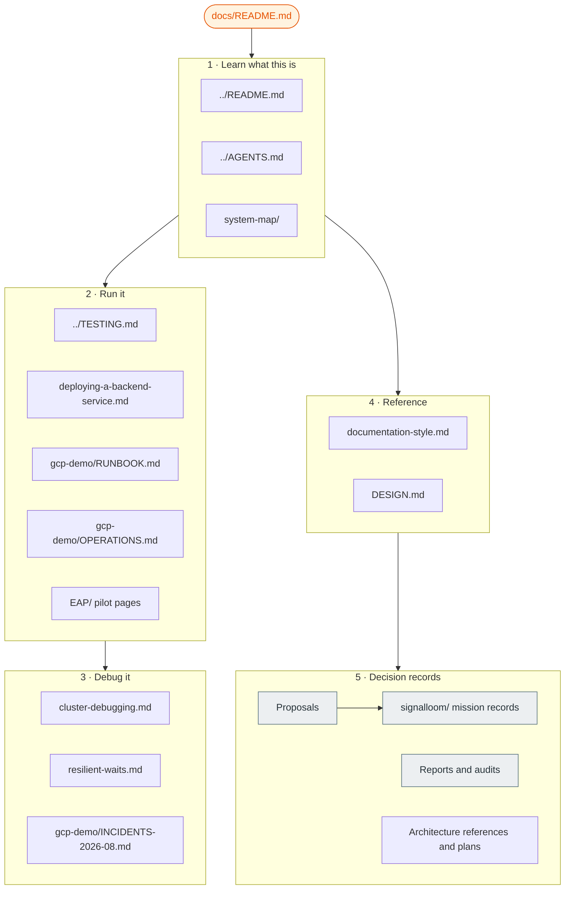

# Documentation index

This page is the entry point for all repository documentation. It lists every
top-level document in `docs/`, each subdirectory, and each record at the
repository root, and it tells you when to read them.

Three files at the repository root start the path:

| File | Reader | Read it for |
| :--- | :--- | :--- |
| [`../README.md`](../README.md) | A person new to OSRAMP | Platform overview, demos, and the local quickstart |
| [`../AGENTS.md`](../AGENTS.md) | An agent or an engineer who needs commands | Slices, lifecycle targets, and shared pitfalls |
| [`../DESIGN.md`](../DESIGN.md) | A developer or UI engineer | Platform design system, colour palette, and interface principles |

## Glossary

Use these terms. Do not use synonyms for them. The rules are in
[`documentation-style.md`](documentation-style.md).

| Term | Meaning |
| :--- | :--- |
| **slice** | One D2 delivery boundary, such as `d2-signalloom/`. A slice owns its namespaces, images, tests, and lifecycle. |
| **foundation** | The shared platform: Kind cluster, Zot registry, signing keys, and Flux. `make up` creates it. |
| **lane** | One GCP environment: `demo-1`, `demo-2`, `ci-1`, or `ci-2`. Each lane has one VM, one tailnet node, and one hand-off file. |
| **estate** | The software stack on a lane VM. `make gcp-tf-demo-up` builds it. The lane is the infrastructure. The estate is the workload. |
| **hand-off file** | `deploy/gcp/<lane>.handoff.json`. Terraform writes it. Later commands read the lane identity from it. |
| **surface** | One of two access paths to a lane: the VM-local surface or the tailnet surface. A lane can pass on one and fail on the other. |
| **mission** | One Signal Loom delivery programme with a shortcode, such as SLER. Its records in [`signalloom/`](signalloom/) use the shortcode as a file prefix. |
| **living document** | A document that must match the current tree. Correct it when the tree changes. |
| **decision record** | A dated proposal, report, audit, or proof. It records a past state. Do not correct it to match the current tree. |

## How the documentation fits together

The diagram shows the reading order. Start at the root files. Then go to the
task that you must do. The sections below contain the same documents as links.



## 1 · Learn what this is

| Document | What it covers |
| :--- | :--- |
| [`system-map/`](system-map/) | Interactive map of the core services and their communication paths |
| [`osramp-component-flows.html`](osramp-component-flows.html) | Interactive flow map of the OSRAMP components, derived from the code in 2026-09. It loads its libraries from the internet. |
| [`flux-coverage.md`](flux-coverage.md) | Which workloads Flux manages and which it does not, the declared exceptions, and the open gaps. Enforced by `make flux-coverage-test`. |

## 2 · Run the platform

Start locally. The local workflow needs Docker.

| Document | What it covers |
| :--- | :--- |
| [`../README.md#getting-started`](../README.md#getting-started) | Local quickstart: run `./scripts/setup.sh`, then a `demo-*-up` target |
| [`../TESTING.md`](../TESTING.md) | Test suites, where each suite runs, and how to run it |
| [`../HUMAN_VALIDATION.md`](../HUMAN_VALIDATION.md) | Manual browser checks and their evidence |
| [`deploying-a-backend-service.md`](deploying-a-backend-service.md) | Checklist for the four layers that can each break a page |
| [`kagent-d5.md`](kagent-d5.md) | The Kagent agent framework demo (D5) |
| [`../d2-signalloom/apps/agentmaxxing-host-sensor/README.md`](../d2-signalloom/apps/agentmaxxing-host-sensor/README.md) | AgentMaxxing host sensor and Linux confinement architecture |
| [`../d2-signalloom/apps/dashboard-signalloom/src/components/demos/BRIDGE-CONTRACT.md`](../d2-signalloom/apps/dashboard-signalloom/src/components/demos/BRIDGE-CONTRACT.md) | AgentMaxxing demo console and telemetry bridge contract |
| [`signalloom/runbooks/slaws-live-lab.md`](signalloom/runbooks/slaws-live-lab.md) | SLAWS live collector lab: AWS Terraform provisioning, S3/SQS seeding, and live validation |

The Kusari pilot has its own pages. They are written for a Kusari engineer
who onboards from zero on the pilot's secondary cluster.

| Document | What it covers |
| :--- | :--- |
| [`EAP/README.md`](EAP/README.md) | Pilot overview, what Kusari gets, reading order, and the source records |
| [`EAP/onboarding.md`](EAP/onboarding.md) | Numbered steps from no access to a signed-in session bound to tenant `kusari` |
| [`EAP/pages.md`](EAP/pages.md) | One section per dashboard page: path, API calls, actions, and who may take them |
| [`EAP/secondary-cluster.md`](EAP/secondary-cluster.md) | What runs on the Kusari cluster, the hub-side keys, and the checks for each step |
| [`EAP/enforcement.md`](EAP/enforcement.md) | Detection triggers, the freeze chain, how it is recorded, how to resume, and the forensic bundle |
| [`EAP/faq-and-limits.md`](EAP/faq-and-limits.md) | Known limits with the file that proves each one, and what to do instead |
| [`EAP/remote-contract.md`](EAP/remote-contract.md) | The wire contract between a remote warden, fleet-manager and the portal: TLS, workload report, remote stun, stun state and resume, discovery |
| [`attached-mode-central-issuance.md`](attached-mode-central-issuance.md) | Why `APPLIANCE_MODE=attached` cannot self-provision: the two centrally minted Secrets, who issues them, and the preflight that enforces it |

Deploy to GCP after the local tests pass. The GCP workflow costs money and needs cloud credentials.

| Document | What it covers |
| :--- | :--- |
| [`gcp-demo/RUNBOOK.md`](gcp-demo/RUNBOOK.md) | Operator steps from an empty cloud project to the dashboard in a browser |
| [`gcp-demo/OPERATIONS.md`](gcp-demo/OPERATIONS.md) | The four lanes, health tools, and operational pitfalls |
| [`../deploy/gcp/README.md`](../deploy/gcp/README.md) | Project inputs, service account roles, and the hand-off file |
| [`../terraform/README.md`](../terraform/README.md) | Why the estate uses three Terraform roots |
| [`../terraform/CONTRACT.md`](../terraform/CONTRACT.md) | Invariants between the Terraform roots |
| [`../terraform/RUNBOOK.md`](../terraform/RUNBOOK.md) | Terraform steps for `demo-1`. The file says that most steps were never run. Use `gcp-demo/RUNBOOK.md` first. |
| [`../scripts/ci/README.md`](../scripts/ci/README.md) | The older CI pipeline on the `signalloom-ci` VMs |

## 3 · Debug the system

| Document | What it covers |
| :--- | :--- |
| [`cluster-debugging.md`](cluster-debugging.md) | Field notes for the local stack. Section 8 lists probes that give false answers. |
| [`resilient-waits.md`](resilient-waits.md) | The wait helpers in `scripts/lib/wait.sh` and why a bare `sleep` fails |
| [`gcp-demo/OPERATIONS.md#operational-pitfalls`](gcp-demo/OPERATIONS.md#operational-pitfalls) | Commands that report an incorrect status |
| [`FAQ.md`](FAQ.md) | Answers on the audit trail, the FX rates, and the staleness guard |

## 4 · Reference

These are living documents. They describe the current rules.

| Document | What it covers |
| :--- | :--- |
| [`documentation-style.md`](documentation-style.md) | The writing rules for this repository and the `make docs-lint` check |
| [`DESIGN.md`](DESIGN.md) | Visual design, information architecture, Starlight theming, and diagram standards |
| [`fair-methodology-open-decisions.md`](fair-methodology-open-decisions.md) | The open methodology decisions on the priced-risk engine, and two recorded defects |

## 5 · Decision records

Decision records are dated. They show the state at the time of writing. The
current tree can be different. Do not use a decision record as a runbook.

### Proposals

The status column comes from the evidence in [`signalloom/`](signalloom/). A
status without a linked record is "No completion record".

| Proposal | Mission | Status and evidence |
| :--- | :--- | :--- |
| [First User and Agent Onboarding](Proposal%20—%20Signal%20Loom%20First%20User%20and%20Agent%20Onboarding%20%282026-Q3%29.md) | SLON | Delivered: [final mission report](signalloom/slon-final-mission-report.md) |
| [Enforcement and Response](Proposal%20—%20Signal%20Loom%20Enforcement%20and%20Response%20%282026-Q3%29.md) | SLER | Delivered: [Governor delivery report](signalloom/sler-p6-gov-delivery-report.md) |
| [Coding Agent & Harness Detective Telemetry](Proposal%20—%20Signal%20Loom%20Coding%20Agent%20&%20Harness%20Detective%20Telemetry%20%282026-Q3%29.md) | SLCD | Delivered in a non-collecting configuration. Not certified clean. Blockers remain open in the [mission certification](signalloom/slcd-mission-certification.md). |
| [Production and Data-Protection Hardening](Proposal%20—%20Signal%20Loom%20Production%20and%20Data-Protection%20Hardening%20%282026-Q3%29.md) | SLDP | Delivered: [mission certification](signalloom/sldp-mission-certification.md) |
| [AgentMaxxing User and External Agent Onboarding](Proposal%20—%20AgentMaxxing%20Signal%20Loom%20User%20and%20External%20Agent%20Onboarding%20%282026-Q3%29.md) | AMXO | Phase 6 proved: [Governor proof](signalloom/amxo-p6-gov-proof.md) |
| [AgentMaxxing Interactive Demo Console](Proposal%20—%20Signal%20Loom%20AgentMaxxing%20Interactive%20Demo%20Console%20%282026-Q3%29.md) | AMXD | No completion record. Baseline: [`amxd-p0-baseline.md`](amxd-p0-baseline.md) |
| [Signal Fusion Actor-Resolution Spine V2](Proposal%20—%20Signal%20Fusion%20Actor-Resolution%20Spine%20V2%20%282026-Q3%29.md) | SFAS | Delivered: [programme certification](signalloom/sfas-final-programme-certification.md) |
| [Signal Fusion Actor-Resolution Spine (V1)](Proposal%20—%20Signal%20Fusion%20Actor-Resolution%20Spine%20%282026-Q3%29.md) | SFDP | Delivered: [production certification](signalloom/sfdp-p3-1-production-certification.md). V2 supersedes it. |
| [Signal Fusion Agents Page Operational Redesign](Proposal%20—%20Signal%20Fusion%20Agents%20Page%20Operational%20Redesign%20and%20Evidence%20Dossier%20%282026-Q3%29.md) | SFAGENTS | Draft, awaiting sign-off. Preflight: [`sfagents-p3-preflight-proof.md`](signalloom/sfagents-p3-preflight-proof.md) |
| [Signal Loom Security Remediation](signalloom/SLSEC-security-remediation-proposal.md) | SLSEC | Delivered: [operational hardening](signalloom/SLSEC-operational-hardening.md) |
| [SLAAT Whole-System Autonomous Adversarial Testing](Proposal%20-%20SLAAT%20Whole-System%20Autonomous%20Adversarial%20Testing%20%282026-Q4%29.md) | SLAAT | Phase 1 certified: [vulnerability dossier](slaat-phase1-adversarial-dossier.md), [Governor report](slaat/SLAAT-P1-GOVERNOR-REPORT.md). Phase 2 certified: [remediation report](slaat-phase2-remediation-report.md), [Governor report](slaat/SLAAT-P2-GOVERNOR-REPORT.md) |
| [Spireless Token-Based Agent Identity Migration](Proposal%20—%20Signal%20Loom%20Spireless%20Token-Based%20Agent%20Identity%20Migration%20%282026-Q4%29.md) | SLTM | Phase 1 (static probe API key): `make test-sltm-probe-apikey` |
| [Feature Flagging and Superadmin User Administration](Proposal%20—%20Signal%20Loom%20Feature%20Flagging%20and%20Superadmin%20User%20Administration%20%282026-Q4%29.md) | SLFA | Proposed |
| [EAP CI Lane and Demo Environment Redeploy](Proposal%20—%20Signal%20Loom%20EAP%20CI%20Lane%20and%20Demo%20Environment%20Redeploy%20%282026-Q4%29.md) | EAPCI | Draft, awaiting sign-off |
| [AWS Telemetry Ingest & Multilayer Policy Engine Beta](Proposal%20—%20Signal%20Loom%20AWS%20Telemetry%20Ingest%20&%20Multilayer%20Policy%20Engine%20Beta%20%282026-Q3%29.md) | SLAWS | Bootstrap, awaiting sign-off: `collectors/awslogs` scaffold (`899d2609`), 17 cards, offline acceptance `make test-signal-ingest` |
| [Exhaustive System Security and Vulnerability Audit](Proposal%20—%20Exhaustive%20System%20Security%20and%20Vulnerability%20Audit%20%282026-Q3%29.md) |  -  | No completion record |
| [First User and Privileged-User Onboarding (precursor)](FIRST-USER-ONBOARDING-PROPOSAL.md) |  -  | Evidence analysis. SLON and AMXO build on it. |
| [SuperCredential Multi-Agent Evolution: The Cascade](Proposal%20—%20Signal%20Loom%20SuperCredential%20Multi-Agent%20Evolution%20—%20The%20Cascade%20%282026-Q4%29.md) | SLSC | Proposed: multi-agent cascading trust revocation and live FAIR risk quantification. Execution: [`multi-agent-supercred-proposal.md`](multi-agent-supercred-proposal.md) |
| [Governance Claim, Human Identity Anchoring, and SuperCred Lifecycle Resilience](Proposal%20—%20Signal%20Loom%20Governance%20Claim,%20Human%20Identity%20Anchoring,%20and%20SuperCred%20Lifecycle%20Resilience%20%282026-Q4%29.md) | SLGC | Delivered: claim correlation deduplication, settings tabs, Users SuperDataTable, and self-healing OpenBao mounts |
| [Warden Native eBPF DNS and Kernel TLS Peeking](Proposal%20-%20Signal%20Loom%20Warden%20Native%20eBPF%20DNS%20and%20Kernel%20TLS%20Peeking%20%282026-Q4%29.md) | SLWD | Proposed: in-kernel DNS attribution, TLS ClientHello SNI peeking, and anomaly detection |
| [Remote Coding Agent Observability, eBPF Lineage & Dual-Path TLS Telemetry](Proposal%20—%20Signal%20Loom%20Remote%20Coding%20Agent%20Observability,%20eBPF%20Lineage%20&%20Dual-Path%20TLS%20Telemetry%20%282026-Q4%29.md) | SLCH | Proposed supported-pilot metadata observation. Requires approved deployment and a successful feasibility gate. |
| [Design Partner Appliance Self-Initialisation Pipeline](Proposal%20—%20SLSI%20Signal%20Loom%20Design%20Partner%20Appliance%20Self-Initialisation%20Pipeline%20%282026-Q4%29.md) | SLSI | In execution on `/ajm-auto-kanban` (Phase 3). Validation runbook: [SLSI Validation Runbook](Validation%20Runbook%20—%20SLSI%20Signal%20Loom%20Design%20Partner%20Appliance%20Self-Initialisation%20Pipeline%20%282026-Q4%29.md) |
| [Live Platform Truthfulness and Accidental Demo Data Remediation](Proposal%20—%20Live%20Platform%20Truthfulness%20and%20Accidental%20Demo%20Data%20Remediation%20%282026-Q4%29.md) | LIVETRUTH | Approved: eliminating accidental demo NHI accounts, topology fallbacks, and hardcoded tenant defaults |
| [Multi-Tenant Audit Provenance and Tenant Scoping Fidelity](Proposal%20—%20Multi-Tenant%20Audit%20Provenance%20and%20Tenant%20Scoping%20Fidelity%20%282026-Q4%29.md) | AUDITFIDELITY | Approved: eliminating hardcoded tenant-demo in signal-ingest correlation, seed, and promote audit trails |
| [Multi-Tenant Boundary Enforcement and Large Artifact Stream Safety](Proposal%20—%20Multi-Tenant%20Boundary%20Enforcement%20and%20Large%20Artifact%20Stream%20Safety%20%282026-Q4%29.md) | STREAMBOUND | Approved: enforcing authoritative tenant boundaries in policy engine handlers and eliminating argv E2BIG truncation in task processor |
| [Proxy Tenancy Confinement and A2A Framing Fidelity](Proposal%20—%20Proxy%20Tenancy%20Confinement%20and%20A2A%20Framing%20Fidelity%20%282026-Q4%29.md) | PROXYFRAMING | Proposed: enforcing strict query and body tenancy in policy engine proxy and reliable framing in A2A service |
| [Multi-Engine Stream Hardening and Tenancy Contradiction Defenses](Proposal%20—%20Multi-Engine%20Stream%20Hardening%20and%20Tenancy%20Contradiction%20Defenses%20%282026-Q4%29.md) | ENGINESTREAM | Proposed: exhaustive tenant query and body validation in proxy routes, contradiction defenses in policy engine, and stream-safe dependency processing |
| [Workspace Multi-Tenancy Confinement and Delivery Sanitization](Proposal%20—%20Workspace%20Multi-Tenancy%20Confinement%20and%20Delivery%20Sanitization%20%282026-Q4%29.md) | WORKSPACESANITIZE | Proposed: confining remote workspace isolation to authenticated tenants and eliminating corporate SIT endpoint leakage in client deliverables |
| [Ingestion Stream Resiliency and A2A Framing Robustness](Proposal%20—%20Ingestion%20Stream%20Resiliency%20and%20A2A%20Framing%20Robustness%20%282026-Q4%29.md) | STREAMFRAME | Proposed: thread-safe listener socket concurrency, unbounded processor buffer streaming, idempotent archiver persistence, and hardened A2A payload framing |
| [Kernel Limit Elimination, Signature Idempotency, and Ingest Bypass Removal](Proposal%20—%20Kernel%20Limit%20Elimination,%20Signature%20Idempotency,%20and%20Ingest%20Bypass%20Removal%20%282026-Q4%29.md) | KERNELSTREAM | Proposed: eliminating MAX_ARG_STRLEN E2BIG truncation in task execution, distinct 400 bad request error handling in A2A, idempotent task signature UPSERT, and closing audit ingest mock signature backdoor |
| [Workspace Concurrency, RBAC Stream Defenses, and Policy Tenancy Hardening](Proposal%20—%20Workspace%20Concurrency,%20RBAC%20Stream%20Defenses,%20and%20Policy%20Tenancy%20Hardening%20%282026-Q4%29.md) | WORKSPACETENANCY | Proposed: thread-safe workspace execution, non-default branch shallow clone support, fail-safe RBAC conversion, and strict policy-as-code cross-tenant validation |
| [Swarm Dispatch Resilience, HITL Gate Lifecycle, and Timing Defenses](Proposal%20—%20Swarm%20Dispatch%20Resilience,%20HITL%20Gate%20Lifecycle,%20and%20Timing%20Defenses%20%282026-Q4%29.md) | DISPATCHGATE | Proposed: thread-safe workspace polling and error propagation, bounded gate reaper and identity checks, argv E2BIG limits in CI triage, A2A status validation, and constant-time auth |
| [Sentinel Spool Resilience, Remote Coder Concurrency, and Gateway Stream Defenses](Proposal%20—%20Sentinel%20Spool%20Resilience,%20Remote%20Coder%20Concurrency,%20and%20Gateway%20Stream%20Defenses%20%282026-Q4%29.md) | SENTINELCODER | Proposed: resilient eBPF spool retry calculation, remote workspace thread-safe cloning and tenant normalization, stream-bounded appraiser validation, safe controller body draining, and bounded chat session lifecycle |
| [Webhook Admission Bounds, Probe Precision, and Integration Proxy Defenses](Proposal%20—%20Webhook%20Admission%20Bounds,%20Probe%20Precision,%20and%20Integration%20Proxy%20Defenses%20%282026-Q4%29.md) | ADMPROXY | Proposed: fail-safe integration proxy body draining, admission webhook payload bounds and read header timeouts, network probe errno precision, deterministic claim timestamps, and bearer token trimming |
| [Pipeline Stream Bounds, Ingestion Sanitization, and Workspace Probes](Proposal%20—%20Pipeline%20Stream%20Bounds,%20Ingestion%20Sanitization,%20and%20Workspace%20Probes%20%282026-Q4%29.md) | CPAIOSRAMP | Proposed: workspace stream bounding and directory traversal protection, task ID sanitization, safe marshal error handling, message payload caps, and probe routing |
| [Production Gate Authorization, Agent Trust Resilience, and Sensor Bounds](Proposal%20—%20Production%20Gate%20Authorization,%20Agent%20Trust%20Resilience,%20and%20Sensor%20Bounds%20%282026-Q4%29.md) | PRODTRUST | Proposed: HITL gate header timeouts and requester validation, MCP read header timeouts and probe parity, signal-ingest timeouts, authz content-length safety, host sensor rate limit budget underflow defense, and A2A probe routing |
| [Swarm Coordination, Replica Stubs, Discovery Probes, and Schema Traversal](Proposal%20—%20Swarm%20Coordination,%20Replica%20Stubs,%20Discovery%20Probes,%20and%20Schema%20Traversal%20%282026-Q4%29.md) | SWARMPROBE | Proposed: swarm coordinator timeouts and description validation, replica stub timeouts and probe parity, discovery portal healthz probe route, cardvault health parity, and schema loader traversal defense |
| [Policy Engine Timeouts, Fleet Server Resiliency, and Sentinel Probe Parity](Proposal%20—%20Policy%20Engine%20Timeouts,%20Fleet%20Server%20Resiliency,%20and%20Sentinel%20Probe%20Parity%20%282026-Q4%29.md) | FLEETENGINE | Proposed: policy engine header timeouts and ingress health route, fleet manager server timeouts, stun sentinel probe parity, factory appraiser timeout and probe test isolation, demo console slowloris defense and health probes, and netassert controller readiness probe parity |
| [Daytona Probes, TC Sentinel Isolation, and ChatOps State Defenses](Proposal%20—%20Daytona%20Probes,%20TC%20Sentinel%20Isolation,%20and%20ChatOps%20State%20Defenses%20%282026-Q4%29.md) | DAYTONAPROXY | Proposed: hosted Daytona coder probe parity, TC sentinel daemon probe parity and testing, proof helper A2A probe routes, integration proxy readiness probe, and ChatOps session task memory bounding |
| [Agent Trust Timeouts, LLM Guard Parity, and Runner Resilience](Proposal%20—%20Agent%20Trust%20Timeouts,%20LLM%20Guard%20Parity,%20and%20Runner%20Resilience%20%282026-Q4%29.md) | TRUSTGUARD | Proposed: agent trust openssl subprocess timeouts, LLM guard probe parity, standalone demo runner healthz probe route, user surface stub probe endpoints, cardvault agent context timeouts, and CI worker command timeouts |
| [Sentinel Probe Parity, Cgroup Traversal Defense, and Workload Auth Robustness](Proposal%20—%20Sentinel%20Probe%20Parity,%20Cgroup%20Traversal%20Defense,%20and%20Workload%20Auth%20Robustness%20%282026-Q4%29.md) | SENTINELCGROUP | Proposed: Olly Sentinel probe parity, host sensor cgroup traversal containment, openat2 relative path validation, SPIRE workload subprocess error handling, Sentinel authz token decoding robustness, and cardvault HTTP method gate |
| [Branch Injection Defenses, Pseudonym Bounds, and Admission Probe Parity](Proposal%20—%20Branch%20Injection%20Defenses,%20Pseudonym%20Bounds,%20and%20Admission%20Probe%20Parity%20%282026-Q4%29.md) | DAYTONAPSEUDO | Proposed: Daytona coder branch injection defense, integration proxy HEAD probe dispatch, host-sensor pseudonym epoch bounds, CI worker root route enforcement, TC sentinel method gate, and admission probe constraints |
| [Deployment Gate Method Checks, Proof Helper Boundaries, and Auto-Claim Defenses](Proposal%20—%20Deployment%20Gate%20Method%20Checks,%20Proof%20Helper%20Boundaries,%20and%20Auto-Claim%20Defenses%20%282026-Q4%29.md) | GATEPROOFCLAIM | Proposed: deployment gate probe method constraints and HEAD gate inspection, proof helper probe and challenge method gates, prompt summarizer root isolation, stun sentinel probe method constraints and bearer trimming, kusari agent HEAD probe support, and cardvault auto-claim validation |
| [Swarm Governor Method Gates, A2A HEAD Probe Dispatch, and Stub Hardening](Proposal%20—%20Swarm%20Governor%20Method%20Gates,%20A2A%20HEAD%20Probe%20Dispatch,%20and%20Stub%20Hardening%20%282026-Q4%29.md) | SWARMCARDNET | Proposed: swarm governor probe method constraints and task HEAD support, cardvault Allow header and HEAD body elimination, A2A service HEAD dispatch and bearer trimming, stub surface server HEAD support and length safety, netassert controller HEAD probes, and Sentinel probe methods |
| [Policy Engine Method Gates, Fleet Manager Probe Constraints, and Workspace Connector Hardening](Proposal%20—%20Policy%20Engine%20Method%20Gates,%20Fleet%20Manager%20Probe%20Constraints,%20and%20Workspace%20Connector%20Hardening%20%282026-Q4%29.md) | POLICYFLEETPROBE | Proposed: policy engine probe methods and Allow headers, fleet manager probe method constraints, workspace connector HEAD support, factory appraiser probe and error headers, cpai engineer HEAD probe handling, and signal ingest probe HEAD dispatch |
| [Sentinel Method Gates, Authz HTTP Allow Headers, and Container Harness Hardening](Proposal%20—%20Sentinel%20Method%20Gates,%20Authz%20HTTP%20Allow%20Headers,%20and%20Container%20Harness%20Hardening%20%282026-Q4%29.md) | SENTINELAUTHZHARNESS | Proposed: authz httputil HEAD dispatch and Allow headers, warden probe Allow headers and HEAD suppression, hosted Daytona coder HEAD probe handling, Kusari agent getOnly HEAD short-circuiting, stun sentinel snapshot HEAD dispatch and POST Allow headers, and deployment gate Allow headers |
| [Integration Proxy Method Gates, Prompt Summarizer Allow Headers, and TC Sentinel Defenses](Proposal%20—%20Integration%20Proxy%20Method%20Gates,%20Prompt%20Summarizer%20Allow%20Headers,%20and%20TC%20Sentinel%20Defenses%20%282026-Q4%29.md) | PROXYPROMPTTCCTL | Proposed: integration proxy HEAD data dispatch and Allow headers, proof helper Allow headers and probe Content-Type, prompt summarizer Allow headers, TC sentinel Allow headers, host sensor rate limit scalar validation, and A2A method gates |
| [Fleet Manager Route Gates, Policy Engine Method Allow Headers, and Node Guard Admission Defenses](Proposal%20—%20Fleet%20Manager%20Route%20Gates,%20Policy%20Engine%20Method%20Allow%20Headers,%20and%20Node%20Guard%20Admission%20Defenses%20%282026-Q4%29.md) | FLEETPOLICYGUARD | Proposed: fleet manager route method gates and HEAD support, remote stun HEAD parity and Allow headers, workload and audit Allow headers, policy engine evaluation and compliance Allow headers, and node capability guard admission POST gate |
| [ELK Search MCP Allow Headers, Telemetry HEAD Parity, and Demo Console Hardening](Proposal%20—%20ELK%20Search%20MCP%20Allow%20Headers,%20Telemetry%20HEAD%20Parity,%20and%20Demo%20Console%20Hardening%20%282026-Q4%29.md) | ELKTELEMCONSOLE | Proposed: ELK search MCP Allow headers and probes, telemetry HEAD parity, demo console Allow headers, triage CI worker probe headers, and replica stub method gates |
| [Netassert Method Gates, Olly Stub HEAD Parity, and Ingest Allow Headers](Proposal%20—%20Netassert%20Method%20Gates,%20Olly%20Stub%20HEAD%20Parity,%20and%20Ingest%20Allow%20Headers%20%282026-Q4%29.md) | NETASSERTMAPPINGINGEST | Proposed: netassert controller method gates, Allow headers, and socket reuse, Sentinel synthetic probe method gates and HEAD body suppression, and signal-ingest Allow headers on mutating and query endpoints |
| [Fleet Consistency Route Gates, Policy Engine Compliance Methods, and Discovery Portal HEAD Parity](Proposal%20—%20Fleet%20Consistency%20Route%20Gates,%20Policy%20Engine%20Compliance%20Methods,%20and%20Discovery%20Portal%20HEAD%20Parity%20%282026-Q4%29.md) | FLEETPOLICYPORTAL | Proposed: fleet consistency route gates and HEAD parity, compliance frameworks and summary method gates, discovery portal probe HEAD parity, and mock/stub server Allow headers |
| [Agent Trust Method Gates, Integration Proxy Socket Reuse, and Node Guard Media Type](Proposal%20—%20Agent%20Trust%20Method%20Gates,%20Integration%20Proxy%20Socket%20Reuse,%20and%20Node%20Guard%20Media%20Type%20%282026-Q4%29.md) | TRUSTPROXYGUARD | Proposed: agent trust A2A method gates and socket reuse, fake integration proxy socket reuse, and node capability guard health probe content-type fidelity |
| [Go ServeMux HEAD Parity, Probe Method Registration, and Appraiser Response Fidelity](Proposal%20—%20Go%20ServeMux%20HEAD%20Parity,%20Probe%20Method%20Registration,%20and%20Appraiser%20Response%20Fidelity%20%282026-Q4%29.md) | GOMUXHEADPARITY | Proposed: Go 1.22 ServeMux HEAD parity across signal ingest, hosted daytona coder, cpai engineer, workspace connector, and factory appraiser |
| [ELK Tools Method Gates, Authz Unhandled Verbs, Stun Health Content-Type, and Sentinel Stub Hardening](Proposal%20—%20ELK%20Tools%20Method%20Gates,%20Authz%20Unhandled%20Verbs,%20Stun%20Health%20Content-Type,%20and%20Sentinel%20Stub%20Hardening%20%282026-Q4%29.md) | OLLYAUTHZSTUNELK | Proposed: ELK tools route method gates and HEAD body suppression, authz httputil unhandled verbs, stun health probe HEAD content-type fidelity, and sentinel stub probes |
| [Test Stub Route Method Gates, HEAD Suppression, and Socket Reuse](Proposal%20—%20Test%20Stub%20Route%20Method%20Gates,%20HEAD%20Suppression,%20and%20Socket%20Reuse%20%282026-Q4%29.md) | STUBMETHODREUSE | Proposed: test stub route method gates and HEAD body suppression across netassert runner, audit anchor archivista, EAP recording upstream, and Jev test bot |
| [Swarm Governor Probe Parity, Console Health Gates, Proxy OPTIONS Support, and Proof Helper Fidelity](Proposal%20—%20Swarm%20Governor%20Probe%20Parity,%20Console%20Health%20Gates,%20Proxy%20OPTIONS%20Support,%20and%20Proof%20Helper%20Fidelity%20%282026-Q4%29.md) | SWARMCONSOLEPROXY | Proposed: swarm governor probe HEAD content-type and body suppression, demo console health gates, proxy OPTIONS verb, and proof helper response fidelity |
| [Tenant App Fault Parity, Mapping Stub Fidelity, Triage CI HEAD Gates, Node Guard Isolation, and Controller Reuse](Proposal%20—%20Tenant%20App%20Fault%20Parity,%20Mapping%20Stub%20Fidelity,%20Triage%20CI%20HEAD%20Gates,%20Node%20Guard%20Isolation,%20and%20Controller%20Reuse%20%282026-Q4%29.md) | TENANTTRIAGENODEGUARD | Proposed: tenant app fault route 405 HEAD body suppression, mapping stub route fidelity, triage CI worker HEAD body suppression, node guard mux isolation, and netassert controller socket reuse |
| [Microservice HEAD Error Response Body Suppression and Method Gates](Proposal%20—%20Microservice%20HEAD%20Error%20Response%20Body%20Suppression%20and%20Method%20Gates%20%282026-Q4%29.md) | HEADERRORSUPPRESS | Proposed: RFC 9110 HEAD error response body suppression, method gates, and probe fidelity across prod deploy gate, cardvault, prompt commit summarizer, stun sentinel, and fleet manager |
| [Workspace, Ingest, Appraiser, and Kusari Agent HEAD Body Suppression and Method Gates](Proposal%20—%20Workspace,%20Ingest,%20Appraiser,%20and%20Kusari%20Agent%20HEAD%20Body%20Suppression%20and%20Method%20Gates%20%282026-Q4%29.md) | MICROSERVICEHEADROUND29 | Proposed: RFC 9110 HEAD error response body suppression and method gates across cpai engineer, factory appraiser, kusari agent, workspace connector, and signal ingest |
| [Demo Console Method Gates, Orbit Endpoints, and Telemetry Response Parity](Proposal%20—%20Demo%20Console%20Method%20Gates,%20Orbit%20Endpoints,%20and%20Telemetry%20Response%20Parity%20%282026-Q4%29.md) | DEMOCONSOLEPARITY | Proposed: RFC 9110 HTTP method gates, Allow headers, and HEAD body suppression across demo console main, orbit, security, and metrics |
| [Daytona Coder, Policy Engine, Telemetry Handler, Harness Dash, and Stun Sentinel HEAD Body Suppression and Method Gates](Proposal%20—%20Daytona%20Coder,%20Policy%20Engine,%20Telemetry%20Handler,%20Harness%20Dash,%20and%20Stun%20Sentinel%20HEAD%20Body%20Suppression%20and%20Method%20Gates%20%282026-Q4%29.md) | PLATFORMHEADROUND30 | Proposed: RFC 9110 HEAD error response body suppression and method gates across hosted daytona coder, policy engine, fe telemetry, harness dash, and stun sentinel |
| [Host Traffic Control, Integration Proxy Test Routes, and Resolver Test Stub Method Parity](Proposal%20—%20Host%20Traffic%20Control,%20Integration%20Proxy%20Test%20Routes,%20and%20Resolver%20Test%20Stub%20Method%20Parity%20%282026-Q4%29.md) | TCCTLPROXYSTUBPARITY | Proposed: RFC 9110 HTTP method gates, Allow headers, and HEAD body suppression across stun-tcctl, fake-integration-proxy control routes, and netassert-runner resolver test stub |
| [Triage Worker, Prompt Summarizer, Cardvault, Proof Helper, and Swarm Governor HEAD Body Suppression and Method Gates](Proposal%20—%20Triage%20Worker,%20Prompt%20Summarizer,%20Cardvault,%20Proof%20Helper,%20and%20Swarm%20Governor%20HEAD%20Body%20Suppression%20and%20Method%20Gates%20%282026-Q4%29.md) | TRIAGEPROMPTVAULT | Proposed: RFC 9110 HEAD error response body suppression and method gates across triage CI worker, prompt commit summarizer, cardvault, proof helper, and swarm governor |
| [Node Capability Webhook, Stun Sentinel Daemon, and Upstream Audit Stub Method Parity](Proposal%20—%20Node%20Capability%20Webhook,%20Stun%20Sentinel%20Daemon,%20and%20Upstream%20Audit%20Stub%20Method%20Parity%20%282026-Q4%29.md) | NODEGUARDSTUNSTUBPARITY | Proposed: RFC 9110 HTTP method gates, Allow headers, and HEAD body suppression across node-capability-guard, stun-sentinel daemon, and upstream audit stubs |
| [ELK Search MCP, Tenant App, Mapping Stub, Prod Deploy Gate, and Agent Trust HEAD Body Suppression and Method Gates](Proposal%20—%20ELK%20Search%20MCP,%20Tenant%20App,%20Mapping%20Stub,%20Prod%20Deploy%20Gate,%20and%20Agent%20Trust%20HEAD%20Body%20Suppression%20and%20Method%20Gates%20%282026-Q4%29.md) | ELKTENANTMAPGATE | Proposed: RFC 9110 HEAD error response body suppression and method gates across ELK search MCP, tenant app, mapping stub, prod deploy gate, and agent trust a2a service |
| [Demo Console, Discovery Portal ASGI, Authz Helper, Netassert Resolver, and AFM Push Stub HEAD Body Suppression and Method Gates](Proposal%20—%20Demo%20Console,%20Discovery%20Portal%20ASGI,%20Authz%20Helper,%20Netassert%20Resolver,%20and%20AFM%20Push%20Stub%20HEAD%20Body%20Suppression%20and%20Method%20Gates%20%282026-Q4%29.md) | DEMOFEAUTHZRESOLVAFM | Proposed: RFC 9110 HEAD error response body suppression and method gates across demo console, discovery portal ASGI pipeline, authz httputil, netassert resolver stub, and afm rbac push stubs |
| [Netassert Controller, Sentinel ELK Stub, Teardown Stubs, Jev Bot Stubs, and Integration Proxy Error Fidelity and HEAD Body Suppression](Proposal%20—%20Netassert%20Controller,%20Sentinel%20ELK%20Stub,%20Teardown%20Stubs,%20Jev%20Bot%20Stubs,%20and%20Integration%20Proxy%20Error%20Fidelity%20and%20HEAD%20Body%20Suppression%20%282026-Q4%29.md) | NETASSERTELKTEARDOWNJEV | Proposed: RFC 9110 HTTP method gates, Allow headers, and HEAD body suppression across netassert controller, sentinel elk stub, teardown stubs, jev bot stubs, and fake integration proxy |
| [Jev SPA Server, User Surface Stub, Agent Trust A2A, and Stun Sentinel Probe HEAD Body Suppression and Method Gates](Proposal%20—%20Jev%20SPA%20Server,%20User%20Surface%20Stub,%20Agent%20Trust%20A2A,%20and%20Stun%20Sentinel%20Probe%20HEAD%20Body%20Suppression%20and%20Method%20Gates%20%282026-Q4%29.md) | JEVSPASTUBA2ASTUNPROBE | Proposed: RFC 9110 HTTP method gates, Allow headers, and HEAD body suppression across jev spa server, user surface stub, agent trust a2a, and stun sentinel probe |
| [Demo Runner ASGI, Fleet Consistency, Policy Compliance, Fleet Scan, and Telemetry HEAD Response Body Suppression](Proposal%20—%20Demo%20Runner%20ASGI,%20Fleet%20Consistency,%20Policy%20Compliance,%20Fleet%20Scan,%20and%20Telemetry%20HEAD%20Response%20Body%20Suppression%20%282026-Q4%29.md) | DEMOFLEETPOLICYTELEMETRY | Proposed: RFC 9110 HEAD error response body suppression and method gates across demo runner ASGI, fleet consistency, policy compliance, compliance fleet scan, and fe telemetry |
| [A2A Conformance, Cockpit Telemetry, Coding Agents, User Admin Flags, and Acceptance Harness Servers HEAD Body Suppression and Method Gates](Proposal%20—%20A2A%20Conformance,%20Cockpit%20Telemetry,%20Coding%20Agents,%20User%20Admin%20Flags,%20and%20Acceptance%20Harness%20Servers%20HEAD%20Body%20Suppression%20and%20Method%20Gates%20%282026-Q4%29.md) | A2AACCEPTANCEHARNESS | Proposed: RFC 9110 HTTP method gates, Allow headers, and HEAD body suppression across A2A conformance server, cockpit telemetry, coding agents, user admin flags, and demo acceptance harness |
| [Signal Ingest Audit Webhooks, GKE Adapter, Demo Console Terminal, Stun Traffic Control, and Archivista Stub HEAD Body Suppression and Method Gates](Proposal%20—%20Signal%20Ingest%20Audit%20Webhooks,%20GKE%20Adapter,%20Demo%20Console%20Terminal,%20Stun%20Traffic%20Control,%20and%20Archivista%20Stub%20HEAD%20Body%20Suppression%20and%20Method%20Gates%20%282026-Q4%29.md) | SIGNALDEMOTCCTLARCHIVISTA | Proposed: RFC 9110 HTTP method gates, Allow headers, and HEAD body suppression across signal-ingest audit receiver, GKE adapter, demo-console terminal, stun-tcctl, and archivista stub |
| [Signal Ingest Acting Tenant Gate, Coding Agent Telemetry, Cofide Interceptor, and Nginx Stub HEAD Body Suppression and Method Gates](Proposal%20—%20Signal%20Ingest%20Acting%20Tenant%20Gate,%20Coding%20Agent%20Telemetry,%20Cofide%20Interceptor,%20and%20Nginx%20Stub%20HEAD%20Body%20Suppression%20and%20Method%20Gates%20%282026-Q4%29.md) | INGESTACTINGCOFIDENGINX | Proposed: RFC 9110 HTTP method gates, Allow headers, socket reuse, and HEAD body suppression across signal-ingest acting tenant gate, coding agent telemetry, cofide interceptor, and dashboard nginx stub |
| [Olly Sentinel A2A, SLSI Appliance Mock, Stun Correlator, Fe Salt OpenBao, and Fleet Manager Fake API HEAD Body Suppression and Method Gates](Proposal%20—%20Olly%20Sentinel%20A2A,%20SLSI%20Appliance%20Mock,%20Stun%20Correlator,%20Fe%20Salt%20OpenBao,%20and%20Fleet%20Manager%20Fake%20API%20HEAD%20Body%20Suppression%20and%20Method%20Gates%20%282026-Q4%29.md) | OLLYSLSICORRELATORHASHFLEET | Proposed: RFC 9110 HTTP method gates, Allow headers, and HEAD body suppression across Olly Sentinel A2A app, SLSI appliance mock server, stun correlator mock ingest, fe salt OpenBao mock, and fleet manager fake API |
| [CPAI LLM Contract, Signal Ingest Containment, Fe EAP Upstream, Fleet Bao Plane, and OpenBao Accessor Mock HEAD Body Suppression and Method Gates](Proposal%20—%20CPAI%20LLM%20Contract,%20Signal%20Ingest%20Containment,%20Fe%20EAP%20Upstream,%20Fleet%20Bao%20Plane,%20and%20OpenBao%20Accessor%20Mock%20HEAD%20Body%20Suppression%20and%20Method%20Gates%20%282026-Q4%29.md) | CPAIINGESTEAPBAOLOOKUP | Proposed: RFC 9110 HTTP method gates, Allow headers, and HEAD body suppression across cpai-engineer LLM contract mocks, signal-ingest containment sentinel mocks, fe-signalloom EAP upstream mock, fleet-manager bao token revocation mock, and fleet-manager slow accessor lookup mock |
| [Fleet Manager OpenBao Client, Token Accessor, Resume Governance, Combined Credential Plane, and Denial Matrix Mock Server HEAD Body Suppression and Method Gates](Proposal%20—%20Fleet%20Manager%20OpenBao%20Client,%20Token%20Accessor,%20Resume%20Governance,%20Combined%20Credential%20Plane,%20and%20Denial%20Matrix%20Mock%20Server%20HEAD%20Body%20Suppression%20and%20Method%20Gates%20%282026-Q4%29.md) | FLEETOPENBAOCLIENTTOKENSRESUME | Proposed: RFC 9110 HTTP method gates, Allow headers, and HEAD body suppression across fleet-manager openbao_client, openbao_token, resume_governance, combined_credential_plane, and denial_matrix mock servers |
| [Signal Ingest Policy Routes and Actor Promotion, Stun Probe Preservers, and Swarm Governor A2A HEAD Body Suppression and Method Gates](Proposal%20—%20Signal%20Ingest%20Policy%20Routes%20and%20Actor%20Promotion,%20Stun%20Probe%20Preservers,%20and%20Swarm%20Governor%20A2A%20HEAD%20Body%20Suppression%20and%20Method%20Gates%20%282026-Q4%29.md) | POLICYPROMOTESTUNGOVA2A | Proposed: RFC 9110 HTTP method gates, Allow headers, probe clean-up, and HEAD body suppression across signal-ingest policy routes, actor promotion, stun probe preservers, and swarm-governor a2a test harness |
| [Cardvault Agent Mocks, Kusari Agent HTTP Endpoints, and Upstream Quote Mock HEAD Body Suppression and Method Gates](Proposal%20—%20Cardvault%20Agent%20Mocks,%20Kusari%20Agent%20HTTP%20Endpoints,%20and%20Upstream%20Quote%20Mock%20HEAD%20Body%20Suppression%20and%20Method%20Gates%20%282026-Q4%29.md) | CARDVAULTKUSARIHEAD | Proposed: RFC 9110 HTTP method gates, Allow headers, and HEAD body suppression across cardvault-agent mock OpenBao/Cardvault/Claim servers, kusari-agent routes, and kusari mock quote upstream |

| [SLAWS & SLAAT Retest Plan](signalloom/retest-plan-slaws-slaat-permutations.md) | SLRT | Active: one-shot permutation matrix validating AWS telemetry ingest and adversarial defenses |
| [Agent trust project proposal](agent-trust-project-proposal.md) |  -  | Delivered: [completion audit](agent-trust-completion-audit.md) and [adversarial review](agent-trust-adversarial-review.md) |
| [Next-Phase Proposals  -  Adversarial Critique](Signal%20Loom%20—%20Next-Phase%20Proposals%20—%20Adversarial%20Critique%20%282026-Q3%29.md) |  -  | Critique of the SLER, SLCD, and AMXD proposals |

### Mission records

The directory [`signalloom/`](signalloom/) holds the phase proofs, evidence, and
certifications of each mission. The file prefix is the mission shortcode.

| Mission | Start with |
| :--- | :--- |
| SLON  -  First User and Agent Onboarding | [`slon-final-mission-report.md`](signalloom/slon-final-mission-report.md), [`slon-p1-technical-design.md`](signalloom/slon-p1-technical-design.md), [`slon-p3-docs-portal-provenance.md`](signalloom/slon-p3-docs-portal-provenance.md) |
| SLER  -  Enforcement and Response | [`sler-p6-gov-delivery-report.md`](signalloom/sler-p6-gov-delivery-report.md), [`sler-p1-2-schema.md`](signalloom/sler-p1-2-schema.md), [`sler-p6-3-proof.md`](signalloom/sler-p6-3-proof.md), [`sler-p5-2-denial-matrix.json`](signalloom/sler-p5-2-denial-matrix.json) |
| SLCD  -  Coding Agent Detective Telemetry | [`slcd-mission-certification.md`](signalloom/slcd-mission-certification.md), [`slcd-p0-baseline.md`](signalloom/slcd-p0-baseline.md), [`slcd-p1-5-lawful-basis.md`](signalloom/slcd-p1-5-lawful-basis.md) |
| SLDP  -  Data Protection | [`sldp-mission-certification.md`](signalloom/sldp-mission-certification.md), [`sldp-downstream-contract.md`](signalloom/sldp-downstream-contract.md), [`sldp-p0-boundary-map.md`](signalloom/sldp-p0-boundary-map.md) |
| SFAS  -  Signal Fusion Actor-Resolution Spine | [`sfas-final-programme-certification.md`](signalloom/sfas-final-programme-certification.md), [`sfas-governor-log.md`](signalloom/sfas-governor-log.md) |
| SFDP  -  Deterministic actor-resolution engine (Signal Fusion V1) | [`sfdp-p3-1-production-certification.md`](signalloom/sfdp-p3-1-production-certification.md), [`sfdp-p1-preflight-proof.md`](signalloom/sfdp-p1-preflight-proof.md), [`sfdp-p2-4-runtime-evidence.md`](signalloom/sfdp-p2-4-runtime-evidence.md) |
| SFAGENTS  -  Signal Fusion agents page redesign | [`sfagents-p3-preflight-proof.md`](signalloom/sfagents-p3-preflight-proof.md) |
| AMXO  -  AgentMaxxing Onboarding | [`amxo-p6-gov-proof.md`](signalloom/amxo-p6-gov-proof.md), [`amxo-governor-log.md`](signalloom/amxo-governor-log.md), [`amxo-p1-1-proof.md`](signalloom/amxo-p1-1-proof.md) |
| CRKC  -  Runtime Confinement, Live FAIR Risk, and Kernel Containment | [`crkc-final-mission-certification.md`](signalloom/crkc-final-mission-certification.md) |
| EAPR  -  Enterprise Access Preview Certification Remediation | [`eapr-governor-log.md`](signalloom/eapr-governor-log.md), [`eap-adversarial-sweep-2026-09-25.md`](signalloom/eap-adversarial-sweep-2026-09-25.md), [`eap-board-reaudit-2026-09-25.md`](signalloom/eap-board-reaudit-2026-09-25.md) |
| SLED  -  Signal Loom Expiry Daemon | [`sled-mission-certification.md`](signalloom/sled-mission-certification.md), [`sled-p2-certification.md`](signalloom/sled-p2-certification.md), [`sled-p3-certification.md`](signalloom/sled-p3-certification.md) |
| SLDC  -  Local Dual-Cluster EAP Pilot Validation | [`SLDC-MISSION-CERTIFICATION.md`](eap/SLDC-MISSION-CERTIFICATION.md), [`SLDC-P2-TOPOLOGY-AUDIT.md`](eap/SLDC-P2-TOPOLOGY-AUDIT.md), [`SLDC-P3-TENANT-INVENTORY.md`](eap/SLDC-P3-TENANT-INVENTORY.md), [`SLDC-P5-CHECKLIST-AUDIT.md`](eap/SLDC-P5-CHECKLIST-AUDIT.md), [`SLDC-P6-PREFLIGHT.md`](eap/SLDC-P6-PREFLIGHT.md), [`FINAL-MISSION-CERTIFICATION-REPORT.md`](eap/FINAL-MISSION-CERTIFICATION-REPORT.md). The living pages of the same mission are linked from the Kusari pilot table above. |
| SLRC  -  SLED Live Runtime Certification Closure | [`slrc-final-certification-dossier.md`](signalloom/evidence/slrc-final-certification-dossier.md), [`slrc-p1-1-teardown-adapters-architecture.md`](signalloom/slrc-p1-1-teardown-adapters-architecture.md), [`slrc-p2-1-lifecycle-persistence-architecture.md`](signalloom/slrc-p2-1-lifecycle-persistence-architecture.md) |
| SLSEC  -  Signal Loom Security Remediation | [`SLSEC-security-remediation-proposal.md`](signalloom/SLSEC-security-remediation-proposal.md), [`SLSEC-operational-hardening.md`](signalloom/SLSEC-operational-hardening.md) |
| SLAAT : Whole-System Autonomous Adversarial Testing | [Phase 1 vulnerability dossier](slaat-phase1-adversarial-dossier.md), [Phase 1 Governor report](slaat/SLAAT-P1-GOVERNOR-REPORT.md), [Phase 2 remediation report](slaat-phase2-remediation-report.md), [Phase 2 Governor report](slaat/SLAAT-P2-GOVERNOR-REPORT.md), [`slaat-governor-log.md`](signalloom/slaat-governor-log.md) |

### Reports, audits, and baselines

| Document | What it records |
| :--- | :--- |
| [Signal Loom CEO Delivery Report, week of 2026-09-08](Signal%20Loom%20—%20CEO%20Delivery%20Report%20—%20Week%20of%202026-09-08.md) | Delivery status for one week |
| [`amxd-p0-baseline.md`](amxd-p0-baseline.md) | AMXD mission baseline, with machine baselines in [`amxd-p0-baseline/`](amxd-p0-baseline/) |
| [`slsi-p0-baseline.md`](slsi-p0-baseline.md) | SLSI mission baseline, establishing acceptance baseline at 504405b9 with machine baselines in [`slsi-p0-baseline/`](slsi-p0-baseline/) |
| [`ktest-p2-preflight.md`](ktest-p2-preflight.md) | KTEST phase 2 preflight |
| [`kpai-harness-verification.md`](kpai-harness-verification.md) | KPAI runtime harness verification |
| [`COLLABORATOR-REVIEW.md`](COLLABORATOR-REVIEW.md) | Review of the KPAI and Antigravity collaborators |
| [`DOCUMENTATION-AUDIT.md`](DOCUMENTATION-AUDIT.md) | Documentation audit of 2026-09-10 |
| [`DOCUMENTATION-DELIVERY-CHECKLIST.md`](DOCUMENTATION-DELIVERY-CHECKLIST.md) | Sign-off sheet for that audit |
| [`workspace-agentic-identity-streaming.md`](workspace-agentic-identity-streaming.md) | Research on Google Workspace agentic identity streaming |
| [`appraisal/APPRAISAL.md`](appraisal/APPRAISAL.md) | Mid-2026 platform appraisal, with [API contract gaps](appraisal/api-contract-gap.md) and [mock fidelity](appraisal/mocks-proxy-fidelity.md) |
| [`appraisal/auth-gateway-runbook.md`](appraisal/auth-gateway-runbook.md) | Auth and gateway appraisal of 2026-07. Superseded on 2026-08-14 and kept as a record of the migration path |
| [`appraisal/WALKING-DEMO-RUNBOOK.md`](appraisal/WALKING-DEMO-RUNBOOK.md) | Walking-demo script of 2026-07-28, partly superseded on 2026-08-14 |
| [`plans/d2-bao-integration.md`](plans/d2-bao-integration.md) | Plan for the OpenBao integration |
| [`gcp-demo/INCIDENTS-2026-08.md`](gcp-demo/INCIDENTS-2026-08.md) | GCP incidents of August 2026 |
| [`local-lifecycle-errata.md`](local-lifecycle-errata.md) | A dated correction (2026-07-27): `make up` creates only the foundation, not the demos |

### Architecture references and plans

These documents are dated. Each one has a status, open decisions, or action
items of its date. The lint checks their links and leaves their prose as the
author wrote it.

| Document | What it records |
| :--- | :--- |
| [`Signal Fusion  -  Architecture and GDPR Reference.md`](Signal%20Fusion%20—%20Architecture%20and%20GDPR%20Reference.md) | Signal Fusion architecture and its GDPR position, with the as-built maturity matrix of 2026-09-14 |
| [`Signal Loom Workstation Sensor  -  ….md`](Signal%20Loom%20Workstation%20Sensor%20—%20Architecture,%20Verification,%20and%20Distribution%20Strategy.md) | The workstation sensor: architecture, verification, and distribution, with test counts of 2026-09-14 |
| [`appendix-credential-architecture.md`](appendix-credential-architecture.md) | Credential architecture of the Signal Loom agent swarm (appendix of 2026-08-28) |
| [`appendix-ebpf-kernel-enforcement.md`](appendix-ebpf-kernel-enforcement.md) | eBPF and kernel-level containment of AI agents (appendix of 2026-08-28) |
| [`aws-eks-architecture-specification.md`](aws-eks-architecture-specification.md) | AWS EKS enterprise deployment and multi-tenant reference architecture |
| [`azure-aks-architecture-specification.md`](azure-aks-architecture-specification.md) | Azure AKS enterprise deployment and multi-tenant reference architecture |
| [`policy-as-versioned-code/`](policy-as-versioned-code/) | Policy as versioned code: [integration](policy-as-versioned-code/INTEGRATION.md) and the [worktree merge plan](policy-as-versioned-code/WORKTREE-INTEGRATION.md) |
| [`../terraform/notes/README.md`](../terraform/notes/README.md) | Index of the Terraform design notes |

### Records at the repository root

This file sits next to `README.md` because active work references it by
that path. It is a decision record, and `make docs-lint` checks that it is
linked here.

| Document | What it records |
| :--- | :--- |
| [`../DEPLOYMENT-SCOPE.md`](../DEPLOYMENT-SCOPE.md) | Discussion draft of the release qualification and production deployment scope (2026-09-05) |

`MEMORY/WORK/` at the repository root holds session records. They are decision
records, not descriptions of the current tree.

`breach-cost-talk/` holds the source media of one conference talk. Start with
[`breach-cost-talk/TALK.md`](breach-cost-talk/TALK.md).

## Layout decision (2026-09-24)

The top of `docs/` and the repository root hold living documents and decision
records side by side. This index and the lint tiers in
[`documentation-style.md`](documentation-style.md#what-make-docs-lint-checks)
divide them. The files stay where they are, because active work references
them by path. The referrers are kanban card specs, integration branches in
other worktrees, ISA files, and the `RECORDS` pattern in the lint.

Move the records into `proposals/` and `reports/` only when this probe prints
nothing for each file you move. It searches every branch, the scripts, the
tests, the lint, and the kanban card specs:

```bash
name='DEPLOYMENT-SCOPE.md'
git grep -l -F "$name" $(git for-each-ref --format='%(refname)' refs/heads refs/remotes)
git grep -l -F "$name" -- Makefile scripts test .github
grep -rlF "$name" ~/.cline/kanban/card-specs
```

The branch search is advisory. Its result depends on the branches in the clone
that runs it. The tracked-path searches are reproducible.

Do the move as one change. Update every link the probe found, then run
`make docs-lint` and `make docs-lint-test`.
