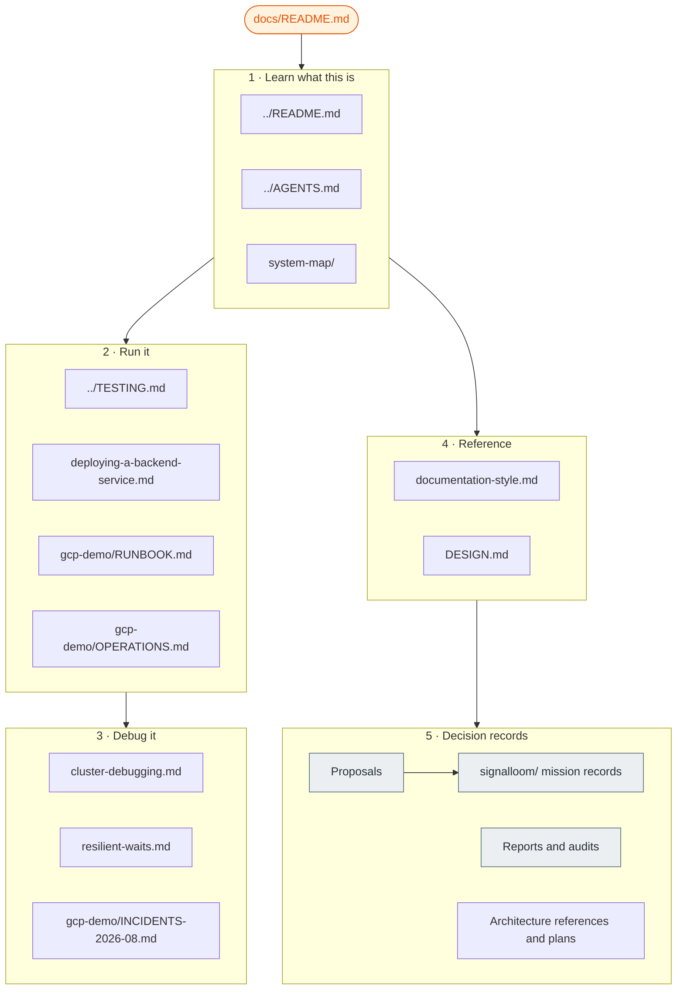

# Documentation index

This page is the entry point for all repository documentation. It lists every
top-level document in `docs/`, each subdirectory, and each record at the
repository root, and it tells you when to read them.

Three files at the repository root start the path:

| File | Reader | Read it for |
| :--- | :--- | :--- |
| [`../README.md`](../README.md) | A person new to OSRAMP | Platform overview, demos, and the local quickstart |
| [`../AGENTS.md`](../AGENTS.md) | An agent or an engineer who needs commands | Slices, lifecycle targets, and shared pitfalls |
| [`../DESIGN.md`](../DESIGN.md) | A developer or UI engineer | Platform design system, colour palette, and interface principles |

## Glossary

Use these terms. Do not use synonyms for them. The rules are in
[`documentation-style.md`](documentation-style.md).

| Term | Meaning |
| :--- | :--- |
| **slice** | One D2 delivery boundary, such as `d2-signalloom/`. A slice owns its namespaces, images, tests, and lifecycle. |
| **foundation** | The shared platform: Kind cluster, Zot registry, signing keys, and Flux. `make up` creates it. |
| **lane** | One GCP environment: `demo-1`, `demo-2`, `ci-1`, or `ci-2`. Each lane has one VM, one tailnet node, and one hand-off file. |
| **estate** | The software stack on a lane VM. `make gcp-tf-demo-up` builds it. The lane is the infrastructure. The estate is the workload. |
| **hand-off file** | `deploy/gcp/<lane>.handoff.json`. Terraform writes it. Later commands read the lane identity from it. |
| **surface** | One of two access paths to a lane: the VM-local surface or the tailnet surface. A lane can pass on one and fail on the other. |
| **mission** | One Signal Loom delivery programme with a shortcode, such as SLER. Its records in [`signalloom/`](signalloom/) use the shortcode as a file prefix. |
| **living document** | A document that must match the current tree. Correct it when the tree changes. |
| **decision record** | A dated proposal, report, audit, or proof. It records a past state. Do not correct it to match the current tree. |

## How the documentation fits together

The diagram shows the reading order. Start at the root files. Then go to the
task that you must do. The sections below contain the same documents as links.



## 1 · Learn what this is

| Document | What it covers |
| :--- | :--- |
| [`system-map/`](system-map/) | Interactive map of the core services and their communication paths |
| [`osramp-component-flows.html`](osramp-component-flows.html) | Interactive flow map of the OSRAMP components, derived from the code in 2026-09. It loads its libraries from the internet. |

## 2 · Run the platform

Start locally. The local workflow needs Docker.

| Document | What it covers |
| :--- | :--- |
| [`../README.md#getting-started`](../README.md#getting-started) | Local quickstart: run `./scripts/setup.sh`, then a `demo-*-up` target |
| [`../TESTING.md`](../TESTING.md) | Test suites, where each suite runs, and how to run it |
| [`../HUMAN_VALIDATION.md`](../HUMAN_VALIDATION.md) | Manual browser checks and their evidence |
| [`deploying-a-backend-service.md`](deploying-a-backend-service.md) | Checklist for the four layers that can each break a page |
| [`kagent-d5.md`](kagent-d5.md) | The Kagent agent framework demo (D5) |
| [`../d2-signalloom/apps/agentmaxxing-host-sensor/README.md`](../d2-signalloom/apps/agentmaxxing-host-sensor/README.md) | AgentMaxxing host sensor and Linux confinement architecture |
| [`../d2-signalloom/apps/dashboard-signalloom/src/components/demos/BRIDGE-CONTRACT.md`](../d2-signalloom/apps/dashboard-signalloom/src/components/demos/BRIDGE-CONTRACT.md) | AgentMaxxing demo console and telemetry bridge contract |

Deploy to GCP after the local tests pass. The GCP workflow costs money and needs cloud credentials.

| Document | What it covers |
| :--- | :--- |
| [`gcp-demo/RUNBOOK.md`](gcp-demo/RUNBOOK.md) | Operator steps from an empty cloud project to the dashboard in a browser |
| [`gcp-demo/OPERATIONS.md`](gcp-demo/OPERATIONS.md) | The four lanes, health tools, and operational pitfalls |
| [`../deploy/gcp/README.md`](../deploy/gcp/README.md) | Project inputs, service account roles, and the hand-off file |
| [`../terraform/README.md`](../terraform/README.md) | Why the estate uses three Terraform roots |
| [`../terraform/CONTRACT.md`](../terraform/CONTRACT.md) | Invariants between the Terraform roots |
| [`../terraform/RUNBOOK.md`](../terraform/RUNBOOK.md) | Terraform steps for `demo-1`. The file says that most steps were never run. Use `gcp-demo/RUNBOOK.md` first. |
| [`../scripts/ci/README.md`](../scripts/ci/README.md) | The older CI pipeline on the `signalloom-ci` VMs |

## 3 · Debug the system

| Document | What it covers |
| :--- | :--- |
| [`cluster-debugging.md`](cluster-debugging.md) | Field notes for the local stack. Section 8 lists probes that give false answers. |
| [`resilient-waits.md`](resilient-waits.md) | The wait helpers in `scripts/lib/wait.sh` and why a bare `sleep` fails |
| [`gcp-demo/OPERATIONS.md#operational-pitfalls`](gcp-demo/OPERATIONS.md#operational-pitfalls) | Commands that report an incorrect status |
| [`FAQ.md`](FAQ.md) | Answers on the audit trail, the FX rates, and the staleness guard |

## 4 · Reference

These are living documents. They describe the current rules.

| Document | What it covers |
| :--- | :--- |
| [`documentation-style.md`](documentation-style.md) | The writing rules for this repository and the `make docs-lint` check |
| [`DESIGN.md`](DESIGN.md) | Visual design, information architecture, Starlight theming, and diagram standards |

## 5 · Decision records

Decision records are dated. They show the state at the time of writing. The
current tree can be different. Do not use a decision record as a runbook.

### Proposals

The status column comes from the evidence in [`signalloom/`](signalloom/). A
status without a linked record is "No completion record".

| Proposal | Mission | Status and evidence |
| :--- | :--- | :--- |
| [First User and Agent Onboarding](Proposal%20 - %20Signal%20Loom%20First%20User%20and%20Agent%20Onboarding%20%282026-Q3%29.md) | SLON | Delivered: [final mission report](signalloom/slon-final-mission-report.md) |
| [Enforcement and Response](Proposal%20 - %20Signal%20Loom%20Enforcement%20and%20Response%20%282026-Q3%29.md) | SLER | Delivered: [Governor delivery report](signalloom/sler-p6-gov-delivery-report.md) |
| [Coding Agent & Harness Detective Telemetry](Proposal%20 - %20Signal%20Loom%20Coding%20Agent%20&%20Harness%20Detective%20Telemetry%20%282026-Q3%29.md) | SLCD | Delivered: [mission certification](signalloom/slcd-mission-certification.md) |
| [Production and Data-Protection Hardening](Proposal%20 - %20Signal%20Loom%20Production%20and%20Data-Protection%20Hardening%20%282026-Q3%29.md) | SLDP | Delivered: [mission certification](signalloom/sldp-mission-certification.md) |
| [AgentMaxxing User and External Agent Onboarding](Proposal%20 - %20AgentMaxxing%20Signal%20Loom%20User%20and%20External%20Agent%20Onboarding%20%282026-Q3%29.md) | AMXO | Phase 6 proved: [Governor proof](signalloom/amxo-p6-gov-proof.md) |
| [AgentMaxxing Interactive Demo Console](Proposal%20 - %20Signal%20Loom%20AgentMaxxing%20Interactive%20Demo%20Console%20%282026-Q3%29.md) | AMXD | No completion record. Baseline: [`amxd-p0-baseline.md`](amxd-p0-baseline.md) |
| [Signal Fusion Actor-Resolution Spine V2](Proposal%20 - %20Signal%20Fusion%20Actor-Resolution%20Spine%20V2%20%282026-Q3%29.md) | SFAS | Delivered: [programme certification](signalloom/sfas-final-programme-certification.md) |
| [Signal Fusion Actor-Resolution Spine (V1)](Proposal%20 - %20Signal%20Fusion%20Actor-Resolution%20Spine%20%282026-Q3%29.md) | SFDP | Delivered: [production certification](signalloom/sfdp-p3-1-production-certification.md). V2 supersedes it. |
| [Signal Fusion Agents Page Operational Redesign](Proposal%20 - %20Signal%20Fusion%20Agents%20Page%20Operational%20Redesign%20and%20Evidence%20Dossier%20%282026-Q3%29.md) | SFAGENTS | Draft, awaiting sign-off. Preflight: [`sfagents-p3-preflight-proof.md`](signalloom/sfagents-p3-preflight-proof.md) |
| [Signal Loom Security Remediation](signalloom/SLSEC-security-remediation-proposal.md) | SLSEC | Delivered: [operational hardening](signalloom/SLSEC-operational-hardening.md) |
| [SLAAT Whole-System Autonomous Adversarial Testing](Proposal%20-%20SLAAT%20Whole-System%20Autonomous%20Adversarial%20Testing%20%282026-Q4%29.md) | SLAAT | Phase 1 certified: [vulnerability dossier](slaat-phase1-adversarial-dossier.md), [Governor report](slaat/SLAAT-P1-GOVERNOR-REPORT.md) |
| [Exhaustive System Security and Vulnerability Audit](Proposal%20 - %20Exhaustive%20System%20Security%20and%20Vulnerability%20Audit%20%282026-Q3%29.md) |  -  | No completion record |
| [First User and Privileged-User Onboarding (precursor)](FIRST-USER-ONBOARDING-PROPOSAL.md) |  -  | Evidence analysis. SLON and AMXO build on it. |
| [SuperCredential Multi-Agent Evolution](multi-agent-supercred-proposal.md) |  -  | No completion record |
| [Agent trust project proposal](agent-trust-project-proposal.md) |  -  | Delivered: [completion audit](agent-trust-completion-audit.md) and [adversarial review](agent-trust-adversarial-review.md) |
| [Next-Phase Proposals  -  Adversarial Critique](Signal%20Loom%20 - %20Next-Phase%20Proposals%20 - %20Adversarial%20Critique%20%282026-Q3%29.md) |  -  | Critique of the SLER, SLCD, and AMXD proposals |

### Mission records

The directory [`signalloom/`](signalloom/) holds the phase proofs, evidence, and
certifications of each mission. The file prefix is the mission shortcode.

| Mission | Start with |
| :--- | :--- |
| SLON  -  First User and Agent Onboarding | [`slon-final-mission-report.md`](signalloom/slon-final-mission-report.md), [`slon-p1-technical-design.md`](signalloom/slon-p1-technical-design.md), [`slon-p3-docs-portal-provenance.md`](signalloom/slon-p3-docs-portal-provenance.md) |
| SLER  -  Enforcement and Response | [`sler-p6-gov-delivery-report.md`](signalloom/sler-p6-gov-delivery-report.md), [`sler-p1-2-schema.md`](signalloom/sler-p1-2-schema.md), [`sler-p6-3-proof.md`](signalloom/sler-p6-3-proof.md), [`sler-p5-2-denial-matrix.json`](signalloom/sler-p5-2-denial-matrix.json) |
| SLCD  -  Coding Agent Detective Telemetry | [`slcd-mission-certification.md`](signalloom/slcd-mission-certification.md), [`slcd-p0-baseline.md`](signalloom/slcd-p0-baseline.md), [`slcd-p1-5-lawful-basis.md`](signalloom/slcd-p1-5-lawful-basis.md) |
| SLDP  -  Data Protection | [`sldp-mission-certification.md`](signalloom/sldp-mission-certification.md), [`sldp-downstream-contract.md`](signalloom/sldp-downstream-contract.md), [`sldp-p0-boundary-map.md`](signalloom/sldp-p0-boundary-map.md) |
| SFAS  -  Signal Fusion Actor-Resolution Spine | [`sfas-final-programme-certification.md`](signalloom/sfas-final-programme-certification.md), [`sfas-governor-log.md`](signalloom/sfas-governor-log.md) |
| SFDP  -  Deterministic actor-resolution engine (Signal Fusion V1) | [`sfdp-p3-1-production-certification.md`](signalloom/sfdp-p3-1-production-certification.md), [`sfdp-p1-preflight-proof.md`](signalloom/sfdp-p1-preflight-proof.md), [`sfdp-p2-4-runtime-evidence.md`](signalloom/sfdp-p2-4-runtime-evidence.md) |
| SFAGENTS  -  Signal Fusion agents page redesign | [`sfagents-p3-preflight-proof.md`](signalloom/sfagents-p3-preflight-proof.md) |
| AMXO  -  AgentMaxxing Onboarding | [`amxo-p6-gov-proof.md`](signalloom/amxo-p6-gov-proof.md), [`amxo-governor-log.md`](signalloom/amxo-governor-log.md), [`amxo-p1-1-proof.md`](signalloom/amxo-p1-1-proof.md) |
| CRKC  -  Runtime Confinement, Live FAIR Risk, and Kernel Containment | [`crkc-final-mission-certification.md`](signalloom/crkc-final-mission-certification.md) |
| EAPR  -  Enterprise Access Preview Certification Remediation | [`eapr-governor-log.md`](signalloom/eapr-governor-log.md), [`eap-adversarial-sweep-2026-09-25.md`](signalloom/eap-adversarial-sweep-2026-09-25.md), [`eap-board-reaudit-2026-09-25.md`](signalloom/eap-board-reaudit-2026-09-25.md) |
| SLED  -  Signal Loom Expiry Daemon | [`sled-mission-certification.md`](signalloom/sled-mission-certification.md), [`sled-p2-certification.md`](signalloom/sled-p2-certification.md), [`sled-p3-certification.md`](signalloom/sled-p3-certification.md) |
| SLRC  -  SLED Live Runtime Certification Closure | [`slrc-final-certification-dossier.md`](signalloom/evidence/slrc-final-certification-dossier.md), [`slrc-p1-1-teardown-adapters-architecture.md`](signalloom/slrc-p1-1-teardown-adapters-architecture.md), [`slrc-p2-1-lifecycle-persistence-architecture.md`](signalloom/slrc-p2-1-lifecycle-persistence-architecture.md) |
| SLSEC  -  Signal Loom Security Remediation | [`SLSEC-security-remediation-proposal.md`](signalloom/SLSEC-security-remediation-proposal.md), [`SLSEC-operational-hardening.md`](signalloom/SLSEC-operational-hardening.md) |
| SLAAT : Whole-System Autonomous Adversarial Testing | [Phase 1 vulnerability dossier](slaat-phase1-adversarial-dossier.md), [Phase 1 Governor report](slaat/SLAAT-P1-GOVERNOR-REPORT.md), [`slaat-governor-log.md`](signalloom/slaat-governor-log.md) |

### Reports, audits, and baselines

| Document | What it records |
| :--- | :--- |
| [Signal Loom CEO Delivery Report, week of 2026-09-08](Signal%20Loom%20 - %20CEO%20Delivery%20Report%20 - %20Week%20of%202026-09-08.md) | Delivery status for one week |
| [`amxd-p0-baseline.md`](amxd-p0-baseline.md) | AMXD mission baseline, with machine baselines in [`amxd-p0-baseline/`](amxd-p0-baseline/) |
| [`ktest-p2-preflight.md`](ktest-p2-preflight.md) | KTEST phase 2 preflight |
| [`kpai-harness-verification.md`](kpai-harness-verification.md) | KPAI runtime harness verification |
| [`COLLABORATOR-REVIEW.md`](COLLABORATOR-REVIEW.md) | Review of the KPAI and Antigravity collaborators |
| [`DOCUMENTATION-AUDIT.md`](DOCUMENTATION-AUDIT.md) | Documentation audit of 2026-09-10 |
| [`DOCUMENTATION-DELIVERY-CHECKLIST.md`](DOCUMENTATION-DELIVERY-CHECKLIST.md) | Sign-off sheet for that audit |
| [`workspace-agentic-identity-streaming.md`](workspace-agentic-identity-streaming.md) | Research on Google Workspace agentic identity streaming |
| [`appraisal/APPRAISAL.md`](appraisal/APPRAISAL.md) | Mid-2026 platform appraisal, with [API contract gaps](appraisal/api-contract-gap.md) and [mock fidelity](appraisal/mocks-proxy-fidelity.md) |
| [`appraisal/auth-gateway-runbook.md`](appraisal/auth-gateway-runbook.md) | Auth and gateway appraisal of 2026-07. Superseded on 2026-08-14 and kept as a record of the migration path |
| [`appraisal/WALKING-DEMO-RUNBOOK.md`](appraisal/WALKING-DEMO-RUNBOOK.md) | Walking-demo script of 2026-07-28, partly superseded on 2026-08-14 |
| [`plans/d2-bao-integration.md`](plans/d2-bao-integration.md) | Plan for the OpenBao integration |
| [`gcp-demo/INCIDENTS-2026-08.md`](gcp-demo/INCIDENTS-2026-08.md) | GCP incidents of August 2026 |
| [`local-lifecycle-errata.md`](local-lifecycle-errata.md) | A dated correction (2026-07-27): `make up` creates only the foundation, not the demos |

### Architecture references and plans

These documents are dated. Each one has a status, open decisions, or action
items of its date. The lint checks their links and leaves their prose as the
author wrote it.

| Document | What it records |
| :--- | :--- |
| [`Signal Fusion  -  Architecture and GDPR Reference.md`](Signal%20Fusion%20 - %20Architecture%20and%20GDPR%20Reference.md) | Signal Fusion architecture and its GDPR position, with the as-built maturity matrix of 2026-09-14 |
| [`Signal Loom Workstation Sensor  -  ….md`](Signal%20Loom%20Workstation%20Sensor%20 - %20Architecture,%20Verification,%20and%20Distribution%20Strategy.md) | The workstation sensor: architecture, verification, and distribution, with test counts of 2026-09-14 |
| [`appendix-credential-architecture.md`](appendix-credential-architecture.md) | Credential architecture of the Signal Loom agent swarm (appendix of 2026-08-28) |
| [`appendix-ebpf-kernel-enforcement.md`](appendix-ebpf-kernel-enforcement.md) | eBPF and kernel-level containment of AI agents (appendix of 2026-08-28) |
| [`policy-as-versioned-code/`](policy-as-versioned-code/) | Policy as versioned code: [integration](policy-as-versioned-code/INTEGRATION.md) and the [worktree merge plan](policy-as-versioned-code/WORKTREE-INTEGRATION.md) |
| [`../terraform/notes/README.md`](../terraform/notes/README.md) | Index of the Terraform design notes |

### Records at the repository root

This file sits next to `README.md` because active work references it by
that path. It is a decision record, and `make docs-lint` checks that it is
linked here.

| Document | What it records |
| :--- | :--- |
| [`../DEPLOYMENT-SCOPE.md`](../DEPLOYMENT-SCOPE.md) | Discussion draft of the release qualification and production deployment scope (2026-09-05) |

`MEMORY/WORK/` at the repository root holds session records. They are decision
records, not descriptions of the current tree.

`breach-cost-talk/` holds the source media of one conference talk. Start with
[`breach-cost-talk/TALK.md`](breach-cost-talk/TALK.md).

## Layout decision (2026-09-24)

The top of `docs/` and the repository root hold living documents and decision
records side by side. This index and the lint tiers in
[`documentation-style.md`](documentation-style.md#what-make-docs-lint-checks)
divide them. The files stay where they are, because active work references
them by path. The referrers are kanban card specs, integration branches in
other worktrees, ISA files, and the `RECORDS` pattern in the lint.

Move the records into `proposals/` and `reports/` only when this probe prints
nothing for each file you move. It searches every branch, the scripts, the
tests, the lint, and the kanban card specs:

```bash
name='DEPLOYMENT-SCOPE.md'
git grep -l -F "$name" $(git for-each-ref --format='%(refname)' refs/heads refs/remotes)
git grep -l -F "$name" -- Makefile scripts test .github
grep -rlF "$name" ~/.cline/kanban/card-specs
```

The branch search is advisory. Its result depends on the branches in the clone
that runs it. The tracked-path searches are reproducible.

Do the move as one change. Update every link the probe found, then run
`make docs-lint` and `make docs-lint-test`.
