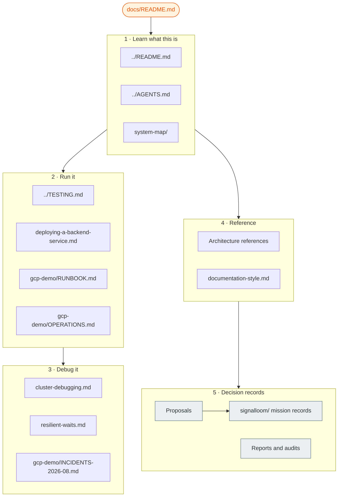

# Documentation index

This page is the entry point for all repository documentation. It lists every
document in `docs/` and tells you when to read it.

Two files at the repository root start the path:

| File | Reader | Read it for |
| :--- | :--- | :--- |
| [`../README.md`](../README.md) | A person new to OSRAMP | Platform overview, demos, and the local quickstart |
| [`../AGENTS.md`](../AGENTS.md) | An agent or an engineer who needs commands | Slices, lifecycle targets, and shared pitfalls |

## Glossary

Use these terms. Do not use synonyms for them. The rules are in
[`documentation-style.md`](documentation-style.md).

| Term | Meaning |
| :--- | :--- |
| **slice** | One D2 delivery boundary, such as `d2-signalloom/`. A slice owns its namespaces, images, tests, and lifecycle. |
| **foundation** | The shared platform: Kind cluster, Zot registry, signing keys, and Flux. `make up` creates it. |
| **lane** | One GCP environment: `demo-1`, `demo-2`, `ci-1`, or `ci-2`. Each lane has one VM, one tailnet node, and one hand-off file. |
| **estate** | The software stack on a lane VM. `make gcp-tf-demo-up` builds it. The lane is the infrastructure. The estate is the workload. |
| **hand-off file** | `deploy/gcp/<lane>.handoff.json`. Terraform writes it. Later commands read the lane identity from it. |
| **surface** | One of two access paths to a lane: the VM-local surface or the tailnet surface. A lane can pass on one and fail on the other. |
| **mission** | One Signal Loom delivery programme with a shortcode, such as SLER. Its records in [`signalloom/`](signalloom/) use the shortcode as a file prefix. |
| **living document** | A document that must match the current tree. Correct it when the tree changes. |
| **decision record** | A dated proposal, report, audit, or proof. It records a past state. Do not correct it to match the current tree. |

## How the documentation fits together

The diagram shows the reading order. Start at the root files. Then go to the
task that you must do. The sections below contain the same documents as links.

## 1 · Learn what this is

| Document | What it covers |
| :--- | :--- |
| [`../README.md`](../README.md) | OSRAMP, the maturity model, team ownership, the ingestion flow, and the demos |
| [`../AGENTS.md`](../AGENTS.md) | The foundation, the slices, lifecycle targets, and shared pitfalls |
| [`system-map/`](system-map/) | Interactive map of the core services and their communication paths |
| [`osramp-component-flows.html`](osramp-component-flows.html) | Static page of OSRAMP component flows |
| [`FAQ.md`](FAQ.md) | Answers to frequent questions |

## 2 · Run the platform

Start locally. The local workflow needs Docker.

| Document | What it covers |
| :--- | :--- |
| [`../README.md#getting-started`](../README.md#getting-started) | Local quickstart: run `./scripts/setup.sh`, then a `demo-*-up` target |
| [`../TESTING.md`](../TESTING.md) | Test suites, where each suite runs, and how to run it |
| [`../HUMAN_VALIDATION.md`](../HUMAN_VALIDATION.md) | Manual browser checks and their evidence |
| [`deploying-a-backend-service.md`](deploying-a-backend-service.md) | Checklist for the four layers that can each break a page |
| [`kagent-d5.md`](kagent-d5.md) | The Kagent agent framework demo (D5) |
| [`appraisal/WALKING-DEMO-RUNBOOK.md`](appraisal/WALKING-DEMO-RUNBOOK.md) | Walk-through script for a live demo |
| [`appraisal/auth-gateway-runbook.md`](appraisal/auth-gateway-runbook.md) | Runbook for the authenticated gateway path |

Deploy to GCP after the local tests pass. The GCP workflow costs money and needs cloud credentials.

| Document | What it covers |
| :--- | :--- |
| [`gcp-demo/RUNBOOK.md`](gcp-demo/RUNBOOK.md) | Operator steps from an empty cloud project to the dashboard in a browser |
| [`gcp-demo/OPERATIONS.md`](gcp-demo/OPERATIONS.md) | The four lanes, health tools, and operational pitfalls |
| [`../deploy/gcp/README.md`](../deploy/gcp/README.md) | Project inputs, service account roles, and the hand-off file |
| [`../terraform/README.md`](../terraform/README.md) | Why the estate uses three Terraform roots |
| [`../terraform/CONTRACT.md`](../terraform/CONTRACT.md) | Invariants between the Terraform roots |
| [`../terraform/RUNBOOK.md`](../terraform/RUNBOOK.md) | Terraform steps for `demo-1` |
| [`../scripts/ci/README.md`](../scripts/ci/README.md) | The older CI pipeline on the `signalloom-ci` VMs |

## 3 · Debug the system

| Document | What it covers |
| :--- | :--- |
| [`cluster-debugging.md`](cluster-debugging.md) | Field notes for the local stack. Section 8 lists probes that give false answers. |
| [`resilient-waits.md`](resilient-waits.md) | The wait helpers in `scripts/lib/wait.sh` and why a bare `sleep` fails |
| [`gcp-demo/OPERATIONS.md#operational-pitfalls`](gcp-demo/OPERATIONS.md#operational-pitfalls) | Commands that report an incorrect status |
| [`gcp-demo/INCIDENTS-2026-08.md`](gcp-demo/INCIDENTS-2026-08.md) | Incident analyses from August 2026, with measurements |
| [`local-lifecycle-errata.md`](local-lifecycle-errata.md) | Known defects in the local lifecycle scripts |

## 4 · Reference

These are living documents. They describe the current design.

| Document | What it covers |
| :--- | :--- |
| [`documentation-style.md`](documentation-style.md) | The writing rules for this repository and the `make docs-lint` check |
| [`Signal Fusion — Architecture and GDPR Reference.md`](Signal%20Fusion%20—%20Architecture%20and%20GDPR%20Reference.md) | Signal Fusion architecture and its GDPR position |
| [`Signal Loom Workstation Sensor — ….md`](Signal%20Loom%20Workstation%20Sensor%20—%20Architecture,%20Verification,%20and%20Distribution%20Strategy.md) | The workstation sensor: architecture, verification, and distribution |
| [`appendix-credential-architecture.md`](appendix-credential-architecture.md) | Credential architecture of the Signal Loom agent swarm |
| [`appendix-ebpf-kernel-enforcement.md`](appendix-ebpf-kernel-enforcement.md) | eBPF and kernel-level containment of AI agents |
| [`policy-as-versioned-code/`](policy-as-versioned-code/) | Policy as versioned code: [integration](policy-as-versioned-code/INTEGRATION.md) and [worktree merge plan](policy-as-versioned-code/WORKTREE-INTEGRATION.md) |
| [`../terraform/notes/README.md`](../terraform/notes/README.md) | Index of the Terraform design notes |

## 5 · Decision records

Decision records are dated. They show the state at the time of writing. The
current tree can be different. Do not use a decision record as a runbook.

### Proposals

The status column comes from the evidence in [`signalloom/`](signalloom/). A
status without a linked record is "No completion record".

| Proposal | Mission | Status and evidence |
| :--- | :--- | :--- |
| [First User and Agent Onboarding](Proposal%20—%20Signal%20Loom%20First%20User%20and%20Agent%20Onboarding%20%282026-Q3%29.md) | SLON | Delivered: [final mission report](signalloom/slon-final-mission-report.md) |
| [Enforcement and Response](Proposal%20—%20Signal%20Loom%20Enforcement%20and%20Response%20%282026-Q3%29.md) | SLER | Delivered: [Governor delivery report](signalloom/sler-p6-gov-delivery-report.md) |
| [Coding Agent & Harness Detective Telemetry](Proposal%20—%20Signal%20Loom%20Coding%20Agent%20&%20Harness%20Detective%20Telemetry%20%282026-Q3%29.md) | SLCD | Delivered: [mission certification](signalloom/slcd-mission-certification.md) |
| [Production and Data-Protection Hardening](Proposal%20—%20Signal%20Loom%20Production%20and%20Data-Protection%20Hardening%20%282026-Q3%29.md) | SLDP | Delivered: [mission certification](signalloom/sldp-mission-certification.md) |
| [AgentMaxxing User and External Agent Onboarding](Proposal%20—%20AgentMaxxing%20Signal%20Loom%20User%20and%20External%20Agent%20Onboarding%20%282026-Q3%29.md) | AMXO | Phase 6 proved: [Governor proof](signalloom/amxo-p6-gov-proof.md) |
| [AgentMaxxing Interactive Demo Console](Proposal%20—%20Signal%20Loom%20AgentMaxxing%20Interactive%20Demo%20Console%20%282026-Q3%29.md) | AMXD | No completion record. Baseline: [`amxd-p0-baseline.md`](amxd-p0-baseline.md) |
| [Signal Fusion Actor-Resolution Spine V2](Proposal%20—%20Signal%20Fusion%20Actor-Resolution%20Spine%20V2%20%282026-Q3%29.md) | SFAS | Delivered: [programme certification](signalloom/sfas-final-programme-certification.md) |
| [Signal Fusion Actor-Resolution Spine (V1)](Proposal%20—%20Signal%20Fusion%20Actor-Resolution%20Spine%20%282026-Q3%29.md) | SFAS | Superseded by V2. V2 records this in its mission history. |
| [Exhaustive System Security and Vulnerability Audit](Proposal%20—%20Exhaustive%20System%20Security%20and%20Vulnerability%20Audit%20%282026-Q3%29.md) | — | No completion record |
| [First User and Privileged-User Onboarding (precursor)](FIRST-USER-ONBOARDING-PROPOSAL.md) | — | Evidence analysis. SLON and AMXO build on it. |
| [SuperCredential Multi-Agent Evolution](multi-agent-supercred-proposal.md) | — | No completion record |
| [Agent trust project proposal](agent-trust-project-proposal.md) | — | Delivered: [completion audit](agent-trust-completion-audit.md) and [adversarial review](agent-trust-adversarial-review.md) |
| [Next-Phase Proposals — Adversarial Critique](Signal%20Loom%20—%20Next-Phase%20Proposals%20—%20Adversarial%20Critique%20%282026-Q3%29.md) | — | Critique of the SLER, SLCD, and AMXD proposals |

### Mission records

The directory [`signalloom/`](signalloom/) holds the phase proofs, evidence, and
certifications of each mission. The file prefix is the mission shortcode.

| Mission | Start with |
| :--- | :--- |
| SLON — First User and Agent Onboarding | [`slon-final-mission-report.md`](signalloom/slon-final-mission-report.md), [`slon-p1-technical-design.md`](signalloom/slon-p1-technical-design.md), [`slon-p3-docs-portal-provenance.md`](signalloom/slon-p3-docs-portal-provenance.md) |
| SLER — Enforcement and Response | [`sler-p6-gov-delivery-report.md`](signalloom/sler-p6-gov-delivery-report.md), [`sler-p1-2-schema.md`](signalloom/sler-p1-2-schema.md), [`sler-p6-3-proof.md`](signalloom/sler-p6-3-proof.md), [`sler-p5-2-denial-matrix.json`](signalloom/sler-p5-2-denial-matrix.json) |
| SLCD — Coding Agent Detective Telemetry | [`slcd-mission-certification.md`](signalloom/slcd-mission-certification.md), [`slcd-p0-baseline.md`](signalloom/slcd-p0-baseline.md), [`slcd-p1-5-lawful-basis.md`](signalloom/slcd-p1-5-lawful-basis.md) |
| SLDP — Data Protection | [`sldp-mission-certification.md`](signalloom/sldp-mission-certification.md), [`sldp-downstream-contract.md`](signalloom/sldp-downstream-contract.md), [`sldp-p0-boundary-map.md`](signalloom/sldp-p0-boundary-map.md) |
| SFAS — Signal Fusion Actor-Resolution Spine | [`sfas-final-programme-certification.md`](signalloom/sfas-final-programme-certification.md), [`sfas-governor-log.md`](signalloom/sfas-governor-log.md) |
| SFDP — Signal Fusion data plane | [`sfdp-p3-1-production-certification.md`](signalloom/sfdp-p3-1-production-certification.md), [`sfdp-p1-preflight-proof.md`](signalloom/sfdp-p1-preflight-proof.md), [`sfdp-p2-4-runtime-evidence.md`](signalloom/sfdp-p2-4-runtime-evidence.md) |
| AMXO — AgentMaxxing Onboarding | [`amxo-p6-gov-proof.md`](signalloom/amxo-p6-gov-proof.md), [`amxo-governor-log.md`](signalloom/amxo-governor-log.md), [`amxo-p1-1-proof.md`](signalloom/amxo-p1-1-proof.md) |
| CRKC — Containment red-team | [`crkc-final-mission-certification.md`](signalloom/crkc-final-mission-certification.md) |

### Reports, audits, and baselines

| Document | What it records |
| :--- | :--- |
| [Signal Loom CEO Delivery Report, week of 2026-09-08](Signal%20Loom%20—%20CEO%20Delivery%20Report%20—%20Week%20of%202026-09-08.md) | Delivery status for one week |
| [`amxd-p0-baseline.md`](amxd-p0-baseline.md) | AMXD mission baseline, with machine baselines in [`amxd-p0-baseline/`](amxd-p0-baseline/) |
| [`ktest-p2-preflight.md`](ktest-p2-preflight.md) | KTEST phase 2 preflight |
| [`kpai-harness-verification.md`](kpai-harness-verification.md) | KPAI runtime harness verification |
| [`COLLABORATOR-REVIEW.md`](COLLABORATOR-REVIEW.md) | Review of the KPAI and Antigravity collaborators |
| [`DOCUMENTATION-AUDIT.md`](DOCUMENTATION-AUDIT.md) | Documentation audit of 2026-09-10 |
| [`DOCUMENTATION-DELIVERY-CHECKLIST.md`](DOCUMENTATION-DELIVERY-CHECKLIST.md) | Sign-off sheet for that audit |
| [`workspace-agentic-identity-streaming.md`](workspace-agentic-identity-streaming.md) | Research on Google Workspace agentic identity streaming |
| [`appraisal/APPRAISAL.md`](appraisal/APPRAISAL.md) | Mid-2026 platform appraisal, with [API contract gaps](appraisal/api-contract-gap.md) and [mock fidelity](appraisal/mocks-proxy-fidelity.md) |
| [`plans/d2-bao-integration.md`](plans/d2-bao-integration.md) | Plan for the OpenBao integration |
| [`gcp-demo/INCIDENTS-2026-08.md`](gcp-demo/INCIDENTS-2026-08.md) | GCP incidents of August 2026 |

`MEMORY/WORK/` at the repository root holds session records. They are decision
records, not descriptions of the current tree.

`breach-cost-talk/` holds the source media of one conference talk. Start with
[`breach-cost-talk/TALK.md`](breach-cost-talk/TALK.md).

## Proposed layout

The top of `docs/` mixes living documents and decision records. A later change
can move them into `reference/`, `runbooks/`, `proposals/`, and `reports/`. A
move breaks inbound links from worktrees, kanban cards, and ISA files. Do the
move as one change, and run `make docs-lint` after it.
