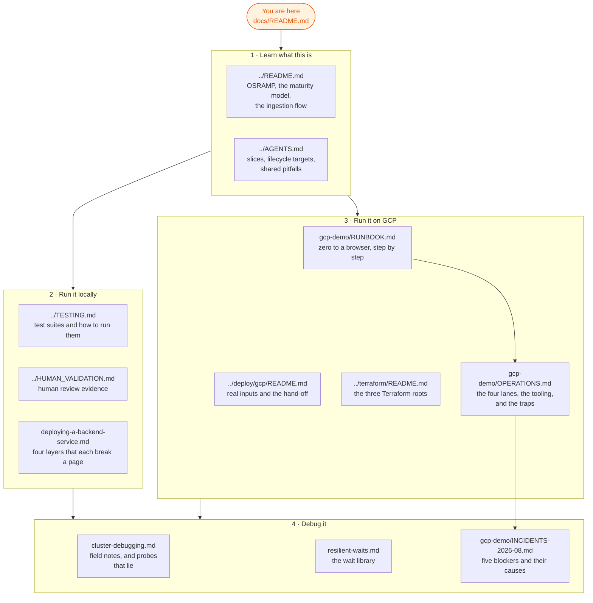

# Documentation index

This page is the entry point to every document in this repository. Read it
first. It answers three questions in order: what this repository is, how you
run it, and how you debug it.

Two files sit above this one and stay at the repository root:

| File | Audience | Read it for |
| :--- | :--- | :--- |
| [`../README.md`](../README.md) | a human, new to OSRAMP | what OSRAMP is and what the demo proves |
| [`../AGENTS.md`](../AGENTS.md) | an agent, or an engineer who wants commands | the slice map, the lifecycle targets, and the shared pitfalls |

## Glossary

Use these terms. Do not use a synonym for any of them. Rule 1.11 of STE-Code
forbids two names for one item, and this repository has paid for that twice.

| Term | Meaning |
| :--- | :--- |
| **slice** | One D2 delivery boundary, such as `d2-signalloom/`. A slice owns its namespaces, images, tests and lifecycle. |
| **foundation** | The shared substrate that every slice needs: the kind cluster, the Zot registry, the signing keys and Flux. `make up` creates it. |
| **lane** | One GCP environment: `demo-1`, `demo-2`, `ci-1` or `ci-2`. Each lane has one VM, one tailnet node and one hand-off file. |
| **estate** | The software stack that runs on one lane's VM. `make gcp-tf-demo-up` builds it. The lane is the infrastructure; the estate is what runs on it. |
| **hand-off file** | `deploy/gcp/<lane>.handoff.json`. Terraform writes it. Every later command reads the lane's identity from it. |
| **surface** | One of the two paths that reach a lane: the on-VM surface, or the tailnet surface. A lane can pass on one and fail on the other. |

## How the documentation fits together

## 1 · Learn what this is

| Document | What it covers |
| :--- | :--- |
| [`../README.md`](../README.md) | OSRAMP, the four-level maturity model, team ownership, the ingestion flow, and the demo commands |
| [`../AGENTS.md`](../AGENTS.md) | The shared foundation, the eight slices, the lifecycle targets, and the pitfalls that recur |
| [`system-map/`](system-map/) | An interactive isometric map of the platform's services and the paths between them |
| [`../terraform/CONTRACT.md`](../terraform/CONTRACT.md) | What the Terraform roots guarantee to each other |

## 2 · Run it

Start locally. The local path needs Docker and nothing else.

| Document | What it covers |
| :--- | :--- |
| [`../README.md#getting-started`](../README.md#getting-started) | The local quickstart: `./scripts/setup.sh`, then a `demo-*-up` target |
| [`../TESTING.md`](../TESTING.md) | Every test suite, and how to run each one |
| [`../HUMAN_VALIDATION.md`](../HUMAN_VALIDATION.md) | The record a person writes after a live browser review |
| [`deploying-a-backend-service.md`](deploying-a-backend-service.md) | Read this before you add a backend service. Four layers each break the page alone. |

Then run it on GCP. The GCP path costs money and needs credentials.

| Document | What it covers |
| :--- | :--- |
| [`gcp-demo/RUNBOOK.md`](gcp-demo/RUNBOOK.md) | The operator runbook: an empty project to a dashboard in a browser |
| [`gcp-demo/OPERATIONS.md`](gcp-demo/OPERATIONS.md) | The four lanes, the health tooling, and the traps that misreport their own cause |
| [`../deploy/gcp/README.md`](../deploy/gcp/README.md) | The real project inputs, the two service accounts, and the hand-off contract |
| [`../terraform/README.md`](../terraform/README.md) | Why the estate splits into three Terraform roots |
| [`../terraform/RUNBOOK.md`](../terraform/RUNBOOK.md) | The Terraform-only walkthrough for `demo-1` |
| [`../scripts/ci/README.md`](../scripts/ci/README.md) | The older CI lane on `signalloom-ci`, which is a different system |

## 3 · Debug it

| Document | What it covers |
| :--- | :--- |
| [`cluster-debugging.md`](cluster-debugging.md) | Field notes for the local stack. Section 8 lists probes that report a confident answer they did not earn. |
| [`resilient-waits.md`](resilient-waits.md) | `scripts/lib/wait.sh`, and why a bare `sleep` is never correct |
| [`gcp-demo/OPERATIONS.md#traps`](gcp-demo/OPERATIONS.md#traps) | Commands that fail while they report success, and the reverse |
| [`gcp-demo/INCIDENTS-2026-08.md`](gcp-demo/INCIDENTS-2026-08.md) | Five blockers from August 2026, each with the measurement that found it |
| [`local-lifecycle-errata.md`](local-lifecycle-errata.md) | Corrections to the local lifecycle documentation |

## Reference and history

These documents record decisions and investigations. They are not instructions.

| Area | Where |
| :--- | :--- |
| Signal Loom design notes, audits and proposals | [`signalloom/`](signalloom/) — 49 files, mostly design records |
| Terraform build notes, chunks F1 to K | [`../terraform/notes/README.md`](../terraform/notes/README.md) — read the index first; most of the series is historical |
| Terraform module reference | `../terraform/modules/*/README.md` |
| Policy as versioned code | [`policy-as-versioned-code/`](policy-as-versioned-code/) |
| Platform appraisal, mid-2026 | [`appraisal/`](appraisal/) |
| Agent trust proposal and audit | [`agent-trust-project-proposal.md`](agent-trust-project-proposal.md), [`agent-trust-completion-audit.md`](agent-trust-completion-audit.md) |
| Frequently asked questions | [`FAQ.md`](FAQ.md) |

NOTE: `MEMORY/WORK/` holds per-session records. Those files are an archive of
how the work happened, not a description of the tree today.

## Writing convention

New documentation in this repository follows STE-Code, which adapts ASD-STE100
for software documentation. The rules that matter most here:

1. Use one term for one item. Do not introduce a synonym.
2. Keep a procedural sentence to 20 words or fewer.
3. Write instructions in the imperative form.
4. Put the condition before the command.
5. Use `WARNING` for a risk of data loss or a security fault. Use `CAUTION` for
   a risk of incorrect results.
6. Give the reason with the risk. A signal word alone tells the reader nothing.

This repository writes en_GB, which departs from STE-Code Rule 1.14. Rule 1.14
permits a project directive to select the spelling, and this is that directive.
