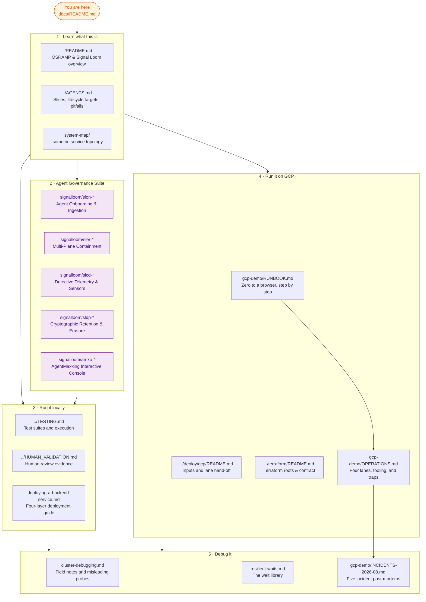

# Documentation index

This page is the entry point for all repository documentation. Read this document first.
It describes the platform, explains how to run the services, and shows how to debug failures.

Two files sit at the repository root:

| File | Audience | Read it for |
| :--- | :--- | :--- |
| [`../README.md`](../README.md) | Human, new to OSRAMP | Platform overview and verification goals |
| [`../AGENTS.md`](../AGENTS.md) | Agent or engineer needing commands | Slice architecture, lifecycle targets, and shared pitfalls |

## Glossary

Use these defined terms. Do not use synonyms. Rule 1.11 of STE-Code forbids multiple names for one item.

| Term | Meaning |
| :--- | :--- |
| **slice** | One D2 delivery boundary, such as `d2-signalloom/`. A slice owns its namespaces, images, tests, and lifecycle. |
| **foundation** | The shared platform substrate: Kind cluster, Zot registry, signing keys, and Flux. `make up` creates it. |
| **lane** | One GCP environment: `demo-1`, `demo-2`, `ci-1`, or `ci-2`. Each lane contains one VM, one tailnet node, and one hand-off file. |
| **estate** | The software stack deployed to a lane VM. `make gcp-tf-demo-up` builds it. The lane is the infrastructure; the estate is the workload. |
| **hand-off file** | `deploy/gcp/<lane>.handoff.json`. Terraform writes this file. Later commands read the lane identity from it. |
| **surface** | One of two communication paths: VM-local surface or Tailscale tailnet surface. A lane can pass on one and fail on the other. |

## How the documentation fits together

## 1 · Learn What This Is

| Document | What it covers |
| :--- | :--- |
| [`../README.md`](../README.md) | OSRAMP, the four-level maturity model, team ownership, ingestion flow, and demo commands |
| [`../AGENTS.md`](../AGENTS.md) | Shared foundation, eight slices, lifecycle targets, and recurring pitfalls |
| [`system-map/`](system-map/) | Interactive isometric map of platform services and communication paths |
| [`../terraform/CONTRACT.md`](../terraform/CONTRACT.md) | Invariants and contracts between Terraform roots |

## 2 · Run the Platform

Start locally. The local workflow requires Docker.

| Document | What it covers |
| :--- | :--- |
| [`../README.md#getting-started`](../README.md#getting-started) | Local quickstart: run `./scripts/setup.sh`, then run a `demo-*-up` target |
| [`../TESTING.md`](../TESTING.md) | Test suites and execution instructions |
| [`../HUMAN_VALIDATION.md`](../HUMAN_VALIDATION.md) | Human verification logs from browser reviews |
| [`deploying-a-backend-service.md`](deploying-a-backend-service.md) | Deployment checklist: four separate layers that can each break page routing |

Deploy to GCP after local testing. The GCP workflow incurs costs and requires cloud credentials.

| Document | What it covers |
| :--- | :--- |
| [`gcp-demo/RUNBOOK.md`](gcp-demo/RUNBOOK.md) | Operator runbook from empty cloud project to dashboard in browser |
| [`gcp-demo/OPERATIONS.md`](gcp-demo/OPERATIONS.md) | Four deployment lanes, health tools, and diagnostic traps |
| [`../deploy/gcp/README.md`](../deploy/gcp/README.md) | Project inputs, service account roles, and hand-off contracts |
| [`../terraform/README.md`](../terraform/README.md) | Architecture rationale for three separate Terraform roots |
| [`../terraform/RUNBOOK.md`](../terraform/RUNBOOK.md) | Step-by-step Terraform execution for `demo-1` |
| [`../scripts/ci/README.md`](../scripts/ci/README.md) | Legacy GCP CI runner pipeline on `signalloom-ci` |

## 3 · Debug the System

| Document | What it covers |
| :--- | :--- |
| [`cluster-debugging.md`](cluster-debugging.md) | Field debugging notes for local stack. Section 8 details misleading probes. |
| [`resilient-waits.md`](resilient-waits.md) | Wait helpers in `scripts/lib/wait.sh` and pitfalls of bare `sleep` commands |
| [`gcp-demo/OPERATIONS.md#traps`](gcp-demo/OPERATIONS.md#traps) | Commands that return incorrect status codes |
| [`gcp-demo/INCIDENTS-2026-08.md`](gcp-demo/INCIDENTS-2026-08.md) | Post-mortem reports and diagnostic measurements for five August 2026 incidents |
| [`local-lifecycle-errata.md`](local-lifecycle-errata.md) | Errata and fixes for local lifecycle scripts |

## Reference and History

These documents record engineering decisions, verification proofs, and Governor certifications.
The directory [`signalloom/`](signalloom/) contains 356 design and architecture records across six delivery missions:

### 1. Agent Onboarding & Ingestion (SLON)

| Document | Purpose |
| :--- | :--- |
| [`signalloom/slon-p1-preflight-proof.md`](signalloom/slon-p1-preflight-proof.md) | Phase 1 preflight verification proof |
| [`signalloom/slon-p1-governor-report.md`](signalloom/slon-p1-governor-report.md) | Phase 1 Governor certification report |
| [`signalloom/slon-p1-technical-design.md`](signalloom/slon-p1-technical-design.md) | Phase 1 technical design and workload architecture |
| [`signalloom/slon-p2-preflight-proof.md`](signalloom/slon-p2-preflight-proof.md) | Phase 2 preflight verification proof |
| [`signalloom/slon-p2-1-evidence.md`](signalloom/slon-p2-1-evidence.md) | Phase 2-1 dual agent deployment evidence |
| [`signalloom/slon-p2-2-evidence.md`](signalloom/slon-p2-2-evidence.md) | Phase 2-2 dynamic Nono capability and signed audit evidence |
| [`signalloom/slon-p2-3-evidence.md`](signalloom/slon-p2-3-evidence.md) | Phase 2-3 dual agent claim evidence |
| [`signalloom/slon-p2-3-comparative-telemetry-architecture.md`](signalloom/slon-p2-3-comparative-telemetry-architecture.md) | Comparative telemetry architecture |
| [`signalloom/slon-p3-preflight-proof.md`](signalloom/slon-p3-preflight-proof.md) | Phase 3 preflight verification proof |
| [`signalloom/slon-p3-docs-portal-provenance.md`](signalloom/slon-p3-docs-portal-provenance.md) | Documentation portal provenance and gap analysis |
| [`signalloom/slon-p3-1-evidence.md`](signalloom/slon-p3-1-evidence.md) | Documentation portal deployment evidence |

### 2. Signal Fusion & Agent Swarms (SFAS & SFDP)

| Document | Purpose |
| :--- | :--- |
| [`signalloom/sfas-final-programme-certification.md`](signalloom/sfas-final-programme-certification.md) | Signal fusion final programme certification |
| [`signalloom/sfas-governor-log.md`](signalloom/sfas-governor-log.md) | Multi-agent coordination and governor execution log |
| [`signalloom/sfdp-p1-preflight-proof.md`](signalloom/sfdp-p1-preflight-proof.md) | Signal fusion data plane preflight proof |
| [`signalloom/sfdp-p2-4-runtime-evidence.md`](signalloom/sfdp-p2-4-runtime-evidence.md) | Data plane runtime telemetry evidence |

### 3. Data Protection & Cryptographic Retention (SLDP)

| Document | Purpose |
| :--- | :--- |
| [`signalloom/sldp-mission-certification.md`](signalloom/sldp-mission-certification.md) | Data protection mission certification |
| [`signalloom/sldp-downstream-contract.md`](signalloom/sldp-downstream-contract.md) | Cryptographic data erasure and downstream contract |
| [`signalloom/sldp-p0-boundary-map.md`](signalloom/sldp-p0-boundary-map.md) | Data boundary and tombstone isolation map |

### 4. Enforcement & Response (SLER)

| Document | Purpose |
| :--- | :--- |
| [`signalloom/sler-p6-gov-delivery-report.md`](signalloom/sler-p6-gov-delivery-report.md) | Multi-plane containment Governor delivery report |
| [`signalloom/sler-p1-2-schema.md`](signalloom/sler-p1-2-schema.md) | Multi-plane containment decision schema |
| [`signalloom/sler-p6-3-proof.md`](signalloom/sler-p6-3-proof.md) | Multi-plane containment end-to-end acceptance proof |
| [`signalloom/sler-p5-2-denial-matrix.json`](signalloom/sler-p5-2-denial-matrix.json) | Machine-readable multi-plane denial matrix |

### 5. AgentMaxxing Interactive Demo Console (AMXD)

| Document | Purpose |
| :--- | :--- |
| [`signalloom/amxo-p6-gov-proof.md`](signalloom/amxo-p6-gov-proof.md) | AgentMaxxing final Governor delivery proof |
| [`signalloom/amxo-governor-log.md`](signalloom/amxo-governor-log.md) | AgentMaxxing supervisor ledger and card history |
| [`signalloom/amxo-p1-1-proof.md`](signalloom/amxo-p1-1-proof.md) | Interactive console execution proof |

### 6. Coding Agent & Harness Detective Telemetry (SLCD)

| Document | Purpose |
| :--- | :--- |
| [`signalloom/slcd-mission-certification.md`](signalloom/slcd-mission-certification.md) | Detective telemetry mission certification |
| [`signalloom/slcd-p1-5-lawful-basis.md`](signalloom/slcd-p1-5-lawful-basis.md) | GDPR Article 6(1)(f) and employee privacy assessment |
| [`signalloom/slcd-p0-baseline.md`](signalloom/slcd-p0-baseline.md) | Host sensor architecture and baseline telemetry |

### Platform Architecture & Historical Notes

| Document | Purpose |
| :--- | :--- |
| [`../terraform/notes/README.md`](../terraform/notes/README.md) | Index of historical Terraform notes (chunks F1 to K) |
| [`policy-as-versioned-code/`](policy-as-versioned-code/) | Policy as versioned code design notes |
| [`appraisal/`](appraisal/) | Mid-2026 platform appraisal |
| [`agent-trust-project-proposal.md`](agent-trust-project-proposal.md) | Agent trust project proposal |
| [`agent-trust-completion-audit.md`](agent-trust-completion-audit.md) | Agent trust project completion audit |
| [`FAQ.md`](FAQ.md) | Frequently asked questions |

Note: `MEMORY/WORK/` contains historical session records.
These files document previous work sessions and do not describe current repository state.

## Writing Conventions

Documentation in this repository follows STE-Code, an adaptation of ASD-STE100 for software documentation.
Apply these primary rules to all documentation updates:

1. Use one term for each item. Do not use synonyms.
2. Keep instruction sentences to 20 words or fewer.
3. Write instructions in the imperative mood.
4. Put conditions before instructions.
5. Use `WARNING` for risks of data loss or security exposure.
   Use `CAUTION` for risks of incorrect operation.
6. State the specific cause with every warning or caution.
7. Use British English (en_GB) spelling per project directive.
