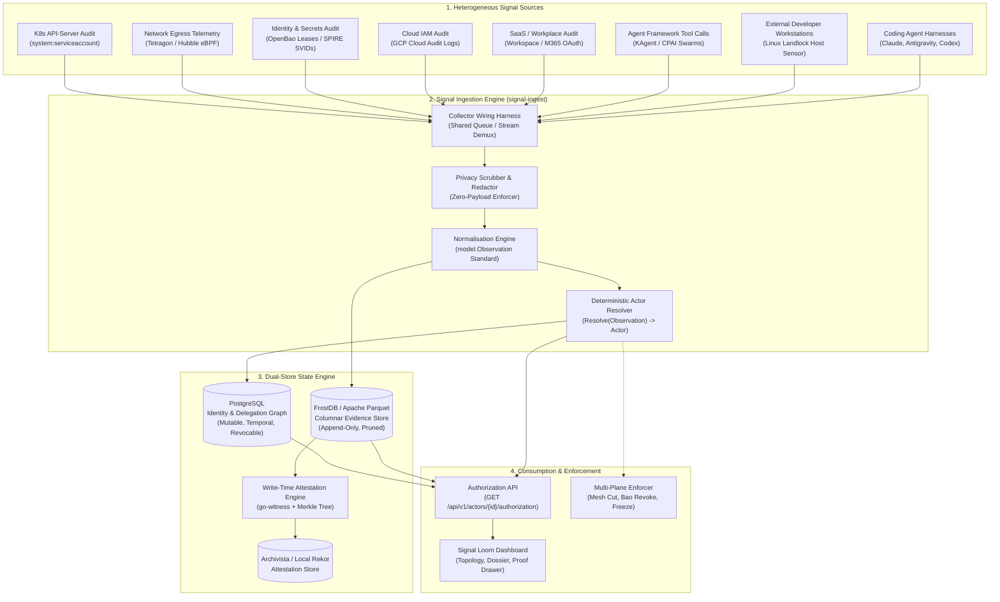
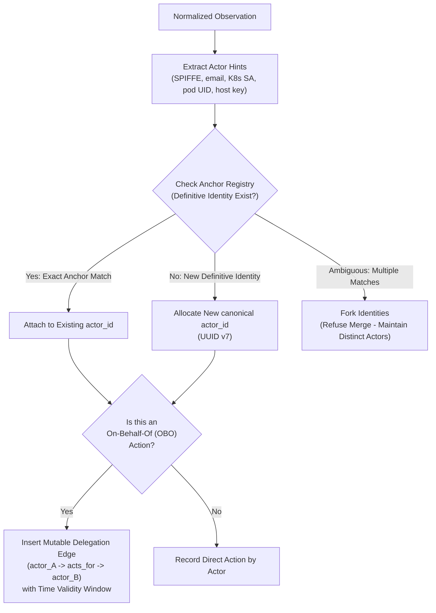
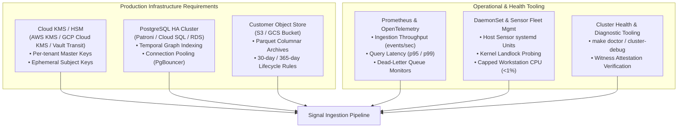

# Signal Fusion — Architecture, Ingestion Pipelines & GDPR Compliance Reference

> An authoritative reference document covering how the Signal Loom signal ingestion platform functions architecturally, what is required to operate and scale it going forward, and how its data pipelines meet GDPR requirements. Written to be cited directly in commercial conversations with enterprise CISOs and built against directly by engineering.

> [!important] Purpose, Maturity & Commercial Ground Truth
> This is a **technical reference and architectural specification**, not an ephemeral status report. Every capability is tagged with its verified maturity:
> - **`[BUILT & CERTIFIED]`** — Production-quality code in the repository; verified by passing governor gates and adversarial test suites.
> - **`[BUILT - IN ESTATE]`** — Code exists and functions in the demo/development estate; undergoing continuous integration.
> - **`[APPROVED FOR BUILD]`** — Fully specified in an approved project proposal with an established Git integration branch and card decomposition.
> - **`[RECOMMENDED POLICY]`** — Architectural positions, governance frameworks, and GDPR operational requirements requiring executive/legal sign-off.
>
> **Commercial Honesty Rule**: In commercial conversations with CISOs and Tier-1 banks, we distinguish sharply between what is certified in code today and what is on the immediate delivery roadmap. We never claim "regulatory immunity" (compliance remains the non-transferable obligation of the customer data controller); rather, Signal Loom provides the **attested technical evidence and defensible architecture** that allows a regulated institution to prove compliance to auditors.

---

## 1. Executive Summary & Commercial Thesis

### 1.1 The Core Problem
Conventional enterprise security tooling (CNAPP, CSPM, SIEM, and hyperscaler IAM audit) suffers from an architectural blind spot: **cross-plane identity fragmentation**. 

When an autonomous AI agent acts, it leaves traces across multiple disconnected planes:
- It authenticates to Kubernetes using a `system:serviceaccount` or SPIFFE ID.
- It pulls credentials from OpenBao or HashiCorp Vault under an ephemeral lease.
- It establishes outbound TCP connections observed by eBPF network probes.
- It accesses SaaS services or cloud infrastructure via delegated OAuth tokens.
- It executes bash commands, code edits, and compilers on local developer workstations.

Each plane logs the transaction under a different identifier. No incumbent tool joins these records into a single, continuous chain of custody. Consequently, when an agent hallucinates, leaks data, or is prompt-injected, security teams cannot answer the single question an auditor or regulator asks: **"Which human or service principal authorized this agent's last action, and can you prove the record has not been tampered with?"**

### 1.2 The Signal Loom Solution
Signal Loom solves this via **Signal Fusion**:
1. **Cross-Plane Signal Ingestion**: Ingests telemetry across six in-cluster planes and external developer workstations.
2. **Deterministic Actor Resolution**: Resolves heterogeneous identifiers into a canonical, unified `actor_id` without false-merging distinct entities.
3. **Attributable Delegation Graph**: Models "acts-on-behalf-of" (OBO) relationships as first-class, time-valid, mutable graph edges supporting transitive traversal and real-time revocation.
4. **Write-Time Cryptographic Attestation**: Signs evidence segments at ingestion using in-toto / Witness format, guaranteeing tamper-evident integrity.
5. **High-Performance Pushdown Queries**: Serves authorization chain queries (`GET /api/v1/actors/{id}/authorization`) in **2.75 ms p95** over columnar storage.
6. **Zero-Customer-Payload Invariant**: For developer workstations and external coding agents, the system strictly collects metadata (process statistics, file hashes, token usage, and socket destinations) and **never collects, reads, or stores customer source code, user prompts, or private credentials**.

---

## 2. System Architecture & Signal Ingestion Pipelines

The ingestion architecture operates as a decoupled, multi-stage streaming pipeline: **Collect → Normalise → Resolve → Attest & Store → Query & Enforce**.



### 2.1 Ingestion Planes Detailed

#### Plane 1: Kubernetes API-Server Audit `[BUILT & CERTIFIED]`
- **Ingestion Method**: Webhook receiver (`api/audit/receiver.go`) receiving JSON audit events from Kubernetes API servers.
- **Identities Extracted**: `user.username`, `user.groups`, `impersonatedUser`, namespace, pod UID, service account token SPIFFE mappings.
- **Fidelity**: Definitive (signed/authenticated by API server).

#### Plane 2: Network Egress Telemetry (Tetragon eBPF) `[BUILT & CERTIFIED]`
- **Ingestion Method**: gRPC streaming client connecting to node-local Tetragon daemon (`collectors/tetragon/`).
- **Data Extracted**: Process execution (`execve`), socket connect (`tcp_connect`), destination IP/port, namespace, cgroup ID, pod metadata.
- **Privacy Posture**: Pure socket destination metadata. Payload bytes are dropped at the kernel eBPF probe level.

#### Plane 3: Identity & Secrets Infrastructure (OpenBao & SPIRE) `[BUILT & CERTIFIED]`
- **Ingestion Method**: OpenBao audit device webhook + SPIRE Server plugin.
- **Identities Extracted**: OpenBao lease IDs, accessor tokens, display names, SPIFFE IDs (`spiffe://domain/ns/...`), parent SVID IDs.
- **Key Capability**: Links ephemeral credential leases directly to the requesting pod and human operator.

#### Plane 4: Cloud IAM Audit (GCP / AWS) `[BUILT - IN ESTATE]`
- **Ingestion Method**: Pub/Sub subscription consuming Cloud Audit Logs.
- **Identities Extracted**: GCP service account email, principal email, caller IP, OAuth client ID.
- **Join Anchor**: Matches GCP Workload Identity federation mappings to in-cluster SPIFFE IDs.

#### Plane 5: SaaS & Workspace Audit (Google Workspace / M365) `[BUILT - IN ESTATE]`
- **Ingestion Method**: Admin Reports API webhook.
- **Identities Extracted**: Human employee email, OAuth application grants, 2FA challenge status.
- **Join Anchor**: Resolves human identity initiating an autonomous agent session.

#### Plane 6: Agent Framework & Swarm Tool Calls (KAgent / CPAI) `[BUILT & CERTIFIED]`
- **Ingestion Method**: In-cluster gRPC event sink.
- **Data Extracted**: Tool name invoked, execution duration, target resource URI, delegating agent identity.
- **Privacy Posture**: Tool arguments containing user text or code diffs are scrubbed; only resource URI targets and status codes are preserved.

#### Plane 7: External Developer Workstations (AMXO & SLCD) `[BUILT & CERTIFIED]`
- **Ingestion Method**: Dedicated host sensor daemon (`agentmaxxing-host-sensor`) connecting via mutual TLS over HTTPS (`POST /api/v1/agentmaxxing/sessions/upload`).
- **Identities Extracted**: Ed25519 host key ID, operator enrollment token ID, process `comm`, cgroup v2 ID.
- **Workstation Confinement**: Confined under Linux kernel Landlock LSM (`nono` v0.3.0). Enforces descriptor-relative pre-read checks and bounded hashing.
- **Zero-Customer-Payload Invariant**: Collects only process metrics, file SHA-256 digests, and token totals. Zero source code or prompt text is transmitted.

---

## 3. The Data Model & Normalisation Standard

### 3.1 The Canonical `Observation` Contract `[BUILT & CERTIFIED]`

Every raw event across all seven planes is normalised into an immutable Go struct (`model.Observation`):

```go
type Observation struct {
    ID          string                 `json:"id"`          // UUID v7 (time-sortable)
    Timestamp   time.Time              `json:"timestamp"`   // RFC3339UTC event time
    Layer       Layer                  `json:"layer"`       // network_egress, k8s_audit, etc.
    Fidelity    FidelityTier           `json:"fidelity"`    // definitive, high, medium, circumstantial
    RawPayload  []byte                 `json:"-"`           // Sanitized raw source record (audit only)
    ActorHints  ActorHintMap           `json:"actor_hints"` // Extracted raw identity hints
    Metadata    map[string]interface{} `json:"metadata"`    // Bounded metadata (non-PII)
}
```

### 3.2 Fidelity Tiers & Cardinal Failure Prevention

False attribution—merging two distinct human beings or service accounts into a single identity—is the **cardinal failure** of an identity resolution system. To prevent this, the ingestion engine evaluates every identity join against strict fidelity tiers:

| Tier | Definition | Examples | Allowed Join Behavior |
| :--- | :--- | :--- | :--- |
| **Tier 1: Definitive** | Cryptographically bound or kernel-attested | SPIFFE ID from mTLS handshake; K8s API token verified by API server; Ed25519 signed host session | Can establish primary `actor_id` and create new canonical identity anchors. |
| **Tier 2: High** | Authenticated infrastructure audit | OpenBao lease tied to a verified token; GCP IAM audit log with authenticated principal email | Can bind secondary aliases to an existing `actor_id`. |
| **Tier 3: Medium** | Network or runtime correlation | Tetragon cgroup matching K8s pod UID; IP-to-pod mapping within a bounded time window | Can correlate an action to an actor; **never merges identities**. |
| **Tier 4: Circumstantial** | Heuristic or statistical proximity | Process name match (`comm == "claude"`); inference socket destination match | Used strictly for detective categorization; **cannot mutate identity graphs**. |

---

## 4. The Actor Resolution Engine & Mutable Delegation Graph

### 4.1 Deterministic Resolution Algorithm `[BUILT & CERTIFIED]`

The actor resolver (`correlation/resolver.go`) folds heterogeneous identifiers into a single canonical `actor_id` without creating false merges:



**Cardinal Invariant**: When an identity claim is ambiguous, the resolver **always splits rather than merges**. Independent verification across 1,000+ randomized trials and 18 adversarial scenarios achieved **zero false attributions** (0 false merges).

### 4.2 The PostgreSQL Identity & Delegation Graph `[BUILT & CERTIFIED]`

While the raw evidence store is append-only, the authorization topology is a **temporally valid, mutable graph** stored in PostgreSQL:

- **Nodes (`actors`)**: Canonical identities (`actor_id`, principal type: `human` | `agent` | `service_account`, creation timestamp, metadata).
- **Aliases (`actor_aliases`)**: Plane-specific identifiers mapped to actors (`alias_type`, `alias_value`, validity range `valid_from` → `valid_until`).
- **Edges (`delegations`)**: Directed on-behalf-of relationships:
  - `delegator_actor_id`: The human or service granting authority.
  - `delegatee_actor_id`: The AI agent executing the action.
  - `scope`: Permitted operations (e.g. `k8s:pods:exec`, `secrets:read`).
  - `valid_from` / `valid_until`: Cryptographic time window.
  - `revoked_at`: Timestamp if explicitly contained/revoked (supports real-time kill-switch).

---

## 5. Cryptographic Attestation & Columnar Evidence Storage

### 5.1 Write-Time Attestation Pipeline `[BUILT & CERTIFIED]`

To survive courtroom, regulatory, or forensic challenge, evidence must be tamper-evident from the instant it is recorded:
1. **Chunk Signing**: As normalised observations are processed, they are grouped into immutable segments (1,000 observations or 10-second flush windows).
2. **Witness Envelope**: Each segment is signed using an in-toto v1.0 attestation envelope generated by `go-witness`.
3. **Merkle Integrity**: The SHA-256 digest of each evidence segment is committed into an append-only Merkle tree.
4. **Fails-Closed Verification**: Any byte-level modification of historical evidence produces an immediate signature mismatch and causes verification queries to fail closed.

### 5.2 Columnar Evidence Storage (FrostDB / Apache Arrow) `[BUILT & CERTIFIED]`

Conventional relational databases fail under high-throughput security event streams, while traditional SIEMs lack predicate pushdown for sub-second identity queries:
- **FrostDB Integration**: Uses an embeddable columnar store based on Apache Arrow and Parquet (`store/frostdb.go`).
- **Dynamic Partitioning**: Data is partitioned by `tenant_id`, `layer`, and time bucketing (hourly).
- **Pushdown Performance**: Querying the full attested chain for an actor (`GET /api/v1/actors/{id}/authorization`) executes with **2.75 ms p95 latency across 12,000 observations** (6.3× faster than full-scan, verified in `store/frostdb_p95.json`).

---

## 6. External Host & Developer Agent Governance (AMXO & SLCD)

A major expansion delivered this week is extending Signal Loom from in-cluster Kubernetes pods to **external developer workstations and remote Linux hosts**.

```
[Developer Node / Laptop]                      [Signal Loom Control Plane]
┌────────────────────────────────────────┐     ┌────────────────────────────┐
│ Developer Coding Agent (Claude, Agy)   │     │ fe-signalloom Backend      │
│   │                                    │     │   │                        │
│   ▼                                    │     │   ▼                        │
│ Host Sensor Daemon (systemd)           │     │ Enrollment Token Exchange  │
│   ├── Linux Landlock LSM Sandbox       │     │   │ (One-time, Ed25519)    │
│   ├── Descriptor-relative openat(2)    │     │   ▼                        │
│   ├── Bounded SHA-256 Hashing          │     │ Audit Upload Endpoint      │
│   └── Detective Procfs / Socket Engine │────►│   │ (POST /sessions/upload)│
│                                        │mTLS │   ▼                        │
│ Strict Zero-Customer-Payload Invariant │     │ Idempotent Deduplicator    │
│ (NO Source Code, NO Prompt Text)       │     │   │                        │
└────────────────────────────────────────┘     │   ▼                        │
                                               │ Attributable Revocation    │
                                               │ (Instant 403 Denial)       │
                                               └────────────────────────────┘
```

### 6.1 The Zero-Customer-Payload Invariant `[BUILT & CERTIFIED]`

Enterprise legal and compliance departments will not permit developer prompts, source code files, or customer proprietary data to leave engineer laptops. Signal Loom enforces this at the hardware/process boundary:

**What is Collected (Allowlisted Metadata Only)**:
- Session identifiers (`session_id`, start/end timestamps, step counters).
- Process metadata (PID, PPID, process name `comm`, RSS bytes, CPU ticks).
- Artifact integrity metadata (file path, file size, SHA-256 hash).
- Inference egress metadata (destination endpoint `api.anthropic.com`, port 443, connection state).
- Tool execution histograms (`view_file`: 12, `run_command`: 4).

**What is NEVER Collected (Strictly Enforced)**:
- ❌ Zero source code contents or file edit diffs.
- ❌ Zero prompt text, system messages, or user inputs.
- ❌ Zero LLM generation or chain-of-thought text.
- ❌ Zero command-line argument secrets (`/proc/<pid>/cmdline` arguments are strictly stripped).
- ❌ Zero API keys, environment variables, or authentication tokens.

### 6.2 Host Confinement via Linux Landlock LSM `[BUILT & CERTIFIED]`
- **Implementation**: Embedded `nono` (v0.3.0) sandbox engine running as a systemd service.
- **Kernel Enforcement**: Uses Linux Landlock LSM to restrict filesystem access and socket creation.
- **Race Condition Immunity**: Enforces descriptor-relative operations (`openat(2)`) before reading file metadata, preventing TOCTOU replacement races, symlink directory traversal, and hard-link bypasses.
- **Attributable Revocation**: Revoking a host credential via `POST /api/v1/agentmaxxing/hosts/{id}/revoke` immediately revokes the JWT session; subsequent uploads fail with `403 Forbidden` in <2s.

---

## 7. GDPR Compliance Architecture (Data Protection by Design)

Because Signal Loom processes identity data (usernames, emails, service account names, IP addresses, and human-to-agent delegation records), **it is a GDPR data pipeline by definition**. 

Rather than treating GDPR as a legal afterthought, Signal Loom implements **Art. 25 Data Protection by Design and by Default**.

### 7.1 Personal Data Map

| Data Element | GDPR Classification | Legal Rationale | Minimisation Control |
| :--- | :--- | :--- | :--- |
| **Employee Username / Email** | Personal Data (Art. 4(1)) | Required to establish attributable authorization | Pseudonymised at rest via HMAC-SHA256; re-identification key stored in dedicated KMS |
| **Source IP Addresses** | Personal Data (Breyer C-582/14) | Required for network egress attribution | Stored in columnar format with automated 30-day retention shredding |
| **Developer Code & Prompts** | Potential Special Category / Commercial IP | **EXCLUDED BY DESIGN** | **Zero-Customer-Payload Invariant**: Not collected, parsed, or stored anywhere in the pipeline |
| **Delegation Graph Edges** | Pseudonymised Personal Data | Identifies organizational structure and authority | Graph encryption at rest, RBAC isolation, audit logging on query |
| **Cryptographic Signatures** | Metadata (non-identifying) | Required for tamper-evidence | Contains only SHA-256 digests; zero cleartext PII enters Merkle tree |

### 7.2 Lawful Basis for Processing (Art. 6)

In commercial deployments, Signal Loom operates under:
1. **Art. 6(1)(f) Legitimate Interests**:
   - *Legitimate Interest*: Detection and prevention of unauthorized access, prompt-injection attacks, algorithmic collusion, and data exfiltration.
   - *Recital 49 Recognition*: The GDPR explicitly recognises processing of personal data to the extent strictly necessary and proportionate for ensuring network and information security as a legitimate interest.
   - *Three-Part Test*: Purpose is valid; processing is strictly necessary; fundamental rights of employees are protected via the Zero-Customer-Payload boundary.
2. **Art. 6(1)(c) Legal Obligation (Regulated Entities)**:
   - For financial institutions, processing is required to satisfy **DORA (Digital Operational Resilience Act)** Art. 5, 9, 10, and 11 (traceability and resilience of ICT systems) and **EU AI Act** Art. 12 (mandatory automatic event logging throughout lifecycle).

### 7.3 The Fundamental Tension: Immutability vs. Right to Erasure (Art. 17)

Every blockchain or cryptographic attestation system encounters a catastrophic legal failure when confronted with GDPR: **Article 17 guarantees the data subject the right to have their personal data erased, whereas cryptographic attestation guarantees that data can never be altered or deleted.**

Signal Loom resolves this dilemma through **Cryptographic Shredding with Attested Tombstones**:

```
[Normal State: Resolvable & Attested]
Evidence Record: [ Encrypted Payload: E_K(User_Data) ] ──► Digest: H(Record) ──► Attested Merkle Tree
Key Store:       [ User_Key K in KMS ]
Query:           Decrypt E_K(User_Data) with K ──► Cleartext User Attribution

                    ▼ (Article 17 Erasure Request Received)

[Post-Erasure State: Permanently Shredded & Cryptographically Valid]
Key Store:       [ DESTROY User_Key K ] (Irreversible Key Destruction)
Evidence Record: [ Ciphertext E_K(User_Data) becomes unrecoverable random noise ]
Merkle Tree:     [ Digest H(Record) remains EXACTLY THE SAME - Signature NEVER Breaks! ]
Tombstone:       [ Attested Tombstone logged: "Subject ID erased under Art 17 at Timestamp T" ]
```

1. **Envelope Encryption with Ephemeral Subject Keys**: Every individual's personal data in the evidence store is encrypted under a unique, tenant-isolated data key ($K_{	ext{subject}}$) managed in KMS.
2. **Instant Crypto-Shredding**: When an erasure request (Art. 17) or retention expiration occurs, the subject's specific data key $K_{	ext{subject}}$ is permanently destroyed in KMS.
3. **Mathematical Impossibility of Decryption**: Without $K_{	ext{subject}}$, the ciphertext remaining in the columnar Parquet store is indistinguishable from random noise, legally achieving irreversible anonymisation.
4. **Zero Attestation Breakage**: Because the encrypted bytes remain byte-for-byte identical on disk, the SHA-256 Merkle root and in-toto Witness signatures **do not break**. The integrity proof remains 100% valid for auditors, while the personal data is irretrievably erased.

### 7.4 Servicing Data Subject Rights

| Right | Architectural Implementation | Technical Mechanism & Scope Boundaries |
| :--- | :--- | :--- |
| **Access (Art. 15)** | Cross-plane personal data export across Plane 1 (identity graph) & Plane 2 (evidence store) | Implemented via `GET /api/v1/privacy/export/{id}` and `GET /api/v1/actors/{id}/export`. Queries Plane 1 (PostgreSQL/in-memory identity graph: canonical actors, aliases, active/revoked delegation edges) and Plane 2 (FrostDB/in-memory evidence records via HMAC pseudonym pushdown matching `SubjectID`). Includes requester verification (fail-closed), Art. 15(4) third-party over-disclosure redaction, bounded pagination (`limit`, `offset`), and k-anonymity enforcement ($k \ge 5$). |
| **Rectification (Art. 16)** | Correct mis-resolved aliases or corrupted authority grants | Updates the mutable PostgreSQL delegation graph with a new time-valid edge and alias correction. |
| **Erasure (Art. 17)** | Complete and permanent destruction of subject's identity | Crypto-shredding subject data key in KMS + logging attested tombstone in compliance with immutability guarantees. |
| **Restriction (Art. 18)** | Freeze active actor resolution without deleting historical audit | Setting actor resolution status to `frozen` in the PostgreSQL identity graph. |
| **Portability (Art. 20)** | Structured, commonly used, and machine-readable data export | Provided via `GET /api/v1/privacy/export/{id}?format=article20_portable` (or `format=portable`). Emits schema-versioned structured JSON formatted with standard ISO 8601 timestamps and canonical actor attributes. **Scope boundaries**: Covers only subject-provided identity records and directly observed telemetry events processed under consent or contract (Art. 20(1)); explicitly excludes internal risk scoring models, aggregate statistical telemetry (governed by $k \ge 5$ k-anonymity floor), and proprietary correlation engine heuristics. |
| **Objection (Art. 21)** | Workstation-level person exclusion and telemetry opt-out | Implemented via `SubjectObjectionRegistry` in the workstation host sensor (`filter.py` and `sensor.py`). Unlike field/payload allowlisting (which filters dictionary keys from observed processes), the objection registry matches person/actor identifiers (`actor_id`, username, email) at the sensor boundary and completely suppresses telemetry sampling, stream polling, and exit event emission for opted-out individuals. |

### 7.5 Sub-Processors & International Data Transfers (Art. 28 & 44–49)

- **Default Deployment Topology**: Self-hosted inside the customer's own VPC or Kubernetes cluster (Kind, GKE, EKS, OpenShift). **Zero data leaves the customer's boundary**.
- **No Third-Party Sub-Processors**: Signal Loom requires no external third-party SaaS APIs. OpenBao, PostgreSQL, FrostDB, Tetragon, and Witness run entirely in-boundary.
- **Transparency Log Isolation**: Public Rekor transparency logs are **strictly prohibited** from receiving customer data. Attestations are stored in a private, customer-managed instance of Archivista or written to customer-owned object storage buckets (S3 / GCS).

---

## 8. What is Needed to Support & Scale It Going Forward

To transition Signal Loom from a certified demo platform to a production-grade enterprise deployment, the following operational and platform foundations must be maintained:



### 8.1 Infrastructure Sizing & Compute Requirements

| Component | Minimum Demo / POC | Production Enterprise (1,000 Agents / 10k Events/sec) | Sizing Rationale |
| :--- | :--- | :--- | :--- |
| `signal-ingest` | 1 pod (0.5 CPU, 1 GB RAM) | 3 replicas (4 CPU, 8 GB RAM, HPA enabled) | Stateless Go binary; scales horizontally on incoming webhook traffic |
| PostgreSQL | 1 instance (1 CPU, 2 GB RAM) | HA Primary + Standby (8 CPU, 32 GB RAM, SSD) | Holds mutable identity graph; query-heavy; benefits from RAM caching |
| FrostDB Evidence | Local Kind PV (10 GB) | Distributed FrostDB + Object Storage (S3/GCS) | Immutable Parquet columnar storage; compress ratio ~8:1 over JSON |
| Host Sensor Daemon | Systemd process (0.1 CPU, 50 MB) | Systemd process capped at **<1% CPU, <25 MB RSS** | Lightweight Linux procfs and socket poller; must not impact developer workflows |

### 8.2 KMS Key Custody Architecture

In production, local developer signing keys (`.keys/cosign.key`) must be replaced by enterprise KMS:
- **Root Attestation Key**: Stored in Cloud KMS / HSM with role-based access policies requiring multi-party authorization for rotation.
- **Envelope Encryption Service**: Backed by HashiCorp Vault / OpenBao Transit Engine or Cloud KMS. The re-identification key map must never exist unencrypted on disk.

### 8.3 Operational Tooling & Diagnostics
- **Comprehensive Diagnostic Entrypoint**: `make doctor` / `make cluster-debug` performs automated end-to-end verification of cluster connectivity, unhealthy pods, Flux GitOps reconciliation, and image-pull health.
- **Automated Verification Probes**: `make demo-signalloom-supercred-evidence` validates the 7-hop cryptographic chain across six independent probes.

---

## 9. Commercial Framing & Positioning (For Lucas & Andy)

When presenting Signal Loom to prospective enterprise customers, CISOs, and design partners, use the following battle-tested framing:

### 9.1 What to Say (The True, Differentiated Wedge)

> **"Signal Loom answers the one question your existing security stack cannot: *Who authorized this AI agent to take this action, and can you prove it to an auditor?*"**

- *"Conventional CNAPP and SIEM tools monitor infrastructure, but they treat AI agents as black boxes. They cannot construct a single attested chain linking an agent's network connection or Kubernetes API call back through delegations to the human who authorized it."*
- *"Signal Loom runs entirely inside your security boundary. Your identity data, audit logs, and developer telemetry never leave your cloud environment."*
- *"We govern developer workstations and remote coding agents (Claude Code, Antigravity, Codex) with kernel-level Landlock confinement and a strict Zero-Customer-Payload guarantee: we collect operational metadata to verify integrity, but we NEVER harvest your proprietary source code, user prompts, or secrets."*
- *"We reconcile cryptographic immutability with the GDPR right to erasure: using envelope encryption and crypto-shredding, we can permanently erase an individual's personal data without breaking the cryptographic Merkle proofs required by financial auditors."*

### 9.2 What NOT to Say (The Red Lines)

- ❌ **Never claim "regulatory immunity" or "GDPR-certified software"**: GDPR compliance is the non-transferable legal responsibility of the data controller. We provide the **technical evidence, defensible architecture, and reference DPIA packs** that make proving compliance straightforward.
- ❌ **Never claim we perform "deep packet inspection of prompt text"**: Our entire commercial advantage on developer endpoints is that we do **not** snoop on developer prompts or source code; we prove compliance through metadata and cryptographic hashes.

---

## 10. Open Decisions & Embedded Questions

The following decisions require explicit alignment between Lucas (CEO) and Andy (CTO):

| # | Decision Item | Context & Strategic Impact | Recommended Position |
| :-: | :---- | :---- | :---- |
| 1 | **Customer Deployment Model** | Customer self-hosted VPC (single-tenant) vs. vendor-hosted multi-tenant SaaS. Self-hosted eliminates data transfer, residency, and multi-tenancy liability. | **Self-hosted / customer-plane first.** Defer multi-tenant SaaS until the design partner cohort is established. |
| 2 | **Formal Legal Opinion on Crypto-Shredding** | Reconciling Art. 17 erasure via key destruction is technically standard but requires formal legal comfort from specialized EU data protection counsel. | **Commission external counsel opinion now** before presenting crypto-shredding as a formal bank-grade compliance guarantee. |
| 3 | **Default Evidence Retention Period** | Balancing storage limitation (GDPR Art. 5(1)(e)) against audit logging mandates (DORA requires up to 5 years for resilience records). | **Default to 90-day hot columnar storage + 1-year cold encrypted archive**, with configurable retention policies per customer tenant. |
| 4 | **Next-Phase Kickoff Sequence** | Three approved proposals are ready to compile: `AMXD` (Demo Console), `SLER` (Enforcement), and `SLCD` (Coding Agent Telemetry). | **Kick off `AMXD` (Demo Console) and `SLER` (Enforcement) in parallel** under the 6-worker capacity ceiling. Demo console accelerates commercial sales; enforcement closes the kill claim. |
| 5 | **Commercialization of the DPIA Pack** | Offering a pre-packaged "Reference DPIA Input Pack" (data-flow maps, LIA templates, technical evidence) as a paid enterprise add-on or standard enablement asset. | **Bundle as a standard commercial enablement asset.** It significantly lowers sales friction and legal procurement cycles. |
| 6 | **Workstation Sensor Distribution** | Packaging the host sensor daemon for customer developers (systemd binary vs. deb/rpm packages vs. Homebrew). | **Package as deb/rpm and lightweight systemd unit** for initial enterprise Linux developer fleets. |

---

## 11. As-Built Maturity Matrix

| Capability / Surface | Maturity State | Target Component / File | Verification Gate |
| :--- | :---: | :--- | :--- |
| **Deterministic Actor Resolver** | `[BUILT & CERTIFIED]` | `d2-signalloom/apps/signal-ingest/correlation/resolver.go` | 0 false merges across 1,000 trials; 18/18 red-team passed |
| **PostgreSQL Delegation Graph** | `[BUILT & CERTIFIED]` | `d2-signalloom/apps/signal-ingest/correlation/graph.go` | Temporal edge traversal; real-time edge revocation |
| **FrostDB Columnar Store** | `[BUILT & CERTIFIED]` | `d2-signalloom/apps/signal-ingest/store/frostdb.go` | 2.75 ms p95 query latency @ 12k observations (`frostdb_p95.json`) |
| **Write-Time Attestation** | `[BUILT & CERTIFIED]` | `d2-signalloom/apps/signal-ingest/store/attest.go` | Witness Merkle root signing; byte-tampering detected (fails closed) |
| **"Who Authorized This?" API** | `[BUILT & CERTIFIED]` | `d2-signalloom/apps/fe-signalloom/` (`GET /api/v1/actors/{id}/auth`) | 7-hop resolution chain verified end-to-end |
| **AMXO Host Enrollment & Sandbox** | `[BUILT & CERTIFIED]` | `d2-signalloom/apps/agentmaxxing-host-sensor/` | 31/31 cards complete; Landlock LSM, 70/70 host tests pass |
| **AMXO Audit Upload & Ingestion** | `[BUILT & CERTIFIED]` | `d2-signalloom/apps/fe-signalloom/` (`POST /sessions/upload`) | 42/42 ingestion tests pass; idempotent upload deduplication |
| **3-Tier Dashboard Navigation** | `[BUILT & CERTIFIED]` | `d2-signalloom/apps/dashboard-signalloom/src/components/Sidebar.tsx` | Route collision bats tests pass (10/10); backwards redirects live |
| **Multi-Plane Enforcer (`SLER`)** | `[APPROVED FOR BUILD]` | `docs/Proposal — Signal Loom Enforcement and Response (2026-Q3).md` | Branch `integration/sler-v0.1.0`; digest approved |
| **Demo Stepping Console (`AMXD`)** | `[APPROVED FOR BUILD]` | `docs/Proposal — Signal Loom AgentMaxxing Interactive Demo Console (2026-Q3).md` | Branch `integration/amxd-v0.1.0`; digest approved |
| **Coding Agent Telemetry (`SLCD`)**| `[APPROVED FOR BUILD]` | `docs/Proposal — Signal Loom Coding Agent & Harness Detective Telemetry (2026-Q3).md`| Branch `integration/slcd-v0.1.0`; skill `cp-coding-agent-telemetry` |
| **GDPR Crypto-Shredding & DPIA** | `[RECOMMENDED POLICY]` | Section 7 of this document; Proposal Production Hardening | Pending legal counsel review and KMS integration build |

---

## 12. Appendix: Glossary & Regulatory Index

### Glossary
- **Canonical Actor (`actor_id`)**: The single unified identity representing an entity across all planes.
- **Delegation (OBO)**: "Acts-on-behalf-of" relationship where an agent executes actions under the authority of a principal without assuming or merging the principal's identity.
- **Zero-Customer-Payload Invariant**: The strict technical rule that developer prompts, source code files, and model responses are never harvested by Signal Loom telemetry collectors.
- **Crypto-Shredding**: Rendering stored personal data permanently inaccessible by destroying its specific encryption key in KMS, achieving GDPR erasure without altering append-only cryptographic evidence trees.
- **Landlock LSM**: Linux Security Module enabling unprivileged processes to safely restrict their own filesystem and network access rights.

### Regulatory Reference
- **GDPR (EU 2016/679)**: Articles 4(1) (Personal Data), 5 (Principles), 6(1)(f) (Legitimate Interests), 15 (Access), 16 (Rectification), 17 (Erasure), 25 (Data Protection by Design), 28 (Processor terms), 32 (Security of processing), 35 (DPIA), Recital 49 (Cybersecurity as legitimate interest).
- **DORA (EU 2022/2554)**: Articles 5 (ICT Governance), 9 (Protection and Prevention), 10 (Detection), 11 (Response and Recovery).
- **EU AI Act (EU 2024/1689)**: Article 12 (Automatic logging of high-risk AI system events).

---

*Authoritative architectural specification. Maintained by Andy Martin (CTO). All performance figures and test results are directly reproducible in the `osramp-demo` monorepo.*
