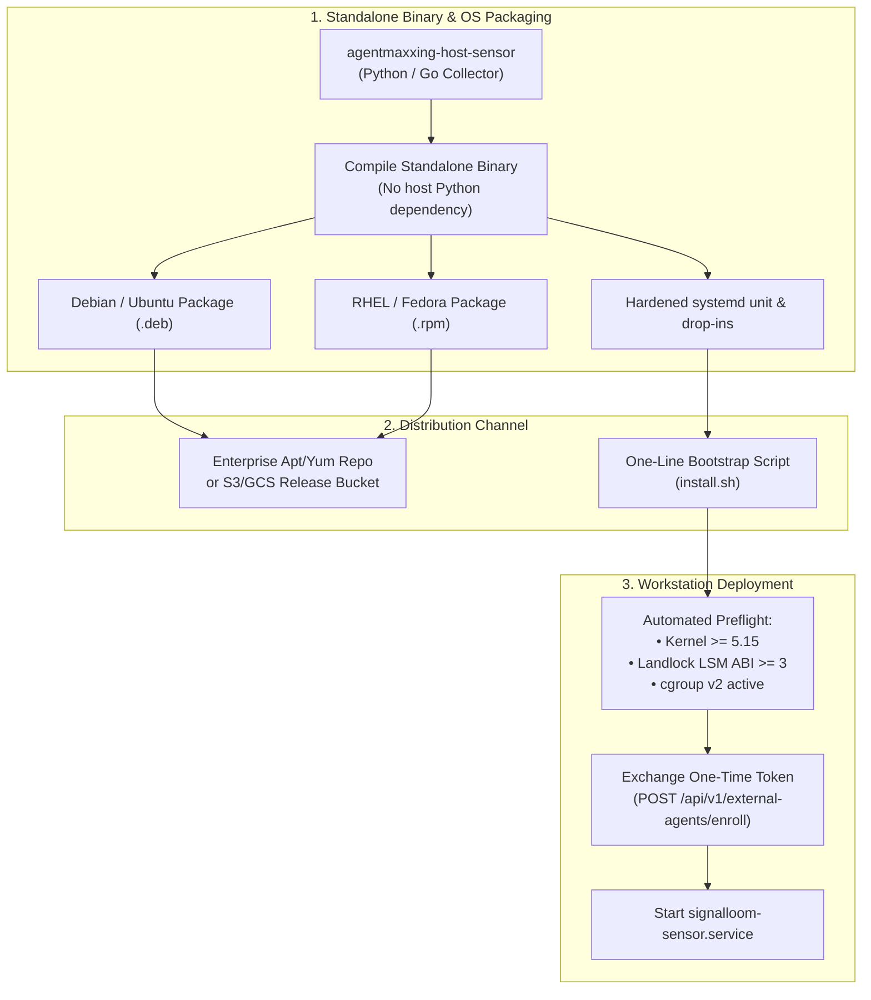

# Signal Loom Workstation Sensor — Architecture, Verification, and Distribution Strategy

> An authoritative reference document detailing the architecture, security invariants, verified test execution, in-flight proposal coverage, and fleet distribution roadmap for the Signal Loom External Host / Workstation Sensor daemon.

> [!important] Context & Test Verification Ground Truth
> - **Component Location**: `d2-signalloom/apps/agentmaxxing-host-sensor/`
> - **Execution Status**: Certified & active in estate (AMXO Phase 6 complete; Alpha tag released).
> - **Test Verification (2026-09-14)**:
>   - `make demo-agentmaxxing-host-test`: **70 passed, 0 failed** (38 unittests, 6 pytests, 11 confinement bats, 9 anti-escape bats, 6 TOCTOU hasher bats).
>   - `make demo-agentmaxxing-acceptance-test`: **6/6 passed** (complete deterministic onboarding-to-removal lifecycle).

---

## 1. Executive Summary

The **Workstation Sensor** extends Signal Loom’s identity, confinement, and audit spine beyond Kubernetes clusters directly onto external developer laptops and remote Linux hosts.

As software engineering organizations adopt autonomous coding agents (Claude Code, Antigravity CLI, OpenAI Codex CLI, CPAI Engineer, Aider), platform leaders face a critical dilemma:
1. **Network-only and proxy monitoring** fails because traffic is end-to-end encrypted (TLS) and cannot inspect process ancestry or local filesystem interactions without intrusive MITM interception.
2. **In-band MCP handshakes or proxies** create severe friction, break local builds, and face fierce developer resistance.
3. **Enterprise security and legal policies** reject developer monitoring tools that harvest proprietary source code, user prompt text, or credential secrets.

Signal Loom resolves this through a **strictly confined, descriptor-relative, zero-customer-payload host sensor** coupled with an atomic one-time enrollment lifecycle.

---

## 2. Sensor Architecture & Security Invariants

The sensor daemon executes directly on partner Linux host infrastructure under multi-layered kernel and process isolation:

```
[Developer Node / External Host]               [Signal Loom Governance Platform]
┌────────────────────────────────────────┐     ┌────────────────────────────┐
│ Autonomous Agent (Claude, Agy, Codex) │     │ fe-signalloom Backend      │
│   │                                    │     │   │                        │
│   ▼                                    │     │   ▼                        │
│ Host Sensor Daemon                     │     │ Operator Enrollment Token  │
│   ├── Linux Landlock LSM (ABI v3/v9)   │     │   │ (POST /register, 24h)  │
│   ├── systemd Hardening Directives     │     │   ▼                        │
│   ├── openat2 Anti-Escape Validator    │────►│ One-Time Host Exchange     │
│   ├── Bounded TOCTOU Hasher            │mTLS │   │ (POST /enroll)         │
│   └── Detective procfs / Socket Engine │     │   ▼                        │
│                                        │     │ Audit Ingestion & Timeline │
│ Strict Zero-Customer-Payload Invariant │     │   │ (POST /audit/sessions) │
│ (NO Source Code, NO Prompt Text)       │     │   ▼                        │
│                                        │     │ Cryptographic Verification │
└────────────────────────────────────────┘     └────────────────────────────┘
```

### 2.1 Multi-Layered Confinement Stack

1. **Linux Landlock LSM Confinement (`profile.json`)**:
   - Supervised under `nono` (v0.73.0 / v0.3.0).
   - Enforces kernel-level default-deny rules on filesystem write paths outside designated workspaces (`/var/lib/agentmaxxing/work`).
   - Default-deny network egress policy with allowlisted endpoints (`signal-ingest.signalloom.controlplane.io:443`).
   - Automated environment stripping of credential secrets (`AWS_*`, `SSH_*`, `GITHUB_*`, `KUBECONFIG`, `VAULT_TOKEN`).

2. **Systemd Unit Hardening (`agentmaxxing-agent.service`)**:
   - `NoNewPrivileges=yes`: Prevents SUID/SGID elevation.
   - `ProtectSystem=strict` and `ProtectHome=yes`: Sandboxes root filesystems and user directories.
   - `PrivateTmp=yes`, `PrivateDevices=yes`, `RestrictSUIDSGID=yes`, `MemoryDenyWriteExecute=yes`.
   - Cgroup v2 resource limits: `MemoryMax=512M`, `TasksMax=64`, `CPUQuota=200%`.

3. **Binary Digest Preflight Gate (`scripts/digest_gate.sh`)**:
   - Asserts kernel Landlock LSM support.
   - Verifies pinned SHA-256 digest of the `nono` supervisor binary.
   - Verifies pinned SHA-256 digest of the agent binary before execution; fails closed on modification.

### 2.2 Anti-Escape & TOCTOU Verification

- **Descriptor-Relative Anti-Escape (`file_validator.py`, `openat2.py`)**: Candidate files are opened exclusively through pinned directory descriptors via `openat2(2)` with `RESOLVE_BENEATH | RESOLVE_NO_SYMLINKS | RESOLVE_NO_XDEV`. Rejects symlinks, hardlinks (`nlink > 1`), directory traversal (`..`), and mount crossings with zero bytes read.
- **TOCTOU Pre/Post-Read Validation (`hasher.py`)**: Captures baseline inode, mount ID, size, and modification timestamps via `fstat` and `statx`. Any concurrent mutation during hashing invalidates the digest with reason code `toctou_mutation_detected`.

### 2.3 The Zero-Customer-Payload Invariant

- **Strictly Collected**: Process lifecycle (`comm`, PID, PPID, health state, CPU time ms, RSS memory bytes, exit code, restart count), artifact metadata (root, size, mtime, SHA-256 digest), and egress socket destinations.
- **Strictly Banned**: Zero `/proc/<pid>/mem`, `/proc/<pid>/environ`, or `/proc/<pid>/cmdline` parsing; zero source code contents; zero prompt text; zero model generations.

---

## 3. Verified Test Execution Evidence

Full verification was executed and confirmed on **2026-09-14**:

### 3.1 Host Confinement & Unit Suites (`make demo-agentmaxxing-host-test`)
- **Python Unittests** (`d2-signalloom/apps/agentmaxxing-host-sensor/`): **38 passed** in 0.68s.
- **Pytest Audit & Conformance** (`fe-signalloom` integration): **6 passed**, 31 deselected.
  - `test_nono_profile_conformance`: PASSED
  - `test_nono_profile_fail_closed`: PASSED
  - `test_process_metadata`: PASSED
  - `test_anti_escape_descriptor_relative_validation`: PASSED
  - `test_toctou_artifact_rejection_and_unobserved_classification`: PASSED
  - `test_toctou_sensor_hasher_integration`: PASSED
- **BATS Confinement Probes** (`agentmaxxing-host-confinement.bats`): **11 passed** (real Landlock LSM probes, binary digest checks, profile validation).
- **BATS Anti-Escape Probes** (`file-validator-anti-escape.bats`): **9 passed** (symlink, hardlink, FIFO, traversal escapes).
- **BATS Hasher Probes** (`hasher-toctou.bats`): **6 passed** (rate limits, oversize files, path traversal).
- **Total**: **70 tests, 0 failures**.

### 3.2 End-to-End Acceptance Journey (`make demo-agentmaxxing-acceptance-test`)
- **Phase 1**: Attributable operator registration & one-time enrollment token issuance — `PASSED`
- **Phase 2**: Host enrollment key exchange & single-use atomic token enforcement — `PASSED`
- **Phase 3**: Audit session telemetry upload & hash-chain validation — `PASSED`
- **Phase 4**: Denial falsification on tampered hash chain, sequence gap, and conflicting payload — `PASSED`
- **Phase 5**: Independent host revocation & subsequent upload denial (`403 Forbidden`) — `PASSED`
- **Phase 6**: Complete end-to-end lifecycle journey — `PASSED`
- **Total**: **6 phases, 0 failures**.

---

## 4. In-Flight Proposals: Coverage & Gap Analysis

| Proposal | Scope & Focus | Sensor Coverage | Distribution Coverage |
| :--- | :--- | :--- | :--- |
| **`AMXO`**<br/>(User & Host Onboarding) | Host enrollment, Landlock profile, systemd unit, baseline telemetry. | **BUILT & CERTIFIED** (Phases 0–6 complete; Alpha released). | Manual file copy & systemd placement. No automated OS packages. |
| **`SLCD`**<br/>(Coding Agent Detective Telemetry) | Passive discovery of developer coding harnesses (Claude Code, Antigravity, Codex, CPAI). | **PROPOSED / APPROVED FOR BUILD.** Extends sensor with procfs tree inspection, kanban loop watcher, disk transcript metadata, and inference socket detection. | **NOT COVERED.** Assumes sensor daemon is already installed on the host. |
| **`SLER`**<br/>(Enforcement & Response) | Multi-plane containment and kill switch. | **PROPOSED / APPROVED FOR BUILD.** Adds cgroup freezer (`cgroup.freeze`) to halt rogue processes on host. | **NOT COVERED.** Focuses on containment protocols. |
| **`AMXD`**<br/>(Interactive Demo Console) | Web-based stepping simulator for executive demos. | **PROPOSED / APPROVED FOR BUILD.** Visualizes enrollment and telemetry in UI. | **NOT COVERED.** Pure frontend/browser layer. |

> [!warning] The Strategic Distribution Gap
> The existing proposals solve **what the sensor observes** (`SLCD`), **how the sensor confines and halts** (`AMXO`/`SLER`), and **how the results are demonstrated** (`AMXD`).
> **None of the proposals currently build the fleet packaging, installer, and distribution pipeline.** This is Open Decision #6 in the master architecture.

---

## 5. Fleet Distribution Strategy & Roadmap

To deploy the sensor across an enterprise developer fleet (500+ machines), the following distribution pipeline must be built:



### 5.1 Standalone Binary Packaging
- **Current Limitation**: Requires Python 3.10+ and pip packages on developer machines.
- **Solution**: Compile into a single, static binary (`signalloom-sensor`) via PyInstaller/Nuitka or rewrite the collector core in Go.
- **Binary Footprint**: Target <25 MB binary, <1.0% CPU overhead, <25 MB RSS memory.

### 5.2 Enterprise Linux Packages (`.deb` / `.rpm`)
- Package `/usr/bin/signalloom-sensor`, `/etc/systemd/system/signalloom-sensor.service`, and default `/etc/signalloom/sensor.env`.
- Post-install script executes `systemctl daemon-reload` and sets up `agentmaxxing-sensor` system user.

### 5.3 One-Line Idempotent Bootstrap (`install.sh`)
```bash
curl -fsSL https://get.signalloom.controlplane.io | sudo bash -s -- \
  --endpoint https://dashboard.osramp.acme.local \
  --token amxo_enroll_sec_98f43b12390abcf
```
- Performs kernel Landlock and cgroup v2 preflight verification.
- Redeems the one-time enrollment token with Signal Loom backend.
- Writes scoped JWT to `/etc/signalloom/sensor.env`.
- Enables and starts `signalloom-sensor.service`.

### 5.4 The MacOS Developer Bridge (Darwin Strategy)
- Linux Landlock LSM and cgroups v2 do not exist on macOS (Darwin).
- For macOS developers, implement the **detective-only sensor** (from `SLCD`):
  - Uses `sysctl` / `libproc` for process discovery and transcript watchers (`~/.claude/`, `~/.gemini/antigravity-cli/`).
  - Packaged via Homebrew: `brew install controlplane/tap/signalloom-sensor` running as a `launchd` user service.

---

## 6. Immediate Action Items

1. **Immediate Verification (Available Now)**:
   - Run `make demo-agentmaxxing-host-test` and `make demo-agentmaxxing-acceptance-test`.
   - Test the local CLI on active workstation processes:
     `python3 -m agentmaxxing_host_sensor inspect --pid $`
2. **Prioritize Packaging Deliverable**:
   - Scope a dedicated packaging task (or include in `SLCD` Milestone 6) to deliver the standalone compiled binary, `.deb`/`.rpm` packages, and `install.sh` bootstrap script.
3. **Align with Executive Team**:
   - Review Open Decision #6 with Lucas (CEO) to determine whether enterprise Linux developer fleets or macOS Homebrew support is the initial commercial priority.

---
*Maintained by Andy Martin (CTO). All test commands and evidence directly reproducible in the `osramp-demo` repository.*
